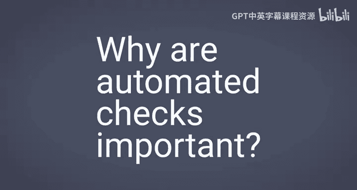

# 鹿特丹伊拉斯姆斯大学《专业人士的 Excel 建模：最佳实践与陷阱｜Excel Modeling for Professionals》中英字幕 - P17：16_专家视频：模型校验与验证方法.zh_en - GPT中英字幕课程资源 - BV1DbeNzqEbf

🎼Hi I'm Liam Basttic， I've run a company some product。

 we're based in Australia but we're everywhere we have a lot of stuff on our website， some product。

com and it's all free。Well right at the beginning， I've just been doing a session on checks there's different types of checking you do in a model。

 There's what I call a selfre of which forms into those where it's a manual assessment of does it look like it's working which I call validating or you've got the actual automated checks which break down into things like error checks。

 Is there something wrong in here have I got primer face errors like and hash do0 hash brownh pipe。

 maybe I' mixed of those up then you've got what I call sensitivity or scenario checks which am I working in the base case because there's war stories out there where people have built brilliant models but forgotten to put the numbers back into the base case because they've been doing what if analysis and then you've got other things where the model appears to be working fine you're in the base case。

 but warning warning if you do this project you're gonna go bust。

So I think checking and testing can be interchangeable to my mind。

 what you're doing here is you're actually making sure that numbers reconcile so if you've broken down a cost into five constient parts。

 make sure that it adds back up to the same thing that will be a check or a test。

A validation for me is a tickback of numbers so it's lookinging back to a source to make sure we put the right numbers in there's no transposition these sorts of things can be done by anybody and so we often have what we call a selfre now a selfre isn't necessarily the person that built it but someone who is seen not to be independent or objective from that then you've got an audit which is test performed by a third party who is independent of this and we' have a whole load of prescribed tests that they will do on that using automated software and have experience。

The problem always with a selfre in that side when it's just me doing it is that I'll never spot errors in my own logic you can't you just think well you know if you think seven times 80 is 63 you'll always think seven times 80 63 and you you're not any reason to check it where somebody else come with another pair of eyes and spot that so obviously up to a point having more people look at it makes sense but there does come a point when I mix all my metaphors up that too many cooks do spoil the broth。

Oh， they're very useful for two reasons。 One， you can put lots and lots of checks in an actual model。

 So the models we sort to build， I would say a typical model we build will have anywhere between five and 800 checks in it。

 you won't look at them all because you'll have an overall one that will actually summarize them。

 you put these in， you summarize them， you list them all that on a page， if it works fine。

 you put a zero， if there's an error， you put a one。 you go through if the value is one or greater。

 you put a one in your total and you'll know there's an issue。

 if you see that there's lots and lots of errors on a sheet。

 if you're the third party receiving this and you can see there's 800 checks in there and it says it's all fine。

 you start to trust that model more just naturally。

 So definitely having automated checks in there at the beginning， just makes life so much easier。

People overestimate their ability in Excel and try and show off and use a long complex function One of the things I've seen in the past is using what I call the rule of thumb。

 which I know one of my competitor companies now uses as well as they go through but the idea is that no formula in the formula bar should be longer than your thumb If you keep it simple you you fall back on one of the four axioms as I call it which is transparency。

Let's be honest。 a model is there， as I've said before， to justify somebody else's gut feel。

 If it doesn't give the answer they're looking for。

 then keep going to it till they get what they want。 That's just the way the world works。

🎼How are they going to figure out if it makes sense though。

 can you really follow a model just by looking at it on a piece of paper without looking at the formula bar if you step it out so you've got rule of the thumb you should be able to follow it and then modeling becomes a team game。

