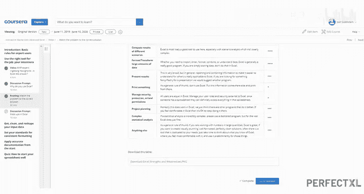
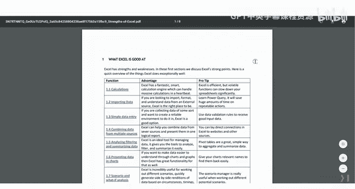

# 鹿特丹伊拉斯姆斯大学《专业人士的 Excel 建模：最佳实践与陷阱｜Excel Modeling for Professionals》中英字幕 - P1：0_Excel专业课程导论.zh_en - GPT中英字幕课程资源 - BV1DbeNzqEbf

Hi， my name is Janm Stpe。 welcomecom to this Excel course。

 I'm going to walk you through the structure and goals of the course。😊。

Each week you will have an introductory video， a few lessons。

 and then an assignment to test your knowledge against the learning goals。

Each lesson will have a video with an Excel expert， a discussion prompt to keep you engaged。

 and a reading with the core content。Each reading will be split into sections。

 and each section has a table or introduction to let you know what will be in the download。

The downloads are full of information， but we understand that it can be a bit too much。

Make sure to use the tables to guide you to the information that is most relevant for you。

Learning isn't static anymore， it's dynamic， and it needs to work for you。

Follow the course in the way that suits you best。Take your time and enjoy the process。

Using Excel better can only be seen as a good thing。

