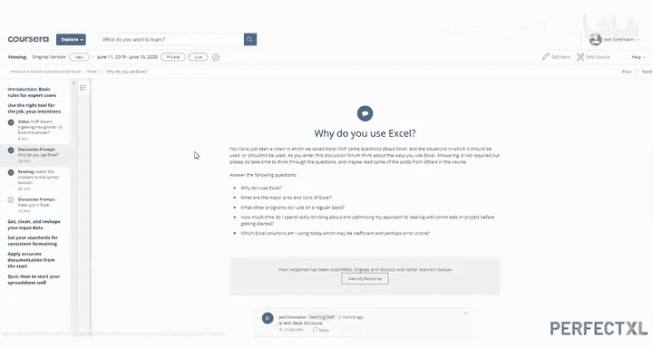
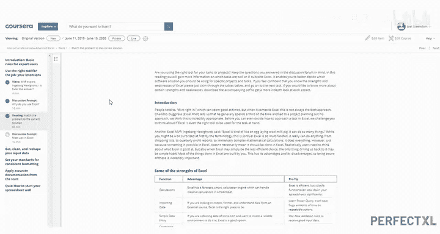
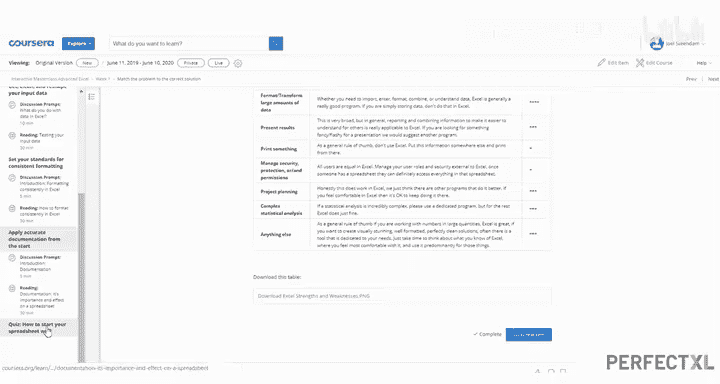

# 鹿特丹伊拉斯姆斯大学《专业人士的 Excel 建模：最佳实践与陷阱｜Excel Modeling for Professionals》中英字幕 - P6：5_核心要点回顾：Excel基础与函数公式入门.zh_en - GPT中英字幕课程资源 - BV1DbeNzqEbf

Hello and welcome to this very first recap and look For video。In these videos。

 I will be summarizing each week's content and introducing the next week。First off。

 let me quickly introduce myself。My name is Jan Stpe and I'm an associateiate professoror of Beal economics at the Erasmus School of Economics。

I do experiments on social behavior in the lab and in the field。ExcL is invaluable。

 but using it well is essential。That's why in this first week we talked about intentions。

Why you decide to use Excel in the first place and what you are using it for？

Input data。

The source material for any spreadsheet， which has to be taken care of and correct。Foratting。

 how do we structure our spreadsheet as we start to build it up？And documentation。

 how we go about making sure an Excel document is understandable for others as well。

Often， you are not the only one working with an Excel sheet。

Using clear documentation saves a lot of time for your classmates or colleagues on joint projects。

Following that trend， next week we will talking about the lifeblood of Excel， the formulas。

We will be seeing some interviews with world renowned Excel users， such as Osdu Sole。

 who you have seen before from Portland， as he talks about some of the pitfalls of commonly used functions and formulas。

Also Charles Williams from England， as he talks about some of the functions and formulas that can really text Excel's calculation engine and cause certain spreadsheets to run slower and Liilla Garrani。

 as she tells us about some of the best practices for good use as it relates to functions and formulas mastering functions and formulas is synonymous to mastering Excel。

That is what we will help you do。I will be back next week to catch you up。For now。

 I invite you to dive right in。Don't be afraid to ask questions of your instructor， peers。

 and colleagues。Excel is something that is best learned together， enjoy and good luck。

