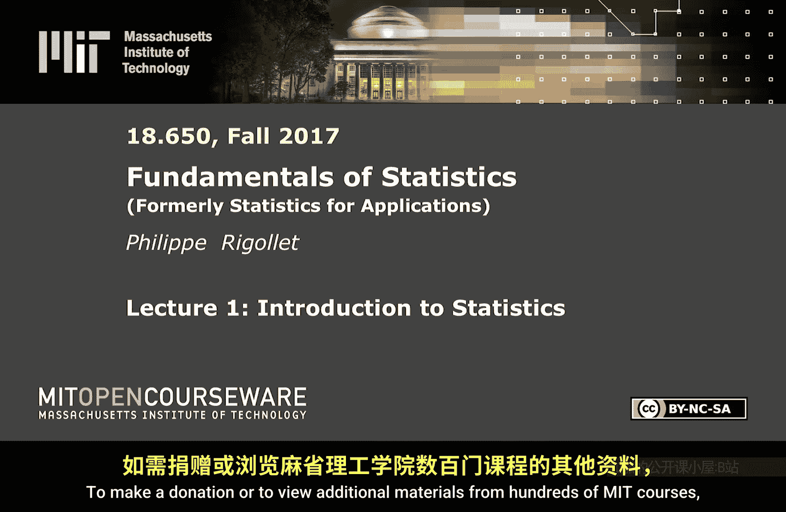
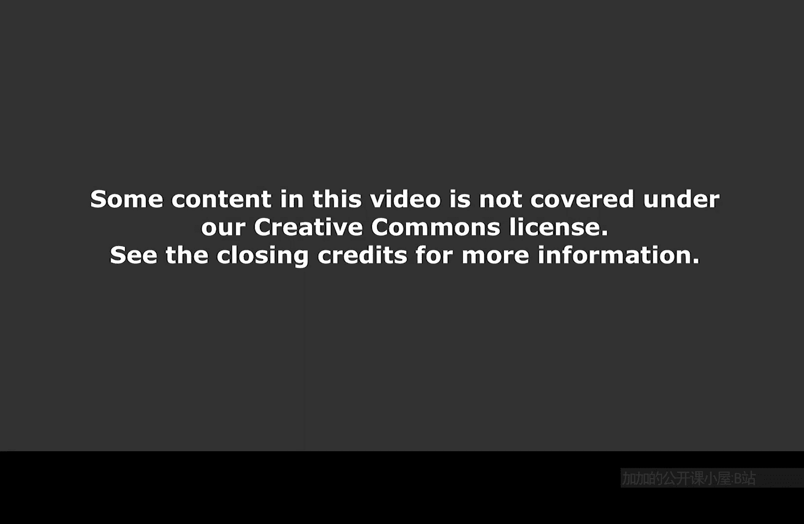
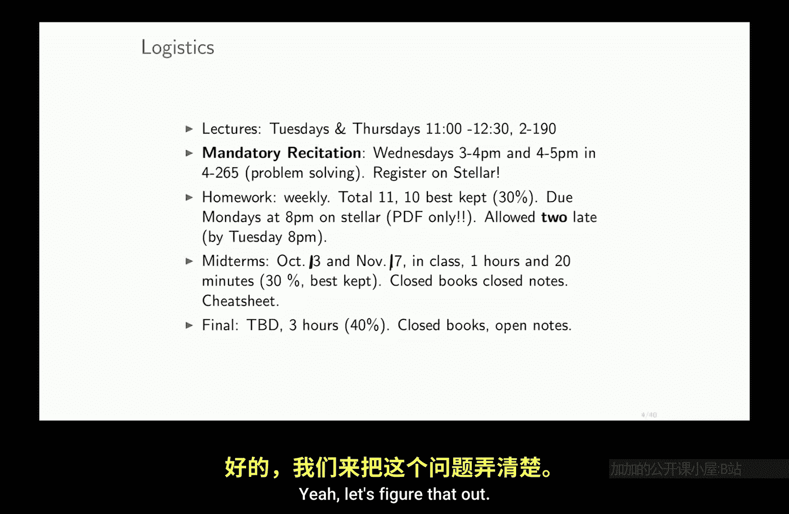

# 麻省理工学院【中英⚡应用统计学｜18.650-2016-Statistics-for-Applications】-p01-P1-1Introduction-to-Statistics-mkv--BV1hck9B6EpM_p1-

The following content is provided under a Creative Commons license。

 Your support will help Mi T OpenCoursewareare continue to offer high quality educational resources for free to make a donation or to view additional materials from hundreds of MiT courses。

 Visit Mit Opencourseseware at O Cw Mt Eduu。

Okay， so the course you're currently sitting in is 18650 and it's called Fundaments of Staistics。

 And until last spring it was still called Staistic for App。

 And it turned out that really based on the content fundamentals of statistics was a more appropriate title So I'll tell you a little bit about what we're gonna to be covering in class what this classes about what it's not about there's several like I realize there's several offerings and statistics on campus。

 So I want to make sure that you've chosen the right one。 I also understand that' for some of you。

 it's a matter of scheduling。I need to actually throw out a disclaimer。 I， I tend to speak too fast。

 I'm aware of that。 You know， someone in the back just do it like that when you have no idea what I'm saying。

 Hopefully will repeat myself many times。 So if you average over time， you will see that statistics。

 we will tell you that you will get the right message that I was actually trying to to send。

All right， so what are the goals of this class So the first one is basically to give you an introduction no one here is expected to have seen statistics before。

 but as you will see， you're expected to have seen probability and usually you do see some statistics in a probability course so I'm sure some of you have some ideas but I won't expect anything and we'll be using mathematics right it's a math class so there's gonna be a bunch of equations not so much real data and statistical thinking。

 we're going to try to provide the article guarantees if I have two estimators that are available for me how theory guides me to choose between the best of them how certain can I be of my guarantees or prediction。

 it's one thing to just bid out a number it's another thing to put some error bars around this so we'll see how to build error bars for example。

And you know you will have your own applications I'm happy to answer questions about specific applications but rather than trying to tailor applications to an entire institute。

 I think we're going to work with pretty standard applications mostly you know not very serious ones and hopefully you'll be able to take the main principles back with you and apply them to your particular problem so what I'm hoping that you will get out of this class is that when you have a real life situation and by real life。

 I mean mostly at MIT so some people probably would not call that real life the goal is to formula a statistical problem in mathematical terms if I want to say is a drug effective that's not in mathematical terms。

 I have to find out which measure I want to have to call it effective I want to maybe it's over a certain period of time maybe it's so there's a lot of things that you actually need and I'm not really going to tell you how to go from the application to the point you need to be。

But I will certainly describe to you what point at。

 what point you need to be at if you want to start applying statistical methodology。

Then once you understand what kind of question you want to answer， Do I want a yes， no answer。

 Do I want a number， Do I want error bars， Do I want to make predictions five years in the future。

 Do I have site information or do I not have side information all these things based on that。

 hopefully， you will have a catalog of statistical methods that you're gonna be able to use and and。

 and and you know， apply in the wall and also， you know。Not no statistical method is perfect。

 Some of them have people have agreed upon over the years and people understand that this is the standard。

 but I want you to be able to understand what the limitations are。

 And when you make conclusions based on data that those conclusions might be erroneous， for example。

 All right more practically， my goal here is to have you ready， So who has taken， for example。

 a machine learning class here。Right so many of you actually is maybe a third。

 have taken a machine learning class。 The goal here will be to take you。

 So statistics has somewhat evolved into machine learning in recent years。

 and my goal is to take you there。 So machine learning has a strong algorithmic component。

 So maybe some of you have taken a machine learning class that displays mostly the algorithmic component。

 but there is also a statistical component to machine learns from data。

 and hopefully so this statistical track and there are some statistical learning which are statistical machine learning classes that you can take here。

 So they're offered at the graduate level， I believe， But once you take those classes。

 I want you to be ready to be able to take those classes having the statistical fundamentals to understand what you're doing and then you're gonna be able to you know expand to broader and more sophisticated methods。

So lectures are here from 11 to 1230s on Tuesday and Thursday Victor Emma Manuel will also be and you can call them Victor will also be holding mandatory recitation so please go on stellar and pick your recitation it's either three to four or four to five on Wednesdays and it's gonna to be mostly focused on problem solving they're mandatory in the sense that well we we're allowed to do this but' they're not going to cover entirely new material but they might cover some techniques that might save you some time when it comes to the exam so you know you might get by so you know attendance is not going to be taken or anything like this。

 but I highly recommend that you go because well they're mandatory so you cannot really complain that something was taught only in recitation so please register on stellar for which of the two recitations you would like to be in they're capped at four。

So first come， first serve。So homework will be due weekly。

 There's a total of 11 problems sets I realize this is a lot。 Hopefully， we'll keep them light。

I just want you to， you know， not rust too much。 The 10 best will be kept。

 and this will count for a total of 30% of the final grade。They were due Mondays at 8 PM on stellar。

 And so this is a new thing。 I'm not， we're not gonna to use the boxes outside of the math department。

 We're gonna use only P D F files， so。Well， you're always welcome to type them and practice your latex or word typing。

 I also understand that this can be a bit of a strain to just you know write them down on a piece of paper。

 use your iPhone and take a picture of it Dropbox as a nice new so try to find something that puts a lot of contrast especially if you use pencil because we're gonna check if they're read readable and this is your responsibility to have a readable file in particular So I've had over the years。

 not at MITMS admit， but I've had students who actually write a doc file and think that converting it to a Pf consistent erasing the extension DC and replacing it by Pf。

 this is not how it works。And。So I'm sure you will figure it out。

 Please try to keep them letter size。 This is not a strict requirement。

 but I don't want to see thumbils either。You were allowed to have two late homeworks。 And by late。

 I mean，24 hours late。 Okay， no questions asked。 you submit them。 This will be counted。

 You don't have to send an email or warrant us or anything like this。嗯。Beyond that， it's gonna be。

 given that you have one slack for 1，0 grade and the slack for two late homeworks。

 you're gonna have to come up with very good explanation why you need actually more extensions than that if you ever do。

 in particular， you're gonna have to keep track about why you've used your three options before。

There's gonna be two midterms。 One is October 3 and one is November 7。

 They're both going to be in class for duration of the lecture。

 When I say they last for an hour and 20 minutes， it does not mean that if you arrive 10 minutes before the end of lecture。

 you still get an hour and 20 minutes， it will end at the lecture at the end of lecture time。

For this as well， no pressure， only the best of the two will be kept。

 and this will disparate will count for 30% of the great。This will be closed books and closed notes。

 So the purpose is for you to， yes。2。the best of the two will be kept。

 I say the best of the two will be kept， yes。Support during the terms。The best of the two。

 not the best two。嗯。We will add them multiply the number by 9。 and that will be your。 No。

 so I am trying to be nice。 There's just a limit。 which what I can do。 Allright。

 so this will be the goal is for you to learn things and to be familiar with them in the in the final。

 you will be allowed to have your notes with you。 But I want you the midterms are also way for you to develop some mechanism so that you don't actually waste too much time on things that you should be able to do without thinking too much。

 you will be allowed a cheat sheets because well， you know， you can always forget something。

 And you will will be too side letter sheet and you can you can practice yourself as writing as small as you want。

 And you can put whatever you want on the cheat sheet。😊，Alright。

 the final will be decided by the register。 It's gonna be three hours， and it's gonna count for 40%。

 You cannot bring books， but you can bring your notes， yes。They're not。Oh， yeah。

 there's the one that's missing on both of them， isn't there。呃，呀呃。

