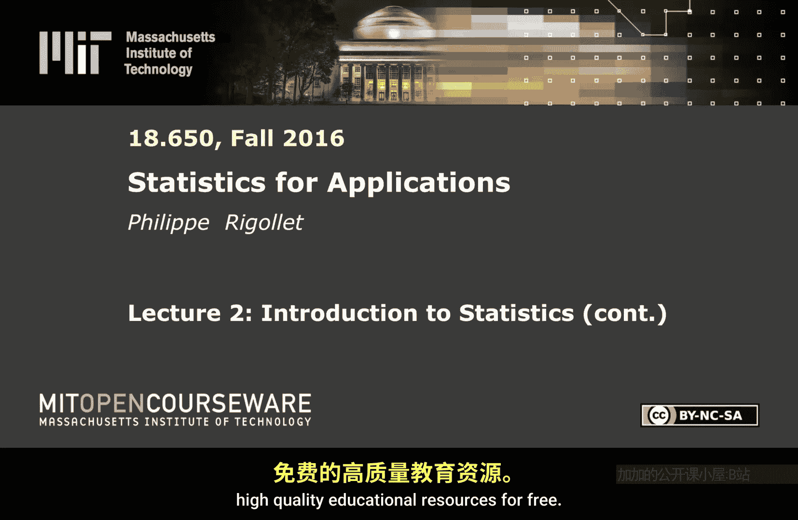
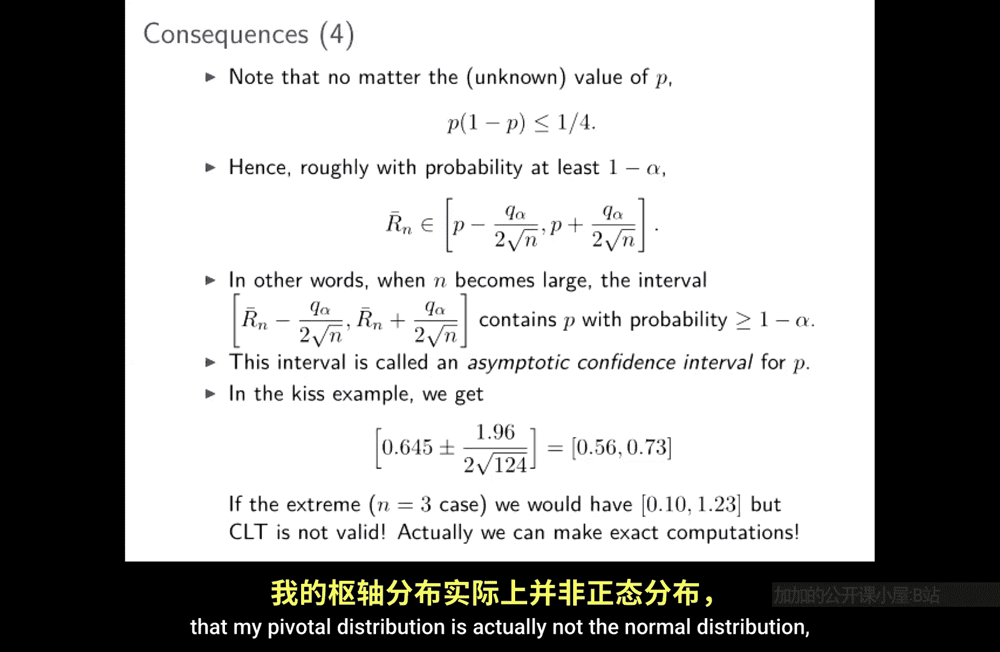

# 麻省理工学院【中英⚡应用统计学｜18.650-2016-Statistics-for-Applications】-p02-P2-2Introduction-to-Statistics-(cont)-mkv--BV1hck9B6EpM_p2-

The following content is provided under a Cative Commons license。

 Your support will help Mi T OpenCourseware continue to offer high quality educational resources for free to make a donation or to view additional materials from hundreds of Mit courses。

 Visit Mitopcourseseware at Ocw。 Mt Eduu。

Quentiles of our limiting distribution， which happened to be Gaussian。

 But if the central limit theorem told us that the limiting distribution of some average was something that looked like a Poisson or an exponential。

 then we would just have in the same way， taking thequiiles of the exponential distribution。

 So let's go back to what we had。So， generically。If you have a。They set up observations， X12 XN。

So remember for the kiss example， they were denoted by R1 to RN because they were turning the head to the right。

 but let's just go back。You see x1 to xn。And in this case， I'm going to assume their IID。

And I'm going to make them burnly。We parameter P and P is unknown， right？So what did we do from here。

 Well， we said P。Is the expectation of XI and actually we didn't even think about it too much we said。

 well， if I need to estimate the proportion of people who turn their head to the right when they kiss I just basically I'm going to compute the average so our P hat was just XN bar。

Which was just one of her end。Some from I equal12 n of the X， right。

 the average of the observations was their estimate。

And then we wanted to build some confidence intervals around this。

 So what we wanted to understand is how much does this P hatt fluctuates。

Right this is a random variable， it's an average of random variable， it's a random variable。

 so we want to know what a distribution is and if we know what the distribution is。

 then we actually know well where it fluctuates what the expectation is around which value it tends to fluctuate。

 et ceter。And so what the central limit theorem told us was if I take。Scrit of end time。

Xn bar minus P， which is its average， and then I divide it by the standard deviation。

Then this thing here converges。As n goes to infinity。

 and we will say a little bit more about what it means in distribution to some standard。

Normal random variable， right， so that was the central limit theem。

So what it means is that when I think of this as a random variable。When n is large enough。

It's going to look like this。And so I understand perfectly its fluctuations。

 I know that this thing here has， I know the probability of being in this zone。

 I know that this number here is0。 I know a bunch of things。And then in particular。

 what I was interested in。Was that the probability。

That's the absolute value of a Gaussian random variable exceeds。Q up over two。Q alphapha。Over two。

 we said that this was equal to what？Anybody。What was that。Alpha， right。

 so that's the probability that my random variable。So this is by definition， Q alpha over  two。

Is the number such that to the right of it is alpha over 2。

And this is a negativeq alpha over 2 by symmetry。And so the probability that I exceeds， well。

 it's not very symmetric， but the probability that I exceeds this value Q off over two is just the sum of the two。

😊，gray areas， all right？So now I said that this thing was approximately equal due to the central meteorum to the probability that's period root of n。

Xn bar minus p divided by square root p1 minus p。Was。Well， absolute value。

Was larger than Q up over two。Well then this thing by default is actually approximately equal to alpha just because of virtue of the central metheorem。

And then we just said， well， no。So for P。Has anyone attempted to solve the degree2 equation for P in the homework？

Anybody try。Okay， so。So essentially this is going to be an equation in P。

 sometimes we don't want to solve it， some of the P's we replaced by their worst possible value。

 for example， we said one of the tricks we had was that this value here。

 square root of p1 minus p was always less than 12。

And so we could actually get this confidence interval that was larger than all possible confidence intervals for all possible values of P。

 but we could solve for P。We all agree on the principle of what we did。

 So that's how you build conference intervals。 Now。

 let's step back for a second and see what was important in the building of this conference interval。

The really key thing is that I didn't tell you why。I formed this thing， right， we started from x bar。

 and then I took some weird function of x bar depending on P and n。

And the reason is because when I take this sanction。

 the central Ethereorum tells me that it converges to something that I know。

But the very important thing about this something that I know is that it does not depend on anything that I don't know。

For example， if I forgot to divide by square root of P1 minus P。

Then this thing would have had a variance， which is p1 minus p。If I didn't remove this P here。

The mean here would have been affected by P。And there's no table for normal P1。

So the screw n terms come from。 So really you should view this。 So here so you know。

 there's a rule in sort of。Quite rule in method， you don't write a divided by。B over C， right。

 you' right。C times a divided by B because it looks nicer。

 but the way you want to think about this is that this is x bar minus P。Divided by square root of。

P1 minus p divided by n。And the reason is because this is actually the standard deviation of this sorry。

 x bar n。This is actually the standard edition of this guy and the screw event comes from the fact on average。

So。The key thing was that this thing， this limiting distribution。

 did not depend on anything I don't know。And this is actually called a pivotal distribution。

 it's pivotal， I can you know I don't need anything， I don't need to know anything。

 and I can read it in a table。Sometimes there's going to be complicated things。

 but now we have computers， the beauty about Gaussians is that people have studied them to death and you can open any textbook and you will see a table at the end that will tell you for each value of alpha you're interested in。

 will tell you what2 alpha over  two is。But there might be some crazy distributions。

 but as long as they don't depend on anything， we might actually be able to simulate from them and in particular。

 compute what Q up over 2 is for any possible value。

And so that's what we're going to be trying to do。fining pivotal distribution。

 how do we take this XN bar， which is a good estimate and turn it into something which maybe be exactly or syntheticically does not depend on any unknown parameter。

So here's one way we can actually so that's what we did for the kissIS example right。

 and here I mentioned， for example， in the extreme case when n was equal to3。

 we would get a different thing， but here the CLT would not be valid。And what that means is that my。

Pivotal distribution is actually not。

The normal distribution， but it might be something else。And I said， we can make exact computations。

Well let's see what it is， right if I have three observations。So I'm going to have x1。X2。X3， okay。

 so now I take the average of those guys。Okay， so that's my estimate。

How many values can this guy take？Then a little bit of counting。Four values。

 how did you get to that number？Okay so each of these guys can take value 01 right so the number of values that it can take I mean it's a little annoying because then I have to sum them right so basically I have to count the number of ones。

はい。So how many ones can I get， right？Sorry I have to yeah。

 so this is the number of ones that I get Okay， so let's look at them so we get 0，00，001。

 and then I get basically three of them that have just the one in there， right？Okay。

 so there's three of them， how many of them have exactly two ones？sorry，3， right。

So it's just this guy where you placed the heroes into one。

Okay so now I get so here I get three that take the value1， one that get the value 0。

 and then I get3 that take the value 2， and then one that takes the value1。The value old ones， right？

Okay， so everybody knows what I'm missing here is's just the one here where I plays the zeros by one。

Okay， so the number of values that this thing can take is one，2。3捕。

Okay so someone's campaign much faster to them。And and so those numbers。

 you've probably seen them before， right，1，3，3，1， remember， and so essentially those guys。

 it takes only three values， which are either one third。😊，1。Sorry。

