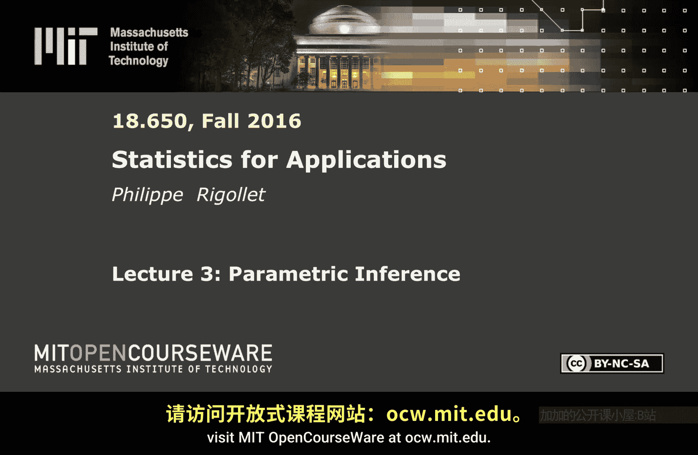
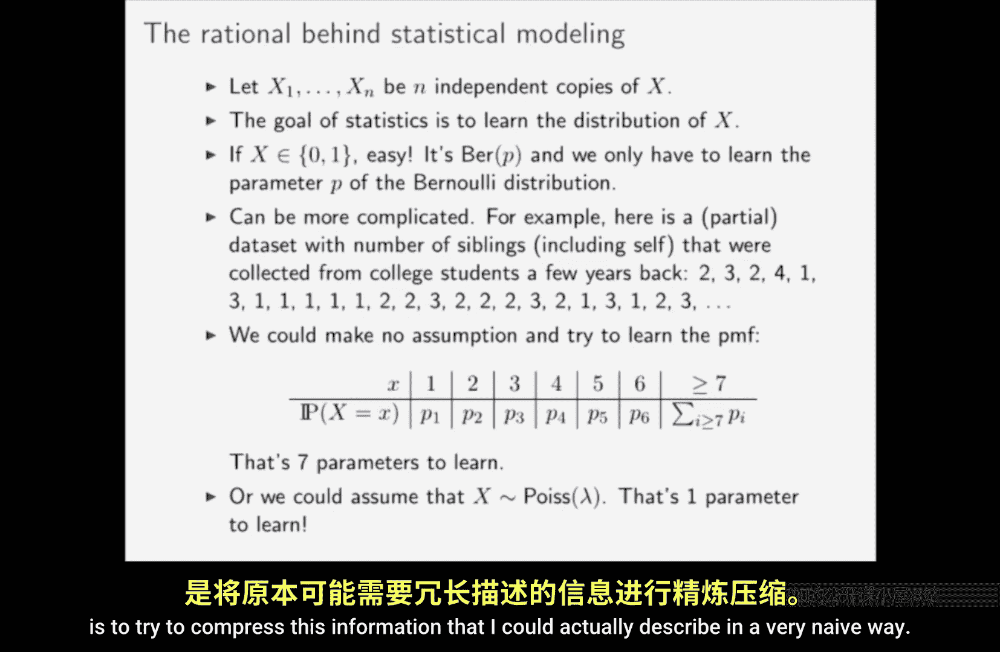

# 麻省理工学院【中英⚡应用统计学｜18.650-2016-Statistics-for-Applications】-p03-P3-3Parametric-Inference-mkv--BV1hck9B6EpM_p3-

The following content is provided under a C Commons license。

 Your support will help Mi T OpenCourseware continue to offer high quality educational resources for free to make a donation or to view additional materials from hundreds of Mit courses。

 Visit Mitopcourseseware at Ocw Mt Eduu。

Doesn't run flash players， so I had to run them on on the。Chrome。Allright。

 so let's move on to our second chapter and hopefully in this chapter you will feel a little better if you felt like it was going a bit fast in the first chapter and the main reason why actually when fast especially in terms of conference interval some of you came in asked me what do you mean by this is a conference interval what does it mean that it's not happening in there with probability 95% etc I just went really fast so that you could see why I didn't want to give you a first week doing probability only and without understanding what the statistical context for it was right so hopefully all these things that we've done in terms of probability you actually know why we've been doing them and so we're basically going to go back to what we're doing maybe start with some statistical setup but the goal of this lecture is really going to go back again to what we've seen from a purely statistical perspective All right？

So。The first thing we're going to do is explain why we're doing statistical modeling。So in practice。

 if you have data， if you observe a bunch of points and here I gave you some numbers， for example。

 so here's a partial data set with a number of siblings including self that were collected from college students a few years back so I was teaching a class like yours and I actually ask students to go and fill out some Google form and tell me a bunch of things and one of the questions was including yourself how many siblings you have and so they gave me this list of numbers and and there's many ways I can think of this list of numbers I could think of it as being just a discrete distribution on the set of numbers between one。

 I mean I know there's not going to be an answer which is less than one unless well someone doesn't understand a question but all the answers I should get are positive integers。

 one， to three etc， and you know there probably is an upper bound but I don't know it on the top of my head so maybe I should say 100 maybe I should say 15 depends right。

So I think the largest number I got for this was six。All right， so。

Here you can see you have pretty standard families， you know， lots of ones， twos and threes。Okay。

 so the way what statistical modeling is doing is to try to compress this information that I could actually describe in a very naive way。

 So let's start with the basic。

A unusual statistical setup， right， So I will start many of the board that look like。Egg1。

Egg and random variabless。And what I'm going to assume， as we said， typically is that those guys are。

IIe。And they have some distribution， so they all share the same distribution And the fact that their are Id is so that I can actually do statistics。

 Staistics means， you know， looking at the global averaging thing so that I can actually get a sense of what global behavior is for the population right If I start assuming that those things are not identically distributed。

 they all live on their own right that my sequence of number is。Your number of siblings。

 the shoes eyes of this person， the depth of the Charles River。

 And I start measuring a bunch of stuff。 There's nothing I'm gonna actually get together。

 I need to have something that's cohesive。And so here I collected some data that was cohesive。

 And so the goal here the first thing is to say， what is the distribution that I actually have here。

 right？So I could actually be very general。 I could just say。It's some distribution peak。

 and let's say they are random variables， not random vectors。

 where they could collect entire vectors about students。

 but let's say those are just random variables。And so now I can start making assumptions on this distribution P。

 right， What can I say about a distribution， Well， maybe if those numbers are continuous。

 for example， I could assume they have a density， right， a probability density function。

That's already an assumption。 Maybe I could start to assume that your probability density function is smooth。

 That's another assumption。Maybe I could actually assume that it's pieceway constant。

 That's even better， right， And those things make my life simpler and simpler because what I do by making the success successive assumptions is reducing the degrees of freedom of the space in which I'm actually searching the distribution。

😊，And so what we actually want is to have something which is small enough so we can actually have some averaging going on。

But we also want something which is big enough that it can actually express。

 It has chances of actually containing a distribution that makes sense for us。

So let's start with the simplest possible example， which is when the X's。Belong to01。

And as I said here， we don't have a choice， the distribution of those guys has to be。Bnon away。

And since they IDd， they all share the same P。So that's definitely the simplest possible thing I could think of。

 they're just burnly pe。Okay， and so all I would have to figure out in this case is。P。And you know。

 this is the simplest case。 and unsurprisingly， it has the simplest answer， right。

 We will come back to this example when we study maximum likelihood estimators or method of。

 estimators by the method of moments。 But at the end of the day。The things that we did。

 the things that we will do are always the naiveest comm you would come up with is what is the proportion of one？

And this will be in pretty much all respects。The best estimator you can think of。All right。

 so then we're going to try to assess this performance and we saw how to do that in the first chapter as well。

So this problem here somehow is completely understood， we'll come back to it。

 but there's nothing fancy that's going to happen。But now I could have some more complicated things right。

 So for example， in the example of the students now， my Xs。Belong to the sequence of integers，  one。

 two，3， etc ce。Okay， which is also denoted by n。Maybe without zero。

 if you want to put zero in n right so the positive integers。

Or I could actually just maybe put some prior knowledge about how humans have time to have families。

 but you know maybe some some people thought of their college mates as being their brothers and sisters and one student would actually put。

 you know 465 siblings because you know we're all good friends。

And or maybe they actually think that all their Facebook contacts are actually their siblings。

 And so you know， you never know what's going to happen。 So maybe you want to account for this。

 but maybe you know that people are reasonable and they will actually give you something like this。

Now， intuitively， maybe you would say， well， why would you bother doing this if you're not really sure about the 20？

But I think that probably all of you intuitively， yes。

 that this is probably a good idea to start putting this kind of assumption rather than allowing for any number in the first place。

 because this eventually will be。Inject it into the precision of our estimator if I don't。

If I allow anything， it's going to be more complicated for me to get an accurate estimator。

 If I know that the numbers are either one or two， then I'm actually going to be slightly more accurate as well。

All right， because I know that for example， somebody put a five。

 I can remove it and it's not going to actually screw up with my estimator。All right， so。Now。

Let's say we actually agree that we have numbers。 And here I put。Seven numbers， okay， so I just said。

 well， now the numbers， let's assume that the numbers I'm going to get are going to be one all the way to say。

This number that I denote by larger than or equal 27。

 which is a place older for any number larger than 7。 Okay。

 because I know maybe I don't want to distinguish between people who have 9 or 25 sibling。Okay。

 and so now。This is a distribution on seven possible values， discrete distributions。

 and you know from your probability class that the way you describe the distribution is using the probability mass function。

Okay， or PMF。Okay， so that's how we describe a discrete distribution。 and the PMF。

Is just a list of numbers right so as I wrote here。

 you have a list of numbers and here you wrote the possible value that the ur random variable can take。

And here you write the probability that your random variable takes this value， Okay。

 so the possible value being1， two， three， all the way to larger than or equal to7。

And then I'm trying to estimate those numbers。 right， If I give you those numbers。

At least up to this。You know， compression of all numbers lower than or equal to7。

 you have a full description of your distribution， and that is the ultimate goal of statistics。

the ultimate goal of statistics is to say what distribution your data came from。

 because that's basically the best you're going to be able to do。Now， admittedly。

 if I started looking at the fraction of once and the fraction of twos and the fraction of threes。

 etc ceter， I would actually eventually get those numbers。

Just like looking at the fraction of one gave me a good estimate for P in the Bly case。

 it would do the same in this case， right？It's a pretty intuitive idea。

's just a lot of large numbers。Everybody agrees with。

