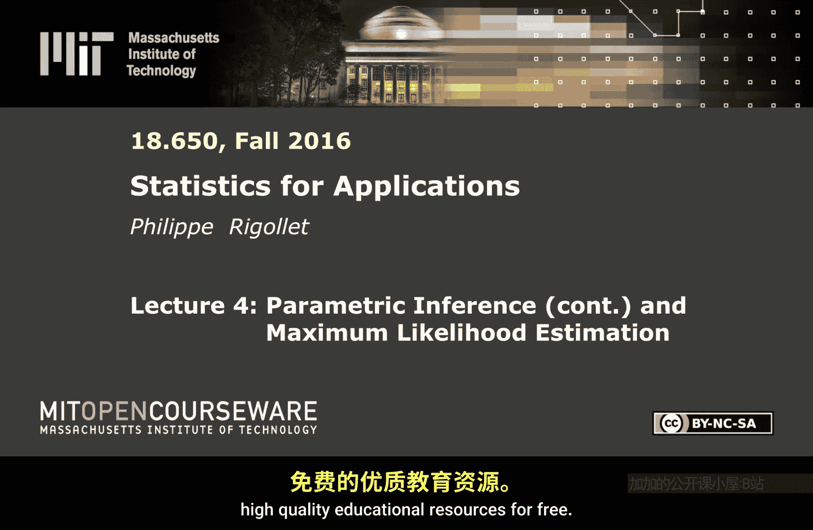
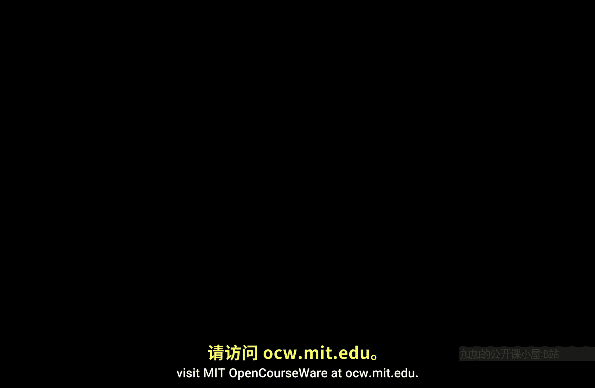
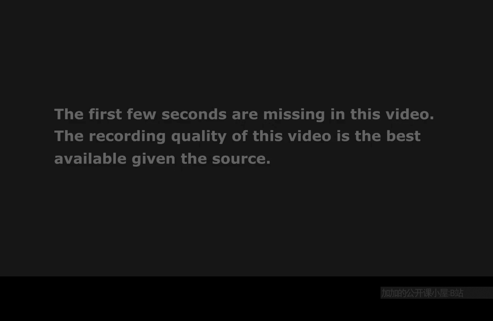
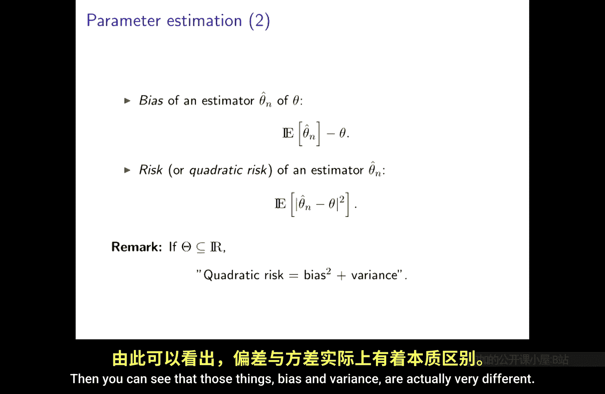

# 麻省理工学院【中英⚡应用统计学｜18.650-2016-Statistics-for-Applications】-p04-P4-4Parametric-Inference-(cont)-and-Maximum-Likelihood-Estimation--rL--BV1hck9B6EpM_p4-

The following content is provided under a C Commons license。

 Your support will help Mi T OpenCourseware continue to offer high quality educational resources for free to make a donation or to view additional materials from hundreds of Mit courses。

 Visit Mitopcourseseware at Ocw Mt Eduu。

I 124。 If I were to repeat this a thousand times。 So every one of those thousand times。

 I collect 124 data points， and then I do it again， and do it again and again， then in average。

 the number I should get should be close to the true parameter that I'm looking for。

 The fluctuations that are due to the fact that I get different samples every time should somewhat vanish。

 And so what I want is to have a small bias， hopefully a zero bias。 If this thing is0。

 then we say that the estimator is unbiased。O。So this is definitely a property that we're gonna be looking for in an estimator trying to find them to be unbiased。

 but we'll see that it's actually maybe not enough。 Alright。

 so unbiasedness should not be something you don't。 you lose your sleepover。

 Something that's slightly better is the risk。So really the quadratics risk。Which is。Expectation of。

So if I have an estimator theta hat， I'm going to look at the expectation of theta hat n minus theta squared。

And what we showed last time is that we can actually by inserting in there adding and removing the expectation of theta hat。

 we actually get something where this thing can be decomposed as the square of the bias。Plus。

 the variance， which is just the expectation of theta hat minus its expectation。Squared。Okay。

 and that came from the fact that when I added and removed the expectation of data had in there。

 the cross termss canceled。Alright， so that was the bias squared。And this is the variance。Okay。

And so， for example， if the extratic risk goes to 0。

 then that means that theta hat converges to theta in the L2 sense。And。

 and here we know that if we want this to go to 0。 This is the sum of two positive terms。

 we need to have both the bias that goes to 0 and the variance that goes to 0。

 So we need to control both of those things。And so there is usually an inherent trade off between getting a small bias and getting a small variance。

 If you reduce one too much， then the variance of the other one is gonna increase then the other one is going to increase or the opposite。

 That happens a lot。But not so much， actually， in this class。

 So let's just look at a couple of examples， right。So， am I planning on。So。So， examples。So if I do。

 for example， x1。XN呢。That are IID。Verly， and I'm going to write a theta so that we keep the same notation。

 Then theta hats。What is the theta had that we proposed many times， It's just x bar， right， X n bar。

 the average of the x size。So what is the bias of this guy？Well， to know the bias。

 I just have to remove。Theta from the expectation。What is the expectation of X of XN bar？Well。

 by linearity of the expectation is just the average of the expectations。

But since all my excs are burnly with the same theta。

 then each of this guy is actually equal to theta。So this thing is actually theta。

Which means that this ist biased， right？Okay。Now， what is the variance of this guy。Okay， so。

If you forgot the properties of the variance for some of independent random variables。

 now it's time to wake up。 So we have the variance。Of something that looks like one over N。

 some from I equal 1 to n。Of X I， right？So it's of the form variance of a constant times the randomium variable。

 So the first thing I'm gonna do is pull out the constant。

 But we know that the variance lives on the square scale。

 So when I pull out a constant outside of the variance， it comes out with a square。 right。

 The variance of a times x is a squared times the variance of x。

So this is equal to one over n squared。Times the variance of the sum。

So now we want to always do what we want to do， right， so we have the variance of the sum。

 We would like somehow to say that this is the sum of the variances。 And in general。

 we are not allowed to say that， but we are because my Xs are actually independent。

So this is actually equal to1 over n squared。Some from I equal1 to N。Of the variance。

Of each of the X。 And that's by independence。Okay， so this is basic probability。And now。

 what is the variance of X， where， again， theyre all the same distribution。

 So the variance of X is the same as the variance of x1。 And so each of those guys as variance， what。

 What is the variance of aly， We've said it once。 It's theta times 1 minus theta。Okay。

And so now I'm gonna have sum of n times the constant。

 So I get n times the constant divided by n squared。 So one of the n is going to cancel。

 And so the whole thing here。Is actually equal to theta 1 minus theta divided by n。

So if I'm interested in the quadratic risk。And again。

 I should just say risk because this is the only risk we're going to be actually looking at， yet。

 this parenthesis should really stop here。I really wanted to put quadratic in parenthesis。

So the risk of this guy is what well， is the expectation。Of x bar n minus theta squared。

And we know it's the square of the variance。So it's the square of the bias， which we know is 0。

 So it's 0 squared plus the variance， which is theta。One plus data。At1 minus theta divided by n。Okay。

 so it's just。Theta 1 minus theta。P divided by n。So this is just summarizing the performance of an estimator。

 which is the random variable。 I mean， it's complicated if I really wanted to describe it。

I would just tell you。The entire distribution of this random variable。

But now what I'm doing is I'm saying， well， let's just take this random variable。

 remove theta from it and see how small the fluctuations around theta in squared the squared fluctuations around theta are in expectation。

😊，Right， so that's what the dramatic risk is doing。 And in a way。

 this decomposition as the sum of the bias square and the variance is really telling you that it it is really accounting for the bias。

 which is， well， even if I had an infinite amount of observations。

 is this thing doing the right thing。 And the other thing is actually the variance。

 So for finite number of observations， what are the fluctuations。😊，Right。

 then you can see that those things， bias and variance are actually very different， so。啊。

So I don't have any colors here， so you're going to have to really follow the speed and the odor in which I draw those curves。

All right， so let's find， I'm going to give you three candidate estimators。So。Estimators for theta。

Okay， so the first one is definitely X N bar。That will be a good candidate estimator。

The second one is going be 0。5， because， you know， after all。

 why should I bother if it's actually gonna be， right， so。You know， if， for example。

 if I ask you to predict the score of some candidate in some election， then since you know。

 it's gonna be very close to 0。5， you might as well just throw out 0。5。

 and you're not gonna be very far from reality。 And it's actually going to cost you 0 time and 0 to come up with this。

 So sometimes， you know， maybe just a good old guess is actually doing the job for you。Of course。

 for can presidential elections or something like this， not very helpful。

 if your prediction is telling you this， but you know， I filled with something different。

 that would be a good way to generate some close to one。For a coin， for example， right。

 if I give you a coin， you never know。 maybe it's slightly biased。

 but the good guess just looking at it， inspecting it。

 maybe there's something crazy happening with the structure of it。 You're gonna guess that it's0。

5 without trying to collect information。And let's find another one， which is， well， you know。

 I have a lot of observations。 but， you know， I'm recording this couples kissing， but， you know。

 I have on a budget。 I don't have time to travel all around the world and collect some people。

 So really， I'm just gonna look at the first couple and go home。

 So my otherestim meator is just gonna be X1。Right， they just take the first observation，0，1。

 and that's it。Okay， so now I'm gonna， I want to actually understand what the。

