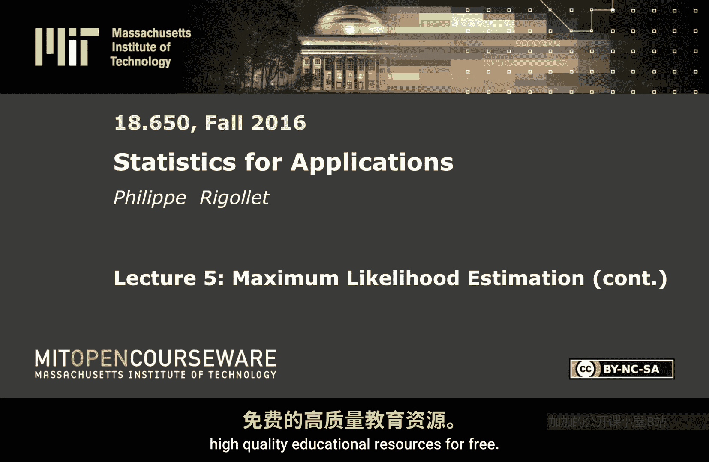
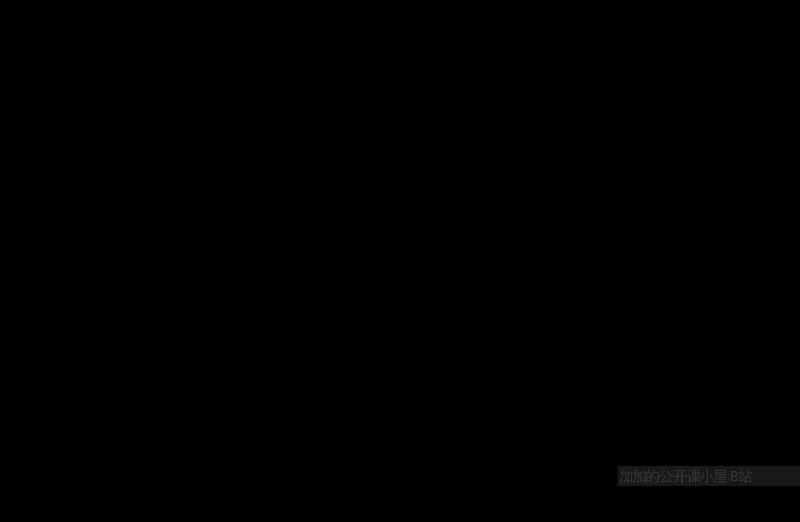
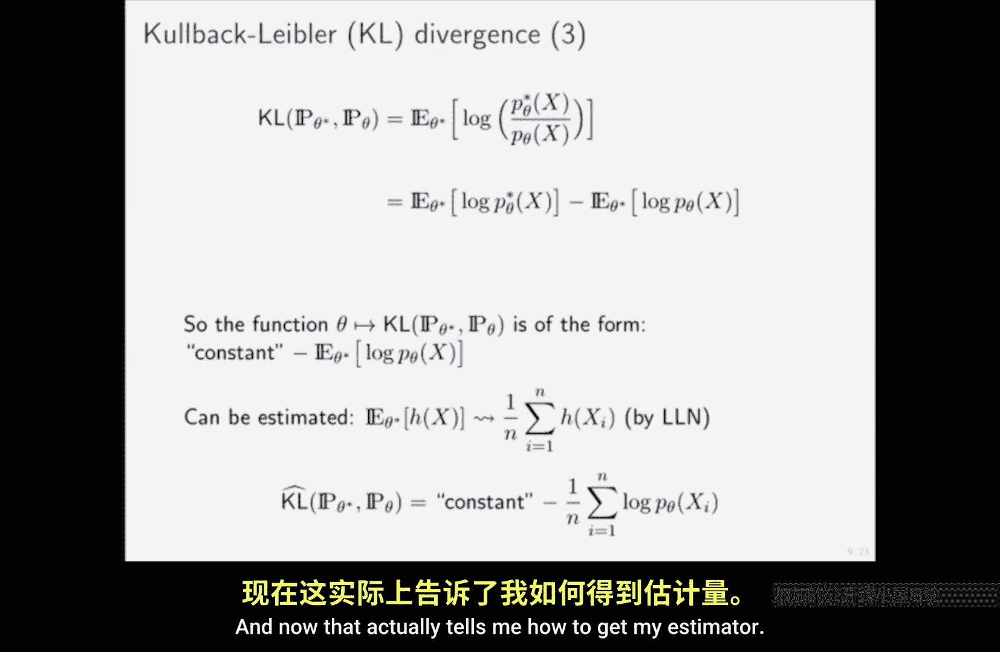

# 麻省理工学院【中英⚡应用统计学｜18.650-2016-Statistics-for-Applications】-p05-P5-5Maximum-Likelihood-Estimation-(cont)-mkv--BV1hck9B6EpM_p5-

The following content is provided under a C Commons license。

 Your support will help Mi T OpenCourseware continue to offer high quality educational resources for free to make a donation or to view additional materials from hundreds of Mit courses。

 Visit Mitopcourseseware at Ocw Mt Eduu。

So I'm using a few things here， right， I'm using the fact that K L is non negative。

But KL is equal to 0 when I take twice the same argument。

So I know that this function is always non negative。And that's so that's。Theta， and that's K L。

PC的 store。Peace theater。 And I know that at theater star。It's equal to 0。Okay。

I could be in the case where I have this happening。I have two。Let's call it Theta star prime。

I have two minimizers。That could be the case， right， I'm not saying that So Kev。L。

 K L is 0 at the minimum。That doesn't mean that I have a unique minimum， right， but it does actually。

 What do I need to use to make sure that I have only one minimum。

So the definiteness is guaranteeing to me that the unique。

 there's a unique P Theta star that minimizes it。But then I need to make sure that there's a unique from this unique P data star。

 I need to go。 I need to make sure there's a unique theta star that defines this P that star。Exactly。

Alright， so I combine definiteness。And identifiability to make sure that there's a unique。

Minimizer in this case cannot exist。Okay， so。Basically， let me write what I just said。

 so definiteness。That implies。That。P fit star。Is the unique。Minimizer。Of。P theta maps 2。KL。

P theta star。P theta。 All right， so definitelyness only guarantees that the probability distribution is uniquely identified。

And。Identfiability。呃。Implies。That theta star is the unique。Mini miser。Of theta maps do。Kll。P Theta。

 star， P Theta。O。So I'm basically doing the composition of two injective functions。

 The first one is the one that maps， say theta to P Theta。

 And the second one is the one that maps P theta to the set of minimizers。Okay。Agr。So。

At least morally， you should agree that The star is the minimizer of this thing。

 whether it's unique or not， you should agree that it's a good one。

So maybe you can think it a little longer on this。 And so thinking about this being the minir。

 then it says， well， if I actually had a good estimate for this function。

 I would use the strategy that I describe for the total variation， which is， well。

 I don't know what this function looks like。 It depends on theta star。

 but maybe I can find an estimator of this function that fluctuates around this function。😊。

And such that when I minimize this estimator of the function， I'm actually not too far。Okay。

 and this is exactly what drives me to do this because I can actually construct an estimator。

 I can actually construct an estimator such that this estimator is actually of K of the KL is actually close to the Kl。

 All right， so I define KL hat。😊，All right， so all we did is just replacing。Expectations。

 respect to see the star。By。Averages。That's what we did。So if you're a little puzzled by this arrow。

 that's all it says， replace this guy by this guy。That has no mathematical meaning。

 it just means just replace it by。And now that actually gives tells me how to get my estimator。

 it just says， well， my estimator kl hat。

Is equal to some constant。Which I don't know。 I mean， certainly depends on theta star。

 but I won't care about it when I'm trying to minimize minus。One of runs some from IA1 to N log。

P呃FC的FC。Of X， right， So here I'm writing it with the density。 You have it with the PMF on the slides。

 And so you have the two versions in front of you。Okay。Oh， sorry， I forgot the XI。Now， clearly。

 this function， I know how to compute。 if you give me a theta。Since I know the。

 the form of the density as theta for each theta that you give me。

 I can actually compute this quantity。Right。This， I don't know。

 but I don't care because I'm just shifting the value of the function。

 I'm trying to minimize the set of minimizers is not going to change。

So now this is my estimation strategy。Minimize。In theater。Kel hat。He hit a star。Pオケ。

So now let's just make sure that we all agree that so what we want is the argument of the minimum。

 right， arguments， the theta that minimizes this guy rather than finding the value of the minimum。

Okay， so I'm trying to find the argument of this thing。 Well， this is equivalent to finding。

The orgmen。Of say， a constant。Minus。One overren some from I。Go one to end of log。F Theta Alex I。Okay。

 so that's just。I think it likes me。Okay， so that's minimizing this average， right。

 I just plugged in the definition of K hat。😊，Now， I claim that taking the arm of a constant or the argument plus a function or the argument of the function is the same thing。

Is anybody。Not comfortable with this idea。Okay。So this is the same。By the way， this。

 I should probably switch to the next slide， because。I'm writing the same thing。But better。

 And it's with a PMF rather than PF。Okay， now argument of the minimum is the same of ag max。So。

 argument of the negative thing is the same as ag max without the negative， right。A max。

Over theta of1 over n。Some from one equal I equal1 to n。Log F theta of Xi。

Taking the argument of the average or the argument of the sum again。

 is not going to make much difference。Just adding constants or multiplying by constants does not change the argument or the arc max。

Now， I have the sum of logs。Which is the log of the product。Okay。

s the a max of the log of F theta of x1 times F theta of x 2， F theta of x1。

But the log is a function that's。Increasing。So maximizing log of a function or maximizing the function itself is the same thing。

The value is going to change， but the R max is not going to change。 Everybody agrees with this。

So this is equivalent。To Arc Max。Or' theta of pie。From one to n。OfF theta X I。And that's because。X。

 apps 2。Lg X。Is increasing。Okay。So now I've gone from minimizing the K L to minimizing the estimate of the K L to maximizing this product。

Well， this chapter is called maximum likelihood estimation。

 That's the maximum comes from the fact that our original idea was to minimize the negative of a function。

 So that's why it's maximum likelihood。 And this function here。It's called。The likelihood。Alright。

 this function is really just telling me they call it likelihood， because it's。

Some measure of how likely it is that data was the parameter that generated the data。Okay。

 so let's go to the， well， we'll go to the formal definition in a second。 But actually。

 let just give you an intuition as to。