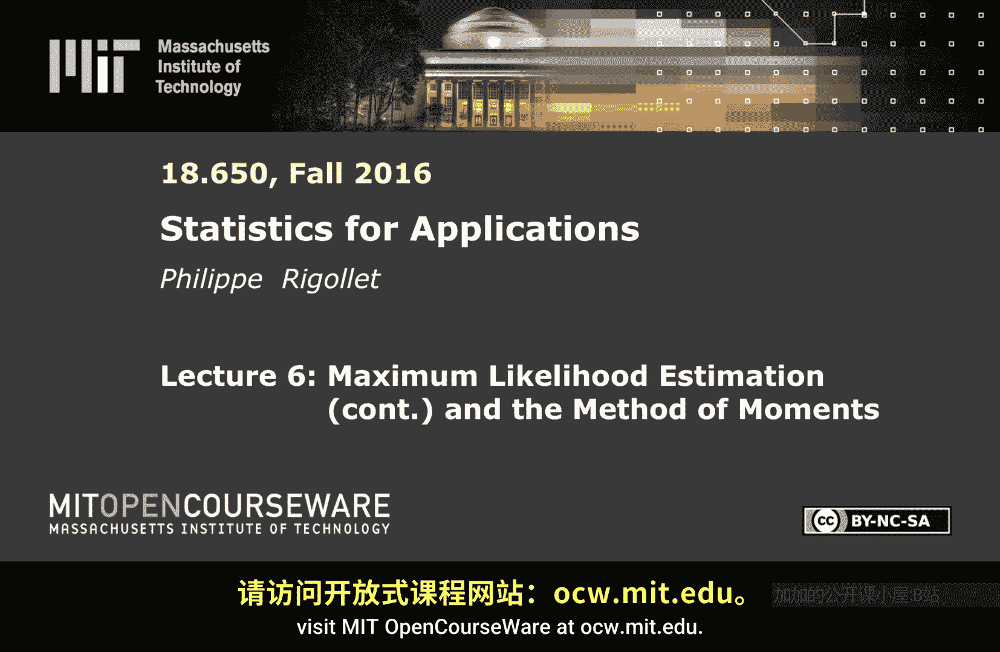
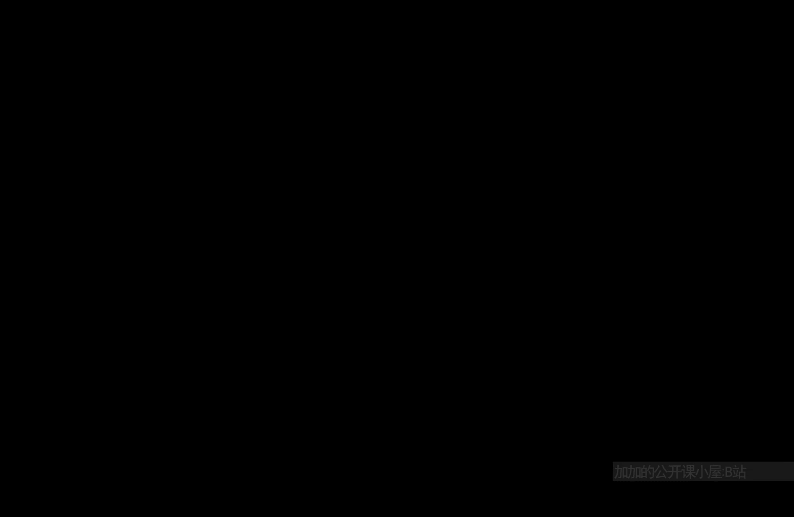
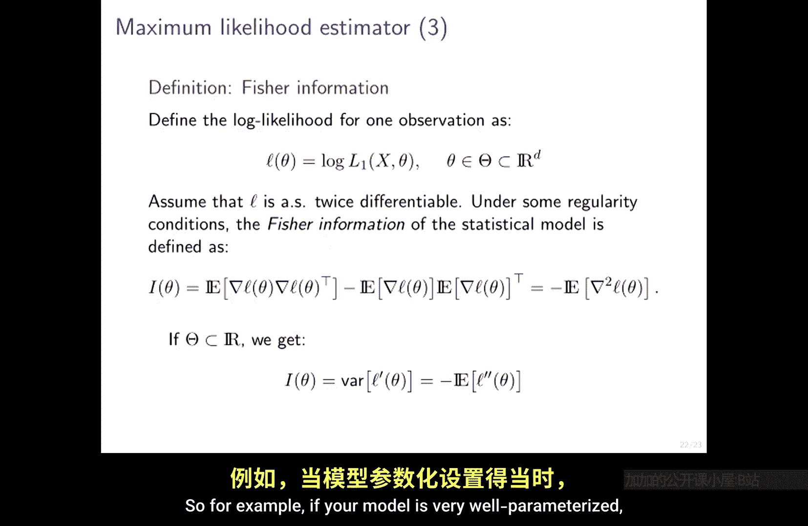

# 麻省理工学院【中英⚡应用统计学｜18.650-2016-Statistics-for-Applications】-p06-P6-6Maximum-Likelihood-Estimation-(cont)-and-the-Method-of-Moments--JT--BV1hck9B6EpM_p6-

The following content is provided under a C Commons license。

 Your support will help Mi T OpenCourseware continue to offer high quality educational resources for free to make a donation or to view additional materials from hundreds of Mit courses。

 Visit Mitopcourseseware at Ocw Mt Eduu。

All right。So welcome back。 We're gonna。Fin this chapter on maximum likelihood estimation。

 And last time I briefly mentioned something that was called fissure information。 All。

 So fissure information in general is actually a matrix。

 when you have a multivariate parameter theta。 So if theta， for example。

 is D by is D is the dimension D， then the fissure information matrix is gonna be a D by D matrix。

 right， you can see that because。😊，It's the outer product。 So it's of the form gradient。

 gradient transpose， right， So if it's gradient gradient transpose， the gradient is the dimensional。

 And so gradient times gradient transpose is a D by D matrix。 Okay。

 and so this in this matrix is actually contains。Well。

 tells you it's called Fisher information matrixtri。

 So it's basically telling you how much information about theta is is in your model。 Alright， so。

 for example， if your model is very well parameterized， then you will have a lot of information。

 You will have a higher。 So let's think of it as being a scalar number。 Just one number now。

 So you're gonna have a larger information about your parameter in the same probability distribution。

 But if you start。

Having a weird way to parameterize your model， then the fiser information is actually gonna drop。

 So as a concrete example， think of， for example， a parameter of interest in a Gaussian model where the mean is known to be 0。

 But what you're interested is in the variance sigma squared。 All right。

 if I'm interested in Sigma square， I could parameterize my model by sigma， Sigma squared。

 Sigma  to the 4 Sigma  to the 24。 I could parameterize it by whatever I want。

 Then I would have a simple transformation。 Then you could say that some of them are actually more or less informative and you're gonna have different values for your fissure information。

 All， so let's just review a few wellknow computations。 right， So。😊。

I will focus primarily on the one dimensional case as usual。

 And I claim that there's two definitions。 So if theta is a real valued parameter。

 then there's basically two definitions that you can think of for your fier information。

 One involves the first derivative of your log likelihood。

 And the second one involves the second derivative。 so the log likelihood here。

 we're actually going define it that as L of theta。And what is it， Well。

 it's simply the likelihood function for one observation。 All right， so it's L。

 And I'm going to write one just to make sure that we all know we're talking about one observations of。

 which is the order again。 I think it's x and theta， right。All right， so that's the log likelihood。

 remember？Okay， so for example， if I have a density， what is it going to be。

 It's going to be log of F sub theta。Of X， okay， so this guy is a random variable because it's a function of a random variable。

 right， And that's why you see expectations of this thing。 It's a random function of data。Alright。

 if I view this as a function of theta， the function becomes random because it depends on this random X。

Right right。I have theater。Is actually defined as the variance of L prime。Of非龙。Okay。

 so the variance of the derivative of this function。And I also claim that it's equal。To negative。

The expectation。Of the second derivative。Ofp data。Okay， and here。

 the expectation and the variance are computed because this function， remember is random。

 right So I need to tell you what is the distribution of the X with respect to which I'm computing the expectation and the variance。

 And it's the theta itself。O。So typically， the theta we're gonna be interested in。

 So there's an information， feature information for all values of the parameter。

 But the one typically we're interested in is the true parameter。Okay， The star。

But view this as a function of theta right now。Right， so now I need to prove to you。

 I mean this is not a trivial statement， right， the variance of the derivative is equal to negative the expectation of the second derivative。

 I mean， there's really quite a bit that comes into this， right。

 And it comes to from the fact that this is a log。Not of anything is the log of a density。

 So let's just prove that without having to bother too much ourselves with some technical assumptions。

 I'm actually， and the technical assumptions are the assumptions that allow me to permute derivative and integral。

 right， because when I compute variances and expectations。

 I'm actually integrating against the density。 And what I want to do is to。

Is to make sure that I can always do that， right， So my technical assumptions are。

 I can always permute integral and derivatives， okay， so。Let's just prove this。

 So what I'm going to do is I'm gonna assume that。呃，X。Has density。A theta。Okay。

 and I'm actually just going write， well， let me write it F the right now。 Okay。

 let me try to not be lazy already。Okay， and so the。

 the thing I'm gonna to use is the fact that the integral of this density。Is equal to what？1。

And this is where I'm going to start doing weird things。

That means that if I take the derivative of this guy， it's equal to。0ero， right。

 So that means that if I look at the derivative。With respect to theater。Of。Integ F theta of x。The X。

 this is equal to 0。 And this is where I'm actually making this。

 this switch is that I'm gonna say that this is actually equal to the derivative of the the integral of the derivative。

ok。So that's going to be the first thing I'm going to use。And， of course。

 if it's true for the first derivative， it's gonna be true for the second derivative。

 So I'm gonna to actually do it a second time。 And the second thing I'm going to use is the fact that the integral of the second derivative。

Is equal to 0。嗯跟。So let's start from here。And let me start from， say。

 the expectation of the second derivative Als L prime prime theta。So what is L prime prime Theta。

 well it's the second derivative？Of。Log。OfF theta。Of x。Okay。

 and we know that the derivative of of the log， sorry the。Yeah， so the derivative of the log。

Is one over well， it's。The derivative of F divided by F itself， okay。Everybody's with me。Okay。

 just log of F prime is F prime over F。Okay， here is just that F。

 I view this as a function of theta and not as a function of x。Okay。

 so now I need to take another derivative of this thing。So that's gonna be equal to。 well， right。

 So the we all know the formula for the derivative of the ratio。 So I pick up the second derivative。

Times F theta。Minus the first derivative squared。Divided by F。Theta squared。O。Basic calculus。

And now I need to check that negative the expectation of this guy。Is giving me back what I want。

 Okay， well， what is negative， the expectation。Of L prime prim of theta。Well。

 what I need to do is to do negative integral of this guy against F theta。

So it's minus the integral of。Okay， that's just the definition of。The expectation， right。

 I take an integral against F theta。But here， I have something nice that's happening is that those guys are canceling。

 right。And now that those guys are canceling， those guys are canceling， too。O。

So what I have is that the first term， I'm going to break this difference here， right。

 So we say that the integral of this difference is the difference of the integrals。

