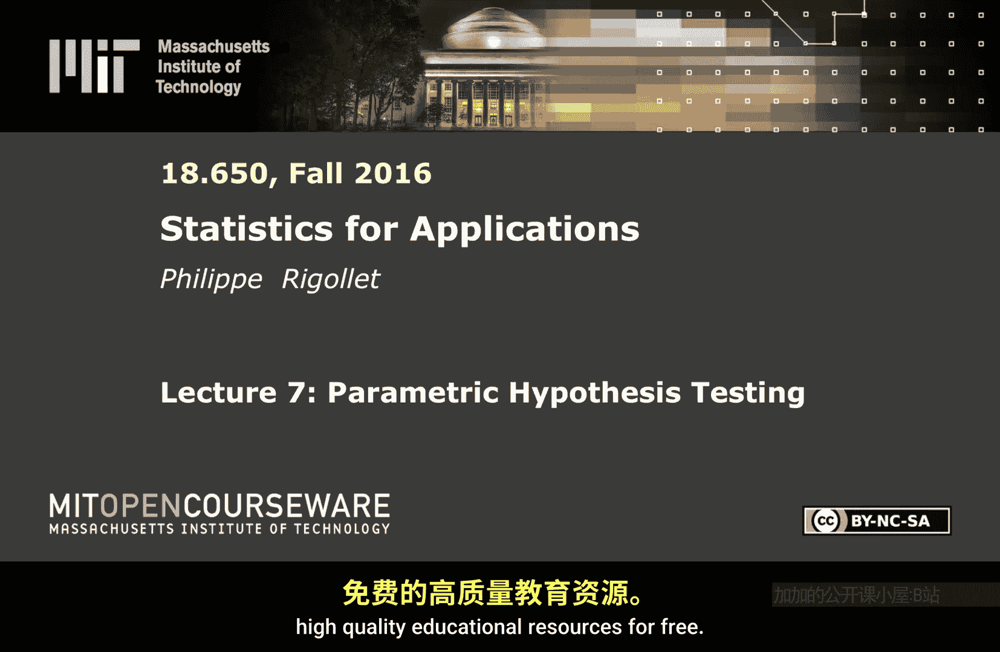
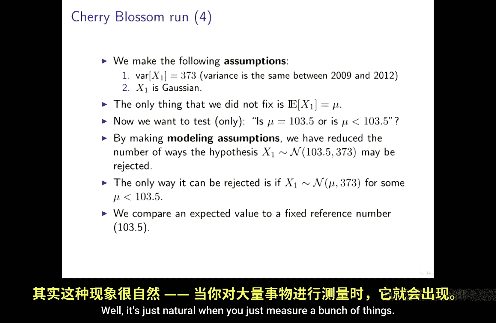

# 麻省理工学院【中英⚡应用统计学｜18.650-2016-Statistics-for-Applications】-p07-P7-7Parametric-Hypothesis-Testing-mkv--BV1hck9B6EpM_p7-

The following content is provided under a C Commons license。

 Your support will help Mi T OpenCourseware continue to offer high quality educational resources for free to make a donation or to view additional materials from hundreds of Mit courses。

 Visit Mitopcourseseware at Ocw Mt Eduu。

So welcome back。 So we're now moving to a new chapter。

 which is going to have a little more of a statistical flavor when it comes to designing methods。

 Because if you think about it，s okay。😊，Some of you have probably attempted problem number two in the problem set。

 and you realize that maximum likelihood estimators does not give you super。Trivial estimators。

 right， I mean， when you have an n theta theta， then， you know。

 the thing you get is not something you could have guessed before you actually attempted to solve that problem。

And so in a way， we've seen already sophisticated methods。However， in many instances。

 the maximum likelihood estimator was just an average。 And in a way。

 even if we had this confirmation for maximum likelihood that indeed。

 that was the estimator that maximum likelihood would spit out and that our intuition was therefore pretty good。

Most of the statistical analysis or use of the central limit theorems。

 All these things actually did not come in the building of the estimator。

 in the design of the estimator， but really in the analysis of the estimator。 And you could say。

 well， you know， if I know already that the best estimator is the average。

 I'm just gonna use the average， I don't have to basically quantify how good it is。

 I just know it's the best I can do。When we're going to talk about tests and we're going to talk about parametric hypothesis testing。

 So you should view this sentence as parametric means well。

 it's about a parameter like we did before。 and hypothesis testing is on the same level as estimation。

And on the same level as estimator will be the word test。 Okay。

 and when we're going to devise a test， we're going to actually need to understand random fluctuations that arise from the central limit theorem better。

 Okay， it's not just going to be in the analysis。 It's also going to be in the design。

 and everything we've been doing before in understanding the behavior of an estimator is actually going to come in and be extremely useful in the actual design of tests。

 Okay。So as an example， I want to talk to you about some real data， I will not study this data。

 but this data actually exists。 you can find it on R。

 And so it's the data from the so-called creditedit union Cheerry blossom run。

 which is a 10 mile race， takes place every year in D seems that some of the years are pretty nice。

2009， they were about 15000 participants， pretty big race。

 and the average learning time was one of 3。5 minutes。 All right so。

About an hour and a half or a little bit more。And so you can ask a following question， right？😊。

This is actual data， right， One of 3。5 actually averaged the running time for all of 15000。 Now。

 this in practice might not be something very suitable。

 And you might want to just sample a few runners and try to understand how they're behaving every year without having to collect the entire data set。

And so you could ask the question， well let's say my budget is to ask for maybe 10 runners what their running time was。

 I still want to be able to determine whether they were running faster in 2012 than in 2009。

 why do I put 2012 and not 2016 well， because the data set for 2012 is also available。

And so if you were interested in you know how to use R just go and have fun with it。

 So so to answer this question， what we do is we select n runners， right， So n is a moderate number。

 that's more manageable than 15000 from the 2012 race at random。

 That's where the random variable is gonna come from right That's where we actually inject randomnesss in our problem And we're gonna denote this guys by we're gonna denote。

 So remember， this is an experiment。 So really， in a way， the runners are the omegas。

 and I'm interested in measurements on those guys。 So this is how I have a random variable and this random variable here is measuring their running time。

 Okay， if you look at the data set， you have all sorts of random variable you could measure about those random runners country of origin I dont know height age a bunch of things。

 Okay here， the random variable of interest being the running time。

 everybody understand what the process is。 so。😊，Now I'm gonna have to make some modeling assumptions。

 And here I'm actually pretty lucky。 I actually have all the data from a past year。 I mean。

 this is not data from 2012， which I also have， but I don't use。

 but I can actually use past data to try to understand what distribution do I have， right？ I mean。

 after all， running time is gonna be rounded to something。

 Maybe I can think of it as discrete random variable。

 Maybe I can think of it as exponential random variable。 Those are positive numbers。 I can think。

 I mean， there's many kind of running times that could come up to mind。 many kind of distributions。

 I could think of for this modeling part。😊，But turns out that if you actually plot the histogram of those running times for all 15000 runners in 29。

 you actually are pretty happy to see that it really looks like a bell shaped curve。

 which suggests that this should be a Gaussian， So what you go on to do is you estimate the mean from past observations。

 which was actually one of 3。5 as we said you estimate the variance， which was 37373。

 and you just try to superimpose a curve with this which is a Gaussian Pdf mean one of 3。

5 in variance 373。 and you see that they actually look very much alike。

 And so here you're pretty comfortable to see that the running time actually is Gaussian distribution。

 so now I know that the x1 to XN， I'm going say theyre Gaussian。😊，Okay。

 I still need to specify two parameters。So。What I want to know is。

 is the distribution the same from past years， Right。

 So I want to know if the random variable that I'm looking for， if I say pick1， say X1。

 does it have the same distribution in 2012 that it did in 202009。 Okay， And so the question is。

 is x 1 has a Gaussian distribution with mean1 of 3。5 invari 373。Is that clear。 Okay。

 so this question that calls for a yes， no answer is a hypothesis testing problem。

I'm testing a hypothesis。 And this is the basis of basically all of data driven scientific inquiry。

You just ask questions， you formulate a scientific hypothesis。

Knocking down this gene is gonna to cure melanoma。Is this true。 I'm gonna collect。 I'm gonna try。

 I'm gonna observe some patience on which I knock down this gene。

 I'm gonna collect some measurements。 and I'm gonna try to answer this yes， no answer this yes。

 no question。 Okay， it's different from the question。

 what is the mean of the mean running time for this year。Okay， so。

 so this hypothesis testing is testing if this hypothesis is true。

 The hypothesis in mathematical terms。 I mean， in in， in， in common English， we just said。

 was the running time where runners running faster， right， Any could formulate this hypothesis。 Now。

 you go to a statistician And he's like， what you're really asking me is。

Is X 1 normally has a Gaussian distribution would mean less than1 or 3。5 in variance 373， right。

 That's really the question that you ask in statistical terms。

 And so if you're asking if this was the same as before。

 there's many ways it could not be the same as before。

 There's basically three ways could not be the same as before。

 It could be the case that X1 is not equal to one in expectation to one of 3。5。

 So the expectation has changed or the variance has changed or the distribution has changed。 I mean。

 who knows maybe runners are now just， you know， all running holding their hands。

 And it's like now a point mass at one given point。Okay。

 so you never know how what could that changed。 Now， of course， if you allow for any change。

 you will find change。And so what you have to do is to factor in as much knowledge as you can make as many modeling assumptions so that you can let the data speak about your particular question here。

 your particular question is。Are they running faster？

 So you're only really asking a question about the expectation。

 You really want to know if the expectation has changed。 So as far as you're concerned。

 you're happy to make the assumption that the rest has been unchanged。O。And so。

This is the question we're asking。 I the expectation now less than  one or 3。5。

 because you specifically ask whether runners were going faster this year， right。

 They tend to go faster， rather than slower， alright， okay。

So this is the question we're asking in mathematical terms。So first， when I did that。

 I need to basically fix the rest and fixing the rest is actually part of the modeling assumptions。

So I fixed my variance to be 373。 Okay， I assume that the variance is not changed between 2009 and 2012。

 Now， this is an assumption。 It turns out it it's wrong。 So if you look at the data from 2012。

 this is not the correct assumption， but I'm just going make it right now for the sake of argument。

 okay。If， and also the fact that it's Gaussian。 Now， this is gonna be hard to violate， right？ I mean。

 where did this bell shaped curve come from， Well， it's just。Natural。

 when you just measure a bunch of things。

The central thetheum appears in the small things of nature。 I mean， you。

 that's how that's the bedtime story you get about the centraltheum。

 And that's why the bell shape curve is everywhere in nature。

 It's the sum of little independent things that are going on。 And this Gaussian assumption。

 even if I wanted to relax it， there's not much else I can do。 And it is pretty robust。

