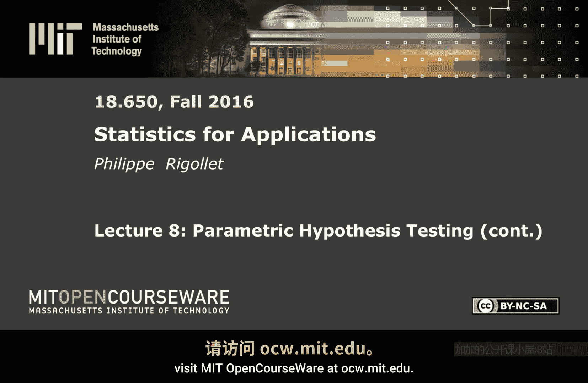

# 麻省理工学院【中英⚡应用统计学｜18.650-2016-Statistics-for-Applications】-p08-P8-8Parametric-Hypothesis-Testing-(cont)-mkv--BV1hck9B6EpM_p8-

The following content is provided under a Cative Commons license。

 Your support will help Mi T OpenCourseware continue to offer high quality educational resources for free to make a donation or to view additional materials from hundreds of Mit courses。

 Visit Mitopcourseseware at Ocw。 Mt Eduu。

talkingalking about tests。 and to be fair， we spend most of our time talking about new jargon that we're using。

 But the main goal is to take a binary decision。 Yes and no， right。

 so just so that we're clear and we make sure that we all speak the same language。

 Let me just remind you what the key words are for tests， right， So the first thing is that we split。

Theater。In。They do not。And theta 1。Both are included in theta。And they're disjoint。Okay。

 so I have my set of possible parameters。And then， I have。Fter not this here。Theta one is here。

And there might be something that I leave out， okay。And。

So what we're doing is we have two hypothesisses。 So here's our hypothesis testing problem。

 and it's a0。 Theta belongs to theta 0。Versus。H1。Theta belongs to theta 1。

This guy was called the null。And this guy was called the alternative。

And why we give them special names is because we saw that they have an asymmetric role。

 The null represents the status quo。 and data is here to bring evidence against this guy。

 And we can really never conclude that age 0 is true， because。

All we could conclude is that H H1 is not true， okay。Or or or may not be true。 Okay， so。

So that was the first thing。 The second thing was the hypothesis。 The third thing is， what is a test。

Well， Psi， it's a statistic。And it ticks the data。And it maps it into 0 or one。Okay。

 and I didn't really mention it， but there's something such as called randomized tests， which is。

 well， if I cannot really make a decision， they might as well flip a coin that tends to be biased。

 but that's really， I mean， think about it in practice。

 you probably don't want to make decisions based on flipping a coin。 And so what people typically do。

 this is happening typically at one specific value。

 So rather than flipping a coin for this very specific value what people typically do is they say。

 okay， I'm gonna to side with H0 because that's the most conservative choice I can make。Right。

 so in a way， they think of flipping this coin， but always falling on head， say。Alright。

 so associated to this test was something called well， the rejection region。R Psi。

 which is just a set of data。X 1， X n。Such that Psi of X1 xn。Is equal to one。

 So that means we rejected 0 when the test is one。 And those are the set of data points that actually are gonna lead me to。

 to reject the test。Okay， then the things that were actually slightly a little more important and really peculiar to。

 to tests specific to tests were the type 1 and type 2 error。Alright。

 so the type 1 error arises when so type 1 error。Is when you。Reject。Whereas。呃呃a0。Is correct。

And the type 2 error is the opposite。So it's failed to reject。Riz。H1 is correct。 H is correct。Okay。

 so those are the two types of errors you can make。

 And we quantifyified their probability of type 1 error。 Al right， So alpha Psi is the probability。

So， that's the probeb。Moability。Of type 1 error。So besides just the probability。For Theta。

That sign rejects。And that's for defined for theta。In theta n。Alright。

 so for different values of theta not right， So H 0 being correct means there exists a theta in theta 0 for which that actually is the right distribution。

 right， So for different values of theta， I might make different errors。Okay， so if you think。

 for example， about the coin example， if if I'm testing if the coin is biased towards heads or biased towards tails。

 right， so if I'm testing whether P is larger than one/ half or less than one/ half then when the true P。

 let's say a0 is larger than1 half when p is equal to1。

 it's actually very difficult for me to make a mistake right because I only see heads。Okay。

 so when P is getting closer to one half， I'm gonna start making more and more probability there。

Okay， and so the type 2 error。 So that's the probability of type 2。Is denoted by beta Psi。

 and it's the function。 Well， that does the opposite。

 And this time is defined for theta in theta n in theta 1。Okay， and finally。

 we define something called the power。嗯，派。i and this time this is actually a number。

And so this number is， is equal to the maximum over theta and theta n。 I mean， that could be a supre。

 but think of it as being a maximum of P theta of。Pi is equal， sorry。That's in zero， right。

Can one sex， so。那个呃。Sorry， that's the min。Okay， so this is not making a mistake， right。

 Theta n is in H in theta 1。 So theta is in theta 1。 and I I conclude 1。 So this is a good thing。

 I want this number to be large。 And I'm looking at the worst house。

 What is the smallest value this number can be。Okay， so。

What I want to show you a little bit is a picture， okay。

So now I'm gonna take theta and think of it as being P。 Okay， so I'm gonna take P。O。

For some burnly experiment。 So P can range between 0 and 1。 That's for sure。Okay。

And what I'm going to try to test is whether P is less than one half。All larger than one half。Okay。

 so this is gonna be， let's say。Data not。And this guy here is Theta 1。

Just trying to give you a picture of what those guys are， okay。So。I have my Y axis。

Now I'm going to start drawing numbers， all these things。This function。

 this function and this number are all numbers between 0 and 1， okay。So now I'm claiming that。

 so when I move from left to right。What is my probability of rejecting gonna do， Okay。

 so what I'm gonna plot is the probability under theta。

 The first thing I want to plot is the probability under theta that applies equal to  one。Okay。

 and let's say Psi think of Psi as being just。You know， this indicator that。Scred of n。X。

 N bar minus P over square root。 X N bar 1 minus X N bar。

Is larger than some constant C for appropriate they chosen C。OK。

So what we choose is that C is in such a way that at one half， when we' were testing for one half。

 what we wanted was this number to be equal to alpha， basically。 Okay。

 so we fixed this alpha number so that this guy。So if I want Psi， alpha of Psi。Of。Theater。

 less than alpha。Given in advanced。So think of it as being equal to say 5%。So I'm fixing this number。

 and I want this to be controlled for all theta in theta not。O。

So if you're going to give me this budget。Well， I'm actually gonna make it equal where I can。 Okay。

 if you're telling me you can make it equal to alpha， we know that if I increase my type 1 error。

 I'm gonna decrease my type 2 error， right， If I start putting everyone in jail or if I start letting everyone go free。

 right， That's what we're discussing last time。 So since we have the straight off。

 and you're giving me a budget for one guy， I'm just gonna max it out。Okay。

 and where am I gonna max it out exactly at one half at the boundary。 Okay， so this is going be 5%。

