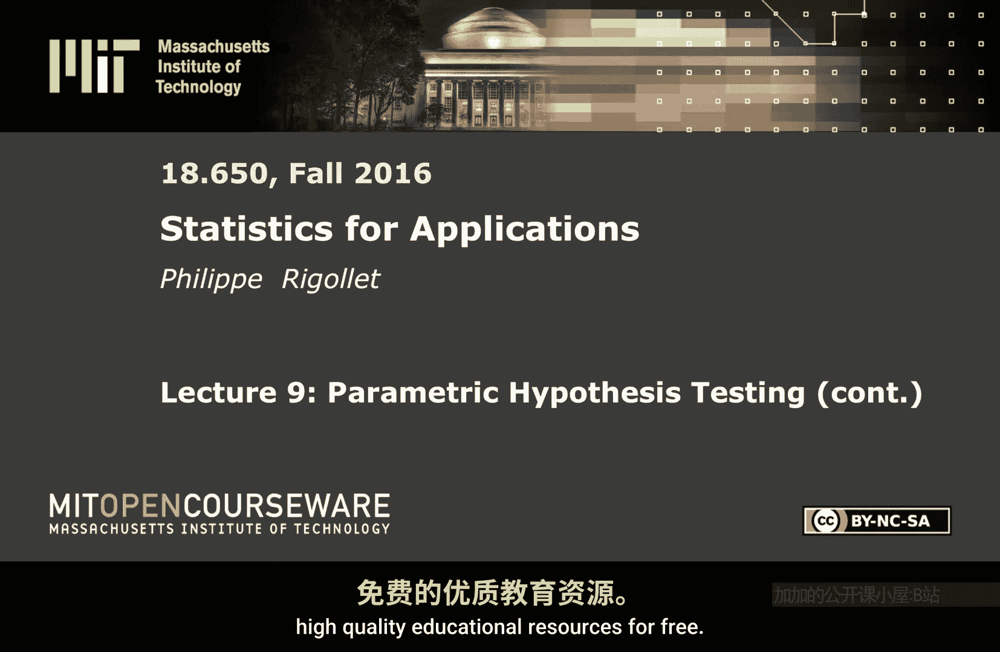
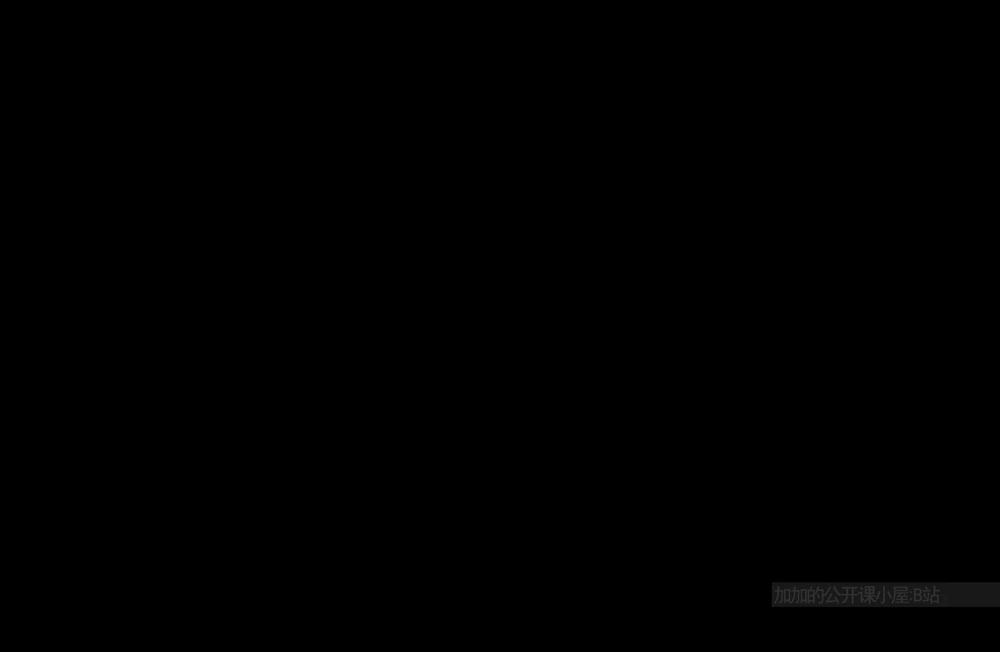
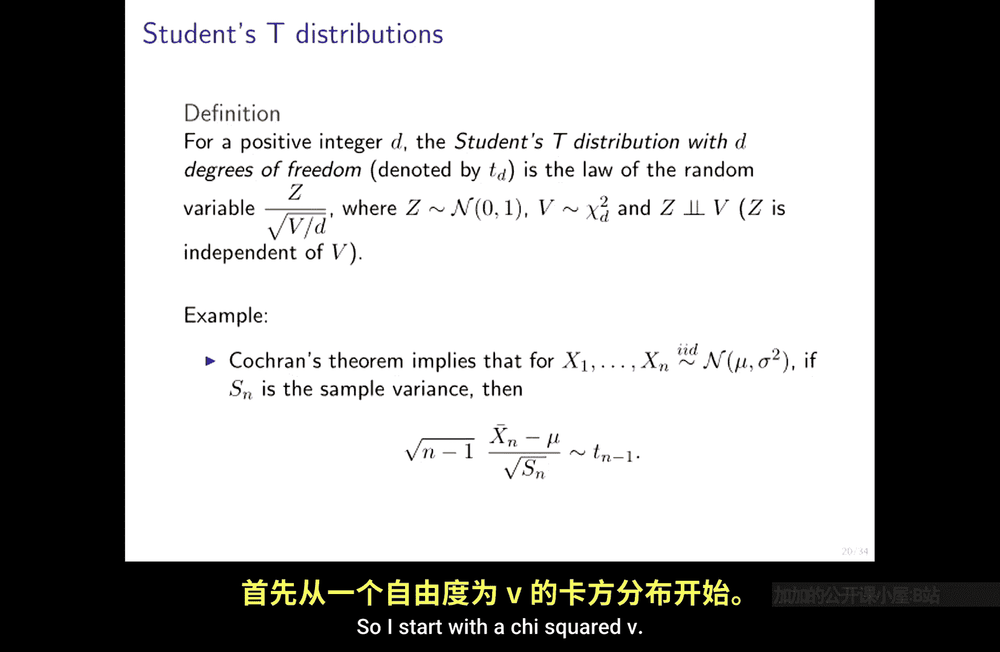

# 麻省理工学院【中英⚡应用统计学｜18.650-2016-Statistics-for-Applications】-p09-P9-9Parametric-Hypothesis-Testing-(cont)-mkv--BV1hck9B6EpM_p9-

The following content is provided under a C Commons license。

 Your support will help Mi T OpenCourseware continue to offer high quality educational resources for free to make a donation or to view additional materials from hundreds of Mit courses。

 Visit Mitopcourseseware at Ocw Mt Eduu。

So again， before we start， there's a survey online。 if you haven't done so。

 I would guess at least one of you has not some of you have entered their answers and their thoughts。

 and I really appreciate this。 it's actually very helpful。You know。

 seems that the course is going fairly well from what I've read so far。

 So if you don't think this is the case， please enter your opinion and tell us that we can make it better。

 One of the things that was said is that I speak too fast， which is absolutely true。

 I just can't help it。 I get so excited。 but I will really do my best。 Okay， I will try to so just。

 you know， I think I always start okay。 I just and not so well。 All right。

 so last time we talked about this sky score distribution。

 which is just another distribution that's so common that it deserves its own name。

And this is something that arises when we sum the squares of independent standard gaussian random variables。

 Okay and in particular， why is that relevant is because if I look at the sample variance。

 then it is a case square distribution and the parameter that shows up is also known as the degrees of freedom is the number of observations minus-1。

Okay and so as I said， this k squared distribution has an explicit probability density function。

 and I tried to draw it。 and one of the comments was also about my handwriting。

 So I will actually not rely on it for detailed thing。

 So this is what the k squared with one degree of freedom look like。

 and really what this is is' just the distribution of the square of a standard Gaussian right I'm summing only one So that's what it is。

 then when I go to two， this is what it is3，4，5，6 and 10。 and as I move。

 you can see this thing is becoming flatter and flatter and pushing to the right and that's because I'm summing more and more squares and in expectation we just get one every time so it really means that the math is moving the mass is moving to infinity in particular a k squared distribution with n degrees of freedom is going to infinity as n goes to infinity。

Another distribution that I asked you to think about。 Any looked about。

 looked around about the student T distribution， what the history of this thing was。

So I'll tell I'll tell you a little bit。 maybe I understand if you't half time。

 So the T distribution is another common distribution that is so common that it will be used and will have its table of quantntiles that are drawn at the back of the book。

 Now， remember when I mentioned the Gaussian。 I said， well。

 there are several values for alpha that we're interested in。

 right And so I wanted to draw a table for。For the Gaussian， we had something that looked like this。

And I said， well， Q alpha over 2。Right we get alpha over 2 to the right of this number。

 and we said that。There's a table for this thanks for common values of of data。 Well。

 if you think if you try to envision what this table would look like。

 it's actually a pretty sad table， right， because it's basically one list of number。

 Why would I call it a table Because all I need to tell you is something that looks like this。

 If I tell you， this is alpha and this is Q alpha over 2。 And then I say， okay。

 that basically the three alphas that I told you I care about or something like 1%，5%， and 10%。

And my table will just give me Q alpha over two。 So that's alpha， and that's Q alpha over 2。

 And that's going to tell me that I don't， I don't remember this one。 but this guy is 1。96。

 This guy is something like 2。45。 I think this one is like 1。65， maybe。And。

And maybe you can be a little finer， but it's not gonna be an entire page at the back of the book。

 And the reason is because I only need to draw these things for the one standard Gaussian when the parameters are 0 for the mean and one for the variance。

 Now， if I'm actually doing this for the case squared， the case squared。

I basically have to give you one table per values of the degrees of freedom。

 because those things are different。 There's no way I can take。Right， for Gaussians。

 if you give me a different mean， I can subtract it and make it back to be a standard Gaussian for the K square。

 there's no such thing。 There's no thing that just takes the K square with the degrees of freedom。

N D and turns it into say a k square with1 degree of freedom。 This just does not happen。 Okay。

 so there's no way to say the word is standardized。 make it a standard case square。

 There's no such thing as a standard case square。 So what it means is that I'm gonna need one row like that for each value of the number of degrees of freedom。

 So that will certainly fill a page at the back of a book。 Okay， even maybe more， I mean， you know。

 I need one per sample size。 So if I want to go from sample size 1 to 1000 I need a0 rows。Okay。

 so now the student distribution is one that arises where it's。

 it looks very much like the Gaussian distribution。

 And it there's a very simple reason for that is that I take a standard Gaussian and I divide it by something。

 That's how I get the student。 What do I divide it with。 Well。

 I take an independent case where I'm gonna to call it V。 and I want to be independent from Z。

And I'm gonna divide Z by root V over D。 Okay， so I start with a case word V。

So this guy is case squared。D， I start with Z， which is n 01。

I'm going to assume that those guys are independent。And my T distribution， I'm gonna write a T。

Capital T is Z。Divided by the square root of V over D。Why would I want to do this？ Well。

 because this is exactly what happens when I divide nu by the true variance。A Gaussian。

 but by its empirical variance。 Okay， so let's see why in a second， right， So I know。

That if you give me some random variable， let's call it X。Which is n mu sigma squared。

Then I can do this X minus mu。Divided by sigma， I'm gonna call this thing Z because this thing actually has some standard。

Gausian distribution。 I have standardized X into something that I can read the quintalza at the back of the book。

 Okay， so that's this process that I want to do。Now， to be able to do this。

 I need to know what new is， and I need to know what Sigma is。 Otherwise。

 I'm not gonna be able to make this operation。Mu， I can sort of get away with。

 because remember when we're doing confidence intervals， we're actually solving for Mu。

 So it was good that Mu was there。When we're doing hypothesis testing。

 we're actually plugging in here the mu that shows up in H0。So that was good。

 We had this thing where think of mu as being P， for example。But this guy here。

We don't necessarily know what it is， right？ I just had to tell you for the entire first chapter。

 I said， assume you have gauss and random variables and that you know what the variance is。

 And the reason why I said， assume you know it。 And I said sometimes you can read it on the side of the box of measuring equipment in the lab。

 So that was sort of just the way I justified it。 But the real reason why I did this is because I would not be able to。

 to perform this operation if I actually did not know what Sigma was。But。From data。

 we know that we can form the estimator S N， which is one over N， some from I equal1 to n of X I。

Minus x bar squared。 And this thing is approximately equal to sigma squared。

 That's the sample variance。 And it's actually a good estimator。Okay。

 just by the law of large number。 Actually， this thing by the law of large number is n goes to infinity。

啊，我。Let's say imp probabilityability goes to sigma squared by the law of number。 Okay。

 so it's a consistent estimator of sigma square。So now what I want to do is to。

 is to be able to use this estimator rather than using sigma。Okay。

 the way I'm gonna do it is I'm gonna say， okay， what I want to form is x minus mu。Divided by。

S N this time。OK。I don't know what the distribution of this guy is。I just don't， sorry。

 It's square root of S N。 This is sigma square。Okay， so this is what I would take。And， you know。

 I could think of Slutsky， maybe something like this that would tell me， well， just use that。

And pretend it's a Gaussian。 And it's sort of， we'll see how actually it's sort of valid to do that。

 because Letsky tells us it is valid to do that。 But what we can also do is to say， well。

 this is actually equal to x minus mu。Divided by sigma。

 which I know what the distribution of this guy is。 And then what I'm gonna do is I'm gonna just。

 well， I'm gonna cancel this effect， right， Sigma over。Square root S N。 Okay。

 so I didn't change anything。 I just did， I just put the sigma here。

So now what I know is that this is some Z。And it has some standard Gaussian distribution。

What is this guy？Well， I know that S， N， we wrote this here。

