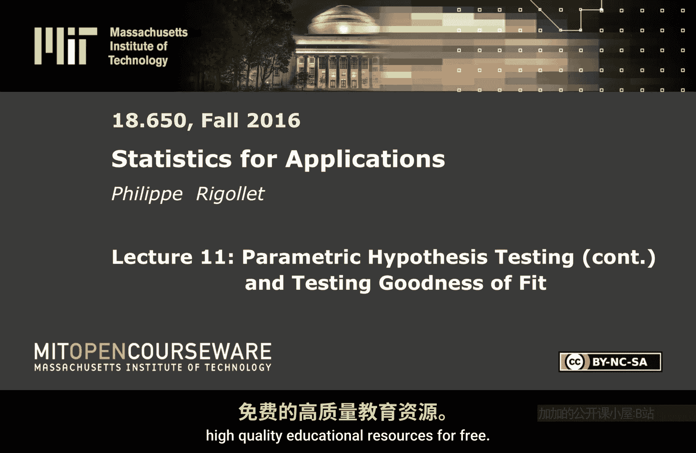
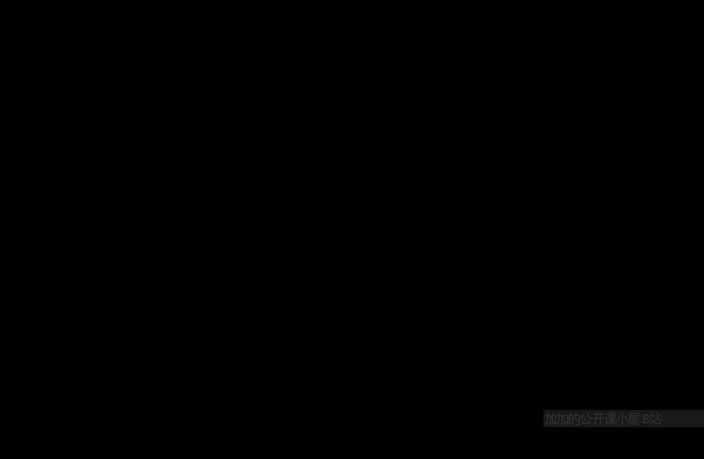
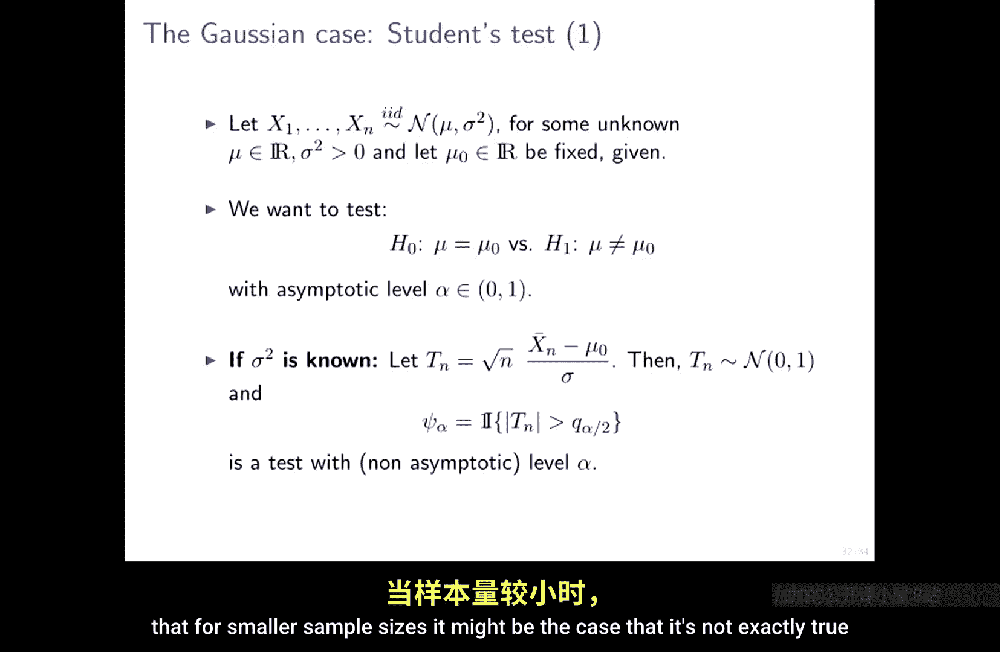

# 麻省理工学院【中英⚡应用统计学｜18.650-2016-Statistics-for-Applications】-p10-P10-11Parametric-Hypothesis-Testing-(cont)-and-Testing-Goodness-of-Fit--a6--BV1hck9B6EpM_p10-

The following content is provided under a C Commons license。

 Your support will help Mi T OpenCourseware continue to offer high quality educational resources for free to make a donation or to view additional materials from hundreds of Mit courses。

 Visit Mitopcourseseware at Ocw Mt Eduu。

So we've been talking about this case score test。 and the name case score comes from the fact that we build a test statistic that has a synotic distribution given by。

The K squared distribution。Let's just give it another shot。O。And this test。

 who has actually ever encountered the Kqua test outside of a status classroom。Alright。

 so some people have， right， It's a fairly common test that you might encounter。

 And it was essentially to test if given some data with a fixed probability mass function right。

 So discrete distribution， you wanted to test if it was given the PMF was equal to a set value， P。

 or if it was different from P。 And the way the case square arose here was by looking at wttzs test。

And essentially， if you write We is the one that has the k squares limiting distribution。

 and if you invert the。A covariance matrix， the synthetic covariance matrix。

 So you compute the fiser information， which in this particular case does not exist for the multi multinoial distribution。

 But we found the trick on how to do this。 We removed the part that forbid it to be invertible。

 then we found this category distribution。 So in a way， we have this test statistic。

 which you might have learned as a black box las。 But going through the math。

 which might have been slightly in placeta acknowledge。

 But really told you why you should do this particular normalization。

 So since some of you requested a little more you know， practical examples of how those things work。

 But let me show you a couple。 The first one is。The you want to answer the question， Well， you know。

 when should I be born to be successful， right？ And， you know， some people believe in Zodiac。

 And so Fortune magazine actually collected the signs of 256 hazards of the Fortune 500， right。

 those were taken randomly。 And they were collected there and you can see this the count of number of CEOs that have a particular zodiac sign。

 And if this was completely uniformly distributed， you should actually get a number that's around 256 divided by 12。

 which in this case is 21。33。😊，Okay， you can see that there is numbers that， you know。

 are probably in the vicinity。 But see， look at this guy。Pieces， right， That's 29。

 So whose pieces is here， All right。And all right so give me your information and we'll meet again in 10 years。

 And so basically you might want to test if actually the fact that it's uniformly distributed is a valid assumption。

 Now， this is clearly a random variable。 I pick a random CEO and I measure what is zodiac sign is。

 and I want to know if this So it's a probability over， I don't know， 12 zodiac signs。

 And I want to know if it's uniform or not right uniform sounds like it should be the status quo。

 if you're reasonable And and maybe there's actually something that moves away。😊。

So you know we could do this in view of this data is there evidence that one is different here's another example where you might want to apply the cache square test right so as I said the benchmark distribution was the uniform distribution for thezodiXon and that's usually the one I gave you1 over k1 over k because well that's sort of the zero you know the central point for all distributions right that's the point that's right at the center of what we call the simplex。

😊，But you can have another benchmark that sort of makes sense， right So for example。

 this is an actual data set where 2575 jurors were identified with identified racial group were collected and you actually might want to know if you know juries in this country are actually representative of the actual population。

 And so here， of course， the population is not uniformly distributed according to racial group and the way you actually do it is you actually go on Wikipedia。

 for example， and you look at the demographics of the United States and you find that the proportion of white is 72% black is 7%。

 Hispanic is 12 and others well about 9 percent So that's a total of one。

 and this is what we actually measured for some jurors。

 So for this guy you can actually run the K square test right you have the estimated proportion which comes from this first line you have the tested proportion p0 that comes from the second line and you might。

W to check if those things actually correspond to each other。Okay， so I'm not gonna do it for you。

 but I sort of invite you to do it and test and see how this compares to the quantntiles of the appropriate category score distribution and see what you can conclude from those two things。

Alright， so this was the multinomial Okay。 So this is essentially what we did。

 We computed the ML E and theyre the right constraint。

 And that was our test statistic that converges to the ca square distribution。

 So if you've seen it before， that's all that was given to you。 Now。

 we know why the normalization here is P J and not P J squared or square root of P J or even one。

 right？ I mean， it's not clear that this should be the right normalization。

 But we know that's what comes from taking the right normalization。

 which comes from the fiser information， Allright。Okay， so。The thing I wanted to move on to。

 So weve basically covered a case score test。 Are there any questions about K case score test。

 And for those of you who were not here on Thursday， I'm really just。I。

 I do not pretend I just did it， right， That's something we did last Thursday。Right。

 but are there any question that arose when you were reading your notes。

 things that you didn't understand， yes。So so it's not it's not the fi the fissure information does not exist in this case。

 And so there's no appropriate name for this is the pseudoinverse of the asyntotic variancevariance matrix。

 And that's what it is。 And theres I don't know if I mentioned it last time。

 but there's this entire field that uses you know， for people who are really aspied to differential geometry。

 but stuck in a stats department。 and there's this thing called information geometry。

 which is essentially studying the manifolds associated to the fissure information matrix and the metric that's associated to fis information And so those。

 of course can be lower dimensional manifolds。 not only the source of geometry。

 but forces everything to live on lower dimension， which is what happens when you fissure information does not exist。

 And so you know， there's a bunch of things that you can study what this manifold looks like， etc。

 but no there's no particular terminology here about going here。

To be fair within the scope of this class， this is the only case where you multinoial case is the only case where you typically see。

A lack of fier information matrix。 And that's just because we have this extra constraints that the sum of the parameters should be one。

 And if you have an extra constraint that seems like it's actually remove1 degree of freedom。

 this will happen inevitably。 And so maybe what you can do is re reparametize。

 So if I actually reparametize， everything in in function of P1 to P K -1。 And then one the sum。

 this would not have happened because I have only a k dimensional space。

So there's tricks around this to make it exist if you want it to exist。Any other question。Alright。

 so let's move on to students T tests。 We mentioned that last time， right， So essentially。

 you've probably done it more even in in homework than you've done it in in lectures。

 But just quickly， this is essentially the test。 That's the test when we have an actual data that comes from a normal distribution。

 There's no central limit theorem that exists。 This is really to。

Account for the fact that for smaller sample sizes， it might be the case that it's not exactly true。

That when I look at Xn bar。Minus mu divided by。 So if I look at X n bar minus mu divided by sigma times square root of n。

 then this thing should have n 0，1 distribution approximately， right。By the central limit theum。

So that's for nlar。 But if n is small。Then， it's still true。When the data。Is N sigma squared？

Then it's true。 That's great of N。So here it's approximately。And this is always true。

But I don't know sigma in practice， right？ Maybe mu comes from my， maybe mu comes from my mu not。

 right， maybe something from the， the test statistic where mu actually is here。 But for this guy。

 I'm gonna have inevitably to find an estimator。 And now， in this case， for small end。

 this is no longer true。And what the T statistic is doing is essentially telling you what the distribution of this guy is。

 Alright， so the true， what you should say is that now this guy has a T distribution with n -1 degrees of freedom。

That's basically the， you know， laundry list stats that you would learn。 It says。

 just look at a different table。 That's what it is。 But we actually defined was a。

 what a T distribution was。And a T distribution。It's basically something that has the same distribution。

