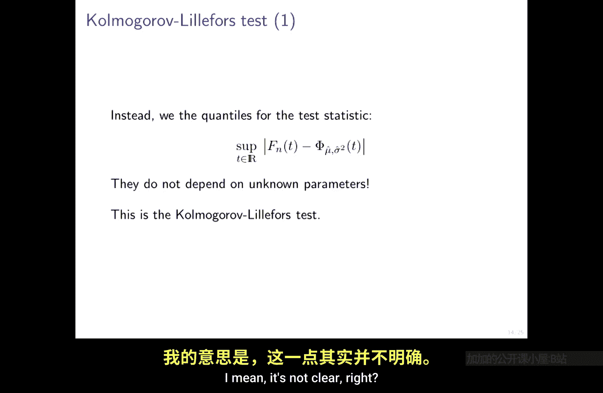

# 麻省理工学院【中英⚡应用统计学｜18.650-2016-Statistics-for-Applications】-p11-P11-12Testing-Goodness-of-Fit-(cont)-mkv--BV1hck9B6EpM_p11-

The following content is provided under a C Commons license。

 Your support will help Mi T OpenCourseware continue to offer high quality educational resources for free to make a donation or to view additional materials from hundreds of Mit courses。

 Visit Mitopcourseseware at Ocw Mt Eduu。

We're talking about goodness of fit test。 goodness of fit tests does my data come from a particular distribution and why we would want to know this。

 Well maybe we're interested in， for example， you know knowing if thezodiac signs of the Forune 500 Cs are uniformly distributed or maybe we actually have slightly more slightly deeper endeavors such as understanding if you can actually apply the T test by testing normality of your sample。

 All right so we saw that there's the main result is the main standard test for this is called the Commorov smrenov test that people use quite a bit it's probably one of the most used test out there and there's other versions of it that I mentioned passing by there's the Kmervo meis and there's the end syndling test Now how would you pick one of such test Well you know theyre always are they're always going to have their advantages and disadvantages and Kmorovmnoff is definitely the。

Most widely used because well， I guess because it's a natural notion of distance between functions。

 just look for each point how far they can be。 and you just look at the farthest they can be everywhere。

 Now， you know K misses involves L distance。 So if you're not used to you know Hilber spaces or notions of know Euclan spaces。

 at least it's a little more complicated And then Anderson Dawlling is definitely even more complicated。

 Now each of this test is going to be more powerful against other alternatives。

 So unless you can really guess which alternative you're expecting to see which you probably don't because again you're in a case where you want to typically declare H0 to be the correct one。

Then it's really， you know， a matter of tossing a coin。

 Maybe you can rent all three of them and just sleep better at night because all three of them have failed to reject。

 for example。Al right， so as I mentioned， one of the maybe primary goals to test goodness of fit is to is to be able to check whether we can apply students test。

 right And if the student distribution is actually a valid distribution。 and for that。

 we need to have normally distributed data。 Now， as I said several times。

Normally distributed is not a specific distribution。

 It's a family of distribution that's indexed by means and variances。

 And the way I would want to test if a distribution is normally distributed is， well。

 I would just look at the most natural normal distribution or Gaussian distribution that my data could follow。

 That means that's the Gaussian distribution that has the same mean as my data and the same empirical variances my data。

 Allright， And so I'm gonna be given some points X1 X N。And I'm going to be asking。

 are those Gaussian？That means this is equivalent to say， are they in。Mu Sigma square。For some。

Mu sigma squared。And， of course， the natural choice is to take new hat。To be mu。

 to be equal to mu hat， which is X n bar and sigma squared to be sigma squared hat。To be well。

 S N hat， S N what we wrote S N， which is one over n， some from i equal1 to n of X I。

Minus x and bar squared。Okay， so this is definitely the natural one you would want to test。

 And maybe you could actually just close your eyes and just stuff that in a commmom enough test。

 Okay， so here， there's a few things that don't work。

 The first one is that Donsks theorem does not work anymore。 right。

 Donk theorem was the one that told us that you know。

 properly normalized this thing would actually convert to the supreme of a Brown bridge。

 which is not true。 So that's one problem。 But there's actually an even bigger problem is that this distribution。

 we will check in a second actually does not is pivotal itself。 right。

 This this this statistic is pivotal。It does not have a distribution that depends on the unknown parameters。

 which is sort of nice， at least under than all。However。

The distribution is not the same as the one that had fixed mu and sigma。

 The fact that they come from some random variables is actually distorting the distribution itself。

 And in particular， the quintiles are gonna be distorted。 And we hinted it that last time。

So one of the thing I need to tell you， though， is that this thing actually， So I know there's some。

 there's， yeah， that's where。That's where there's a word missing thing。

 So we compute the quintiles for this test statistic。

 And so what I need to promise to you is that this quintiles。Do not depend on any unknown parameter。

 right， I mean， it's not clear。This， right， so I want to test whether my data has some Gaussian distribution。

 So under the null， all I know is that my， my Xs are。

Gussian with some mean mu and some variant sigma， which I don't know。

 So it could be the case that when I try to understand the distribution of this quantity under the null。

It depends on mu and sigma， which I don't know。So we need to check that this is the case。

 And what's actually our redemption here is actually going be the supre。

 The su is going to basically allow us to say， soup out mu and and， and sigma squared。

So let's check that。 Right， So what I'm interested in is this quantity， supre over T in R。😊。

Of the difference between F N of T。And would I rate phi。New hat。Sigma squared of T。So，5。New hat。

Sigma hat squared。 sorry， Sigma hat squared is the CF。

Of some Gaussian with mean mu hats and variant sigma hat squared。 And so in particular。

 this thing here。Fi hat。Of。New hat sorry， P hats of。M hat Sigma hat squared。

Of T is the probability that some x is less than T， where x follows some n。Mu hat Sigma hat squared。

So what it means is that by just the translation and scaling trick that we typically do for Gaussian to turn it into some standard Gaussian。

 that implies that there exists some Z， which is standard Gaussian this time。

 So means 0 in variance 1。 such that x is equal to sigma hat X。 sorry Z。Plus， new hat。Agreed。That's。

 that's basically saying that x has some Gaussian with mean mu and varying sigma square。

 And I'm not going say the hats over single times， okay。So。Okay， so that's what it means。

 So in particular， maybe I shouldn't use X here because the X is gonna be my actual data。

 So let me write why。Okay。So now what is the， what is this guy here It's basically so Phi hat。

 So this implies that Phi。Mu hat sigma hat squared of T is equal to the probability that sigma hat。

Z plus mu hat is less than t。Which is equal to the probability that Z is less than t minus mu hat divided by sigma hat。

Right。But now， when Z is a standard normal， this is really just the cumulative distribution function of a standard Gaussian。

 but evaluated at the point， which is not T， but T minus mu hat divided by sigma hat。All right。

 so in particular， what I know。 So from this， what I get， well。

 maybe I'll remove that That's going be annoying。 I know that phi mu hat sigma hat squared。😊，Sorry。

Phi mu hat sigma hat squared of T is simply phi。Of， say， 0，1。And that's just the notation。

 Usually we don't put those。 But here it's more convenient。 So it's5hi，0，1 of T。

Minus mu hat divided by sigma hat。O。That's just something you can quickly check。

 There's this nice way of writing the commulative distribution function for any mean and any variance in terms of the commmulative distribution function which mean0 in variance1。

Alright， not too complicated。 All right， so now what I'm gonna to say is that's okay。

I have this soup here， so what I can write is that this thing here is equal to the super over T in R。

Of。1 over and， let me write what F N is， Some from I equal 1 to N of the indicator that X I is less than T minus。

5hi 0，1。Of T minus mu hat divided by sigma hat。Okay。

I actually want to make a change of variable so that this thing I'm going call mu a U， sorry。Okay。

 and so I'm gonna make my life easier， and I'm gonna make it appear here。

 And so I'm just gonna replace this by indicator。That X， I minus mu hat divided by sigma hat。

 less than T。Minus mu hat divided by sigma hat， which is sort of useless at this point。

 I'm just making my formula more complicated。