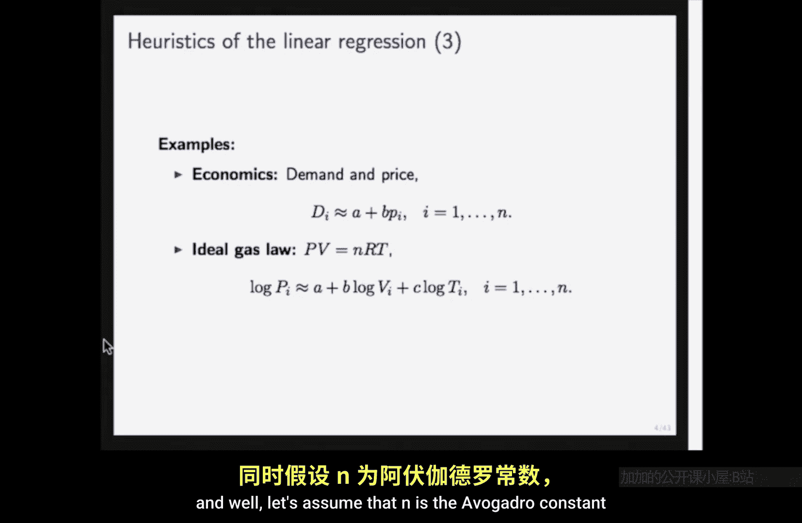

# 麻省理工学院【中英⚡应用统计学｜18.650-2016-Statistics-for-Applications】-p12-P12-13Regression-mkv--BV1hck9B6EpM_p12-

The following content is provided under a C Commons license。

 Your support will help Mi T OpenCourseware continue to offer high quality educational resources for free to make a donation or to view additional materials from hundreds of Mit courses。

 Visit Mitopcourseseware at Ocw Mt Eduu。

ItsBecause if I was not， this would be basically the last topic we would ever see。

 And this is arguably probably the most important topic in statistics。

 or at least that's probably the reason why most of you are taking this class， because regression。

Implies prediction and prediction is what people are all after now， right。

 You don't need to understand what the model for the financial market is if you actually have a formula to predict what the the stock prices are going be tomorrow。

 And regression in a way allows us to do that。 And we'll start with a very simple version of regression。

 which is linear regression， which is the most standard one。

And then we'll move on to slightly more advanced notions， such as nonpar or regression。

 At least we're gonna see the principles behind it。

 And I'll touch upon a little bit of high dimensional regression。

 which is what people are doing today。So。The goal of regression is to try to predict one variable based on another variable。

 Alright， so here， the notation is very important。 it's extremely standard。 It goes from one。

 it goes everywhere essentially， and essentially， you have。

 you're trying to explain y as a function of X， okay， which is the usual y equals F of x question。

Except that， if you look at a calculus class， people tell you y equals F of x。

And they give you a specific form for F。 And then you do something here。

 We're just gonna try to estimate what this link function is。

 And this is why we often call Y D explain variable and X， D explanatory variable。Alright。

 so we're statistician。 So we start with data。 Al right， then what does our data look like， Well。

 it looks like a bunch of input output to this relationship。 Alright， so we have a bunch of X I， Y I。

 Those are pairs。 and I can do a scatter plot of those guys。 right， So each point here has a。

X coordinate， which is X I and a Y coordinate， which is why I in here， I have a bunch of endpoint。

 and I just draw them like that。Now， if。So the functions we're gonna be interested in are often function of the form Y equals a plus B times x。

Okay， and that means that this function looks like this。So if I do X and Y。

 this function looks exactly like a line and clearly those points are not online and it will basically never happen that those points are online。

 there's a famous t-shirt from I think UC Berkeley Sta department that shows this picture and put a line in between them like we're gonna to see it and it says statisticians so many points and you still manage to miss all of them。

And and so basically， essentially， we don't believe that this relationship Y is equal to a plus B X is true。

 but maybe up to some noise。 And that's where the statistics is gonna to come into play。

 There's gonna be some random noise that's gonna to play out。 And hopefully。

 the noise is gonna be spread out evenly so that we can average it if we have enough points。

 Average it out。 Okay， And so this epsilon here is not necessarily due to randomness， but again。

 just like we did modeling in the first place。 It essentially accounts for everything we don't understand about this relationship。

All right， so for example。So here I'm not gonna be okay， give me one second。

 So I'll see we'll see an example in a second。But the idea here is that if you have data。

 and if you believe that it's of the form a plus B X plus some noise。

 you're trying to find the line that will explain your data the best， right。

 in the terminology we've been using before， this would be the most likely line that explains the data。

 So we can see that it's， We've just added another dimension to our statistical problem。

 We don't have just x's。 but we have Y's。 And we're trying to find the most likely explanation of the relationship between Y and X。

All right， and so。In practice， the way it's going to look like is that we're going to have basically two parameters to find the slope B and the intercept A。

 And given data， the goal is going to be to try to find the best possible line。

So what we're gonna find is not exactly A And B， the ones that actually generate the data。

 but someest estimators of those parameters， A hat and B hat。Constructed from the data。Alright。

 so we'll see that more generally， but we're not gonna go too much in the details of this。

 there's actually quite a bit that you can understand if you do what's called univariate regression when X is actually a real valued random variable。

 So when this happens， this is called univariate regression。And when x is in R P。

For p larger than n or equal to 2， this is called multivari regression。Okay。

 and so here we're just trying to explain Y is a plus B X plus epsilon。

 And here we're gonna have something more complicated。 We're gonna have y。

 which is equal to a plus B1 x 1 plus B2。X 2 plus。B。P XP。Plus， epsilon。

 where x is equal to the coordinates of x are given by x12 x p and Rp。Okay， so it's still linear。

 right， They still add all the coordinates of x with a coefficient in front of them。

 but it's a bit more complicated than just one coefficient for one coordinate of x。 Okay。

 so we'll come back to multi regression。There's， of course， you can write this as a X transpose B。

 right， So this entire thing here。This linear combination is of the form x transpose B。

Where B is the vector that has coordinates。B1，2 BP。O。So， here it's in R D。

P is the natural limitation。Alright， so our goal here in the Uni 1 is to try to write a model。

 make sense of this little twiddle here。Essentially。

 from a statistical modeling question is gonna be able to， the question is gonna be。

What distributional assumptions you want to put on Epsilon。

 Are you going to say they Gaussian or are you going to say they are。Bomal。Okay。

Are you gonna say they're binomial are gonna say they're Bly。

 So that's gonna be what we're gonna make sense。 And then we're gonna try to find a method to estimate A And B。

 And then maybe we're gonna try to do some inference about A And B。

 maybe test if A And B take certain values if there are less than something。

 maybe find some confidence regions for A And B， alright。So why would you want to do this？ Well。

 I'm sure all of you have an application， why if I give you some X you're trying to predict what why is machine learning is all about doing this。

 right， without maybe trying to even understand the physics behind this。 They're saying， well。

 you give me a bag of words。 I want to understand whether it's gonna be a spam or not。

 You give me a bunch of economic indicators， I want you to tell me how much I should be selling my car for You give me a bunch of measurements on some patient。

 I want you to predict how this person is going respond to my drug and things like this。 Alright。

 And so。Often， we actually don't have much modeling intuition about what the relationship between X and Y is。

 And this linear thing is basically the simplest function we can think of， arguably。

Linear functions are the simplest functions that are not trivial。 Otherwise， we would just say， well。

 let's just predict X Y to be a constant， meaning it does not depend on X。

 but if you want it to depend on X， linear functions are basically as simple as it gets。 Turn out。

 amazingly， this does the trick quite often。Alright， so for example， if you look at economics。

 you might want to assume that the demand is a linear function of the price。 Allright。

 so if your price is 0， there's going to be a certain demand。 And as the price increases。

 the demand is going to move， do you think B is going to be positive or negative here。我。Typically。

 it's negative unless we're talking about maybe luxury goods where， you know， the more expensive。

 the more people actually want it。 I mean， if we're talking about actual economic demand。

 that's probably definitely negative。 it doesn't have to be， you know。

 clearly linear so that you can actually make it linear， transform it into some linear。

 So for for example， you have this like multiplicative relationship， right P you know。

 Pv equals an R T， which is the ideal ideal gas law， if you want to actually write this relationship。

 if you want to predict what the pressure is going be as a function of the volume and the temperature。

And well， let's assume that so n is the avoator constantant And let's assume that the。

 the radius is actually fixed。 Then you have basically， you take the log on each side， right。

 So you get PV equals in R T。

Okay， so。