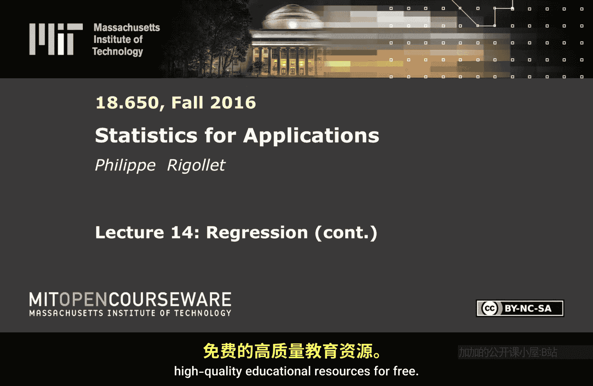

# 麻省理工学院【中英⚡应用统计学｜18.650-2016-Statistics-for-Applications】-p13-P13-14Regression-(cont)-mkv--BV1hck9B6EpM_p13-

The following content is provided under a C Commons license。

 Your support will help Mi T OpenCourseware continue to offer high quality educational resources for free to make a donation or to view additional materials from hundreds of Mit courses。

 Visit Mitopcourseseware at Ocw Mt Eduu。

AI minus X I transpose。

切。Okay， I just。Pick whatever notation I want for my variable， and let's say it's T。Okay。

 so that's the least square estimator。 And it turns out that as I said。

 last time it's gonna be convenient to think of those things as matrices。 Alright。

 so here I already have vectors， right， I've already gone from one dimension。

 just real valued random variables to random vectors when I think of each X。

 But if I start stacking them together， I'm gonna have vectors and matrices that show up。

 So the first vector I'm getting is why。😊，Which is just the vi where I have Y1。QY N。Then I have。

 so that's a bold phase vector。Then I have x。Which is a matrix where I have。 well。

 the first coordinate is always one。 Okay， so I have one and then。X 1。X， P-1。 And that's sorry， X1。

X P -1， And that's for observation1。 And then I have the same thing all the way down for observation N。

Okay， everybody understands what this is。So I'm just basically stacking up all the Xs， right？

So this eye throw。Is X I transpose。I'm just stacking them up。

 And so if I want to write all these things to be to be true for each of them。

 all I need to do is to write a vector Epsilon， which is Epsilon 1 to Epsilon n。

And what I'm going to have is that y， the voltage phase vector now is equal to the matrix x times the vector beta plus the vector epsilon。

Okay， and it's really just exactly saying what's there because for two。 So this is a vector， right。

 This is a vector。And what， what is the dimension of this vector。N， right， So this is N observations。

And for all these， for two vectors to be equal， I need to have all that coordinates to be equal。

 And that's exactly the same thing as saying that this holds for I equal 1 to x。But now。

 when I have this， I can actually rewrite the sum。For T sorry， for I。Eals one to n of Y， I minus。X。

 I transpose beta squared。 This is turns out to be equal to the Euclidean norm of the vector Y minus the matrix x time beta。

Squared， okay， and I'm going to put a two here。 So we， you know。

 we're talking about the Euclidean norm。 right， This just means this is a Euclidean norm。Right。

That's the one we've seen before。 when we talked about k square。

 that's the square norm the sum of the square of the coefficients。 And then I take a square root。

 But here I have an extra square。 So it's really just the sum of the square of the coefficients。

 which is this， and here are the coefficients。😊，O。So there that I write my this。

 this thing like that， then minimizing。So my goal here now is going to solve minimum over t。

In our P of。Why。Minus x times T。2 square。And just like we did for one dimension。

 we can actually write optimality conditions for。This， I mean， this is a function。Right。

 so this is a function。From R P。To R。And if I want to minimize it。

 all I have to do is to take its gradient and set it equal to 0。Okay， so。明林门。Set。Graients。To 0。

So that's where it becomes a little complicated， right， Now。

 I'm going have to take the gradient of this norm。 It might be a little annoying to do。 But actually。

 what's nice about those things。 I mean， I remember that it was a bit annoying to learn。 I mean。

 it's just like basically rules of， of calculus that you don't use that much， but。Essentially。

 you can actually expandend this norm， and you will see that the rules are basically the same as in one dimension。

 you just have to be careful about the fact that matrices did not commute。Okay。

 so let's expend this thing。Y minus X t squared。Well， this is equal to the norm of y squared。Plus。

The norm。Of X t squared。Plus two times y transpose。X T， right。

That's just expanding the square in and more dimensions。

 And this I'm actually going to write as y squared。Plus， so here， the norm squared of this guy。

 I always have that the norm of x squared is equal to x transpose x， right？

So I'm going to write this as x transpose x。 So it's T transpose。X transpose X T。Plus。

 two times y transpose X T。Okay， so now if I'm going take the gradient with respect to T。

 I have basically three terms， and each of them has some sort of a different nature。

 This term is linear in T。And it's going to differentiate the same way that I differentiate a times x。

 right， I'm just going keep the A。This guy is quadratic。 T appears twice。 And this guy。

 I'm going pick up a2 and is's going to differentiate just like when I differentiate a times x squared。

 it's two times a X。 Okay， and this guy is a constant with respect to T。

 So it's gonna to differentiate 2。0。Okay， so when I compute the gradient。Now， of course。

 every all these rules that I give you can check by looking at the partial derivative with respect to each coordinate。

 but arguably， it's much faster to know the rules of differentiability。

 It's like if I give you the function exponential x。 And I said。

 what is the derivative and you start writing， well。

 I'm gonna write exponential x plus h minus exponential x x divided by h and let H go to 0。

 that's a bit painful。I'm sorry。The transpose of2 A B。Is D transpose a transpose。

If you're not sure about this， just make A And B have different size。

 And then you will see that there's some not incompatibility。 I mean。

 there's basically only one way to not screw that one up。 So that's easy to remember。 Alright。

 so if I take the gradient。Then it's going to be equal to what it's going to be0。Plus， we said here。

 this is going to differentiate like， so think。A times x squared。 So I'm gonna have2 A X。 So here。

 basically， this guy is gonna go。2。X transpose X T now。I could have made this one go away。

 but that's the same thing as saying that my gradient is I I。

 I can think of my gradient as being either a horizontal vector or vertical vector。

 So if I remove this guy， I'm thinking of my gradient as being horizontal。 If I remove that guy。

 I'm thinking of my vector my gradient as being vertical。 and that's what I want to think of。

 typically vertical vectors， right。😊，Column vectors。And then this guy， well。

 it's like this guys just think。A times x， right， So the derivative is just a。

 So I'm going to keep only that part here。Sorry， I forgot a minus somewhere yeah here。

Minus2 Y transpose x。And what I want is this thing to be equal to 0， right？So， tea。The optimal T。

It's called。Be the hat。And satisfies。Well， I can cancel the twos and put the minus on the other side。

 And what I get is that x transpose X T。Is equal to y。Transpose X。And that's。Yeah。

 that's not working for me。Yeah， that's because when I took the derivative。

 I still need to make sure。So it's the same question of whether I want things to be columns or rows。

 right？ So this is not a column。Right， if I remove that guy， why transpose T。

