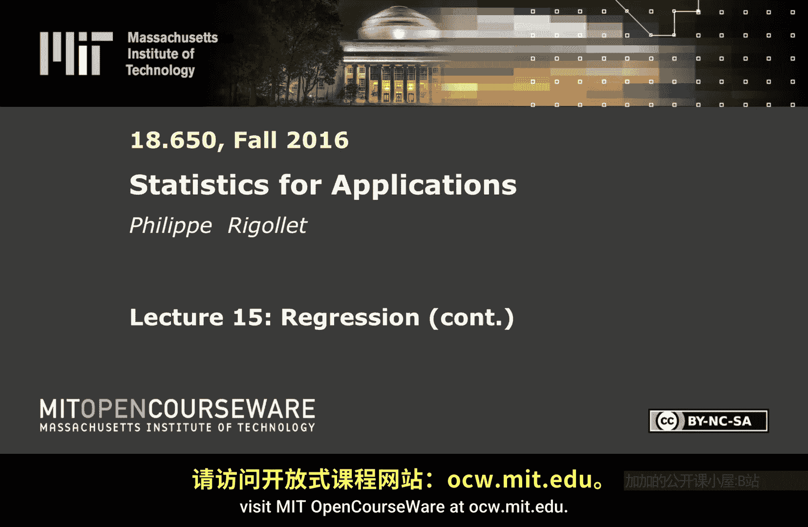
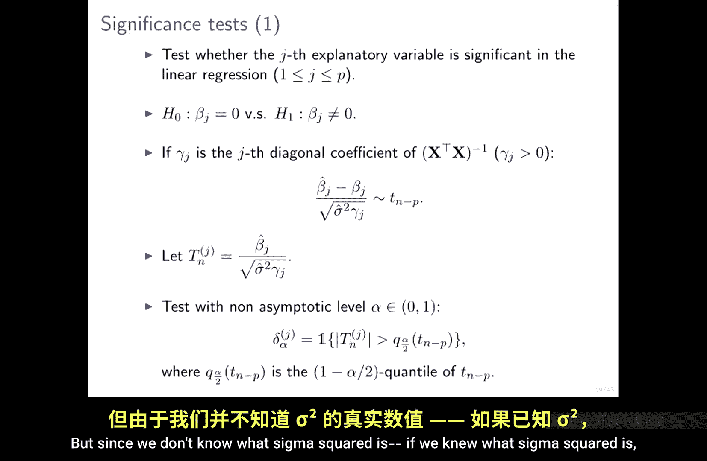

# 麻省理工学院【中英⚡应用统计学｜18.650-2016-Statistics-for-Applications】-p14-P14-15Regression-(cont)-mkv--BV1hck9B6EpM_p14-

The following content is provided under a C Commons license。

 Your support will help Mi T OpenCourseware continue to offer high quality educational resources for free to make a donation or to view additional materials from hundreds of Mit courses。

 Visit Mitopcourseseware at Ocw Mt Eduu。

So yes， before we start this chapter will not be part of the midterm。

 everything else will be and so all the way up to goodness of fit tests and there will be some practice exams that will be posted in the recitation section of the course and you will be working on so the recitation tomorrow will be a review session for the midterm。

I'll send an announcement by email。Okay， so。Going back to our estimator。

 we showed that the least scores estimator in the case where we had some Gaussian observations。

 so we had something that looked like this why it was equal to some matrix x times beta plus some epsilon。

 This was an equation that was happening in R to the n for n observations and then we wrote the least squares estimator beta hat。

Okay， and for the purpose from Huron， where you see that you have this normal distribution。

 this Gaussian P V distribution。 that means that at some point。

 we've made the assumption that epsilons were N。And dimensional0 identity of R n times the times sigma squared。

Which I kept unforttting about last time。 All right， I will try not to do that this time。

And so from this， we derived a bunch of properties of this least squares estimator beta hat。

And in particular， one the， the key thing that everything was built on was that we could write beta hat as the true unknown beta plus some multivariate Gaussian that was centered。

 but had a weird convenientvari structure。 So that was definitely p dimensional。

 And it was sigma squared times x。X， so that's x transpose x。And that's inverse， right， yeah。

And the way we derived that was by having a lot of at least one cancellation between x transpose X and X transpose X inverse。

Okay， so this。😊，Is。The basis。For inference。嗯呃。linear in linear regression。So。In a way。

 that's correct， because what happened is that we use the fact that x beta hat once we have this beta X beta hat is really just a projection of y onto the linear span of the columns of x。

 right， or the column span of x。 And so in particular， those things。

 Y minus x beta hats are called residuals。But that's the vi。Of residuals。

What's the dimension of this of this。Victor。And by one， right？

 So those things we can sort of write as epsilon hat。Right。

 there's sort of an estimate for this epsilon because we just put a hat on。On beta。And from this one。

 we could actually build an enbiased estimator of sigma hat squared。And that was this guy。 Okay。

 and we showed that indeed， the right normalization for this was n minus p because y minus x beta hat2 norm is actually a k square with n minus p degrees of freedom。

 And so thats up to the scaling by sigma square。 So that's what we came up with。

 And something I told you which follows from cochran theorem we did not go into details about this。

 But essentially since one of them corresponds to projection onto the linear span of the columns of x。

 and the other one corresponds to projection onto the orthogonal of this guy。

 And we're in a Gaussian case， things that are orthogonal are actually independent in a Gaussian case。

 So from a geometric point of view， you can sort of understand everything。

 You think of your subspace of the linear span of the x's。 sometimes you project onto this guy。

 sometimes you project onto its orthogonal， beta hats corresponds to projection onto the linear span。

 epsilon hats correspond to a projection onto the orthogonal and those things tend to be independent。

 And that's why you have that beta hats is independent of sigma square of Sigma hat square。

 so it's really just。It's a statement about two linear spaces being orthogonal with respect to each other。

So。We， we left at this on this slide last time。 And what I claim is that this thing here is actually oh。

 yeah， the other thing we want to use。 So that's good for beta hat。

 But since we don't know what sigma square is。 If we knew what Sigma square is。

 that would totally be enough for us， but we also need the extra thing， that sigma square hat square。

Over Sigma squared。Follows， and there's n minus P。This follows a k squared with n minus P degrees of freedom。

 and sigma hat squared is independent of beta hat， right， so。That's gonna be something we need。

 So that's useful。If sigma squared。Is a known。And again。

 sometimes it might be known if you're using some sort of you know。

 measurement device for which it's right on the side of the box。Okay， so from these two things。

 we're gonna be able to do inference and inference， right， we said there's， I mean。

 there's three pillars to inference。 The first one is estimation， and we've been doing that so far。

 right， We've constructed this least square estimator。

 which happens to be the maximum likelihood estimator in the Gasian case。😊。

The two other things we do in， in inference are confidence intervals。

And we can do confidence intervals。 We're not gonna do much because we're gonna talk about their sort of cousin。

 which are tests。 Okay， and that's really where the statistical inference comes into。 And here。

 we're gonna be interested in a very specific kind of test for linear regression。

 And those are tests of the form。Beta J， so the J is coefficient of beta is equal to 0。

 And that's going to be our null hypothesis versus。H1。Where beta J is say not equal to 0。

 And for the purpose of regression， unless you have lots of domain specific knowledge。

 it won't be beta G positive or beta G negative。 It's really not， not nonze。

 That's interesting to you。Okay， so why would I want to do this test。Well。

 if I expend this thing where I have Y。Is equal to x beta。Plus， epsilon。So what happens if I look。

 for example， at the first coordinate。 So， so I have that Y is actually， so say y 1。Is equal to。

Beta 1。Plus。Beta 2 x 1。Well， that's actually complicated。 Let me write it like this。Betata 0。Plus。

 beta 1， x1。不好意思。B2 P。-1 X， P-1。Plus， epsilon。 And that's true for all eyes， right。Okay。

 and this is right。 So this is beta1 times 1 That was our first coordinate。 Okay。

 so that's just expanding this going back to the， to the。

 the scalar form rather than going to the matrix vector form。 Okay， that's what we're doing。

 When I write y is equal to x beta pluspsilon。 I， I assume that each of my y can be presented as a linear combination of the x' is。

 the first one being one plus a mepson I。 Everybody agrees with this。

What does it mean for beta J to be equal to 0。Yeah， that X J doesn't even show up in this thing。

 right， So if beta j is equal to 0。That means that， essentially， we can remove。Did Jay coordinate？

X J from all observations。Okay， so， for example， I'm a banker， and I'm trying to predict。Some score。

 let's call it why without the noise， right， So I'm trying to predict what is gonna be your score。

 And that's something that should be sort of telling me how likely you are to rebrsse your loan on time。

 right， or do have late payments， or actually， maybe these days bankers are actually looking at how much late fees can I will I be collect from you。

 right， Maybe that's what they are more after， rather than make sure that you rebrsse everything。

 So they're trying to maximize this number of late fees。

 And they collect a bunch of things about you definitely your credit score。

 but maybe your zip code profession， years of education， family status， a bunch of things， right。

One might be your。