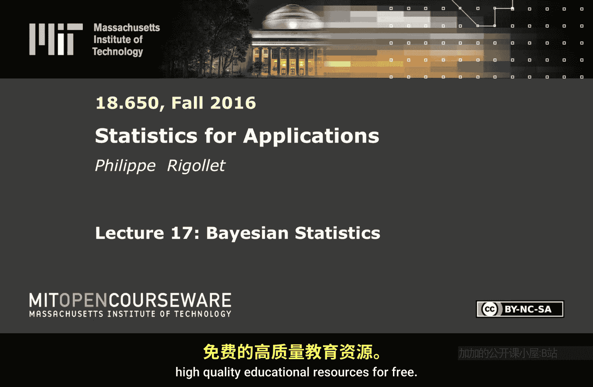
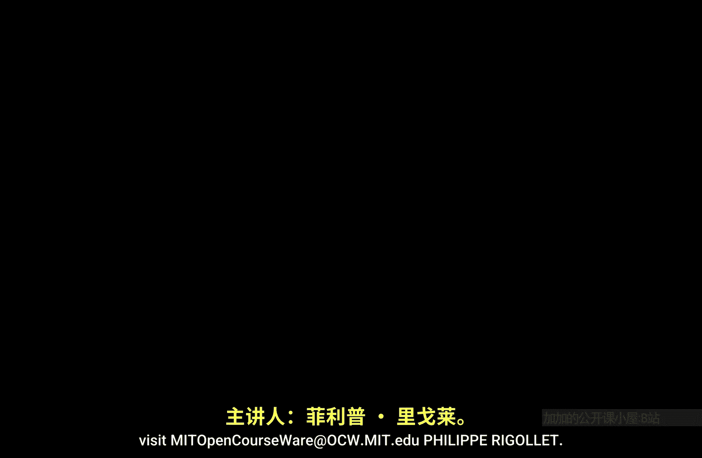
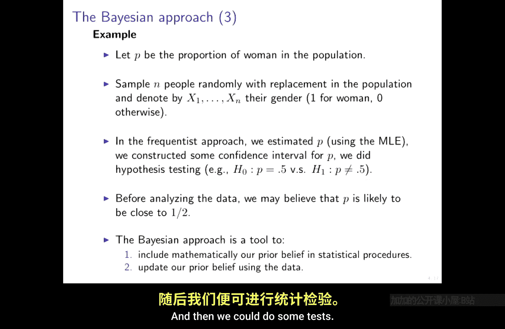

# 麻省理工学院【中英⚡应用统计学｜18.650-2016-Statistics-for-Applications】-p15-P15-17Bayesian-Statistics-mkv--BV1hck9B6EpM_p15-

The following content is provided under a C Commons license。

 Your support will help Mi T OpenCourseware continue to offer high quality educational resources for free to make a donation or to view additional materials from hundreds of Mit courses。

 Visit Mitopcourseseware at Ocw Mt Eduu。

So today， we'll actually just do a brief chapter on Bayesian statistics。

 And there's entire courses on Bayesian statistics。 There's entire books on Bayesian statistics。

 There's entire careers on Bayesian statistics， so。Admittedly。

 I'm not gonna be able to do it justice and tell you all the interesting things that are happening in Beijing statistics。

 but I think it's important as a statistician to know what it is。

 how it works because it's actually a weapon of choice for many practitioners and and because it allows them to incorporate their knowledge about a problem in a fairly systematic manner。

 So if you look at like say the Bay statistics literature it's huge。 And so here I give you you know。

 sort of a range of what you can expect to see in Beijing statistics from your you know。

Second edition of a traditional book， something that involves computation。

 some things that involve rethinking。 And there's a lot of Bayesian thinking。

 there's a lot of things that， you know， talk about sort of like philosophy of thinking Bayesian。

 This book， for example， seems to be one of them。 This book is definitely one of them。

 This one represents sort of a wide a broad literature on Bayesian statistics for applications。

 for example， in social sciences。 But even in largescale machine learning。

 There's a lot of Bayesian statistics happening， particular using something called Bayesian and parametrics or hierarchical Bayesian modeling。

 So。We do have some experts at MIT in CL Tamarbroderic， for example。

 is a person who does quite a bit of interesting work on Bay and parametrics and if that's something you want to know more about ourdu to go and talk to her So you know before we go in those more advanced things we need to start with what is the Bay approach。

 what do Beijingians do and how is it different from what we've been doing so far。

So to understand the difference between Bayesians and what we've been doing so far is we need to first put a name on what we've been doing so far。

 It's called frequent statistics。 it's usually Bayesian versus frequent statistics。 I mean， by verse。

 I don't mean that there's naturally in a position to them actually often you will see the same method that comes out of both approaches。

 So let's see how we did it， right， The first thing we had data。 right， We observe some data。

And we assume that this data was generated randomly。

 The reason we did that is that because this would allow us to leverage tools from probability。

 So let's say by nature， measurements， you do a survey， you get some data， okay。

Then we made some assumptions on the data generating process。 For example， we assume they were IID。

 that was one of the recurring things。 Sometimes we assume it was Gaussian。

 If we wanted to use a T test。 maybe we did some nonparmetric statistics。

 we assume it was a smooth function or maybe linear regression function So those are our modeling。

 And this was basically a way to say， well， we're not gonna allow for any distributions for the data that we have。

 but maybe a small set of distribution that indexed by some small parameters， for example。

 or at least you know， remove some of the possibilities。 otherwise， there's nothing we could learn。

And。And so， for example， this was associated to some parameter of interest。

 theta or beta in the regression model。 Al right， then we had this unknown problem。

 and this unknown thing。 a parameter in。 we wanted to find it。

 We wanted to either estimate it or test it or maybe find a confidence interval for the subject。

 Allright， So so far， I should not have said anything that's gonna that's new。

 But this last sentence is actually what's gonna be different from the the vision party in particular。

 this unknown but fixed thing it's gonna to be changing。Alright， so。In the Bayesian approach。

 we still assume that we observe some random data， but the generating process is slightly different。

 It's sort of a two layer process。 And there's one process that generates the parameter and then one process that。

 given this parameter generates the data。So what the first layer does， right？ I mean。

 nobody really believes that there's some random process that's happening about， you know。

 generating what is going to be the true expected number of people who turn their head to the right when they kiss。

 but this is actually gonna be something that brings us some， you know。

Easiness for us to incorporate what we call prior belief。Right。We'll see an example in a second。

 But often you actually have prior belief of what this parameter should be， right。

 when we did say least squares， we looked over all of the vectors in all of R to the P。

 including the ones that have coefficients equal to， you know，50 million。

And so those are things that maybe we might be able to rule out。

 and maybe we might be able to rule out at a much smaller scale。For example， well， I mean。

 I don't know。 I'm not an expert on， on you know， turning your head to the right or to the left。 but。

 you know， maybe you can roll out the fact that， you know。

 almost everybody's turning their head in the same direction or almost everybody's turning their head to another direction。

So we want to， we have this prior belief。 And this prior belief is gonna play。

Say hopefully less and less important role as we collect more in more data。

 But if we have a smaller amount of data， we might want to be able to use this information。

 Alright rather than just shooting in the dark。 And so the idea is to have this prior belief。

 And then we want to update this belief into what's called the posterior belief after we've seen some data。

 maybe I believe that you know there's something that should be in some range。

 but maybe after I see data， maybe it's comforting me in my belief。

 So I'm actually having maybe a belief that's more so belief encompasses basically what you think and how strongly you think about it。

 That's what I call belief So for example， if I have a belief about some parameter the。

 maybe my belief is telling me where data should be how strongly I believe in it in the sense that I have a very narrow region where data could be And so the posterior belief says well。

 you see some data and maybe you're more confident or less confident about what you've you've shifted your belief a little bit。

And so that's what we're going to try to see and how to do this in a principal manner。So， of course。

 to understand this better， there's nothing better than an example， so。

Let's talk about another stupid statistical question， which is， let's try to understand P。 Of course。

 I'm not gonna talk about politics from now on。 So there。

 let's talk about P the proportion of women in the population。Okay。

 and so what I could do is to collect some data， X 1， X， N。And assume that there。

Vnately with some parameter P known， right， so。P is in01。Okay， let's assume that those guys are I D。

 So this is just an indicator for each of my collected data。

 whether the person I randomly sample is a woman。 I get a1。 and if it's a man， I get a0。Okay， and so。

Now， the question is， I sampled these people randomly。

 I you know their their gender and the the frequentest approach was just saying， okay。

 let's just estimate P hat being X and bar。 And then we could do some tests。

Right， so here there's a test。 I want to test maybe if p is equal 2。5 or not。

 That sounds like a pretty reasonable thing to test。 And but， you know。

 we want to also maybe estimate P。 But here， this is a case where we definitely have for our belief of what P should be。

 right， We are pretty confident that P is not gonna to be 07。

We actually believe that P should be extremely close to one half。Okay， but maybe not exactly。 Maybe。

 I don't know。 Maybe this population is not the population in the world。

 but maybe this is the population of， say， some college。

 And we want to understand if this college has half women or not， right。

 So maybe we know it's gonna be close to one half， but maybe we're not quite sure。And so。

We're gonna want to integrate that knowledge。 Alright。

 so I could integrate it in a blunt manner by saying， you know。

 discard the data and say that P is equal to one half。 But maybe that's just a little too much。

 So how do I do this trade off between， you know， adding the data and combining it with this prior knowledge。

In many ways， in many instances， essentially， what's going to happen is that this one half is going to act like one new observation。

 essentially。So if you have， you know， five observations， this is just the six observation。

 which will play a role。 If you have a million observations， you're gonna have a million in one。

 and it's not going to play so much of a role。 That's basically how it goes。

That's basically how it goes， but。Definitely not always。 all right。

 because we'll see that if I take my prior to be a 0。 minus1 half here。

 it's basically as if I was discarding my data。 So essentially there's also your ability to encompass how strongly you believe in this prior and if you believe infinitely more in the prior than you believe in the data you collected。

 then of course it's not going to act like one more observation。

 so the Bayesian approach is a tool to one， include mathematically or prior in。

