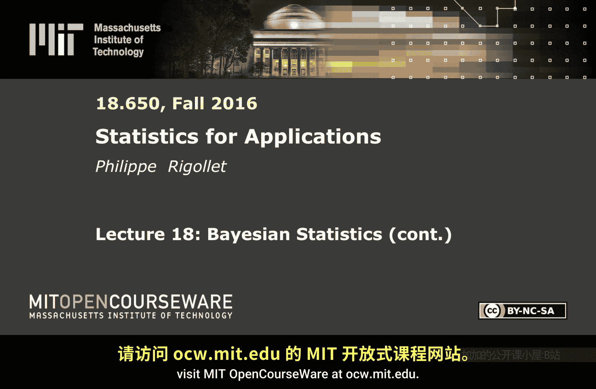
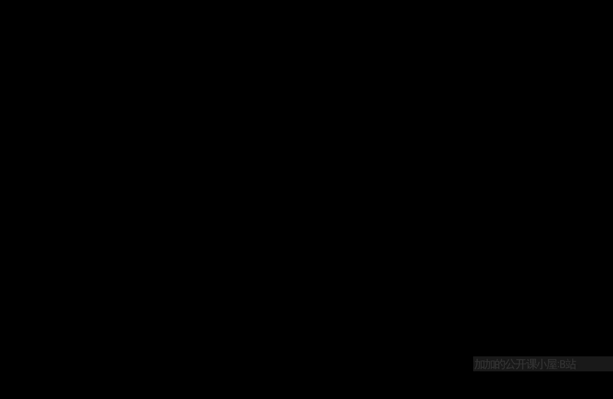
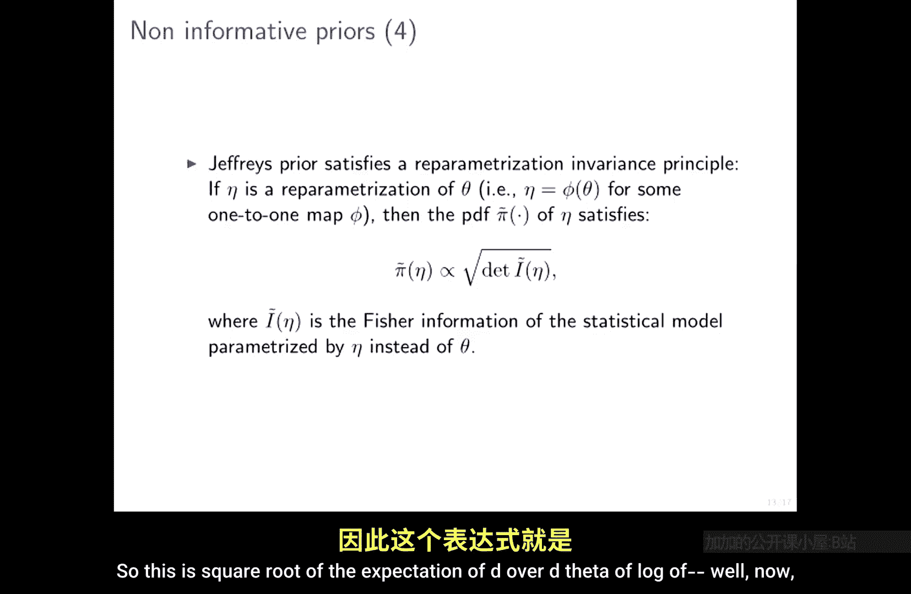

# 麻省理工学院【中英⚡应用统计学｜18.650-2016-Statistics-for-Applications】-p16-P16-18Bayesian-Statistics-(cont)-mkv--BV1hck9B6EpM_p16-

The following content is provided under a Cative Commons license。

 Your support will help Mi T OpenCourseware continue to offer high quality educational resources for free to make a donation or to view additional materials from hundreds of Mit courses。

 Visit Mitopcourseseware at Ocw Mt Eduu。

So today we're gonna close this chapter on the short chapter on Beijing inference。 Again。

 this was just an overview of what you can do in Beijing inference。

 And last time we started defining what's called Jeffrey's priors so when you do Beijingian inference。

 you have to introduce a prior on your parameter。 And we said that usually it's something that encodes your domain knowledge about where the parameter could be。

 but there's also some principal way to do it if you want to do Beijingian inference without really having to think about it And for example。

 one of the natural priors where those nonin priors if you're on a compact set。

 it's a uniform prior over this set。 if you're on an infinite set。

 you can still think of taking the all ones prior and that's called prior that's always equal to one and that's an improper prior if you're an infinite set。

And or proportional to one。 And so another prior， you can think of in the case where you have fier information。

 which is well defined is something called Jeffs prior。 And this prior is a prior。

 which is proportional to square root of the determinant of the fier information matrix。

 And if you just have， if you're in one dimension， it's basically proportional to square root of the fier information coefficient which we know。

 for example， as the syntheticotic variance at this of the maximum likelihood estimator。

 and and it turns out that it's basically so square root of this thing is basically one over the standard deviation of the maximum likelihood estimator。

 And so you can compute this， right， So you can compute for the maximum likelihood estimator。

 we know that the variance is gonna be P1 minus p in the。In the。Bly statistical experiment。

 So you get this one over square root of this thing。 And for example， in the Gaussian setting。

 you actually have that the fissure information， even in the multivariate one is actually going be something like the identity matrix。

 So this is proportional to one。 it's the improper prior that you get in this case。

Meaning that for the Gaussian setting， no， no place where you center your Gaussian is actually better than any other。

Alright， so we basically left on this slide where we saw that Jeffrey's priorryor satisfy a reparameterization。

 They're invariant by transformation of your parameter， which is a desirable property。 And in a way。

 it says that， well， if I have my prior on theta。 And then I suddenly decide that theta is not the parameter I want to use to parameterize my problem。

 actually， what I want is phi of theta。 for think， for example。

 as theta being the mean of a Gaussian and phi of theta as being this mean to the cube。 Okay。

 this is a one to one。Map Phi， right？ So， for example， if I want to go from Theta to Theta cube。

And now I decide that this is the actual parameter that I want。 Well。

 then it means that on this parameter， my original prior is gonna induce another prior。

 And here it says， well， this prior is actually also Jeffrey's prior， Okay。

 so it's essentially telling you that for this new parameterization。 if you take Jeffrey's prior。

 then you actually go back to having exactly something that's of the form curve of determinant of the fier information。

 But this time with respect to your new parameterization。 Allright， And so why is this true， Well。

 it's just this change of variable theorem， right， So it's essentially telling you that。If you call。

Let's call P。 Mo， let's call Pi tilde。Of eaten。Prior。Over。Eta。

 and you have pi of theta is the prior over theta。Then just by since Eta is of the form phi of theta。

 just by change a variable。Right， so that's essentially a probability result。 It says that。

Pi Tilda of Eta。Is。Equal to pi of Eta。Times D pi of theta times D。Theta over d。Eta。And。Sorry。

 is that the one。 Actually， I'm going have to write it because I always forget this。所以非这个方心。Okay。

 so what I want is to check。嗯。Okay。啊。Okay， so I want a function of Eta that I can put here。

 And what I know is that this is H of phi。theta。All right， so。Sorry， Eta is5 of theta， right。

So what I'm going to do is I'm going to do the change of variable。飞的。Is。By inverse。啊， 비。So。一张。

It's by of，Which means that D Eta。I。Equal to。D to well to phi prime of theta。D data don。

So when I'm gonna write this， I'm gonna get integral of H。Actually。

 let me write this as I'm more comfortable writing this as。咦。With respect to Ata of H of Eta。Okay。

 so that's just Eta， according to being drawn from the prior。

 And I want to write this as the integral of H of Eta time sum function， right？

 So this is the integral of。H of。5。Of theta， Pi of theta。ディテラ？

Now I'm going to do my changer variable， so this is going to be the integral of H of Eta。

And then pi of。Phi So theta is phi inverse of Eta。And then the theta is phi prime。Of data。D data。

 okay。And so what is pi of Phi theta。 So this thing is proportional。 So we're in say dimension  one。

 So it's proportional of square root of the fiser information and the fiser information we know is the expectation of the square of the derivative of the log likelihood。

 right， So this is square root。Of the expectation of。

D over。Theta。Of log。Of， well， now I need the density。Well， let's just call it log。

 Let's call it L of theta。 And I want this to be taken at phi inverse。呃，biter。Squared。

And then what I pick up is the。So I'm gonna put everything into the square。

 So I get phi prime of theta。Squared D theta。O。So now I have the expectation of a squared。

 This does not depend。 So this is， sorry， this is L of theta。

 This is the expectation of L of theta of N X， right。That's for some variable。

 And the expectation here is with respect to X。 That's just the definition of the， of the。

Fishature information。 So now I'm gonna squeeze this guy into the expectation。

 It does not depend on X。 It just acts as a constant。

 And so what I have now is that this is actually proportional to the integral of H Eta。

Times the square root。Of the expectation with respect to X of what Well here I have D over D theta of log of theta。

 And here， this guy is really。D Eta over D theta， right。Agree。So now what I'm really left by。

 So I get D over D theta times D sorry， times D theta over D Eta。So that's just D over D Eta of v。

Of Eta。X。