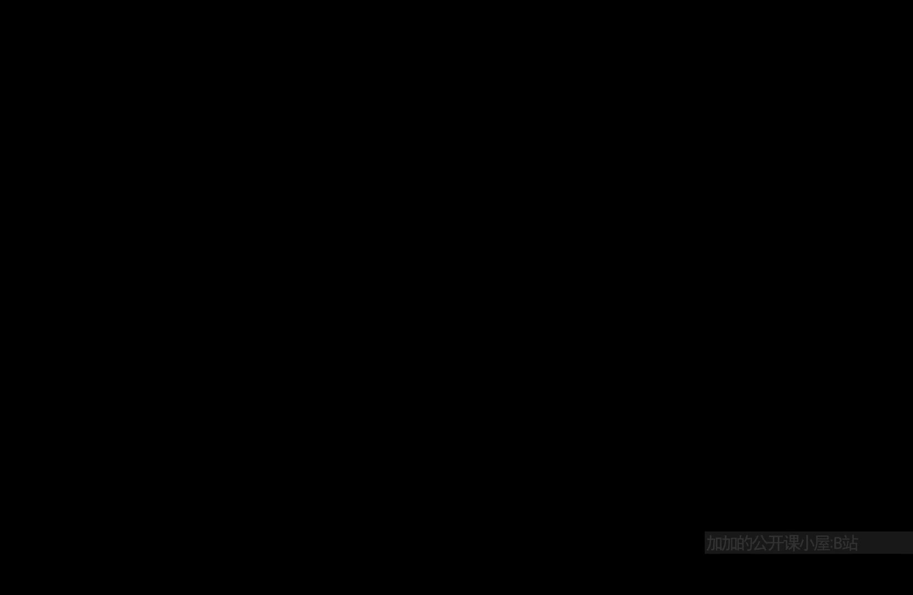

# 麻省理工学院【中英⚡应用统计学｜18.650-2016-Statistics-for-Applications】-p17-P17-19Principal-Component-Analysis-mkv--BV1hck9B6EpM_p17-

The following content is provided under a C Commons license。

 Your support will help Mi T OpenCourseware continue to offer high quality educational resources for free to make a donation or to view additional materials from hundreds of Mit courses。

 Visit Mitopcourseseware at Ocw Mt Eduu。

A bunch of x's and a bunch of and a bunch of y's。 The Y's were univvariate。

 just one real valued random variable。 and the x's were vectors that describe a bunch of attributes for say each of our individuals or each of our observations。

 Let's assume now that we're given essentially only the x's。

 This is some referred to as unsupervised learning。

 There's just the x's usually supervision is done by the Y's。

 And so what you're trying to do is to make sense of this data。

 You're gonna try to understand this data， Re this data， visualize this data。

 try to understand something right So if I give you a de dimensionmensional random vectors。

 and you're gonna have an independent copies of this of this random vector。

 Okay so you will see that I'm going have I'm going very quickly run into some limitations about what I can actually draw on the board because I'm using boldface here。

 I'm also going use the blackboard boldface。 So it's gonna be a bit difficult。

 So let's tell me if you're actually little。Con by what is a vector。

 What is a number and what is a matrix。 But we'll get there。 So I have x in R D。

 And that's a random vector。And they have x1。To X N that are I I D。 They are independent copies of x。

Okay， so you can think of those as being。The realization of this guys are going to be a cloud。

Of endpoints。In order to the D。 And we're going to think of D as being fairly large。

 And for this to start to make sense。 We're going think of D as being at least4。O。

And meaning that you are gonna have a hard time visualizing those things。 If it was three or two。

 you would be able to draw these points。 and that's pretty much as much sense you're gonna be making about those guys。

 just looking at the cloud point。Alright， so I'm going to write each of those x's。

So this vector x as de coordinate。And I'm going to write them as x1。To X， D。

And I'm gonna stack them into a matrix。 Okay， so once I have those guys。

I'm going to have a matrix with here。 I'm going to use the double bar， and it's。X 1。Transpose。

X N transpose。 So what it means。Is that the coordinates of this guy， of course， are x11 here。

I'm of size D， so I have X 1 D。And here I have x n1。X andD。And so， the I。Jith。

I throw and J's column is the matrix X I J， right， is the entry X I to， sorry。Okay， so each。

 so the rows here are the observations and the columns are the covariates or attributes。 Okay。

 so this is an end by D matrix。Right， this is really just some bookping。

 How do we store this data somehow， And the fact that we use a matrix。

 just like for regression is going be convenient because we're gonna be able to talk about projections。

 We're going to be able to talk about things like this。Alright。

 so everything I'm going to say now is about variances or covariances of those things。

 which means that I need two moments。 Okay， if the variance does not exist。

 there's nothing I can say about this problem。 So I'm gonna to assume that the variance exists。

 And one way to just put it is to say that the two norm of those guys is finite。

 which is another way to say that each of them is finite。 I mean。

 you can think of it the way you want。Alright， so now the mean of x， right。

 So I have a random vector so I can talk about the expectation of x。 That's a vector that's in R D。

And that's just taking the expectation entry wise。Sorry。X 11 sorry， X1 X D。Okay。

 so I should say it out loud。For this， the purpose of this class， I will denote by subscripts。

 the indices that corresponds to observations and superscripts。

 the indices that correspond to coordinates of variable。 And that's。

 I think that's the same convention that we took for the regression case。Of course。

 you could use whatever you want if you want to put commas， et ce。

 It becomes just a bit more complicated。Alright， and so now once I have this。

 So this tells me where my cloud of point is centered， right， So if I have。A bunch of points。

 Okay so。Now have a distribution on R D。 So maybe I should talk about this。

 I'll talk about this when we talk about the empirical version。

 But if you think that you have say a two dimensional Gaussian random variable。

 then you have a center in two dimension， which is where it peaks basically。

 And that's what we're talking about here。 But the other thing we want to know is how how much of it spread in every direction right So in every direction of the two dimensional thing it can try to understand how much spread I'm getting。

 And the way you measure this is by using covariance So the covariance matrix。Sigma， that's a matrix。

 which is D by D。And it records in the JK entry。 It records the covariance between the J coordinator X and the K coordinator X。

 Okay， so with entries。Okay， so I have sigma， which is Sigma 11。sigma。呃，滴滴。Sigma 1 d， Sigma D1。Okay。

 here I have sigma J K。And Sigma JK。It's just the covariance。Between x。I， sorry， X J。

 the J coordinate and the K coordinate。Okay， so in particular。

 it'ssymmetric because the covariance between X J and X K is the same as the covariance between X K and X J。

 I should not put those。Prentices here。 I do not use them in this。OK。Just the covariance matrix。

 So that's just something that records everything。 And so what's nice about the covariance matrix is that if I actually give you X as a vector。

 you actually can build a matrix just by looking at vectors times vectors transpose。

 rather than actually thinking about building it coordinate by coordinate。 So， for example。

 if youre used to using matlab， that's the way you want to build a covariance matrix。

 because Matlab is good as at you know， manipulating vectors and matrices rather than just entry it by entry by entry。

😊，Okay， so。So what is the covariance？Between X J。N Xk。Well， by definition， is the expectation of X J。

嗯。And Xk。Minus the expectation of Xj。Times the expectation of xk。Right。

 that's the definition of the covariance。 I hope everybody's seen that。And so in particular。

 I can actually see that this thing can be written as sigma can now be written as the expectation of X。

 X transpose。😊，Mineus the expectation of x。Times the expectation of x transpose。Why， well。

 let's look at the JKth coefficient of this guy， right， So here， if I look at the JKth coefficient。

I see what well I see that it's the expectation。Of x。X transpose JK。

Which is equal to the expectation of x。X transpose GK。

And what are what are the entries of X X transpose Well they're of the form X I X J times Xk。

 exactly。