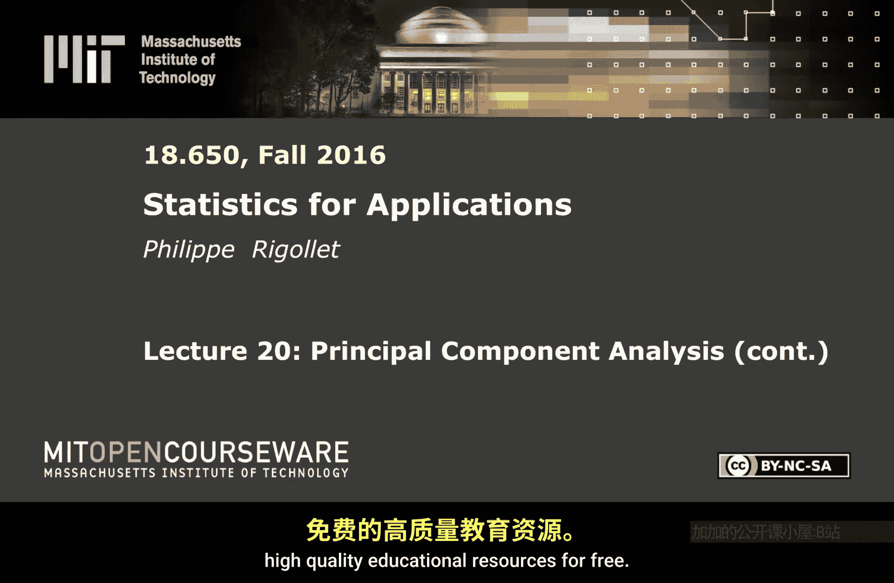
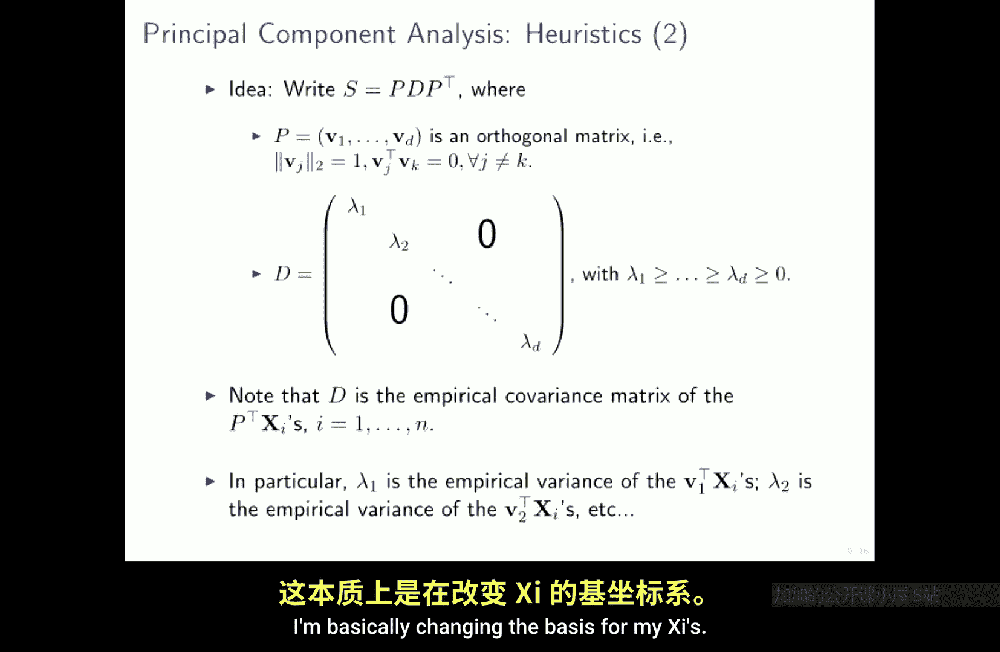

# 麻省理工学院【中英⚡应用统计学｜18.650-2016-Statistics-for-Applications】-p18-P18-20Principal-Component-Analysis-(cont)-mkv--BV1hck9B6EpM_p18-

The following content is provided under a Cative Commons license。

 Your support will help Mi T OpenCourseware continue to offer high quality educational resources for free to make a donation or to view additional materials from hundreds of Mit courses。

 Visit Mitopcourseseware at Ocw。 Mt Eduu。

Keep on talking about principle component analysis， which we。

Essentially introduced as a way to work with a bunch of data。

 So we have the the data that's given to us when we want to do PC A is a bunch of vectors， X 1， X， N。

Allright， so。So they're random vectors。In R D， okay。

 and what we mention is that we're gonna be using linear algebra in particular。

 the spectral theorem that guarantees to us that if I look at the covariance matrix of disguise or its empirical covariance matrix。

 Since there' are symmetric real matrices and there are positive semidefinite。

 There exists a diagonalization into non-neative eigenvalues。 All right， And so here。

 those things live in R D。 So it's a really large space。

 And what we want to do is to map it down into a space that we can visualize。

 hopefully a space of size 2 or3， or if not， then we're just going to take more and start looking at subspaces altogether。

 right so。😊，Think of the case where d's large。But not larger than N。 Allright。

 so let's say you have a large number of points。 So the question is。

Is it possible to project those things onto a lower dimensional space D prime。

Which is much less than D。 So think of D prime of equals， say 2 or or 3。

And so that you keep as much information about the cloud point that you had originally。 All right。

 so again， the example that we could have is that X 1 to X N for。

 say X I for patient I recording a bunch of body measurements and maybe blood pressure。

 some symptoms， etc。 And then we have a cloud of end patients and we're trying to visualize maybe to see if if I could see for example。

 that there's two groups of patients， maybe I would know that I have two groups of different disease or maybe two groups of different patients that respond differently to a particular disease or drug。

 etc。 So visualizing is gonna give us quite a bit of insight about what this the spatial arrangement of those vectors are。

 And so PC8 says， well， you know。Here， of course， in this question。

 one thing is not defined is what is information。 And we said that one thing we might want to do when we project is that points start to not collide with each other。

 And so that means we're trying to find directions where after I project the points are still pretty spread out。

 And so I can see what's going on。 And PC says， okay。 So there's many ways to answer this question。

 And PC says， let's just find a a subspace of dimension D prime that keeps as much covariance structure as possible。

 And and the reason is that those directions are the ones that maximize the variance。

 which is a proxy for the spread。 There's many， many ways to do this。 There's actually a。😊。

AGoo video that was released maybe last week about the data visualization team of Google that shows you something called Tney。

 which is essentially something that tries to do that。

 It takes points in very high dimensions and tries to map them in lower dimension so that you can actually visualize them。

 And T is some alternative to PCA that gives another definition for the word information。 Allright。

I'll talk about this towards the end， how you can actually somewhat automatically extend everything we've said for PCA to an infinite family of。

 of procedures。Alright， so how do we do this， Well， the way we do this is as follows。 right。

 So remember， given those guys， we can form something which is called S， which is the sample。

Or the empirical。Covariance matrix。Okay， and since from a couple slides ago。

 we know that S has this avalue decomposition。 S is equal to。P，D， P transpose， where。P is orthogonal。

Okay， so that's where we use our linear algebra results。

 So that means that P transpose P is equal to P， trans P， P transpose。Which is the identity。Okay。

 so remember， S is a D by D matrix， right。And so P is also D by D。And D。Is theagonagonal。And。

And I'm actually gonna take without loss of generality。 I'm gonna assume that D。

 So it's gonna be diagonal。 And I'm gonna have something that looks like lambmbda 1。Yeah。

 lambda 1 to lambda D。 Those are called the eigenvalues of S。

What we know is that the lambda Js are non negative。And actually。

 what I'm going to assume with list of generality is Lada 1 is larger than Lada 2， which is larger。

Then lambda D。Okay， because in particular， this decomposition。

 the spectral decomposition is not entirely unique。I could permute。The columns of P。

And I would still have an orthogonal matrix。 and to balance that。

 I would also have to permute the entries of D。 Okay。

 so there's as many thecompositions as their permutations， right， So there's actually quite a bit。

 But the bag of eigenvalues is unique， right if I give the set of eigenvalues is unique。

 The order ring is certainly not unique。 Okay， so here I'm just gonna pick。

 I'm gonna nail down one particular permutation， actually， maybe two in case in case I have equal。

 But let's say there's， let's say I pick one that satisfies this。

 And the reason why I do this is really not very important is just to say when I talk I'm gonna want to talk about the largest of those eigenvalues。

 So it's just gonna be easier for me to say that this one is lambda 1 rather than say sda 7。

 Allright。So this is just to say that the largest tag in value。Of S。Is lambda 1， okay。

If I didn't do that， I would just call it maybe Lida max。

 And you would just know which one I'm talking about。Alright， so。So。What's happening now is that。

If I look at D。Then it turns out that if I start， So if I do P transpose X I。

 I am actually projecting my X'。 I'm basically changing the， the basis for my Xs。

 And now D is the empirical covariance matrix of those guys。😊。

Alright， so let's check that。So what it means is that。If it look at。

So what I claim is that P transpose Xi。 That's a new vector。 Let's call it Y I。It's equal。

 it's also in RD。And what I claim is that the covariance matrix of this guy is actually now this diagonal matrix。

 which means in particular that if they were Gaussian， then they would be independent。

 But I also know now that there's no correlation across coordinates of Y I。 Okay， so to prove this。

 let me assume。That X bar。Is equal to 0。 And the reason why I do this is because it's just annoying to carry out all this centering constantly when I talk about S。

 Alright， so when x bar is equal to 0， that implies that S as this very simple form。

 It' of the form some from I equal1 to n of X I。X， I transpose， right， So that's my S。

 But what I want is the S of。Why， so， okay， that implies also that P。Times x v。

Which is equal to P times x bar is also equal to 0， right， So that means that y bar。Y has mean 0。

 if this is 0。 So if I look at the sample covariance matrix of y。

It's just going be something that looks like the sum of the outer products or the Y I， Y I transpose。

O。And again， the reason why I make this assumption。

So that they don't have to write minus x bar x bar transpose。But you can do it。

 and it's gonna work exactly the same。Alright， so now I look at this S prime。

 And so what is this S prime。Well， I'm just going to replace Y I with P X I， right， So it's the sum。

From I equal1 to n of P， Px， I transpose。Which is equal to。The sum from， sorry， there's a one over n。

So it's equal to one over n sum from I equal 1 to n of P， X， I。X I transpose， P transpose。Agree。

I just said that the transpose of A B is the transpose of B times the transpose of A。

And so now I can push the sum in。 right， P does not depend on I。 So this thing here is equal to P。

