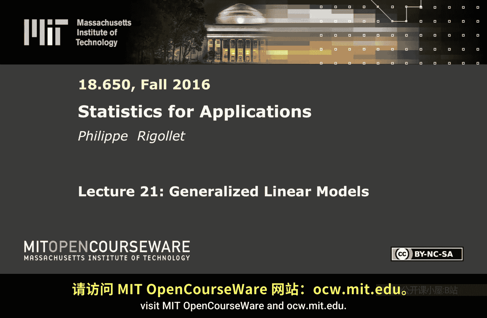
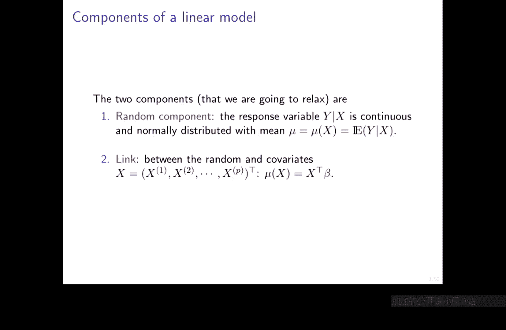

# 麻省理工学院【中英⚡应用统计学｜18.650-2016-Statistics-for-Applications】-p19-P19-21Generalized-Linear-Models-mkv--BV1hck9B6EpM_p19-

The following content is provided under a C Commons license。

 Your support will help Mi T OpenCourseware continue to offer high quality educational resources for free to make a donation or to view additional materials from hundreds of Mit courses。

 Visit Mitopcourseseware at Ocw Mt Eduu。

Cha is a natural capstone chapter for this entire course。

 We'll see some of the things we've seen during maximum likelihood and some of the things we've seen during linear regression。

 Some of the things we've seen in terms of the basic modeling that we've had before。

 We're not going go back to much inference questions。 It's really going be about modeling。

 And in a way， generalized linear models， as the word says are just the generalization of linear models。

 And they're actually extremely useful。 They're often forgotten about。

 and people just jump onto machine learning and sophisticated techniques。

 But those things do the job quite well。 So let's see in what sense they are generalization of the linear models。

 right So remember， the linear model look like this。 We said that。

Y was equal to x transpose beta plus epsilon， right that was a linear regression model。

 And it's another way to say this is that if I and let's assume that those were say Gaussian would mean 0 and identity covariance matrix。

 then another way to say this is that the conditional distribution of y given x。Is equal to sorry。

 is a。Gaausian with mean X transpose beta。And variance， well， we had a sigma square。

 which I will forget as usual， x transpose beta and then sigma square。 Okay。

 so here we just assumed that so what is regression is just saying I'm trying to explain y as a function of x。

 given x， I'm assuming a distribution for the Y。 And this x is just gonna be here to help me model what the what the mean of this Gaussian it'。

 right？ I mean， I could have something crazy。 I could have。😊，Something that looks like Y， give an X。

Is n 0 x transpose beta。 And then this guy could be some other thing， which looks like， I don't know。

 some x transpose gamma squared times I don't know。 X x transpose plus identity。

 Some crazy thing that depends on x here， right， And we deliberately assumed that all the thing that depends on x shows up in the mean。

 Okay， And so what I have here is that y given x is a Gaussian with a mean that depends on x and covariance matrix。

 sigma square identity。😊，Now， the linear model assumed a very specific form for the mean。 It said。

 I want the mean。To be equal to x transpose beta， which remember was the sum from， say。

 J equals1 to P of beta J。X J， right。Where the X Gs are the coordinates of X。

 But I could do something also more complicated， right， that could have something that looks like。

 instead replace this by， I don't know。 sum of beta J。A log of x through the J。Divided by。

X to the J squared or something like this， right？I could do this， as well。

So there's two things that we've assumed。 The first one is that when I look at the conditional distribution of Y even and X。

 x affects only the mean。I also assumed that it was Gaussian and that affect only the mean and the mean is affected in a very specific way。

 which is linear in x。Right， so。This is essentially the things we're going to try to relax。

So the first thing that we assumed， the fact that y was Gaussian and had only its mean that depend on Xx is what's called the random component。

 It just says that the response variables。You know。

 sort of makes sense to assume that they're Gaussian。And， and everything was essentially captured。

 right， So there's this property of Gaussians that if， you tell me， the， if the variance is known。

 all you need to tell me to understand exactly what the distribution of a Gaussian is。

 All you need to tell me is its expected value。All right， so that's this mu of x。

And the second thing is that we had this link that says， well。

 I need to find a way to use my X's to explain this mu。

 And the link was exactly mu of x was equal to x transpose beta。OK。Now。

 we are talking about generalized linear models。So， this part here。Or mu of x is of the form。

 the way I want my beta， my x to show up is linear。 This will never be questioned。In principle。

 I could had add a third point， which is just question this part， the fact that。

A mu of x is x transpose beta。 I could have some more complicated non nonlinear function of x。

 And then we'll never do that because we're talking about generalized linear model。

 The only thing with generalize are the random component， the conditional distribution of y given x。

And the link that just says， well， once you actually tell me that the only thing I need to figure out is the mean。

 I'm just gonna slap it exactly this x transpose beta thing without any transformation of x transpose beta。

Okay， so those are the two things。

It will become clear what I mean。 this sounds like a theology。

 But let's just see how we could extend that。So what we're gonna do。And generalized linear models。

 right， so。When I talk about GLNs。The first thing I'm going to do with my x is turn it into some x transpose beta。

 And that's just the。L part， right， this I'm not going be able to change。 That's the way it works。

 I'm not gonna do anything on linear。But the two things I'm gonna change is this random component。

Which is that y， which used to be some Gaussian with mean mu of X。They in Sigma squared。

So why give an X story？This is going to become。Yhy give an X？Follow some。Distribution。

And I'm not gonna allow any distribution。 I want something that looks comes from the exponential family。

Who knows what the exponential family of distribution is。

 This is not the same thing as the exponential distribution。It's a family of distributions。Alright。

 so we'll see that。哇啊。我紧得比。Oh yeah， that's actually my。嗯。So啊。I'm sorry。那个。嗯。I mean in。

 presentation mode that should not happen。 Okay， so hopefully this is muted so。So essentially。

 this is gonna be a family of of distributions。 And what makes them exponential。

 T is that there's an exponential that shows up in the definition of the density。 Alright。

 we'll see that the Gaussian belongs to the exponential family。

 but there's slightly less expected ones because there's this crazy thing that。

A to the X is exponential。 X log A， which makes the exponential show up without being there。

 So if there's an exponential or some power， it's gonna show up。 But it's more than that。

 So we'll actually come to this particular family of distribution。 Why this particular family。

 Because in a way， everything we've done for the linear model with Gaussian。

Is going to extend fairly naturally to this family。Alright， and it actually also。

 because it encompasses pretty much everything all the distributions we've discussed before。Alright。

 so the two， the second thing that I want to question。So before we just said， well， mu of x。

Was directly equal to this thing。U of x was directly extra transpose beta。

 So I knew I was gonna have an extra transpose beta。 And I said， well。

 I could do something with this extra transpose beta before I used it to explain the expected value。

 But I'm actually taking it like that。 Here， we're gonna say， let's extend this。To some function。

Is equal to this thing。Now， admittedly， this is not the most natural way to think about it。

 What you would probably feel more comfortable doing is write something like mu X is a function。

 Let's call it F。Of x trans transpose beta。But here， I just decide to call F。G inverse。Okay。

 that's just my geneverse， yes。Different than just transforming the。一。I mean。

 what transformation you want to put on your x's。Like is this equivalent to just applying some function？

Individual x component。 And then we'll applying that data to get。The民。Oh no， certainly not， right。

I mean， if I give you， if I force you to work with x1 plus x2。

 you cannot work with any function of x 1 plus any function of X 2， right。So yeah， this is different。

那就 yeah。The transformation would be just the simple part of your linear regression problem where you would take。

