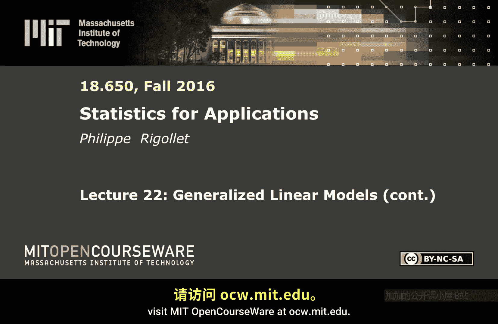
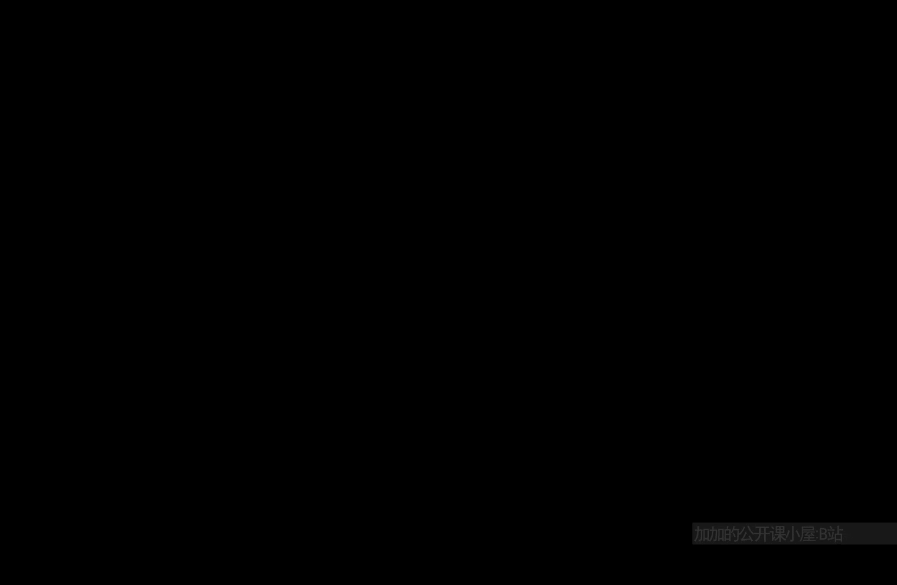

# 麻省理工学院【中英⚡应用统计学｜18.650-2016-Statistics-for-Applications】-p20-P20-22Generalized-Linear-Models-(cont)-mkv--BV1hck9B6EpM_p20-

The following content is provided under a C Commons license。

 Your support will help Mi T OpenCourseware continue to offer high quality educational resources for free to make a donation or to view additional materials from hundreds of Mit courses。

 Visit Mitopcourseseware at Ocw Mt Eduu。

We're talking about。Generalized linear models and in generalized linear models with generalized linear models in two ways。

 The first one is to allow for different distributions for the response variables。

 And the distributions that we wanted was the exponential family。

And this is a family that can be generalized over random variables that are the final say R Q in general with parameters in R K。

 but we're going to focus in a very specific case where this is when R is equal Y is real valued response variable。

 which is the one you're used to when you're doing linear regression and the parameter theta。

Also lives in R。And so we're going to talk about the canonical case。

 So that's the canonical exponential family where you have a density of theta of x。

 which is of the form exponential minus sorry exponential plus。

 and then we have y which interact with theta only by taking a product。

 and there's a term that depends only on theta， some dispersion parameter phi。

 and then we have some normalization factor， let's call it c of y。嗯。Phi， so it only depends。

 So it really should not matter too much。 So it's a C of Y P。

 And that's really just a normalization factor。 And here we said that we're gonna assume that Phi is known。

Okay， I just， I have no idea what I write。 I don't know if you guys can read。

 I don't know what chalk has been used today， but I just can't see it。 That's not my fault。 Alright。

 so。We're gonna assume that Phi is known。 And so we saw that， you know。

 several distributions that we know well， including the Gaussian， for example， belong to this family。

 And there's other ones such as peo。じゃ。Sorry。Qusson and Berley。 So if the PMF has this form。

 if you have a discrete random variable， this is also valid。

And the reason why we introduce this family is because there are gonna be some properties。

 So we know that this thing here。 this function B of theta is essentially what completely characterizes your distribution。

 right So if phi is fixed， we know that the interaction as the form。 this form。

 and this really just comes from the fact that we want the function to integrate to one。

 So this B here in the canonical form encodes everything we want to know。

 if I tell you what b of theta is， and of course， I tell you what phi is。

 but let's say for' second that phi is equal to1。 if I tell you this B of theta。

 you know exactly what distribution I'm talking about。

 So it should encode everything that's you know， specific to this distribution such as meanvari all the moments that you would want。

 And we'll see how we can compute from this thing。The mean and the variance， for example。 So today。

 we're gonna talk about likelihood。 And we're gonna start with the likelihood function or the log likelihood for one observation from this。

 We're gonna to do some computations。 And then we'll move on to the actual log likelihood based on n independent observations。

 And here， as we will see， the observations are not going to be identically distributed because we're gonna want each of them。

 I mean， conditionally on x to have a different to be a different function of x。 Okay。

 to where theta is just a different function of x for each of the observations。Right。

 so remember the log likelihood。And this is for one observation。It's just the log of the density。

 right。And we have this identity that I mentioned at the end of the class on Tuesday。

 And this identity is just that the expectation of the derivative of this gap with respect to theta is equal to 0。

 So let's see why。 So if I take the derivative with respect to theta of log。F theta of x。

What I get is the derivative with respect to theta。OfF theta of x divided by F theta of x。Right， now。

 if I take the expectation of this guy。With respect to this data， as well。

What I get is that this thing， What is the expectation。 Well， iss just the integral against F theta。

 or if I'm in a discrete case， I just have the sum against F theta， right， If it's a PMF。

 just the distribution， the definition of， right， the expectation。Of x is either the integral。 Well。

 let's say of H of x。Is the integral of H of x。F theta of x。

If this is discrete or it's just the sum of H of x， F theta of x。If X is discrete。

 So if it's continuous， you put this， you know， sweet soft sum。 And if it's put the this guy。

 it's the same thing， right， So I'm just gonna illustrate the case when it's continuous。

So this is what， Well， this is the integral of partial derivative with respect to theta。

Of F theta of x。Divided by F theta of x。All time s theta of x。DX。And now this F theta is canceled。

 So I'm actually left with the integral of the derivative。

 which I'm gonna to write as the derivative of the integral。But a theta being。呃， being呃嗯。Sorry。

 F theta being density for any value of theta that I can take。

 This is the function as a function of theta。 Well， actually， as， as a function of theta。

 this function is constantly equal to one。Right， for any theatre that I take it takes value1。

So this is constantly equal to1。 I put three bars to see that for any value of theta， this is one。

 which actually tells me that derivative is equal to 0。Okay， yes。The second。What is like the first？

That the， that's the definition of the expectation。 Oh， sorry， no， that's just the。

 the definition of the derivative of a log of a function。Log of F prime is F prime over F， right。

That the哪ge。Just by elimination。嗯。😊，I'm sorry。And， and you do good because that's probably how my mind's processes。

 And so I'm like， yeah， L， here's enough information。😊，Okay， everybody's good with this。So， you know。

 that was convenient。 So it just said that the expectation of the derivative of the log likelihood is equal to 0。

 That's gonna be our first identity。Let's move on to the second identity using exactly the same trick。

 which is， let's hope that at some point， we have the integral of this function that's constantly equal to one as a function of theta and then should show that it use the fact that it' derivative is equal to 0。

So。If I start taking the second derivative of the log。Of E theta。So what is this， Well。

 it's the second derivative of， it's the derivative of this guy here。 So I'm gonna go straight to it。

 So it's second derivative。F theta of x times f theta of x。Minus。Second derivative。

 the first derivative of F theta of x。Times first derivative of F theta of x。

Here is some super important stuff。I'm kidding。 And so you can still see that guy over there。

 All right， so it's just the square。And then I divide by f theta of x squared。OK。So。

Here have the second derivative times F itself。 and here have the product of the first derivative itself with itself。

 right， so that's the square。 So now I'm gonna integrate this guy。 So if I take the expectation。

Of this thing here。What I get is the integral。 So here。

 the only thing that's gonna happen when I'm gonna take my integral is that this one of those squares is gonna cancel against F theta。

 right， So I'm gonna get the second derivative。Mus the second derivative squared。

And then I'm divided by F theta。And I know that this thing is equal to 0。Okay。

 now one of this guy here。 sorry， why do I have， Yeah， So I have this guy here。

 So this guy here is gonna cancel。Right， so this is what this is。 equal to。嗯。

