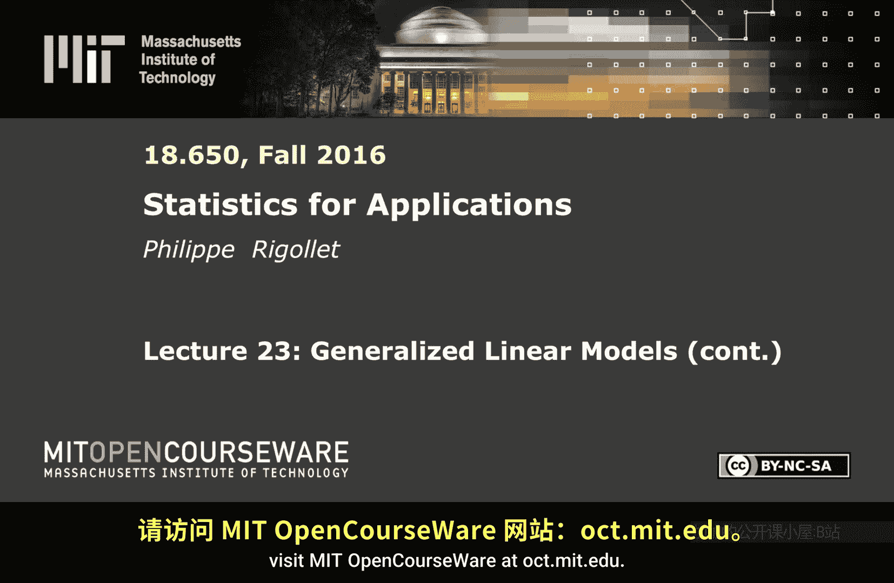
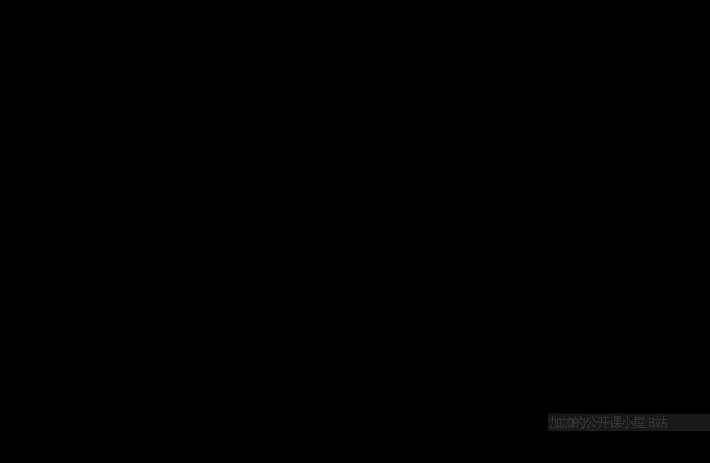
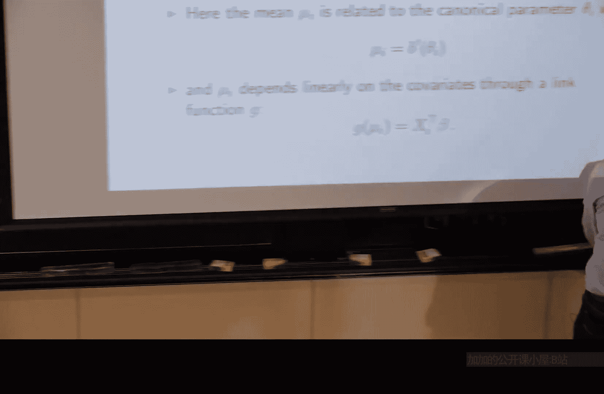
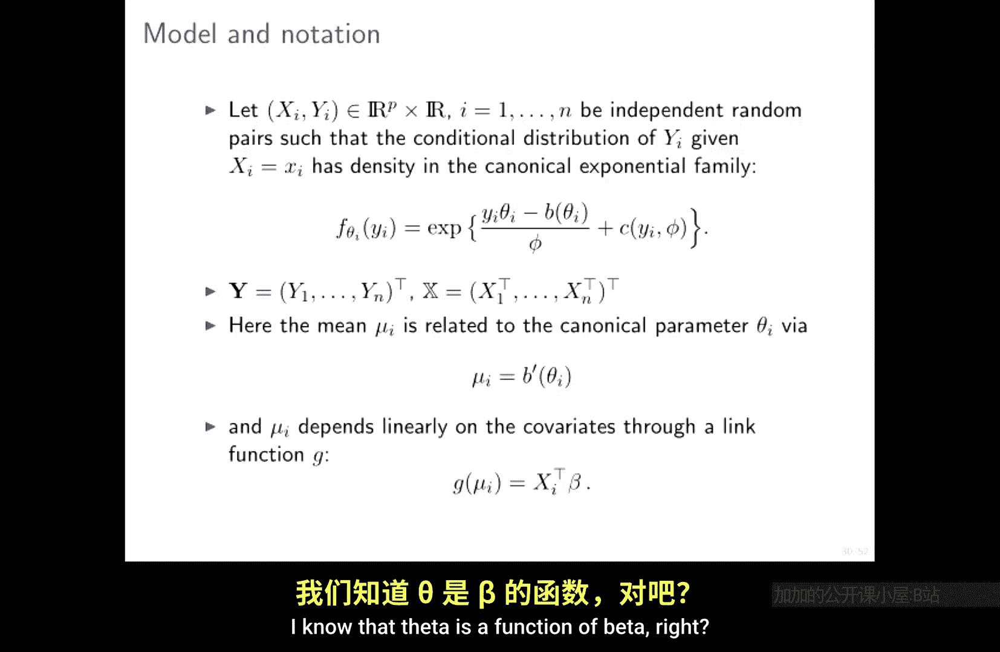

# 麻省理工学院【中英⚡应用统计学｜18.650-2016-Statistics-for-Applications】-p21-P21-23Generalized-Linear-Models-(cont)-mkv--BV1hck9B6EpM_p21-

The following content is provided under a C Commons license。

 Your support will help Mi T OpenCourseware continue to offer high quality educational resources for free to make a donation or to view additional materials from hundreds of Mit courses。

 Visit Mitopcourseseware at Ocw Mt Eduu。

All right。So。Let's continue talking about maximum likelihood estimation in the context of generalized linear models。

 Alright， so in those generalized linear models， what we spend most of the past lectures working on is the conditional distribution。

Of y， sorry of y given x。And we're going to assume that this follows some。Distribution。

In the exponential family。Okay， and so what it means is that if I look at the the density。

 say or the PMF， but let's talk about density is to make things clear。

 we're going to assume that y given F has x has the distribution。

 So x is now fixed because we're conditioning on it and has a density， which is of this form。

C of why。I5。Okay， so the C， again， we don't really need to think about it。

 This is something that's gonna come out naturally as soon as you need normalization factor。

 And so here what it means。 So if this is the distribution of Y given X I。 So that's the density of。

Why。I given X I is equal to little Xxi。So if it's the conditional distribution of Y I given X I。

 it should depend on X I somehow， and it does not appear to depend on X I。 And here。

 the model is going be on。Theta I， which is just a function。Theta I of X I。

 and we're gonna to take a very specific one。 It's gonna be a function of a linear a linear form of the X I。

 So really， we're gonna take something which is of the form theta I。

 which is really just a theta does not depend on X I of X I transpose some beta。 Okay。

 so all this parts here。 This is really some modeling assumptions that we're making。

Once we've agreed on what distribution we want。Okay， so to do that。 So our goal， of course。

 is going to try to understand what this beta is。 There's one beta here。

 What's important is that's this beta。Does not。Depend。On I。 So if I observe pairs， X， I， Y， I。

 let's say I observe N of them。I equalals one to n。

The hope is that as I accumulate more and more pairs of this form。

 where there's always the same parameter that links X I to Y I。 That's this parameter beta。

 then I should have a better and better estimation of this beta because it's always the same。

 And that's essentially what couples all of our distribution。 If I did not assume this。

Then I could have a different distribution for each pair X I given Y I。

 And I would not be able to do any statistics。 They would nothing， nothing would average in the end。

 But here I have the same beta， which means that I can hope to do statistics in average errors out。

Okay， so。I'm going collect， I'll come back to this but as usual， in the linear regression model。

 we're going to collect all our observations， Y I。 So here I'm going to assume that they're real valued and that my X are takes value in R P。

 just like in the regression model。 and I'm going collect all my Y is into one big vector Y in R N and all my x' is into one big matrix in R n times P。

Okay， just like for the linear regressiong model。All right， so。Again。

 what I'm interested in here is the conditional distribution of YI given Xi。Okay， and I said。

 this is this distribution。When we're talking about regression。

 I defined last time what the definition of a regression function was。

 It's just one particular aspect of this conventionalal distribution is the conditional expectation of why I give an Xi。

Okay， and so this conditional expectation， I will denoted by。So if I talk about the conditional。

So that's I'm going to call it a new eye， which is the conditional expectation。

Of Y I given Xi equals some littlexii， sayh？You can forget about this part if you find it confusing。

 it really doesn't matter just so that this is just， this means that this is a function。Of little Xi。

 But if I only had the expectation of why I given big Xi。Would be just a function of big X。Right。

 so it really doesn't change anything。 It's just a matter of notation。Okay。

 so just forget about this part， but I'll just do it like that here。Okay。

 so this is just the conditional expectation of why I given an X。All right， it just depends on X I。

 So particularly it depends on I。 And so I will call it mu I。

 But I know that since I'm in a canonical exponential family。

Then I know that new I is actually B prime of theta I。Okay。

 so there's a one to one link between the canonical parameter of my exponential family and the mean mu I。

 the conditional expectation。And the modeling assumption we're going to make is not directly that we remember that was the second aspect of the generalized linear model。

 We're not going to assume that the I itself directly depends on X I。

 We're going assume that mu I has a particular dependence on X I through the link function。 right。

 So again， we're back to modeling。So we have a link function G。And we assume。Ne。Mui。Depends。On X I。

As follows。G of mu I。 And remember， G， all G does for us is really map the space in which mu I lives。

 which could be just interval 0，1 to the entire real line。

 And we're gonna assume that this thing that lives in the real line is just X I transpose beta。

I should maybe put a small one， X transpose beta。Okay。So we're making， indeed a modeling assumption。

 But compared to in the linear regression model， we only assumed that U I was X I transpose beta。

 So if you want to make a parallel between generalized linear models and linear model is just the only difference is that G is not the identity necessarily in this case。

And all doji does for us is to just make this thing compatible that those two things on the left and the right of this equality live in the same space。

So in a way， we're not making a much， you know。Bigger leap of faith by assuming a linear model。

 The linear link is already here。 We're just making things compatible。哎。And so。

This is gonna be what So it's always the same link function。 So now if I want to go back to beta。

 right， because I'm gonna want to express my likelihood， right。

 So if I were to express my likelihood from this， it would just be a function of theta， right。

And so if I want to maximize my likelihood， I don't want to maximize it in theta。

 I want to maximize it in beta。 So if I can write my density as a function of beta。

 then I will be able to write my likelihood as a function of beta and then talk about my maximum likelihood estimator。

 And so all I need to do is to just say， okay， how do I replace theta by what is。

 I know that theta is a function of beta， right， I wrote it here。😊。

So the question is， what， what is this function。 And I actually have access to all of this。

 So what I know is that theta， right， So mu is B prime of theta。

Which means that theta I is D prime inverse。Of new I。Okay， so that's what we got from this， you know。

 derivative of the log likelihood equal to 0 that gave us this guy inverted。

 And now I know that new I is G inverse of X I beta。

So this composition of B prime inverse and G inverse is actually just the。

Composition of G with B prime。Everybody's comfortable with this notation。 The little circle。

My question about this。 Allright， just means that I first apply B prime。 Well， actually。

 it's the inverse。 But if I look at a function G composed with B prime， I first apply G。

For G B prime of x。Is just G of the parameter。O。