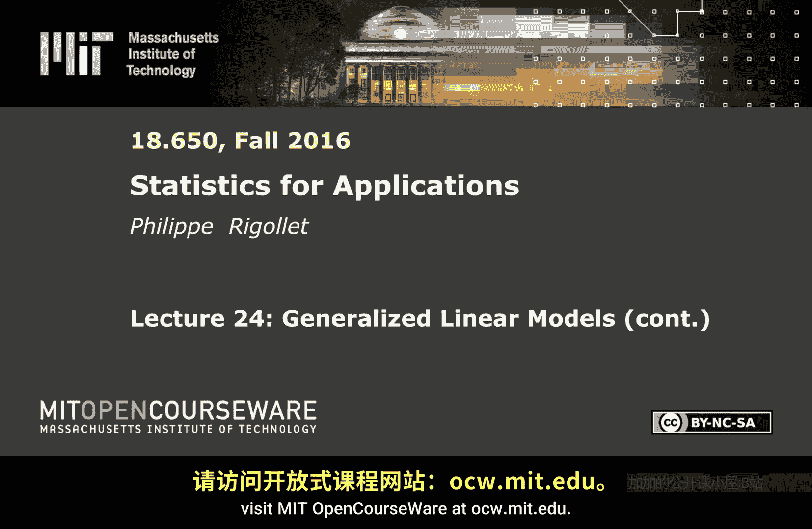
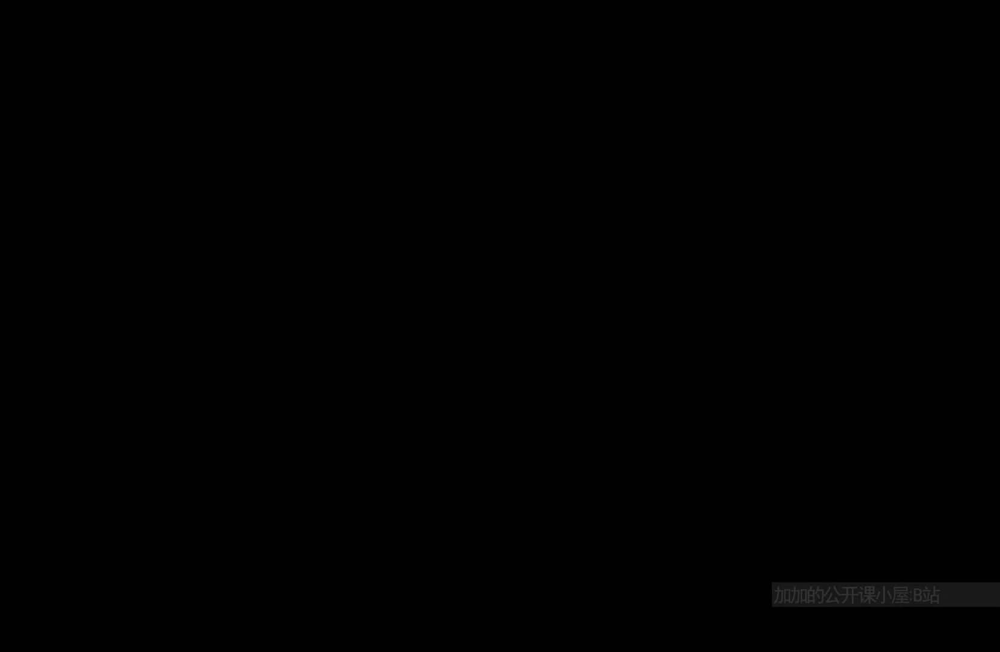
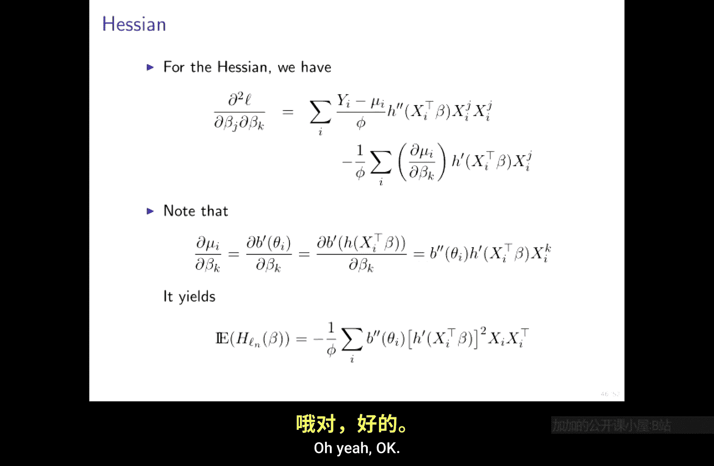

# 麻省理工学院【中英⚡应用统计学｜18.650-2016-Statistics-for-Applications】-p22-P22-24Generalized-Linear-Models-(cont)-mkv--BV1hck9B6EpM_p22-

The following content is provided under a C Commons license。

 Your support will help Mi T OpenCourseware continue to offer high quality educational resources for free to make a donation or to view additional materials from hundreds of Mit courses。

 Visit Mitopcourseseware at Ocw Mt Eduu。

So I， I apologize my voice。It's not 100%。 So if you don't understand。What I'm saying， please ask me。

So we're gonna be analyzing， actually， not really analyzing。

 We described a second order method to optimize the log likelihood in a generalized linear model。

 When the parameter of interest was beta。 Okay， so here I'm gonna to rewrite the whole thing as a beta。

 So that's the equation you see， But we really have this beta and an iteration K plus1。

 beta is given by beta K。And then I have a plus sign。And the plus， if you think of。

The fiser information that beta K as being some number。

 if you were to say whether it's a positive or negative number。

 it's actually gonna be a positive number because it's a positive semi deffinite matrix。

 So since we're doing gradient descent， we have a plus sign here。

 and then the direction is basically gradient L N at beta K。Okay。

 so this is the iterations that we're trying to implement。 and we could just do this。

 at its iteration， we compute the fiser information， and then we do it again and again。 All right。

 that's called the fissure' scoring algorithm。 And I told you that this was going converge。

 And what we're going try to do this in this lecture is to show how we can reimplement this using iteratively re weighted Lee squares so that each step of this algorithm is consists simply of solving a weighted Lee square problem。

Alright， so let's go back quickly and remind ourselves that we are in the。呃。Gussian， sorry。

 we're in the exponential family。 So if I look at the log likelihood for one observation。

 So here it's L N。 sorry， this is the sum from I equal 1 to N of Y I minus。嗯。Okay。

 so it's y I times theta I， sorry。Mus b of theta I。

 then there's going to be some parameter and then a half plus C of Y I phi。Okay。

 so just the exponential went away when I took the log of the likelihood and I have N observations。

 So I'm summing over all n observations。Allright， then we had a bunch of formulas that we came up to this if I look at the expectation of Yi。

 so that's really the conditional of Yi given Xi， but like here it really doesn't matter。

 it' is just going be different for H I， this is denoted by mu I and we showed that this was beta prime of theta I then the other equation that we found was that so what we want to model is this thing we wanted to be equal to Xi transpose beta。

sorry， G of this thing。Right so that's our model。 And then we had that variance was also given by the second derivative。

 I'm not going to go into it。 What's actually interesting is to see if we want to express theta I as a function of X I。

 what we get going from X I through to mu I by G inverse and then to theta I by B inverse。

 we get that。Theta I。Is equal to H of X I transpose beta。 So yeah， H。Of X， I transpose beta。We're H。

Is the inverse。So which order is this is the inverse of G N composed with B prime。O。

So we we we remember that last time those are all computations that we've made。

 they're gonna to be useful in our derivation。 And the first thing we did last time is to show that if I look now at the derivative of the log likelihood with respect to one coordinate of beta。

 which is gonna give me the gradient。 If I do that for all the coordinates。

 what we ended up finding is that we can rewrite it， in this form some of Y I tilde minus mu tilde。

 So let's remind ourselves that。So y tilde is just y。Divided， well， okay。

 Y tilde I is Y I as it times or divided times。G prime。Of mu I。

 mu tilde is I is mu I times G tilde times G prime of。MI。And。

 and then that was just an artificial thing so that we could actually divide the weights by G prime。

 But the real thing that builds the weights or this H prime。 And there's this normalization factor。

 And so if we write it like that。 So if I also write that。W I is H。

Prime of X I transpose beta divided by G prime of mu I times phi。

Then I could actually rewrite my gradient。Which is a vector in the following matrix form。

 the gradient L， N。At beta。So the gradient of my log likelihood in beta took the following form was x transpose。

W。And then y tilder minus mu tilder。And here， W was just a matrix。With W 1， W2。

 all the way to W N on the diagonal and 0 on the of diagonals。OK。

So that was just taking the derivative and doing a slight manipulations that said， well。

 let's just divide whatevers here by G prime and multiply whatever's here by G prime。So today。

 we'll see why we make this division and and multiplication by G prime， which seems to make no sense。

 but it actually comes from the Hassian computations。

 So the hassian computations are going to be a little more annoying。 Actually。

 let me start directly with the coordinate wise derivative， right， So to build this gradient。

 What we used in the end was that the partial derivative。Of L， N。

 with respect to the J coordinator beta。Was equal to the sum。Over I。Of Y I tilde minus mu I tilde。

Times W， I。Cims the G coordinate of X I。O。So now let's just take another derivative。

 and that's gonna give us the entries of the Hesian。Okay， so we're doing。

 we're going to the second derivative。So what I want to compute is the derivative。

With respect to beta J and beta K。Okay， so where does beta J。

 So here I already took the derivative with respect to beta J。

 So this is just the derivative with respect to beta K of the derivative with respect to beta J。

So what I need to do is to take the derivative of this guy with respect to Bta K。

 Where does beta K show up here。It set in in two places。No， it's not in the wise。 The wise are my I。

 I， are my data， right。But， I mean， it's in the way tillil is。Yeah， because it's in mu， right。

 mu depends on beta。 Mu is G inverse of X I transpose beta， and it's also in the in the W Is。

 Actually， everything that you see is directly。 Well， okay， W depends on mu N of on beta explicitly。

And， but the rest depends only on mu。And so we might want to be a little。 well。

 we can actually use the。Did we， did I use the chain rule already。Yeah， it's here。 but okay， well。

 let's， let's go for it， so。Oh， yeah。 okay， sorry， I should not write it like that because that was actually。

Right， so I make my life miserable by just multiplying and dividing by this G prime of of mu。

 I should not do this， right， So what I should just write is say that this guy here。

 I'm actually gonna remove the mu prime， the G prime of mu。

Because I just make something that depends on the appear when it really should not。

 So let's just look at the last but one equality。Okay， so that's the one over there。

 And then I have X， I J。Okay， so here it make my life much more simple because why I does not depend on beta。

 but this guy depends on beta， and this guy depends on beta。 Allright， so when I take the derivative。

 I'm gonna have to be a little more careful now， but I just have a derivative of a product。

 Nothing more complicated。 So this is what， well， the sum is gonna be linear。 So it's gonna come out。

 Then I'm gonna have to take the derivative of this term。So it's just gonna be one over versi。

 Then the derivative of mu I。With respect to beta K， which I will just write。

