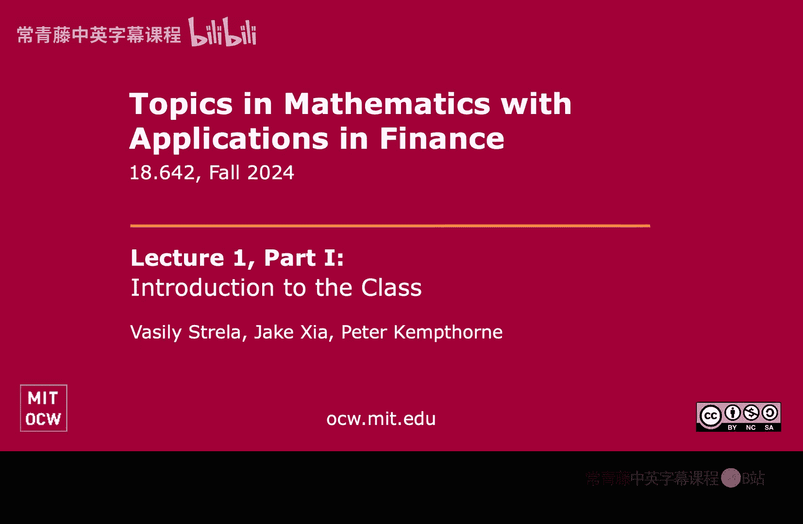
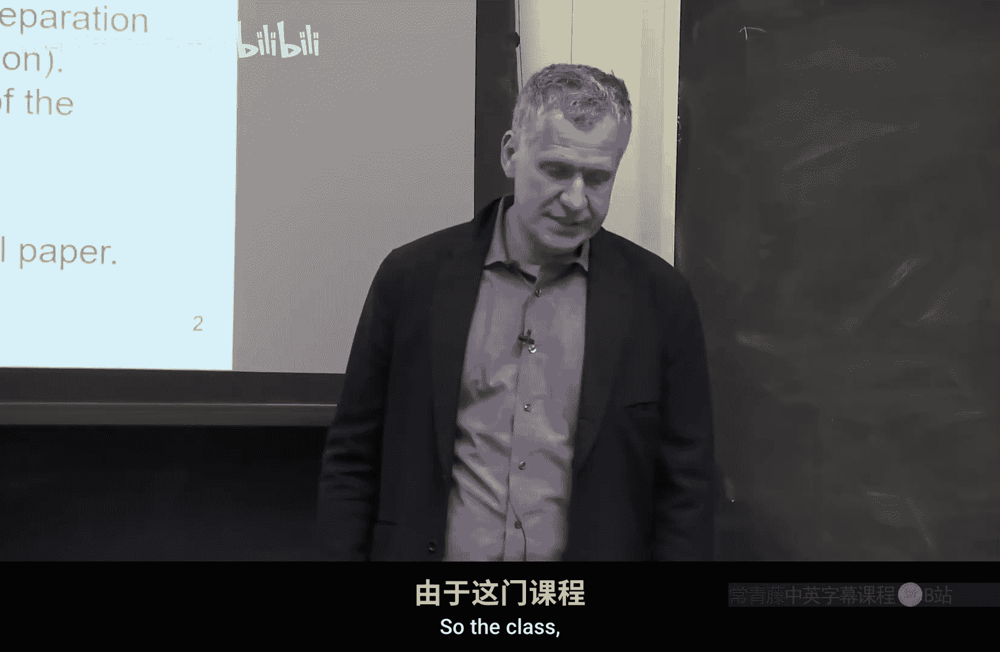
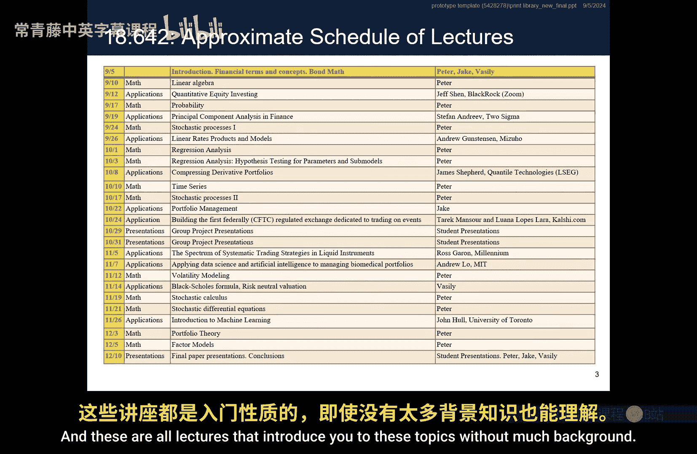
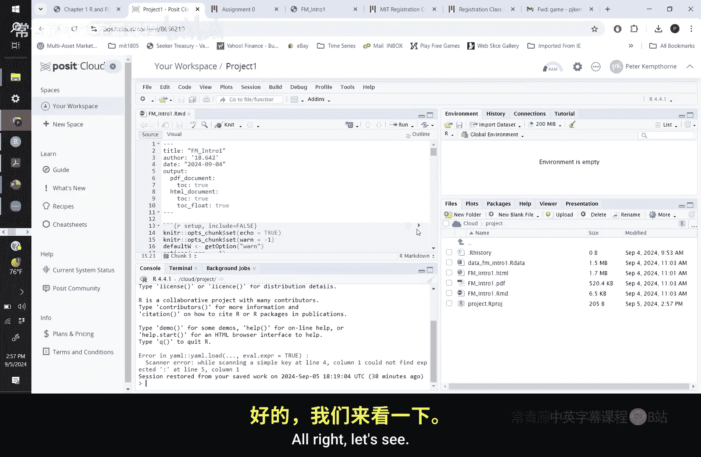
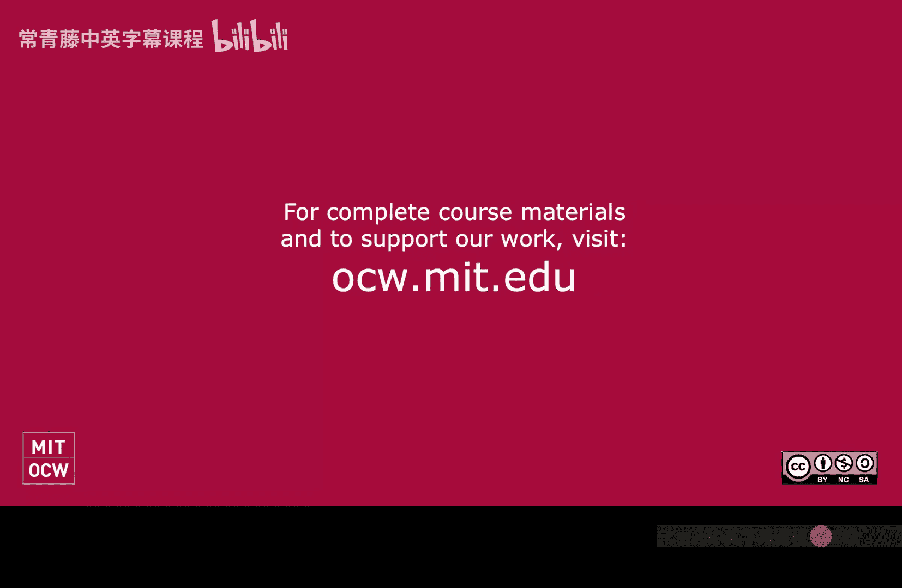

# 麻省理工学院【中英⚡数学专题及其在金融中的应用｜18.642-Fall-2024,-Topics-in-Mathematics-with-Applicatio】-p01-P1-Part-I：-Introduction-of-the-Class--BV1iLrjBrETS_p1-

So today's class is introductory class， we' talk about the class itself and about the program of the class。

 then Jake will talk a little bit about the financial terms and and ideas and I'll talk about Bo masss a little bit。

So the class is because。

It is。Organized。To introduce you to， to the。Applications of， of mass in the real world。

 the class is split between a mathematical part， which will be taught by by Peter and application part。

 which will be taught by many people who come from industry。

Maybe start with a little bit of introduction of myself and how it all comes together。

 so I was at MIT a long time ago， I got my PhD from Mass department in '92。

 my advisor was Gilil Traang。And my topic of my PhD was had nothing to do with finance。

It was actually applications where it was about wavelets and applications where in signal processing。

So after that， I was a mass professor for。For a few years and did math research。

 but at some point I decided to switch to the industry and somehow I did like mathematical finance。

 so since then I've been at one working in mathematical finance。

 worked many places for a long time I was with Morgan Stanley and right now I run fixed income coins at RBC。

So。And， and。My history is definitely。I， I very much appreciate having experience both with academia and and this industry。

 And that's what what I would like to， to show and， to show you。😊，through the class。

 so now a little bit more about the class。So as I said。

 there will be math part and there will be finance part。 The， the lectures will be intertwined。

 not necessarily one after another， but， but more or less。呃。In equal proportion。

In terms of prerequisites， I do think that you all have。Necessary mathematical prerequisites。

 which is linear algebra， some statistics and some pro some calcus。And in mathematical analysis。

 we don't require any prior knowledge of finance。Even though if you have been doing some work or internships before。

 that certainly helps。Here is the schedule which we intend to keep and please keep in mind that things may change and may shift。

 particularly with invited speakers， Peter will talk about the mathematical part here。

 I'll just introduce the a few classes， so in a weeks's time Jeff Shan from Blackrock will talk about equity investing in particular quantitative equity investing。

Then Stefan and Vive from to Sigma will talk about principal Comp analysis and finance。

 which should go well together with what Peter will be talking about at the time then Andrew Gustanson from Mizuhu will will talk about linear rates products。

 swaps， bonds and curve construction。 Then James Shepherd from Pantel Technologies。

 which is now part of London stock exchange we' talk about optimization anding compressing derivative portfolios。

Then a very interesting lecture by Tareek Mansur and Luna Lopez from Kalhi。

 they'll talk about their company and how they started。

 all they both are MIT alums and actually alums from the class from a few years ago。

 then Ross Garin from Millennium will talk。About investments in systematic investments。

 Andrew Law from MI， I T will talk actually， about applying some。

Techniques from computational finance into biomedicine and biomedical portfolio。 Oh， I missed。

Both Jake and myself there， but Jake will talk about powerful optimization and I'll talk about black shaals and the last invited lecture will be by John Howell。

 who is legendary in derivative space， but he will actually talk about machine learning。

 his newest interest。😊，With that， let me pass it on to Peter， thank you。Let' see。

 let me just page back up to the schedule of lectures。

 although before that let me give a brief self introductiontrod。

 I have a PhD degree in statistics and this was a mathematical statistics program at UC Berkeley。

And I was getting rather distracted with mathematical arguments and analysis and took a class at the business school at Berkeley。

 the Ha School， and that renewed my passion basically for studying finance and quantitative finance。

 I taught in the statistics department at Harvard， and then joined the Sloan School。

Where I pursued research on financial， statistical modeling and finance。

That led to interesting consulting projects where one client。

hirired well wanted to hire me to work on a trading program in international equities and we ended up agreeing on becoming partners rather than deciding how much I should get paid for that and so I worked with hedge funds for a number of years ultimately had the great pleasure of working for ICOOS a hedge fund in Cyprus。

 which is the Eastern Mediterranean following that I came back to academics actually to help with this course now what 11 years ago or 12 years ago and had the great pleasure to work with the silly and Jake on this class and what I think is really important to highlight is how the mathematics lectures are teaching you mathematics that's really。

Quite practical and useful。So I like。I love mathematics， but I love。

 I guess financial applications even more and so we'll be stressing those tools that are useful in financial modeling I do think it's。

Important to emphasize the stature of many of these guest lectures。

 and you're really going to be hearing from people who are the top in the field like John Hall。

 many of you probably are familiar with his work and Andrew Lowe and actually I had the pleasure of teaching Tak and Luwana in。

Statistics classes， one of which was this， and what they've done is created a new futures exchange。

Which is rather impressive。When you look at the history of the Commodity Futures Trading Commission。

 there are may be， I don't know 50 or so futures exchanges that have come and gone。

 maybe the most important the Chicago Merrcantile exchange but here were two students who basically create an exchange where you bet on discrete events。

 whether things will or will not occur and anyways it's a great to have them join the class well let's see with the different statistics or math lectures you can see the range of topics and these are all lectures that introduce you to these topics without much background so I think it provides an excellent introduction to the different topics we will also be using the language are in our studio for illustrations and I think most students。

Here probably are Python experts。 I am not a Python expert。So I use R， but let me just tab over to。

A slide showing this。Let's see with using R， one of the reasons for using ours that it gives you immediate access to the state of the art。

 statistical methods that get developed， but in addition to that it facilitates the downloading and collection of financial data from the internet or from other sources that you might have access to。

 but one can see issues like nonlinear volatility models， regime modeling。

Those are packages that are quite useful and powerful in terms of sources of financial data。

 everyone， I'm sure looks at the financial markets a bit and any data that's available on Yahoo。

Is importable into R also the Federal Reserve economic database has。All well around 80。

000 different time series of different rates， so let's see we distributed in the canvasva site this R notebook。

 FM Intro1。Which。Basically uses the R studio cloud to。

Collect data and display it and so this year we have an alternative to asking students to install our desktop on their machines。

 but just to sign up to this our studio cloud and you can basically with a simple login create a simple files which we give you and display different time series so this。

This FM Intro 1 R program。Basically， we'll collect and display data。And。

You don't need to know anything except to maybe update the dates for starting and ending data collection。

And so one can look at the S&P 500 index， the VIX index。

Perhaps one of the more important indexes in equity markets is the VIX indexex sort of a fear gauge。

 and it turns out that the sort of fear gauge tends to spike when the market drops and so their interesting relationships between these that actually get formalized with option pricing theory。

And let's see， just for interest， there's here's the time series for Bitcoin。

The beginning of this time series is about when our class began。And。

If you were fortunate to be at MIT at that time， an alum of MIT gave all the incoming students。

 I think $100 in Bitcoin。And。Many years later， some of them still had their Bitcoin keys and could cash in。

 some were very regretful that they somehow lost their Bitcoin keys。

 but it's really an interesting market， I was a complete skeptic back here。😊。

And I guess I'm still a complete skeptic， but that being said。

 you know there's obviously great potential there， here's the time series graph of NviDdia。Curiously。

 in last year's notes we displayed inVdia。And since then。It's risen rather dramatically。

 a really interesting topic for。Analysis is the creation of bubbles in financial markets。

And can you detect a bubble and when it might burst， very challenging。嗯。

Let's say one last point to illustrate was。The crude oil Fus contract。

It's one of the more popular futures contracts traded。And what's rather striking is that。In 2020。

The price of this contract went negative。Significantly， and this was an event that the brokers。

 important brokers， didn't program into that possibility into their systems。

And so when the system sort of became updated on this day when the price was significantly negative。

 those who held， say， thousands of contracts of the contract，Actually， owed money。

To the exchange for their negative position anyway， the financial markets offer these cases where。

Surprising， seemingly impossible events can occur such as negative interest rates when I was studying finance。

The thought of negative interest rates was just considered an impossibility。So with that， let's see。

 I just want to highlight this。Our。Our studio。Cloud allows you just to log in with just a username and password。

And it's free， and then you can create our programs。And it should。Display。The R studio。

Running from the cloud。And so here is a directory。In this cloud project， which has。

An RMD for our markdown file。Which is displayed in the top left， and that simple program runs。

 creates that HTML file。So analyses are very easy to illustrate with our studio and。

I hope to share with you various R programs that you can use to replicate studies we do in our lectures。

All right， let's see finally， let's see。

Distributed assignment zero today， which is asking everyone to fill out a simple survey of where you come from what your interests are and to submit perhaps a resume or CV if you have that accessible so we can get to know all of you。

