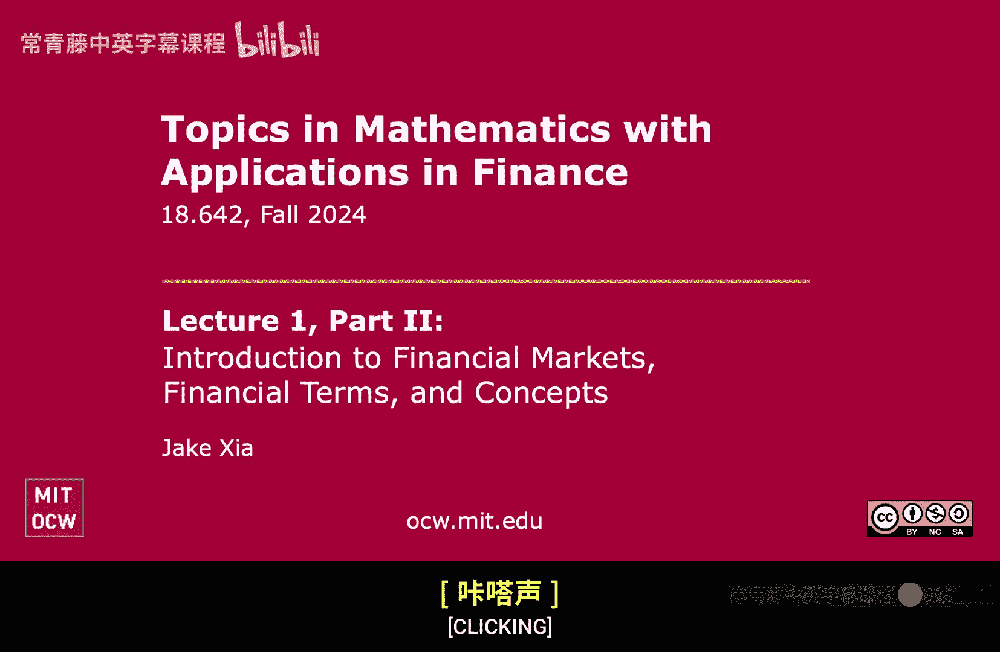
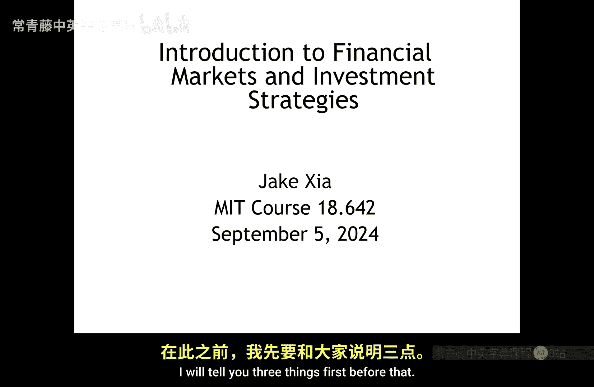
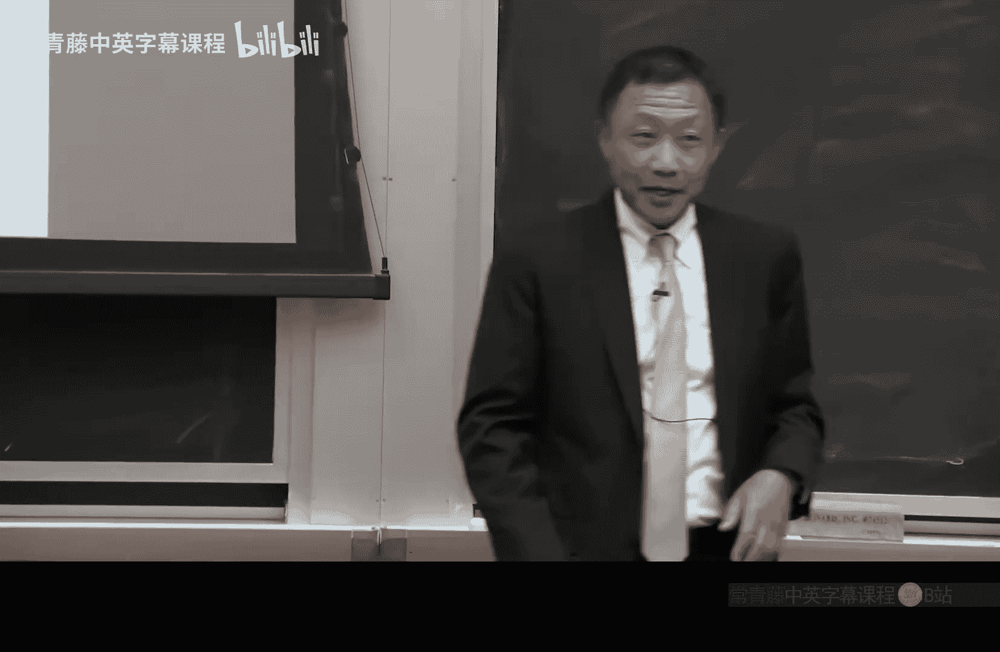
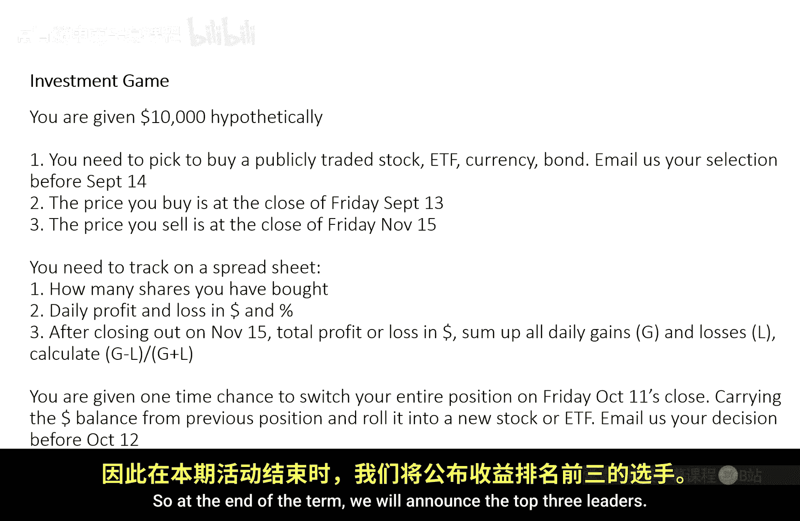
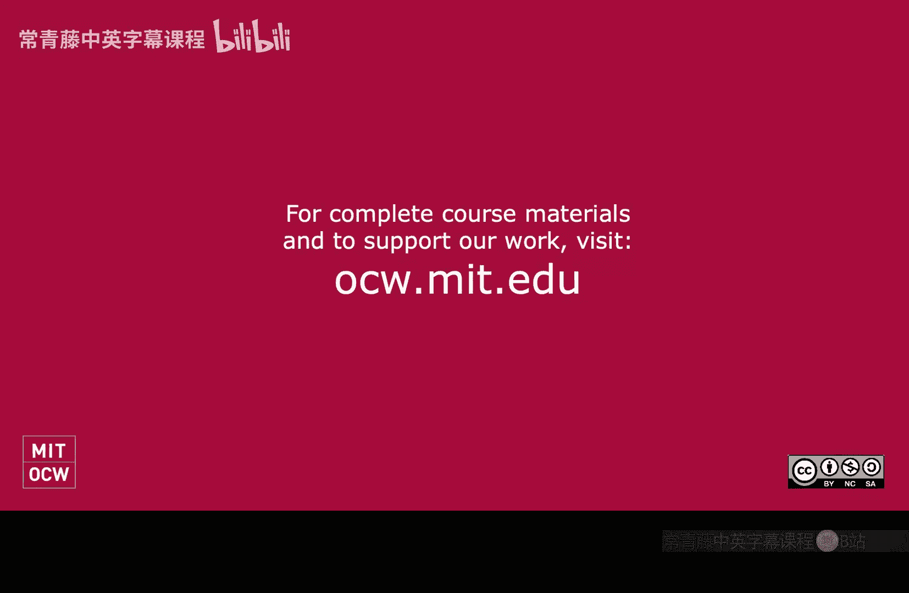

# 麻省理工学院【中英⚡数学专题及其在金融中的应用｜18.642-Fall-2024,-Topics-in-Mathematics-with-Applicatio】-p02-P2-Part-II：-Introduction-of-Financial-Markets,-Financial-Terms-and-Concepts--BV1iLrjBrETS_p2-

So in my part of the first lecture， I will before I get into the introduction of some financial concepts and investment strategies。

 give you some basics and the background information for this class。I will tell you three things。

 first before that。 First is bit introduction of myself。 Second。

 I tell you how this class was actually formed， Why we had this idea why we have decided to have this class。

 The third is before you actually do the assignment 0， submit your information。

 I'm gonna survey the class a little bit， just get some idea of your background of the knowledge of financial markets and math。

 So we know， you know what level we should target you at。 Okay， so first about me。

 So my connection with MI T， as Vas said， also quite similar。 So I' have a PhD from course 6。

 electrical engineering and computer science。

And I worked in the engineering field as a researcher for a few years。

 then switched to Wall Street as a qua。Quant means using mathematics， building training models。

Back then， I joined Solomon Brothers。 So that tells you about my age。

 because probably how many of you have heard about Solomon Brothers。Oh， good for you。 Okay。

 It's now part of a Cigroup。 But Solomon Brothers back then was the pioneer of using quantitative trading strategies and also hiring mathematicians of doing those so called orage about those。

 finding one stock or bond versus another， you know， basically finding relative value。😊。

So I worked there for a couple of years as a quant。

 then Morgan Stanley recruited me away to be a trader。 I ended up staying there for over 17 years。

 worked as various trading and trading management roles， globally， got sent around the globe。

That's where I worked with Vailili。啊。And in 2013， that was the year when we first recorded our open courseware video for this class。

I actually switched my job from Morgan Stanley to Harvard Management Company。

 which is the entity manages Harvard University's endowment。😊。

I joined as the chief risk officer to oversee risk management and also capital allocation。

That's when back then we had many internal fund managers doing various strategies。

We since then changed our model about  seven years ago。

78 years ago to focus on investing with external funds。

 I subsequently also switched my focus full time， focusing on investing and finding the right funds and managers。

I'll tell you a bit more about that， but I will save that for later， So that's basically about me。

 So I tell you a bit about the class。So back， I want say maybe 1415 years ago。

 when Vasilia and I were working together at Morgan Stanley。

 we came to MI I T to recruit quite often。And while city was from the math department。

 I was from Co 6。 So we met a lot of。Really bright students with quantitative background。

But they don't really know much about finance。And they ask many good questions。

So we just felt like in a half an hour or one hour interview， time slot。

It's simply not enough for us to answer all the questions or get to know the students。

So we figured maybe the best way is to have a seminar to tell the students more about how math is used in finance。

So one seminar lecture actually got expanded to the whole term。

 and so we invited different practitioners talking about how math is being applied in different fields。

 solving different problems。The the class actually got very popular。 I mean。

 one of the first classes， we've got students sit on the floor everywhere。 They want to know about。

 you know， should they pursue a career in quantitative finance。

So the Mas Department was very supportive。And so we teamed up with Peter the following year to offer half of the lectures in actually math。

To。Fill up all the background knowledge and then kept the half of the class talking about application cases。

We even had field trips， taking all the students to New York。

Touring the trading floor of Morgan Stanley， we did that for a few years， and we had various。

 you know， fun。 And some students really ended up working in New York。

 Some of them are still there in various jobs。😊，So that's how this class came about。

So let me turn the table around， asking you a few quick questions。 You don't have to state your name。

 Just raise your hands。 It's fine。 How many of you have watched our opencourseseware recording from 2013。

Oh great。 Yeah， see，5，6 hands。 So have you knew something about this class。

 How many of you have done internship jobs at the financial firm。😊，哦。A third， okay。

How many of you are math majors？Most of you。How many of you are graduate students？Okay， few。

How many of you actually are outside MI I T because we have okay， great。 I want。

 I want to welcome all the students came， you know。

 across from cross registration or sitting from other schools。

 We always had a few from other schools。 So you're very welcome。

 if you are unfamiliar with some of the MI I T systems。 Please feel free to seek for help。😊。

So that's all about introduction。 So let me get into the actual content for this lecture。

So as I said， the purpose of this first lectures give you some background information。

 I realize some of you already have done intern jobs， so you know quite a bit。

 but but I wanted to also be sensitive to the students who have actually not done the internship positions and I can give you some basic knowledge and I give you one example in one of the first years when we had this class。

So there are some students didn't even know what the stock is。What the stock was。

You shouldn't feel bad if you have no knowledge about the financial markets。

 or make sure you have plenty of the knowledge when you finish the class in December。ok。

So what is？You know， finance or financial markets about right， It's really about。

There is a market of exchanges in the original form。 People come to the market， you know。

 at the village。Exchanging goods， you know， you have something。 I don't have something。

 I need something， you know， so let's exchange。So the stock exchange was formed。Was the same idea。

 right， So some buyers want to own。Equity of a company。 I explain what equity is。

 Equity is basically ownership of a company。Meaning of stocks。

And they centralize all the trading of these stocks at a particular place。 These are exchanges。

 right many cities， large financial centers have different exchanges。And in the last few decades。

 that also has changed。 is no longer that centralized。

 So people do a lot of over the counter O TC trading。 So it's trade by appointment。

 trade by arrangement， trade by contract。 right， So you don't have to go to a centralized exchange to finish a trade。

Or there are electronic communication networks or E， Ns。 You can do that simply electronically。

 I mean， they also act as distribute exchanges。So these are kind of the major platforms of markets。

So what are the products people actually are trading or exchanging hands？First， is simply money。

Right， so Peter mentioned bitcoins。 Bitcoincoin is actually kind of form of money。You know。

 not the fiat form， but， you know， different forms。 But， you know， originally， gold or metal。

Or paper money or coins。But or now， different currencies issued by different governments。

 those were basically。First way of first essential product to， to trade with。Then。

You always hear about the stock market。 Stock market represents ownerships of companies， right。

 Peter mentioned media stock going up rapidly。 because people bet on oh AI applications。

 the demand for GPU chips and so on， data centers。So to get a ownership of a company， you buy stocks。

 I mean， also， you can buy equity indices， meaning a basket of stocks。

So you probably have heard S and P 500。Right， so standard poor 500 is essentially。five。

Logest companies。You know， here， so you can， you can get exposure not to just simply one company。

 You can get exposure to many of them at the same time。 These are the ideas of index or you know。

 they can have different forms of that， traded in ETF exchange traded funds also representing often basket of different stocks。

And theyre also。2 kind of tiers of markets。 So the。

 the exchange traded stocks is called the listed stocks。

 So they have to go through a process called IPO initial public offering。

To become listed on the exchange。so。But that's called the primary process to go from a private company。

 become a public company， have stocks freely traded。They are also private companies。

 which I get into later。 But after it， it become listed， its traded by many other people。

 So it's called the secondary market。 So after primary getting listed is a secondary market。So。

Besides the large category of equity market， there's also a big category of bond or fixed income market。

So bond is essentially a loan， withs a securitized loan。 So it become listed and tradable。

 So the most commonly known bond is the US Treasury bond， right US government。Borrows money from。

The investors。You know， us or institutions。They pay a interest periodically。

 Either quarterly or semianly。And so the bond issuer has an obligation to pay back the whole principal amount or the notional amount at the end of the maturity。

But they can also default on that payment on both the principle or the interest。So bond has。

Credit risk， meaning that the issuer may not always pay back， right， so。

So that involves the exposure of the credit of the issuer。So， that's。Basically。

 related to a whole bunch of credit related to products。And。2008， global financial crisis。

Is really a credit crisis。Because that started in the mortgage market。

People borrow money to buy houses， but couldn't pay back。 And also。

 these mortgages were restructuringstructured into different kind of derivative products。

And we'll get into that later。So related to bonds， there is a interest rate curve。

 which is also very important。Right。Depends on maturity of the bonds。 that interest the payment。

Is or the coupon is actually different。If you only borrow for three months。You pay certain interest。

 You borrow for 30 years。 You pay another interest rate every year。

Depends on the curve shape of the interest rate and as well as the supply demand and the many other factors。

The Federal Reserve Bank， which is the policy bank of the United States。

Is responsible of setting the short term the， the front end interest rate to。

Affect the whole interest rate curve。 I mean， right now， as many of you know。

 the interest rate curve is actually inverted。The front end interest rate is higher than the longer maturity。

Which is not often the case。 Okay， we can also get into that later。 So related to interest rates。

There are， you know， real estate products， as I mentioned。

 the mortgage and the asset back securities。And another whole category is commodities。 know。

 I mentioned gold， but theres also crude oil。 Peter's example of the futures dipping down below 0。

And agriculture products， right。 I mean now we're in the era of electrifying everything。

 Electric vehicles uses a lot of copper， right， or lithium for batteries。

 So those commodities were trading。rapidlyap higher and also follows the cycle。So I。

 I'm just giving you some ideas of the basic products。 But on top of all these products。

You can also have derivative products， meaning you can derive other contracts of trading。

 So you can have options。 So I don't just buy the stock。

 I want to buy the right to own the stock in the future。That is the option。 So it's the right。

 but not the obligation。I can also say， I don't want to buy it now。

 I just want to buy it a year from now。So that's a forward contract。

So I just want to buy the stock index of futures， which is a very liquid and standardized contract。

So you can also say， I want to do a swap， I don't want to really buy things。

 I want to say I buy it from you now， but a month later， I sold it back to you。

So it's a swap contract。And so there are many different ways of。

Structuring a product for different purposes and needs， so。Once you actually land on a job like that。

 you， you become an expert。 Your math will be very useful。Okay， so who are the players in the market。

So typically， they are the banks you deposit money with， right， Bank of America， Cha。

They take deposits。 They also lend out the money to home builders or other commercial projects。

They are the investment banks where you interview， they come to MIT to recruit。

 so the Morgan Stanley， the Goldman Sachs and others， JP Morgans。呃。

JP Morganorgan was actually a commercial bank。But since the termination of a Glas eagle law in 19999。

 they turned themselves into a investment bank。 It turned so back into the investment bank because many years ago before 1930。

 they were they were Morganley and JP。 Morgan were one company。

So they have essentially three main divisions in the investment banking business。

 One is called equity。 So you， when you go interview。

 if you're interviewing with the equity department， you should know that that's to do with stocks。

 okay。When you intervene with the fixed income department。You're gonna deal with bonds。

 interest rate curves， currencies， possibly commodities and other derivatives。

You can also join the so called IBD investmentment banking division。

 which is more about corporate finance or raising money。Taking a company from private to be listed。

 public company or issuing bonds or some other ways。

 So they are doing more services and client relationship planning and other type of。

USsment banking services。So beyond the investment banking business of these banks。

 they usually have asset management division。So。They produce products such as funds， right。

 mutual funds or other type of higher return funds。They also provide wealth management services。

 helping the individual or wealthy families to manage their wealth。So。Outside the banks。

 there are hedge funds。 So some of the internship must be with some hedge funds。

 hedgedge funds are essentially trading entities， right so they use the capital or the investors capital。

 try to generate returns。So by the way， at the end of this， I'm。

 I'm gonna play assign a game to all of you， which is related to investing and trading， okay。

So retail investors。 So they just simply open a brokerage account。 and you probably have。 and。

 and your parents have and trade。Central banks， they involve they are guiding the markets， you know。

 usually providing liquidity or intervening the currencies or whatever they are policy driven。

They are corporates。 So corporates come in mostly for hedging purposes。

 They want to reduce the exposure from their exports or inputs。

What is the objective of all these players involved in the markets。In one sentence。

 they try to maximize the gain， Why minimize the losses。Okay。

 because financial markets are uncertain， right， So you don't know when you initiate a trade。

 you will ended up making money or losing money。So， investors have the money。Theyre seeking returns。

The borrowers。Or you can think about them as the managers。 They actually， they need the money。

 They can take the risk。 Okay， so the trade between lender and the borrower is essentially the main driving force of all the financial relationships。

You can always pair them up this way。And。Another example， right， I just quickly mentioned。

 you probably heard the terms L P versus G P。 LP means limited partners。 G。

 P means general partners or in the simple words is the。

Investor versus hedge fund manager is that relationship。If you one day want to raise a hedge fund。

Right， you need to deal with your investors。 So you need to sort out these kind of relationships。

So the trader types the we can categoryze into the three。 One is the hedges， right like corporates。

 they want to reduce risk。I mean， second is the market maker， like a lot of the banking。

 the bank trading desks， they make。A buyinguying a price， a selling price， a bid or an offer。

Their objective is to earn that spread， but not to take risk every time they try to earn that spread and quickly flatten out the position。

The last category are the risk seekers， the proprietary traders or the fund managers。So。

 they use their own capital。To initiate risk。 and hopefully they are betting right to make a return。

So how is this all related to math， Why why you need to know all these things。

 I assume you are in this class because you have some interest of finding out how math can be used in the financial markets。

So the math is used also in the three different ways。 One is to come up with a pricing model。

Because these instruments， especially the derivatives， the options， the forwards， the swaps。

Is actually quite complicated。In one of the guest lectures later on in the term you will hear from Zhang Hao。

 He wrote a textbook many years ago on how to price options。You know。

 Vailia and I probably were back then all the， you know。

Hungry readers of those books to figure out how differential equations can be used。 I mean。

 he was a pioneer in this field。And MII T， actually。

Is at the was that I was at the frontier of all these innovations back in the 70。 right。

 So you probably heard the Nobel Prize given in the 90s to the black show Merton model。

 So that was a model using mathematics。To price options。 right， So they want economic price No。

 Nobel Pri in economics。So that's the pricing model side。

The second part is also very important is risk management。mean when you take on the risk。

 take on a position。Your first question you have to decide is how big the position should be。Right。

 so you have certain amount of money。 Do you want to put all in all your chips on one stock or you want to diversify。

 put them into different stocks。Once you put your investment in， when do you change your mind。

 When do you sell， When do you take profit， When do you cut loss。Right， so。All the things， you know。

 you greed， your emotions will drive you。 And on one hand， your fear will also drive you on。

In other situations。So risk management is actually a very quantitative process。 You should let math。

Speak for that process。The last  one is， I think most people are interested in。

 especially sitting in your seats。 You say if you can make a。Trading strategy。

 perpetual money making machine using some kind of hidden mathematics。 Wouldn't that be so cool。

 right， You just go to the beach and let the machine make money for you。😊，I mean。

 that's the dream of many quantitative managers。And I would say some of them are very successful。

 Some of the funds out there， they have achieved amazing outcomes using mathematics。😊。

But the problem is， once they found those secrets。They will never disclose it。And if you join them。

 they' will ask you to sign a lifetime， non compete。 meaning when you leave the shop。

 you cannot say a word of what you learn。 Yeah， go ahead。 compete。 pay is when they buy you， yes。

 not， not a lifetime， unfortunately， Yeah， so we're not gonna get into that for this。 Yeah。

 but I first step， you have to find those secrets。 Okay。😊，啊。So how do you find those secrets， right。

 So people say， okay， why don't you just look at the data， right， Learn from the historical patterns。

 then extrapolate them。 right， The efficient market theory says that's not possible。

If is there such thing， you10 dollar bills lying on the ground。

 there would have already have been picked up long time ago。

 Why would that secret waiting for you to uncover， right， There are many smart people before you。

The behavioral finance theory says， oh wait a second， you know。

 because people are not totally rational。Under certain situations， we' are not thinking rationally。

 That's why we're providing these opportunities for others to explore。Is this a zero sum game。So。

I'm getting into now investment strategies。 Okay， I'm not， of course， telling you all the secrets。

 but I'm laying all the steps for you to think about what you should focus on。So you first。

 you should focus on。Do you want to do this by yourself or you want to hire other people to do it for you？

Right， so this is the direct versus investing in other people's funds or fund of funds。

Do you want to focus on publicly traded markets， As I said， all these things， stock bonds。

 currencies。Or you probably interview the herd venture capital， private equity buyouts。

 real estate funds， natural resource funds。 I mean， they are not so transparent。

 but they seem to make a lot of returns， too， right， You need to pick。 These are very。

 two very different markets。Also， passive versus active。Do you want to do the stock picking。

 selecting the stocks or you just want to buy the index。

Buying S& P 500 in the last 10 years would have done very well and beating most of the fund managers。

Right， so why shouldn't you。Just you， do the passive。Also， systematic versus discretionary。

 Do you want to make decisions based on some systematic or quantitative rules models。

 or every time you want to make a decision by yourself using your human brain。Do you want to。

 even you want to follow the quantitative model using math。

Do you want look for statistical patterns or some deterministic relationships。

Determinal relationships， like， like a lot of physics， right， if A plus B， you know， you will get C。

But in statistics， you have a probability of getting C， right。So I would say nowadays。

 finding deterministic arbitrage or trading strategies。Very hot。 Those。

 those 100 bills definitely have picked up。But sometimes they still show up。Do you wantna do。

Train following or mean reversion。That means when market goes up， do you want to buy more？

Or market goes up you want to sell。 You play the contrarian， or you buy the dip。

Do you want to focus on short term or you focus on long term。Fhorll term。

 you're trading very fast and you're trading in the liquid where you can change your mind easily。

 or you， you make your decisions very slowly。 you take your time。😊，I mean， the。

Start up companies you invest with your venture capital may take 10 years to find out if it's successful or not。

Do you want to be a warrant buffet， like value investor， right。

 You look at the current price should be much lower than its value。

Or you focus on the growth of the company。 You project enviious future income for the next 10 years。

 as long as the future value。Is going be greater than the current value。 You， you can。

 you can invest in it。I would say in the last few years。

 more and more people are focusing growth rather than value。You need to figure out why。ok。

And history versus future， right， Do you want， Do you believe history will repeat itself So you follow the patterns。

Or you actually don't simply extrapolate into the future。

The key is you need to understand your own objectives。 So your objective is to maximize your gain。

 right versus minimizing your loss。But that's。Not all of it， right， You need to understand。

 why do you need the money。What's it for， How much can you afford to lose。

How much are you gonna spend。Every year。And you life horizon of income versus spending。

This is a whole set of investment objectives。 You need to understand about yourself。

 Then you need to pick an area。 You are the best。 You are the best。

 You have an edge over the rest of the market， right， You need understand why you are。

 You should make money。 Other people should give you the money。

And you need to find suitable strategy for you， ultimately。If math is your strength。

 you need to make math， your edge。Okay， for that， I'm gonna quickly talk about the trading game。

 Then I will pass on to Vasil。 So this game is about for every single one of you to pick a stock or E TF。

😊，You exchange traded funds， just traded like stock or bonds or whatever。 only to buy。 Okay。

 so I know some of you are most sophisticated say can I shoot if you wan to go short。

 you buy the short related E TF。 Okay， so pick one stock。You are hypothetically given $10000。

 Everyone has $10000。 each one of you。You need to let us know。 emailmail us your selection。

 You you pick only one thing。 You let us know before September 14。We're gonna。

 we gonna give you a slide on the website。 So don't worry。

 the price you buy is that the close of Friday of September 13。

The price you sell is automatically set on Friday， November 15。 So about two month period。

So you need to track on the spreadsheet。 How many shares you have bought。 That's easy，$10000， right。

 You know， you just convert into shares。Dived by per share price and your daily profit and loss in dollar and percentage。

 that gives you a practice of how to。Track your position。 Okay， every day， there's a P L。

 profit and loss。At the end of the close， on November 15。Calculate the total loss or or profit。

And also， when I want to do one calculation to sum up all the daily gains on one side。

Called the G and some of all the daily losses。Called L in dollar terms。

 So G minus L should be your net profit and loss。 But I want to calculate that ratio G minus L divided G plus L。

 that gives you the quality of your trading strategy。A bonus。

Youre giving one time chance to change your mind on October 11 close。

 You email us your decision if you want to switch on before October 12。😊。

You can switch to one other position。 You can decide not to switch。 But when you switch。

 you carry the balance， whatever is left， you $10000， maybe $1000 left or become 550 grand， whatever。

 Ro into a new position。😊，So at the end of the term， we will announce the top three leaders。

Okay， for that， I pass on to Vasili。

