# 麻省理工学院【中英⚡数学专题及其在金融中的应用｜18.642-Fall-2024,-Topics-in-Mathematics-with-Applicatio】-p03-P3-Part-III：-Bond-“Mathematics”--BV1iLrjBrETS_p3-

So in the rest of the class， let's talk a little bit about interest rates and a little bit about bonds。

Because that's very。Important for and central for many will be will be definitely part of many classes and is genuinely central for。

For finance and for life， in my opinion。 So what is interest。YeahWell， let's start with。Now。

And suppose we have $1， which we invested。 Ill put it in the bank。So what happens in one year。Well。

 you expect to get。Your dollar back with some interest。

 And what does it mean So you get one plus something。I know。5% nowadays。

 And this R is called interest rate。So what happens if you reinvest it？What will you get？

TheThe whole thing。So in two years， you would expect to get。1 plus R times1 plus R， right。

 So one plus r squared。 So in n years。You will expect to get。1 plus R to， to the power M， right。Well。

Let's make it small and small。Not to confuse ourselves。 So now let's。

 let's make life a little bit more complicated。 What happens if you， if you。

Decide to take your money in half a year。Right， you had one here。 So what happens in half a year。

Well， you get half of the interest， right。So it will be one plus R over 2。 And in one year。

It will be。1 plus R over 2。Square， right？Because you reinvest it。 So suppose you。

 you keep it in the bank。 And in any years， it will be。1 plus R over 2。But twice N， right。

 because there are twice as many periods。Okay， let's subdivide further。 Let's make M period。

So in one in the first period。You get one over1 plus R over M。In one year， it will be。1 plus R。

Over M the power of M。And here， you'll get one。Plus R。Over M。M times M。All right。

What if we take the limit， let's if we are able to reinvest every second， every millisecond。

What happens then。So。Willll send this M to the infinity。So what is who knows what is that。Well。

 it is E。But， no。R。Right， our has to be there。 and this end will stay there， right。Well， yeah， yeah。

 if we keep them here。So， in fact， interesting， historical fact。

 That's how E was discovered and defined。 It was Berulli in his seminal paper in。呃。1683。Where he。

Describe this computation。 And it was about interest rate， about。How interest is compounding。

 So maybe this was the first with medical finance paper。In， in the history。Okay。

 now let's change the game a little bit。 Not the game。 Change the question a little a little bit。

 So suppose we know that well receive。We receive $1 in one year。How much？

Should we pay for this right to receive。A dollar in one year。 How。

 How much should should we pay now to receive a dollar in one year， right， So， and let's compute it。

 So suppose we don't， we don't know。 Let's， let's assume that now it is X。ど。And let's consider the。

 the following strategy。 Let's borrow $1。 Let's borrow X。They amount。Now。And let's see what happens。

At the end。So at the end， in one year， I mean， we'll receive $1 for sure， right。

And we'll have to repay our debt， but with interest。So， we'll have repay。1。Plus x times r。Sorry， X。

Times one plus r。Now。What should this be。Can it be greater than0。There's difference。Well。

 if it's greater than 0， why wouldn't we borrow， why。

 Why wouldn't we buy a right to receive a billion dollars。Then we'll have。A lot of profit。

Can it be less than 0。 Well， then we would be stupid to enter this counter because we'll lose money for sure。

 That's，s we know that this will happen in one year。So。For no arbitrage。And we。

 we don't assume that anybody， our counterparty is stupid。 We don't think that we are stupid。

 right so。It has to be 0。So in this x。Is equal to one plus divided by one plus R。

And this is called discounting。Meaning that if we know that well receive。Certain amount。

In the future， and we know the interest rates， prevailing interest rates。Then。

We have to discount the， the， the future value。To today。Using a discount factor。

And this is the discount factor assuming analyzed compounding， right。If if we。If we as humanized。

 compounding and。Receive n dollars in the future， in the future， N years， right。

 The value of N dollars in the future。It is the value of our end dollars， which。

 which well receive in the future and years， but it has to be discounted by end years， right， So it。

 it should be。And here it is discounting， right， If we assume it continuous discounting。

Something like this。Then it will be。Our price will be and。Times。一とでマイナス。R N， right。

This will be our discount factor factor。Assuming continuous compounding。

So were already hitting the the problem or not the problem。

 but we are already hitting a situation where some model is needed。So。

Which bring brings us to the world of financial interest is financial instruments。

 interest rate related financial instruments。And the simplest financial instrument is a zero coupon bond。

That's exactly the right to receive certain amount of。

 of notional or notional is quite often one or 100 in certain amount of time， right。And that's。

The value of our zero coupon bond。More common。Financial instruments are coupon bonds， right。

 because most people would like to receive periodic interest。For， for giving， for lending money。

 right？ And that's effectively lending money。 And this is typical bonds。 For example。

 if you buy government bonds， that's that's what will what will happen。

 Youll give the government you00 dollars。And government will be repaying you coupons periodically。

 usually semi annualnually here in US in Europe it's quite often quarterly。

 And the noal all your hundred dollars at the end， right。So what。

 what the the price of such a coupon bond should be。Well， we'll need to take all the cash flows。

And discount them。And if we assume a constant interest rate。

We'll have to discount it with our constant discount factors。

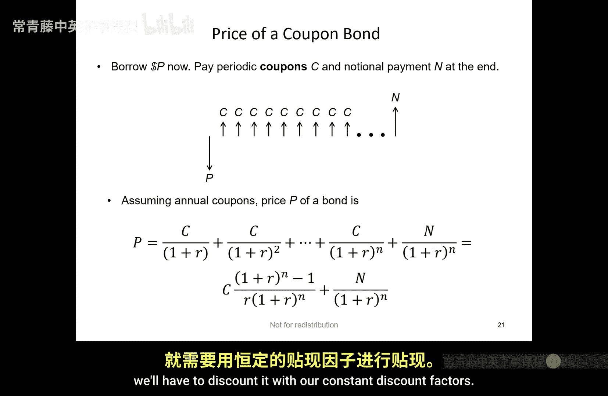

And that's how， how much and this assumes， well， say annual coupons。An annual rate。

That will be your sequence with is a notional at the end。

 right the the whole big notional at the end。And can we sum this up？

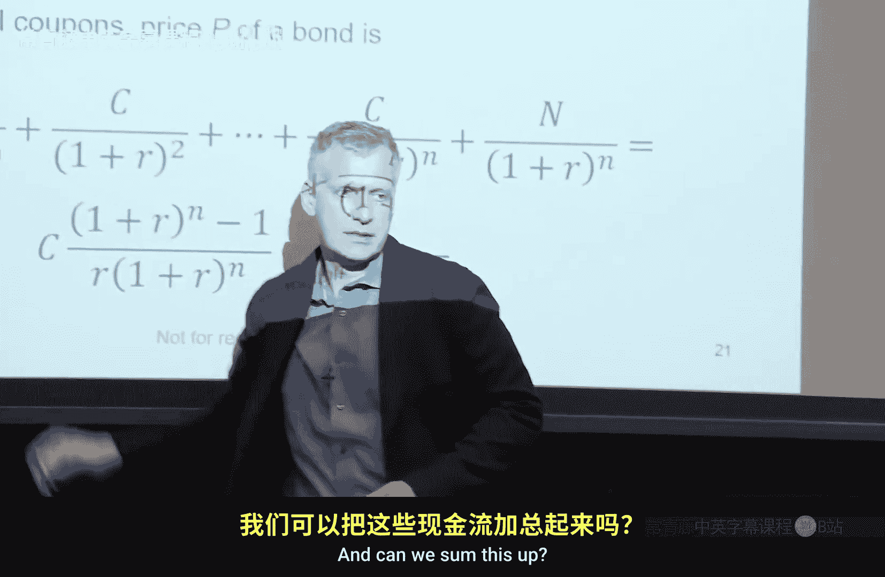

Well， sure， that's geometric sequence， right， Everybody can sum up geometric sequence， and that's。

That's the volume。That's what you get。呃。So， and that's the value of the bond。Now。呃。

The bonds are traded on the markets。There are prices of the bonds。

And if you start investing into into bonds and not in just in one bond。

 you should be able to compare to bonds。And comparing the price is not really convenient。

Because bones of different maturities。Even with the same interest。We will have different prices。

 right， because there will be different number of cash flows。

 One of different coupons will have different prices。So what turns out to be more convenient。

 measured to compare bonds and various fixed income securities is yield。And yieldal is。

Such a constant interest rate。Which by this discounting gives you market price。 You， So you。

 you buy something at the market price。 you know the market price。 So， you know all the cash flows。

 So you back out one flat interest rate， which will give you the price。Of， of the bond， right。

 That's called yield of the bond。Obviously， there is one to one relationship between price and yield。

 So for our。0 coupon bond。 yieldield is pretty simple， right， You just invert this， this formula。

And here， it think it is here on the slide for coupon bonds。

Yd computation is more complex because invertging this formula is more involved in in fact。

 it has to be numerical， but that's how yields are computed。嗯。Here， I I give you an example。Of。

 of a few。Of price yield relationship for a 10 year bond with different coupons。

So what's important to know here is that the hire is a coupon and that's natural the higher the yield is right。

 for the same bundle， the same maturity。But what is important to know is the yield and price are in averse relationship。

 The high yield， the low， lower the price， right， because it's all about discounting。

It's in denominator， the higher the the price， the lower the use。嗯。So。That's， that's what it is and。

But real life。Is。Is more complicated than that。In real world。

 as if we wanted everything to be the same simple interest rate。And all bonds have。

To be discounted the same， real life is slightly different。 So if you take market securities。

 market bonds and start breaking up their yields， they they will not be constant。

 particularly with maturity。And this is called the yield curve。 and I gave you here。

 I ploted a yield curve。For。10 year term structure of 10 year yields。US。 government yields。

For a variety of times。 And I want to talk just a little bit about it because it's quite topical。

 So that's the， the， the thickest line is this， that's the yield curve for September 3。

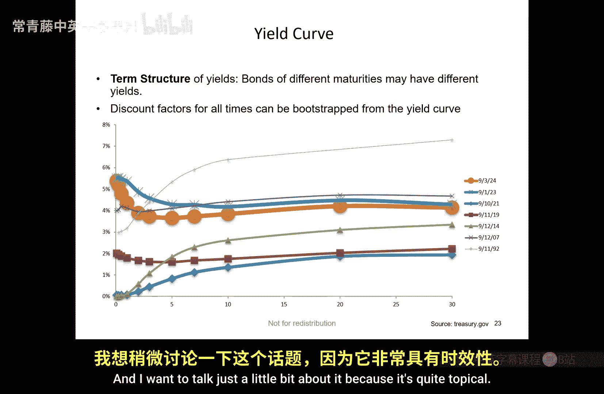

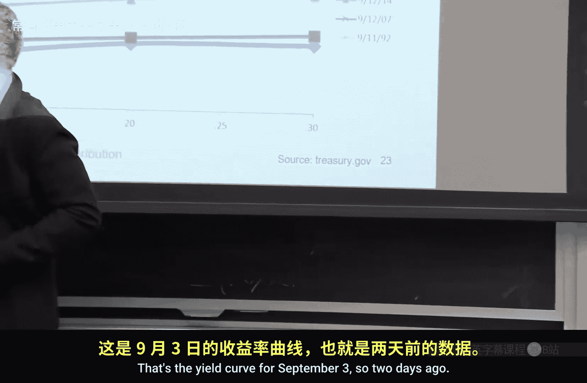

So two days， two days ago。

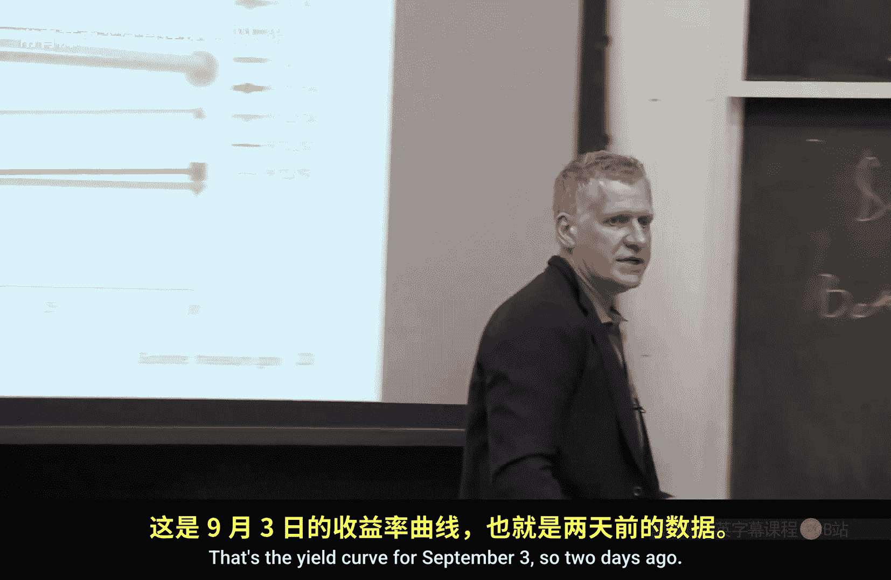

Right， so quite different and yields here。In for a very short。

 data securities are quite higher than for long data security。 This， this is still quite atypical。

 For example， in 92， around the same September time。

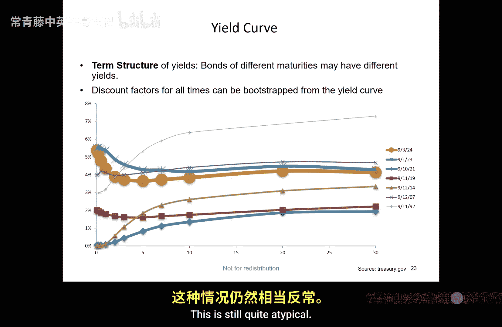

Your curve look like this。Considered to be a more or less classical curve。And generally speaking。

 we expect upward slope and curves because。Genually speaking。

 people would like to receive more yield for a longer term， for longer term investments， right。

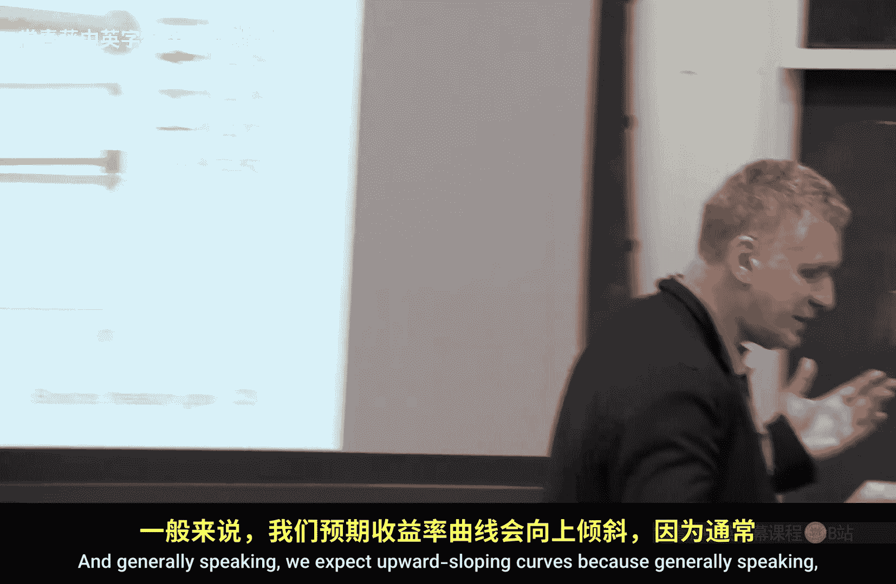

And that's what was the case in。 this is what。This is。21， this is 14。Yeah。Nice looking curves。

 The only difference here is that now they， they are in 92。

 they were grounded at 3% and went all the way up to 7。

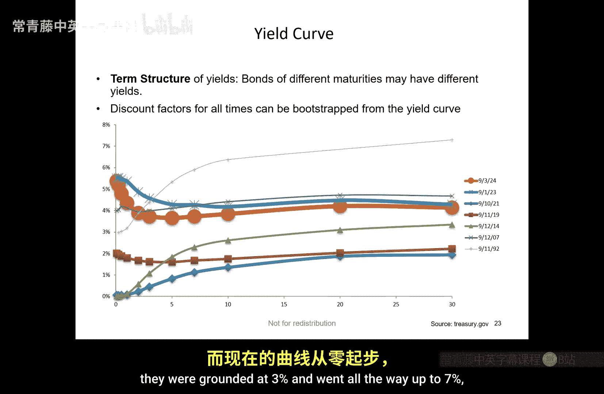

Those were grounded at zero。

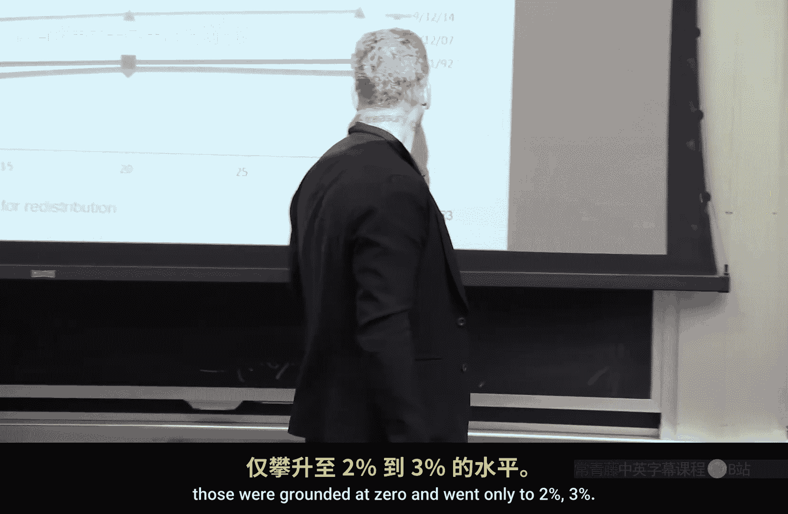

And went only to 2，3%， right。Now， interesting observation here is。

So let's look at this inverted curve。A year ago， it was inverted。Now it is inverted。

It was inverted in 2007。 No， this is 22019， and this is 2007。So what the。Do we have anything。

In your mind， what's what's common between 2000。21。In 2007。So。They Yes， exactly。 Well， 2007。

 the recession was the recession， right。2021， there was a recession in 2020。 Even this， this。

 this yield curve is before Covid。 So nothing was。And if you look at the shape of the yield curves and recession times。

EWell， it is common analogy。 And there there are papers on that。

 How predictive is inverted yield curve。For the recessions。Generally， it is。Assed to be predictive。

So here we go。 We have inverted He curve。 What does it tell us about the future。

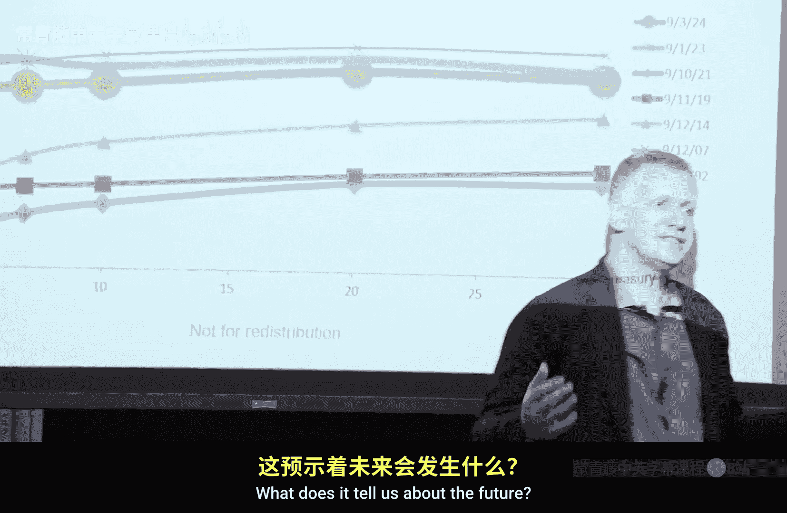

Well， that's all F's job to keep it。To， to keep it to make it a soft landing and。And。

 and for a recession not to happen。 And we'll see， maybe it will be。Or maybe not。

 but what I want to emphasize that there is a lot of information in yields。

One of the lectures in the future Andrewgans he will be talking mostly about yield curves and heel curve constructions and the instruments around that。

So it's very important piece。嗯。Of knowledge。 And yeah。

 I'll promise you when I come back later on to talk about black Shos。 I'll。

 I'll bring this slide back and we'll see what happens with with the yur because what and I can guarantee you it will look different because the Fed is happening。

 The Fed meeting is happening in September。 Everybody expects。The yields to be cut。

 which immediately will bring the short end down。 What happens with the long end， I wishing you。

Anyway， that's about yield curves。 But another important thing to emphasize that no matter what。

Bond prices。Are sensitive to， to yields， obviously， right？

 And they' are sensitive to yields in non nonlinear fashion。 What does it mean， Well。

 it means that if you hold bonds on your hands and yields change and they do change。You will， your。

 your investment will change。 So it's quite important to understand the sensitivity of your investment to。

 to interest rates and yields， so。And， and what are sensitivities， those are derivatives， right。

 So or in in the finance and fixed income world， they are called durations because they're usually scaled by price。

So very important measures are duration of the bond。Which is derivative with respect。

 with respect to guilt。呃。And there for each different bond and each different security。

 they will be slightly different， right。And not only the first derivative is important。

 the second derivative or convexity。Is also important。So， yeah。

And that's what we will be talking about。In， in the various classes。We will be talking。

About more interesting。Inter rate objects in the future， in particular， forward rates and swaps。

 But I'll leave it to Stean and and Andrew to， to talk more about that。

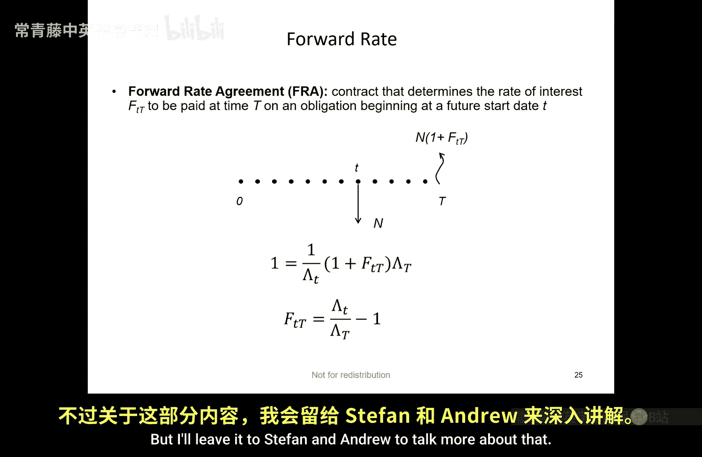

That's probably all for today and any questions to， to any of us。ビドでドな 게。

Not specifically in this format， so we tried before it was more open ended。

 I was thinking so I think by fixing the dates， you don't have to make the market time and decision。

We already made it for you。

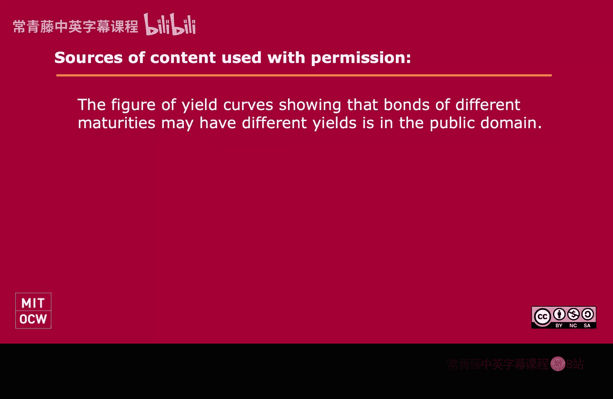

