# 麻省理工学院【中英⚡数学专题及其在金融中的应用｜18.642-Fall-2024,-Topics-in-Mathematics-with-Applicatio】-p04-P4-Linear-Algebra--BV1iLrjBrETS_p4-

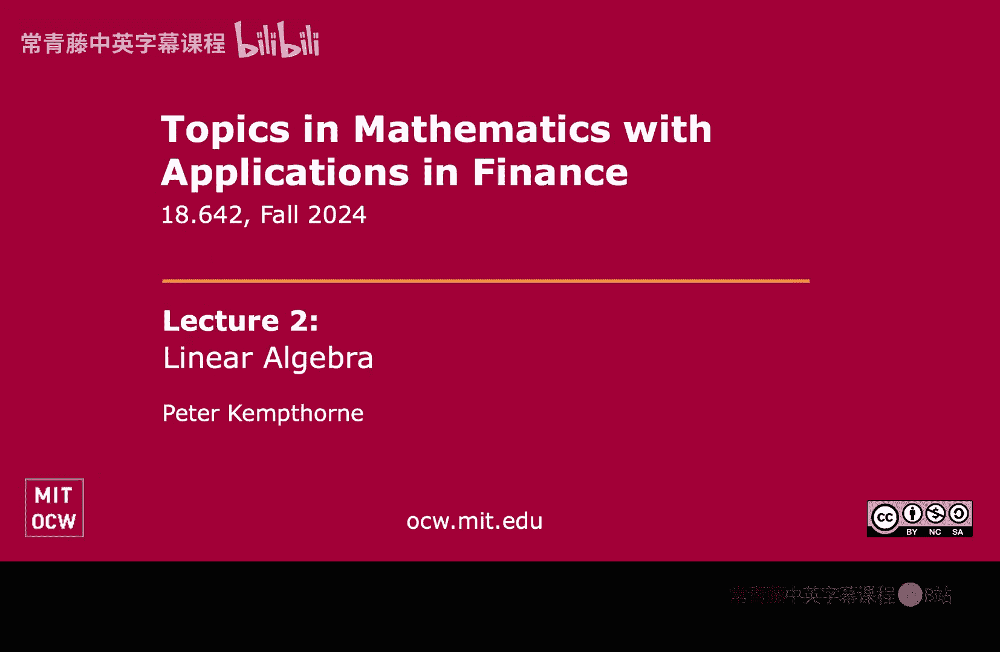

Alright， well， welcome to the first math lecture。 The topic today is linear algebra。

 And what I expect is that for most of you， the topics will be very familiar。

 At least we'll be covering。Basic fundamentals of vector algebra， then dealing with special matrices。

 matrices that are used in applications。Eigenvectors and eigenvalue decompositions。

Singular value decompositions。 And then finally， the Peron Phrobeius theorem。

And what's really neat about quantitative finances that。

Linear algebra can really be very useful in understanding different computations we want to do。

 So it makes our life easier。 Well， let's just begin with a discussion of。

Basic linear algebra concepts。 I'll use a notation where often I'll have a bold vector notation or bold letter for note noting a vector。

 So this bold V is a vector in M dimensional space。

 And it just consists of an ordered list of numbers。And we can think of it as a column vector。

 typicallyp， sometimes we'll think of it as a row vector。

But special cases of vectors will be the vector of all zeros and the vector of all ones。

And we can think of a graphical representation of。A vector。

Where we can think of it as perhaps just a single point in， in this case， two dimensional space。Or。

With an origin here。We might think of the vector representing the directed line segment from the origin to that point where this is V1 and this is V2。

Depending on our application， both of these can be useful。And。

A basic example for us would be could be the closing prices on a given day for all stocks in the S&P 500 index。

So we can think of P boldface being a vector of 500 values corresponding to the closing price of stocks that are in the S&P 500 index。

Importantly， the prices are positive， so that's where the R plus comes into play。

 And if we consider a portfolio holding shares of the S&P 500 stocks，We can represent that with。

A vector Q。And the value of such a portfolio at the end of the day is simply the sum of the quantities。

 the shares times the price per share。Now。With this。And later on， we'll see that。Sort of Q。Dot P。

 the dot product of those two vectors， gives us the value of the portfolio。嗯。

What we're going to find useful is to actually add to our 500 stocks。

The value of a cash holding in the。In the portfolio。

 So we can think of P 0 of T just being a fixed $1。And then Q n tells us how many dollars we hold。

And so our portfolio value， VT will。

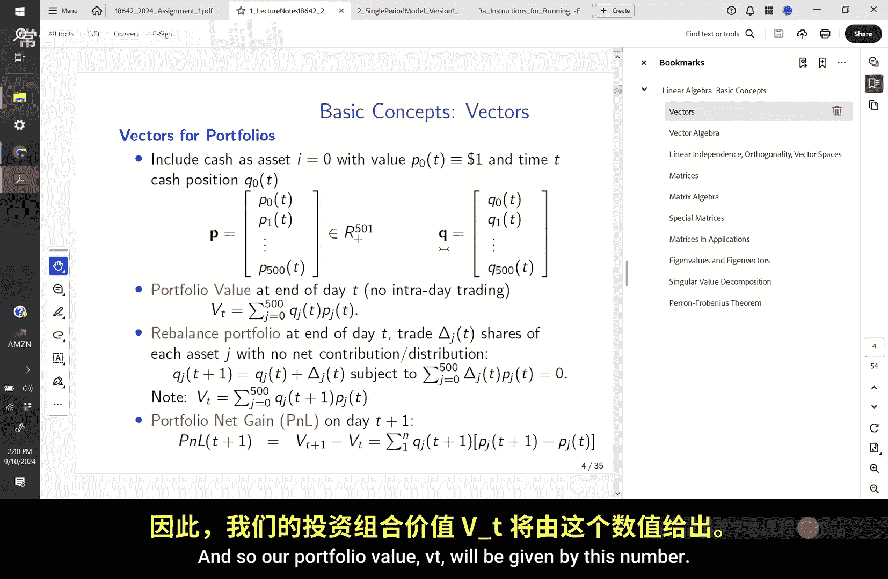

Be given by this number。And we can。Think about rebalancing portfolios。

 computing portfolio and loss on a daily basis。And。We can。

Characterize rebalancing the portfolio as shifting from shares held at。The end of day T。To。

Q J of T plus1 to be held through day T plus1 by adjusting the quantity。For each stock by a Delta J。

And if we。Constrain the sum of the change in shares。Across the J stocks。

And cash and the P J multiplying by the P J of T。 We can constrain this sum to be equal to 0。

So this would correspond to a rebalancing of the portfolio。

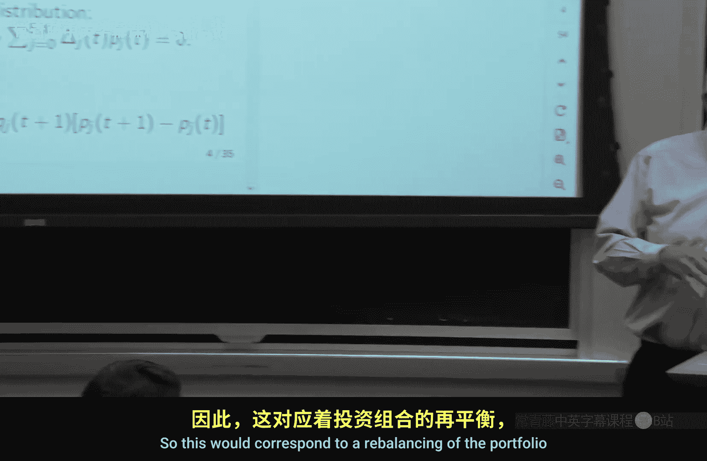

And。Basically， not taking any sort of distributions from from the account。Now， with the net gain。

Let's see， this terminology， P and L。It's in a sense， a misnomer， I think。

 because it's really profit and loss， but it's referred to as P& L portfolio net gain。

 We can just look at the change in value from day t to day t plus one。

And this will have this simple form。For the change in portfolio value。

 basically the shares that are held from the end of day T to T plus1 times the change in price from day T to day t plus one。

And so this is the portfolio net gain。Here we're talking about portfolio management。

Maybe on a daily basis where at the end of the day。

 we make a decision as to how to rebalance our portfolio。 And there's a net gain。During that period。

 one could。Adjust the period of rebalancing to be intraday on a regular or irre basis。

 And we'd have to have extra notation to do that。Now。With， with。Vectctor concepts。

If we multiply a vector V。By a scalar C， then we just multiply through each of the components of V by that scalar。

And if we add two vectors。We've simply。Comprise the sum of components element by element。

 and the dot product between two vectors is simply the sum of the product of the two。So。

 this allows us to。Work with。Vectctor algebra associated with portfolios。 If we have two portfolios。

We can consider。嗯。Let's see， we can think of a。A Q T and A in this notation， A W T。

As two different portfolios。And with each of these portfolios， we can determine what the。

Profit and loss is of each portfolio。So for Q， it's the value at the end of day minus the value at the beginning of the day。

 and similarly for portfolio W。And it's。Useful to include in the notation here， this sort of B。

 O D and E O D to represent beginning of day， end of day。 And what's。Relevant， actually。

 is that the Q T。Portfolio composition is while it's indexed by T。

 it's actually determined at the end of day T -1。And so。

1 needs to be careful in doing computations with portfolio value measurement that you're always using portfolios that are defined。

 using only information up to a given time point。 So if we're going to be rebalancing at the end of。

The day for investment the next day， we can't know what will happen on the next day。All right， well。

With these portfolios that are just simple vectors， we can look at their difference。And so。

 if we look at。DT equal to Q T minus W T。Okay， this defines another portfolio。

We often constrain portfolios to be long only， meaning。The Qs and W's are positive or 0。

But there's no。Reason why we can't allow component weights in portfolios to be negative。

 And in this case， it's negative shares。And so one can have a long， short portfolio that。

Is given by D， and we can calculate the profit and loss of that D。

Portfolio by subtracting the profit loss of the Q and W。嗯。Now， let's see with。

Short selling in markets， let's see。Who in the class might offer a description of what it means to sell short。

A stock。 so suppose that we have。Dt。Sub 2 is equal to， say， minus200。What would that。Mean or。

 you know， can we actually realize a portfolio where we're short， one of the。Stocks by 200 shares。

I'm sure someone， okay， and what's your name。Okay， thank you，好。8月。Yes。

 you basically sell first buy back later and you sell by， you don't have the stock。 So you。

Borrow it from some seller， and。Bkerage accounts that have margin。

Allow you to engage in this kind of transaction。 And so the policy。Of the brokerage。

 is that if you want to sell short a stock。They need to locate some shares for you to borrow。

And what's rather neat about that。Selling short is that your brokerage account gets credited。

With the sale of those shares。 So your。Brokerage account will have a positive cash flow due to the short selling。

And with such a positive。Contribution to the brokerage account。

 you can actually invest long in more than say， 100% of your wealth that's in the of your bank account or brokerage account。

So that's quite advantageous and allows for very interesting trading opportunities。All right well。

An important special case of a long short portfolio。Is a zero cost portfolio。

And this would be one where。The sum of。Bausy， the values of the long and short positions balance each other perfectly。

And so we have a portfolio D T in this case， which。Where the D components are not all zero。

But the value， the net value of the portfolio is， in fact，0。And。We can。

Hope for the possibility of an arbitrage portfolio。Which could be a portfolio that has zero cost。

But has。A positive。Profit and loss。Over a period。And this kind of opportunity。Generally， well， it。

 it doesn't exist sort of inefficient markets。But markets are never completely efficient。

And so it can be feasible to。Identify portfolios that may be close to an arbitrage portfolio。

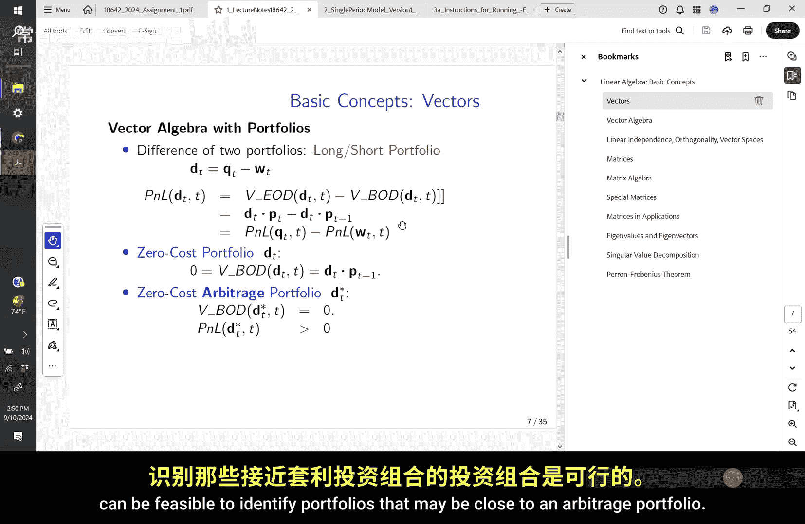

嗯。What， in fact， happens is that this profit and loss。Of a zero cost portfolio will be random。

And depending upon。The market model that applies to the market we're trading in。

 it may be that there are opportunities that yield a positive profit。

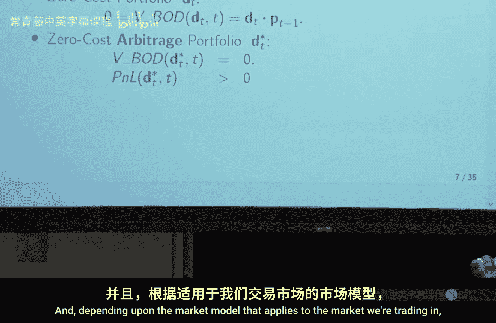

All the time。 in which case， we would say that's an arbitrage opportunity。

 What we'll see later today is the question of。

Under what conditions。Is there。No arbitrage in a given market。And how do we characterize？

Prices of assets in a market with no arbitrage。 And ultimately。

 it turns out that option pricing theory。That that was or mentioned last time of black Shohoals and Merton。

Is all based upon。Arbitrage free markets and the implications of that。

 and we'll see that in arbitrage free markets， there does not exist any arbitrage portfolios。

 and what will be neat is to understand why that's the case。All right。Allright。

 so we have random prices at the end of day T。 And so the profit and loss is going to be random。呃。

I guess it's relevant to note that there are strategies of statistical arbitrage。

And those are strategies where we have。Sort of portfolio。

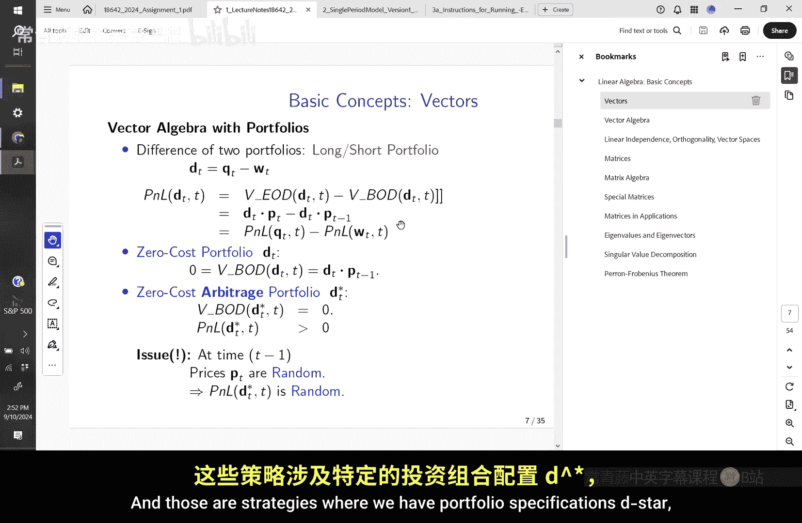

Specificationations D star for which this random Croofin loss。

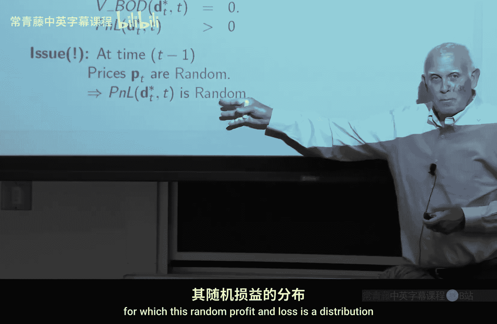

Is a distribution that tends to generate positive returns。

And so there's sort of a statistical likelihood of making money。

But it's often not sort of a pure arbitrage， but what we might call a statistical arbitrage。Alright。

 well， let's review just some other concepts of vectors。We have the norm of a vector。Being the。

Length of a vector， so。If we have a vector V here。And。The norm of the。

Is basically the length of this vector。And if we consider what the dot product is between two vectors。

We have this cosine sort of formula for what the dot product is。 It's actually the length of。

V times the length of W times the cosine of the angle between the two。So， if we have。Another vector。

W here。Then。The dot product corresponds to that formula。And what's interesting about that formula。

Is that it actually corresponds to。The dot product sort of corresponds to the length。

Of the segment along W。That is closest to V。And so。With this dot product notation。

 we actually can talk about。Orthgonality between vectors in。N or M dimensional space。

And those can be very useful。We'll actually see。This sort of orthogonality applied when we talk about regression and least squares regression。

 So you may be familiar with some of these topics from that discussion。All right。With。

 with vector is a really important。Topic is。Whether vectors are linearly independent。Of each other。

And so if we have two vectors。V and W。They are linearly independent， if。

The only linear combination of the two， which gives us the zero vector。Is。

The linear combination with c1 equals C2 equals 0。So。Linear independence is。Essentially。

 the case that。We have a V and W that aren't aligned with each other。In two dimensions。

 and at least vectors emanating from the origin， having that property。

And the utility of linear independence is that we can。Work with a vector space。Capital S here。

And the definition of a vector space is that。Any vector can be rescaled by an arbitrary constantsancy。

 And it's still in the space。And with any two vectors， V and W in the space。

 their sum is in the space。With， with a vector space， what's very useful is a basis for。The space。

 which corresponds to linearly independent vectors， V1 to VP。

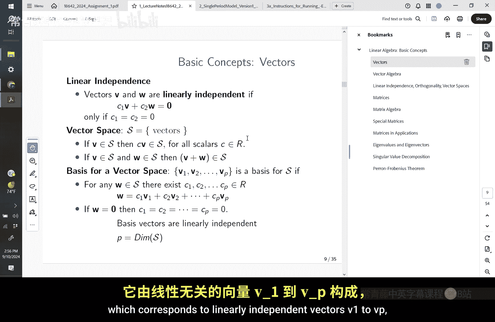

Such that the only linear combination giving the zero vector is the linear combination where all the coefficients are equal to 0。

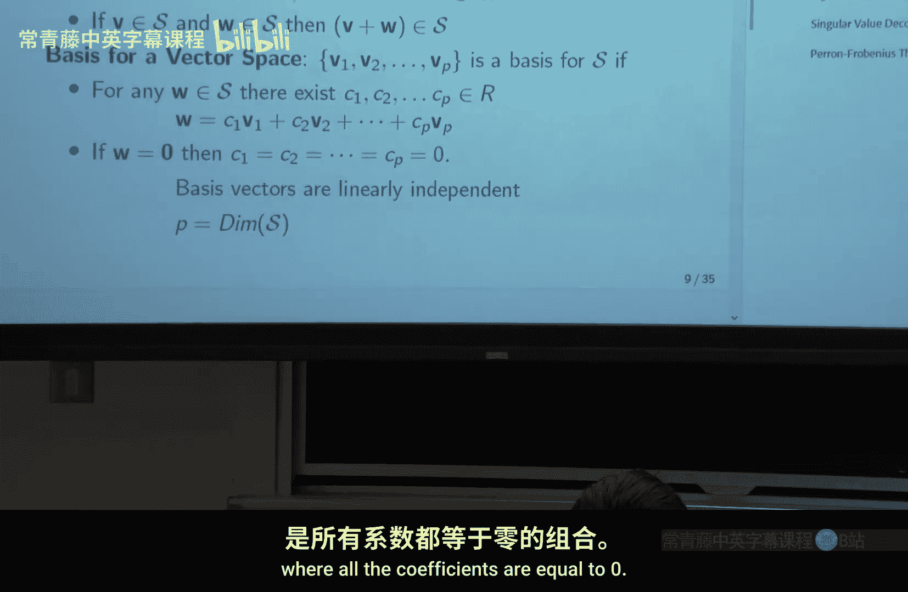

All right。

Well， let's just go through sort of all of matrix algebra pretty much。

 We can extend from vectors to matrices。Where we have M rows and N columns in。A matrix， A。

 a rectangular matrix。And one very useful representation of。

A matrix is as a collection of column vectors。That are stacked one after the other。And so。

We can denote bold a sub1 through bold a sub N as the column vectors。And with。Matrix， algebra。

Let's see。 Well， let's see we can multiply a matrix。Capital a， by a constant。

And we end up multiplying each of。The components， elements of the table of a values by the same constant C。

With a transpose operation。A transpo is simply to flip rows and columns。And so。

If we have a sub I J being the I throw jith column。Element of a， then。

A J I corresponds to the J throw and Ithe column。Now。

If we think of the transpose of each of the column vectors in a。That's a row vector。

And our transpose of the matrix A can be thought of as。

Stacked row vectors corresponding to the same vectors， A 1 through A N。Now。

 one of the reasons for thinking of a matrix as having。

Being a composition of different column vectors is that when we multiply。

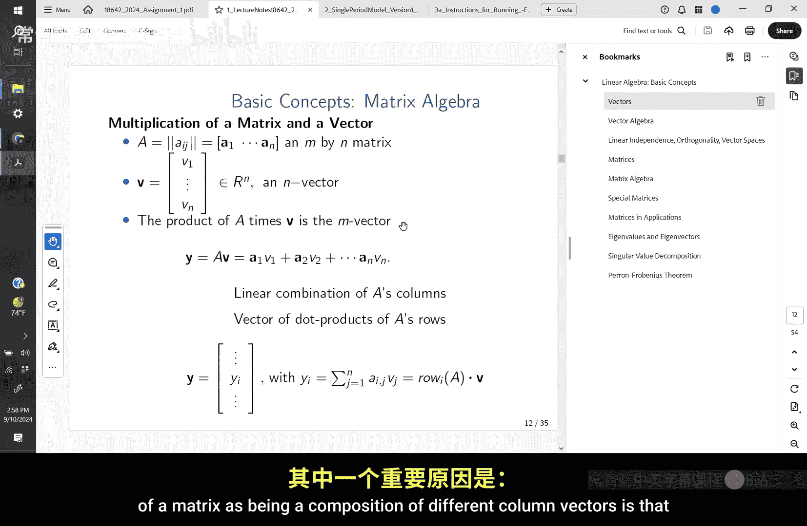

A matrix， A by。A vector V。Then， this corresponds to。The linear combination of the columns of a。With。

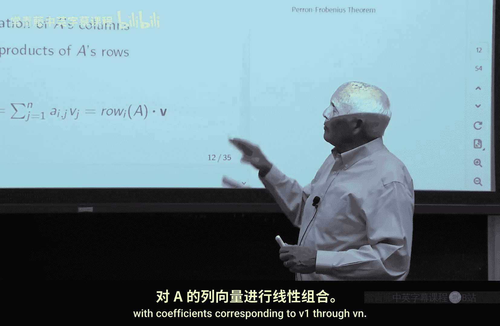

Coefics corresponding to V1 through V N。So we have a linear combination of A's columns。

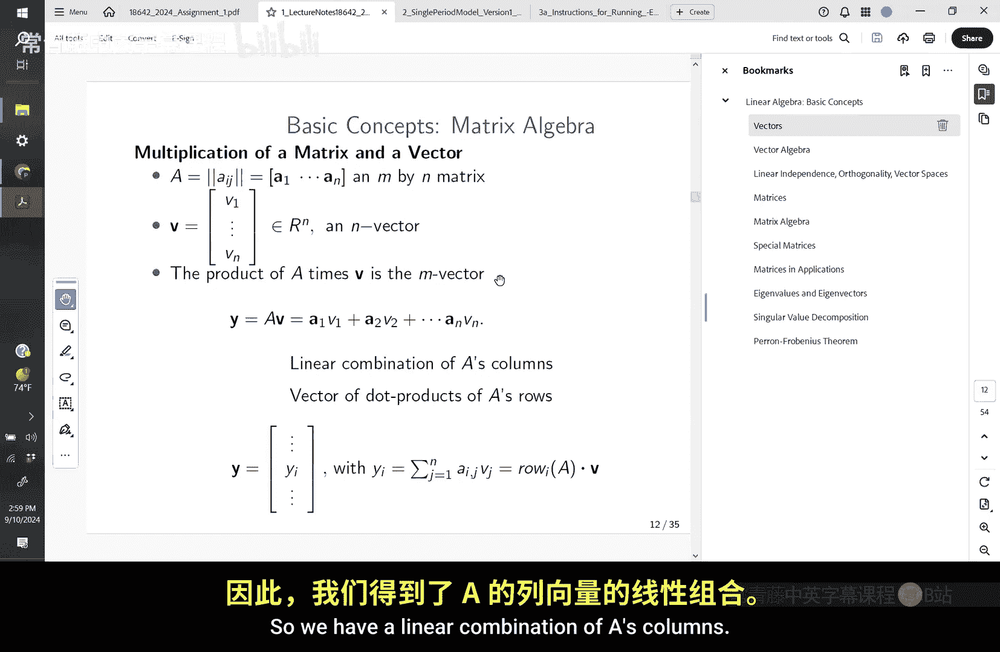

And this。Representation of matrix vector multiplication turns out to be very， very useful。

Perhaps less useful is that if we look at the。Matrix vector product。

 It's also a vector of dot products of A's rows。With the。

And so being comfortable with dot products is。

Potentially useful。 but for the moment， thinking of linear combinations of columns of a is very useful。

So I guess， you know， if we think of the columns of a。

Corresponding to potentially a basis of vectors。Then A V corresponds to another vector in the space spanned by those columns。

Allright， now when we multiply two matrices together。嗯。We actually have。A matrix A and a matrix B。

Each with their respective columns。Vectctorors。And we can。Basically。

 expand the matrix B into B1 through B， P。And then do the matrix vector product for each term。啊。

This is equivalent， actually， to looking at。Elements C I J， which are just these double sums。

When I learned linear algebra decades ago。I use these。Double sums。

 which were're not very intuitive to interpret， although one。

With the simple algebra notation can prove everything。

 but things are much easier to prove with this other notation。 Now。

 what's important when we multiply two matrices together is that the matrices have to be conformal。

 meaning。We need to be able to multiply a times the column vectors of B， so。M by N matrix of。

A has to be able to multiply the M by P matrix。Of， of B。So， actually， I think there's a。Alright。

 let's see。 Y， sorry。 N there are n columns in A and N rows in B。

And so the result is an M by P matrix。All right。Well， with different matrix operations。

 you learn in linear algebra， all of these rules， these laws associated with matrix algebra。

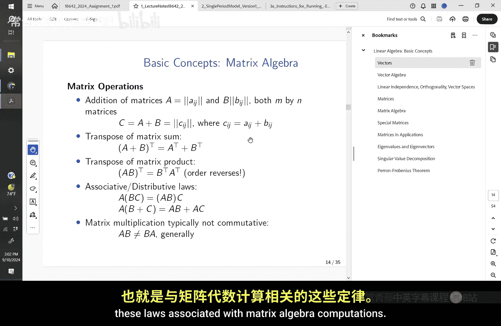

Computations。Everything is pretty obvious， except。

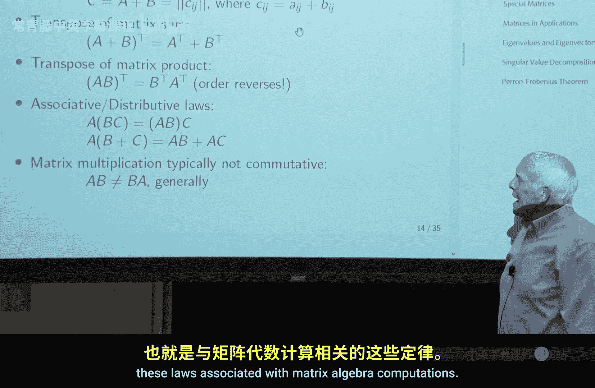

Maybe when you transpose a product。You reverse the order of the product of transpos。

And if you consider。Reversing the order of matrix multiplications。If。

One can sort of reverse the order if A and B have the same number of rows and columns。

 It turns out that you the。Commutative law for multiplication doesn't apply to matrices。

 So you want to be careful with。Those distinctions。Allright， so special matrices。 Okay。

 there's the when we have。A symmetric matrix。 Then it's transpose。Equals itself。So， the matrix has。

Basically。Diet， well， let's see。 the off diagonal entries are matched one by one。With AIJ。

 equaling AJI。The identity matrix。Is a matrix with ones along the diagonal。

And it can be convenient to represent this。As the matrix of columns。Where E sub J。

Is a simple matrix or a simple vector。Which is all zeros， but then a single one。

Where this is the J throw。And。Different computations。Can be made easy with that， sometimes now。

There's a notation of using the J matrix to be the matrix of all ones。嗯。And the matrix， J。

Turns out to be a vector 1。Times it's transpose。And we have diagonal matrices， where。

The matrix is all zeros except for the diagonal entries， which may or may not be zero。

And are given by the list D1 through D N。 All right。Okay。

 well now we can turn to some applications of。That use matrices。

 And the first one we want to discuss is stochastic matrices。So these are matrices， which。

We'll consider a stochastic matrix that square。And the columns of a sum to one。So。So we'll have an A。

With a1， a2。Up to A M。Or A N。And basically， the sum of AI J， I equaling1 to M。

Is going to equal to one。So， this。This kind of matrix is associated with Markov chains where we think of their being M possible states。

And we can think of。So we basically have M rows。And M columns。And we have this notation。

 AI J or lowercase AI J is equal to the probability。That。The state， the next state。Equals I given。

The previous state equals J。嗯。Is given by this AI J， so。So， we have。Let's see， for each column J。

We have if the previous state at time T。Was J。Then， there's a。Transition to a state at time。

 T plus 1。And this。These transition probabilities， in some cases。

 can be assumed to be stable or stationary over tea。And with a Markov chain， we can think of。

They're basically being different states。嗯。Which are index from one。To up to M。And。

We might think of these as。Being sort of nodes。In a graph。And there's a probability of moving from。

One node to another。For each time point。And。These probabilities of transitions。

Might be stationary and a stationary Markov chain model。Well， if。We have a vector。Pi。

Which is going to be。Basically， pi of T， equaling pi 1 of T。Pi 2 of T down to pi M of T。So， this。

M vector pi tells us at time T， what's the likelihood。Of being in any of the states。

Then if we want to compute。The probabilities of states at time， T T plus 1。

Then it turns out to be simply。The matrix vector product of a times pi of T。So this formula gives us。

The model for how the probabilities of states occurring changes from time T to T plus 1。Now。

If we consider。What is the probability vector at time T plus 2。

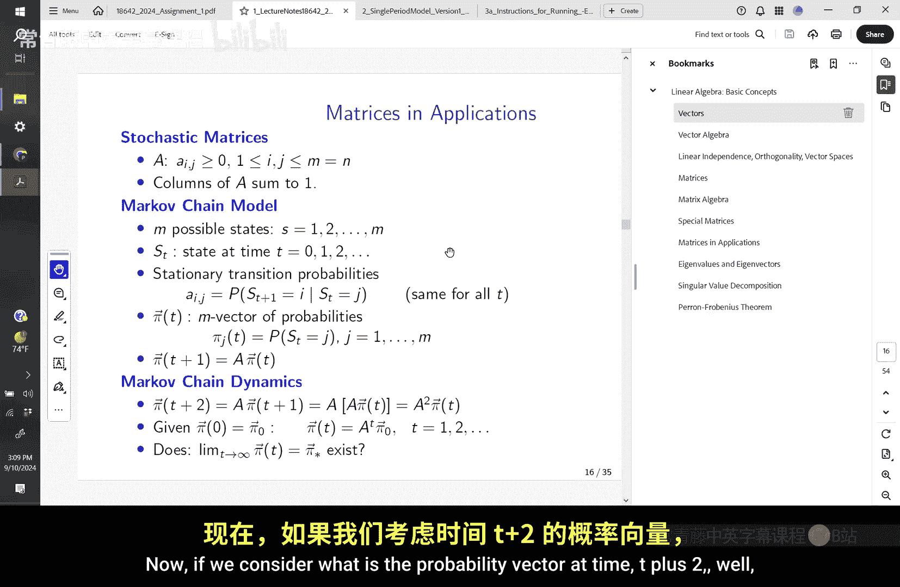

Well， we have the same matrix vector。Model。Where the stationary transition probabilities A are multiplied by the vector of probabilities at T plus  one。

And we can substitute in what that。Product is。Which is a pi。

 And so we basically get the square of the transition probability matrix times the pi vector at time T。

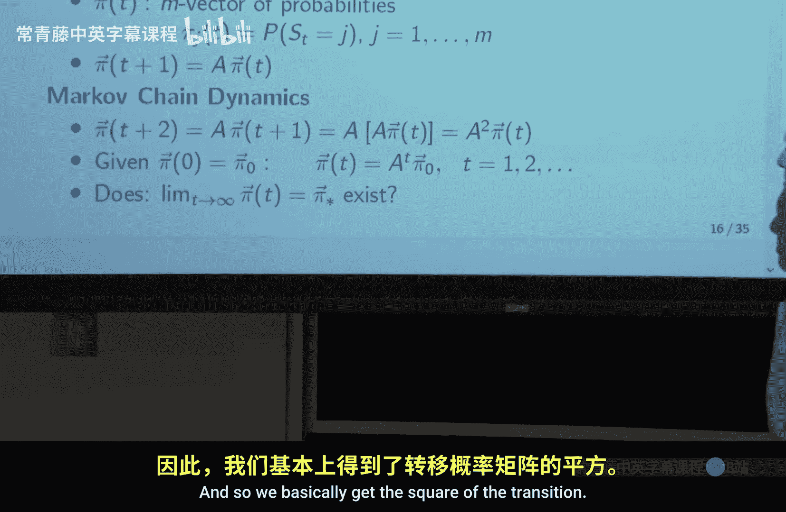

Now， what's interesting to ask with Markov chains is if we start。Out with。A pi 0 vector at time 0。

And we have the model that the likelihood of different states evolves。

Such that the sort of T period transition probabilities from。Pi 0 to T is given by this formula。

 Then does this limit exist or not。And so let me just ask。

嗯。That question。To the class， anyone remember from。Sttochastic processes， perhaps or。Linear algebra。

 whether that。Has a limit。Yes。If it exists， is' the stationary distribution。And so。Basically， if。

If pi star is the stationary distribution is equal to a。Pi star。

So that we're at a limiting distribution where there's no change in probabilities。

Continuing sort of from t equal to infinity to infinity plus one。Then this would be the formula。Now。

Are there circumstances where such a stationary distribution doesn't exist。Yes， okay。

 And when is that。I see some solid nods， yes。What is periodic， Y。

 so you could have cycles in the process and。You know。

 a simple case would be two states that just alternate even odd being one state or the other as an example。

 So we need to have acyclic。Distributions， or。Or the transition pro or the。

The Markco chain needs to be acyclic。And。So， and actually。

All these topics are quite interesting when you study them， it turns out that you can prove that a。

A Markov chain is acyclic。 if all of itss。Components。Of the a matrix。

 if every single one is non zero。So that there's always a possibility of transitioning from one state to another。

That's a bit too restrictive。 But it turns out that。If you consider a particular power of a。

That for some power， not necessarily very big， but there's at some point of looking at powers of a。

The a to that power is a matrix of all positive entries。

So it's sort of interesting just how these mathematical features can be shown。Now。Let's see。

 All right。 So if it does exist， we have a stationary distribution。And that's， that's nice。

 Let's see， let me just point out that， I guess in the first problem set for the course that's been posted。

 that's due a week from Friday。 So this is a。Good healthy amount of time away。 I hope for everybody。

 we're asking you to look at some simple Markov chains and explore the stationary distribution of those cases and。

The Markov chain model is used for modeling whether， say， trades at the buy or sell side。嗯。

Or whether trades。Successive trades in a stock will be at the buyside or sell side depending on what the previous trade was at。

Alright， well， let's move on to another class of matrices that's of interest。And， actually。Actually。

 before doing that， I'm going to jump ahead just in terms of topics。

 but this formula for the stationary distribution。Is a formula。That's very specific。

To eigenvalues and eigenvectors。And so。If you think of the matrix， a。

Having eigenvalues and eigenvectors。What's the eigenvalue and what's the eigenvector in this case。

Doess anybody。Yes， okay。Could give everybody one。The argument participate。So， so this。

So this basically is a case where one of the eigenvalues is one。Or sorry。

 one of the eigenvalues is one， and this is satisfied。We'll see。Later， that。Basically。

 the other eigenvalues may be smaller than one。And when you multiply。The a matrix。By itself。To many。

 many powers， then it's only this one eigenve that doesn't get shrunk to 0 in the limit， so。

All right， well， let's turn to positive matrices。 positive matrices arise in economics。

 where we think of there being， say， prices of goods。Under different sort of states of the market。

Or costs of goods under states of the market。 And those are all positive。

And we can think of this arising。In。A single period market model。Where we have。N assets。Indexed by I。

And。Let's see。We have two periods or sorry，2， a single period with a beginning and end。

 T 0 and T equals capital T and。If we think of。What is the。Price of assets at time 0。嗯。

We may know what those are at time 0， and then。What are the subsequent prices at the end of the single period。

Capital T。And。Those prices may， or may not be。Kown， and so。Let me just。Give an example here。

With two assets。And。So we're going to think of the two period model。

And we're gonna to have n equal to 2。And。For。We're going to consider basically。A bond。B。Which。

Takes on values。That will be B0。嗯。At T equals 0， And B T。At time， capital T。And well consider。

The case of a bond， which。Basically， pays interest at the interest rate。Rf。So， this。B0。

Price of the bond at time 0， grows to。B sub capital T。

 which is basically growing at a simple interest rate of RF F。And。Let's see， we can。Talk about R B。

 the return。Of this， just being。Bt minus B0。So this is the absolute return。And we could also。

Define the percent return。Which would be looking at。R sub B equal to。The absolute return。

 divided by the initial value。So this would be the percentage return。And。Let's see。

 if we subtract this here， we end up getting。That this is。B 0。Rf。Times T。

So this turns out to be equal to simply RFT。As the percent return。And。Let's see。

We can also talk about the simple。Rate of return。Which would be given by。Well， let's see， actually。

 maybe I hear I should write R sub B。嗯。And here， R sub B。Instead of r sub F。

 because I want to define r sub F to be equal to。嗯。The basically say one over T。

 the average rate of return。So it's equal to this times。Bt minus b0 over B0。And so， this is simply。

In this case。Is equal to that RB。And。I guess I'll be using a notation of characterizing an interest rate as being a risk free interest rate。

If。This bond is sort of guaranteed to have that final value。And so in quantitative finance。

 we often talk about risk free rates。And the， nothing in the world is risk free。

 but when governments can print money to pay off their liabilities。

 then it essentially is sort of a risk free rate。And we worry less about it with。

Countries with stronger economies。 Now， this is the first asset。 Let's also consider a stock， S。

Which has at time0 a value of s0。And then at time T。It's going to be random。And so we have S sub T。

Is going to equal。Different possible outcomes。And we'll consider a special case， where it's S T U。

An STD。Where。We have an underlying state being an up or a down market。So。

We have a random outcome for S T。We're not yet specifying what probabilities are associated with these different states。

 And so there are two。States。At time T。Omega equal to。Well。

 maybe I'll just write U and omega equal to D for that。 And so。

In thinking of a single market model with N assets， not just two。We are defining， basically。

 two assets。

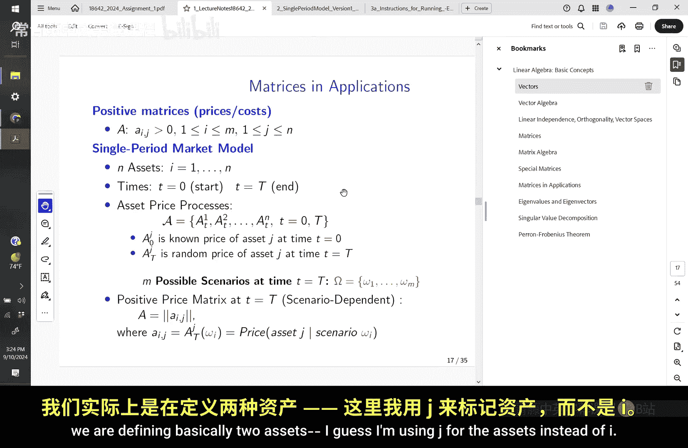

I guess I'm using J for the assets instead of。I， but we basically have known asset prices at time  zero and potentially random prices at time capital T。

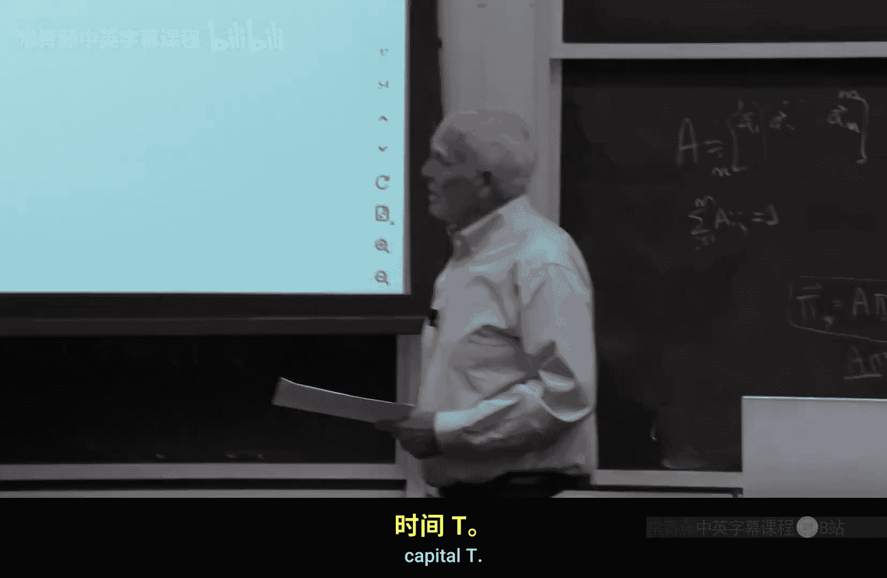

And so。We can model this。By。Associating different states。At or scenarios at time， capital T。

That are indexed W1 to WM。And we then。

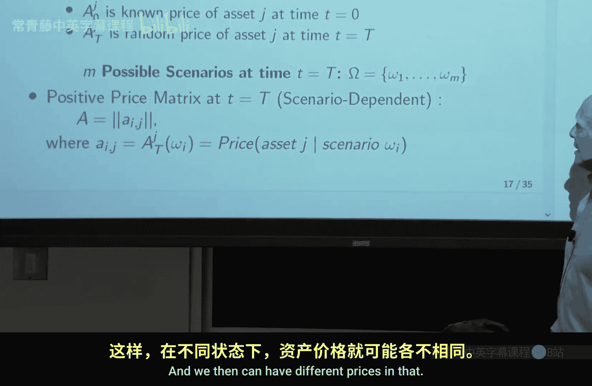

Can have different prices。In that。 So so here's the framework for this right now。

And at least the framework with two assets。And we can also characterize portfolios。

Of the n equals two assets。And we can define a pi vector。Being simply equal to。

A weight in the bond and a weight in the stock。Units of the stock， unitss of the bond。

Given by this vector。And so。What we can then do is。Deal with modeling the outcomes of。This portfolio。

嗯。If we。Consider sort of V0。The value of the portfolio at time 0。This would be just pi B times B0。

Plus， pi S times。S。0。And。At time， capital T。Then our portfolio would have values。Pie the。Bt。Plus。

Pi S。Times S。T you。For the up case and pi B， B T。Plus， pi S times S TD。When W is equal to D。

 when the state is down。So。This。Value of the portfolio will be random depending upon the likelihood of these up and down states。

Well。With this setup。It's useful at this point。To introduce you to some concepts。

Which is contingent claims。And。Replicating portfolios。Porfolios。And so。Suppose that we have a。

A contingent claim， C。Which has a value C0。嗯。Is the value。At t equal to 0。And。C T。

Will be the value of this contingent claim。Depending upon whether we have。And up or down。Actually。

 I'll reverse it a down or an up market。What we end up doing in。These market models is。Being able to。

Moodeled the prices of contingent claims。When we can replicate the contingent claim。

With the portfolio of the underlying assets。And so。You know， so we can ask。

 does there exist a portfolio。Of B and S。Such that。Pi B。嗯。V plus pi SS。呃。Tu。Equals。See。CT。

D and pi B the。Plus pi S。S T， I've got these notations wrong。Of CU。So。If this were the case。Then。

If so。Then。We could have C 0 equaling pi B。B0 plus pi S S 0。And we would。

Replate this contingent claim payoff at time， capital T。Now， mathematically。Can we solve for。

A portfolio。Coefics。That satisfy this contingent claim。Any thoughts。Well。

 let's see if we look at CTD。Versus CTU。And here's the origin。嗯。If we had a portfolio， that was just。

嗯。The， the bond。We might have be。Tea here。And Bt here。And here's the point corresponding to BTBT。

And here's the vector。Corresponding to the portfolio is just the bond。And if we look at the。Stock。

The portfolio is just， the stock。We might have。STD here。And then， way up here。Maybe S。T you。

 the value of the stock when the market is up。And so。

This would be our S T vector in the two dimensional space corresponding to down market state versus up market state。

Now， given this。Figure。If we think of just。An arbitrary point in this space of contingent claims。

Can we construct a portfolio that matches that， yes。Yes， okay， the contingent claim。Is a payoff。

That is contingent upon。The state of the market， at that time。

And it's either a down market or an up market。Over the one period。And the payoff。

 if it's an upmarket， is C TU。And the payoff， if it's a down market， is C TD。

And in this space of contingent claims， we can draw vectors corresponding to the stock。And the bond。

As these vectors。And so what's curious to think about is。Suppose we have a contingent claim。That。

Well， let's see。 Sose we consider a call option。Contingent claim。So， C。Well， let's see。 Okay， so。

 so let's see the， there would be a strike。Price。Of。Let's see。A strike price of k。To。To buy。

The stock。At time T。And in order for this to be of interest， we might have K。

Being smaller than ST T U and greater than S T。D。So we have a call option。

With strike price K to buy the stock。And the contingent claim。Of the call。Would be。0， if。We have。

The down market， and it would be S T U minus K if it's the up market。

So we could consider 0 in the down market， and。Basically， maybe this would be C minus k here。

So this vector here would correspond to。The payoff of this call option。

So under what circumstances can we。Take a linear combination of these two vectors。

 and get this vector。Yes。こ那个。Yeah， I mean， basically we can solve for this。Here。

By substituting in for this。0 and p minus K。 And then just solve it to get our。

Two equations and two unknowns。 So if this system of equations。

 two equations and two unknowns has a solution。Then we can solve it。And。What is interesting is。To。

Consider sort of what are the space of all possible contingent claims。 And let me let's see。

 just turn to。This note。This is on canvas。But this note that's been posted in Canva talks about a one period economy with two assets in Section 1。

 That's what I've just outlined on the chalkboard here。One can generalize that to。

A single period model with。More than two assets。 That's Cha Section 2。

 And then one can generalize to。Not generalized， but one can consider visualizing the assets and portfolios in Section 3 here。

And so。What I。Do in the last section here is looking at the vector of payoffs。

Of the bond and the stock。Colored differently。 And so this is a bond that may pay off the same amount in the down versus the up market and the stock pays off more in the up market than the down。

And then one can consider collections of portfolios。That sort of。Weight， the bond and the。Stock。

So that the positive weight sum to one。And so these vectors correspond to the payoff vectors of those long portfolios。

嗯。And if we。Consider。Well， let's see， looking at those long portfolios。

Instead of representing vectors as pointed segments from the origin。

 one could just represent them as points in the space。And that representation is helpful when we。

Want to consider a variety of other portfolios in the mix。And so here's a graph。Showing。Value。

Of the payoff。If we consider portfolios that can invest up to 100%。In each。Of the bond or the stock。

 or both。And so。If we invest 100% in both， we basically get the。Payoffs that are really high。

 And if we don't invest much close to zero in both， then we get the zero vector。But this。This。

Graph sort of shows the contingent claims that are mapped。

Are equivalent by replicating portfolios of these types。And so if we then allow for shorting。

This sort of extends the contingent claims to allow for negative payoffs。嗯。Which。Our graph here。

 basically with the payoff and the down market versus the up。And what's of interest here。

 although it's not quite easy to see。But is， let's see。

 there are portfolios where the initial value of the portfolio。Is 0。

And so that would correspond to a long， short portfolio that。Is implemented with zero cost。So。

 and then。Let's say， okay， so this is sort of the payoff vector at T。And looking at the value。

 where we。Sort of white out those portfolios that have zero cost。Now。

 what's useful here to see is that。With these kinds of portfolios， we can。

Replate different contingent claims， which correspond to different points in this space。

If we were able to。Invest。Sort of more than 100%。Of our portfolio。Long or short。Then。

 we could actually realize。Any point in this space。In some cases。 and so。

Any contingent claim could be solved for， you know， with this。Equation here。And that's rather neat。

 but it also is reasonable。To consider if we make certain assumptions on the market， such as。

As you buy more of an asset。You don't change the price of the asset。

There's basically a fixed price is suitable， regardless of how much。

 and there's no constraint on short selling the asset that you can do that with liberty。 So。

 so there are these kinds of properties that arise now。

With the case extending from the bond and the single stock to。M。Sorry， little N assets。

Then everything generalizes， and we end up having。A positive pricema trick。At time T。

Corresponding to different payoffs of the individual assets at time capital T。4 different states。

 omega 1 through omega M。And。With this kind of setup。嗯。1 can。Represent sort of the initial value。Of。

A portfolio。Q。Being the sum of the Q weights times the initial prices in the a 0 vector。And then。

 the payoff。Of the portfolio at time， capital T。Is given by the same weights Q J times the time capital T prices。

But we have different prices， depending upon what state。Ocurs。And so in this case。

 we have basically our matrix a times Q giving us the vector。Of state dependent。Values at time。

 capital T。And so。With this model。We can。Contemplate there being an arbitrage portfolio where the initial value is not positive。

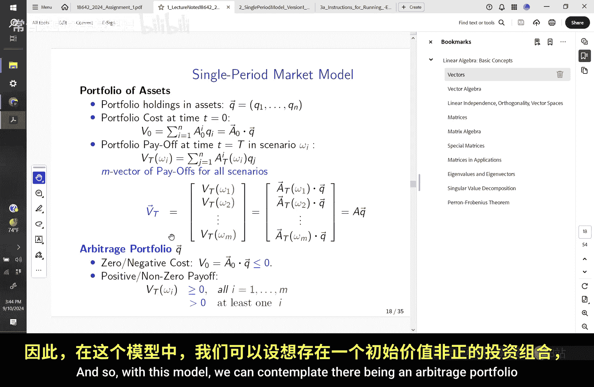

I guess one could constrain this to be0， but it's easier to just say less than or equal to 0。

If this initial。If we have a negative cost， that means we get paid to。Implement this portfolio。

And it will be an arbitrage portfolio。 if the likelihood of a。Negative。Payoff is 0。

And there's some likelihood of a positive payoff。So this port such a portfolio would be。

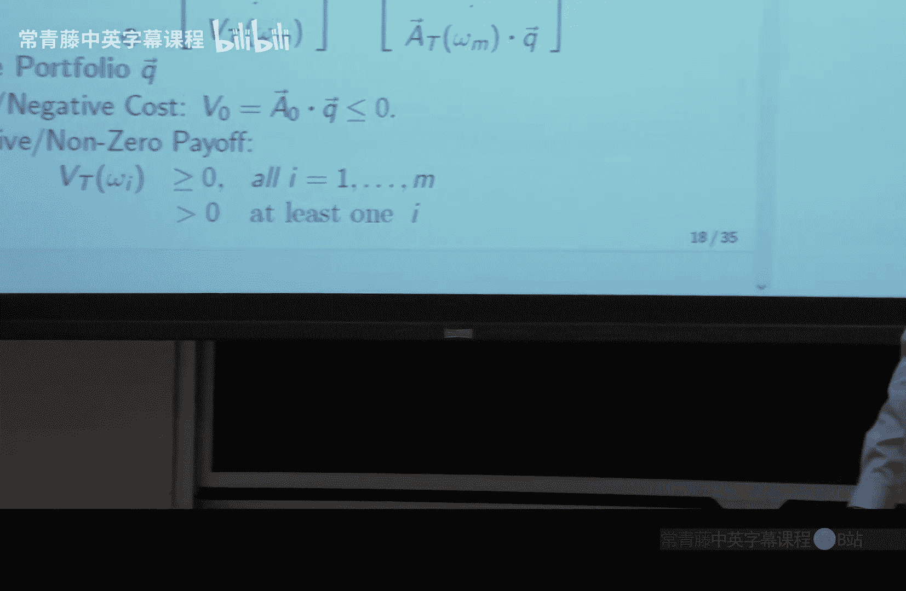

Risk free in terms of downside risk。 We never lose money。

We either make money all the time or in at least one of the states。So this is an arbitrage portfolio。

Now。With this model， there can be。嗯。Conditions that ensure that theres there is no arbitrage in the market。

And。嗯。So， so that's one issue to think about what conditions would ensure no arbitrage。

And another condition that's of interest is called market completeness， which is。

Are there portfolios that can realize any payoff vector。So in looking at the contingent claims。

Payoff。Can we sort of span this space fully。With portfolios of the underlying assets in the market。

And so， if we can。Represent any contingent payoff as a portfolio。

 Then we say that the market is complete。And。It turns out that。The conditions of。No arbitrage。

Our and market completeness are related to whether a pricing measure exists。On scenarios。And so。

Think about Q star being a probability distribution。Over the underlying states。

 omega1 through omega M。And。

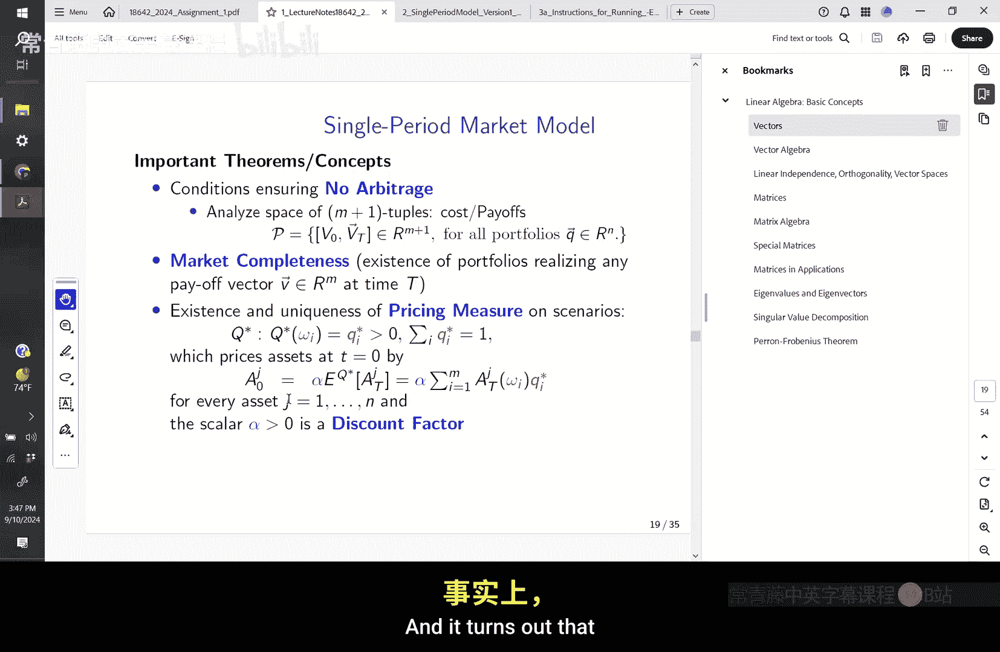

It turns out that。If the initial。Price。Of the Jaith asset。

Is sort of the discounted expected terminal price。Of that jaith asset across the different states。

Then， this is。Q stars is called a pricing measure。So， our initial prices equal。

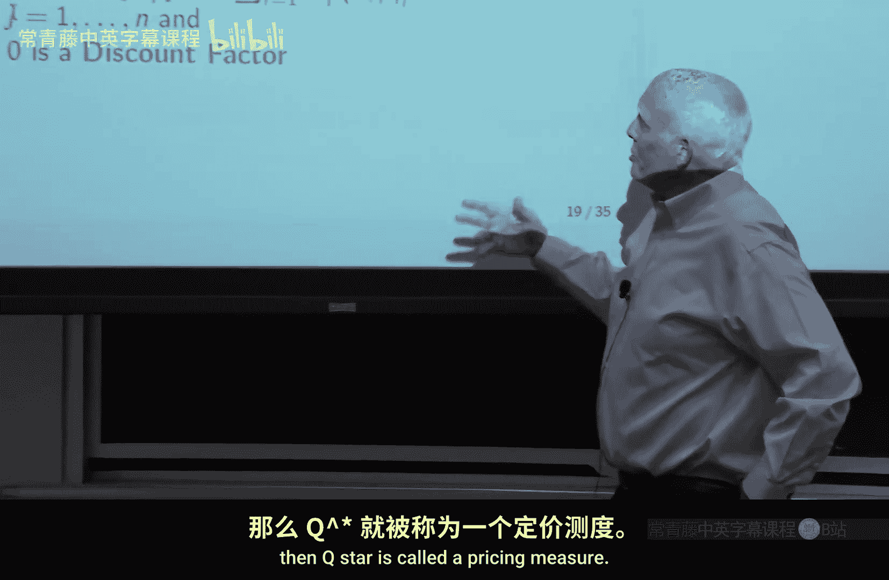

A discount factor times the expected terminal。Time T values。嗯。

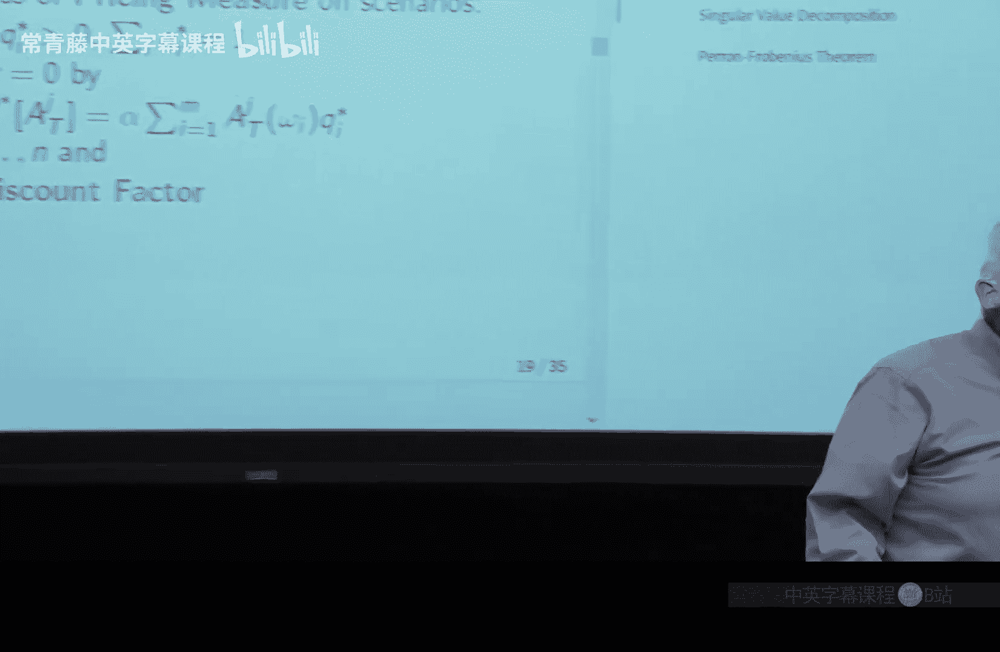

If such a pricing measure exists， then there's no arbitrage。And。Let's see。 Okay。

 so it's no arbitrage if all of the Q J stars are positive。

So if this pricing measure gives positive weight to each of the underlying states。

 then there's no arbitrage。And we say that the market is complete。With no arbitrage。

 if this pricing measure is unique。So it's an interesting set of properties。Actually are quite well。

 useful to know about， and these models actually underlie much of option pricing theory and arbitrage relationships in quantitative finance。

嗯。So and in this single period model note that we have distributed， there's this reference。

Of this book by Albanese and。Camppo Leti， where they go through proofs of these。

 and they can get a bit technical。 But， but the basic ideas， I think， are relatively。Accessible。Now。

 let's see。Moving on to other applications of。Marices。We can。Consider systems of linear equations。

And their solution where。We basically have。M equations。In。And unknowns。And so。With these M equations。

We have A X equals B， a B vector。And。To solve such a system of equations， well。

One case where we can solve these is where our。Number of unknowns and number of equations are the same。

And our coefficients matrix， A in the system of equations has full rank。So， a。

Being square and of full rank。Has a determinant That's nonzero。And it's inverse。Matrix exists。

And so we can actually just take our system of equations and multiply both sides by the inverse of a。

And get our answer。嗯。When the number of equations。Is smaller than the number of。Unknowns。

 then we have an undetermined system of equations。 When M is greater than N is's overdetermined and so forth。

 So these are different cases that you likely are familiar with from。Your study of linear algebra。嗯。

All right， the next topic in our remaining few minutes is。Let's see。 eigenvalues in eigenvectors。

When we have square matrices， a。We can。Consider the existence of an eigenvalue lambmbda。And a。

Eigenvector V。Such that the matrix A times V is equal to just the scalar lambda times V。

So the matrix vector product just rescales V by the factor lambda。And。

1 can solve for eigenvalues eigenvectors by just reexpressing。

The eigenvalue eigenvector relationship as this system of equations。And so this system of equations。

Well。Corspond to。Let's see。This system of equations will。Let's see， can be solved。

By saying that the determinant of a minus lambda I is equal to 0。And so。If。

Lambda equals one of the roots of this polynomial。Then。That lambda will be a an eigenvalue。

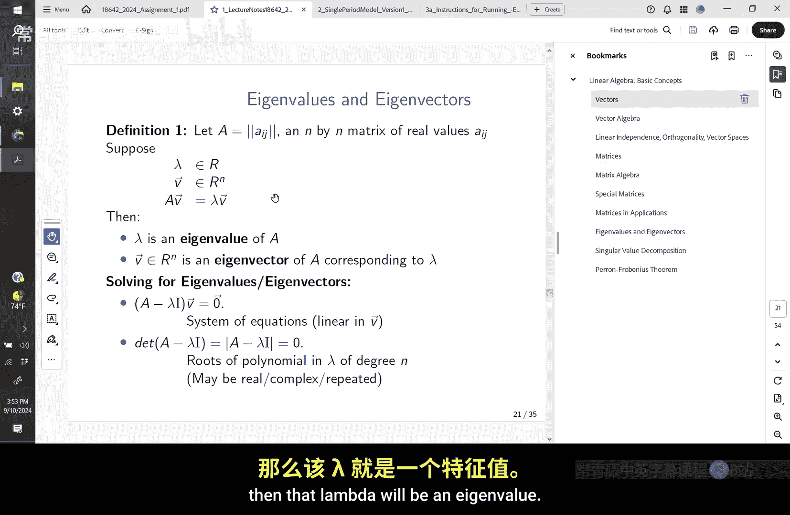

And one can then， for that fixed eigenvalue。

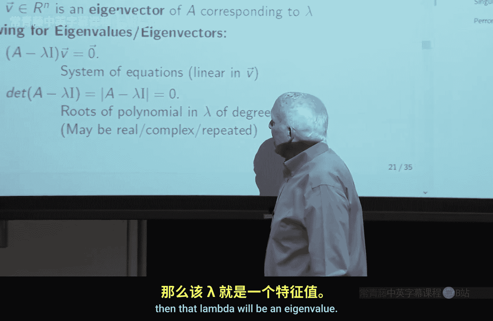

Solve for the eigenvector V that satisfies that。

🤧嗯。Now。There are properties with eigenvalues and eigenvectors that are very useful。You know。

 one of which is that。Maximum eigenvalue， magnitude corresponds to the maximum length of A V for vectors V that are of length 1。

嗯。And。When we。Have。A matrix A that has independent eigenvalues or eigenvectors。

Then in this special case， we consider defining the matrix S to be the matrix whose columns are the written。

Different eigenvectors。And if you look at this。Equation here， we multiply。

The original matrix A by this S matrix。 Then each column of the product is the corresponding。

Eigenvalue times the corresponding eigenvector this。

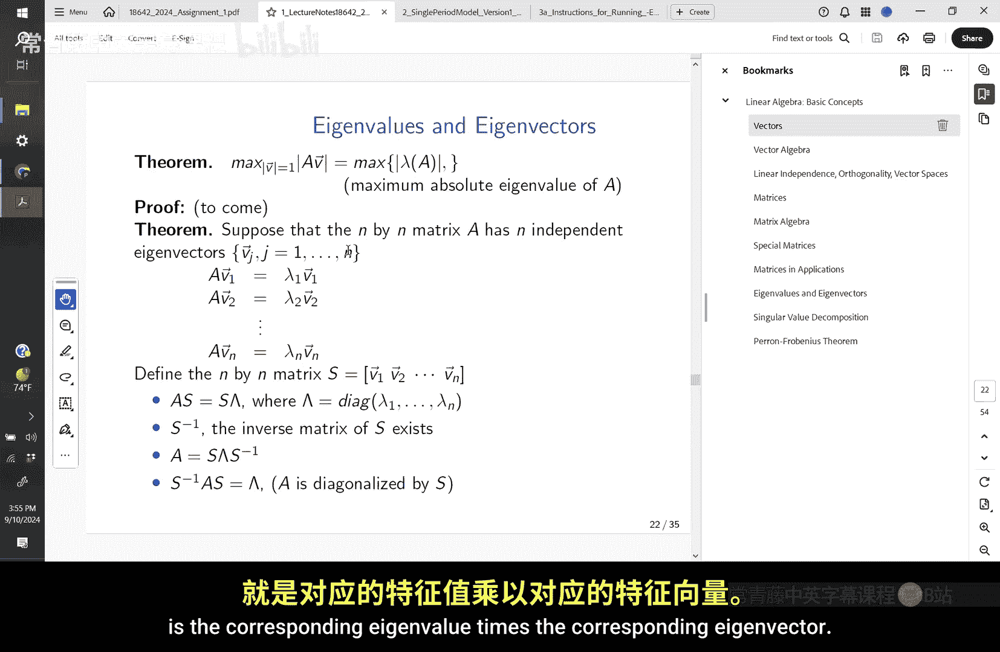

This equation here is。Very straightforward from。The notation above。

And if we consider the inverse of this S matrix。That exists if the eigenvectors are linearly independent。

Then we can write a to B S lambda S inverse。And this representation of。The matrix A。

Also gives us the way of diagonalizing。A by pre and post multiplying by S inversion。

 asked respectively。

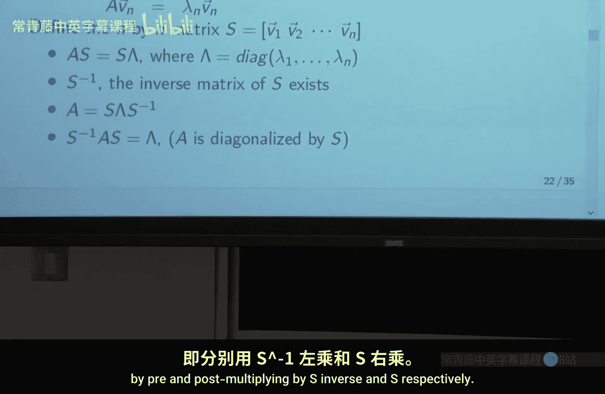

And so with powers of a diagonzable matrix A。They have a very nice form。

We basically got cancellation of S and S inverse。In the products of a times itself。

 and so powers of a simply are the same V matrix S times lambda。

 the diagonal matrix of eigenvalues to the k power times S inverse。And so these are very useful。

In defining。State equations and common filters。So。All right， so let me just。

I guess I'll finish there， there's some interesting key thememes in the remainder of these notes think。

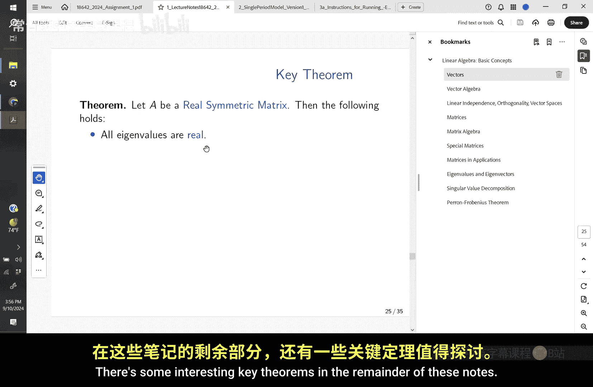

They're pretty readable， and I'll maybe point out these during our next lecture， but。There we are。

 Also， let's see， I posted a。And our studio program that computes portfolios of S&P 500 stocks and looks at the changing value over time。

And so I hope people can sort of explore those programs and try to use those in the our studio cloud。

