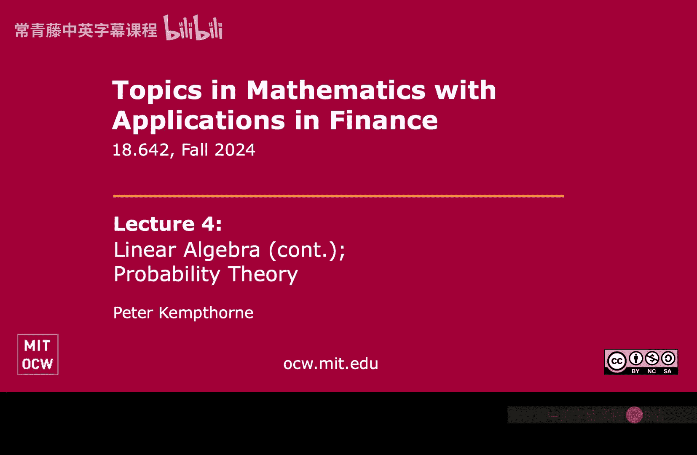
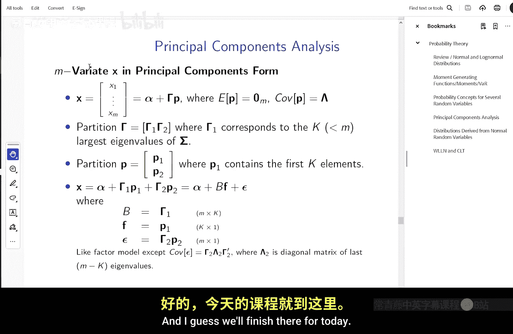

# 麻省理工学院【中英⚡数学专题及其在金融中的应用｜18.642-Fall-2024,-Topics-in-Mathematics-with-Applicatio】-p05-P5-Linear-Algebra-(cont.);-Probability-Theory--BV1iLrjBrETS_p5-

嗯。All right， I guess we'll get started。Let's see。 I wanted to just finish up some discussion of topics from linear algebra that we didn't get to the last math lecture。

 And to begin with， I think we did。Cover this topic of eigenvalues and eigenvectors。

 These linear algebra concepts turn out to be very， very useful in a number of different。

Applications， but when we have an eigenvalue， an eigenvector pair， then。For a matrix a。

That has an eigenvector V。Then。The matrix vector product is simply a rescaling of that same vector。

 so matrix multiplication when we use eigen or matrix vector multiplication。

 when we use eigenvectors is very simple， we're just rescaling the input and in order to solve for eigenvalues and eigenvectors。

One can solve this equation where the two are equal。And。When we solved this equation， we。

Want the roots of the sort of determinant equation to equal 0。

This means that these are the eigenvalues which make this matrix factor a minus i lambda non invertible。

So with a matrix。If that matrix a that matrix is invertible。

 then the determinant of the matrix is nonzero and the inverse is actually functions of different determinant cofactors。

 so in order for V to not be zero。Well， which would be the case if this matrix were invertible。

 we must have the lambda satisfying this equation and this system of equations is a polynomial。

In lambda， or at least the determinant equaling 0。Corsponds to a polynomial in lambda equaling 0。

 So these things can be solved very directly。 actually， in R。

 you can actually compute the roots of any polynomial very easily。 And then once we've solved for。

A root lambda， then we can solve the equations for what the V vector is that satisfies that。Now。

Let me。Put this in here。嗯。Okay， it turns out that if we have。Independent eigenvectors。Then， we can。

Linenially independent eigenvectors， Then we can comprise those as columns of a matrix s。

And the matrix a multiplied by this S matrix will simply be the matrix of multiples of the eigenvectors。

 so Sda lambda as a diagonal matrix and the inverse matrix of S will exist so long as we have independent eigenvectors。

And so。This equation here can be used to obtain A is S lambda S inverse。Alternatively。

 S inverse A S is equal to lambda。 So these eigenvectors。

When comprising a matrix allow us to diagonalize。A matrix， A。Now。Let's see。All right， so eigenvalues。

 eigenvectors can come into play when we have equations for calm and filters。

 if our matrix A is transforming states at time t minus1 into states at time t。

 and the dynamics of this process proceed regularly over time increments given by T。

 then we simply have the teeth transition from state zero is given by the teeth power of a。

And we can actually get explicit solutions then， which end up。Giving us， let's see。

 at least if our eigenvectors， V1 through V N are linearly independent。

Then if we have an initial condition， you not。We can express that initial condition as a linear combination of the eigenvectors。

And then we can represent the transition。Over T periods to have this form。

 And it ends up just being a sum of multiples of the eigenvectors。

With the coefficients being powers of the eigenvalues。So in looking at this， mathematically。

 one can see that。If。The eigenvalues lambda 1 to lambda n。Are smaller than one in magnitude。Then。

This sort of limiting state transition goes to a zero vector。If。

The one of the eigenvalues is equal to one。Then this term here won't change with each transition。

 and so we'll have a limiting value of the state that corresponds to a multiple of the first eigenvector。

And so what's interesting to anticipate is that there will be different kinds of problems we work with where the eigenvalues may actually be such that the largest eigenvalue is equal to one。

And the other eigenvalues are smaller than one in magnitude。

And so we can get nice analytic representations for the transition of the states。All right。

From linear algebra courses， you probably remember that if we have a symmetric real matrix。

 So if this matrix here is N by N and it's symmetric。And it's real then。

All of the eigenvalues of this matrix are real， as well。And。If we have two distinct eigenvalues。

Then the eigenvectors corresponding to those two eigenvalues。Are orthogonal to each other。So。

 if we have。A V1 equals lambmbda1 V1 and A V2。Is equal to lambda 2 V2。Then it turns out that V1。

Dot V 2。Is equal to zero。And。You know， this。Is。Useful， at least if we're。With linear algebra。

 we often want to represent multidimensional vectors in terms of some basis。And so。If we think of。

Our matrix， a equaling。A vector A1， A2 up to AN。嗯。If。The matrix A has full rank。

Then these columns of a are linearly independent。And we could use。

These column vectors as a basis for the ndisal space。So， so if the rank。Of a。Is equal to n。

 Then the collection of A Js j equaling one to n。Forms of basis。And if we have a matrix A。

That maybe is symmetric。It has eigenvalue that are all distinct。 Then we actually could have。

 So if a。Is symmetric。And all the。Eigenvalues are distinct。Then。The collection of eigenvectors， V J。

 J， equaling1 to n。This would correspond to an。Orthgonal basis。And so when representing。N vectors。

It's convenient to represent them in a coordinate system。That has sort of orthogonal axes in it。U。

Now， what's interesting is that。When a is symmetric and real， all the eigenvalues are real。

 it turns out that there exists。And。Orhogonal set of eigenvectors in that general case so。

So that can be very useful。嗯。Alright。Well， a very important linear algebra。

Result is the singular value decomposition。And let me just ask。

 how many people here have covered singular value decompositions？Just about everybody， okay。

 so who would like to explain to me what or explain to the class what a singular value decomposition is。

So。Let me write this。Maybe as the singular value decomposition in my notation。So who。

Id like to explain what this is。Anybody。Yes， expresses the matrix A as a sum of or thought it will run when major。

So。You is such that you transpose。You。Is equal to， say， the identity。It has orthogonal columns。

V is the same thing。And D is a diagonal。And so。Whats。Important is that any matrix。

Can be expressed as the factor of。A V。Transpose， which is orthogonal matrix。

That will sort of transform coordinate axes to new axes that are orthogonal in the same space。

 And then D is a diagonal matrix。Downe to D。Well I'll write DR。

Where we basically are stretching and squeezing。Axxies。

 and then U and simply has columns that define a new basis or a new vector space。

 And we're taking some of those。 So， so it's interesting to represent any matrix。As this。呃。Operator。

 which will sort of or do an orthogonal transformation of axes。

 stretch and squeeze in that transformed space and then use those to multiply。

New coordinate factorsers you now to if， if we take。Sort of any， let's say， here an M by N matrix。A。

嗯。And。It's often the case that we have maybe M cases in a data set and N variables。

And so this corresponds to a data matrix for。An analysis of some data。 If we take a transpose a。

Then this is a symmetric， real matrix。And so this actually can be diagonalized to the。

D squared V transpose。Where。I'm representing the eigenvalues。As therere the squared D。Values and the。

Eigenvectors as columns of V。And so one can sort of construct this， do the eigenvalue。

 eigenvector decomposition here， and then we can take the matrix A。Pre multiply by V。And。

Or not pre multiied， post multiplied by V and post multiplied by D inverse。

And this will basically be our you。Mattrix， now， all of this is a bit casual with my notation。

The number of sort of non zero diagonal entries here。Can be limited to。

The rank count of the matrix A。And so， you know， that's the way it。Can play out。

 So we basically have non zero eigens。Values of a transpose A， there will be R。

 the rank nonzero eigenvalues。We can define the orthogonal orthoormal eigenvectors corresponding to those。

 And then if we want to sort of expand the。Orhoormal basis of the first are eigenvectors to be。

An n dimensional basis， although they essentially aren't used。And。

So that gives us our singular value decomposition。And it turns out that in dealing with。Data。

In a matrix。The singular value decomposition allows us to reduce dimensionality。

 Perhaps there's variation in the data values that is limited to。A subspace。A rank， two or three。

And so we can identify and specify that subspace easily with the singular value decompositions。

All right。Let's see。Okay， so in these notes， I refer to a reduced S VD was rather interesting。

As a decomposition of the matrix A is that it's a sum。Of our terms where R is the rank of the matrix。

 And those R terms are。The products of。The column vectors of U。

Times the column vector transpose of V。Respectively， with the singular value Sigma 1 through Sigma R。

 So its provides a nice way of thinking of。A matrix。 It's simply a sum of rank 1。Terms。Okay。

Let's see， these lecture notes on linear algebra finishes with the coron Frrobeius theorem。

And this theorem relates to matrices。That are square。With positive， strictly positive elements。

And so。With such matrices。The theorem states that there is。An eigenvalue。

 a real eigenvalue Lada knot that is bigger than any in magnitude than any other。Eigenvalues。

And corresponding to this。Eigenvalue lambmbda not。We can define an eigenvector V。Which。

Has elements that are all positive， as well。And this lambda not。Eigenvalue， the largest one。Is。Alone。

 in terms of all other eigenvalues are smaller in magnitude。

And this result turns out to be very useful in working with positive matrices。

The notes here go through the proof of that， I guess they are included here if we wanted to。

 so get into technical proofs of。The near algebra。 And I don't want to do that。 Let's see。

 I finished the these notes with just some mention of different news sources that。You should。

Consider exploring with in finance and。With， well， there's Yahoo F。

 which is where we can easily collect price data。But you should know that the Wall Street Journal is you can get a free subscription with that through your Kbo password or ID rather。

 so that's very useful and then there are a number of other sites that you may find useful。Now。

 let's see when。And see in our very first lecture。嗯。Let's see。 I indicated。

How we could use our studio to collect data， plot time series of different stocks or other assets。

 and in this lecture too， I distributed this workspace， which has our scripts。And output for。

Looking at portfolios of stocks and considering sort of equal weighted portfolios with different components in the equal weights。

And so， with the。Let's see if you go to。The R cloud。Our studio cloud project。

So with our studio cloud。Or maybe it's cloud R studio。 One can。

Upload different R programs in this in this project。

 And so I don't know has anyone in class yet used our。Our studio cloud for any of the examples。

 I'd like some， I'd like everyone to at least be capable of doing that。

 And I'd like sort of proof that it actually works with students doing it。

 So it would be great for some of you to to consider that。 What's what's nice about this。😊。

Environment is that I can give you an R program。And it should run just by saying run。

 You don't have to install anything。 And let's see， with this。Output。

Let's see there was one program called Sc S 500。And there's a table of contents for this R script。

 which says it loads libraries， then collects stock prices and then saves the workspace。

So the commands are all very simple in here。嗯。And， and then。

Let's see with the equal weighted portfolios。Scrrit， it actually loads libraries。And loads the。

Data set of stock prices that was just downloaded in the other program。 and it loads the data in。

Then in processing the data。嗯。I， let's see。 consider investing。A portfolio by equally waiting。

Allocs to different stocks in the S&P 500 index。And so if one does this。

These simple R commands create the value of such a portfolio。Where， in fact。As indicated here。

 it's investing $10 dollars。At the beginning of 2019。

And as an alternative to just equally waiting across the S&P 500 stocks。I looked at the Amazon。

 Apple， NviDdia， or no， Netflix and Google。 these were actually they're really hot stocks about four or five years ago。

And basically， look at equal weighting of all these。And so here's how。The investment。

Equal weighted at the beginning of the period resulted towards the end。 So。

 so there are some interesting features。 one can see if one happened to。

Be good at identifying stocks to invest in。 you can do much better than sort the average S&P 500。

There can be greater risk。By investing in a smaller number of stocks。

 because you're not so diversified。And so you can see how the red。

The red graph of values sort of decreases rather dramatically at some points in the time period。And。

If one looks at sort of what happened to the $250 invested in each of those four stocks。

 this is what happened over this whatever's five year period or almost five year period。

And this raises some interesting issues for us， which is。When considering portfolio construction。嗯。

Maybe equally weighting allocations across the assets is a good thing to start with。But。What happens？

Over time。Well， in this case， Apple。Outgrew the other allocation substantially。

 And so the degree of diversification in the portfolio is getting lower because we have a greater concentration in that one stock。

So what we'd like to do， perhaps is to balance， rebalance the portfolio。And you。

 different approaches to rebalancing portfolios can be considered。 Now， if we were to。Consider。

Sort of rebalancing every day。The investments in these four stocks。Then。

Would you think that's a really good way to。Rebalance to do it very， very frequently。

And why or why not。Yes， well if you do it too frequently。

 then my variance is like in 2022 might like affect it， or it won't be。VeryYeah， I mean。

 it's if you re too quickly， then you're taking。Funds away from winners。And giving those to losers。

And so you're sort of equalizing allocations in a way that doesn't benefit from。Short term trends。

Or strength in different assets。So that extreme is probably not something you want to do。

One thing that's rather interesting is just how。If you do not do any rebalancing。

 then the portfolios。Become， rather。Undirsified and so the risk level is actually probably increasing over time here。

 so if you know one way of rebalancing portfolios is trying to maintain a certain risk level for the portfolio and such an objective would require periodic rebalancing。

Okay。Well， let's。Move on， then to。嗯。Topic of probability theory。 and so。

What I want to do in this note is to just give you a quick。Overview。

Basically a review of probability concepts that you probably are very familiar with and so with probability theory。

 it's customary to distinguish between discrete valued random variables and continuous ones and so with discrete valued random variables。

 know those can be just events occurring or not like a default of a counterparty or maybe the federal open market committee deciding on a Fed funds rate the。

Let's see。In thinking of individual stocks and their dynamics intra day。

 one can think of different orders for a stock to buy or sell coming in。

At random and wondering what side those would be on。

 also perhaps the share size of the next market order。A youth now did now。

It used to be that these were always discrete sort of outcomes like share size。

 it turns out you can actually now invest fractionally。Factctionional shares in different stocks。

 so the markets become more rich in that way， but importantly we do want to distinguish between discrete outcomes that have probabilities with respective outcomes versus continuous random variables where we're thinking of values that could take on any value in some interval or range and so。

In thinking about the values of assets。We can think of the value being in a in a continuous range。

 also。Timing of events is a an important random variable that is continuous as well。 So one might。

Consider what is the waiting time to the next market order for Apple stock。嗯。

Mixed variables can arise where we think of a stock having some value。

Where it's generally a positive value， but it could go bankrupt。In which case。

 there would perhaps be some discrete probability of bankruptcy for a stock。Now， with。

Probability models， we use probability mass functions for discrete。

Variables and probability densities for continuous。

 And so we use calculus to calculate continuous probabilities。In different intervals。

 And importantly， the cumulative distribution function。Is a very important。2。So。

If we write F sub x of。Right see。Is the probability that the random variable x is less than or equal to C。

As a function of C， this。Value is going to be。Noose。no smaller than zero and no larger than one。

And it will be monotone increasing。In C。And。Distributions will be uniquely specified by specifying their cumulative distribution function。

So these are very simple concepts。Let's see there are expectations and moments。Let's see。One， just。

I'll just call this an anecdote。嗯。If x is continuous。Random variable。And we define y equal to F of x。

So we consider the probability integral transform。Of the random variable X。

What is the distribution of why？Okay， uniform， yeah， it's uniform。こじ。Its uniform on0。

So what's really neat is that。Sort of a。Monoone transform of the random variable X， whatever X is。

 as long as we know what the distribution is。Transforms that to a uniform。And so this is true。

 regardless of what F is so long as F is continuous。And。That property can be turned out to be very。

 very useful。One issue could be oh， suppose you have a random sample of data。From some distribution。

 or you think it's from some distribution。Is。The sample consistent with that distribution or not。

 Well， if you did this probability integral transform。It should lead to a uniform distribution。

Which may or may not。Be realized， so anyway， that turns out to be quite quite useful。

Now we have expectations and moments of random variables。嗯。Basically。

 the mean of a random variables is the probability weighted outcome we can generalize the mean to looking at which is the first moment to consider the probability weighted average of the k power where k is an integer and。

The variance of random variables is a useful measure of uncertainty about the mean value and。

There's a nice formula for the variance， which is the squared。Distance from the mean。

In terms of the average squared minus the square of the average。 So these are useful。

Forulas that may come in。Be useful at certain times。 Now。

 in terms of measuring uncertainty about outcomes。Instead of the variance。

Taking the square root of the variances。Useful because its scale is the same as the original units。

 Most people don't think in terms of squared units。With any problem。

 And so instead of dealing with the variance directly。

 we'll commonly take the square root of that to have the same units as our original variable X。

 Now with the with skewness。And kosis， we're looking at measures of sort of the shape of the distribution。

And with skewness， as you might anticipate， that detects asymmetry in a distribution。

 and so something that's nice to think about is if we have a random variable X。

Where the expected value of x。Is equal to mu and the square root of the variance。Is sigma。

If we take Z。Equal to x minus mu over sigma。This is a。Standardization of the random variable。

The expected value of Z。Will equal 0。 And the variance。Of the。Will equal one。

As will the square root of the variance。And for the skewness。Which I use， I guess it's a gamma。

Gamma is equal to the expected value of Z cubed， and the ketosis。

Is equal to the expected value of Z to the fourth。So。

The skewness and kerptosis parameters of a distribution。Can measure asymmetry。

 at least if the cubed value has more weight on the positive end than the negative end。

 it'll be skewed to the right and。With the Kappa， we're looking at Z to the fourth。

 so we're looking at basically how heavy are the tails。And the。Let's see， for a Gaussian。

Distribution。Kappa is equal to 3。Or normal 0，1。Or any normal， and。Gm is equal to 0。 So anyway。

 so these other parameters are useful for characterizing distributions that are not Gaussian。

And non gaussian in terms of perhaps skewness or heavier tails。Alright， well， let's just review。

Gaausian distributions。I hope this formula for the density of a Gaussian is very familiar to everyone here。

 We basically have the density function。Is。Equal to one over root two pi。Sigma E the minus a half。

X minus mu over sigma squared。And so。The mean is mue， the variance of sigma squared。

And the density function is symmetrical with a maximum at the mean mu。And。

The points of inflection are actually at plus and minus sigma， so。If we think of。Just。

Trying to draw a normal density function。Then。The peak is at the mean。And the point of inflection。

Where the second derivative。Is0。 It goes from negative second derivative to a positive second derivative。

That distance is sigma。Symsymmetrically。So。Allright， so let's take a look at the normal bell curve。

68% lies within one standard deviation。 So this is， you know the。Whatever you know AP statistics。

 you learn these facts， if we go to two standard deviations from the mean。

 that's 95% and three standard deviations is 99。7%。

So these models are normal models have these or properties of how likely different variations are in standard deviation units。

Well。In finance， we'd like to。Exploit perhaps Gaussian distributions for modeling prices。And。

With a normal density curve， it actually。Applies to x values that can be arbitrarily large。

 negative or positive。 It's an unbounded。Distribution in terms of potential outcomes。

 And so one way of dealing with that with say prices。Is to consider taking the log of。Prices。

And thinking of that being a normal distribution。And so that construction corresponds to a log normalmal distribution。

And so if we have a random variable X that's normal。And then we take the exponential of that normal。

Then。We say that the y variable is log normal with the parameters。

 mu and sigma squared corresponding to the log scale。Now。What。Will be very interesting。

In subsequent lectures is when we talk about stochastic processes。

That can be applied in financial markets。 there's an important stochastic process called brownie in motion。

Which many of you probably have some familiarity with。 and with a brownian motion process， the。

Increments。Of the process。Over time periods。Has a distribution that's normally distributed。

And as the length of the increment of time increases。Both the mean and variance of the outcome。

Changes， and so this Brownian motion processes are very， very interesting。

Process that is intimately related to Gaussian distribution。 So， so we'll get。

 we'll get there in a few lectures now。One of the useful tools we have in probability theory is being able to derive the distributions of transformations of random variables。

 so with the log normal we have a normal distribution。

We maybe take the exponential of that normal outcome。

 and we'd like to be able to write down the density of that distribution and compute different features well。

We can think of。Say a random variable X being transformed to Y with a function G。

And then we can consider the function H， which is the inverse function of G。And。As examples。

 if G is E to the X， then H is the log。F。And。With change of variables， if we have the CF of X。

Then the CF of Y。Is equal to the CF of x。Evaluated at the inverse of y on the x scale。

 So this equation here is。A simple sort of logical statement that everyone here， I think。

 would agree， is valid。And so， if this。Function relating the distribution functions is true。

If we take the derivative。Of the CF function。Of why we get the density。

And then we just have to apply the chain rule on the right hand side。The density of。

X evaluated at H of Y。 But then we also need to have the chain rule for H in there。 So with this。

Formula。Right it's。All sort of familiar。 But if we have F of。

X is equal to the integral minus infinity to x of f of x， F of T dt rather。Then the derivative。

Of F evaluated at x turns out to be equal to F of T evaluated at T equal to x。

So the cumulative integral has a derivative equal to the argument of the integral。 So this is。Easy。

 and we can use this to get the density function for a log normal distribution。And。

Here's the density of the。Log normal distribution。 It has the same form as。

The Gaussian density plugging in log Y instead of for x。But then we need to multiply that by。

Chain rules， sort of derivative of。H with respect to Y， which is one over y。Okay。

 so here's the log normal distribution。And as an example， I chose a mean log value of 0。2。

And a S D on the log scale of 04。And as you work with different distributions， you may have。

Let's see， suggestion or not suggestions， but you may find it useful to consider specific parameter values here。

 I'm thinking that if one has a。嗯。If we think of， say x of0， equaling1。And x of one。

Being distributed as a log normal。With mu equal to 0。2 and sigma equal to 0。4 then。

This log normal distribution can correspond to sort of a one year。pereriod。Where on the log scale。

 we expect a mean。Change on the log scale to be 02。And with standard deviation of 04。

 So this would potentially be relevant for an asset。

And looking at its sort of percentage change on the log scale over one year with an annualized return of about 20% in annualized standard deviation of 0。

4。Well， if we draw vertical lines in this distribution space or sample space of the log normal here I've just drawn symmetrical percentiles of 25th and 75th percentiles。

 and then the  fifth and 95th percentiles in red and it's obvious that it's asymmetrical。And。What。

In what's useful， actually， with different distributions is being able to calculate。

Quantities of interest and finance， and so here's a nice example of a financial computation where we consider a call option to buy an asset at some terminal time capital T and the strike price is going to be at price K and so if we think of。

X being the random variable of what the time T price is。 Then the payoff is going to be equal to。

X minus k。The value minus the strike price， if that's positive。Or it won't be worth anything。

If we have at time。Tea。Let's see if we were to draw here。As a function of P of T， or sorry， X。

 I guess。And there's a。Strike price here。 Then we would have the zero value up to K。

 and then we'd have。X minus k。Be giving this option payoff。 Now， you'll hear。

Vili and Jake talk about。The hockey stick payoff function of。Options， and so this is what that。

Comes from。 now， what's interesting to。No， is this theorem here says that if we have a density function。

 little F。With CF capital F。For the outcome at time capital T。

 then the expected value of this payoff。Is equal to this。

Integral from the strike to infinity of1 minus F of x。And。The proof of this。Is done by。

Considering a finite upper limit， M， capital M。And then integrating by parts and getting a formula here。

 So it's an interesting result that。If we know that。Terminal time T。

Random price of random of an asset， then a call option on that。

Terminal value will have this expected value。So。Let's see。

 those of you who actually have some advanced probability coursework。May notice that。When you。

Are looking at。Sort of。The expected value of a positive random variable。

You can sometimes express that as an integral of。Sort of。

Complimentary probability of exceeding that value。And so that sort of result ends up being applicable here in a very nice way。

Now， with a normal with distribution for X， we get this formula coming out for that call option。

 and if we have a log normal， we get this different。Distribute this different result。

 So knowing the distribution affects what the。Option price is。Now。In probability theory。

 we make use of moment generating functions， which。I guess when I first learned of beans， I thought。

 well， nice tool， but。I don't really care， at least， you know， it's a highly technical tool to use。

 However， it turns out these are incredibly useful moment generating functions and the definition of the moment generating function。

😊，Is。Given by。Looking at just the expected value of E to the T X。And。We can。

Sort of expand this argument。In a Taylor series。Which is done。On the。

First line there and take the expectation。Now。Something that we should be。Questioning perhaps is。

 do moment generating functions always exist？And by that， I mean， do we get a finite valued。Function。

 M X of T。For all random variables。K。No。Yeah。So， that's right。 no， that's fine。 That's fine。

 with my hand didn enough。The moment generating function doesn't have to exist。

And the moment generating function won't exist if this exponential function is has too much weight。

 so that integral is infinite。And an example where it is infinite is a koshi distribution。

I don't know if you' a koshy distribution doesn't have finite mean or variance。

 but what's interesting is that this is called the moment generating function。There's。A。

A characteristic function。Characteristic function。That turns out to be equal to E to the IT X。Where。

I here is the square root of negative one。And if you know a little bit about complex numbers。

This turns out to be equal to the cosine of T X。Plus， I times the sine of Tx。

And it turns out that these characteristic functions always exist。And。

Can be used almost the same way。 A moment generating function can be used when it exists。

 So the fact that it doesn't always exist shouldn't worry us because we can generalize to characteristic functions。

 But what's what's important is that。If we have two random variables。

That have identical moment generating functions。Then， those distributions。

Are equal for the two random variables。 So we have identical distributions if their moment generating functions are equal。

And if we consider a sequence of random variables。And the moment generating functions。

That can be thought of as a sequence， converges to。

A function that's a moment generating function of some distribution， then。We have that。

The sequence of random variables x's converges to that distribution as well。So。

 so these are nice properties that allow us to。Understand limits of random variables and what what the distributions are of limits。

Now， with moment generating functions。This。Slide here discusses。Well。

 it introduces you to the moment generating function for the normal distribution with mean mu and variant sigma squared。

And。With the special case。Of mu equals 0。And sigma equaling one。Let's see。 for a normal 0，1。

If we look at the expected value of e to the Tx。Okay， it's equal to the integral。Of E to the Tx。

Times E。To the minus1 half。X squared。Overroot2 pi。Dx。So this is simply the formula for。E to the T Z。

 I guess。Okay。Well， if we look at this。Exponential here， we can write this as E the minus12。X minus。

呃。Let's see。X minus。T over two。Squared。That gives us。X squared。Minus。Oh， no， just x minus t squared。

Is this right？Let's see， okay， I basically want to take1 half x。Squared。呃。Minus。Or sorry， plus。Tx。

And write this as minus1 half。Of。X minus t。Squared。Minus。T squared over 2。Is that right。Alright。

 do I want a plus。Right there。So。So this exponent。Of the exponential here can be rewritten as this exponent。

Times that。 So this， so this is equal to。So this is equal to the integral from minus infinity to infinity1 over root 2 pi e to the minus12。

X minus t squared。And then plus t squared over two。Dx。And so this exponential factor with T。Squared。

Can be taken out， and this integral here is simply going to equal 1。

So we are able to find the moment generating function for the standard normal very easily。

It's equal to E to the half T squared。 Now， if we think about transforming a random variable。

 such as。X。with a linear function， basically rescale x by sigma and add a mu。

Then the moment generating function of that transformation of x to y。Can be written out。

 and it's equal to the exponential of t mu times the moment generating function of x evaluated at T sigma instead。

So， knowing what。The X moment generating function is we basically get this function coming out for the。

Moment generating function of a normal。Now， this moment generating function。Is， in fact。

 the moment the expected value of a log normal random variable。At least if we set T equal to one。

 it's the expected value of a log normal。And if we take t equal to2， it's equal to the square。

Of a log normalmal distribution。 So we can use the moments。

Generating function for the normal to calculate moments of a log normalmal distribution。

 and that'll be an exercise in the next homework。🤧Okay。All right， so linear transformations。嗯。

Basically， linear transformations。Don't change the sort of skewness of distributions。嗯。

And the crptosis can。Well， it might affect the cretptosis。 Alright， well， let's move on to。

Considerations of more than one random variable and the concept of two random variables being independent。

In probability theory， we say two random variables are independent。 if the joint probability。Of。

The random variables。A set。X lying in a set A and Y lying in a set B。

 If that joint probability of both occurring is equal to just the product of each occurring alone。

And so， we have。For densities or probability mass functions。

 we have this property of the joint density function factoring into the product of the marginal densities of each of the random variables。

And it works for continuous or discrete distributions as well。So， independence。Means that。

Basically knowing one variable doesn't give us any insight on the value of the other variable。Now。

 we。Can compute covariances between two random variables。And correlations。And so， with a covariance。

呃。With a covariance between two random variables。This is a generalization of the variance for one variable。

 but this is the probability weighted average of x minus。I'll write here， Mu X。Times y minus mu y。

And。The correlation statistic。Corresponds to dividing。Dividing this covariance。By the product。

Of sigma x and Sigma Y。The square root of the variances。

And it turns out that this also can be written as sort of x minus muX over sigma x。Times。

Y minus mu y。Over Sigma Y。And so the standardization of the random variables to have mean zero and standard deviation1。

Can be。Made， and then the expected product of those standardized values is the correlation。

 statistic or the correlation parameter。嗯。Importantly。Zero correlation doesn't imply independence。

But zero correlation does mean that there's。That， that the dependence。

does suggest that there's no linear dependence between the two variables。Now。

 when we consider generalizing from two random variables to many。

Then we can think of working with random vectors。And with。

Say little N being the count of different random variables。 we can。

Have notation of mu J for the means or expectations of each and sigma I J corresponding to the covariance between X and Xj for sigma I J。

And we can then represent sort of the expected vector。Of x values is equal to a mu vector。

And we can represent the covariances between elements in terms of an N by N matrix sigma。And so。

What's important to realize here is that if we have。An X vector。And a mu vector。

So x is equal to x1 down to x n。And mu is equal to mu 1。Down to Muen。Then。

We define the covariance matrix of x。To be the expected value of。Sort of x minus the mu vector。

Times x minus the mu vector。Transpose。 And so this is an n by one。 This is a one by N。Transpose。

And so we get an N by N。Matrix。Where we take expectations element by element in that array。So。So。

 this。Theres a nice way of representing the covariance matrix。And。What's useful in particular， is。

Well， if we think of X's maybe representing returns on different assets。With means mu。

And the covariance matrix tells us how。Much variability there is in each of the Xs。

 but also the correlation structure across the N Xs。 Then if we consider， say。

A linear combination of the x' is given by a vector a of constants。

Then this linear combination of the x's can actually represent。Maybe a portfolio。Of。

Holdings across different assets given by the excise。

And what we'd like to be able to do is model the mean。Value of y and its variance。

The mean value is very simply the linear combination of the component means times the a coefficients。

And when we go to calculate the variance of y。If you go through each step here and each equation here is doing something slightly important。

 you know， we're basically substituting in a transpose x for y at the beginning in a transpose mu for the expected value。

 then we are able to pull out the constant vector。A transpose。

In the front of the expectation and actually in the back of the expectation。

So these coefficient vectors are constants and can be pulled out of the。Expectation computations。

 And then this middle term here is simply the covariance matrix of x。

So we have that the variance of y is simply the sum。Double sum over all pairs of coefficients。

 AI A J， multiplied by the covariance terms between I and J。

So this is the formula for the variance of y。嗯。Something that's。

I see I'm not sure if we go into this in the next slide， but。If the covariance of Xi。

Nx J is equal to 0 if。This is equal to zero for all I not equal to J。Then。

This variance expression simplifies a lot。And。If say AI J， sorry， AI。

Is equal to AJ is equal to 1 over n。Then。嗯。Some of the AIs is equal to one。

And the sum of the AI squares。Is equal to。What。No， no， this， this is not。 this。

 This is not equal to one。 It's going be less than one。1 over N， right， it's N。N times one overhead。

So it's sorry， n times1 over n squared。So the variance of sort of an equal weighted。

Average of the x's。Will'll have variants thats。1 over n times the variance of each of the x's。

 So this is where sort of diversification can be useful。In terms of reducing variability。And。

In a very special case where we have， say， zero correlated assets。嗯。And。

I guess equal weighted variances of the x's， then we can reduce the variability by the factor n or multiplying by the factor one over n。

Okay。Well， this leads us to。Introducing you to principal components analysis。And。

With principal components analysis。嗯。Let's see。We。😔，Consider。Sort of an Mvari vector X。嗯。

So we consider an x vector that's m by one。Which has an expected value。Equal to。An alpha vector。

And a covariance matrix。Which is M by M。Equal to sigma。Matrix。And。The covarience matrix。

Is a real matrix。That is symmetric。Therefore， it's going to have real eigenvalues。And。

It's also going to have。Non negative eigenvalues。Because。The covariance matrix is positive。

Semi definite。And so。So， sigma。Is positive。Semi deffinite。

The definition of positive semi deffininite is that for all A vectors。A transpose Sigma a。

Is greater than or equal to 0。And。This is， actually。The variance of a transpose x。This。

Product of the covariance matrix times the transpose of an a vector in that。 So。

 so the fact that the variance。Of the linear combination of。The X's is。Strictly non negative。

 gives us this。Result here， which means that the sigma matrix is positive semi definite。And。We。

Let's see。We can basically list the eigenvalues to be lambda1 through lambda M。

 Those could be all different。Some of them will be non zero so long as there's no。

So long as the covariance matrix is。嗯。Sort of has some positive rank。 And so with this framework。

 where we have。The covariance matrix sigma having eigenvalues， Lada。

 I and corresponding eigenvectors gamma subbi。嗯。We can。Well。

 we can normalize the eigenvector's gammaI to be。Of unit length。

So gamI transpose gamI is equal to one， and we can also define the gammas to be orthogonal to each other。

Then， principal components。Defins new variables。By saying。嗯。We take our vector X。

We transpose it to x minus alpha。So we're looking at deviations from the mean values component by component。

And then， we。Take each of those。And。We。Multiply them。

Or look at the dot product of gamma I dot x minus alpha。And we call this。The coefficient。

Of the Ih principal component variables。And these principal component variables。Are very neat。

 because。Their average or mean value is equal to 0。But the covariance matrix。Between the peas is。

It's time to finish the lecture here。嗯。The covariance matrix is the diagonal matrix， Lambda。

So we basically have transformed our original X vector。Into new coordinates， which have means zero。

Are uncorrelated with each other， and have variability that。

Decreases basically with I if we rank the。Their principal components， eigenvectors。

 lambda one to be bigger then。Alright。Basically， to be ordered from lamb to1 to lamb to M。

 So we have an orthogonal basis for our data in this case。And。Let's see， I guess we'll finish there。

For today， but on Thursday， we'll finish these notes up。And what you'll be able to see is。

How we can try to represent。An x vector。As a sum of terms。

And maybe the sum of terms corresponds to using just a small number of the principal component variables。

 So when。We have multidimensional vectors that have variability that is limited to a smaller number of dimensions。

 we can characterize those smaller number of dimensions nicely with principal components and obtain useful models。

And these kinds of models underlie multifactor models often in doing modeling asset returns in financial markets。

 So we'll finish there for today and。Thank you。

