# 麻省理工学院【中英⚡数学专题及其在金融中的应用｜18.642-Fall-2024,-Topics-in-Mathematics-with-Applicatio】-p06-P6-Probability-Theory-(cont.);-Stochastic-Processes-I--BV1iLrjBrETS_p6-

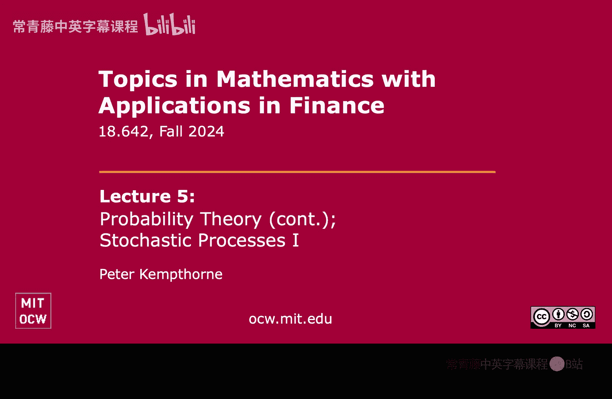

All right， we'll get started， we're going to continue our discussion of principal components analysis。

And what I want to emphasize with principal components is that we're dealing with。A random vector X。

That's in M dimensional space。And it has an expected value。Of。Alpha， say。

 and it has a covariance matrix。Given by sigma。Which is M by M。Okay， this kind of setup。

Can be used for modeling returns on stocks or assets。

That may have a mean return over some holding period and a variance covariance matrix。

And so in working with financial data， principal components analysis can be quite useful。Essentially。

 what principal components does is it。Transforms。Our x vector。

To a P vector of principal component variables。And the definitions of these is。We subtract from X。

The mean vector。And then we。Rotate the coordinate axes。Of this M vector by this gamma。Transpose。

Matrix。And so。This gamma transpose。Can equal gamma1 transpose。

 gamma 2 transpose down to gamma M transpose。And so， the first component。嗯。P1 down to PM。

The first component corresponds to using this。Gamma vectorctor。

 which happens to be an eigenvector of the covariance matrix。Corresponding to。

 where with associated eigenvalue， lambmbda I。And in this representation。We basically have。Sigma。

Gamma I is equal to lambdi， gamma I。And。We can order our。Eigenvalues。From largest to smallest。

And the first principal component variable。Corresponds to lining up or looking at a coordinate system where we're looking along the dimension of greatest variability in the data。

 So， so this。Sort of covariant structure。 It's actually useful to think of。A special example。

Which is the multivariate normal distribution。In M dimensions with mean vector。

 alpha and covariance matrix sigma。And so。If we think of x1 and x2。

We'll just consider a two dimensional case as an example。There could be an alpha1。Alpha 2 here。

For the mean of x1， first component mean of x2。And with a。Byvari normal distribution。The。

 we basically will have。Contours of the density。The joint density of x 1 and x 2 that are given by ellipses。

Centered at the mean vector。And the degree to which。The components are highly correlated。

 If it's a positive correlation， then we have。Ellipses that are tilted up。

 If it's a negative correlation， that would be tilted down。 Now。

 what principal components analysis does is。It， basically。This step here corresponds to shifting。

The coordinate axes to， say x1 star an x2 star， so we recenter our space at the point with the origin being at the mean point of the outcomes。

And then。We consider。Rotating these axes。In such a way that。

The first principal component axis with the largest。Corsbding to the largest eigenvalue。

 it will orient along the principal axis of the ellipse。And。The second principal component。

Accxis will be orthogonal to the first。And it will。Well， in two dimensions， it will， you。

 have variability along that dimension that's that's smaller than P1。

 When we extend from a two dimensional case to an M dimensional case。

So suppose we have 500 stocks or 1000。 Then if we apply a multi normalmal model to those to that case。

 then our principal components will be identifying。Coords。

 basically coordinate system variables that line up with。

Different orthogonal dimensions of variability。And so what ends up being very useful is that at least when we look at a market of stocks or asset returns。

 some of those may be highly correlated with each other。Others may be in a sense。

 orthoal or uncorrelated with each other。And with principal components analysis。

 we can actually identify。We can identify different directions in the space。

 which basically have decreasing levels of variability。

 but that are also orthogonal to each other or uncorrelated with each other。

So when we want to specify factors， underlying factors。

 say in joint distributions of returns in markets， principal components can be very helpful in trying to identify those and later on we'll talk about factor modeling and see how close or how effective principal components can be。

 but there are also general factor models that we'll introduce later。So， with these。Transforms。

 as noted here。These principal component variables have。Basically。

 a mean that's  zero and a covariance matrix。 that's diagonal。

So these principal component variables are uncorrelated with each other。

And if we order the eigenvalues from largest to smallest。

 the first principal component variable will be the sort of axis with the greatest variability。 Now。

 what's interesting to highlight is that。In the transformation from the original X's。

To the principal component variables， the only thing we've done。Is shift the origin。

And then rotated the coordinate axes in an orthogonal way。 So we're maintaining。

Right angles between coordinate axes。And that's all we've done。 So， so if we have outcomes。Of X。

So if we have x is a random variable， but then we may have realizations。Realization say。X。

 I don't know， A。X B， I don't want to have integers referring to these because I don't want to confuse the components。

 but we could have different realizations for different days。Or different analysis periods。

 And we would get different points。Of realizations， of the outcomes of this vector。

And so principal components。Allows us just to view the data。In a way that hasn't。Transform the data。

In an unusual way， basically， the configuration of points is the same。

Before and after the construction of these PC variables。Let's see， okay。

 there's this sort of version of principle components where we consider splitting the first K。

Priinncciple components into sort of a gamma 1 matrix and the remaining ones into a gamma 2 portion。

 And so one can then think of。There being a linear model for our outcome X variable。

 which might be simplified to just a mean vector plus a matrix。Times。The first。

K principal component variables plus error。 If this， in fact， were。Sort of an effective model。

 you know， it might be the case that the last M minus K principal component variables essentially have no important information in them。

And so this could be a very simple model for our X variable。

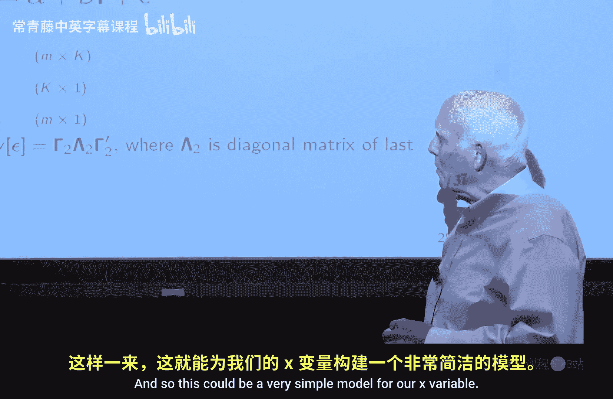

And importantly， the， if this were the。an appropriate model for an M vector X。

 Then the covariance matrix of the。The covariance matrix of x is just given by。Or let's see or。

 the covariance matrix of X in terms of the off diagonal entries which represent the correlations are all due to common loadings on these different principal component variables in P1。

So the interesting question。To。

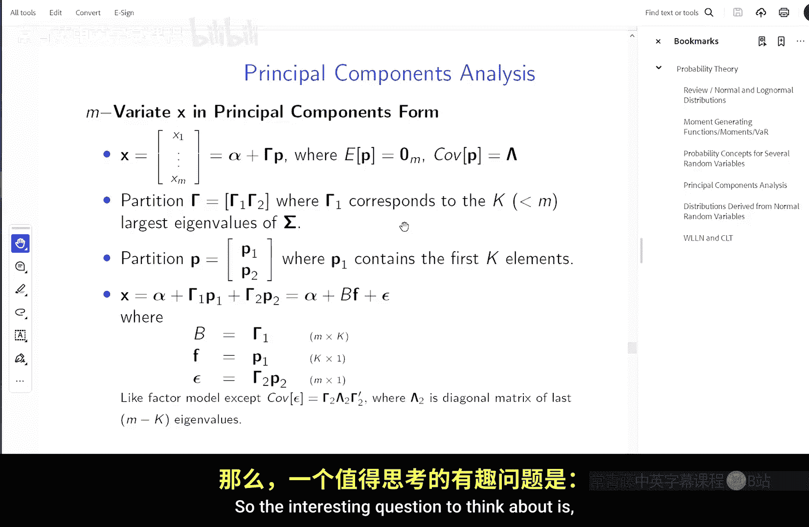

Think about is， you know， how can we model。Random vectors with some covariance matrix。

And are there simple structures to the covariance matrix that explain all of the intercorrelations？

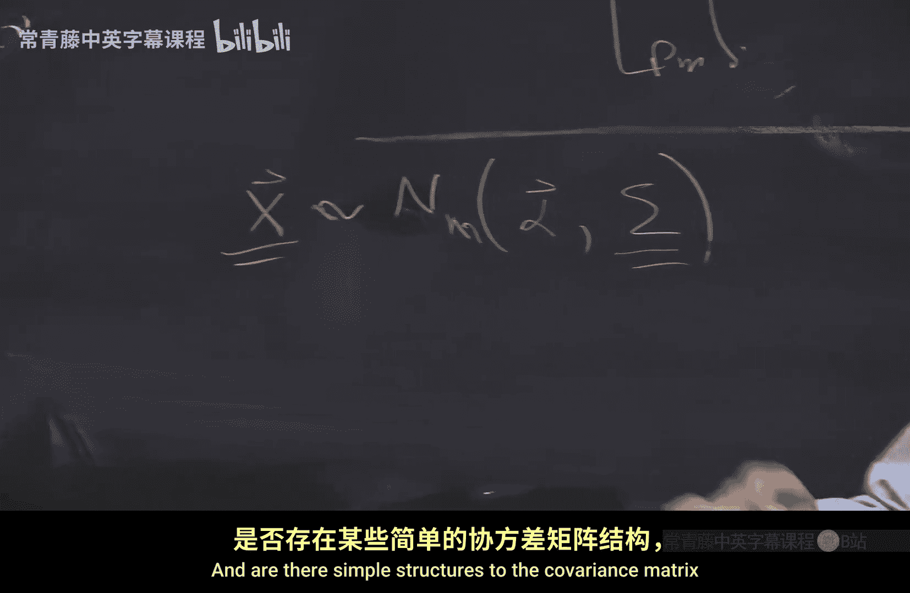

Now， when we。Perform。Empirical principal components analysis。Then what we do is。

We say we have an X matrix。Which has columns x1 through x sub capital T that are all M vectors。

 Then we compute the row means。嗯。We subtract those row means from the matrix， row by row。And then。

With this X star matrix， that's the demeaned matrix。That matrix times its transpose。

Divided by the number of columns in xs。Couple T， that is an estimate of the covariance matrix。

Essentially， the sample covariance matrix。And we then。Can perform an eigenvalue。

 eigenvector decomposition of this covariance matrix。And then use these results to define。

The empirical principal component coordinates of our data。

 And it corresponds to just taking our estimate of the gamma matrix， transpose the demean matrix。

 So this is very simple to。Implement。嗯。🤧嗯。And let's see the singular value decomposition is also a way of obtaining these principal component transformations。

Look at VDU transpose being the singular value decomposition of our X star demeaned matrix。Then。

We have。Our lambmbda。Estimate just being the square of the D diagonal matrix divided by T。

The estimate of the gamma matrix is simply the V。And our。

Principal component variables or our data transformed to principal component coordinates is simply given by D U prime。

So。Priinipple components analysis is very easy to implement。

And the lecture that was originally scheduled for today， Stefan Andreev。

 he's going to go through a number of examples of applying principal components in equity markets and in bond markets。

 what's really，Useful to anticipate， is that。Well， one of the examples that he's used in the past is where the X vector corresponds to index returns in different European markets。

On a daily basis。And。Attempting to understand。Sort of the joint variability across all of the markets。

 but also to understand where there are sort of different geographical clusters of countries like northern European versus southern European those tend to be separately highly correlated with each other。

 Another example of principal components analysis is looking at interest rates。

In the fixed income market。It turns out that for different maturities of bonds， ranging from， say。

 one month， three month a year to five years， 10 years， 20 years， 30 years。The interest rates。Can be。

Measured in terms of their yields。And the yield curve。Will vary day by day。

 and it turns out that the principal components analysis of yields has a very strong structure to it。

So I'll let him introduce those when he comes in a couple of weeks。All right。

With principal component variables， it's important to。

Understand that there are alternative ways of deriving or defining principal component variables。

One is to define the first principal component variable to be the linear combination。

Defined by weights， W1 through WM。That maximize the variance of that weighted sum。

 subject to the sum of squares of the weights equaling one。So we're looking at a unit vector。W。

And trying to find the。Vectctor W， that maximizes the。

Variance of the linear combination in that direction。 So when we get to。

Sort of the transformation of the data。Or the random variable by demeaning it。 Then if we look at。

W vectors that are unit vectors。In this space。Then we're looking at which sort of W vector。

Is pointing in the direction of maximum variability。

Then the second principal component variable is defined as。The next。W vector， now V。

 which maximizes the variant subject to having length 1， but being orthogonal to the first。

So it's a rather nice way of characterizing principal component variables。Now。

 with principal components analysis， one of the really neat things is that。Let's say。

 we often focus on。The first few principal component variables because they explain most of the variability。

But the last principal component variable。Is defines the linear combination of the components that has the smallest variance。

And sometimes that smallest variance can be0。In which case we're identifying sort of a linear dependence in the returns。

嗯。Let's see， my first sort of example of this case was before the euro existed。

 so I'm really dating myself， but the German Deutschmark and the French Frank were very。

 very highly correlated before the euro came out。And in looking at currency returns。

 the principal components analysis actually sort of identified that empirically in a nice way。

All right。Let's see。 Okay， mathematically with。唉。Princciple components analysis。

 we can talk about a decomposition of the total variance。So， if we have。This covariance matrix sigma。

We could talk about the total variance。Is equal to the sum1 to M of sigma J J。 So the J diagonal。

Entry of the covariance matrix is the variance of the Jith component。

And the sum of that is the trace。Of sigma。嗯。We can decompose that total variance。

As the sum of the eigenvalues。And so principal components analysis provides a decomposition of variability。

And we can see sort of what proportion of variability is explained by the first or the first few principal component variables。

All right， these lecture notes finish with just reminding you of some important staistic important probability distributions in statistics。

The chi squared distribution arises again and again。

 and the chi squared distribution with one degree of freedom is。

Equal in distribution to the square of a standard normal distribution。

So this is a useful thing to remember。In different cases。 and let's see if we。Well。

 here's its density function。It turns out to be a special case of the gamma distribution。And。

Here's this moment generating function。 It turns out that if we。Take。Independent， normal 0。

1 random variables。 square them and sum them。Then the sum of an independentdependent ones as a chii squared within1 degrees of freedom。

And we can prove these results using moment generating functions。And get densities for those。

Importantly， T distributions often are。呃。Let's see。 arise。

 especially in the study of regression models and the significance of regression parameter estimates。

 but。Basically， with a T distribution， if we take a standard normal。

And then divide it by the square root of a chii squared divided by its degrees of freedom。

Where the chi squared variable U is independent， then this will give us a T distribution with R degrees of freedom。

And so。Let's see， with T distributions。Tea distributions are examples of。

Distributions that are heavier tailed than a normal distribution。And so， if you think of。

Taking a normal Z variable and dividing by this chii squared。

Distribution divided by degree of freedom。And square root。

 we're basically dividing a random normal by something that's random， but round one。

And the randomness of that factor leads to greater variability than the normal。

 so it's sort of obvious that that could be the case and it's indeed。True and。Let's see。

The F distribution turns out to be the ratio of2。Ci squared distributions。

 each divided by their respective degrees of freedom。And in classical statistics。

 we often are interested in measuring variability of data and variability due to different driving factors。

 and so F distributions arise commonly when we have estimates of variance given by a chi squared divided by a degree of freedom。

And if we have two different estimates of variability。Then。

If those distributions sort of have common variances， then the F distribution applies。

some of you may have heard of analysis of variants。In statistics， anyway。

 the analysis variance methods work with studying F staistic distributions。

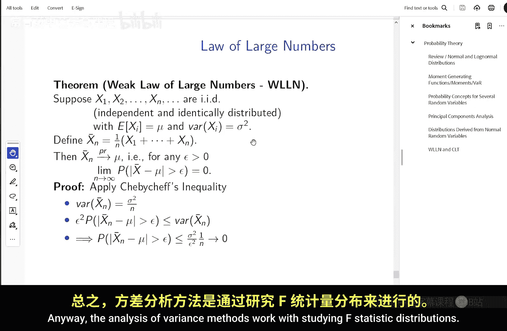

Yeah。ANo central distributions used a lot， whether software non central。

they mainly just like presented one well， the non centrality or when you have。

No hypotheses in analysis of variants that are。True。

 then the F statistics will sort of be F's with zero non centrality。

 and if the null hypothesis is false。Then。You'll have a F distribution with a non centrality parameter。

So the non centrality parameter comes into specifying the distribution of the test statistic。

When the null hypothesis is false。So HR is called yes， actually。

 the next two lectures after today will be on regression analysis。

And testing and regression。 And so we'll see those come into play there。Yeah。🤧嗯。All right。

 what else Oh okay， just the weak law of large numbers and the central limit there were the remaining topics here。

哎。If we have。Sample data realizations of， say， N。呃。Are N realizations of a random variable。

And here we say， I I D for independent and identically distributed。

And if those random variables have mean mu and variance sigma squared， then。The sample mean X bar N。

Will converge in probability to that mean？So the larger the sample size。In the mean。

 the closer the sample mean will be to the true mu parameter。What we。

 what's important from probability theory is how do we characterize convergence of random variables。

 And so the convergence and probability to a constant。Means that the probability that the deviation。

 the absolute deviation from you exceeding epsilon， that that goes to 0。And this。Theorem。

Or this result can be proven with Chebychev's inequality。

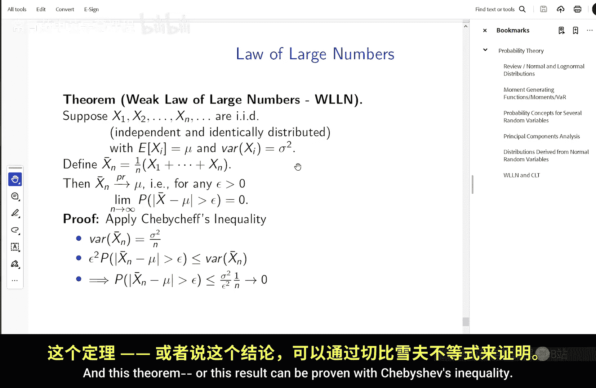

And。It's sort of a neat example。Where。If we want to look at。The variance of x bar n。

Which is equal to what the expected value of x bar n minus mu。🤧呃。Squared。Then。

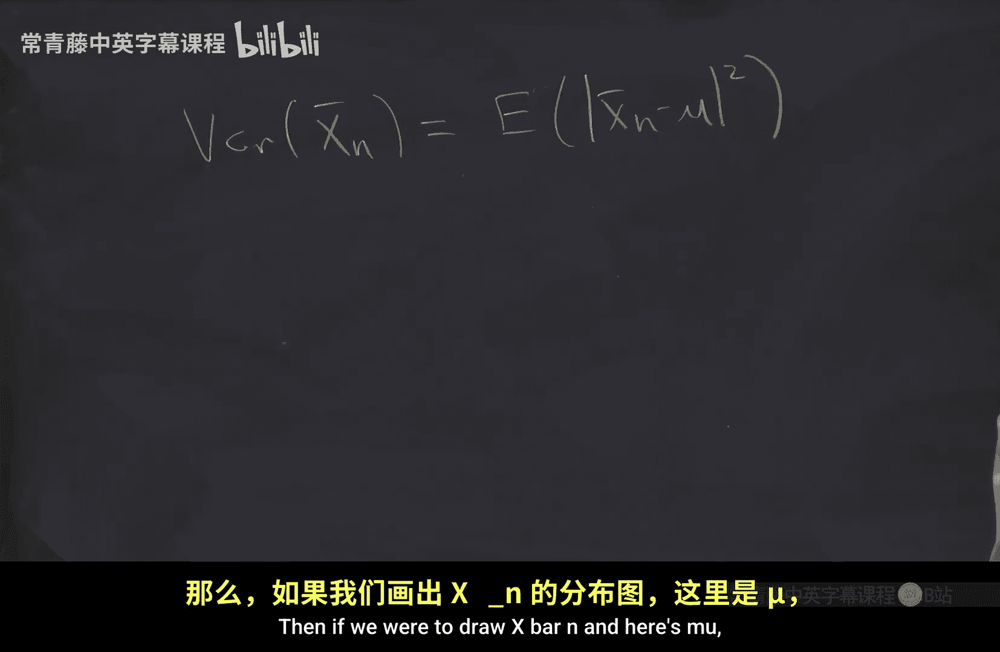

If we were to draw。Sort of x bar n。And here's mu。And then have the graph。Of x bar n minus mu。Squared。

If we were to。Transform our scale to x bar n minus mu。Then this。Mu value goes to 0。

And if we were to look at。The epsilon value for x bar n minus mu。We can consider。A function。

 other than this parabola。Which is 0。Up to。This epsilent away from mu point and then is simply equal to epsilon squared。

Beyond and do the same at minus Epsilon。So，0 up to there。And。The variance。

 which is the probability weighted average of the carrabola over the distribution。Has to。

Be greater than epsilon squared times the probability of exceeding。

Of being further away from you than Epsilon。So the fact that this function。嗯。

Its greater than or equal to epsilon squared times probability then。

X bar and minus mu is greater than epsilon。This gives us the result。And。We basically have。

That we're basically。Giving a positive bound for。For this。

A we have an upper bound that decreases within n for this probability。

 So that gives us our nice result。嗯。Let's see if you really like probability theory。

One can actually extend this result to the case where。We don't have a variance existing。

 We just have a mean existing。And that's a rather strong result that's that's neat。

 at least it's neat in terms of how the mathematics can handle。More complex cases。Now finally。

 we have the central limit theorem。Which tells us。What the asymptotic distribution is of a。

Some of independent and identically distributed random variables is。And so， if we have。

Variables x1 to xn that are mean0 variant sigma squared。It turns out that the。

Some of the x size divided by the square root of the sample size converges to a normal distribution with mean zero andvari sigma squared。

So。So， we have。What ZN equal one overro in？Some one to n of the X size can inverges to a normal mean zero and vary sigma squared。

😔，And if we were to think of。X bar。Which is equal to one overro n times Zn。

This basically is converging in some sense to a normal with mean zero and variance sigma squared over n。

Now I put quotes around this。Arrow here， because。It's not really legitimate to talk about a limiting distribution。

That depends on N。But this is sort the way the。This is the way we approximate the distributions of sample means。

 Basically， they converge to the mean of the distribution in this case，0。

 and the variance is sigma squared over n。Now， what's neat in this proof is just to highlight the use of moment generating functions。

And so if we say， let's calculate the moment generating function of ZN。

We're going to show that the moment generating function of Z N converges to this moment generating function。

 which in fact， is the normal with mean 0 and variance sigma squared。

 So the theorem that says moment generating functions are sort of unique。

And if the limit of moment generating functions exists and equals some function。

We can identify the distribution by that limiting moment generating function。 Well。

 if we calculate just the moment generating function of Z， N， we just plug in Z， N。

Within the expectation。Then noting that the X's are independent of each other。

We basically are taking the expectation of a product of independent terms。

And so that expectation of a product is the product of the expectations。So， we have the product of。

The expected value of Xi times t over root n。And this expectation here is actually the moment generating function of。

X。Evaluated at T overroot N。So it's the eighth power of that when we take the product of all N of those。

Now。This is where it gets interesting。If we look at our moment generating function of T over root N。

 well， we don't really know。Much about。The distribution of the x's。 We know it has a mean。

 We know it has a variance。The mean is 0， the variance is sigma squared。

If we expand the moment generating function into a Taylor series。

Then we get1 plus the expected value of x times t over n plus the expected value of x squared times。

Divided by two times t over would n squared plus。An order term that is given by the third power of the argument。

 And so as n gets large， these higher order terms are of smaller order。

 And so we finally have that this。In the limit， it is one plus this multiple over n plus a small O of T squared over n。

And if we take this expression to the nth power。Then it converges to the exponent。Of the argument。

Sigma squared。T squared over 2。So。Let see if we have one plus。Our。Let's see。1 plus R over n。

To the endth power。嗯。This converges to E to the R。And Vaciili used this argument。

In the first lecture to talk about。Sor of continuous compounding。And what the limiting。

Value is of continuous compounding at some interest rate。 anyway， that same exponential。

Result is true here， so this actually proves the central limit theorem using the identity theorem。

For MGFs， yeah， is CLT actually used in practice？Is like in finance。

 nothing is going to be IID or at least they're not going to be independent。

 So like is it actually still useful in？It can be very useful in a practical setting。Right now。

 it's specified in terms of。Identically distributed axes。

It actually generalizes to X's that are independent but with different distributions as well。

 so also what's I guess really important is that。If。

A variable we're working with corresponds to the sum。Of。Independent or uncorrelated terms。

The sum can approach a normal distribution well。And if one。呃。Looks at， I guess。

 linear sort of projections。Of。Multidimensional vectors， x's。If you had sort of a random direction。

In the undimensional space。The projection onto that random direction。Will correspond to sums of。

Close to sort of identically distributed random variables。

 but will very likely have a Gaussian distribution as well。嗯。

This will come up when we talk about regression modeling。

 but when we look at sort of the error vector from a regression。Feasibility of the error vector。

Being close to Gaussian is plausible and reasonable， given the way it's constructed sometimes。Okay。

 well let's。Move on then to。This note on probability theory for asset pricing。

 what's really neat about this note is that we're going to introduce you just with basic probability theory to one of the more important models in。

Quantitative finance or at least in early quantitative finance。

 which is the capital asset pricing model。And so let's consider。A simple。

Context where we have one risky asset。Like a stock。And we have a one period model， where。We have。

The beginning of the period。Is。Tnot。And the end of the period is T 1， I guess。And so。And。

There's this risky asset， A。So there's a risky asset。A。And。Will consider。

A market agent having Q A shares。Of。The asset。And。Just Q units of a risk free asset。Now。

 they risk free asset。Is like。Putting money in the bank and being confident that you'll get it back with interest。

And。Well assume that their risk free asset costs a dollar。So a dollar per unit。And the risky asset。

Will be of price PA per share。So this。Market agent has a wealth。At time 0。

So W0 is going to be equal to。Q APA。Plus， Q。Times 1。And actually okay。

 so maybe we'll put an F here just to indicate that it's sort of the risk free。Asid。Now， at time T 1。

嗯。So this is the。The Tnot prices。Are given here at T 1， the risk free asset。

Is going to be worth one plus R。F。And the price of。The risky asset。

We'll assume that it's a random variable given by F Tilde。And。For simplicity。

We'll assume that it has some mean mu and variance sigma squared。 Now， now right away。

 this is maybe a bad assumption to make because。Gausian or normal distributions can be arbitrarily。

Large， negative。But we'll assume that the likelihood of impossible values is very close to zero。

 so that this is a useful model。Allright， so this is the time T1。呃。State of the market。

 which has sort of certainty for the。Risk free。Investment， but uncertain outcome for the risky asset。

Well。One could consider。The agent being able to。Bye。

X units are the risky asset at the initial time point。T 0。

And then have end of period wealth that reflects that trade of buying X units at TO。So。

 at the end of。The period T1。Time， there will be Q A plus X shares with value F Tilde。And。

The X shares will have been bought by。Paying PA the T0 price at time zero。

And so there will be money invested in the risk free asset earning。

The interest rate are at the absolute return of one plus RFF。Now。

What we want to do is consider what is the optimal choice of X。

The number of shares to buy for this agent。And in order to。Make that choice。

 one can apply sort of the decision theory under uncertainty。

And associate a utility of the end period wealth。Given by some。Utility function， U。

And we can choose the x value to maximize the expected utility of wealth。So importantly。嗯。If we have。

U of W。As a function of W。And there's。Basically， a。W0 value here。Utility of W0。

There are some standard assumptions one makes as to what the utility function is like。

 and we might assume that the first derivative and second derivative exist。So， we'll assume。

That these exist。And so， well， the first derivative。Is likely to be positive。

More wealth is preferred to less。So we sort of have a better direction being up into the right and the second derivative。

This actually could be。Less than 0。If there's a decreasing marginal utility to more wealth。So。

 this function might go。And look like this with a U prime greater than0 and U double prime less than zero。

嗯。So these kinds of assumptions are reasonable to assume and。

The theory of sort of decision rational decision making under uncertainty。

 if this is indeed your utility function。Is to find the。Action X that maximizes this。

 and if we are lucky， we might be able to solve for X by satisfying the first order condition。

The derivative of the expected utility equaling 0 at the maximum value。And。第二，我不知。

Anything other than the identity function for you， sure you just want to maximize your end period love。

嗯。Let's say， if you use the identity。Then。There's sort of， well。

 it will turn out there's no penalty for risk。That you're undertaking。

And so with this decreasing marginal utility of wealth， you end up having a penalty for taking risks。

And so。Yeah。Okay， so I'll leave it there， but it's a very good question。Let's see。

 there's actually some。Well， there are some really interesting discussions about how to optimally sort of invest as this case。

 and there was a controversy between Claude Shannon and I think it was。

I think it was Milton Friedman about sort of maximizing the。Exponential are the expected log return。

Of investments just period and that being optimal。 So anyway。

 we'll return to that discussion later as well。 but for now。

 let's assume that this is a reasonable thing to do。And in order to。Solved this problem。

 We're actually going to use a lemma called Stein's lemma。Which is。A curious mathematical result。

 dealing with。Normally distributed Y variable。And why star。

 they're jointly distributed with each other。And Gaussian。If we look at the expected value of G of y。

Times y minus mu。And。The expected value of g prime of y if both of those exist。

 then we get these simple formulas for essentially the covariance between G of y and y and the covariance of G and y and y star。

So this is。A mathematical theorem that is sort of abstract。As it stated。

 but it ends up being applicable。In our problem。 So if we define our wealth at the end of the period at time T 1 to be given by this W Tilde vector。

Then。If。The outcome of the asset price。A tilda。If this is Gaussian。Then。This。

Wealth at time T1 will also be Gaussian because we're just taking a multiple of that plus a constant。

So， that note is。Simple， then if we。Look at the expected utility and try to take the derivative of that with respect to X。

Then under certain conditions， we can take。The expectation of the derivative with respect to Xom。

The intergr with the expectation。 Now， under what conditions is it feasible to differentiate sort of underneath the integral sign。

When you're doing computations and calculus。I mean。I mean， basically。

 what we want to do is take the expected value of you of。嗯。W Tilde plus Delta。

And subtract the expectation of。You of W。 Tilde。And divide by Delta， and take the limit。As this。

Goes to 0。So that's sort of the formula for computing， the derivative。It turns out we can do that if。

The first derivative of you。Is bounded or it has bounded expectation。And so。If that's。Possible to do。

 then we can take the derivative underneath the integral sign。

 and we have basically the derivative of U multiplied by。The chain rule。

 the derivative of W tilde with respect to x。 So if we take the derivative of W tilde with respect to x。

 we get F tilde minus Pa times 1 plus RFf。 so this is just the chain rule of differentiation there。

Now with this expression in black。嗯。We can。Use the。Well， let's see。We can express this。As。

The expected product of two random variables is equal to the covariance plus the product of the expectations。

So here we have U prime and F tilde minus PA1 plus RFf。

The covariance between those two plus the product of their expectations is equal to that expected product。

Then， by Stein's lemma。One actually can simplify or reexpress this covariance。

As the expected second derivative。Of you。Times the covariance of W。And F。

And so we can then substitute this expression。Into this last expression here and get0 equals that covariance plus the product of the。

First expectations there。And so， we're substituting in。This expected， second derivative。

U times the covariance。In that formula。 now， with this。嗯。Expression here。

We have this covariance of W and F。Well， the covarience between W and F。Is simply。The covariance of。

F with a multiple of F。So it equals that multiple times the variance of F。

And so we plug that in to this covariance term。And what's curious。

And sort of is the punchline is that this final equation。Gives us a formula。For。嗯。How we solve。For。

How we solve for X。And so。The value of x that we should choose。Well。Basically， satisfy this equation。

And。So our x value will depend upon。What the price of the asset is and。It actually is equal to。

A discounted value of the expected price。Plus， this other term here。And this other term here。

The second derivative is negative。First derivative is positive。

 So this is actually a negative factor here。And so， we end up getting。That。嗯。We have a formula that。

Sort of depends upon。That ratio of second derivative expectation to first derivative expectation of the utility function。

 Now， in economics classes， maybe some of you have come across the constant。Absolute risk aversion。

 utility function。Has anybody come across that in an economics class？Maybe， maybe not。

 but that function， which is a constant。Minus。A constant minus E。To the minus a。W。嗯。

This is the constant。Absolute risk aversion， utility function。 And so it basically。

has the right shape。嗯。For in terms of marginal utilities。Decreasing and。Utility is always increasing。

 and so with this particular。Utility function。We have the U double prime divided by U prime。

 those actually giving us just the factor A here。So we have our price of the asset should equal the discounted expected cash flow minus a risk adjustment。

嗯。And。SoAnd the risk adjustment in the price that's like the fair price for the asset varies depending upon what the risk aversion coefficient is of the agent and also the magnitude of the shares of the risky asset。

That。Are obtained and the variance of the price outcome。 So， so the fair price。

For the market agent basically is balancing all of these factors。And。Let's see if。Okay， well。

 with this result for a single asset， what's really neat is that we can。

Generalize from one asset to many。And set up the whole problem with almost the same notation。

So we consider defining a Q vector。Of shares， of。Assets，1 through n。

A1 through A N and QF units of the risk free asset。And we can。Go through the same logic of。

The initial wealth being。The Q shares per asset times the price at time0。

 T0 of the assets plus the value of the risk free investment。

And we can assume that the random prices at time T1。Are jointly normally distributed。嗯。

And so we then。Can think of。The market agent。Basically， adjusting the initial。

Sharrees Q by the X vector。And choosing the x vector to maximize expected utility。And。We can。

Just plug everything in。Now with vectors instead of scrs。And the same arguments apply。

And we end up getting at the end of the day。Different sort of equilibrium prices for the different assets。

That are sort of discounted。Expected values of the price。Plus， a penalty depending upon。

The sort of risk aversion of the agent。And so。We end up getting。This final result here。Now。What's。

Particularly interesting from this。Set up is to then say， well。What。

Prices should be holding if this market model is in equilibrium。And so。If the market。

Is an equilibrium， Then we should have expected returns。Of risky assets。That satisfy。

This formula here。And。If we look at。诶。An initial endowment sort of of no shares at all and。

Define the X allocation。To be an equilibrium investment。In the market portfolio。Then。

Our market portfolio， defined by X。Willll have a market value of F Tilde M。The sum of the exciseise。

Shares times F Tilde I。The price initially of the market portfolio will be。

Just the sum of the X I shares times the initial price is P AI。

And the return of the market portfolio。Will just be the change in value divided by the initial value。

Which corresponds to a weighted sum。Of the asset changes。Our percentage returns。

So the percentage return are tilde M is simply the weighted returns of the individual assets。

And this is our expected return of。The market portfolio， when。

The underlying assets satisfy these pricing conditions。Now。If we expand this expected market return。

呃。Expression。We can successively derive。That。It equals。The risk free rate。Plus。

 this blue factor times the covariance。Of the initial sort of W。Vectctor with RM。And。This。

Blue expression。Can be。Solved for。As the。Sort of excess return of the market portfolio divided by the covariance。

Term here。And so we end up getting。That。This。Covariance of W and RM end up being simply PM times the covariance of RM or the variance of RM。

And plugging this in。We finally get that the expected returns。Of different assets。

Are simply a beta factor times the excess return。Expected return of the market portfolio over the risk free rate。

And so this。Expression is actually。The expression for what's called the security market line。

Where we have the expected return of。Asset I is the risk free rate plus a beta factor times the excess return of the market over the risk free rate。

And this beta factor。Is the ratio of the covariance。Of。

Asset I and the market portfolio divided by the variance of the market portfolio。

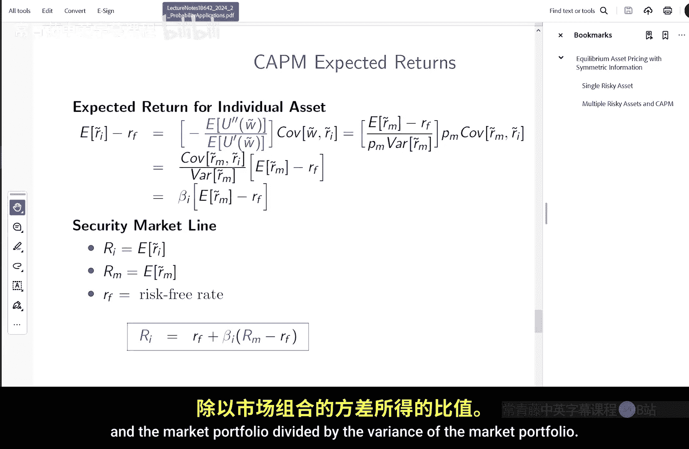

And so。This beta I is equivalent to。The regression coefficient of the excess return of stocks。

Regressreed on the excess return of the market。So in this model。

 we end up having that different assets will have different returns。And those returns。

Are sort of bounded below， sort of by RF， but then。而。Increased by having a higher beta factor。

Multiplying the excess return of the market。 So you may be familiar with。

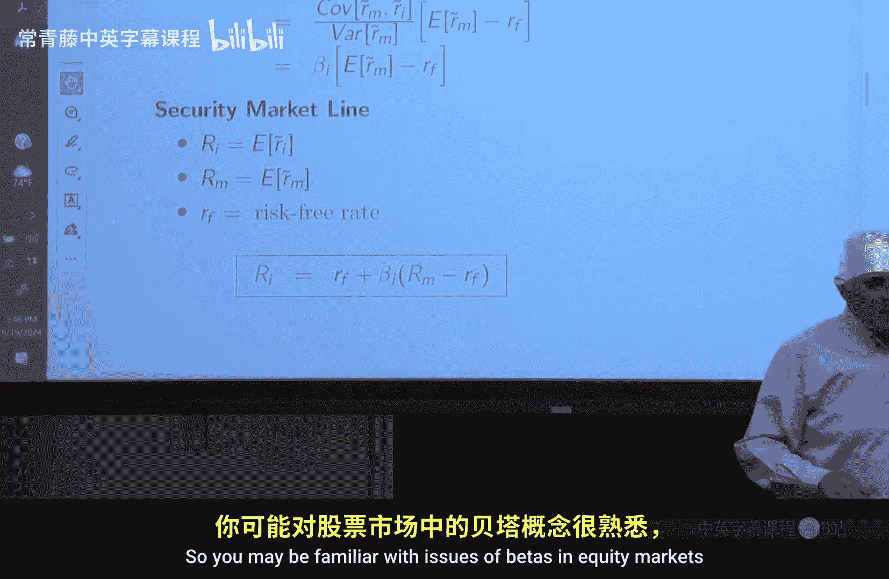

Issues of betas in equity markets， and there're being low betas or high beta stocks。In this model。

 we have that the way you get higher expected return is to have a higher beta。And。So， so this。

Also just leads to。Understanding sort of what the。Equiilibrium prices are of individual assets。

 If we take those expressions for returns and then reverse them into expressions for the equilibrium prices。

 We have that the equilibrium prices are sort of the expected。

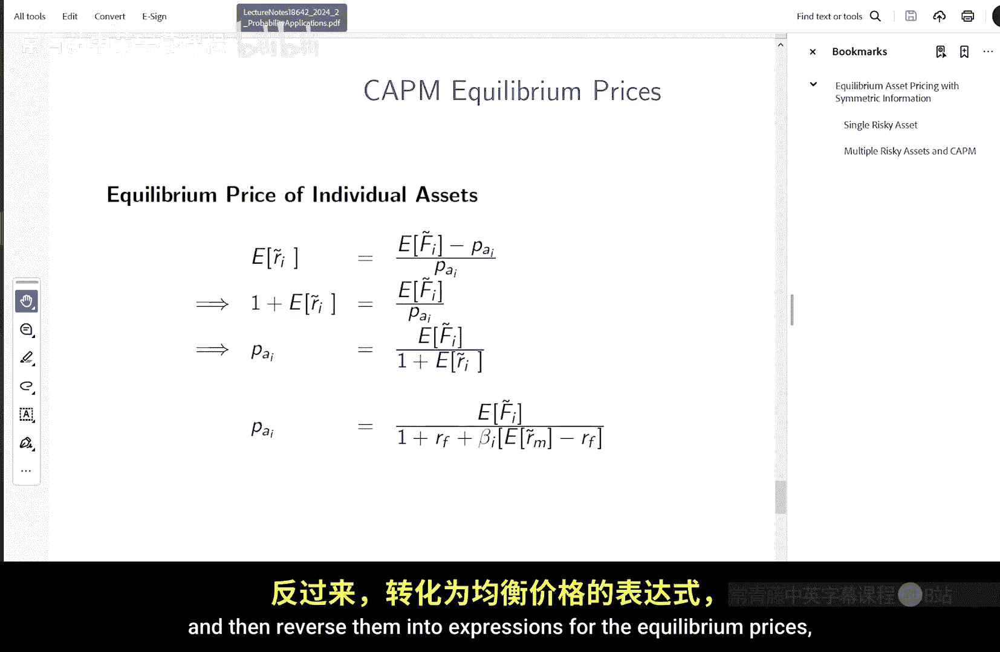

Terminal。Price divided by a discount factor that discounts by the。

Discount rate of the risk free investment， but adding to that a penalty based on the level of risk that's being taken。

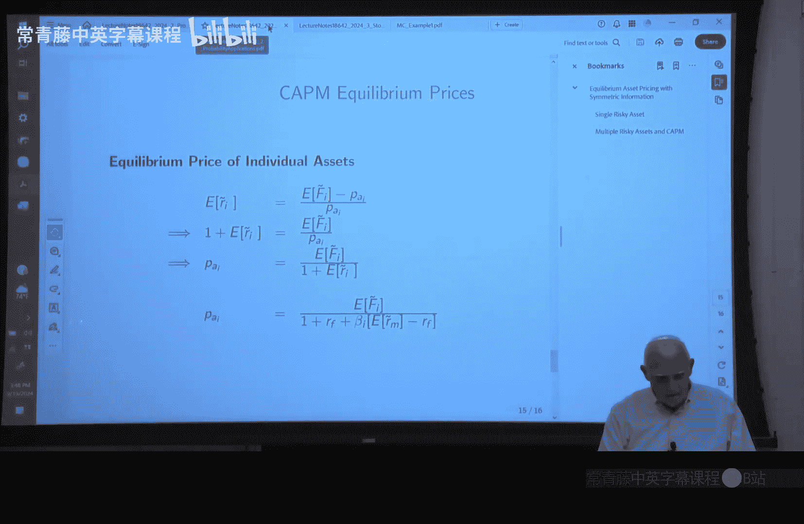

And here are just some references on this topic that。

You may want to check out the development here was actually taken from the first reference by Frank Dejong and Barbara Rindy。

 there are other important citations， one of them that's of interest is John Litner。

 the valuation of risky assets。The capital asset pricing model was actually。

Forulated by John Litner and William Sharp back in the early 60s。

 and I distributed one of the articles of Litner in the Canvas site and it's actually nice to be able to read。

A very technical paper。In an accessible way， and so I think that you'll enjoy checking that paper out。

嗯。Okay。Well， let me turn then to。The sort of main topic in our syllabus for today。

 but it's sort of the tail end of today to talk about stochastic processes concepts。

And one of the most important concepts in stochastic processes is the concept of a Martinale process。

And so if we。Have a stochastic process。Given by a sequence of。Random variables， XN。We can define。

A related process， M， N。Which is defined as functions。Of the first n X's for each n。So if we。

Have MN depending only on the first N X's in some well defined way given by a function fn。

Then we will say that this。M N sequence。Which is random because of its dependence on the axises。

 It will be a Martinale。If the expected value。Of the8th。M。Given the first n minus1 x's。

Is simply equal to the。N minus first value of M。And we also are going to require that the magnitude of the MNs as a finite expectation for all N2。

Now。Let's consider perhaps the simplest example of a Martin Gaale， which is basically a random walk。

Suppose the Xn sequence is just independent random variables。That。Each has mean  zero。

And Sn is the sum of the first N Xs。Then。This essence is a random walk with steps given by X。

And it's going to be a Martinale with respect to the original process of X Ns。Now。

 we can make this example even simpler by assuming that the x's are independent and identically distributed。

And maybe that they're discrete with just a plus one or minus one step increment with equal probability。

So these x's have expectation equal to zero。And variance equal to one。

And the process SN has expectation zero the sum of the expectations and the variance of SN。

Is the variance of a sum of independent。Steps， increments。 And so it's just sum of the variances。

 So that's in。Well， here's a random walk realization。Of this model with 100 steps。And。

So it basically starts at zero， at time zero， and then as steps occur。

 increments up or down plus or minus1。If we increase from 100 steps to100。This is。

What a realization looks like。And then here's an extension from 1000 steps to 10000 steps。

And what's rather significant is the general shape of this random walk process as we increase the number of steps。

 it becomes this very sort of jagged path。And it actually corresponds to。

Browie in motion models that will come across。 Now。

 if we were to realize 10 different paths of length，10000 here are。Examples of that。

And so one can see that for low number of steps， there's not very much variability。

 It increases as we increase the number of steps。 And here we're just drawing。

Bands at plus or minus multiples of the standard deviation of the random walk value。And so these。

Standard deviation levels basically apply just through the mathematics of calculating one or two standard deviations of the sum。

And what， you know， we know from。呃。Our central limit theorem。

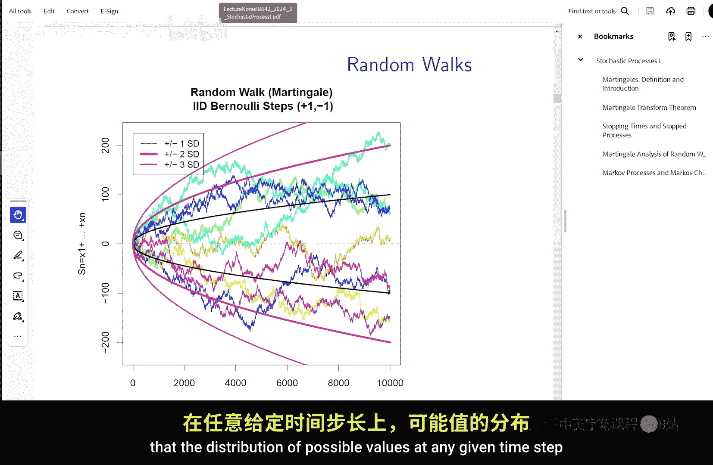

Is that the sort of distribution of possible values at any given time step will be closely modeled by a Gaussian distribution because of the central limit theorem。

There we have a stop。 Okay， I'm going take two more minutes just to show you you a more。

 not a more interesting， but a related， but very interesting Martin Gaale。

Suppose that。Once we've calculated the random walk S N， we look at the square of S N。

And subtract n Sigma squared。It turns out that this is a Martinale as well。

And here's one realization。Over 10000 steps。And here are 1 realizations。And so these look very。

 very different from。The simple random walk。 But these as well， are Martins。And so。

One of the what we'll see next time is how Martin Gas。

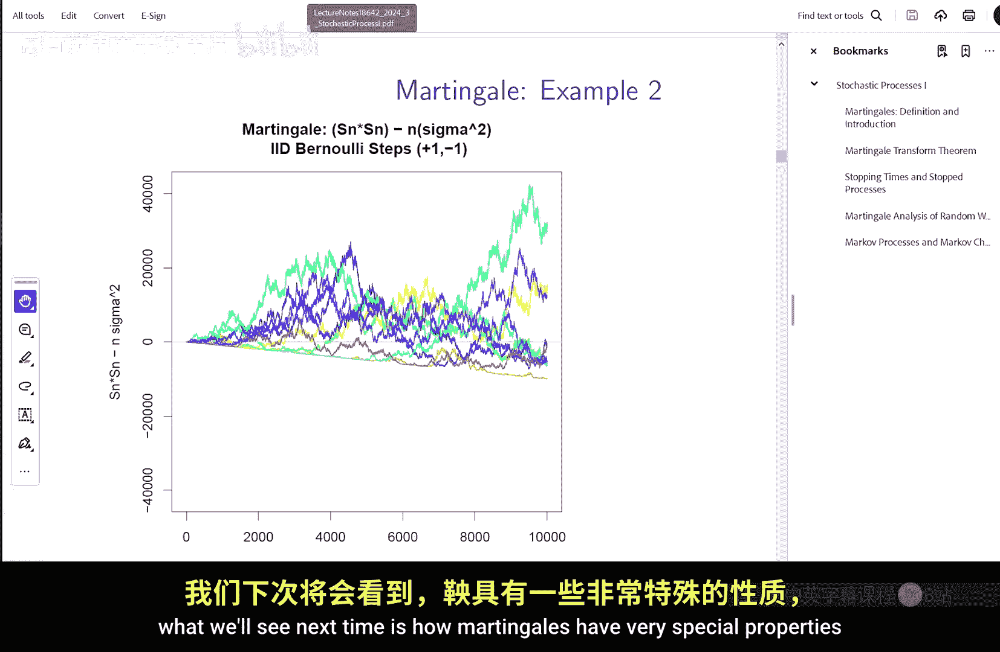

Have very special properties which can be used to solve challenging。Probability problems。

And just as a closing remark， does anyone here know where the term Martinale comes from？

Do we have any equestrians？Theres a bridle and a horse called a Martinale bridle that keeps the horse straight。

 looking straight。 so that sort of is a bridle that sort of has。

Pressure on both sides of the mouth to keep the horse looking straight。

 And what's true about a Martiningale is that the expected value in the future is always a constant level。

 equal to the last level of the series。 So that that property will end up being very。

 very convenient。 And we'll see examples of that next time。

