# 麻省理工学院【中英⚡数学专题及其在金融中的应用｜18.642-Fall-2024,-Topics-in-Mathematics-with-Applicatio】-p07-P7-Stochastic-Processes-I-(cont.);-Regression-Analysis--BV1iLrjBrETS_p7-

All right， we'll get started see last time we introduced you to the definition of Martin Gaes and what we're going to do the first part of today is to see how useful and powerful Martinale properties are in solving interesting questions and challenges。

 so just as a reminder， if we have a stochastic process XN。

 which is just a sequence of random variables，Generally， the index n corresponds to time。

 then we can consider another a derived process capital M sub n。

 which is a function of the first n values of the stochastic process X。

And we say that this second process， this derived process is a Martinale。

 if the expected value into the future from time n minus1 is simply equal to the time n minus1 value。

 so with a process。

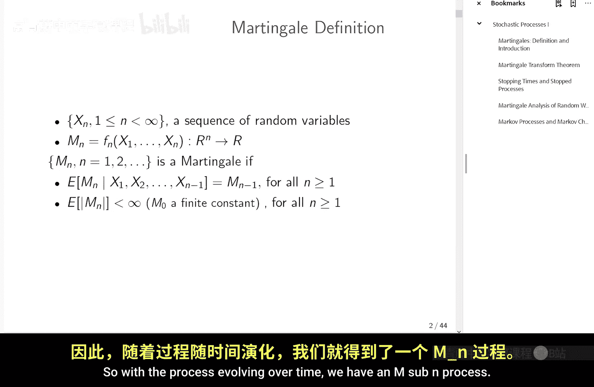

Evolving over time。We have。An M subN process basically at time n minus1， we have a value。

 our prediction is that the expected value of that in the future is MN minus1。

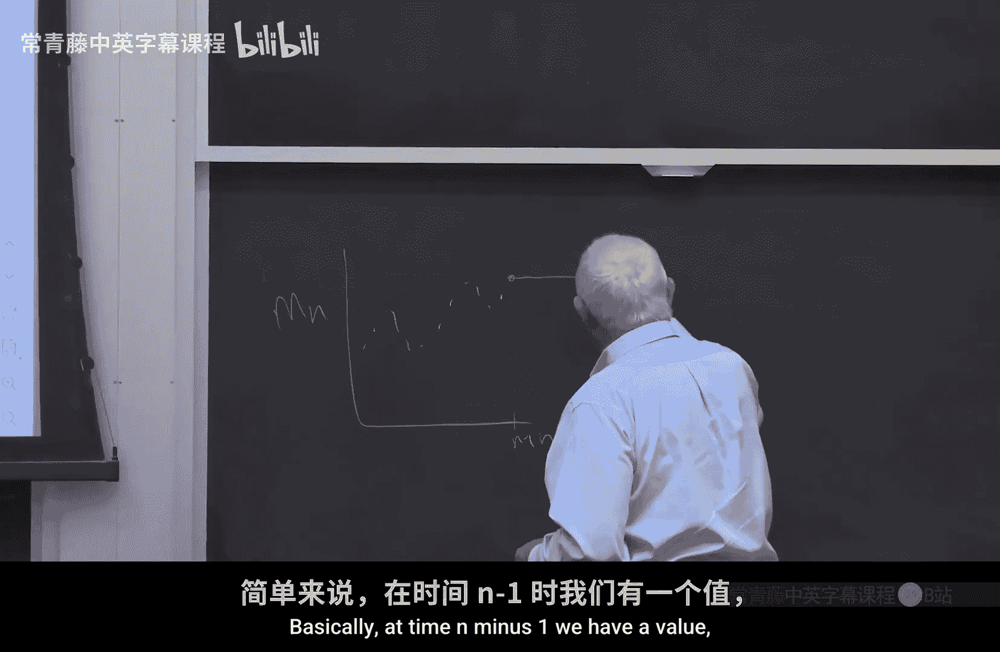

And so some examples of these we went through last time， a simple random walk。

And with a simple random walk。We end up having realizations of this Martinale。

That evolve from say a starting point zero and what's critical with these realizations is that the future paths that have yet to be graphed will have average value equal to the last point on these realizations。

 so there's a notion of there being flatness in the Martinale expectations。With。

The example here of a simple random walk with equal probability of going up or down one step。

One can graph the standard deviations。From the average zero for the processes。

 and you know basically the realizations of the random walk will by the central limit theorem。

Converge to a normal distribution at any given time point， far into the future。Now。

 this second example of a Martinale where we。Have a random walk SN。

 but then we square it and subtract。N times the sigma squared。The variance of each of the steps。

 this is also a Martin Gale。And so looking at different realizations of this Martinale。

 we can see that it' very， very different from that of a simple random walk， and importantly。

 there's basically sort of a lower limit of the process that appears。

For fixed in and an unbounded upper limit。And but this process as well as a Martinale。And。You see。

 a different Martinale can be defined not in terms of random walks with steps that add。

 but with random sort of shifts。With factors x1 DXN， so if we have MN being the product of X1 DXN。

 where the x's are independent random variables with mean value1。

 then this particular process M sub n will be a Martin Ga with respect to the original series。

So here's an example of our Bernoulli。

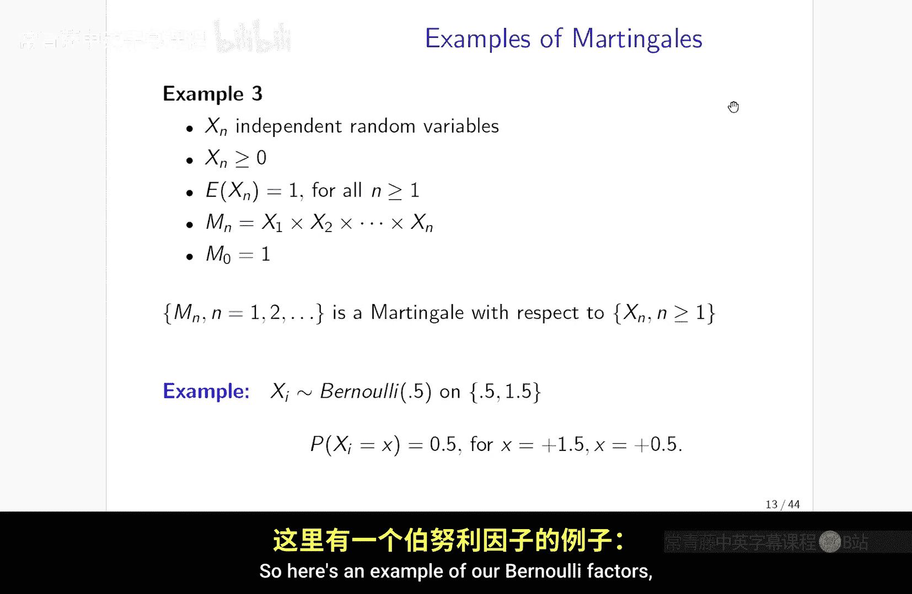

Factors， which are。With 50% probability，1。5 and with 50% probability 。5， this would correspond to。

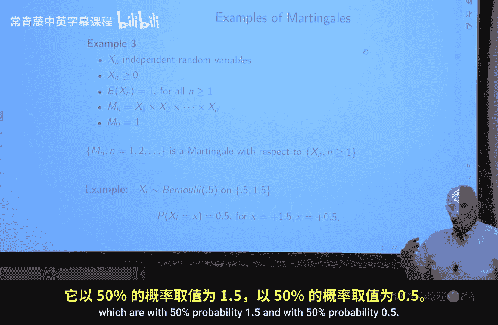

The change in wealth from betting your wealth。In a lottery where you either make 50% or lose 50% with equal probability。

And here is the。Graph of a realization over 50 steps。 Here's other realizations。

And what's interesting to see is that with this particular Martinale。

There are opportunities to basically， if you're playing this lottery game at each step。

To be able to grow your wealth to 5 or 10 times。Its value， its initial value。

 but very with moderate or even high probability， you actually have lost almost all your wealth。

So yet another example， and this one is really rather。Curious to introduce。

 but it shows you how we can be flexible in generating or constructing Martin Gaes， if we have。

The YN sequence being IID random variables。And the moment generating function。E to the lambmbdayan。

Or eat to the lambmbda。Why。呃。Whyan。Is equal to the moment generating function。And。

 or that's say E to the T Y is in R notation， we're going to use a phi of lambda here。Or Phi of T。U。

Then if we consider。Taking。XN。Equaling E。To the Lambda YN divided by phi of Lada。Then this。

XN will be a Martinale。Or this XN rather， will be factors that have expectation equaling one。

And if we take the product of these x's。We basically have。

M sub n equaling E to the lambda times the sum of the y Ns。Divided by。Fhi of lambmbda。

To the endth power， this will also be a Martinale。And what we'll see towards the middle of this lecture is that this particular Martinale can be used to solve probabilities of gambler's ruin when you have gambs that have。

Different probabilities of success versus failure， not necessarily equal far bets。All right。

With Martin Gaes。It turns out to be very useful to consider。ThisWhat we call the information sets。On。

The sequence， the subsequence of variables x1 through xN。

 so if we think of information being progressing over time。

 the information up to time little n can be given by the outcomes of the X process。

And we can consider。Expectations of random variables， given this information set。And。

The kinds of random variables we might be interested in， Z can correspond to。

 say trading strategies based on the outcomes of。Asset prices progressing over time。And。We。

 if we have， let's see if this original information set is represented in terms of a Martinale。Then。

We。Can consider。Functions of the。First， N values given by why。And。Relating to。This。

Function of the first end values， which could be， say。

 the trading gains from applying a trading strategy with asset prices given by the Xs。

It will be very useful to use。Random variables that are called non anticipating。

And so a non anticipating random variable。Is a random variable anN。That。

Is defined by the information set， it's non random。

 given the information set of the first n minus1 x's。So if we wanted to。Represent the outcome of。

Making trading decisions using the first n minus1 values。

This AN could characterize how we might invest for the Nth trading period。Now。

With such a non anticicipating， random variable。We can consider a transformation of the original Martinale。

Given by Ms with no tildas。And consider a transformation of the MN Martinale by considering this decomposition of M Tilde。

 so we have an initial value M0。Then we have the non anicipating variable A1 that depends only on information at time zero times the increment of the Martinale from time zero to time1。

 and we add successive terms， so these A's basically are random variables at the beginning of time。

But。After observing。Say J time periods， the AJ。AJ let's see， will be or J minus one time periods。

 the AJ will be defined and non random going from time J to J plus1。Now the。

And if you were to look at。This mtildesabn definition， we basically have。

Terms that are given by increments of the Martin Gaale process。

Which where each of those increments has expectation equal to zero。

And so if we take the expectation of those。From time 0， then。By conditional expectation， properties。

 the A's are sort of fixed given the information up to time N minus or J minus1 and then the variation from。

Of the Martinalell process from time J minus1 to J has expectation zero anyway。

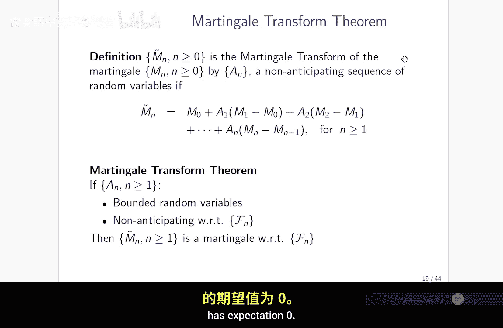

The Martin Gaale transform， transform theorem says that。

This mTilde end process is a Martin Gale also with respect to the information sets FN。

And we often call this collection of information sets sort of a filtration。

And so when we think of different processes， different realizations of a process up to time and then whatever。

The history is。Prior to Anne。That is the information set we have available and as we observe successive values of the original MN process。

 we're basically adding sort of more information about the realizations and that's how it progresses now。

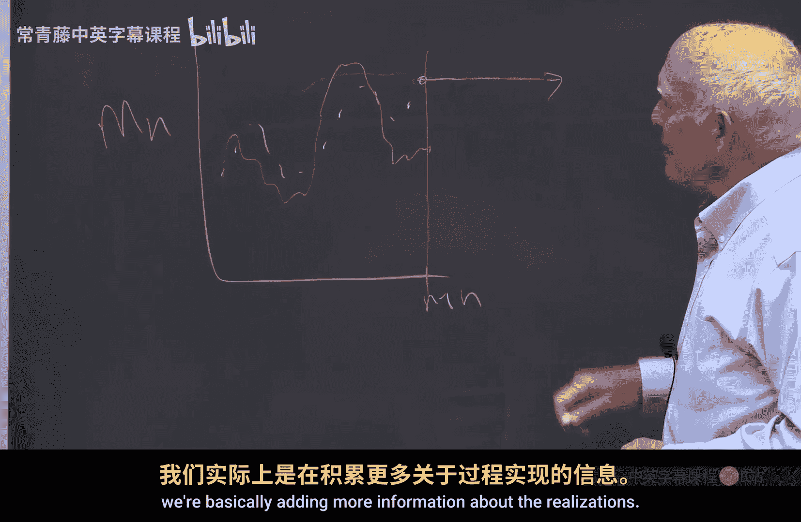

With Martin Gaes， an important concept for us is a stopping time random variable。

 which we'll call tau and so。What the stopping time variable is is。A random variable。That。

Characterizes whether。Let's， I guess at any time end。

 we know whether the stopping time has occurred or not。

So the event of the stopping time being less than n， less than or equal to n steps。

That has to be known in the information set up to time N。

 so the notation here is a little bit tricky， we think of this set or event being the underlying probability distribution states where the tau variable is less than or equal to n。

And at any time， N， we know whether this set。Its occurred or not。

So the stopping time is a random variable and it could be infinite。

 so it takes values on the set S varying from zero up to possibly infinity if the process never stops。

Now， a way of。Trying to help explain this is。With。A stopping time random variable。 We have different。

Omegas。In the probability space and the omegas can be thought of as indexing all possible paths。

So with different realizations， we have a different mega。And so with these paths。

 our expectation are our event E， which is the set of paths for which。

The stopping time evaluated on that path is less than or equal to n。This event is known。

To either have occurred or not to occur。 So we have the indicator。

Of the path being in this set E is either zero or one。

And so we can work with this sort of random variable。

The indicator of whether the stopping time has occurred or not。And。With this setup， we can think of。

The process that is sort of governed by a stopping time tau。

 we can represent the process at the stopped time tau as the sum of the realizations XN times a simple indicator of whether the stopping time equals。

And or not。So we basically have our stopped process being a sum。Of。Weaiights。Time the Xends。

 where those weights are actually0 or1。Now。In the mathematics of dealing with stopping times。呃。

The potential for infinite values of the stopping time makes things complicated。

And what we can do is consider the minimum of N and the stopping time tau。

Denoting that by N carrot tau。 So the minimum of N N tau。And so if we have a finite value N。

This truncated stopping time。It is going to be a measurable random variable。With respect to。The set。

The information set script FM， information set FM for M Gr than or equal to N。 So if we。Imagine。

Basically， this time。Increasing。And we think of。And。The minimum of n and tau， then we will be。

Considering processes that maybe stop。For a given。To for a given realization。

Or if they don't really stop until later， we just consider the value at the end point。Now。

 this theorem。Can be proven with this argument。And what you can see is that we define。

Our non anticipating。Variables to be the indicator of。Tau。

 the stopping time being greater than or equal to k。And so。Substituting that in。

To the formula for the decomposition， we end up getting that this。Stopped。Martinale at time。

 the minimum of n or tau is actually equal to the sum of these non anipating variables times the increments of the Martinale。

 so this is easily a Martin transform and satisfies the Martinale transform theorem。

 so this sort of stopped。Martinale， at the minimum of N and Tau is also a Martinale。

 What we then want to do is consider taking。Let's say I'm not sure if we do it here shortly or not。

 but we'll basically let little N。Grow large and argue that in the limiting case。

 we basically have the stopped Martinale without the minimum of N and Tau。Well。

 let's look at this simple random walk we had before， where the steps are plus one or minus1。

And we consider。SN being the sum of the steps。This can be used to characterize the problem of。

Playing against an opponent and betting $1 with each iteration of the game。

 And you either win or lose that dollar each iteration of the game and。😔，We can consider。Having a。

Hit level for the。some S N being equal to plus a or minus B。And so the basically。

 this reflects whether we。Beat our opponent or not， where our opponent。Has。A， well， let's see。

let's see if we have a bank role B and our opponent has a bank role A， do we？

Win the entire bankroll of our opponent and hit A first。嗯。So we have this problem。

 and we want to know what the likelihood of。Basically， player one losing。And the SN is a Martinale。

And tao， the time at which。The sum SN equals plus a or minus B is a stopping time。

 and so this is a Martinale by the stopping time theorem。And with such a Martinale。We have that。

The expected value。Of S at the stopped time is equal to the expected value， initially。

And that is equal to zero。Starting out at time zero， SN is equal to zero。

And so if we take the limit as n goes to infinity。This converges to。

The random variable S tau with probability 1。And this is proven， partly by。Showing that。

The stopping time can't be infinite， but if we assume that， these results are valid。

Then we have 0 as equal to the expected value of S tau。And if we write out what S tau is。

At the stopping time tau， it's either going to equal a times。The S tau hitting a。

Or minus b times the stopped value equaling minus B。And if we take expectations of this。Equation。

 we basically have 0。Is equal to a times the probability。That we hit。

The level plus a minus b times the probability that we hit minus b。

 and those probabilities are complements of each other。So。

The chance that we hit minus B at the stop time is one minus the probability that we hit a。

 so using these relationships we get that the probability that we hit A first is B over A plus B。Yes。

On the previous slide。check。I don't know it might be error or you don't understand as I think。

It say sold for S tower plus。Wheres this problem involved。Let's see。Can you ask the question again？

And then problem solve， you say probability S tau oh， yes， is probably the S tau equals plus a。Yes。

 definitely。No， no， that's fine。 and it's fine。 There's always typos， fewer typos on。

Slides then on the blackboard， I would say that's the。

 the benefit of having the slides and easier to fix。 Allright， thank you for that。 Allright， so。

 so we get this really nice formula for the likelihood of hitting a。Before hitting minus B。And so。

By symmetry， if a equals B， then this is simply a half。But if。

The player sort of B has a larger bankroll than the chance of taking all the money from A basically goes to one。

So it makes sense that if you're going to gamble with sort of fair odds。

 you have an advantage if you have a bigger bankroll than your opponent。Now。

This second example of Martin Gas。Which is or the square of the random walk Sn minus n。

This is a Martinale as well。 and if we look at the。This Martinale， it's bounded。

By the max of a squared b squared plus taos， we have a bounded transformation。Of the original SN。

And so this Martin Gaale has expectation zero for all N。

And so if we look at the expectation of M tau。This transformation of the original。Martin Gaale。

 sort of SN。It has zero expectation， which is equal to。

The expected value of S tau squared minus the expected value of tau。And。

If we look at what is the expected value of。S tau squared。

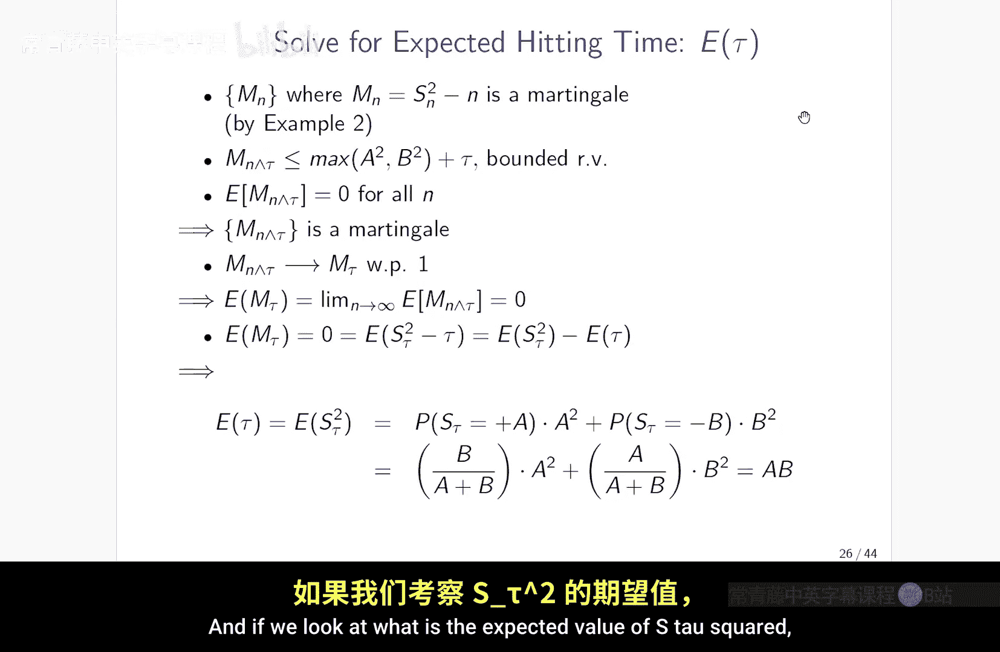

So this term here。We have that。 that's equal to。Being stopped at plus a times a squared plus the probability being stopped at minus B times B squared。

And this expectation is equal to 0。 so we can actually solve for the expected value of tau。

 It's simply equal to the expected value of S tau squared。So。Plugging everything in。

It gets a little tricky until we simplify， and it's simply the product of a times B。

So the amount of time it takes to。Defeat the opponent。Has an expected time equal to a times B。

So if you're gambling in such a situation。The size of your bankroll sort of times。

 the size of the other person's bankroll estimates the approximate time it will take to finish the game with one dominate the other。

嗯。Anyway， what， what's characteristic of these examples is we have a Martin Gaale。

Transform of the original series， it has a zero expectation as it's defined。

 and that zero expectation applies for all time points as well as the stopping time。

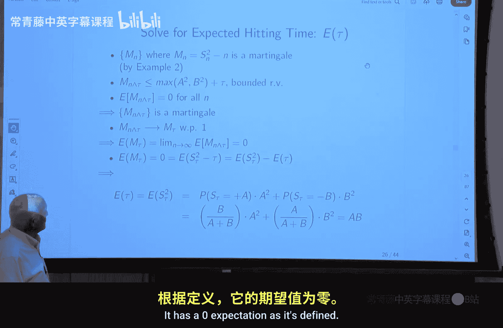

All right。Well， a really challenging。Problem is。To consider the random walk with bias。

 So we consider。Steps plus1 or minus1 with probability P and 1 minus P respectively。

And then we're interested in。What is。What is the probability of hitting plus a？Say in this case。

 certainly as P。Increases the probability of hitting plus a first increases。

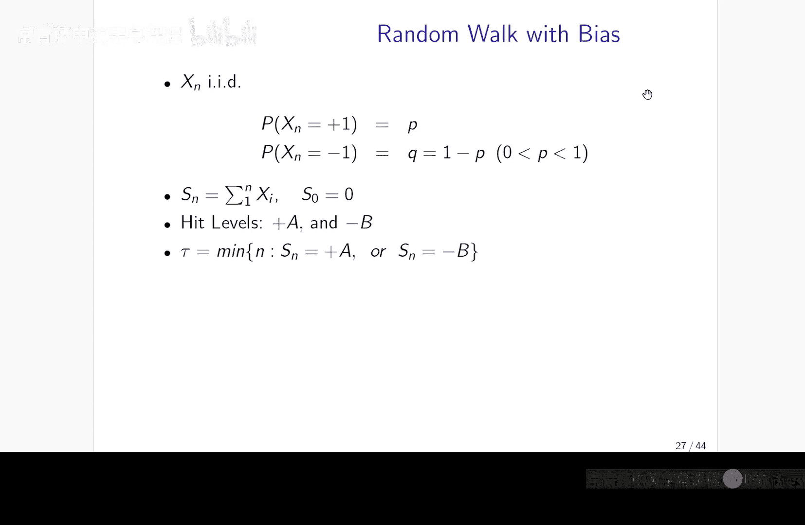

嗯。But how does it do so？ Now， some of you have taken stochastic processes already。

OrHow many people have taken the course in the stochastic process， maybe just a couple？

Do you recall this problem being covered in your course？And。

When I taught the stochastic processes course about five or six years ago， the way this was solved。

Was sort of by brute force。Understanding。The dynamics of the process， and doing。

Computations with sort of first step analyses and。The solution was really quite complex。

But it got the right answer。What's really neat about Martin Gas is that we can actually solve this problem。

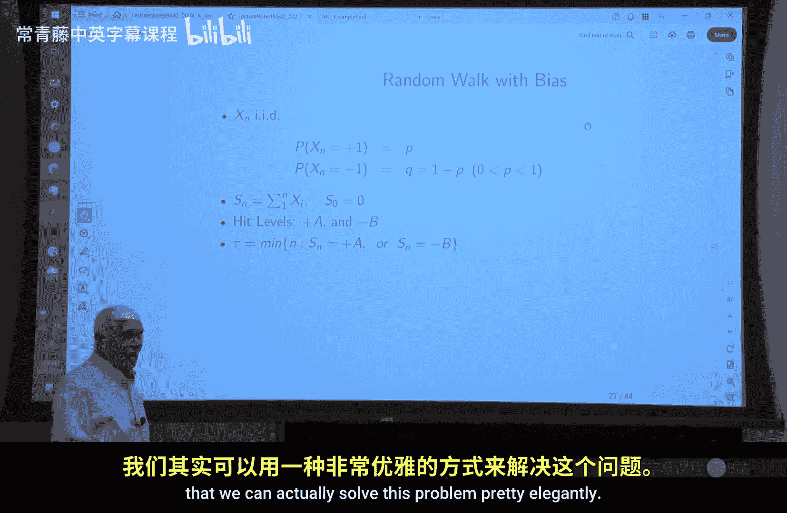

Pretty elegantly。 And so we're going to use this moment generating function， transformation。

So our Xs have a moment generating function。Which is P， the probability of plus 1。

Times E to the lambda times plus1。Plus， Q， the probability of negative1 times E。

To the lambda times negative one。 So this definition of the moment generating function is very straightforward。

If we take E the lambda X n divided by phi， these are independent random variables that have expectation equal to one。

And we can define M N to be the product of the first N eyes's。

And this will be a Martinale by our example four。And。If。We solve for the lambmbda value。

That makes phi of lambda equal to one。Then。For that fixed value of lambmbda。This M， N。

Is going to be a Martinale。 It's actually a Martining Gaale for any lambda。 But in addition。

 that special case where phi of lambda equals one。And so if we graph this moment generating function。

As a function of land。We can see that it's equal to。Equal to one。

When E to the lambda is equal to Q over P。So this so MN for this particular lambda。

For which E to the lambda equals Q over P is simply。Q over P to the power SN。And with that。

 we basically have the initial value of M。At time 1， basically or at time 0 is 1。

 and that should equal the stopped value of Q over p to the power S n at the stopped value。

 so it's Q over p to the plus a times the probability of stopping at A plus Q over P to the minus B times the probability of stopping at minus B。

And again， this。Equation basically gives us two terms that are related to each other that we can solve for。

 So we get the probability that this biased random walk stops at。

Our hits plus a first is simply the ratio of Q to P to the power B-1。

Over the same ratio of the power A plus B。So， so this result is very direct and。Elegant。

 if you look at stochastic processes books that try to solve this biased random walk problem without Martinale theory。

 it's a bit more involved and tricky。All right， so here's just some R code that will graph these probabilities as functions of A and B。

I think it's useful only just to know that you can do something like this。

 you can graph the probability surface as it varies with the head los A and B。

And here are contours of the different probabilities， which can also be graphed easily。

 And that sort of finishes this initial discussion of of Martin Gaes。 Now a second。

Topic in stochastic processes that is extremely important is the concept of Markov processes。

And so if we think of a general stochastic process， Xt。Then， we will say that。

The process is a Markov process。If for any times of the process。S。That's between U and T that。

X T will be independent of all X youth， where U is less than。S， so。When we。Think of。A time scale。

So we have U less than S， less than T。If we imagine realizations of a stochastic process。

And we are interested in。Looking at the value of X T。嗯。The value of X T。

Given information on times as and before。Will be。Independent of all of the times before。

And so the conditional distribution。So。So the distribution of X T。

 given all of the values of x prior to time u is equal in distribution as the same random distribution。

As。Just。The conditional distribution， given excess。So with a Markov process。The future。

Depends on the past only through the last value of the past。 It doesn't matter how one。

Arrived at a given。Value at time S。For different realizations that have the same end point。

It's only that end point that sort of indexes the distributions into the future。

 So this is a markov process。 It's like a。嗯。It's， it's。It's。Sort of a a simple model where the past。

Information can be。Encapsulated just in the last observed value。

Not in the realizations of how that value was achieved。Okay。

 so this is just some notation for trying to say what I just said。Now。With。Markov chains。

 These are interesting stochastic processes where。We consider there being a state space。S， capital S。

 that where we can index possible states of the process， beginning， say with zero。And the integers。

 and it could be a finite number or accountably infinite number。And then we have a time index set。

With n varying from 0。To the through the positive integers。And so the markov property with this。呃。

Mar with this， with this stochastic process。嗯。Would have。That the probability。Of the next step。

Next state being J from time N， given。The values of the process， x not through XN。

This conditional probability。Is equal to the conditional probability。

Of J state at time n plus1 just given that Xn is equal to I。So this is。A nice property。

For processes that makes their analysis a bit less complex。And。

What's important in this definition of the Markov process is that there's。

A one step transition probability。From state。I to state J。From time N to n plus one。And。

These transition probabilities。Together with。The probabilities of the initial states completely specifies the stochastic process。

 Now， this issue of completely specifying a stochastic process is an important one in that。

What we want with a stochastic process is to have a complete probability model of that process。

And so。If we have sort of an initial state x0。And the probabilities over。All states， I and S。

That characterizes the probability model for。The state zero value。Then if we look at the probability。

 the conditional probability from time n equals 0 to n。from zero to1。

 we then have the conditional probabilities of moving from any state。0ero。To any state and at time1。

 And so those。Conditional probabilities， together with the marginal probabilities specified the。

Distribution of the process over state 0 and 1。 And we can continue this computation。

For successive time points and completely specify our。Sttochastic process。The general Markov process。

 as introduced there， is very。Complex because we may have different transition probabilities。

 depending upon how long the process has been operating。

A simple case is called a stationary Markov process where these transition probabilities， one state。

One step， transition probabilities。Do not depend on the time。

 So we have the same probabilities of moving from one state to another。

 regardless of when that is occurring。And so we can define a matrix P。

 which is the collection of all sort of pairwise probabilitybabilities P I J moving from basically state I to state J。

And。We basically。Require that these transition probabilities are non negative and the sum over sort of target states J from state I。

 that those probabilities sum to one for a stationary transition probability matrix。And。

To sort of define the probability distribution。Of the entire process XN using this stationary transition probability matrix and initial probabilities。

 we can compute any probabilities。By。Computing the collection of all such probabilities。

 where we have sort of N。Steps of the process or and time points of the process and states。

 I not through I little N。There， so if we can calculate these probabilities。

 we will have specified the probability model。 now in calculating。

The joint probability of the first little N values states being I0 through I N。

We can decompose this probability into。The marginal probability of the first n-1。

And times the conditional probability of the last， given the others， so。

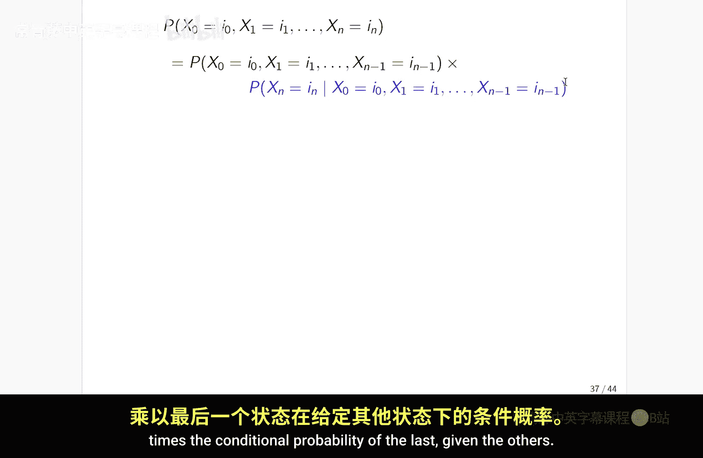

If we think of。Sort of a。

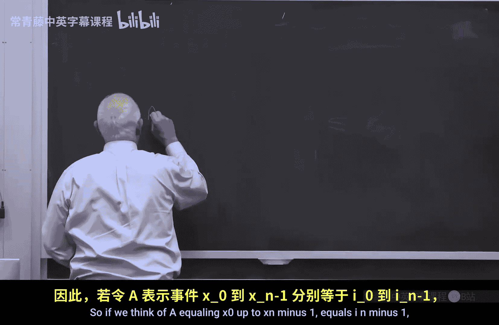

Equing x 0。Up to x and -1 equals I and -1。And B。Is equal to。Xn equal to I N。Then。

We can look at the probability of a。And B。Is equal to the probability of a。

Times the probability of B given A。And this is basically what's written up there。

And this formula on the Blackboard is simply Bay's formula relating sort of the conditional probability of B given A。

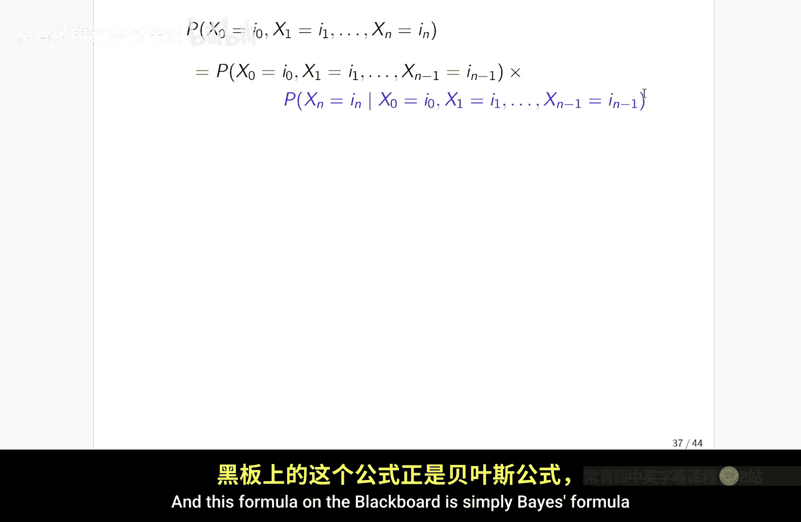

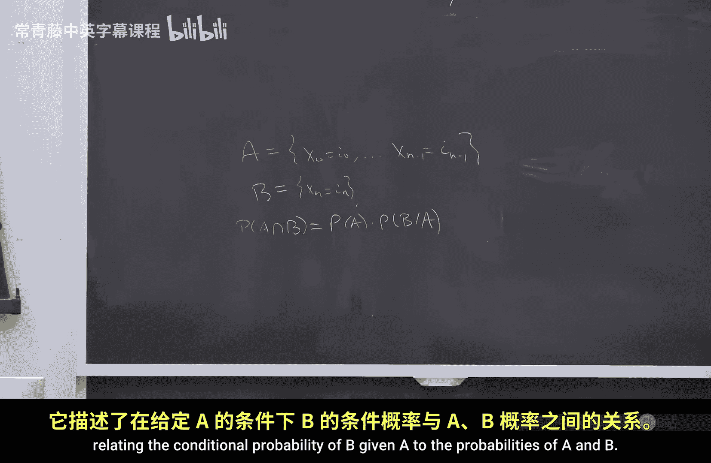

To the probabilities of A and B。So probability of B given any。Now， with this。Second equation。

 we can simplify that to。The red probability， which is only depending upon the n-1 value。And so。

We have。That the this probability is equal to the marginal probability of the first n -1 times the。

Transition probability from state and。I n minus1 to IN， and that won't depend on N。And so。

 we can basically。By induction。As we replace each of the successive state transitions by the probability of moving from one state to another and the successive transitions of all those states。

So， this joint probability。Can be represented in this form。

Exploiting the Markov property to simplify the one step transitions。And using the。

Stationary property to define these PIJs。Okay， well， with a stationary transition probabilities。

The multi step transition probabilities turn out to have。A really nice form。And so。We can represent。

The transition probability matrix over N steps。As。The8 power of the one step transition probabilities。

Marices。So this property of Markov change with stationary transition probabilities is very nice and。

Gives us this result。嗯。Now， let's see， there's。In terms of proving this， okay， there's this。

Analysis called first step analysis in stochastic processes。

 That's a really useful tool for proving different results。And。This first step。呃。

Pro analysislysis basically says， okay， if we want to calculate the probability of going from state zero。

 sorry， state I to J in N steps。That's like starting at time0 in state I in transitioning to state J。

Then。We can。Consider we can decompose this probability。Into the sum。

Overall possible first steps going from I to K in state1 and then from state K to J。By time N。

And so this first。Equation here is a first step。Equation of the probabilities。

 We can basically decompose the process of going from state I to J and N steps as going from state I to each K。

State and step one， and then going from state。K to N。In n-1 steps。So this is。That。Formula。

 and so if we。Write this out。 We end up getting。X，N。

Equaling or this in blue is equal to the term above and black because of the Markov nature of the Markov property of the process。

And so we basically have this sum of PIK。U。Times probably x n minus1 equaling J x n equals k。

And so this。So we end up basically getting this matrix equation of the n step transition probabilities as equal to the one step matrix p times the n minus one step transition probability matrix in green。

Okay， well， these transition probabilities together with。

The marginal distribution of the initial state gives us the marginal distribution of XN at any。Time。

So， okay， so these formulas just indicate how we do these computations。 Now。

 where do Markov chains arise。In finance， well， one example to think about is how companies have credit ratings。

And those credit ratings range from high credit。Meaning， which is AAA and low credit being。

 I guess C D being default is。Sort of maybe a terminal state， at least in some sense。

 but companies are graded。A rated by standard ands and Fitch and other rating agencies。

 and depending upon how good their credit rating is， they can borrow money。At lower interest rates。

And the way corporations borrow money is to issue a bond paying a certain interest rate and having that interest rate be attractive to lenders and the way。

That。Such a loan contract is attractive to lenders is。With a high interest rate to the lender。

 but a low risk of default by the borrower。And so one can think about how these credit ratings vary from one。

Period to the next。 And here's a。Table of sort of migration probabilities from one year to the next。

 And one can see that。ApleA。Initial ratings。Had only a 43% chance of staying AAA at the end of that one year。

And there was a very low probability of downgrades， too。You know，C， triple C or B and with。

Say very low credit rating companies， the chance of their。Basically， increasing their credit rating。

To be was 41%。Staying at TriC is 32%， but almost a 20% chance of defaulting grabs。So。

 so these kinds of。Metrics basically can be analyzed sort of with the tools of。Markov chains。

Let's see。 Then another example that I put together is looking at the stock price dynamics of。

Any stock， but I chose Apple。And using daily prices。To consider states。Of the Apple stock price。

 which is， is it an up or a down day， I the price at day T higher than t -1， or is it a down day。

I guess one of those should probably be a less than or equal to if they if we want to incorporate everything。

 but we can consider defining a。A two day。ASt， which is。Let's see。

 the formatting here is a little off， but we could have two updates in a row。

An up day followed by a down day。 A down day followed by an up day and a down day followed by a down day。

And。Look at trying to model。The state changes for a two day state with a Markov chain。And in R。

 there's a nice R package that。Will do this for us。And this was distributed。In the canvasva site。

And so you should be able to replicate this example。

With Apple or choose any other stock you might be interested in。And so。Importantly。Okay， this uses。

The library Qua Mauude here。It's sort of hard to see。Let's see。So there's a library Qua mod。

 which allows us to collect price data from the Internet。And then there's this。

A package Markov chain， which allows us to specify。Markov chainin models。And so with this。Our code。

 it basically collects the data。On。Apple stock。And。Yeah。

 I think's what I really want to emphasize for everyone is that these examples。

 and it's a bit tedious if you want to go through these examples yourself， however。

The examples should work。Just with clicking a button saying run and you can replicate these。

 And so for the Apple stock， we just needed to substitute in the Apple symbol。And collect the data。

And so here's the Apple stock price from 2014 or 2013 through。A week ago。And。

I considered just fitting a Markov chain model for these up and down states to the last four and a half years。

And so。The code here goes through。And。Basically with Apple prices。Apple closing prices here。

We define differences in closing prices for two lags。And then talk about。Defining up up days。

In this section here。😔，Up down days， down， up and so forth。And then， if we graph。

These states say from May of this year to the end of August， this shows。How this。

F state Markov chain evolved over these dates。And。We can just use the Markov chain。Function。呃。

All let's see， we can plot a Markov chain function or a Markov chain transition states。嗯。

Ass this graph here。 So what's， what this code does is it looks at transitions from one day to the next and calculates the probabilities of going from one state to another。

 So the sums across rows equals one。And this graph。

 this plot shows basically what is happening with the Markov chain。 We have different states。

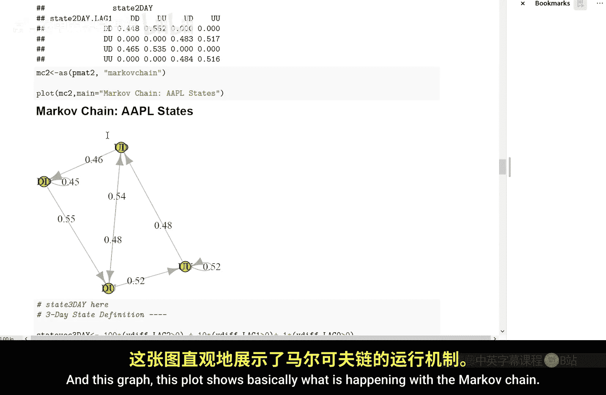

given by the nodes， and then we can transition from between nodes by which arrows are feasible and this Markov chain package will give us the probabilities。

 empirical probabilities of moving from one state to another。

And so one can see that。Two updates。And Apple are。Likely to be followed by two updates。Again。

 so that we'd get a third up with that one step transition two down days are not likely to be followed by a third down day because it won't go to that。

Down， down state with probability。More than 。5 or so。

 so there tends to perhaps be reversals from double down days and a continuation of up as sort of。

Suggested by， by these graphs。Now。With with this example， I thought， well， maybe。

There would be some interesting structure if we defined three day states。

And so the same logic sort of gives us。E states of up or down on three successive days。

And so sort of two times two times two or eight is the total number of possible states。And。

One can calculate the probabilities， empirical probabilities of transitioning。And then。Get。

Get this sort of display of the Markov chain with these eight states。And so what's rather。

Curious just to focus on our three down days are not likely to be followed by fourth。

And three updates maybe are likely to be followed by a fourth update。

So you get some insight perhaps into the overall dynamics。What's。Great to me。

 is that we can visualize。The process。And the graphical representation of sort of nodes and edges between the nodes that have probabilities is quite useful。

嗯。So let's see if if you steady Markov chains and then one can。Classify different states。

or different nodes as communicating states， so can you move from one state to another or not and in this case one can move from one state to another possibly not in one time period but in multiple ones and so this happens to be a strongly connected set of states。

And。Let's see。There was this sort of little note ends with printing out the columns of the transition probability matrix for up moves。

And down moves。And so。If。We wanted to move from one state to。And up move the next period。

Then looking at this table， one can see that。The highest probability。Of。The three day state。

Being up in the third day， given。Prior。3。Day， state， then。

It corresponds to three down days lead to an up the next day with almost a 60% chance。And。

One can also sort of do the same for down moves and see under what state are we most likely to have a down move。

And so。This。I think 0。510 is the highest。Which isn't much higher than 0。5， but。Basically。

 the past few days being a bit mixed， but with two up preceded by a down day。

 give us a higher likelihood of a。D day。So。With， let's see。 with this note， the。Let's see。 There's。

Okay， so here's the。Reference for this Markov chain package。

And what's quite convenient with different R packages on different application。Topics is that。The。

These articles often go through the mathematical background of the models。

 And so if you check out this。Discussion this article on the Markov chain package。

 it actually will include issues， the mathematical issues of how you might classify different states。

And do various computations， so that's quite useful to have as a resource with these。Now。

 let's say with the。Our studio cloud files that were distributed。 If you use those programs。

 you can change。The symbols from Apple to any other and use different time periods to see whether these properties may be strong or not。

With other stocks。 And I think that it might be an interesting thing to， to check out our。Next topic。

 which is on regression analysis。And。With regression。

We want to just review the notation and setup for multiple linear regression if you've taken any statistics class。

Prior to this， which most of you have， you're very familiar with simple linear regression where you have one dependent variable and one predictor or explanatory variable。

We want to consider the case of multiple linear regression where we have a single dependent variable and multiple。

Predicctor or explanatory variables given by x's。 And we want to describe the relationship between the dependent and independent variables now。

Different regression problems can focus on prediction。

This is actually one that I find most engaging least trying to say， predict stock prices over。

Fixed horizons is of real interest， but regression models can also be used to make inferences of causality。

Regression models arise in medical experiments。Where one of the explanatory variables corresponds to a treatment effect。

One can also be interested in trying to approximate the dependent variable by functions of the independent variables and understand their functional relationships。

So， this is。All of these objectives can be achieved with regression。And。We。Define a general。

 linear model。With。These equations here， we basically have our observed Y eye values being a sum of a fitted value plus error。

And the fitted value， why had I。Is written here as a linear function of the independent variables。

 Xi with coefficients beta 1 through beta。Beta P。And there's actually a typo。

 There shouldn't be beta sub I P。 It should just be beta P there。And。With this setup， well， we could。

Consider different。Explanatory variables that happen to be just different powers of one independent variable X。

We could also consider Fourier series。Of。X variables。U。We could also have time series regressions。

 where。The independent variables X may correspond to prior。

Time values of the Y series and in all of these cases。

 what's really important is linearity of the fitted value Y hat。And。What's linear is not。

It is is not that it's the sum of x's so much as it is。

 the regression parameters beta are a linear function of those。 So the linearity of Y hat。

In the regression parameters is a key property of this model。

And that linearity dependence on the parameters allows us to specify the parameters。Now。Let me just。

Go to。Another example here。Let's see here。Okay， here's。A time series of the high yield spread。

In the bond markets， and so this is looking at the yield on bonds with a credit rating of BAA minus the yield on a US Treasury。

And so。This。Difference in yield tends to be positive well above， too。

 It means that these lower credit。Rated companies have to pay more interest to lenders when they borrow money。

But that excess rate above the Treasury evolves over time and sometimes you know it drops。Moderately。

 it arises moderately now， if we were to use just。Polynomials to try and fit these。Well。As we。

Extend to sort of eighth order polynomials you everyone here probably knows that with a high enough order polynomial you can match any smooth curve。

 no surprise， do we expect this spread to actually follow some high order polynomial probably not。

Here's another example of using Fourier series with the same。Spread time series。

And so as we add in more terms in the Fourier series。

 we're able to model higher frequency variations。And what this shows is just how。

I guess frequency analysis in financial series potentially can be useful。What's？Really surprising。

 though， is if we do an auto regression。Where here is the high yield spread。And then。We。Basically。

 have an auto regression saying that the spread tomorrow is the same as the spread today or very。

 very close。 Then we get this blue curve fitting。The black curve。

 which is sort of over underneath the blue curve。 So we get almost a perfect fit with。

With this auto regression。So there's a multiple r squared。Which we will introduce you to， but of 0。

99。Five for the auto regression， so the use of historical values of a time series can be very powerful in predicting future values。

Alright， so， so in fitting a multiple regression model， whether it's with time series。Factors or not。

 What we do is go through these steps。Of proposing a model， step 1。

And make assumptions about the error term epsilin。And then。Second。

 we define a criterion for judging different estimators。

And that criterion can be things like least squares or minimum mean squared predictionction error。

Or others。 And then characterize the best estimator using that criterion。Then， we。

Check whether the assumptions we made are， in fact， satisfied。And very often。

 we'll discover that certain assumptions we make。Are not satisfied。

 and we need to revise those and create a new model。So。The models that。

The model assumptions we apply include。What are called Gaus Markov assumptions。

 which is where we assume that the errors in the model have。Mean  zero。And constant variances。

And so with this Epsent hat。Corresponding to the end cases in the series。Basically。

Can assume these are mean0 and have standard deviation， Sigma。 That's a constant。

And that these are uncorrelated。Uncorrelated。嗯。We could additionally assume that these errors are normally distributed。

Or not， we can generalize the Gauss Markov to assume。

Non constant variances of the errors and possibly correlations of errors over time。

 we could also consider non normal non Gaussian distributions and all of these cases actually have a role。

In in different contexts。In particular， I guess generalized Gaus Markov methods apply with time series regressions。

 and the non normalmal non Gaussian distributions arise as well， often with asset returns data。Now。

 in terms of what kind of criterion we should use for specifying parameters。We have least squares。

 maximum likelihood， robust methods， bay methods， a whole variety of methods。

 And what's really important to me is。For people to have an understanding of。

What these different methods are and when you would prefer one method over another。

And so what I think is a really important question to ask when doing empirical analyses with different models is。

 are your assumptions reasonable， if not satisfied by the data you're modeling and with different criteria for judging different specifications of models？

Are you using an appropriate criterion or not Are there variations in that criterion that would lead to higher performance levels so that for me is a guiding sort of question throughout these different checks so with that we'll finish today and next time will finish these notes going through ordinary least squares estimation and what's useful about this development of least squares estimation is that it does so。

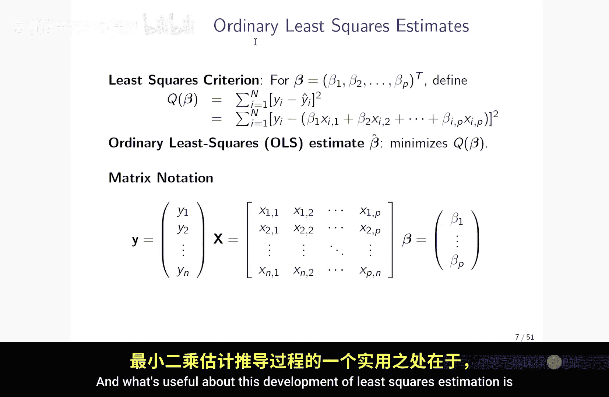

With linear algebra。And what we'll see is that with linear algebra。

 we get very straightforward formulas for least squares estimates。

 as well as interesting sort of analytical properties of those least squares estimates。

 so we'll cover that。Next time。

