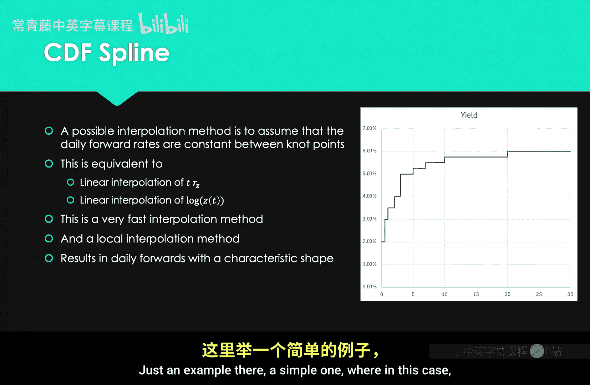
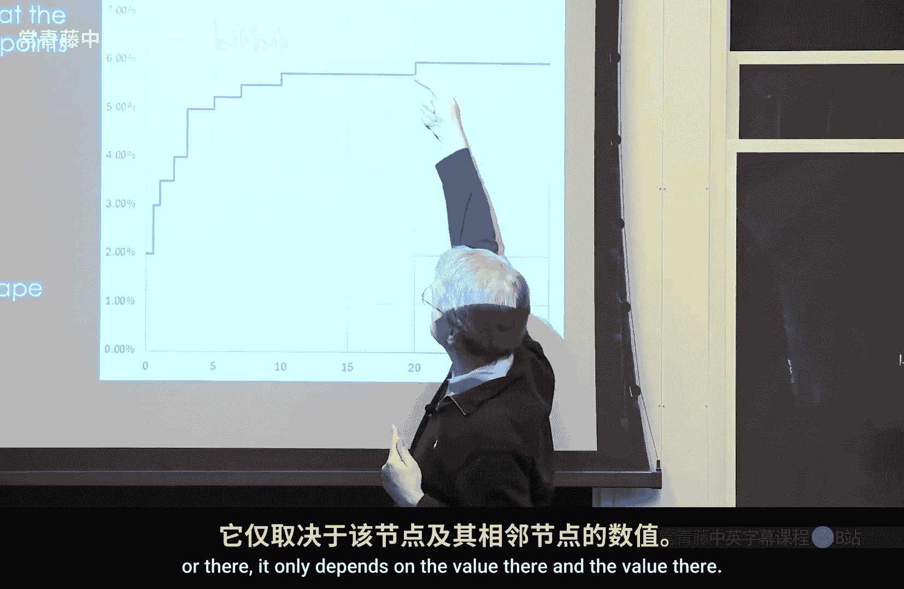
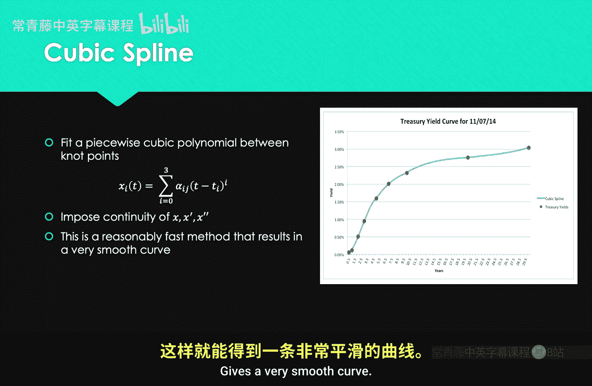
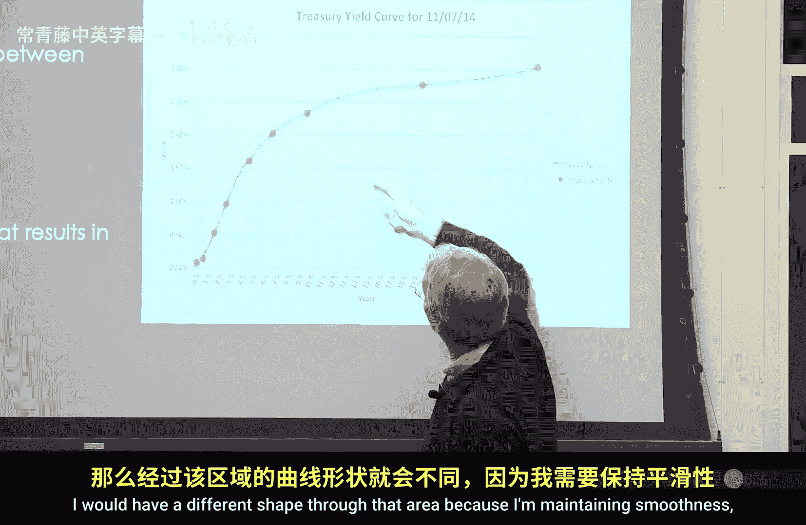
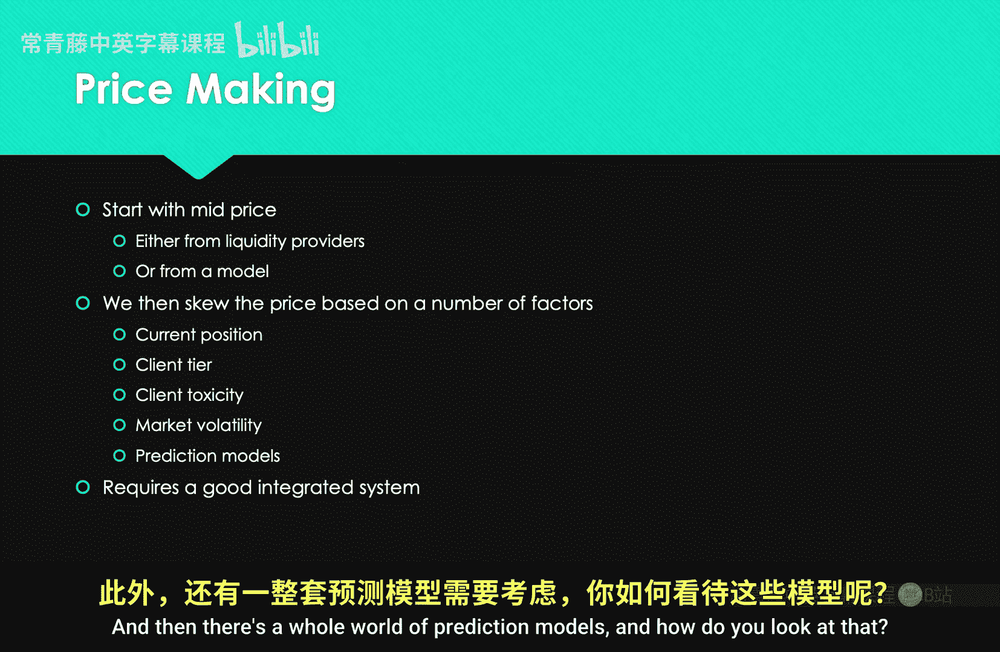

# 麻省理工学院【中英⚡数学专题及其在金融中的应用｜18.642-Fall-2024,-Topics-in-Mathematics-with-Applicatio】-p08-P8-Linear-Rates,-Products,-and-Models--BV1iLrjBrETS_p8-

So it's my pleasure to introduce Andrew Garsson， who I had。Honor and pleasure to work with。

And for a long while at Morgan Stanley and Andrew is actually a MIT alum。

 he got his PhD in geophysics from MIT。And after that。

 he worked in a variety of roles in financial senior quantitative roles in financial industry。

 and now Andrew is head of quantitative strategies at Mizuho in New York。So Andrew， welcome。

Please take it away Okay thanks everyone， so I'm going to a quick talk today about sort of linear models and rates in particular。

 which is area I work in we'll just give a quick overview。

 we're going to talk a little bit about some basic markets， interest rates。

 what are they what are some of the more liquid rates products， yield curves。

 you know a little bit about hedging， how do you hedge your positions。

 P attribution and then end with a little bit on e trading and bonds。

I'm going to caveat this is going to be a very non mathhy presentation， probably for this class。

That's probably my personal bias is I don't find math necessarily that illuminating in some of these problems versus what problems are you actually solving。

 As I told Peter， if we were talking about how to build a house， we wouldn't spend know。

80% of the time talking about hammers。 You know， we're talking about how big you launch your rooms and how the connectivity is。

 I would highly encourage you to ask questions。 I'm gonna ask Peter if nobody else does。

 if he can pipe in a couple just because I'd like to keep the discussion going。

 And I'm generally happy to yak on and on about any particular topic that anyone is interested in some。

😊，So please talk away。Okay， so start with the basics。 What are linear products， You know。

 there are things that are not nonlinear。 Nothing too surprises there。 You know。

 some of the major categories are things like bonds， interest rate swaps， interest rate future， C Ds。

 These are sort of the more traditional relatively simple products。 These are not， you know。

 CDO squares or callable spread range accruals or any of the。

Super exotic stuff that has been around for a while and still continues to be done。You know。

 the modeling is， in some sense， relatively simpler here。 And these are not， you know。Huge， you know。

 multifactor， stochastic calculus models you have to do in terms structure multiple things iss relatively straightforward。

 You know， So the question then is， you know， why do we care， You know， as quants。

 Why is this interesting， You know， anybody want to hazard a guess as to why the stuff is still relevant today。

Somebody take a guess。You look like you're thinking。あませい。就。It's important itself。It is。

 it's an important thing。 It's the core underlying。 What， What are some other reasons。

 Maybe you might care about this。 Its a lot。 It's a very big market and a very liquid market。

 true A couple other ones。 are it's also generally used for hedging of the more complicated stuff。

 and it's also an input to all the more complicated models， which generally。

 you start from the simple stuff。 and you build your models up。嗯。You know， these are very large。

 These are the larger markets on the planet。 Just a couple of statistics。 in the last few years。

 equities is is you know， getting close now， particularly with the sort of run up in global equities last couple of years。

Bonds have something north of $120 trillion outstanding。 interest rate swaps are more like， you know。

$500 plus trillion outstanding。 you know， just the main futures contract， more than 10 trillion。

 You know， these are very large numbers。 You don't need to have a huge profit margin。

 And when you market the size to， you know， do very well。In the market of this size。

 it's very actively， it trades a lot， you know， the daily volumes。

 treasuries approaching a trillion dollars a day， interest rate swaps， you know， comparable， again。

 futures， something like 4 million contracts a day and the so futures which are the main short term interest rate contracts。

And then I think a lot of the more complicated models start with the simple stuff and then sort of build up on top of that。

And again。I have a tendency to talk faster and faster and faster。 If nobody comes back。

 So I'm gonna apologize in advance。 And if you find me doing that， somebody just tell me to stop。嗯。

You know， and again， I said they mentioned， they're sort of based of the complexs and inputs to the more complicated model。

 previously， I think they were thought quite simple。

I think the global financial crisis in 2008 sort of brought a number of factors to the fore that people hadn't considered before。

 in particular around things like funding。And what was previously say a very simple product。

 so you I'll pay you a dollar in 10 years， how to value that became quite difficult and subject to a lot of thinking and discussion and there's not a unique answer to that。

 which is also interesting。A couple of the other things that came in。

 there' was a lot of regulation that came in after 2008。嗯。You know， some sense。

 somebody said the regulators wanted to make banking boring。And， you know， it's not boring。

 but they changed where the interest is in it and sort of the super complicated exotic products that were really very much in vogue in the early knots and midnots。

Really， those things。Ended poorly for a lot of people。

 You sort of think about the causes of the financial crisis， at least on on the market side。

 a lot of it ultimately boiled down to US residential real estate。

 which had a huge run up and then an enormous crash。But after that， they'd been issued， you know。

 a lot of very complicated securitization products， very highly levered and multi layered。

 and things were， you know， very opaque and hard to value。 You know。

 this was not financial modeling find this hour。So I think there was a lot of regulation that came in on top of that in terms of model risk management and that really sort of ended that section of the business。

 so people went back a little bit to basics and started thinking a little more about some of the fundamentals。

 which I think was a good thing because I think things were kind of silly there I remember talking to someone of my friends at a soccer game or something our kids were playing and he was mentioning they just on a mortgage securitization issue which I believe defaulted without making a single payment。

So this stuff was just so， you know， so poorly supported and thought out。

 but because it was so opaque， you know， you know， smiling， fast talking sales guy。

 could push a lot of this stuff to areas really probably should not have been involved in this area。

You find little like municipalities in Nor We haven't declared bankruptcy because they bought a whole bunch of C Ds from Iowa。

 you know， stripip malls or something crazy like that。 And you sort of think， how did that happen。

 So I think there was quite a lot of regulation came in really to put a little bit of fences around some of this stuff。

 which is is。You know， it's quite powerful， but you know， can be used for good or bad in some sense。

Okay。So let's talk a little bit about what is an interest rate。You know。

 and just read that it's most basic is a rate at which you can。

 you know either borrow or lend money on a principal amount。In this case， I'm going to have。

 you know， my interest I payment will be n， which is a notional typically times the rate are accrued over whatever time I'm borrowing it for。

So I you know I'm borrowing $1，000 at 5% for a year in a year。

 I'll have to pay back $00 plus $5% times a year， times$1 thousand0，$50 of interest。

Relatively straightforward， you know， how do I value that in terms of what I'm willing to pay for that today。

 You know， I'm not willing to pay $100 for it because。Well， let me reverse that。

 So if I get 1000 in a year， how much am I willing to pay for that today whatever I'm willing to pay for today。

 I can invest。 And if you work up arithmetic， it works out to be one over one plus the rate times the time。

 So at a $5% rate， I'll pay something like $950 odd dollars for that。 and then in a year get $1000。

Now this depends a lot on the discounting rate。 For example。 So what rate am I going to discount at。

 You know， that's hard to observe rates I can get for investing are easy to observe。

 And you walk into a bank and you look at the signs in the front door by CDDs 4 and half percent rates for a year。

Whatever how much a discount is is hard。Typically， you know， in our world。

 we're going to assume one of the know， institutional rates。

 which is something like a sofa rate or no as rate。

 which we'll talk more about in a little bit in the future。

But these are sort of a standard assumption。Now，One of the interesting things practically is you find every person has a slightly different rate that they should be discounting because it depends on where they can borrow money and that that depends on your credit breathing is。

 So， you know， you may have a good credit rating and you can borrow money at 4%。 You know， you know。

 offense I'm picking you， you may have a terrible credit ratings。 You have to pay 8% to borrow money。

 you may have a media ones。 You're borrowing it 6%。

 So and it all depends on the particular issues of the issuer。

 So this this makes it interesting because at this point， you know。

The a contract for you guys to pay me 10 bucks in a year has different prices。

 depending on who you are。 So there's no single price here。Makes it interesting。

A lot of the banks will deal with this because， you know。

 it's kind of a pain in the ass for a trading desk。 They have to manage， you know。

100 different counterparty relationships each with their own funding。

 So usually you'll centralize that on a central funding desk of some sort。

 They will then assume all of the。Individual traders can fund at a relatively generic rate。

 and the funding desk will deal with all these horrible little funding bases and small collateral exposures and things like that。

Okay， going back a little bit in history， you may or may not have heard of Libor。

 probably not because it now is gone， but this was one of the first really common news rates stands for London Interbank Off rate。

 it was developed， I believe， by a Greek guy in the 60s as a method of standardizing syndicated lending in London。

Most bank lending to corporates is floating rate lending。 So you won't。

 You won't do a fixed rate loan for 10 years。 You'll do a rate that resets every month every three months at the then current rate。

 And the question then was， what rate should we be using to set the interest payments on these loans at。

So what do you came up with as a notion we're going to pull the banks as to where they lend money short term。

 and we'll take the average of that， kick out the highs and lows。

 and then that'll be a standard rate。 Everyone can use a reference index。You know， was a very good。

 very good idea， incredibly successful。First， in rate swaps。

 which are really synthetic versions of those came out in the early 80s。First century swap。

 I believe， was 1980 or 81， which is across currency swap by IBM。

 and then the first pure single currency interest swap came out the next year。

These products had phenomenal growth in the 90s and knots。

 Currently there's something about 350 or 400 trillion of them outstanding as of lib cessation and still continued to grow a little more than that。

So， very， very popular product， very liquid， very actively traded。You know， Libor is a rate， though。

 you know， again， another one of the fallouts from the financial crisis showed that it had some issues。

You know， library was set by polling banks。 So you'd go ask the funding department at each of the big banks。

 I think there's 20 odd people in the library pool。Where you to are you going to borrow money from？

They've come up with a number， they'd quoted。Note that it's not based on actual transactions。

So they're just making a number up。 They're trying， in theory。

 if they're all good players hitting it where they would actually do the trades。

 But this is not actually observable trades。And I think in the sort of late knots， early teens。

Group of traders of less than honorable intent realized that this is。 And this was a maniptable rate。

Now you may have， for example， you know， every day you're going to look at how much money， you know。

 these rates set every day。 and based on your portfolio， you'll have some impact on that。

 Some of them you can have millions of dollars a basis point， a basis point being 1 hundred of a%。

 So if you can get that rate up or down just a little bit in your favor。

 it can end up making you a lot of money。what they did was they essentially all， you know。

 chatted with each other， and they were chatting with whoever the people at their banks were responsible for setting these rates and communities saying。

 look， I need you to make this a high rate today or I need to make this a lower rate today。

And they could， you know， you can move this thing a little bit because it's not observable because nothing trades。

 And， you know， they were doing that for a while to their advantage。This was discovered。

 A number of them were in jail for some time。 There was very substantial multibillion dollar fines to the banks doing this。

 But I think the realization came that this rate didn't have any support。You know。

 one of the things is Libor is a， you know， it's an unsecured rate if you will。

 it doesn't have anything backing it like a repo or a collateral rate。

 And there's just not a lot of transactions。 post 2008。

 nobody wanted to lend unsecured because you had a number of bankruptcies。

 people like Lehman's going out and you you don't want to lend to money who's nothing backing it。

 So people were unhappy with that。 And you some of the things in some of the tens and markets。

 I think had you know， three transactions in a six month period。 That's not。

 but you have to quote this rate every day。 So there's just。Nothing fixing it。

So that was a real issue。So the Fed set up or the Fed plus the other regulators。

I guess I came out of London originally， was the big driver for this， the FSA there， LB。

 London and Libor。Really decided， you know， you needed a new rate。

 It was going to be defensible backing up based on actual transactions and a number of other criteria to make it hard to manipulate so that you this would be a genuine real observer rate and not something that was just being made up by banks to favor their trading desks。

See just a comment。This LibO rate may sound a bit esoteric at this point， but at the time。

 mortgage interest rates were often quoted as LibOR plus a spreadprint。

My experience was there during the time of the knots and the teamss looking at possibly refinancing my mortgage to a lower rate because rates were coming down。

And the library board did not move much at all the back。今さ。

Rather frustrating to watch that F understood why it was not it was partly that and partly the LibBO to Treasury spread。

 which is the difference between LibBOR rates， which are the bank rates and the Treasury rates or government rates blew out in that period around 201112。

 the find institution now was out of that point rolled off 。8。

4 billion in structured notes because of that， for example。

 because they were hedging their structured notes with LibBOR products and assuming the two would stay together and they went w。

Most of it came back in the next couple years， but it was quite unpleasant for a while there and made them want to change how they were doing that。

You know， when we went through sort of the Libor retirement， you know。

 when you look at how much of what kind of products are out there， there's all sorts of weird stuff。

 You know， swaps are the biggest piece。 But then as you have floating rate mortgages。

You have a fair amount of corporate bonds out there。You have some really bizarre。

 slightly esoteric stuff that is like。You know， I don't know how you redo that when you're gonna go knock in somebody's door and tell my mother that。

 you know， her library plus 100 mortgages now is so far plus 150。

 I don't know what she's gonna do with that other than be confused and call me and ask for help。 but。

So， you know， so they really， the lib had to go because it was， was not not a good rate anymore。

 And this is also true of the equivalent librariess in at least Japan， Canada， US， Switzerland。

 Europe and the UK， I think， all have replaced their rates with something a little more defensible。

In the US， it's called the So rate， which is the securitized overnight funding rate。

W whichch is essentially the average of overnight repo trades。 So a repo rate is， you know。

 if I have a bond， I can just buy it out right if I want to。

 but it's not usually you know an efficient way to do。I can borrow money against the bond。

 so if I have buy $100 million US treasuries， I can then lend that to somebody。

 post that to somebody and borrow， say $98 million of cash he'll hold my bond and then if we want。

 we can swap it back in again， but the rate at which you're going to pay in that borrowing as soon as the repo rate or reverseary per rate depending which direction you're going and that's it a real rate real money changes hands。

US has about 800 billion of that a day of the main repo facilities。

 So that's something that there's a lot of transaction data behind。 You can you know， look at it。

 measure it， you know， add it all up， average it and come up with the rate。So that's what they did。嗯。

You know， so far it does have some features that are not so fabulous。 you know， first of all。

 it's a daily rate。 nobody wants to have a loan where you have to be interest every day。

 It's just a pain in the ass operationally and not good。

 you want to pay every three months or six months or annually， for example。

 that just makes it just easier or mechanically to deal with。You know， you can compound it into term。

 So I'll talk about that in a slide or two。 Another thing。 if you do compound it into term rates。

 So you do like the average。 So for over three month period and then pay that rate。

 you don't know the rate until the end of the period because you haven't finished doing all your daily features。

 That's a bit annoying for people because a lot of people want to know the rate upfront so they can just arrange。

 you know， guess operationally。Set all their payment systems， make sure the payments get there。

 schedule that。 have enough time to sort out， make sure you're doing the right right。

And the other interesting thing is it so far is a secured rate。

 The banks actually prefer to lend unsecured。So I think when a bank， when a bank makes a loan。

 so it'll do a floating rate lay to a corporate， they'll give them 100 million dollars。

 corporate will pay them to floating rate， say Lib plus， you know， spread or whatever。Now。

 if you think about what happens when bank credit goes bad。 So if there's a crisis。

 typically the bank spreads will blow out， which means labor will blow out。

 And if the majority of the income is coming from labor products because that's what you've loaned up。

 you're not making more money。So you loan money at Lib plus 50。 Lib is now 100。

 You got an extra 50 basis points of income because your credit is deteriorating。

 So it sort of a right way risk kind of feature。 that is， you know。I don't know if it's worth。

 you know， a whole lot of the bank， but it's a nice feature to have that if bank credit goes bad。

 you end up making more income。So people like that。

So LBorR has mostly been phased out in the last few years， US ended LibIBorO last June， so June 2023。

 one of the biggieies Sterling went earlier。Canada went two months ago。

 Mexico is going into this year。 And then there's a couple of features in Yen that are also happening。

 I think， early next year。 You know， this was an enormous migration and and。You know。

 you hope in your careers， you never deal with this kind of stuff because it is just painful and tedious。

 I。 Do you mind bringing up bank credit and。Okay， so I， I'm a bank。 my。

 my majority of my corporate lending portfolio is flood rate loans。

Which are going to pay me an interest of library plus a spread， fixed spread。

So it's going to float if Lib is higher and make more money， if labor is lower， and make less money。

I'm going fund myself as something that's typically not you， less， less。Floiting the rat。

 So bank credit goes bad。 So banks get into trouble or somebody perceive that there's a systematic issue out there with banking Al lot 2008 or a couple other episodes。

 The library spreads are going to increase。Because you know， larger spreads， higher rates。

 lower quality， generally。 So what that means is the spreads are going to increase my increase I'm going to earn and my loans has now gone up。

Which helps makes I get more income。Make sense or Okay， yeah up please again， please。

I'm talking fast on a big range of topics。 So please jump right in。

 You're looking confused or anything。No questions。 No， yeah， yeah。 No， Okay。 you， again。

 you hope in your career， you don't have to deal with this because it's a pain in the ass。

 It's just an enormous mechanical process。There's been a few of them around Euro conversion was another one in the late 90s we did。

 where all of the European currencies converted to euros。嗯。Yeah。

 I remember sitting in Kenar wharf at that one at like three in the morning because we'd screwed something up and it was like。

 oh， dear。But it all happened in the Y2 Ks and other classic one。

 There's been a bunch of other ones like that。 but it all happened and fine。 So no more labor。Okay。

 so to mentioned， sulur is a daily rate。 You know， you don't want to pay daily。 So， you know。

 you can compound that up two standard ways。 I'm going do daily compounding。So each day， I'll。

 you know， work out my discount factor for that day， which is one plus the rate over through 60。

 And you just compound those up and then subtract one off the end。

 and that'll convert it to an equivalent term rate。 Allright， and you can pay the term rate。

Or I can just do a simple average， which is average the sofa or average the daily ss。In this case。

 the little Ds are the number of days that applies for。

 So a rate setting in Friday will apply for three days over the weekend。

 A rate setting in Monday only applies for one day。Ex do that。 You add it all up。 Pay that rate。

The majority of products in the dollar market go on the compounding so forth because it' it's a simpler rate to calorie。

It also doesn't have。The average and you need to make a slight correction due to volatility。

 which is just annoying。 You know， it's a few basis points running。So most people won't care。

 but if you're trading this a lot as a market maker。

 you want to get all this stuff right because the bid offers are couple tens of the basis points。

If you have something that pushes you outside of that， you're going to lose money。You know。

 there's lots of other rates are out there term so is one the CME created a couple of years ago used they actually。

Fit something。 They have a little model。 They do a best fit to all the futures prices， which are。

 again， are very liquid， well traded stuff。 And they work out one month，3 months， six month rates。

 and then publish those。 It's a set in advance rate。 So I set it now。

 and it applies for the next three months。 So I'll fix the terms over for now。

 pay in three months at that rate， plus whatever。This one is quite common in corporate loans。

And again， corporate lending， you know。The banks in generally have much better systems than the users。

 not always the case， but they've been at this for a while where if I'm a corporate。

 I don't necessarily want to deal with a lot of the complexities and sort of nuances of this stuff。

 I just want to have something fairly simple。Every three months， I'll look I right up on a screen。

 I'll put that on my loan， and I'll pay that three months later。I don't know if this is like。

I'm not understanding this correctly。Well， let's assume when we go back to like when rates were high。

Now like when rates were when there was more of a risk of rates going above 6%。

 that would directly influence how the duration of the futures contracts。

Is that'm not sure I my understanding。The cheapest deliver for the futures contract changes because like the price at 6% sure so at 6% your futures contract will hit at 94 because the 100 minus the price is generally the rate fine so in terms of thinking about how the very thing about how that affects the term so。

Like that could change the duration of the cheap deliver。

 which means that it turns over everything that's different。Tm it is a slightly different rate。そ。

Okay。So let me doodle here for a little bit if you don't mind。So that's time。 That's right。

So what it is， the futures will each set a block of， say。

 three month futures will set an average over a three month rate。

 So I might have a rate that does that， another future that does that。

 and that might have a little stub period in here， which you know， can go back to that future。

So each future will be set and it's essentially the average over the term of the future。

So what CME then did was they did a fit of this model to the futures contracts。

 and they then interpolate the daily rates say for six months。

 which will run from here to about here。So they look at that and they'll work out what the equivalent six month term rate is based on。

These rates。To compute that。Does makes sense。Yeah， I think I think。No系。This question question。不的。都。

Anyway， so， you know， seeme came up with that。 The lone guys like it。 again， you know。

 end user corporate roots don't want to deal with all the mechanics of daily sets and operational stuff It's just a pain And they ask for them。

 So they're happy to let somebody else do that。You know。

 it's the usual set of advance pay six months or three months from now fine。

 that makes everyone happier。 The Fed， however， doesn't want this to become a de facto new libor rate。

 So they actually have quite severe restrictions on how much the dealers can trade in it。

 essentially dealers are only allowed to trade it to hedge their loan portfolio。

 which also is an feature， which means it's an entirely one- way market because you know banks issue loans。

 They have to hedge it。 It's all in the same direction。

 So there's a very substantial basis between sort of regular vanilla over swaps and the term s swaps。

 know something around four or five basis points。you get in a market context where that's 20 or 30 times a bit offer。

 It's way outside the bit offer range。There's another sort of older version of sofur called Fed funds。

 which is really an average of of slightly different Fed funds drawing。

 similar to So that's still in wide use。 And there's a whole lot of other crazy rates， Prime disco。

 you know， municipal or military housing rates and all sorts of other stuff。

 Disco is my favorite rate， not for any reason than I like the name。

 but which is if any made discount rate。Okay。Okay， so no discounting rates。 One of the questions is。

 how do you work out what the discounting rate is going to be for example。

 what rate should you use to discount。You know a future payment。So let's assume we have， you know。

 a simple case of a fixed payment F for fixed at a time T We' assume some discounting rate and we'll value the payment today。

 give a present value of P。Now， we have to fund this rate。 So we have， you know。

 generally in this world， you assume that you are not just you know。

 spending money out of your back pocket。 You're gonna go borrow money from somewhere and use it to purchase this thing。

So we'll buy P， and we're gonna to buy it whatever our funding rate is。

 So whatever we can borrow money yet。 That's what we' will do to fund it。And now。

 just think a little bit about from one day to the next day， what are the cash flows involved here。

You have two of them。 essentially。 you have， you're gonna have to pay money to borrow in your ac。

 You will have to pay interest on your borrowing。 So whatever interest rate you've done for one day。

 you're going to pay that。 And then your underlying asset， which is the fixed cash out in the future。

 will increase in value a little bit because you're getting one day closer to its payment。Okay。

 so the interest paid， you know， the interest is just going be whatever the the present value of that is。

 be it T not times the borrowing rate over 360。 So that's how much you're paying to fund this。

And the increase in value is going to go up by yesterday's value times one plus R over 360。

 That's sort of the the compounded rate accal factor。Or the change in that is。You know， again。

 the value times R over 360。 notice that the first and the third equation have very similar forms here。

And the only thing different are the two rates。So this is actually going to imply those rates have to be the same or there's an arbitrser。

So that means that your discounting rate that you should be using to discount on you know future cash flows is whatever your funding rate is。

 So whatever you can borrow money at， That's the appropriate rate to discount。 Fu flows up。Now。

 if those rates are different。 You know， there's a trade。

 You can either borrow cheaper than you can invest or you can invest cheaper than you can borrow。

 and you do one of the other， and that'll come back。This actually， this is a very， you know。

If you only pick one thing away from the hour and a half we're spending here， remember this。

 because this is， you know， funding and discounting are the same。Okay。

 let's talk a little bit about some of the products。 Just going talk about the vanilla ones。

 So the question is， how do I compute what I think。

NoFor rates should be and what projections of those should be。

So what I'm going to do is essentially is build a curve to do that。

 I'm going to start with by thinking what are the easily observable instruments in the market。

 What can I see out there that I can think I know whatever my pricing model is going to be。

 these are the things it needs to hit because I can trade these things。

Some of the common ones we're talking about are CD Ds， which are certificate deposits。

 These are very short term bank lending borrowing。 You know。

 you can walk into a bank and buy a one month CD D at four and a half percent if you want。

 maybe a three month one， six month one doesn't go much beyond that， maybe a year。You know， again。

 fairly liquid， quite common。 interest rate futures， very liquid products can do that。 And finally。

 interest rate swaps。And so for each of these， we're going to work out what is the price of this as the function of my discounting curve。

So， and then given that， the cash rates， I could invert that to find what my discounting implied curve is that prices all these instruments back to market。

So C Ds， you know， nothing too hard here。 you know， by a C D。

 I get the amount I invested plus the rate accrued over the time。

 The value of that is that forward interest amount plus the forward return of my principal discounted back or inverted。

 I just get， you know Z is1 over one plus R delta T。That again。

 that's the thing you're going to see all over the place。Theses rates are well observable。

 Theyre little little bit tricky because the swap test typically can't necessarily trade them because these C D are funded products。

 I have to actually， you know， buy them。 $1100 million C D。 I need to give somebody 100 million。

 I have to get that。 Swftas don't like that。 know， they prefer derivativeive instruments。

 which are not unfunded instruments because you just have to put less cash up front。

And everybody likes less cash upfront because you can do more， leverage yourself up more， and so on。

Okay， second one is interest rate futures， again， very local contracts。

 US ones trade on the CME exchange in Chicago， every country generally has a relatively active short term rate。

 Canada tradetreal。The UK contracts trade on， I believe， the LME， the Eurocon trade on the Uex。

 Japan contracts trade on Tokyo， I think stock is changing。

So two main contractors one month contracts and a three month contracts， they're slightly different。

 which is a bit annoying three month contract trades on a compoundfounded rate。

 one month contract trades。On an average rate。Three month contract goes from IMM date to IMM date。

 IMM is international monetaryet market。Whi was an old market in Chicago that sort of set the standards here。

 which is the third wedding state of every March， June， September， December。

 is' just when the contracts settled。That's fine the one month contracts trade on a calendar month。

 so today's contract started in September 1s will settle on October 1st。

 I think maybe off by a day there。The future settle at 100 minus the rate。 So， you know。

 if I have a interest rate of 5% and I'm settling a future， that'll be a 95 price and so。 And again。

People just did it that way because they like to know markets rallying， contracts go up。

 markets selling off， contracts go down。For bonds， price and yield move in opposite directions。

 So yields go up。 prices go down and so on。 So that's why they set the。100 minus that。

There's a small convexity adjustment here as well， dealing with futures margin。

 I'm going just wave my hands and gloss over， but it's something you have to be conscious of。

 futuretures do daily margin。 It's a standard part of a futures contract。

So if I have an integrated futures contract and I， you know， I enter it into it。

 and generally you'll enter into a futures contract at no upfront cost aside from some initial margin。

 perhaps market moves up。 You know， futures contract goes from 90 to 91。

 They'll give me one back in margin。 If it goes from 90 to 89。 I have to pay one to remarg it。

 So at the end of every day， you settle up the net move on that day。

 they do this to sort of minimize credit exposure between that。

But if I think if I have an interest rate contract， you know， when the price of the contract goes up。

 I'm getting money back。 But the fact that the price went up implies rates have gone down。

So that means I can reinvest my money and now at a lower rate。 Or if the contract goes down in value。

 I have to fund that more because I need to antite up more margin to the exchange。

 But I'm having to do that at a higher interest rate。

 So this sort of correlation between the flows of money and what is going to cost me in a borrow or lend that introduces a small valuation impact。

Okay， so let's talk about interest rate swaps， which are probably the biggest single product on the planet。

 This is basically a agreement and custom agreement between two counterparties to exchange two sets of cash flows。

In the most simple case， one of these is a fixed rate。

 So I'm going to pay you 5% a year for 10 years。 and the other one is a floating rate。

 I'm going to pay you。Comebo to so。 I'll pay you annually every 10 years。 We'll do that for 10 years。

 and then we'll call it a day。The many， many variations of these structures。

 there's all sorts of crazy stuff， and imagination is the limit here as long as you give in somebody else to do the other side of it。

They're a tremendously useful instrument。 They're great。 if you know。

 if I need to hedge something or change my risk profile， it's a very efficient way to do it。

 These are all derivative products。 means they generally don't use balance sheet。

 They don't take a lot of upfront capital。 They're cheap to fund。

 So they're quite popular for those reasons。And I said they are the most liquid interest rate product out there。

They're one of these things that， you know， there's a lot of mechanics to get it right in particular。

 you know， if if you enter， you know， you work in this field。

 you will get very good at datarithmetic， which is sort of a stupid thing， but。I。

 remember once I was interviewing a guy and he just done a PhD in numerical methods， I think。

 And one of the questions you asked me， which was a great question。 So， you know。

 keep this in mind when you're interviewing， you said， if I come and work for you a year from now。

 what will I know now， What will I know then that I don't know now。And I said。

 you all know how to do datarithmetic。 he looked at me kind of funny。

But went away and they actually he we gave him a job and he took it， and he's a fabulous guy。

 and he came back here from now and said， you know， you were right。You know， I know how to tell it。

 you know， between my birthday and today， how many days are there。

 it's not a unique answer to that one， by the way， just to make it comment。

 depends on your conventions。And I'm also going to guess in interest rate swaps。

 at least 90% of all problems are date related。 And that's the first thing you want to look do I have the dates correct because you know。

 I'm using the right holiday calendars。And holiday calendars again。

 it's another one of these things that's occasionally annoying， you know。

 they change we had Juneteenth added a couple years ago， for example。

 we had the queen's funeral added every time a president directs president dies there's holiday and just these you know Canada had truth and reconciliation they added recently so。

You know， you have to make sure you build your models to account for， you know。

 the fact that a holidays may be dynamic。So I just put on there a simple sort of standard dollar swap rollout and there's a half dozen different steps to actually get what are the accrual periods and the cash flows and the payment dates and the reset dates。

You you start with today。 you go to the trade date。 It's a forward starting date。 From that。

 you typically add two days。 You go to the effective date。

 You then add the tenor of the swap to get the maturity date， unjust maturity date。

 You then roll that back in increments of the payment frequency。 get the unadjusted roll dates。

 and then you adjust everything based on a holiday calendar。

 which typically be New York banking or something。And again。

 you got to be really precise on the calendars。 Another one of the questions I like to ask people is how many distinct dollar calendars do you think exist in terms of swaps monitor。

 which is a standard source for all calendar data， How many dollar calendars do you think they have。

 And we want to take a guess。So I have New York banking， for example。 I might have New York Fed。

Somebody guess。ThereNo penalties for getting it wrong。Okay， Peter。

 what's your guess you've been around for longer？Let's see。哎 we guess。你。

You were in the right ballpark last time we checked， there was 294。And they're all。

 every exchange has' got its own calendar， and they're all different。

 Every major business center has its own calendar。 And it's just， you know。

 if you get the wrong calendar， you're gonna price stuff on the wrong date and you're gonna miss price things。

 And then winner's curse rule says if you price something wrong。

 you only get the trade when it hurts you。So。And again， dates are just an enormous pain。Okay。

 the value of the swap， we're gonna to do it in two pieces。 We'll start with the fixed side。

So fixed site is relatively for。 We wrote all the cash flows。

 We work out how much we're paying and what dates we're paying。 We then， you know， from our curve。

 get the。Discount factors there。 sum it all up。 So in this case， Ive just got C。

 which is the coupon rate。 Delta is the accrual fraction。 So if it's an annual swap。

 that'll be our round one Notional。 And then times the discount factor sum it up。

 That's the present value of the fixed site。Floating sides a little harder， but same idea。

 But instead of the。Coupon rate， I've got the forward rates， which are little F。

 So I have to work out what the forward rates are。 But you， we'll get to that in the next slide。You。

 know， some mechanics are about what is the。What are the particular specifications as it said at the beginning。

 at the end， forward， maybe a spread in there。But you end up with there sort of two different curves you here and you need one curve to generate the forward rates from and another curve to generate the discounting factories from。

In the vanilla swap， those are both the sofa curves。 So there' are actually only one curve。Okay。

 so what do you want to do here？There's another bit of magic here that I can actually generate an implied floating rate from fixed flows only。

So if I assume I can borrow fixed rate bonds， I can borrow one at a given at a first date。

 invest it and pay it back at a later date， invest it at the unknown floating rate。

And then pay it back at the end。And I assume I'm gonna invest hit a rate that's a fair trade。

 So P V that is 0。 So I end up here with， you know。

 the initial term there is me borrowing the money at time T 0。

Me getting the interest rate at time1 and me getting the principal back at time1。

given all that sum to0， I can work out what the implied forward rates from this discounting curve are。

 So use that。 plug it through the swaps。 And now I've got a。Swat market。

So for an implied swap markets， generally， when you do a swap。

 it's usually done at a  zero PV or something pretty close to a zero PV。

So when I look at the two legs and sum them up I'm making zero。

 I've got the fixed side plus the float side， you know， both just the sum of the fixed rates。

 times the discounting factors and then know subtracting the float side and discounting factors。

 do some arithmetic and I get the what the implied swap rate coupon is。Now。

 this is useful because swap rates are observed。 I go to my favorite Bloomberg screen。

 I can see all sorts of swap rates。 So that's what I have to work out my zero curve to fit those。

Any questions I feel like I'm just motoring through this here right now。Yep。To this at least。就是。

Sir what's the question I was ask if we get slides I don't know if they I could certainly send them。

 I don't think I have them， but there is nothing to top in any of this。接 want康。

I'm not a fixed income expert， but the zero sort of present value at trade initiation is quite as important。

Feature， I think， where it encourages。People interestedchching either side of the swab to be。

Comfortable with making the train。Yeah， that's sort of the so-called par rate。

 which is the rate that prices at at par Aka for a swap that's0。

 You could price it at something other than that。 And you know， again。

 bid offers in this market are usually a10 of a basis point，2 tenths of a basis point。

 So it's around  zero。 know， some of the structured transactions will have swaps that are way off market。

 And then that may get account for elsewhere that just maybe be where you're taking your PL out of so。

Just another comment that a long time ago， this is like the late 80s。

 I was at the Sloan School and swaps were becoming very popular and one of the reasons there were becoming very popular was that certain corporations could access sort of fixed rates at very low rates。

And。Less credit worthy companies could。Not have access to such good race。For borrowing。

 but did have access to floating rate so these corporations with theirara。a swap。

 I don't know to what extent the swap market now I think it's well past the but at the time if I'm a lower rated guy and I can maybe borrow short term。

 but nobody's going to lend me money long term because they don't trust， you know。

 I'll be around in 20 years， but maybe they're comfortable that I'll be here in three months。

And another guy who can then fund for 20 years because he's a high credit rating。

 We can both borrow in our country and then do a swap。

 I now have fixed rate swaps and he has floating rate swaps And depending how they want to manage the treasuries。

 That may be a great trade for all sides。 So yeah。Again。

 swaps are very flexible let you move the risk around in quite a flexible way and quite a customizable way。

Okay， so let's talk now about the core sort of valuation model really in interest rate swaps。

 which is the yield curve。So we're going to parameterize the yield curve and a yield curve is used to it's just to get a function of the discounting as a function of time。

 which then feeds all of the other valuation models。

 So we're going parameterize it by a set of times and zero。Z coupon bond prices。

 You can parameterize it in a number of different ways。 But this is， this is one of the easy ones。

I also need to choose a method to figure out what is my zero disease if I'm in between knot points。

So maybe I have annual knot points， so I'll do a one，2，3 4， five up to 10 years for my times。

 and I'll have disease at each of that， but suppose I need a four and a half year discount factor。

 How do I do that？Lots of， lots of possibilities here。 First all， I'll talk about the knot points。

 You know， how do you choose which time to use to interpolate that。Simplelest one。

 which the most common one is you just use the maturity dates of all your instruments。

So I'm gonna build it with， say，1，2，3， you know，5，7，10 years swaps。 I have not points，1，2，3，5，7。

10 years。 Use that。 That's easy one。 There's other possibilities like FOMC dates。

 which we'll talk about in a minute。 You also have to be a little careful on picking your knot points to work well with your interpolation method because some of them。

 there's some。You can make bad choicess here， which will give you unstable hedging。

We then are going to fit a set of market observables here。To get the Z。

 So given that we've chosen an interpolation are knots， you know。

 we have hopefully n knots and end points we can solve。 Just talk a little bit about C DF sp。

 This is a constant daily forwards。This is one of the easy ones。

 which you assume that between your knot points， your daily forward rates are constant。

So end up with a curve that looks like sort of a skyline or a stair step or something。

 just an example， there a simple one where， you know， in this case。

 you can see what my knot points are， I think I have six months a year， two years， three years。

5 years，7，10 and 20， I believe in 30， and the forward rates are just flat in between them。

This is perfectly good， this is really fast。This is a local interpolation method。

 which is one of the key features。 And what I mean by that is if I'm looking at， you know。

 I want to find a discount factor， save there， it only depends on the value there and the value there。

 It doesn't depend on anything here or anything there。

 Its I just going to interpolate between most two。 I not choose to security based。

No what Im minimizing here。How are you going do that？小对车。You could。 what you want to do。

 the thing in the simple cases， you want to maintain a connection with you're not going to your calibration instruments。

So in this case， I'm choosing thematurities。 You can do lots of other stuff， but you could。

 for example， let's suppose you had this set of not instruments according to the knot points here。

You know， if I choose， say， not points at 5，10，15，2020，30。

 I'm overspecified here and underspecified there。 So you need to choose it with regards to how you're gonna calibrate。

 particularly。 And the other thing that comes out is when I work out the simplest cases as what my hedges are。

 It's in terms of my yield curve input instruments。 So I want to choose a good set of liquid。

 observable stuff that I can actually transacting to do the hedging。

There was a zillion ways to do this。 And that's still， you know，30 years in。

 that's still a very active area of research and discussion， so。嗯。Lots of stuff。 And， and， you know。

 some of the areas like some of the computer graphics， for example。

 has a lot of advanced interpolation stuff。 You know， beast minds and beyond。

 and all of those are likely entirely relevant here。 Just haven't looked at it。Anyway。

 so this one gets you your very characteristic shape。 So this is， you know。

 probably the least smooth， simplest， fast method。 So it's got popularity for that reason。

On the other side， the most smooth， little slower cubic sps。 in this case。

 I'm just gonna fit a piecewise cubic polynomial here。

 So I'll work out all what my little parameters are。 And then I'm just gonna， you know， sum it up。

 I have four terms。 You know， cubic in each interval。

 I impose constraints at the edge of the intervals on continuity and smoothness。 and do that。 Again。

 this is still a reasonably fast method is a very smooth curve。

Now， this curve is not local。 This is a global curve。 And you， if any of you go into in quant space。

 you need to make up little laminated cards。Saying I can have fast local hedges or I can have smooth global hedges。

 and I can be anywhere in between。 But you， I've had this argument for 30 years with traders。

 traders always want， you know， if I'm gonna do a hedge of a eight year instrument。

 they want to be only 7 and 10 year hedges。 They don't like it when the hedges sort of spill over to five years or 15 years。

 but。有。Smoothness is a global property。 So if this is my curve and I'm， you know， I have a point。

 you know， somewhere instrument in this area， and I'm you know， pricing it。You know， it's affected。

 obviously by these two。 But at this point here， it was down here。

 it would have a different shape through that area。

Because I'm maintaining smoothness again， global。 So what the global thing implies is that I'm sensitive to points much farther out from my maturity point。

And again， this is an argument we've had for。Decades。

 some of the smooth methods are better than others。 cubic spine is probably the worst。

Because it is the most smooth， I guess you could do a quinttic spine or something if you really wanted to be sort of pathologic。

 but thatll be a weird thing to do。Okay， so then how do I calibrate？You know。

 I can write my error function， I'm going to price each instrument as a function of my proposed curve。

And I'm going to from that take the difference between that and what the actual observed price is。

So if I right， I can then just， if I have， you know， n knots and N calibrations。

 might just solve that exactly， know， pick your favorite numerical solver and off you go。

 or in some cases， you can actually bootstrap it and be fast。

Or if I want to relax that constraint that I have to have the same number of calibration instruments at points。

 maybe I'm going to do a least square fit。Again， just pick my favorite minimizer and let it go。

And see， where we come up with some。Now， you can also include lots of other stuff in your objective function。

 other than just the errors。 So， you know， one of the stuff we built with， for example。

 are I want smoothness constraints。 So I'm going under specify a curve。

 But then I'm gonna to impose additional smoothness constraints because I want my curve to be smooth。

 That's fine。I can also drop the exact fit requirement a little bit。 You know。

 there is no single pricing in。 There's always a bit offer。

 So maybe I'm happy with my curve prices things to within a bit offer。That's close enough。

 I can't distinguish that from an exact fit and any number of other extra constraints you can add here。

Okay。Not just one of the other ones。 actually， when we take a look at rates。

So this is so rates over the last， I think， three or four years。This doesn't look very smooth。

This in fact， looks very stair step。And what you'll notice here is the rates are this is a little。

 This is an interesting spike cause for tax receipt issues。

 which caused a lot of consternation in the industry at the time。 But well ignore that for now。

 You know， it's generally flat。 and then it goes up。 It stays flat。 It goes up。

 These are the central bank meeting date。 So these are when the FOMC gets together and decides we're increasing rates。

The rate， the daily rates will generally stay constant until the next FOMC rate change。

You can tell this graph actually needs a 50 basis point drop off of the right side of that。

 because they just cut rates last week。So this is， this looks very sort of like the CF function。

 for example。So there's another curve model that I think is probably pretty much。

Pretty widely used at this point in the industry， which is I'm gonna build my knot points based on the central bank meeting dates。

 because those are the only dates that rates are going change in general or going to change materially。

 And I'll assume it's flat in between。So that's one again。

 I think that started six or seven years ago and it' pretty as far as I almost everybody uses this methodology now。

 where you have generally the central Manco published the next two years meeting calendar if you really want to。

 you can apply beyond that， but two years is about the stuff you know。And then we'll assume。

 say I sp beyond that。You end up with a little bit of issues on how do you choose your instruments。

 There's 8 meeting dates，8 central bank meeting dates a year，4 quarterly futures a year。

 So you have a slight under constraint issue here。 So you need to fill that in somehow。

You can include the one year sorry one month futures， smoothness constraint。

 you have to do something else， but that's fine。Also， recently in the last couple of years。

Actual swaps between meeting data have started to trade。So basically。

 this is a bet on the implied rate， you know， after this meeting date。

 So if you think the Fed is going to cut at the next meeting， which I think is early November。

You can buy a swap from November through， I think， middle or late December at this rate。

 And that's essentially the implied rate after the meeting。So I don't know what they。

 I think probably thinking is they're going to drop 25 basis points。 fine。

 They surprised me a little bit by dropping 50。 fine。

 But there there's instruments that will directly probe that and reflect that rate。

 So that's also something you can do。Okay。 so I said we can make a hybrid curve。

 and this works pretty well。Lots of other stuff and curves， and this is still it。

Very active area event of research。 There's other features that you sometimes want to account to。

 for example， turns is an interesting feature where there's dates that are significant accounting dates。

 year ends， for example， generally， corporates will post their earnings and their balance sheets return on assets on December 31 or you know。

 quarterly。So what that does is puts a premium to borrow money over that rate。 If I'm a bank。

 I want to minimize my balance sheet when I'm reporting what it is。

Because I'm going to be judged by the investor community and things like return on assets on total assets and things like that。

 So I don't want my assets to spike over year end。On the other hand， money is money。

 And if somebody wants to borrow money over year and for some other reason， I'll do it。

 but I'm going to charge my premium for that。So you find the curves actually。You know。

 if I actually look at a curve， it might be like do do do do， but then I'll have a big spike。

 you know， every year。 So maybe that's one year。Where this essentially is the premium for borrowing over year end。

So those you can include in curvebs as well。 and you'll find。

Some of the hedge funds in particular are slightly nasty， So they'll do a trade。

 where they'll want to do one swap to this state and the second swap opposite direction to that date。

 So they're really just picking out whatever you know curve building you're doing over your end。 And。

 you know， it's very easy to get that wrong。 And you， you do it enough size and it real money。So。

 and the other way， there also other sort of approaches you can do， for example， do a PCA method。

You know， one of the things on the curve is I may build a curve。 Typically。

 it's about 50 inputs for a dollar curve。You know， there's widely varying liquidity among all those 50。

 Typically， there's going to be about a half dozen that are the super liquid points。

And then the rest of the stuff will slowly become less liquid。So you can， if you want。

 say look at historical data， work out what my factors are。

 I picked the first half dozen factors which represent sort of shapes of curve moves。

 have those driven by my most liquid stuff and use that word curve。

That worked quite well in bondndor， for example， So there lots of other possibilities。Okay。

 talk briefly about hedging。Some one of things you want to do if you're running a trading book of some sort or asset management or something。

 you want to know what is my risk？You， and most generally in the sort of trading desk view of the world is how much do I make or lose if my say rates go up or down？

So I'm going to use just simple PVO1 is my main risk measure。

just a sensitive visual on basis point increase。 You know， nothing too。

 I've got a two sided difference here。 just PV at rates plus a bit， minus P V at rates down a bit。

 normalized by two times the size of that。Do this breach parameter。 And I get a deelta strip。

 And that's typically what I'm going to use for hedging。

That's what I'm going to have limits put on me farmers management。

 It's what I'm going to use an assortment of other things。Very standard approach。

 And you can do that for， you。Any parameter you want。

 you work out just what is my sensitivity by generally a brute forest bump and reve。

 change the parameter reefrce， take the difference。

You can get a bit cleverer than that if you want to go to sort of analytical hedge computations and things like that。

 But the the Gore method is still the same。So that's first order。I can also， you know。

 depending on my product， everything has got a little bit of convexity。

 And depending on what my trading style is， may or may not matter。

 So I might want to do a gamma just my second order risk。

 generally the change in PV squared by D rate squared。Many definitions of gamma。

 and at least in in inequity world， it's a little simpler in the interest rate world。

 it's a little more annoying because interest rates has said， you have a。

So a yield curve that might have 50 inputs on it。 So my delta will have 50 computations。

 Gamma is gonna be that squared because they need to bump each of them in pairs。2500 computations。

 It very expensive。 So you probably don't want to do that。 So again。

 you can do a parallel gamma or factory gamma a number of other approaches or just use scenario analysis。

 Lots of ways to get your higher order terms in there。Okay。

As soon as you start actually hedging in practice， you hit a whole lot of practical issues that you had to be aware of。

嗯。How much is the higher order terms contribute， you can have third order terms， fourth order terms。

 cross terms and so on， overs to weird conveities。How do I choose my bump size， You know。

 the standard is a basis point， but that's really just for reporting。

And this depends a little bit on your numerical method and what you're doing。

So if I'm in a Monte Carlo world， for example， I have a Monte Carlo pricing engine。

 I probably want to bump a little bigger because there's Monte Carlo noise because it's， you know。

 it's random numbers。 It's a little noisy。 So my bumps are too small。

 My difference is gonna be quite small。Some of the other methods， for example。

 some of the PDDE based methods， If I'm doing a large bump。

 I can see grid effects starting to hit it。 So there's a lot of numerical issues that hit here。

 and everyone's a little bit different。So there's some sequential bounces。

 all sorts of little convex citiesities come in。And I said。

 you're exposed to your interpolation method。 If I'm doing a local interpolation。

 my hedges are concentrated around my maturity。 If I'm doing a global one。

 they're going to be more distributed。So this was something that， again。

 you get into lots of arguments with people about pretty quickly。One of the other things to do。

 depending on your jurisdiction， maybe a regulatory requirement is to do your P And L attribution。

So know you know come in in the morning， I've got a set of positions， set of whatever market is。

 whatever at the end of the day， I go home， I've made or lost some amount of money。

 So one of the key questions is why。Where did that come from。

 Am I a genius trader did I get the market right， that I just have a lot of client flow that I took a bit offer on what happened。

It's also a very good check on how well your models working。Which is interesting。So， you know。

 the P And L I said from you yesterday closed to today's close because you can value everything。

 So how did you get that。You know， generally， there's three main components。

 and this is also something that you will have arguments about till the heat death of the universe on。

 particularly on the theta component。You have a change due to the portfolio so that I buy and sell trades that I do unwinds that things get assigned to me。

 Do I have resets， Did I exercise options。 All of that will have an impact。

There's the passage of time。 That's the complicated one。 So I went home， you know， yesterday。

 and I came in today。 market hasn't moved。 But what does market not move actually mean。

 It's a very subtle effect because interest rate curves are a function of。Time versus this soap。

 When I move this date to that date。What do I hold content and what do I let change。 And。

 there's more than one intellectually defensible answer to do this。

 So anytime I tell people you be very precise， make sure you know exactly what you're doing。

 And again， there's lots of defensible answers。 But you all have to agree on your notation。

And then finally， there's the more common one that people think about。

 which is utter some American move。So， you know， I'm long a billion bonds。 I got， you know。

 a P V01 of is that $10 million and01 or whatever rates moved 5 basis points。 I made $50 million。

 Well done me。 rates went down  three basis points。 I lost $30 million， less well done me。

So market impacts easily。 And it said the portfolio change is also one of these ones。

 It's mechanically just a pain in the asset。 You know。

 you get introduced to booking systems and all your operational flows and things like that。

 which are。Can confuse things a lot。Okay， finally， you know， just still bouncing between subjects。

 hope we shall get a few more minutes。 You know， Cling is another thing that came in post 2008。

One of the features in。2008， as people became acutely aware of their counterparty exposure。

So I do a trade with you。 and you know， we do it at 0 PV initially。 time passes。

 Now it's worth $10 million to you。 Great， you know， this is not realized money。 This is money。

 I owe you in the future。 If I go bankrupt， you lose $10 million bucks So people become very aware of And if you go bankrupt。

 I get a $10 million freebie。 So you know， assuming I can argue with your bankruptcy judge fine。

 So there's people being very acutely aware And Lehman really brought that home because they were a huge dealer know。

 they had many， many billions， hundreds of billions of dollars of derivatives with people8 by the way。

 is why JP Morgan is doing so well。 No the only bank still standing in the fall of 8 So people had to replace an enormous amount of Lehman hedges。

 And JP was the only one still actively trading Goldmans was in trouble Stanley was in trouble。

 Bank America where I was I just bought Merll， Merrill went bust。

And all the other city group was having all sorts of issues with guaranteed credit exposures and things。

So JP Morgan just made out， you know， the bid offers。

 So don' about a factor of 20 for a month or two there。 And you know。

 they just raked it all and you know， good for them， I guess。Not good for anybody else。

So one of the things the regulators decided after that was people would have to use clearing for vanilla swamps。

The clearing is a concepts been around in futures forever。 But in， in swaps， it's allegedly new。

 So what that means is， say， I'll do a trade with you and we'll do a trade fine。

 You guys we agree in the terms。 We will then both assign our side of the trade to a central clearing house。

Say CE and LC C， H， London Clearinghouse in the CM here are the two big ones。

So then both of us now face， say， the CME， and you and I are now separated。

 and we don't care what happens to each other。 You can go bustted。 know， I'll be sad。

 but I'm not losing money。😔，So that came in， and clearing houses are are generally big。You know。

 one of the worries is we've traded off sort of small and large potential disasters for a very small number of enormous disasters。

You know， if LC CH goes bust， you know， it's time to get you know guns in ammo and head for the hills because it's going to be just a complete disaster in the financial world。

 they are so big and so integrated with everything。

 and all the members post various margins to them and membership fees。 so know they're pretty robust。

 but if something did weird happen， it would be quite unpleasant there。Okay， now。

 one of the things about the clearinghouses is is the dealers are required。

 but you you end up with this now situation where a dollar I'm paying to L C。

 H is not the same as a dollar I'm paying to the CM，E。You know。

 these are these are not fungible amounts， even though they're both dollars。

So it's quite interesting because I can't if I have a swap with LCCH and I swap with CME。

 I can't offset these two。I can in my books， but not in terms of operationally and collateral and everything。

 So what happened about8 or  nine years ago is quite a significant spread opened up between these two。

 So this is you know， from 2017。 I guess the tradition is one of the big brokers。You know。

 this is the difference between， if I want to pay fixed on C， ME versus pay fixed in L， C， H。

So again， if I'm doing a 30 year swap， it's now3 and a half basis points between them。 And again。

 this is a market where the bid offer is 02 of a basis point。So， you know， the question is。

 why did this， you know， this persisted for a long time。 It's actually a flipped sign recently。

 but this was around for years。Anybody want to guess why this kind of new。

 Why can't I just arbitrage this so， I'll go receive fix and CM E， I'll pay fix in L C H。

 and I'll collect three and a half basis points and you know， go by my island in the Caribbean。

 Why can I not do that。Or why did nobody do that？Anybody want to hazard a guess even？

It's quite interesting。 And it's， it's one of the pretty core things in a post08 world。

 which makes things a lot harder。No guesses，Like is there spread。

 like when you're among something that you receive versus when you're shortless。

But why does that persist。 Why can't I just， you know。

 there's enough people out there that are happy to make money。 Why can't they just take that out。

If you told me I could make  three and a half basis points running for 30 years。

 I'll do that all day。And that'll make me a ton of money。I theres a couple of reasons。

The you have to post margin on both sides。The clearing houses。

 as part of doing clearing require you post for a swap。

 It's typically a percent or 2% of the notionionals。 You have to post money to them on both sides。

 You're now double posting margin。 That costs you。 And that's the main driver of it。

 Some of the other features are other products trade on these these clearinghouses and your can。

 them。 for example， CMmeE is the big futures。Counterparty。

 So if I'm long a ton of of interest rate futures and short a ton of swaps。

 I get at least partial netting in my margin between the two。

Then there's a couple sort of non less economic things。

This thing was largely driven by some very large US asset managers， people like Pimco。

 who was ginormous that wanted to pay fixed all day to hedge their loan portfolio。

They are a little less trusting of the LCCH because the LCH is owned by a consortium of dealers。

CME has owned a private company。 So they， their thought was the L C H is going to be more favorable to dealers because the dealers own them。

So if it comes down to a a legal issue or something， they're going to be biased。

 The other one is they want to be in US jurisdiction。 L C H is in London， Lbe in London。

 and they just want， you know， they want to deal with the legal issues in the US because that's where they have their expertise and where they're based。

 So a couple things again， it's quite interesting。 But one of the things that introduces the fundamental thing is that because of the margin requirements。

 There's a spread here。 they can exist between things that would formerly be arbitrageable。

And it can persist Fx is all sorts of these too。And this is sort of coming to the point that actually to correctly and completely calculate the prices。

 you need to include a lot of things outside of the core pricing of the instrument。

 How are you going to margin it， what capital do you have to post it。

 or there any other kind of things like this that are going to cost you money that have not traditionally been accounted for。

And I would say one of the huge sort of quant efforts over the last 15 years is to be work out what are all these extra costs and how do I push them back into the upfront pricing。

You know， if I， if I do a swap for a very small P And L with a counterparty and then it turns out I have to post an enormous margin。

 It's going to cost me way more than that。 I've just done a money losing trade。

 So I don't want to do that。 you can't do too many of those you're not trading anymore。

 So you have to correctly account for all of these extra costs。 And that's quite nontrivial。

 just both mechanically in the assistance side as well as sort of conceptually And a lot of these things are portfolio effects。

So how do I then allocate that to individual trades is not necessarily super obvious。嗯。Okay， good。

 coming to the end at about the right time。 quick， quick blurb about electronic trading， which is。

You if any of you guys get into this area and your careers。

 this is one of the very sort of quite interesting， very hot areas。

Electronic trading has been around on equities for quite a while。

My sort of standard metric is equities is probably 10 years ahead of foreign exchange。

 which is 10 years ahead of fixed income。And one of the graphs there is from the data providers。

 sort of the percentage of markets in some of the fixed income products that are traded electronically。

You know， not too basic， there's electronic trading。

 which I sit on my keyboard and I go at all computer does everything or I can pick up the phone and I can call somebody voice trading。

So again， there's sort of a spectrum here on the right。 I've got the very liquid stuff。 you know。

 US equity products， cash equities， those are all 90% plus F spot all traded electronically。

 basically。 And then I start to get less and less European governments， US governments。

 both predominantly electronic。 but， you know， we're talking， you know，60% to 80% of the market here。

What you tend to see is a lot of the smaller trades will go through electronically for a couple of reasons。

 You know， these are not market moving trades。 So people are happy to let the machine do its thing。

 You know， if I'm buying a million dollars of a treasury， know。

 that's not going to affect a market that trades a trillion a day。 if I'm buying you 100 million。

 Maybe if I'm buying $500 million。 I need to be careful because that is going to move the market and it's going to the market against me。

 and I'm going end up paying more than I would otherwise do that。

And the other thing is they get down there。 So I sort of have some of the investment grade corporates。

 high yield bonds， and I get down to the left， which is really not electronic。

 It things like emerging market bonds and municipals。Again， Muni's is one of these ones。

 quite an interesting market。Before I was at Muuho， I was at TD， Toronto Dominion。

 we acquired a Muni bond electroniclect trading firm from Chicago， which was tremendously successful。

 and they have about half of the electronic market in Muniis。

 So Muni's is something that there are huge number of bonds are something like three and a half million issuers in the country。

 which is the states， the towns， you know， bridge projects， school boards。

 all sorts of things that issue municipal bonds。 They're all a little different。

So there's a lot of non standardization in the actual bond structures。And the other thing。

 there's a tax advantage。 I don't know if you guys any of you guys， you know。

 have a P at this point or hopefully in the future， not too much longer。 you know， many bonds。

 you don't pay federal income tax on them。Which means typically the yields are about 70% of a taxable issue because you get the same net after a tax yield。

This means it's a retail market。 You know， institutional investors don't get the tax break。

 So they are less interested。 un。 Retail investors typically are not buying things in blocks of 100 million。

 They're buying things in blocks of $5000 or $10000， or something like that。

So the average trade size is very small。 said at TD， they did you， something 5 to 10000 trades a day。

 but the average trade size， I think was $28000， which in the government market is is absurd last not even an odd lot of something。

 you know， the janitor picks up at the end of the day and just does something with。嗯。

So it's it's quite interesting。 But on the hand you do enough of it。 You can still make good money。

 You know， emerging markets is another one where the bonds are very idiosyncratic。

 And there's a lot of sort of very special stuff。 There's not really a generic Chilean bond。

 You know， you have to know exactly what it is。 How is it paid。 What's your credit support。

 All of that。 So these things are generally done over the phone with somebody。 because you know。

Not not for the faint of heart though， I would say。嗯。But you know， as time goes on， you know。

 things are slowly moving up here and， you know， things are becoming more electronic。 You know。

 electronic is just， it's faster， it's cheaper。It's， it's。

 you're less sensitive to people taking advantage of， But you have markets。

 you can see where the market is。They're doingom。Quite a variety of participants here。

 you sort of have the trading shops， theres people like X D X or Jane Street or Hudson River tradingd or folks like that。

They don't have customers， they just trade it on their own account， they're very good。

 they're very fast。You know， they generally make markets in a lot of this。

Telling Peter his story I had at some point。And was that a Thanksgiving having dinner or something with a big group of people。

 And one of the other people there had just graduated from college of the PhD in physics in microwave guides and he'd been employed。

 I think， by jump trading。To work out the optimal microwave transmission to reduce Chicago。

 New York latency， because Chicago is where the exchanges are in here where the customers are。

 And I just remember talking to that guy and thinking， Jesus。

 I think I was at Bank of America at the time。 We are never getting in front of this。 You know。

 these guys are just， there are so advanced in the stuff that you have to be very careful to pick what you're doing。

So， you know， these guys are are super fast， super good。 This is the high frequency traders。

 people like that。Then you have the dealers， which are people like the Bank of Americas or TDs。

 Morgan Sandleys。They generally are trading。 They're pretty good。 They're fast。

 They're not building their own microwave towers。 So they're doing that。 They have customers。

 you know， Custom are good。 Custom want to trade with you。

 The customers will pay you a bit offer to do trade with you。 So， you like that。And they're。

 they're sort of， you know， low latency， but you know。Microseconds and not nanoseconds。

 And then there's the customers who just want efficient execution and to get sense that they're not being taken advantage of。

 and they're seeing a full market。 And， you know， they're able to decide what they want to do。

 And there's a bunch of other guys。 But those sort of some of the main market participants here。

So pricemaking here is。At least on the dealer side， which is what I'm familiar with。

 I never worked at a prop shop。 So I don't know if those guys are much different。

 We start by getting a good mid market price， either from liquidity providers。

 if it's something that creates actively or from a model， if it's something it's a little。You know。

 little off the run。 You're then going sort of skew the mid market price to what you're actually gonna offer the guy based on a whole lot of stuff。

Maybe risk， you know， what is your current position on this product。

 If this is a risk reducing trade， you're willing to be more aggressive just to get it off your books。

IfThis is a risk increasing trade， you're generally going want to be a little more conservative because it's going to cost you to manage it。

You know， who's the client？You know， iss this a good client that is important， you know。

 for you to keep good relations with。 you have other other transactions as a firm， which case。

 you will and be a little little more aggressive with him。This is a toxic client。

It's quite an interesting study of how do you evaluate client toxicity and the classic toxic client。

 again， is some sort of fast money guy who will put out 10 requests to 10 different dealers for the same trade at the same time。

So if you execute that， you'll then find 9 other guys have executed the same。

 So your hedges moved away from you。 So that's going to cost you more money to hedge。

 and you're probably losing money on the trade。 But how do you determine if that's likely to happen or not。

 So how to market microstructure things。Also volatility， you know。

 if the market's in a particularly volatile period。

 you're going to want to be a little more conservative in your pricing。

 wide not your bid offer because the market may move away from you before you can hedge。

And then there's a whole world of sort of prediction models and。You know。

 how do you look at that and you know， what's your estimate of where the next tick is up or down and things like that。

 And there's all sorts of market microstructure there。 This's quite interesting area you can do。

 In general， the trading requires very good integrated systems that you need to have everything talk and everything super fast。

 You can't have， know。

One of the bans of our existence at a previous firm was the credit check。

 So I had to get a request from somebody to a trade。

 I had to determine if we had open credit lines with them by the time that answer came back from our credit systems。

 The deal had gone away。So that was a bit annoying， so。Okay。

 I think I'll end there and just open it up for any more questions and think we've got a couple minutes still。

 so I'm happy to yak about anything， as I said so。Otherwise， I think we'll color it a day there。

GoS through some bonds。Yeah。Yeah。系啲所こ度。I interest rates the。这是。On the implications that changes in。

Just have a。チショ。You know， the biggest one from the guys actually managing interest rate policy is really inflation。

You know， we've had a burst of inflation here driven by things like the Covid funds。 You know。

 we pump an enormous amount of money into the economy to stop things collapsing in Covid。 And。

 you know， one of the ways that showed up was inflation。

 Russia invading Ukraine also pop energy prices。 So that also pop inflation。

 that's one of the big ones。 know， Now， the downside is the Fed's trying to balance that with employment。

 know， generally， if rates are high， people are not willing to borrow money because it costs you more。

 You know， if I'm going to start a business or something。

 I'm going to want to quite often borrow money。The other huge。

 connected thing in that is home prices。You know， when you look at， you know。

 in my lifetime what have I spent money on， you know。

 my house is overwhelmingly the most offensive thing I bought。 And then also every time you move。

 you know， you buy furniture and paint and a new roof in this。

 So that's also a huge driver of economic thing。 So， so I think in terms of we've just。

 I just kickedd into an interest rate cutting cycle。said a few weeks ago， they dropped it。

 some arguments that they kept the rates too high for too long。But I think they started to cut。

 So I think the kind of things that you would look to see is things like mortgages。

 home sales activity， business startups， stuff like that。 It's quite pervasive in terms of how much。

 how expensive is money is a huge driver of a lot of activity。

I don't know if I answered your question or not， but okay。So。It else。No。

Just one question with in fixed income modeling。I guess that forecasting and predicting rate changes。

Would sort take a real back seatat to。Well， again， that's a subtly。一'次。There's a sub。

 subtly difference here。 There's sort of two kinds of fixed income research。

 There is the economics client facing research， which is a lot about that stuff。

 Here's my prediction for the economy。 Here's if the rates cut， this is what I think you should do。

 Here's the positions。 And then there's the internal area， which is I am。

 which is more about pricing and hedging of transactions， which you know。

 we don't make any prediction。 We don't care。 We just want to know how to hedge it that point。

 We're good。 So' sort of they're quite different in outlook。

 even though they're both sort of fixed income research。

And I have no opinion at where rates are going。 If I did。

 I wouldn't be standing in front of you here。 I'd be sitting on like Caribbean Island。

 the pinina Collateadas。 you you also comment on municipal what。

Analytical challenges are there a couple of the challenges there are， again。

 there's there's sort of a set of bonds that are very idiosyncratic。 Maybe the project bonds。

 So this is a bond where the the revenues come off of， say， you know。

 to tolls on the Pennsylvania turn' issue bond supported by that。You know， I don't know But。

 you I have no idea on the traffic in the Pennsylvania turn bike and what that's like could it be。

 So， you know， a lot of these things got a big whack in Covid， for example。

 because nobody went anywhere for a year。 So there was no revenue to support them。

 So they all got a lot of the othermun。It's about what do you think future tax policy is。

 So let's suppose the average federal rate is， I don't know，30% right now。

 So that means I'm willing to take 70% of the Treasury rate for a Mu bond。When I look forward。

 I think tax rates are going up or down。 I have no idea。I would suspect up， but you never know。

 just given the deficit situation。 But who knows。 So there's that kind of issue。

A lot of the other issue remember on the trading and the Qua side is， you know。

 how do you figure out who's got them。You know， so I want some。

 I have somebody who wants to buy a bunch of， you know， double A New Jersey bonds。

 How do I source those。 So that's a lot of data。 That's one。

 one of the reasons union are still very voice driven is the sales guys know where the bonds are so they can get them out for you。

 You know， Where's the machines just have no idea who's got the bonds right now。

 So it it's hard to source the product at that point。 So it's some of the complexities。嗯。Oh。

 thank you very much。

