# 麻省理工学院【中英⚡数学专题及其在金融中的应用｜18.642-Fall-2024,-Topics-in-Mathematics-with-Applicatio】-p09-P9-Regression-Analysis-(cont.)--BV1iLrjBrETS_p9-

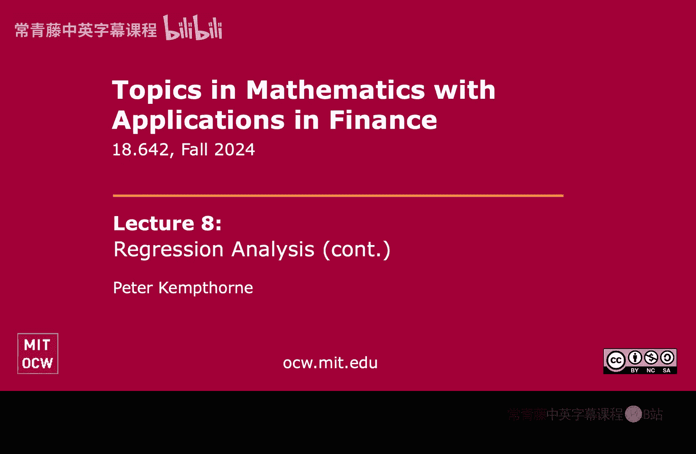

All right。Well， let's continue with our discussion of linear regression modeling。

 and as we introduced last time， there are ways one can formalize fitting a model。

 which is to propose a model， specified criteria for judging different fits or estimators of model parameters。

Then find the best estimators and then check our assumptions underlying the specification of the criterion。

 and possibly if necessary， modify the model because the assumptions that we made aren't satisfied。

 so we either want to add additional assumptions or consider transformations of the model perhaps。

So with ordinary least squares。Regression， we have this criterion for specifying regression parameters。

 and we specify these in terms of a y vector。And。This has values of a dependent variable across cases in the data。

 and X matrix。Which will have N rows and P columns。

And we'll have sort of general elements Xi J and then。Our model will be that y is equal to x。

 the matrix times a beta vector。So we can have a beta vector。That has P components。And。

An error vector。Which。Has N。Terms corresponding to the N cases。So。In specifying the regression model。

 we have。That our n vector Y is going to be a linear combination of the columns of x。

 and there will be an error vector characterizing the discrepancy from that。So。

So how should we specify this beta vector if we have a least squares criterion？

We can look at some one to n。Of y i minus。Why had I？Where。Say， why hat？Is equal to。X beta hat。

And this criterion。Is。Basically a sum of squares criterion， so it's like a sum of squared errors。Now。

 minimizing this can be done。Just with simple calculus。We can plug in for。in the formula。And。

Have this sum of squares criterion， which is simply。Y minus x beta transpose。Y minus x beta。

 so we have Q。Of beta。Is basically。Y minus x beta。Squared， so it's the distance of our what。

 our n vector。From the。Prediction or fitted value， I guess maybe I'll put the beta hat here to make it explicit。

And we basically want our fitted values to be as close as possible to the actual values。Now。

 because this criterion is a quadratic。Okay， it's a quadratic in the regression coefficients。

 We can simply take derivatives of Q。And solve for those derivatives equal to zero。

 so that's the first order conditions。And let's see， how do we know whether。

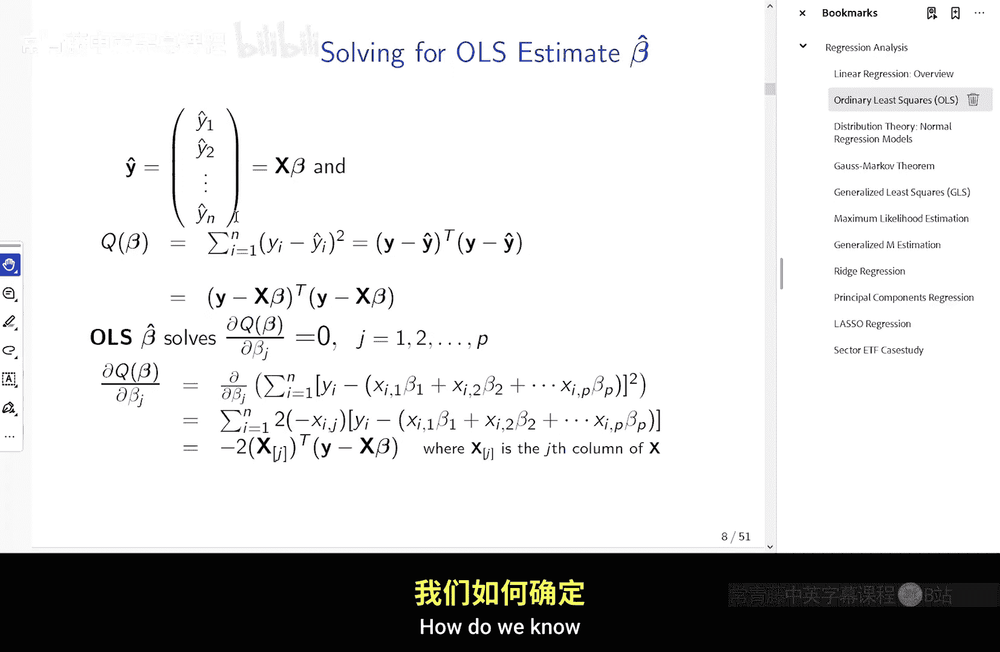

The solution to this。Equation actually minimizes。The sum of squared errors criterion。

A first order condition is one where。The derivative。Of the function is equal to 0。

 That could be at a minimum， but it also could be at a maximum。Yes。我。I'm sure that it。好。Yes。

 we want to take the second order derivative and。If it's positive， then we have a。

 I guess it's a con cave。Or sorry， a convex function。 And so the first derivative will solve that。

 Now， this is the first derivative。Equation。If we were to。呃。Look at Dq of beta。By deta J。Let's see。

 is that Vanta J， right？If we were to look at the。Second order。Derivative。By D beta D。Beta transpose。

 then。Analytically， we'll basically get。This。Term times minus x。

 and so that will end up being a positive term in terms of products of columns of X。

And a full X matrix。And so， so with that。We have this set of equations。 Now。

 if you read up on regression theory， linear model theory， this equation of。

The derivative of Q with respect to beta equaling 0 is equivalent to this equation here。

Which is just obtained by eliminating the -2 factor and solving for betim。

And this is called the normal equations。U。What is familiar to some people is that in statistics theory。

The names of。Important terms is often not very sophisticated in terms of here we have what we call the normal equations。

 There's nothing really normal about it， but it's a way of specifying a set of equations that we need to solve。

 And if the。X transpose X matrix is invertible。 Then we have a solution by multiplying both sides of this equation by the inverse。

And。In order for this。Process to work。 We need to have that X must have full column rank。

And。All right。So here， if we plug in that least squares estimate。

 so we have beta hat equal to x transpose x inverse x transpose y。If we plug that into。Our。

Forula for the fitted values。Then。This becomes。This formula times y。

And I'll put square brackets around that。And this is called。The hat matrix by some statisticians now。

This matrix H is actually a very special matrix。It has special properties。Does anyone。

Sort of know what those special properties might be。Anybody in the back， no？Okay。呃。

From memory it it's a projection of。Yes。It is exactly so H。Is a projection。Matrix。And it's onto。

Sor of the column space。Of the X matrix。Now， what are properties of。

A projection matrix if we multiply。The projection matrix by itself。

We actually get the projection matrix。And what's？Relevant is that if we were to take sort of H Y hat。

嗯。Which is then equal to h times H。Why。If this。First term is。In the column space。Of X。

As a projection， then projecting it。Onto that same calm space will have no difference。So this is。

Sort of logically what it should be。 And if we multiply out the projection matrix times itself。

 we get this。嗯。This property。Okay， well。Importantly， in modeling is to look at residuals。

Which are sort of model errors。And so。If we have。Epsilent hat is equal to y minus y hat。Okay。

 this is y minus。Or y times the identity matrix minus H。Why。And。This。

This matrix here multiplying Y to give us our residuals。It is also a projection matrix。

So this is a projection as well。And if we multiply I minus h times I minus H。And expand out。We get I。

Squared minus2 H plus h squared。And that equals I minus H。

 So we can mathematically verify that it's a projection。And。

A very important property of this residual vector。Is that it is。

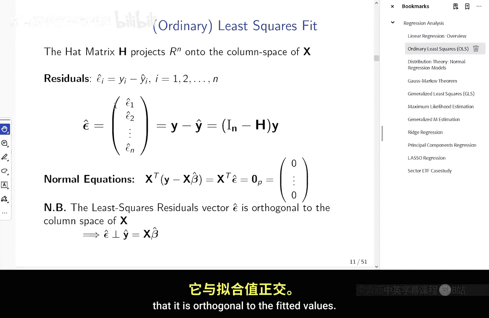

Orthgonal to the fitted value。 So in the normal equations， we have this equation。Must equal zero。

This term here is the residual vector。And if we multiply that n vector by the transpose of x。

 and it's equal to zero， then we must have that the error vector epsilent hat is orthogonal to x。嗯。

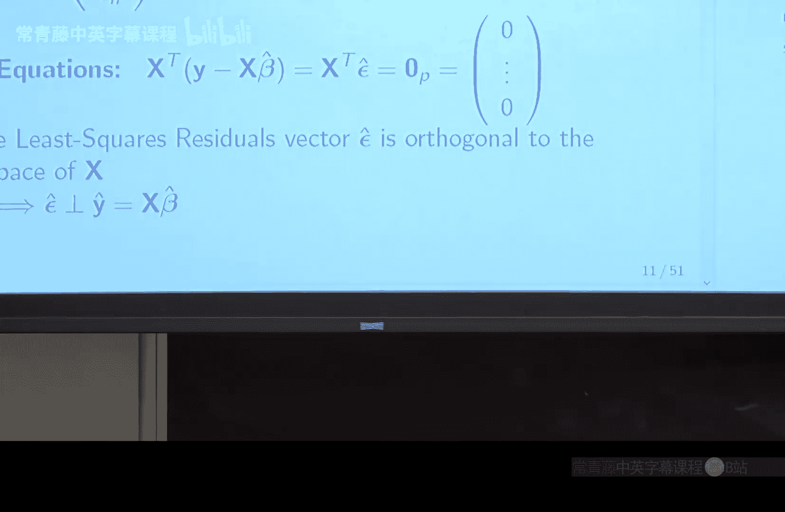

Now。Let's see。 I'm not sure if it's on the next slide。Or not。嗯。And something to keep in mind。

That's really quite useful when we use linear algebra with least squares。Is that we have why。

Being an n dimensional space。嗯。We have an X matrix n by P。

Which corresponds to sort of a column space。Of x， which is a subspace of R to the n。And。嗯。

Let's see if we have。Why hat？An excellent hat。These are thgonal to each other。

So if we think in sort of n dimensions of having a Y vector。And。Have。A。Yhy hat N vector。嗯。Then。

Yhy minus why， sorry， not y hat， Y minus y hat。So， if we take。The vector from here to here。

That's y minus。Why hat。Okay， this is going to be orthogonal to why hat。 So we actually have。

Right angles here in between。The Y hat vector and the Y vector。Sorry， we have。

The Y hat vector and the error vector。 And so。From this。We have that。嗯。The squared length of y。

Is equal to the squared length of y hat plus the squared length of the residual vector。And then。

If we expand this。Squared length out we actually get zero because of the orthogonality。

So with least squares， we basically have。A sort of pythagorean theorem。

That generalizes from two dimensions to n dimensions。

And that generalization is quite convenient and useful when we think about。

Not the mathematical exercise of least squares， but we think about having probability distributions on。

 say the errors。So。So that leads us to trying to extend the mathematical regression model。

To a probability model。And so with this。We have constants assumptions for the independent variables and the X matrix。

 constants for the regression parameters。But the error terms。

Those will be assumed to follow some probability model。What's useful to think about is， well。

 what would be the simplest possible probability model。To apply to a regression。 Well。

 we could assume that the errors。Our I I D。Which means independent and identically distributed。

And we could also。For convenience， assume that they are normally distributed。嗯。

And so this is a normal linear regression model。And when we write out the model equation here。

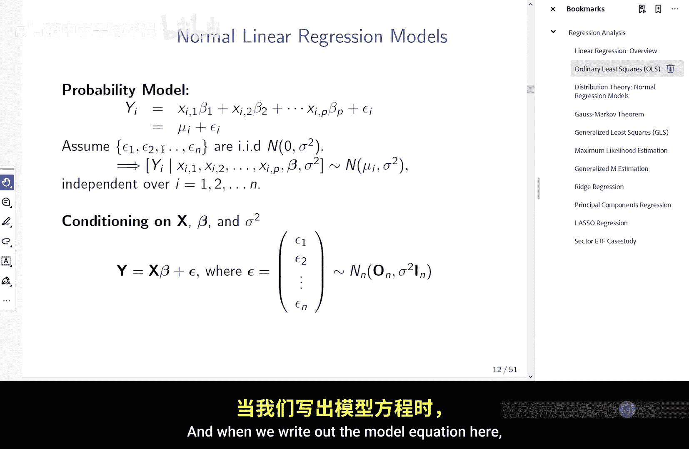

The model equation， basically， is。Consts plus the error vector。And the error vector。

Epsilon 1 to epsilon N being I I D normal。 This， in fact。

 is consistent or is equivalent to a multivariate normal。Distribution。

Of dimension N with a zero vector。For the mean and a covariance matrix， that's diagonal。

With constant variances。

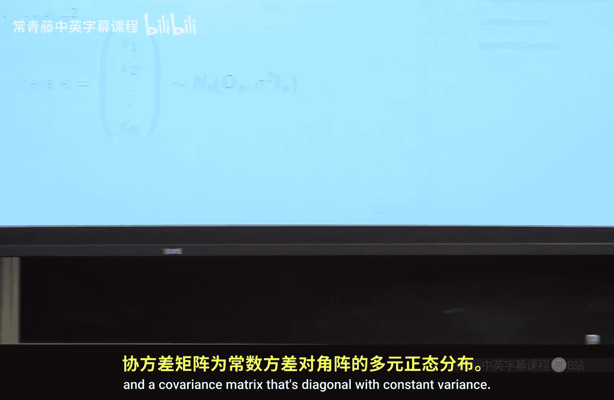

So this is going to be a convenient model for us to work with。

 and what we'll see is that different inferences about how important different independent variables are in a regression model can be judged。

Using this model as sort of a baseline model for that evaluation。So。Importantly。

The distribution of the residuals。Leads us to a distribution。Of。The dependent variable vector y。

And so， in this slide。We use the notation of a mu vector for the conditional expectation of the y vector。

Given x and beta。And。We'll define this just to be a mu vector that's an n vector。

And will define the covariance matrix of the y vector。Or the conditional covariance。Okay。

 this is going to be equal to the product of。Yhy minus it's mean。

Times the transpose of y minus its mean。And so this is an n by one， one by n。Term。

So this is an end by N。Matrix。And。We'll call this。Capital Sigma。As a covariance matrix。 Now。

 for the special case of I I D errors， this covariance matrix will be。

Diaagonal with constant sigma squared。And。It will turn out that。This。

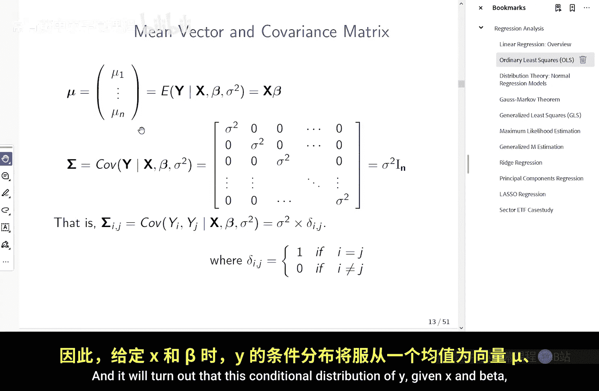

Conditional distribution of Y given x。And beta。Will'll have a multi normal distribution with a mean vector mu and a covariance matrix sigma。

 So an n dimensional。Multivariate normal distribution。Okay， well。What we're going to do。Is show。

Results of what distribution the y vector is。

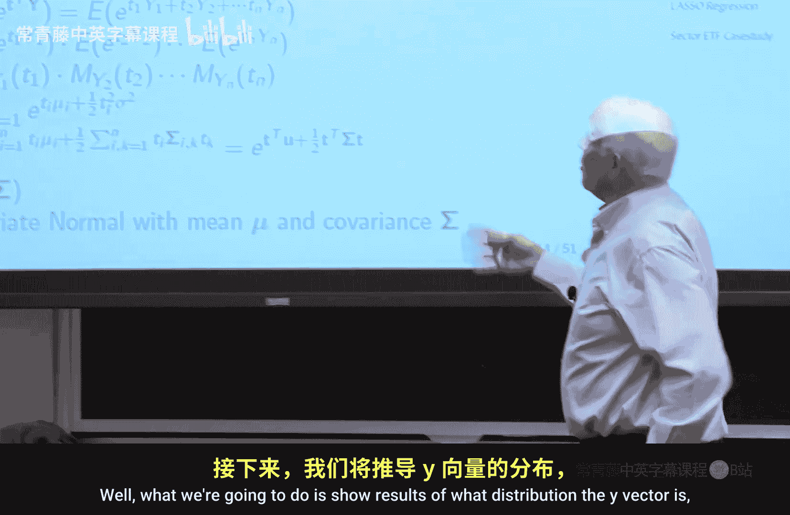

As well as show。What the distribution is of the least squares estimate is using moment generating functions。

So this。Example。Of the application of moment generating functions is really quite neat because the arguments are。

Very。Simple and accessible。So， if we have。A。An nvariate random vector， y。And a constant vector T。

Then the moment generating function of。The y vector is equal to the expected value of the exponential of T transpose Y。

 So this momentgeneity function has。Is a function of the T vector。

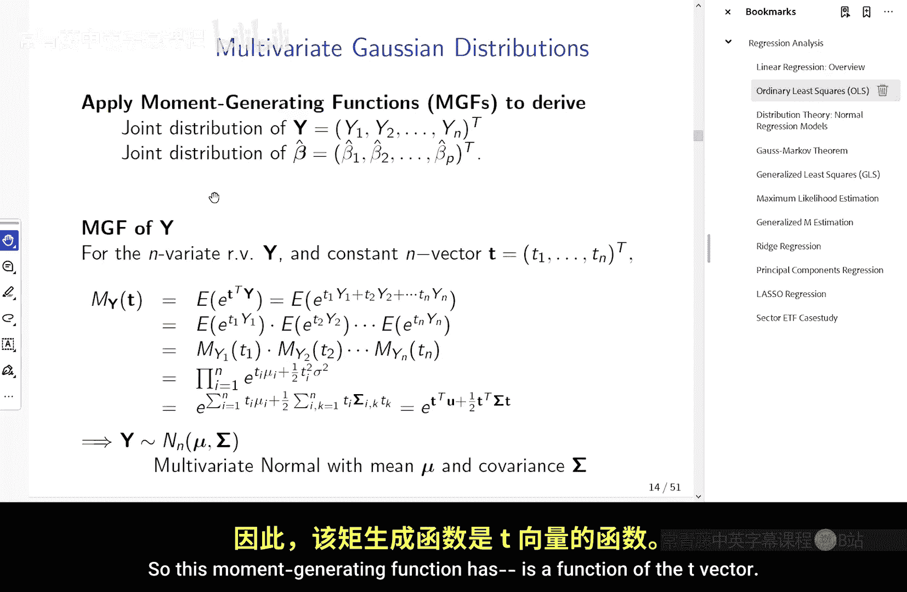

And we just。Plug into this formula。 Now， because the wise， in fact， are independent of each other。

Then。We have。This expected product of terms is the product of the expectations。

So we're going to use that independence。Property where expectations of products are products of the expectations。

And then for each of the whys。We can plug in the moment generating function。For each y。I。

And that's E to the T I， mu I plus a half T I squared sigma squared。

 We went through this moment generating function。And our section on probability theory。Now。

What's important from this example is if we take this product of all the moment generating functions and then try to express it in terms of the T vector。

The mu vector and the sigma matrix。We get this formula。And this formula is， in fact。

The moment generating function for a multivariate normal with a given mean vector mu and a given covariance matrix sigma。

So that result is sort of trivial， not surprising。What。Less surprising is that we can use。

Moment generating functions to solve for the distribution of the least squares estimate。

So this first。Formula here。Is the moment generating function for beta hat。And。In writing that out。

And some beta hat。 I'm going to use a different argument， tau。Which will be a P vector。

And this is going to be the expected value of E。To the tau transpose beta hat。 So this is the。

Definition of the moment， generating function。And。If we。Define。The matrix A。To be the。Basically。

 the pre multiple factor。Of A that gives a spade a hat。

Then our moment generating function for beta hat。Can be written as。

This expression just plugging in A Y for beta hat。 But then we can express。Tau transpose a。

Equal to T transpose。So this。Moment generating function of the least squares estimates。

 beta hat is actually。The value of the moment generating function of the multi normalmal vector evaluated at T equal to a transpose。

Tao。And so。We can。Simply plug in。This value of T。And。Get。Our result。

And so T transpose mu ends up being tau transpose beta。And T transpo sigma T。

Is equal to this product。And if we simplify it。We basically have。

A sort of mean vector beta for the least squares estimate and a covariance matrix for the least squares estimate that's given by。

Sigma squared x transpose x inverse。So this is our moment generating function of beta hat and by the uniqueness of moment generating functions。

We can recognize this as a multi normalmal with the given mean vector and the given covariance matrix。

So we have multivariate normality of the least squares estimates， which is。

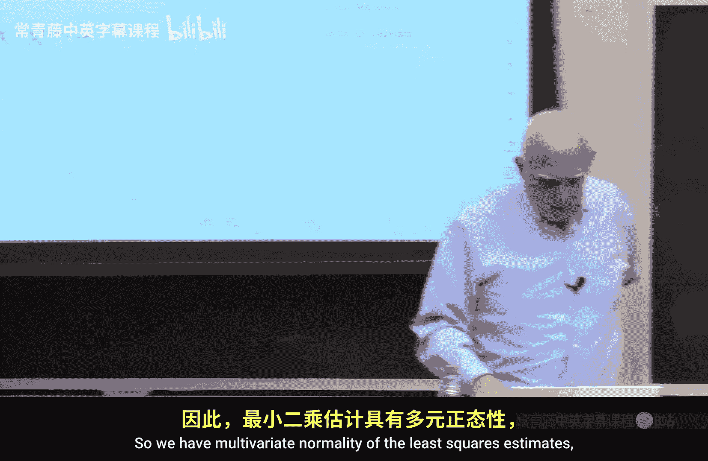

Very convenient and useful。Now， from this， we end up getting marginal distributions。That are normal。

For each of the least squares estimates。So。We're just thinking in this slide of the Jith component of beta hat。

 Well， it's univevariate normal with mean beta J and。

Vararianance given by sigma squared times the Jagonal element of x transpose x inverse。And。So。

So we get this nice distribution result。嗯。Now there's more distribution theory here to go through。

Let's see something just to think about that's， I think very powerful is。In some examples。嗯。

Where we have this model。嗯。We may have control over what our independent variable matrix is。

And in a scientific experiment， we might vary different conditions of the experiment yielding Y for different conditions of X。

And。With these models， we might be interested in。A particular sort of column of the X matrix。

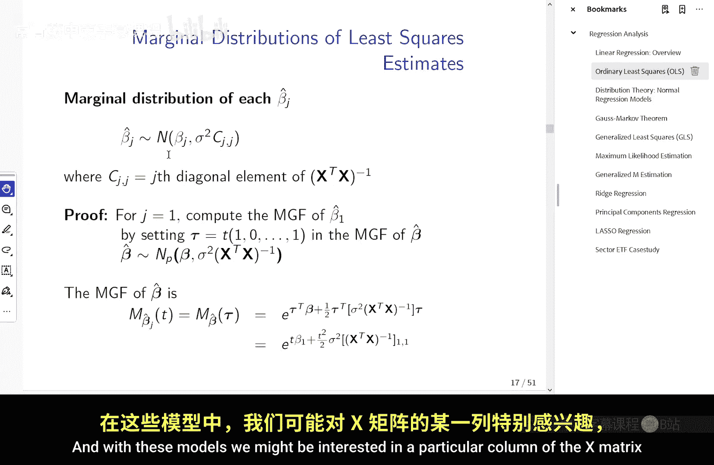

And want to estimate。The beta J， the regression parameter relationship for that。And so。If we。

Had control over。

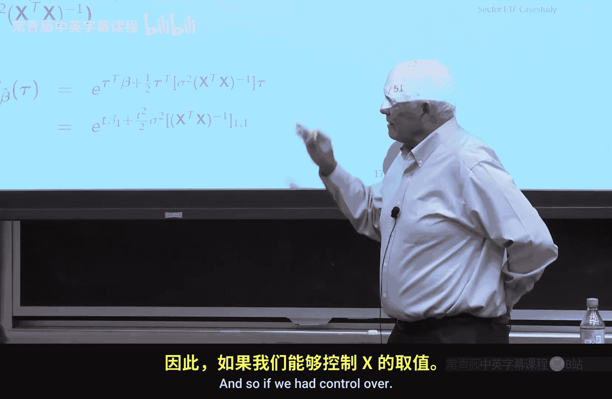

The X matrix。We might try to make the Jaith diagonal。The smallest we can。

So that the precision of that regression parameter estimate is as small as possible。And so。Suppose。

 I guess， for simplicity that the X matrix。嗯。Suppose that x transpo x is a diagonal matrix。

And here's CJ。The diagonal values of x transpose x。Inverse will simply。B。So if we do a minus1 there。

 we can do a minus one here。Diaagonal entries will be smallest。Smaller。

 the more large the Jaith column is。 And so when you think of。Regression。Models and experiments。

 we basically would perhaps want to have the spread。

And an independent variable be as big as possible in order to specify the line。If we。If we think of。

A regression model of y on x。And we have。If we have points。Of x and Y。嗯。Basically， the。

If we look at the sample mean of the x's。And we consider。Sort of concentrating our X values。

As far away as possible， that presumably will yield more accurate estimates of the slope parameter in the relationship。

And so， you can think of。Basically。If we observe points that are far away from the mean。

Then those points will sort of pin down the regression line， the greatest。And this。

Issue arises in experimental design。And in experimental design， one can think of。

How one can construct X matrices that have these properties。As you might expect。

The properties relate to。The eigenvalues of x transpose x。And looking at。

Methods for maximizing those eigenvalues。All right。We have， we can do some more distribution theory。

 which is to look at what the distribution is of our error vector。Y vector。

 but we can also look at any matrix A times y。And look at the distribution of that transformation。

It'll be a。Linear combination of the Ys for each component of Z。And。

It will actually have an M dimensional multi normalormal distribution with mean value given by a times the expected value of y and covariance matrix equal to。

A times the covariance of Y a transpose。And so this matrix a will give us the distribution of beta hat as we just did。

 but we can also use different definitions of A and Z。And。

The normal distribution theory leads to these sort of key properties。Of normal linear model terms。

The beta hat least squares estimate， is multi normalormal。

We have that the error vector epsilon hat is also multi normalormal。

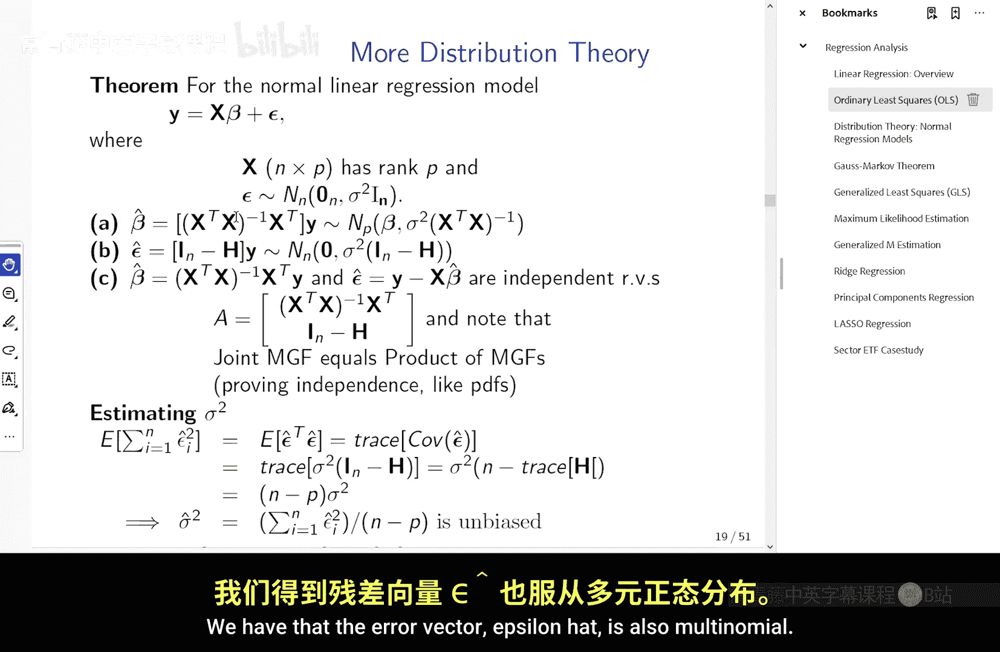

And but it's multi normalmal in n dimensions。

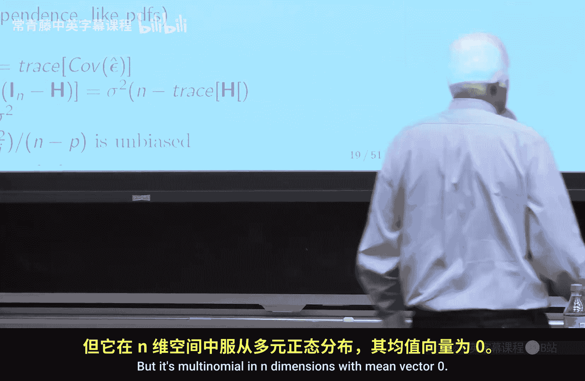

With。Mean vector。Zero。So epsilent hat， which is equal to i minus H。Why。

Is distributed as a multi normalmal。In N dimensions。With a covariance matrix。

Given by sigma squared times the projection。Now。What。Significant is that this。

Covariance matrix here is not a full rank。So this is non singular。Actually， is that the right word。

 no， it's singular？I guess。But it's singular， it's not invertible。And what does that mean？Well。

 that means that。There are。Linear combinations of the error vector。That have zero variances。

 there's a linear dependence in the error of vectors。And so。

If we consider x hat and x transpose this， and this is equal to the zero vector。

 this is the normal equations。嗯。We basically have that fixed linear combinations of these residuals。

The residual vector are identically equal to 0。 So we don't have。N sort of independent error terms。

And so because of that， when we look at。For example， estimating the error variance sigma squared。

Well， if we take the sum of the squared residuals， that's the trace of the covariance matrix。

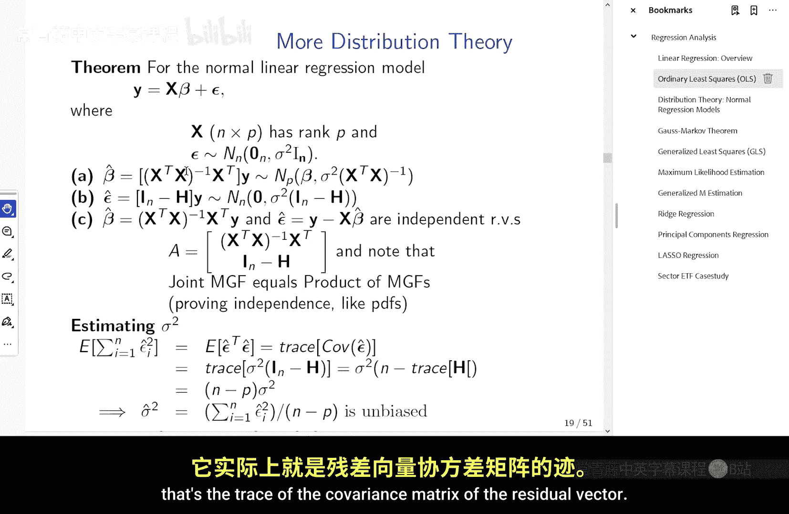

Of the residual vector。And that's equal to the trace of this。Projection matrix IN minus H。

And so the trace of a sum is the sum of the traces。And。The trace of a matrix。

Is product is also the trace of the product with terms reversed。

 So this gives us s squared n minus trace of H。And we get n minus p sigma squared for the expected by sigma squared。

And in regression models with normal linear models。

 we use this relationship to estimate sigma squared。Dividing both sides by n minus p。

 we get an unbiased estimate。Of the error variant。Now。

 an additional property that's from part C of this theorem is that the error vector。

Epsilent hat and the regression parameter， beta hat。 Those happen to be independent of each other。

And the independence。Follows。By looking at the joint distribution。The moment。

 joint moment generating function of。A Y。And showing that that。

Is equal to the moment generating function of beta hat times the moment generating function of epsilent hat。

So the product of moment generating functions sort of allows us to。

Determine the independence there。And when we have independence of the error vector and the regression parameter vector。

 then。We can compute。T statistics。For。Regression parameters。And we end up。

As stated in the notes there that TJ。Equal to beta hat J minus the true beta J。Divided by sigma hat。

Times C， J J。This distribution will have a T distribution。Now， when you studied statistics。

 if you took a statistics course， you， I'm sure it came across the T distribution。

And the T distribution is rather remarkable。This。This turns out to be equal in distribution to。A。

Normal0。Distribution。Mean zero in some variance。🤧Divided by。

The square root of a chi squared distribution。Divided by its degrees of freedom。

Where these two things are independent of each other。And so。The T distribution。Well， who can。

Comment on what。Property is a T distribution has compared to a normal。

The T distribution is symmetrical。It's somewhat bell shaped。Well， at this numerator。Is a normal。

And this denominator is random。It's random near one。Then we'll have a heavier tail distribution。

With the tea。 And so。We need to be able to quantify sort of how significantly different from zero。

The T statistic is。So if we have an H not that beta j is equal to0。

 then this distribution turns out to be。Basically have a T distribution。A T distribution。

With n minus P degrees of freedom。And so， we can。Judge。Whetherath。

Our data provides evidence against this null hypothesis or not。

 and we can test other hypotheses as well， not only that the beta J is equal to 0。

 We'll be covering this in a little more detail with。

One of the lecture notes that was passed out for today。But。Let's see。

 does anyone know the history of the T distribution， how it was discovered？To。Yes。

 there was a statistician who was working at Guinness with quality control。And。He， he would look at。

He would look at samples， very small samples of size 4 from。A。So we this right here， Guinness。嗯。He。

Would look at samples， say x1 x2， x3， x4。Of a measurement。

 I'm not sure quite what the quality measure was。But。He would calculate x bar。

And the standard deviation of x。嗯。Which is the square root of。

The sum of X I minus x bar squared over over。Over three。 well， actually， I think he did it。 Well。

 I'll write it in three。And。What he discovered was that。If we look at Z。Equal to sort of x bar over。

S x。嗯。These outcomes of the sample means。Which suitably rescaled should follow a normal distribution because we're looking at a Z score。

This was not。呃。Distributed。As a normal01。There was much greater variability。And so。

The person who did this work， they wouldn't allow him to publish under his real name。

 And so he published a paper under the pseudonym student。

 And so we call this the student's tea distribution now。

But what was really quite remarkable was to see that in small samples。

 the variability of these kinds of statistics。In theory should be close to normal， but in fact。

 are systematically different。And。With， let's see， with。Other questions that come up in regression。

 one can construct an F test。Of whether all the regression parameters beyond the first P are equal to 0 or not。

And。

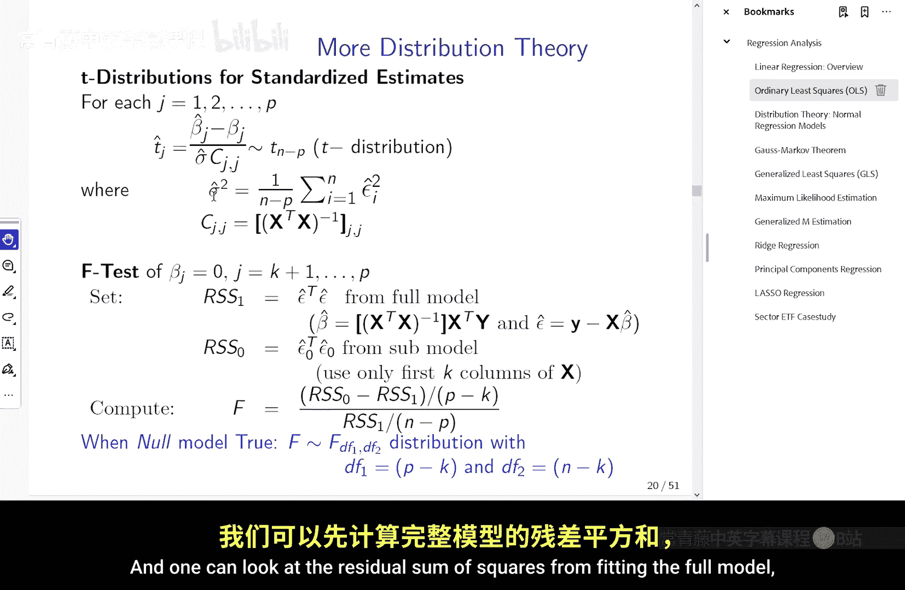

One can look at the residual sum of squares from fitting the full model。

And then the residual sum of squares from fitting a submod using just the first K， sorry， the first。

K misssp。 and then this F statistic。Is a ratio。Of normalized sort sums of squares and differences thereof。

 And， and this F test statistic comes up。As。An analysis of variance statistic。

 where one can estimate variability。Using。The residual sum of squares from the full model。

And one can then also look at the residual sum of squares from the submodel。

And if both models are true。Meaning。Beta k plus 1 to p are equal to zero。

 then these formulas here are estimating the same variance。And they're independent of each other。

And so we get the F distribution as the ratio of to。

Ci squared distributions that have different degrees of freedom。

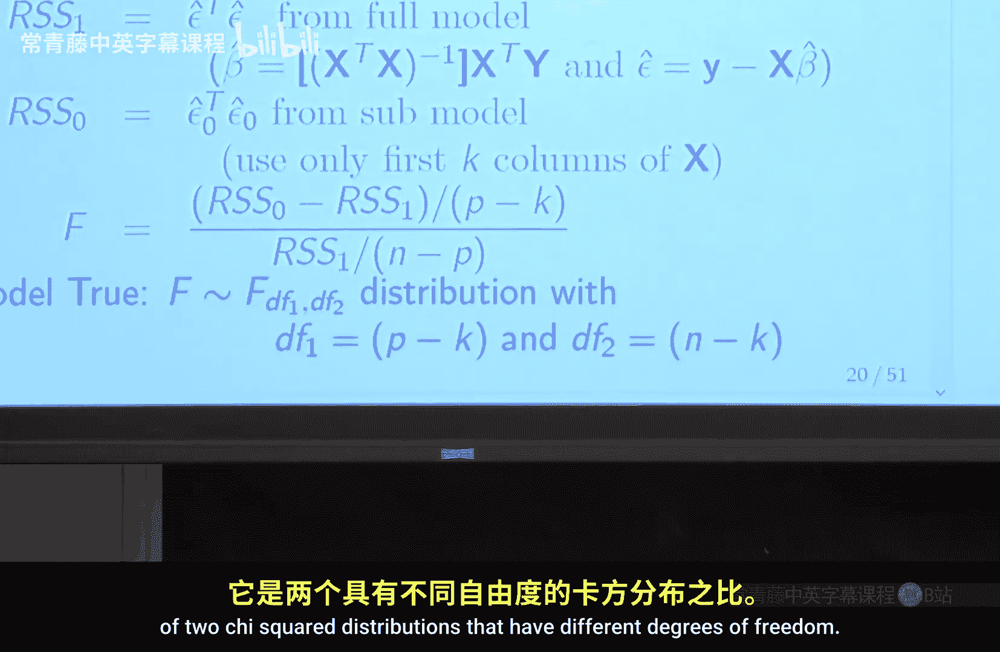

All right。Well， let's take a look at some real data。

TheThe example data set I want to introduce is actually not a financial data set。

 this is a medical study， but this。This example。呃。Comes up。In。Some work by。Ephrine and hasty。

Grad Efin and Trevor Hasty。They have some books。There's the elements of statistical learning。

Actually， this is hasty。 And then there's。With Ephin。

 there's an advanced book on sort of computational。あ。Statistics。A book that I text that I use in 186。

55。In this data set， one basically has a response variable and independent variables。

 And what's really key to know is。Experience we have with one regression problem extends to other regression problems。

Just sort of the names of variables change。And， but the same issues arise。And so with this data set。

 we're trying to predict the L PA variable。As it varies with other independent variables。

For subjects in a data set， this data set happened to be a data set on patients or subjects with prostate cancer。

And so with any。Data set one can compute summary statistics which help us sort of detect whether there are sort of issues with the data or not。

 there's this pairs function in R， which is quite convenient for just displaying all of the data。

And if you look at this pairs plot， every pair of variables in the data set are。Ploted。

And a scatter plot with the other variables。 And so along the diagonal。

 we have the names of the variables。 and then we have。Different relationships of those。 Now。

 if L PA is the。

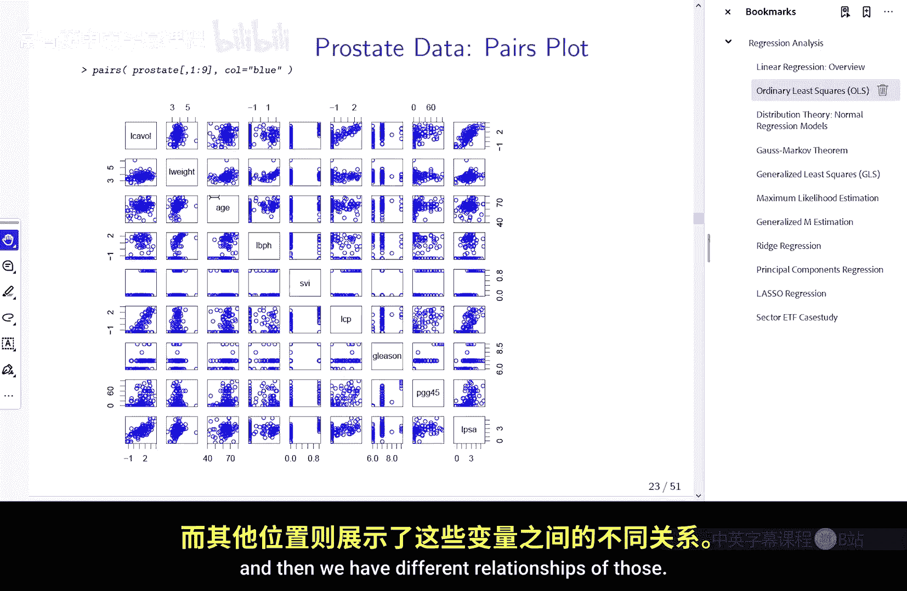

呃。Depenent variable of interest。 if we look sort of across this row。

 we're looking at the scatter plot of different independent variables with that。

 and it looks like the LCA Va is probably a very strong relationship。 Some of the variables in fact。

 are discrete。

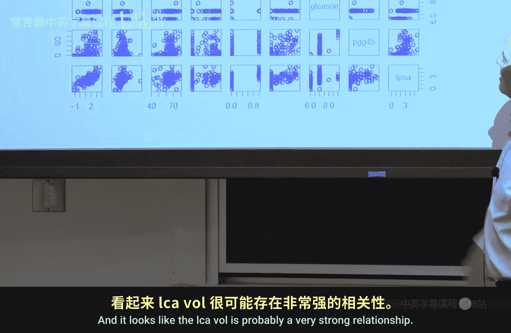

And we're able to see that as well。And if we just fit a simple regression。

We end up getting。Output from the regression， which consists of an estimate。

We have a coefficient table。With。An estimate column。Standard error column。And then a T value。

And then finally。What's。Called a P value column。 This is the probability that。

We have a larger value of the T statistic being observed。And。What's being tabled here is。

Results of hypothesis testing for each of the regression coefficients equaling zero or not。

In the true model。 So we have estimates of these different regression parameters。

We can get standard errors of those。The standard errors。Correspond to。Sigma hat， C J J。Actually。

 it's， I think it's the。It's the square root of sigma squared C， J J。And then。

The T value is just the signal estimate to noise ratio。Which。Scales。And magnitude， how important。

Those factors are。

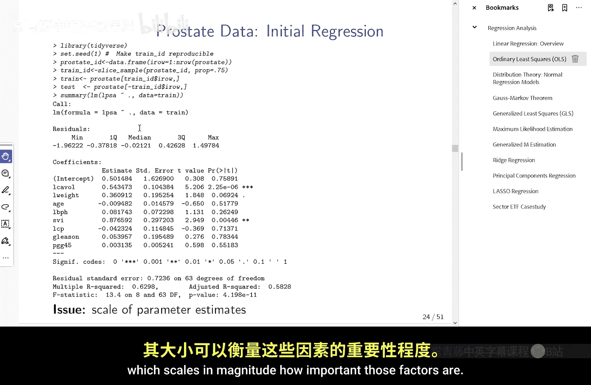

And we can calculate the P value。Let's see。If we have， say， a beta。Hat J value。And。

It has this T distribution。Which is centered at the true beta J。And the spread is given by sea hat。

CJ J square root。嗯。We can。Calculate。嗯。We can basically test whether beta J。Is equal to zero。

And so if we sort of。Set this equal to zero。If we observe a value of beta hat J。We can。Calculate。

 how likely is it that we get a sort of beta hat J minus beta。Minus0 over sigma hat C J J。

This is our T statistic。We can look at calculating this。Probability。

That the T statistic or of getting a greater than。A large， a larger value of that T statistic。And。

With this。呃。Let's see， if we。Sort of consider。Changing the scale here to just be beta hat J divided by Sigma hat C。

 J， J square root。 This is our T statistic， then。We basically have。A。

T distribution for the outcome of the least squares estimate。

 And we're calculating how likely is it we。Would get as larger， larger a T statistic。If the true。

regressiongress parameters were zero or not。Now， in looking at this。These estimates。

 one of the challenges， in part， is that the scale of the parameter estimates varies。

Depending on the units of the independent variables。And so in some problems。

 we have very diverse independent variables in the data set。

And the units。Ourre。A property of the data set， but they're not really an important part of the problem。

And so what we can do。Is standardize the covariates。By。

Normalizing them to have mean zero and standard deviation1。So if we have。Our X matrix。Equaling。

Let's see， how do I want to do this？So if we have P columns in our x matrix。We can basically take X。

One， and transform it to。X1 minus x bar1 times the vector of ones。

And divide through by the standard deviationation。Of x1。And so this。We'll call this。

A random vector Z1 of standardized values。And。If we do this， we're basically shifting the x's。

And rescaling the shifted values。It turns out that our regression model。

On the Z scores or standardized scores are the same。As the regression coefficients in the original。

Units。So。It's。Sort of obvious， I guess， but if we have。Why。呃。Is equal to。Beta 1， X 1。Plus。

Beta 2 x 2 up to beta P， X， P。Plus an error vector。And we consider Z， J。Is just simply equal to xj。

Minus。X bar J times the vector of ones。And one over。Say S of J。

 where S J is equal to the sample variance。Of the X。Jays。阿门。We basically。Can sort of。Substitute in。

For each of the。Xs。The formula here。So x bar J。Is equal to。S， J。Z， J。Plus， X bar J。呃。Plus， X bar J。

So this times this is x bar， minus little x bar。So this is times the vector of ones。So if we plug in。

To。Our。X J values here。 This。 Then we end up getting。This。Equation with。

The same regression parameters coming into play。All right。Well。When we fit the scaled regression。

Independent variables model。 Then notice that the T values and the P values for these two regressions are identical。

So if we pick。Say the largest T value S V I， or that's not quite the largest LC C A of all。

 but let's do S VI 2。949。If we scroll back。To the original units， the T statistics。

Are identical across all the variables， and so are the P values。

So in terms of interpreting how important different variables are， we get the same judge。

Judgments of what's important in terms of T values and P values。But what's particularly useful。

 though， when we use the standardized covariates。

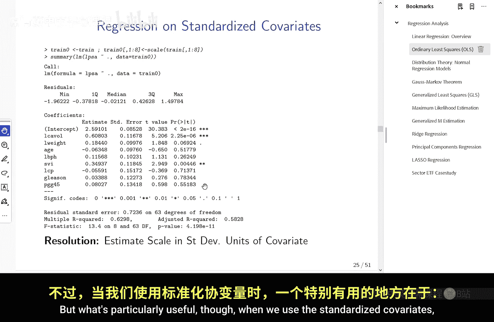

Is that the magnitude。Of the。Coefics， when we have the standardized scale。

 that corresponds to the impact of a one standard deviation move。Of the independent variable。So。If。

We have an， an age value。 That's one standard deviation above。The mean。

It doesn't have much of an impact。On the dependent variable， if we have the S VI。

 a one standard deviation move above a Z score of one， then it has。A larger impact on。

 on the dependent variable。 So this。

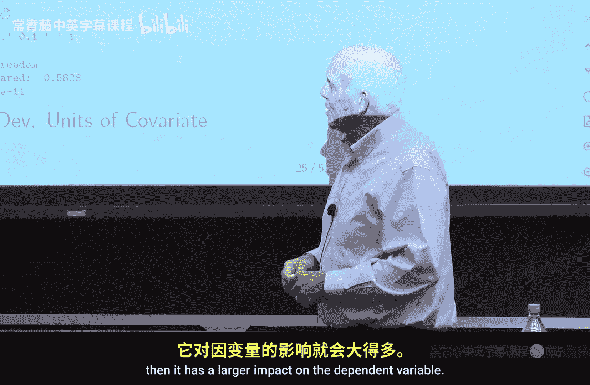

Standard deviation units， can be a very convenient way to rescale our data。🤧嗯。All right。

 now in judging the quality of regression models。We can calculate。Fitted values。

And pair those with the absurd values。And look at the scatter plot of absurd versus fitted values。

And this simple， scatter plot。Will have a correlation statistic。

And the square of that correlation statistic is actually called the multiple r squared or a coefficient of determination。

If you're familiar with simple linear regression where you calculate correlation statistics。

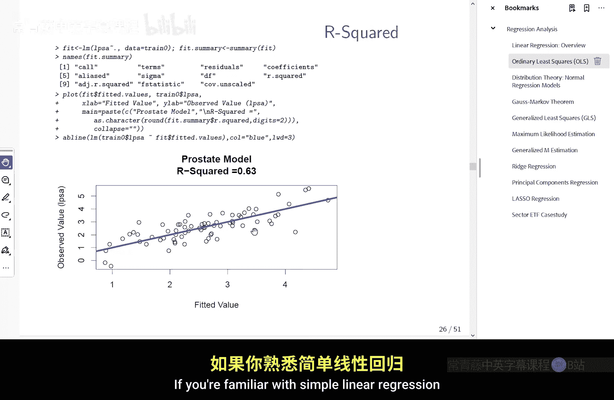

嗯。You can think of the squared correlation as being useful。In multiple regression。

 we generalize a single correlation。呃。Statistic with the multiple R squared coefficient。

 And so it basically tells us how predictable。

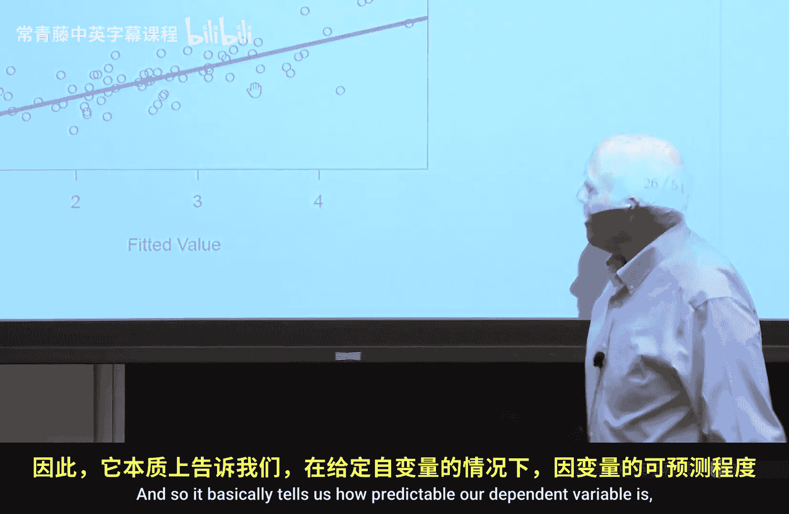

Our dependent variable is given the independent variables。嗯。Now， in terms of evaluating。

The assumptions of our regression model， there are regression diagnostics that we can apply to fitted models。

 and there are a number of different important。啊。Measures that we can apply and in the stats package。

 there's this influence measures general function， which gives a table of different statistics。

There's this R student。For computing studentized residuals。

If we have epsilent hat is distributed as multivariant normal with mean zero and covariance matrix。

 I minus h times sigma squared。嗯。Our residuals。May have very different variances， because of。This。

I minus H factor in the covariance。 And so studentized residuals。

Basically will divide the residuals by。The square root of that variance and an estimate of that。

And that estimate of the variance。That's in the divisor， leads to。Non normal。

But T distributions for the Epsilon hats。 So we'll see that。Play out in a moment。

And then there are other statistics like how much does。

The regression parameter change if we include or exclude different data points。

 different cases in the data。嗯。So let's just see some of the results。 So here's the student。

Residuals。For this regression model。And。We have a histogram， which is。Uimmodal symmetrical。

 Here is the what's called a quantile plot of。The residuals that where the。

Quantile plot will follow a straight line if the data consistent with the normal distribution model and。

The T distribution 4， normalizing the residuals by estimates of their variance。What's。Was's rather。

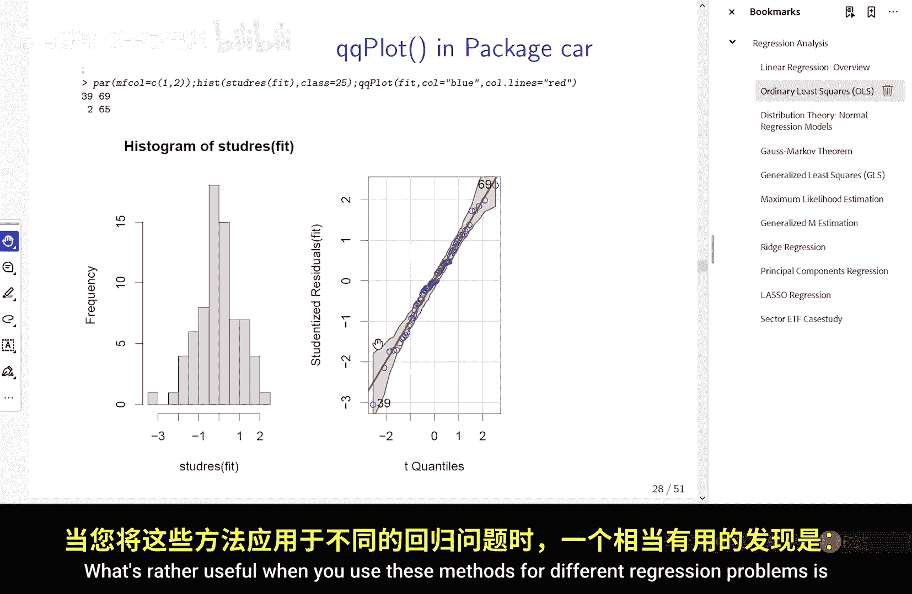

Useful when you use these methods for different regression problems is that。

You'll see that there's sampling variability due to just the data set we're working with。

 if you were to collect a new data set under identical conditions。

 you would get different results these red bands correspond to bands you might expect to see with variation from one example to another。

Now this。Here is a plot called the influence plot in the car package。And。

It plots hat values versus studentized residuals。 The hat values。Our。The diagonals of the H matrix。

And。What's important about the hat values is that。Let's see。 if the hat values were equal to one。So。

 if。Say H subbi I equals1。Then。We would have。Why hat I is actually equal to why I。

And so the I case would would be the sort of。Only case in the data set that allows you to estimate that。

That value。 So， so that case would have very high influence。 So hat values。

Generally are close to P over n。And。Lower values correspond to lower influence。

And studentized residuals。Our。Given by these magnitudes。And I believe what is drawn in this。

Slide is yeah， is the circle size of proportional to Cook's distance。And so。

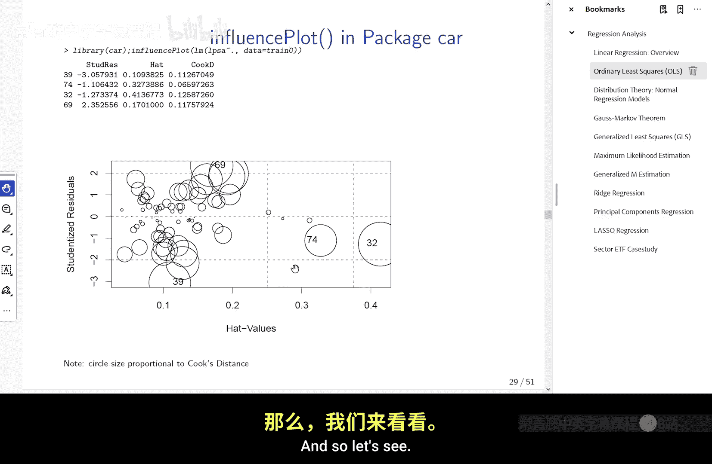

Let's see， with Cook's distance。If we have beta hat equal to。呃。X transpose x inverse。X transpose y。U。

We can think of beta hats sub minus I， which is。The least squares estimate if we were to exclude the Ithe case。

So this corresponds to excluding。The eighth case。Then。Well。

 we have that this beta hat is distributed multi normalormal with the mean vector。

 the true beta and covariance matrix。Given by this。嗯。

We can actually look at beta hat minus。Or beta hat， I minus beta hat。And then。うと？

Consider the distance。Of this。Or the magnitude of。The change in the beta。And this cooks distance。

Will actually correspond closely to sort of a chi squared distribution。Because of。The relationship。

So we're basically looking at the distance of beta had I from the true beta。

And normalizing that by the covariance matrix。Now， let's see。

 and there's basically a whole slew of different diagnostics that we can。Graph。

 and I think it's very useful to have graphical methods to highlight what's。

Perhaps important in looking at this。Plooting from the car package or plot dot L M。

We can see how the residuals compare with the fitted values。

And we don't like to see any systematic pattern in that plot。 We'd like that just to be flat。

How that will change sometimes is that as the fitted values increase。

 the residuals might increase in magnitude as well。So that would suggest that the residuals。

Are dependent on the magnitude of the fitted values。Okay。

 we can also look at the normal QQ plot to see whether the data are consistent with normal or not。

And then one can look at。The scale。Of the。The scale of measures of the scale of the residual。

 So we can take the square root of the standardized residuals。Or the magnitude。

And see whether those have variation depending upon whether the fitted values are small or large here。

 it looks like there may be a nonlinear relationship there。When we discover relationships。

 then that leads us to sort of。Refine our model assumptions。嗯。Let's see this。Res plots function。

Is actually a function that looks at。The sensitivity of our linear regression model to potential non nonlinearity。

In。The model dependence on， on independent factors。 And so it actually tries to fit curvature。Terms。

In。To the residuals in the model。 and if residual if there's curvature present in the residuals。

 then we might have a nonlinear model and need to expand with nonlinear terms。Okay。Let's see。

With this normal linear model。嗯。We can。Consider。The assumptions underlying that minus normality。

 and those are called the Gaus Markov assumptions。So if we have our regression model。

And for our Y vector and x matrix。We set that up。As the conditional expectation is x beta and the covariance matrix is equal to sigma squared times the identity。

And with this。Gauus Markov assumptions。There's a really important theorem in linear models。

 which is that。The least squares estimates。Of the regression parameters。

Give us the best estimates of any linear combination of the true regression parameters。

 So if we want to estimate a parameter theta。Which is a linear combination of the regression parameters。

 Then if the gaus markov assumptions are satisfied。

 then plugging in the least squares estimates provides an unbiased estimator。That。Is also。

The unbiased estimator with the smallest variability。

And these are called best linear unbiased estimates。And what's important， well。

 I mean as it's framed here， it's quite general。 but think about this if if we have the constants C1 through C correspond to specific。

Values of the explanatory variables。Corsponing to a different case。

 then we can be estimating the sort of true mean value for a given case of the x variables。

If we have two。X。Values x vectors for different cases。

 and we're interested in what's the difference in mean values for those two cases。

Then we can have these C's represent the difference in the x's。

 and we're estimating the difference in y values， the difference in mean values for different cases。

 So it really is a very， very general theorem。And。Well， it's a very wonderful theorem。

 It depends on the Gaus Markov assumptions。 So what we can do is。

Consider generalizing the Gaus Markov assumptions to。Again， have zero mean errors。

But have the covariance matrix of the errors be given by sigma squared times a capital sigma matrix。

And。This kind of covariant structure in。Error terms。

Actually arises frequently in time series modeling。

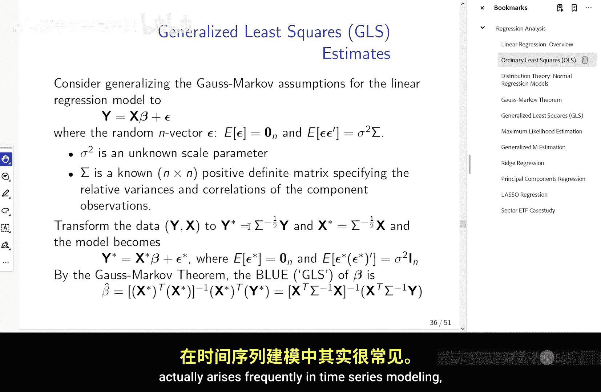

Where we're ordering our data by time and maybe near。

Values of the error that are observed at nearby times are more correlated than those at far away times。

 and the covervarit structure of those errors might be systematically。Represented by。

A multiple of a known sigma matrix。 Well， if this is the case。We can transform our original data。By。

Pre multiplying by。The。Inverse square root of sigma。And do the same for our x matrix。

And if we do that。We're basically transforming our model。这 the。Stard case， where。

The Y star and X star as we've。Represented here， the Epsilent star will have mean 0。

And the covariance matrix of the epsilon stars will actually be。Diaagonal with constant variance。

 So in this transformed case， we have the same regression parameters。We have。

The epsilon stars with the。With the Gaus Markov assumptions being satisfied。

 So by the Gaus Markov theorem， we just can write directly our least squares estimate。

In terms of the X stars and Y stars。And when we write that out。

 it ends up giving us this formula for the generalized least squares estimate。

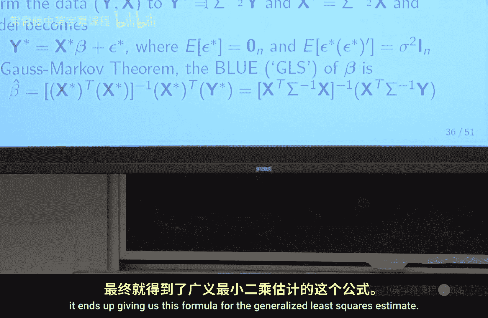

And so if we have variable errors where we know the relative variation of those errors。

 we can accommodate that and get best estimates with this generalized least squares formula and importantly。

Generalize least squares estimate。Basically， does sort of awaited regression。Where we wait cases。

Proportal to the inverse of the variance。Of。The random variables。If this sigma matrix， in fact。

 were diagonal with different variances， we would be。Down waitinging those cases with。High variance。

And。Performing the least squares computations， you know， in a weighted way。

 So that's the generalized least squares estimate。All right， well， we'll finish there。For today， and。

Cover more regression next time。

