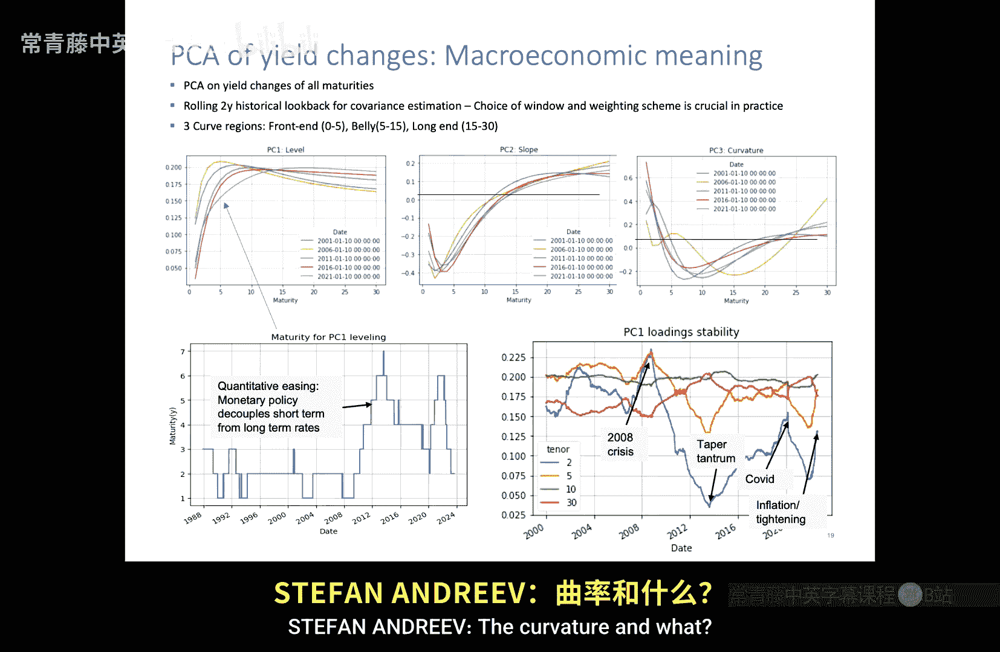

# 麻省理工学院【中英⚡数学专题及其在金融中的应用｜18.642-Fall-2024,-Topics-in-Mathematics-with-Applicatio】-p10-P10-Principal-Component-Analysis-in-Finance--BV1iLrjBrETS_p10-

All right， I want to welcome Stefan Andrea our his guest lecture today。

 he has been a significant part of this course over the past I think 11 years， is that right。

 Stefan along a long period and that far partly because his lectures are the most popular in the course and we really are glad to have him come back again。

 his background is very interesting， he has a PhD in chemical physics from Harvard。

And he has worked at the top firms on Wall Street， Morgan Stanley。Ctadel， and now two sigma。

So he's a really great person to share his expertise with us。 so thank you。Thank you。Thank you。

 Thank you， guys。Very nice to， to meet you all。Big class。Big class this year。 That's exciting。I like。

 I， I'll， I'll start with this before everybody gets， gets tired。 I wanted to say that like I。

 we're gonna talk about principal component analysis today。And the。

Some of the main things I want to take away from this。Or， this is a。Absolutely core data science。

 tool， in finance。It's number one， number 2。It's great to like this kind of stuff you only learn by doing it。

So， doing like。Actually， doing some kind of project that where you use these toolkit。

Is is like essential for you to kind of reallylearn it。And。3。

 if you ever want to get a job in finance， like， I think having having like some experience。

 having like done a project with this and having some familiarity with what this is about might help you during interviews quite a bit。

We're gonna have lectures， the slides are， we're gonna have some the。

 the slider on the web on the classroom。Website。In addition to that， there is。There is a notebook。

 in a Jupyter notebook and a data。That Ive used to。Prepare these slides to at least the first。

 the first example we're gonna talk about。I've like， I think that that's like。

 that's a great reference。 If you ever want to like， like see how you actually like。

 how this stuff gets computed。 and if you want to do。A final order a project。

 a final project in the class。嗯。It would be something like that notebook。

 but like a little more elaborate。 So it gives you like a little bit of a flavor of。

What the starting point and what， you know what the project would be like probably would be a little。

 a little more extensive than and what we're talking about here， but。

But like in the same same spirit。So yeah， that's， now that we got this over with。 like， we're gonna。

 let's talk about like， what is PCA and where， where does it fit within the world of。

Machine learning algorithms。And it's， it's basically。It's。

 it's a un method for unsupervised learning。 So it's it。Basically， a method to cluster。

 reduce dimensionality to make sense of the data。It， it's not。 It doesn't。It doesn't necessarily。

 It's not a regression。 So it doesn't like， there's no causality implied when you use PC A。

 but it is。It's yeah， it， it's a way to understand data better， especially data that。

Has a lot of dimensions where things are like many， many of those dimensions are highly correlated。

Here we have。 I've listed a bunch of examples of where PCA can be applied， generally。It's。

 it's widely applied in large data sets， multidimensional data， like a lot of data。

 It's mostly like the actual， the actual calculations are mostly linear algebra。

 So it's efficient and fast and scalable。 So， and this is one of the reasons people generally like to。

To， to use it。I'm not gonna go through all these， but like it's， it's very it's。

 their applications are。Very。Widely， they， they vary widely across， across science and。

And in finance， it's used like very extensively as well。Okay。

 so first thing I wanted to talk about is like kind of go through a visual example。

Of these are some of these things that I want to talk about are like。

My mental toy models to understand that I always refer to when I think about what is happening when I'm using PCA。

In this example， do you guys see it well， okay， good。In this example， I have prepared effectively。

3 data sets， but they're really like one data set。 There like it's one。 I've， I've just made this up。

 right， It's just one， is's like one dimensional data set。And。

All I've done is Ive taken this one dimensional data， and。

I've made it two dimensional by just adding an extra coordinate， like the blue line。

 the extra coordinate Y I made 0。 And then I took this data。

 and I just like rotated it like 45 degrees and 90 degrees。And in the。In this two dimensional world。

 like it's， it's two each point has two coordinates。 So it looks like it's two dimensional。

 but I know it's like it's one dimensional because I， I made it。And。

And the key thing that that PC A would do is like is PC A kind of would immediately tell you when it looks at this data that it's actually one dimensional。

If just by like you down the day， you do the calculations。 it's gonna be one dimension。 So how。

 how would it work。PC A， basically， you can think of PC A as like a， is a。

Is a way to rotate the coordinate system。And。We basically when， when you apply PCA to this。

 it will tell you。If you apply to the blue blue data， it will tell you the the PC1。

 the per first principle component。 you guys have done Peter。

 you guys have done the math part already， right， of PC。 Yeah。

 So the first principle component is going to be the x direction。 When you do the the red line。

 is's going tell you that it's like the the 11 direction。 and and it's going to just discover this。

 this。This dimensionality。 And okay， the first data set was like very。

 very simple because it was no is's purely one dimensional。

 This one here is like kind of the same thing。 but I've added a little bit of noise in in the other dimension。

And now when I apply PCA to this is going toomic basically the same thing。 PC1 is going be the same。

But PC 2 is， is gonna have a little bit of variance along PC 2 among the perpendicular erection。

 So in both of these cases， A And B。It will tell me that PC 1 and PC2， the eigenvectors are the same。

And it what's gonna be different is the， there's gonna be a zero variance in case of B on the PC2 direction and a little bit of variance in in the。

 in the first。In in the example， a。Along the PC2 direction。So， it basically tells us。

The two thing it tells us， like the directions along which data is concentrated and the variance or the how important that direction is。

In on a out basis。We can generally， what's nice about this， Like I've done this two dimensional plot。

But PC A， like when you actually do it， it's just linear algebra， and you can do it on。

You can do it on any number of dimensions。You can do it on Yeah。

 but so when you have high dimensionality， this is a very robust and powerful tool。What's。

 what's really nice about that and the high dimensionality is like it's， it's not a minimization。

 It's not an optimization。 It's just a linear algebra calculation and。It's fast。 So you can。

 you can process very large amounts of data very quickly。A， a very common。

when you use this in practice。Like the answers that you get from。

 like the things you kind of learn from PC A。They're going to be。

It tells you like a relationship between variables。 like in our first example。

If you look at this diagonal line， it's going to tell you that。Like。

 it's basically like y equals x is kind of the line， right， And then you can， you can think， well。

 I can discover the same thing if I run a regression。Y， it regrets Y on x。 And。

 and then it's going to tell me pretty much like the same。if I look at my dog and a life。

 they're going to tell me the same thing。And that， that is true in the one dimensional example。

 But I wanted to kind of give an illustration of what is the difference between regression and。

And PCA。 And the difference is like the my PC A is， is kind of。It's， remember， it's。

It's notupervised learning， So there's no causality implied。

 So X and Y are kind of on the same footing。Each dimension is in the same footing。

 There's no special dimension is dependent。 and one that is independent。 So when you regress。

 this is like the same data set。 And you can see here the regression of why。Versus x。

 the regression of x versus y and the PC1 line， they're similar。They're not， but。

They're not the same。 They it， like， it's actually optimizing。

It's minimizing the distance to the line。 but like， you know， you know。 like， this is。

 this is like minimizing the distance in the perpendicular direction。

 and the others are minimizing distance in the independent variable direction， so。

When you do a regression， so it's not exactly the same。 I think it's good to keep that in mind。

Because， sometimes。If you really want to understand how。You know， like given on observation X。

 how I should model Y。Maybe PC A is not the right approach。 Maybe you should run a regression。

But like， if you want to understand the， the correlation structure of X and Y have two variables。

 there， there is no， you don't have necessarily one depends on the other。

 You don't know anything about their relationship。 then then PCA is probably a more appropriate tool。

Yeah， so I was just saying like if there's， there's some data that is in some like if data is like in a particular line。

 PC1， which is the red direction here would always discover where that direction is。

 And if you actually map the the data into like PC coordinates。

 it's just gonna look like a straight line like that。

And a couple of things that I like about this example is like， you can。

 you can see how rotating this dataset set doesn't， doesn't change the PC coordinate output。 So it's。

 it's it finds the direction appropriate。 The second thing that's very important is robustness in the real world And like when you do。

 it could be in science or in finance。You're not going to have perfect data。

 Everything is very noisy， and noise is a huge problem。

And robustness to data noise is very important， so。This kind of illustrates how robust things are。

 So if， if I， if I take one point， and I just move it around。My， you can see that my， the red。

 the red line， which is the， the direction of my PC 1 doesn't it's like it's quite robust。

It's quite robust to， to， to noise in to one particular。 if everything else is aligned。

 like just moving around one data is it doesn't really change things too much。

If I make them a little bit。More spread out。嗯。It's it's a little less robust， but it's still。

 still pretty robust， right。And the thing that I wanted to kind of say， like， what happened。

 People are just gonna very often， you just take some data。

And you just shove it into PCA and you don't actually care too much before you even know what the data is。

 And you just put it into PC A。 And PC A always gives you something。

But suppose the data doesn't really have a dominant direction。

Then the PCA algorithm becomes not robust。So you can see now， look。

 I'm moving one data and look what happening to the coordinate。

One data point is I can just move that a little bit。 And like， it's just completely giving me。

The output is like super sensitive to， to any noise in the data。So it's kind of worthless。

So it's very important when we're looking at the data。

If we don't really know what this data kind of looks like， sometimes it's high dimension。

 and can't even really visualize it。You have to think。

How do I understand whether there is actual structure in data that I'm trying to discover。

 This will help me discover quantify a structure， but it's also good to understand qualitatively how much the structure is。

嗯。One thing that is that PC A also like part of the PC analysis and the output， yes。余啥的你字。So。也好啊。

Well， it's。No， but what is's not。 I don't have， like， you can write tools to do that。 But like。

 I think。What you want， like one thing that you can do。

That is very important is to kind of when you do your PC analysis， is to look at the eigenvalues。

Becauseuse people， very often， people like look at yang in vectors and like， oh。

 these are my directions。 And I'm gonna project things。

 And I'm going to assume that everything is like factorized nicely。And like。

 we don't really look as much at the eigenvalues， but it's very important to look at the eigenvalues。

The reason。Is that。In this example， when there's no dominant direction。

 the eigenvalues which measure the variance along each direction， would be very similar。

So when you look at， when you're look using a a principal component。

 like a first principle component， you want to make sure that your the eigenvalue of that component you're using is。

Is like quite distinct from the rest of the eigenvalues。In finance， we'll see later。

 like were dealing with a time series of PC A。 like every day you construct a PC A model。

 So everything， anything that's a number here， like the eigenvalue is actually a time series of eigenvalue。

 So the thing I look at a lot when I'm doing analysis is I look at eigenvalue plots in log space。

 and I want to see that。Each distinct。Component that I use。Ideally。

 you want to see it that is like an order of magnitude different。And the next one in invari。

 variance invari， basically， which。If that's true， like， that's great。 that actually。

 and that doesn't always happen。 but it at least you want it to be like visually。

 you want it to be distinct thing。 You want it to be like different。 You don't want if you。

If you have a time series of things， don't want to like the， the first and the second want to cross。

 And， if that's happening， then。The first and second principle component， if they。

 if theigenvalues are。Small changes are causing them to switch places。

It basically means there isn't a lot of structure， and the PC output is noisy。

 and it's actually going to obfuscate。Rather than clarify the thing you're looking at。

I've put here like a little bit of math notation。 You guys have done your math lecture on PCA， so。

We can be relatively quick here。But。I do want to go through it。The main thing is like， you have。

 your， you have your data。 data matrix is generally like there's。And observations in P D dimensions。

 And we think of that as a matrix。 And then if this matrix is x。

Then every day's observation are vectors of size B。And then you have a covariance matrix。

 which is X T times x。And。嗯。And then like， there is， I， I've here， like， defined the， the W K or the。

Orthormals vectors representing the theseard diigenvectors， WK。

 And then I've written down the math of how you do the projection of data。On to principal components。

And in how you compute the variance。How do you get these vectors well。There is。You could。

 you could do。 you could take your data， compute covariance matrix。

 feed it into an eigenvalue eigenvalue calculator。Which is basically in， in the， in my work。

Our data is not really。 The number of dimensions is not actually that high。 So that that's pretty。

 that's okay。It does kill。As like that thing is。But potentially maybe a little bit slow。

 but it's not actually that slow。There is also a more efficient method。Cas S VD， single。

 single value composition where you can just。Compute your projections without calculating the covariance matrix。

I like to compute the covariance matrix because we generally need to compute the covariance matrix for other things in any case。

 so。If you have it already， then， then it's。Then it， you might as well use it。Sam， there's some。

 Ive listed here some properties of。This eigenvector matrix， that are important。

That it's also normal， which means it。That's the transpose of the eigenvector matrix is kind of also inverse。

Thevariance matrixes can be written as the。In this， in this form。

 where lambda is the eigenvalue matrix。 That's the SVD decomposition。

That theres total variance quantity you can think about， like， which is the variance effects。

 which is just the trace of Lada。 So like the the product。

 the f values is the variance of your dataset。And there is something。

Cote percent variance explaineds。Which is just defined as how much variance。Is。

 is along a particular PC direction divided by the total variance。So that adds up to 100%。

Lake Winneyard and。But that that's very useful， because。

Remember how I was saying you want to look at the eigenvalues to understand。

How important each direction is。 variance explain tells you that is a kind of a number you want to look at。

You wanna， when you， when you're trying to model your data with as few dimensions as possible。

 you want to kind of add more PC directions until you get to a relatively high variance explained。

If you're able to explain。If you have like a 10 dimensional data set， and you're able to explain。

80% of it using three dimensions。 That's a pretty， that's a pretty big win。

And I've also like written out this of out of sample variance explain。

 Or very often what we do is we， we calculate a PC A， we calibrate on historical data。

 and then we apply it to。Future data。That。We're trying to model like trying to model what will happen in the future。

 and especially in finance， we do that。So。When， when the data you're calibrating your。

 your PC A on is different than than the other data than this。

You hope that the structure of the two data sets are the same。 So if the structure is the same。

 you'll get the same kind of variance explaineds structure。 but to the extent that is not true。

You may not。 So you may see that。Your。Dominance of certain PC1 factor It becomes like。

 it starts to explain less variance as you， as your out of sample data becomes more different from the。

 the data which you calibrate。So this is a little bit of like， the modeling。Art of it， where。

You're going to be using some data to to calibrate a model。 And then youre gonna。

 you're going to use this to。To predict the various， the correlation structure of。What。

 what happens in the future， like future market moves or future returns。Okay， so。At typical。

 how do we， like， what do we generally do when we apply PC A， We， we're gonna take our data set。

 We're going to demean it。And then maybe we're going to normalize the variance to one。

Like when I say maybe， and the reason this maybe is like sometimes you want to do that and sometimes you don't。

It's。Very often， whether you want to do that or not。Depends on。

How exactly are you going to use your PC factors and your your dimensions。Generally。

 I would say that most of the time you want to normalize it in in a certain you want to normalize it in a way that you want the。

 at least the expected variance along your dimensions be unit to be similar。

Then you're going to compute your covariance matrix and calculate the eigenvalues。

And then you're gonna order them by decreasing eigenvalue。And。

And you're going to have like a certain cutoff where you say， okay， the only the top。

 I'm going to use only the top X factors to model the structure of my dataset。

So you say like maybe you would normalize it， What would be like a complete example of like， well。

 it'd be better to not normalize it？嗯。Well。Here's an example。So let let， actually， let， yes。

 Ill start with this， so。This is an example of like， it's a little bit of a toe example。

 And I'll talk about a real example。 So in this toe example。

 there's the blue and the red dataset set。And the red one looks at it's kind of one dimensional。

And the blue looks like。It's just a blo。 There's no direct dimensionality。So when if I tell you。

 okay， should we use PC A， I there what， is PC I going to work on the blue data set is。

 is it going to reduce dimensionality。And the answer would be no， no。

 because it's there is no dominant direction。And in the red one， it definitely will。

 It will pick the right direction。Now， what's fun about these two examples is that these two are the same。

Data， except normal in the blue data set。 I've normalized。The variance along X and Y。

And in the red 1， I haven't。So。If， if I， if these two dimensions were。You know， like。

And temperature versus。Temperature in Seattle versus temperature pressure in。In Atlanta or something。

 theyre like the kind of very distinct and generally， like different。

Things where you're only interested in correlation and the the relative variance doesn't quite is not very meaningful。

 Then you， you would want to normalize it because you're， you're。That always。

 the units are not going to be。 You want to have like somewhat related units。

 So the units will be standard deviations if you normalize it。 if you don't。

 the units will be arbitrary and they don't。 It wouldn't really make sense。On the other hand， if。If。

 if this was like。If x axis was your grades on quiz 1 and y axis was your grades on quiz 2。

These two are like the same units now。And you， you may not want to normalize。 you。

 You want to actually。Like these grades are， these numbers are meaningful relative to each other。

 So there's not necessarily like you， you want to actually model。The actual grades， including the。

 the variance of quiz1 and quiz 2。 So there is no necessarily need to normalize it。

Does makes sense thank you。But it's like that part is， to be honest。

 that part is very much the art of things。 We have lot， we have a lot of discussion as work。

 How we normalizing it， How are we normalizing it， What are we using to normalize it like。

That's like， you'd be surprisingly， this is sometimes cutting edge research is to actually understand how you normalize it。

 Its that these are the things that actually make a difference。

The other thing I mentioned is we need to demean the data set。 Why is that important。

Because remember， the principal component analysis is a rotation。So it it always rotates around 0，0。

0。 So what0 is， it matters a lot。And this is two examples of the same data。

These two blockss are the same data sets， but one is like not the means， and the other is the means。

So this one here is center0。And BC。Finds that there is a direction， dominant direction。

 It finds that it works like it's supposed to。 This one here is not center at 0。 Like， for example。

 let's say you do a bunch of stock prices。 Like you just put prices into PC A。

Stock prices are not centered at 0，0 always positive so。It's gonna have some direction。

 but it's gonna be somewhere far away from 0。 When you MP PC A on it， it's gonna be like。

 it's gonna try to rotate around 0， but it's not it's like。It can't find anything， because。

It's not you're not like you can see why like you can't rotate this thing。

 can there's nothing to find if you don't center it zero。You cannot rotate around。

 It's rotating always around the origin。So。Me meanan mean near  zero or close to  zero or exactly  zero is is very important。

And surprising， it surprising how often comes up。 Some just does PC A on some。

On some numbers that are just like。Large， positive numbers。And like， nothing comes out。 And like。

 it doesn't work。 But you just have to normalize to 0。 How do we actually do it well。

This is just the examples of various places that have implementations of this eigenvalue calculations。

 I think when I started doing this。Look 11， but I don't know。 how many years ago。

This actually was more relevant。 Now， it's like everybody uses Python。

 Everybody knows Jupyter notebook books， and like。You guys， now， now it's like standard toolkit。Okay。

 now what's special about finance。When it comes to PCA。It's mostly what is special about finance。

 This is not exclusive， by the way， but like most of the time。

We are going to be doing PCA on time series。In， in quantitative finance， like in。

 in the quant world that。I live in。And I， I work in， I would say。It's our。

 the general job is to discover patterns。In the that that have happened in the past and try to use that information。

To model the future， and to。Somehow， like it use that as part of your toolkit to make predictions and to place bets in the markets。

So every day， every， every trading session， every， every observation is an opportunity。

To bet and to make predictions。And you can understand that。

 the thing about time series is that the history now and the history on the next opportunity to bet。

Is not that different。 Like， it has one extra data point。

 maybe like later has an additional data point， but everything else is the same， so。There is like。

 there is this slow changing time series of information。And what how we handle that。

 there is a whole time series。Data science， class that one can take。But。

especiallyspec with regard to PCA。It's important to。To understand， like， how， how what the what。

What the impact does that time series aspect it have on PCA。A couple of things， I think are。

 are important we。We generally are going to be interested in。

In modeling the the changes of of things of variables， like not the levels。 Part of that is that。

The thing I'm I was just talking about， which is de meaningan。And part of it is that。

When you make bets in the market。You make money based on how things change after you' bet。

 not the price， the absolute level of where the price is at。 So like returns or what matters， not。

The price of something， the absolute price。Then the next thing is like， okay， so when we do。

 when we model。When we have our data in finance， like generally。

 the data is the historical returns or history of something， history of prices， history of returns。

 history of。Anything of of。Whatever you're modeling doesn't have to be just prices could be。

 could be any。Anything that any technical indicator。And that means that every day there is。

 there is a history that is similar but a little different。 So the history changes your。

 your information about what has happened， changes slowly。And。That means that。

When you're looking at your PCA， you have to now define。How am I going to define my data matrix。

 which I'm using to calculate my eigenvectors and eigenvalues。

And the one of the main choices are how long of a history I want to use。And how much， how do I wait。

 How do I wait。History， more recent history versus further away history。

And these are some of the main hyper parameters of principal component analysis in finance。

How many things I'm， I'm including in my in my data data。How far back am I looking。

How am I waiting those observations as I passed through time？And。

Then the last thing is like the robustness of the data。Very often。

 there is a tradeoff between including more data points。But each， each marginal addition of data。

 like each marginal dimension of data that I'm looking at could be。Less robust。 like there is like。

 and we'll talk about in the examples later on。 But there is。We have to think carefully about。How。

How robust the data we're putting in is because if it's， if it's too noisy。

If it's not representative of where our bets are going to be。

 then it becomes less relevant to our modeling down the line。 on the other hand。

 if we don't include enough。We're also going to be missing opportunities to。

 to understand the structure of the information。 So， again， that's part of the art of。Of。

 of actually， of the。Practitioner is to actually kind of have some feeling of have some intuition about what I should include and what I should not include。

And we， we'll talk about an example here。The example， first example。

 and the main example I want to go through。Is applying principal component analysis to the United States bond market。

 yes。Well。就发的一些。啊个。それと。我也就是。我个。转来就是残区就是多。TheDifferent I guess， window sizes I' say of like pump。

Oh is going be。Yeah， yeah。's another That's a whole other dimension of how grandular it is。

 absolutelysolutely right。 It's not just about how long of a history， but how grandular it is like。

Well， like the examples I'm going to show you right now。Are based on daily observations。But。Why。

 why did I decide to use daily observations。The short answer is， like。And we， by the way。

 very often in， in my work， we use daily observations。The reason is that the observations。

Are just a more available， generally， more history is high quality data history is available for longer periods of time。

 for daily observations， second。Yes， intratro the observations are。They represent additional data。

However， the quality of。The quality of that data， meaning how， how noise。

 how much noise there is can very often in practice be much higher for intraday data than this random day data。

 That might not always be true。 There are situations where that's not true， right， but and there's。

 theres entire fields in finance that deal with high frequency trading。In those fields。

End of day data is just like their whole trading， buying。

 holding and selling happens 10 times for the entire day。

 So they start an end of day with like no positions。 And for them， daily is like not relevant。

 It's too， too slow。 They need to understand how the market moves on a very fast time scale。

So that how， how often， like how you sample time is a whole。

He's a whole othertorian basically how his sample time is going to impact。The units of volatility。

 volatility is measured。And in units of square root of time， basically， so。

It's it's very important like to know that and have to understand keep to keep that in mind。

Whatever the frequency of sampling is that's going to give you effectively the unit of your volatility。

 And then if you want to annualize it， like you need to apply appropriate factors and comparing volatilities of different units is not going to be meaningful so。

That's important。Okay， going back to this example。The US bond market。So why， why am I like。

Why is this an interesting example， Like， I work in fixed income， which is basically where we trade。

啊。Bonds and various derivatives of bonds。 And those are the， the biggest markets in the world。

 like the most， there's a huge amounts of money being transferred。

 They're not necessarily the most volatile equities are much more volatile， but。

They are extremely deep， extremely liquid， and they also allow。

P like people who trade in them to take large amounts of leverage。

 So even though they're not by themselves。That volatile， if once you take leverage。

 you can increase volatility by taking leverage。 so you can actually make。

You can construct portfolios that are。They are actually quite， quite volatile。 and deliver。

Substantial， substantial like market volatility and， and returns。

So there' there's a lot of a huge industry of money managers， hedge funds that trade fixed income。

And。The US bond market is the kind of prototypical example of fixed income。

 It's the most liquid in the world by far。The most well structured。So it's a great example。

 to play with。Another reason I'm using it is because。

There is pricing data from the Federal Reserve that is freely available。

And that's the data that we're going to use right now， too。Do our analysis。

This data is like it's actually quite high quality data。And。Yeah， that like that's， I think that。

If you w to do a project， like this would be a great， great data set to play with because it's real。

And its， it goes on for a very long time。And。And you can apply。

 You can apply our PC techniques to it。So the first question to ask is like， is there。 remember。

 like， we have our data set now， What is it consist of？ Well， in the United States。

The US Treasury issues。 It just， it issues a bunch of T bills， short maturity bills。

That they raise money。 That's， that's how they raise money for the debt。

But the part we're gonna concern with is going to be the US Treasury notes and bonds。

 which are kind of the longer dated。Instruments that US Treasury issues。

 the issue on a very ir regular basis。 Every month。

 there is a schedule of auctions that are very well known and repetitive。

And they always issue like a two year bond， a three year bond， five year bond， seven year bond。

10 year bond， and a3 year bond。And there's actually now 20 year bonds that started about like 3。

4 years ago。 But we're not going to look at that right now。Cause it's， it's very。

 it's very new and it's not， not as liquid。 So we're just gonna focus on these。And。

What are like the other thing about these bonds is that they're。They're all debts of the US Treasury。

 So they're they're very， in a sense， they're very similar。Like if you， if you own。

 if I give you money for six months and I also give you a separate loan for like three years。

I've I've given you two loans。 The first thing that these two things are theyre basically you still owe me money。

 right。Yeah， one is longer and maturity than the other， but like。You're still wanting me money。

 So in terms of the way the price。Of these， of these securities evolves。 Theyre all kind of。

 they all depend on the interest rates， the short term。

 the path of short term interest rates of the Federal Reserve。And the expectations of that path。

 So that it's， they are all derivatives of that。The implications of that is that。

The returns were the， the changes。Have bond yields。Are very highly correlated。

 So here I on the bottom right， I've shown。The the correlation matrix of changes。

 and you can see like these numbers are very， very high。So this is a data where。Everything is very。

 very highly correlated。Prime candidate for PC A。 When you see a correlation matrix。

 it has high concentrations of high。High correlations， prime candidate of PCA。So what are these。

 what are these numbers I'm looking at on the， on the left chart， I've shown the US yield curve， so。

On any given day， we can observe the prices of two year bonds，3 year bonds，5 year bonds，7 year bond。

10 year bond，30 year bond。 What is the price of that and。I don't know if， G， if if Peter， have you。

 have you guys done Bo math yet。A little。 So， so you。

 we know the prices where these things buying so very transparent prices。

 and we can convert prices to yields。So basically， a yield is like the implied rate of return of the bonds effectively。

 given its price over the course of its maturity。 And then when we plot these yields。

On the on this plot here， I've plotted the yields。The yield is on the y axis versus the maturity of the bonds。

 And I have sampled。5ive days from history。And this is what's known as the yield curve。

That is the most important input of macroeconomics in the world is the US the shape of the dollar yield curve。

Sometimes most of the time， the yield curve is upward sloping。

 so people people require a bigger return to lend money for longer。

 And the US Treasury like generally， requires that。But sometimes that is not true。 Like。

 sometimes you can see this top blue line。 Sometimes the yields actually like is。

 starts out downwardloping and then flattens out。 So these yields can have a variety of shapes。

And this is just the level of yields。What we're betting on is the changes。

 So we're betting on how this curve evolves day to day。And you can see from these。

From these yield curves， that。You can imagine how if I just。

 if I was to show you a movie of the yield curve， it's going to kind of flop around。

 It's gonna be like a little string。 It's like flopp around。

 but it's gonna be like going up and down。 It's gonna slope like this。

 It's gonna have a whole set of dynamics。And that， that dynamics and that kind of。

Those dynamics is what we're trying to kind of model with PCA here。嗯。Bonus question。Is。

Do you guys know what is the shape of the old curve now， What does it look like， What are。

What are the is are short term interest rates like higher than long term interest rates。If you。Has。

 has anybody like。We had a a very prominent Federal Reserve meeting recently。And they， they。

 you remember what they did。The action the Fed took was the action the Fed took was to cut interest rates by 50 basis points。

 So what the Fed is doing。It's cutting the interest rate。

 that is the leftmost point on this yield curve that that they're they're setting that point。

 Everything else， the rest of the curve is market expectations of what that point would do in the future。

So they move this point down by 50 basis points。50 basis points means half a percent。 So it went。

It went down by half a percent。Right now， this blue curve， even though it's from 2023， that's like。

 that's pretty recent。 it still。The curve is still downwardloping。

 It looks a little bit more like like this right now。 So it's not。It was for a very long time。

 It was actually like really inverted。 It was going like downwardloping like that。Now， the back。

 now the back is like starting to flatten out， but。

But still quite high in the front end and downward sloping。So that。

 that unrelated to what we're talking about， but fun。Kind of a fun fact。Okay。

 so now when we look at yield changes。嗯。When we look at the， we take our data。

 we compute your changes So the changes the yields on day to day。We。

 we can we should demean that data set， but generally demeaning it doesn't really help that much because the mean is going to be very close to 0。

Because changes are sometimes the are going to go up。 Sometimes they're going to go down。

You're not gonna have。Over the history of， of 2030 years that we're talking about here。

 you're not going to have a large， large mean。Still， it's always good practice to demean it。

It won't change much of the result。But then we take this。In this example。

 I didn't actually normalize the variance。 I think we just just left it in there。

 So we did PC A on covariance matrix。 And the reason is that the units。

 the yield changes are are comparable units， and there is。Looking at the PC A without。

 without normalizing the， the variance is actually like。It's a very meaningful。

Output like we want to understand how volatile is going to tell us something about the relative vilities of points。

So when we do that， and we look at the。What， what I， what I'm plotting here on the top are the。

The eigenvectors。 So the。The principal component factors。

 the shapes of the principal component factors on various days。So this plot can be confusing， right。

 and I want to make sure that we all on the same page what it is。This was。This is the shape。

 This is the yields。Then we take these yields。 We look at the changes of yields。

 and we put them through PCA。And remember， the output of PC as eigenvectors and eigenvalues。

 eigenvectors means every， every point， like two year，3 year，5 year，10 year，30 year。

 everything has a number now loading。We call that I， the number， the aigenvector coefficient。

 I call that loading。 That's a very a term that we use。That loading。Is again。

 there's a time series of those。 And I'm plotting here I select like five different dates in history。

Of what that。Eigenvector looks like what the first principle component looks like。

What the second principle component looks like， What the third principle component looks like。

These are， these are snapshots。Like five snapshotts in time。And I'm plotting maturity versus loading。

And there is actually three dimensions here。 There's maturity loading in time。 So I can't like。

 I can show you a three dimensional plot， but that will just be like confusing。

So I'm showing here cross sections。 So these are various cross sections on time。And you can see that。

There is a clear and persistent pattern in what the aig vectors look like。The first one。

PC 1 is called the level。That' basically means that。That。

 that is like it all the loadings are positive。 So it means when the yield curves move， generally。

 they move up and down together when in the same direction。 So if ten year rate is going up。

Probably two year rate is going up as well。 F year rate is going up， as well。

And that has the term ratess are going up。 ratess are going up。 like generally speaking。

 everything is going up or down。 and that's the most。That is the the move that。

 that is explains most of the variance of the yield curve。But on top of that。

 now there is a second move， which is we call this PC 2。 And we， when we look at the shape of it。

 we can say， oh， it starts out negative。And the front end of the curve。

 And it's positive on the back end of the curve。That's the slope。

So that's kind of a steepening of the curve versus the flattening of the curve。

 That is a second PC factor。So this first piece factor， by the way。

 explains around like 90% of the variance。Maybe like 85 or something。

 And the second piece factor explains， like。Between 5 and 10% of the variance。

Like like a very huge difference。And the third piece factor is like the curvature。 So how， how curvy。

What is the curvature of the of the it's positive on the front end。

 positive the at the 30 year and negative at the belly of the curve， ten0 year point。

And that has the smallest amount of variance。 So what does that mean if you think mentally of the movie of what the yoker is doing。

 it's mostly going up and down， mostly going up and down like that。 But it's also like。

So also slope a little bit of slope。 So it's mostly up and down。

 but like little bit of slope and a little bit of like curvature。I。So like that that's， that's。

 that's that's what this thing tells us is the dynamics of the curve。Now。

Some of these things are like super the structure of these things actually tells you a lot。

You can see how the， the PC1 level。It， like。哎。The the the maturity at which it like。

 it starts out steep up or sloping。 and then it levels out the maturity at the maturity in years at which it levels out。

I've plotted here what the maturity is， at which it it kind of levels out where the short term rate。

 the couple from long term rates。 And if you plot that in time， in time series。

 you can kind of see that it was。Very short， like monetary policy was effect was basically L only governing the short end of the curve。

Up to two years up until right after the post financial crisis。 And then the Fed became very。

 very powerful。 post financial crisis。 The Fed said we're going to keep rates low for a very long time。

 and all of a sudden， this thing exploded， became very， very。Very high。 So like， basically。

The short term rates were governing effectively the the the rates up to。Up to 4 or five years。

 And then up to Covid， they started to decrease up until Covid。 Covid happened。 Fed came in and said。

 we're gonna bring to Booka。 So we're going to。 everybody's like， okay。

They're going to keep rates low for a long time as well。 It exploded again。 and now it's back down。

Again。So that is like。That's， that's already something that is kind of like a regime indicator。

 you can see。How the market behavior is reflected in the shape of these PC factors。

That tells you so much about what's going on in the market when you look at the these。

 in the details of these factors。Something like。Where is the bottom of PC 3。Where is the belly。

You can see that it sometimes it's at 10 years， sometimes it becomes close to 5。

 sometimes close to 15。That's also a regime indicator。PC loading stability。 So here I'm taking this。

 this graph， PC 1 graph。 but instead of plotting。Loading versus maturity。

 I'm plot loading versus time， and each maturity point。Is line。

So that tells me the stability of my loadings。 You generally。

 you want to look at that because you want， you want factors that are stable。

And PC1 loadings are are pretty stable， but these and the fact where the changes in PC1 loadings。

They're very often， like， they're quite meaningful。 Like you can 2008 crisis， two year rate。

 This blue line is a two year rate。 The short end。 It short time becomes very volatile。

 Nobody knows what Fed is going to do。 Theres a lot of volatility。 It then collapses。 post 2012。

 Like the Fed is not doing anything。 So the two year point is not moving。Then it goes up。

 Maybe the Fed is going to move。 And then after Covid， it also collapses。And now it's back up again。

 The Fed is very active right now。 This， This ends in like 2023， this data set。

 If I make it a little bit longer， you see this line actually went very high in the recent history。

So all of that is。These things are like， theyre， they're。They all come from this data。 but they。

 they tell you， they， they， they tell you a lot about the behavior， the regime and the dynamics of。

 of interest rate market。This is the variance explained。 I think this is like， this is a way。

 Remember how I was telling you how we look at eigenvalues and we wanna。

Make sure that they're well segregated。 Well， this is a good， this is a way to look at it。

If you look at this chart and the first factor explains so much variance， it's like， yeah。

 that that's。That's a good factor。 That's a good factor， too。 like， it's a solid factor， and。You can。

 you know that this thing is persistent。 You very， this thing is likely to continue。

 It's likely to be stable。 And it's a good part of your model for the future。

If you look at variants explained by a factor， this is a lock plot。

You see that how the first and second and third factor are separated in like priorityative magnitude。

 So they never cross。 So that means that these factors are robust。And。They， they're like， yeah。

 theyre， they're very very useful modeling factors for modeling。 You w to see this kind of picture。

 What you don't want to see is like lines that are all entangled out to each other。

 That's we don't want to see that。 You want to see something like this in general。

 when you're looking at PC A。As again， these are eigenvalues I'm looking at， Verance explained。嗯。

And this out of sample covariance is like when I'm， this is basically when I when I calibrate my PCA。

 remember my， my in my， if I take a single data set， however I choose it。And I do run my PCA。

The PC 1 projections and the PC 2 projections。Are going to be uncorrelated with each other by construction。

But if I take the same loadings now， and I look at。The future returns。

There is nothing that says that。If I project my future day or a future returns onto to the same loadings。

 those might not might actually become correlated。So here I'm computing like kind of future returns。

Projected onto PC factors using that rec calibrated on like past past history and。

And you see that it's not， they're not fully orthogonal。 However， they're quite orthogonal。

 So it means that like， the dynamics are mostly preserved。TheThe the loading。

 the PC factors are mostly stable。 This is not like this is something you would expect。

 you would hope to see。 You don't want to see， you don't want to see these numbers of diagonal numbers to become like 30。

50%。 That would be like， that means that your PCM model is quite unstable。

 But if it's like if your our sample correlation is is pretty small， that's， that's a good thing。And。

Now， what do we do with this PCA？Well， one of the key things is like， okay。

I wanna go back to this slide for one reason。 Suppose you say， well， I really。I want to bet on。Curve。

 I want to bet on the second factor。 I have a model。

That that I want to bet on like curved diping a relative value of 10 year bonds versus five year bonds or 30 year bond versus 10 year bonds。

I can use PC A to isolate effects that are idiosyncratic to particular。

Points on the curve to particular factors。And I can basically say， well， if I， if I hedge out。

The vast majority of the variant is by hedging L PC water。And I look at。Like。

The residual PC1 residuals， which is PC2 and above。What can I say about those？About those returns。

 How can I model those And how do I， And the key thing you can， you can construct these things。

 you can say， oh， I want to model these things。 But the key is how do， if once you。

 once you have a good model， how do you trade them。

So being able to construct PC to understand how PC loadings translate to portfolios is very important because it。

 it tells you。How I can use this methodology to construct。

Specific portfolios that are uncorrelated to each other。And。嗯。And give me like a new。

 a new a new kind of target tomorrow。IfIf I didn't do that。

 I still have like eight things I can trade with six things， two year， three year， five year。

 10 year and 3 year bonds。But they're so correlated where I'm trading 10 year bond or 30 year bond。

 Like， if I just trade 10 year bond outright or 30 year bond outright。

 I'm mostly getting the same return。So to be able to increase the diversity of what I'm of the target I'm capturing。

I'm using PCA to construct more portfolios that are going to be uncorrelated and present me with more opportunities to model to make bets。

That's like， that's a key use case for PCI finance。

 Like we take these things that are very highly correlated。

 and now I'm going to create out of these six highly correlated portfolios。

 I'm going to create three or four portfolios that are not highly correlated。

Wat like and these portfolios are going be my PC， are going to be defined by my PCA factors。

So remember， the， the factors。On any given day， they give me a loading on every tenor。

 on every maturity。Yeah， yeah， did you have a question， Okay， yeah。

 they gave me a loading on every maturityur， so。It tells me， and I， I can think of this loading as。

Telling me how much to own of this particular。Bonds on， on that maturity。

So PC1 means by every bond in some means some equal amount。 that will be， that's PC1， PC2。He's like。

 oh， you should like， sell some to your bonds。Buy some 30 year bonds like basically。

 the portfolio is going to be。The portfolio is going to be defined， like。You're gonna。

You're going to basically buy。Bonds， according to the loading。On every， on every point， on PC 2。

Why is this portfolio interesting， Well， it's interesting because。

PCA tells us that if I construct this portfolio like this。It would have no sensitivity to PC1。

But PC 1 is like 90% of my variance。 So that means that by if I construct the PC 2 portfolio。

I have effectively hedged out 90% of the variance。Of individual bonds。

 And I've constructed something that's new， less volatile。But。

Uncorrelated to my original like out tangure bond。Same thing with PC3。

 I can construct and I can construct like these PC3 portfolios there are like and these， by the way。

 these things actually trade in the market they're called like curves。

 PC2 things are like theyre curves like you buy two year， you sell10 year vice ver。

 and then and there's flies， which are like two stands and 3s where you sell10 year and you buy two year and 30 year。

Yes， is there any application of the higher order PC or they just they explain such little variances you don't really bother。

 They are the most interesting thing because。The PC1 stuff is easy to bet on。

 Like you just buy in your bond， buy and sell。 If you can model that and predict it， that's awesome。

😊，But like， first， that's hard。But also， it's only one thing you can predict。

 whether you're doing 10 year or0 or 30 years， you're predicting only one thing so you can make a model for that。

Being able to construct these portfolios， PC 2 and 3， you're able to create out of these。

Out of these lake。Out of these bonds that are highly correlated。

 you're able to create something that is entirely different from， from the PC 1。 uncorrelated。

 So now you have something else you can model。And you can。

 and because of the market is So the market is is liquid。

 It needs to be very liquid because remember this， it doesn't explain a lot of variance。

 So if you construct this thing， it's not gonna move much。

But all that means is I just need to buy more of it。If I buy enough of it。

Even though a single unit might not move much when I buy enough of it， it's still gonna move enough。

 And that's the point of leverage。So if I sell a bunch of two year bond， buy a bunch of 30 year bond。

Now。If I buy the same notion， by and sell the same notions is as the PC1。It's not going to。

 like you say， it's not going move very much。Maybe it's going to move like only one third as much as my PC1 portfolio。

But if I。Scaled up by， by 3， by， by a factor of 3。Now， my new portfolio。

 PC2 has the same daily standard deviation as my PC1 portfolio。And it's orthogonal。

 So you just need basically。 So what did I need to do that。

 I need to be able to buy three times as much。 So it needs the market needs to be liquid and need to have access to leverage。

You can do the same with PC 3。And yes， in， in the， in the big liquid markets like US Treasury。

 there is enough access for to leverage where you can actually do that。

You will see a lot of times in the press。 It's a very hot topic now。

TheCFTC is trying to regulate like how much leverage exists in the financial markets。

 especially in interest rates。Because。Because of this。

 because of the fact that PC 1 is so explained so much。

 people use massive amounts of leverage to gain access to， to basically enough volatility。

To make these bets on on PC 2 and 3。And。That can create， It means you own large amount。

 You own long and short， massive amounts of certain bonds。

That can be dangerous if it's systemic in a certain way。 And like， this presents risk。 But it's also。

 but it's definitely， it's doable because there is so much debt。

There's so much debt in the world that there is enough out there， where you can。Where you can bet。

 you can gain this leverage， basically。 and it's， it's very accessible to professional investors。

So yeah， the actually， the， the you far from， far from it being irrelevant， like。

That is actually where a lot of times the money is made。 But like it is true that as you go。

 why can't we go to PC 4 and 5。The amount of leverage you need to make this work is becomes so high。

 it becomes very expensive to trade。Yes。打是去伪的。I just shouldn forward that is this allows you allow you to kind still up to get the。

Is only as useful word。推京か可。You're by the same。I since it's not as。

Like if you were to buy that many of whatever。Security costs。我这个系用。Well。It turns out that it's not。

That is not。It's， it's not actually it's not really true。 What you say， and。

 the reason is the following。Yeah， the volumes and notional volumes of equity market may be a little bit smaller。

 They're still very large。Ands。The variance explained of the first principle component equities is not nearly as high as it is in rates。

So you don't need as much leverage to get like the second principal components got a lot of volatility。

 a lot more relative to the first。Then in this example here。Later in the slides。

 which I think we might not get to。 There is also an example with equity indices in Europe。

Same concept there。And by the way， a lot of equity， there is a whole field of hedge fundss schools。

 E that are equity， longs short， neutral。They are basically betting on。

Equities without taking directional risk。 So everybody is trying those。

 all these guys are hedging out。 PC1， They're taking leverage。 It exists。It。

 it's just a little more expensive to trade， but it gives you opportunities that you wouldn't be able to access otherwise。

 so yeah。Yes。Those yearss for like some makes they products special ones that are more liquid。

 they might trade like that。One rarely to around specific events。Select the prices that you see。

Are necessarily decative of how the prices would have traded。day or two before that。

How do you think about how to？I guess we did it in a way or like understand。

That there's a lot of newioyncra factors they go on with fixing the product。

 especially ones that are dealing with。Yeah。It's a great question。 There's a lot of art。

That goes a lot of like domain knowledge that goes into that。In this example， with bonds。Yeah。

 there are certainly events。That。Where the market is very volatile。And。When we。

 when we look at daily returns， if I look at like 10 years of daily returns。

 and I'm gonna estimate like a standard deviation。And I'm going to say， well， on average。I can。

 on average。Yields moved by。I don't know，5 to6 basis points per day， something。

 but which is that's roughly how much they move。But。And then I say， like， well。

 if I'm sitting there and tomorrow is like， there wasn't this example in in August that。

There was a huge， huge， like。You know， there was a huge number that comes out。

 a huge print that was related to the inflation。And。In on that day。

 if you look at the price the day before versus the price after that announcement。

The volatility that people expected on this on this day was probably twice as high。

So people expected the daily， the standard deviation of daily move that was price in was probably like。

10 to 12 basis points。Prety。O。What is that， Does that mean that all this is irrelevant， No， it's not。

 It just means that when you're thinking about the risk you're taking。

You have to understand that if you take a certain amount of for the same notionional of the same number of bonds or the same number of like the same investment that you hold。

If you hold it on that kind of a day， you would just have a lot more risk。

 So if you're when you're doing your risk management， you have to account for that。

 Do you want to do that， Do you want to hold it， Do you may want to maybe shrink your position。

 or if you have a view， maybe you don't want to shrink your position。 like。

 but that you have to just be aware of it。 The correlations are very likely to continue to hold sometimes。

Things happen。Covid happens for example Covid hit。These loadings， the curve。

 the dynamics of the curve changed overnight。Like the PC loadings。The。

 that the way the curve started to behave。Like the central bank end， it was an emergency cut。

 and things changed like super quickly。Being able to reflect that in your model is very important because now if you're trying to take a PC 2 bed。

 but your PC loadings are not indicative of how the current dynamics are。

 you're gonna be ending up taking like massive。Massive leverage， but you're not。

 you're not really PC1 H。 So all this leverage is going to produce huge amounts of returns and noise in your P L。

So these are the practical questions of。When did you face， when you're actually doing this thing。

 How do you。 And remember， you need history to train your model。 So you're sitting there。

 Covid happened。 There was a big cut emergency cut in the central bank。 They cut like 1% in one day。

 And， you know， it's a new world。 But there is no data on how the new。

The worldorld is going to behave because it just happened two days ago。

 You don't have 10 years of history to calibrate your PCM model。 So what are you gonna do。

And there's a lot of answers to that。 You can look at implied markets。

 There is a lot of answers to that。 But how you answer a question is going to is like that's critical。

That's critical， y。that do you think it's worth in some sense？Howmost。

Slicing of your data into other pieces where you think。

People behave in similar fashions and then like I guess you can say there something。

 some other models better understand how they behave in this particular regime。好。Yeah， yeah， that。

 that's certainly the thing that that is， that is a thing that you can do like regime specific。

 You can group together data that are specific to this regime like， oh， I'm gonna look at right now。

 the fat is cutting rate。 I'm gonna model my curve behavior not by looking at the last five years of history。

 but I'm gonna look at like。Join together historical periods where rate federal cutting rates。

 and just look at that。 Like， it's an approach。 and it's a sensible approach。 Like， first， now。

 when you do that， you， you're introducing other， yes， the federal cutting rates。

 But there were other things that were not the same。 So theres no like perfect answer in that。

Because again， you're you're still trying to use the past to predict the future。

There is no perfect answer， but there， there are many valid answers。嗯。Yeah， I。

 I kind of wanted to like， this is a description of how you construct these PC portfolios and PC residuals。

We have like some of the pros and cons I already talked about some of these。And。

I kind of wanted to talk about。This part of。The output of this， so。Here。

 I've created like a little trading strategy based on the， the recent， the returns。

Of like basically a momentum mean reversion strategy for PC1 and， and looked at the performance。

 It doesn't really work great， But it that's not the point。

 The point is that it's an illustration of how this works。

All the code of how this was created and how you calculate these things is part of that Jupiter notebook that。

Is accompanying the slides that you can download and the data is there in a CSV file。

Which you can pull from the F， like an updated version of。

So if you're interested in like doing a project， there。

 there's a lot of like a lot of standard like strategies that you can try， for example， to。

 to write and。And。And， and to test out， like it's not， it's not。 again。

 the point is not to actually go and trade it， but like to actually practice a little bit。

Applying PC A to real data。 And there's not， there is no substitute。To actually doing it。

 because you， we see that in every single step， there's choices to make。 There's little details。

 and these details matter。And being able to， like。To。

 to understand the pros and cons of each of these details。

 one lecture is like not enough to go over everything。

I I've kind of wanted to give you a little taste of what it's like to， to deal with this stuff。

 But it's a very powerful tool。 It's used all around the street for， for modeling of。

Things are like stocks and bonds。And。It's a great thing to have in your toolkit as somebody who is like looking for a job in finance if you decide to do that。

So I'm going to stop here down here， like this， there is another example。

 which is European stock market indices。 Same thing tells you about the correlation。

 what the various principal components are， what they mean。And， and tells you about this strategy。

 So there're like， there are two examples in the slides。We don't need to go through both of them。

 I think。I know that in five minutes， you're gonna of have to leave。 So I。

I wanted to give a little bit of time。For questions and for discussion。

 I thank you so much for being so。Active and。Interactive， rather， you guys have。

You guys have asked more questions in this class than than。It's like， definitely top。

One of the top like question asking classes in in my， in my experience doing this class。

 so I love that。That shows that the stuff is interesting。 So I'm very happy to hear that。嗯。So， like。

Yeah， I， I definitely wanted to ask if you have any questions。 and in particular， if I。

If this is clear， I really wantan to make sure that this， this stuff is clear。 these tip top3 plots。

 what they represent。Yeah is there any chance you can explain the both that？Yeah， yeah。

 So the bottom left one。Basically。So if there's two PC1 shapes。This is date one。

 and there is one that is date2。I kind of said， well。嗯。What I'm looking for is， basically。The。

I'm looking for the， the point， maturity point where。

The loadings cross a certain threshold because at the end。

 both of these are going to be kind of relatively flat towards the back end。

 So basically10 year bonds and 30 year bonds， when the rates move up and down。

 they're going to move like the same amount。 But on the very front end， that's not really true。

 And why is that， well。On the very front end， the rates are governed by the central bank， so。

Central Bank is saying we're going to set the rate here。

 expectationsations can vary for what happens 10 years down the line。

 but expectations of what's going to happen on the next couple of months are not going to vary。

 very much because that is basically the Fed said that。The Fed tells you what。

 what is going to happen。So。The loading of this PC1， like that。

 that front end point is like much less volatile in general。 That can change。 like。

 it could also be that。In the recent， in the last couple of months。

The the actual shape of the PC1 factor was probably like that。

 And the reason is that the front end was so uncertain。 Nobody knew。

 are they going to cut Are they going to hike。 like， we don't really know what， what's gonna happen。

But generally speaking， the front end is going to be less volatile than the back end because。

Of the fact that the。The， the Federal Reserve like， is like they。

 they control the front end part of the curve。So what I'm plotting is effectively。At what point does。

 does the loadings cross a threshold。Why is and。If， if the Fed controls the curve， if。

 if people believe the Fed is going to have if， if there's clarity on the Fed's policy over a longer period of time。

We're going to have lower loadings on the front of the curve for longer periods of time。

And if there is less clarity， that period is going to shrink。 I， yeah。

 they're always gonna control the front end， but like。How quickly do we decouple from that？

And that's what I'm plotting here。 Im， I'm taking on every day。 I'm， I'm taking this point。

 This is on day  one It's gonna be here。 some other day is gonna be here。

 And I'm plot a time series of that。At that point， like at what time in in maturity years。

 like at which maturity do we cross。The trash hope。Could you explain the question？

They could have a turned what？

yeah， right， yeah。Right， so the PC3。Shape， remember was like， there is like its， this is 0。

And it's like positive， negative， positive。So， the。Short end and back end， theyre like basically。

 like， there's once you hedge out the curvature and。And levels。What remains is， like the。

The once you mention out the， once you hedge out the slope and levels， what remains is the curvature。

 And the question is like， at that point。How does the curve move。

And I can give give you two examples in dollars。You can see that most of the time。

 the bottom of this graph is at like around 10 years。10 year maturity。

 So that means that like once you hedge out slope and curvature。

10 year bonds are going to be anti correlated with two year and 30 year bonds。

So it's going to like move around like that with where the belly of the curve is  ten year point。

 Now， if I look at。Another country that is like more like an emerging markets country， for example。

 like Mexico。It's going to look like this。Where this is going to be around five years。

What is the significance of this， well。It tells you。Like。

 you can think of this as like the curve has distinct like parts that different things drive it。

 The the very front end， we said a central bank。 Then theres like a period。After that。

 that is really mostly driven by inflation expectations。

And then the very long end is a lot of it is about growth。Growth expectations。And。This， the。

 the point where， where this bottom of the curvature is。

 it really tells you a lot about like where which part， where does the what part of the curve is。

 where does this crossover go from like inflation inflation being dominant to like growth being dominant。

Different players invest in different parts of the curve。Certain， like the back end of the curve。

 there's a lot of pensions， insurance companies investing in the very long end。

 They have long term liabilities to invest here。 The very front end is like。A lot of。

 like two year rates a lot of speculators， a lot of like。Like people who need short term financing。

10 year in the US。Between 5 and 10 years where most most corporate bonds。

 most corporations they issue， there is that in the five of 10 year maturity。

 So the different players。Participate in the different parts of the curve。

 And that means the dynamics are they， that means the dynamics are are different。

 Once you hedge out those two components， you start to discover those like these dynamics are small。

 relatively speaking on the scale of phrases going up and down。 But once you remove that。

 you start to discover these features。 Theyre， they're kind of hidden under this。

This big noise of like ratess going up and down。And you start to kind of see these things start to pop out。

This being longer term， it just， it tells you again。

 something about developed markets tend to have this belly be further out。Because people have。

PeoplePeople look at like a longer term horizon essentially for investing the pension funds invest for longer。

 they buy longer term bonds。And like generally， people investing longer term than， than in， say。

 emerging market countries。So these are like when you look at。

 when you compare these factors across countries。You can actually make sense of some of these。

 these things， and you can。Quantify those， those feature， those， those things。

 and they can become features for modeling。One more question perhaps。Yeah。

For a lot of pharmaceutical markets， you're not going to get prices usually。cury。

 is there a way in which by trying to ask for transactal par like synthetic？か。Yeah， getting， getting。

 getting access to good data is。Step one in every quantitative finance project。I would say that。

 like。That may be true。 but it's， I it you can， like， there's ways to get it。 First of all。

 a lot of there's bond futures， which are effectively futures on bonds。 those trade exchanges。

 that data also tends to be pretty high quality and readily available。 So there's ways to get it。

 But like， yeah， that。There for every particular market you look at。

 there's gonna be certain data quality issues you have to overcome。

AUS market is the easiest for that。 Now， it's part of， for example， that's why， for example。

 if you're gonna do your project， you're not gonna look at like。

South African rates because it's just like hard to get good data。 But if you're in a hedge fund。

 like， maybe， oh， it's worth getting the data and putting some effort because maybe you have less competition there。

 you can， you can maybe make some money or maybe you have some ideas where you could model it where you can actually have some predictive power in South African rates so you make that investment of time。

 but it's it's all part of that。The， the less the data， the more the。

 the harder it is to get the data usually means that theres probably gonna be more opportunities for quantitative modeling because it's hard for everybody。

 If it's easy， then everybody can do it， so。You always have to be on the edge。Of of the wave to。

 to find， to make money。Great， thank you so much。😊，我要。

