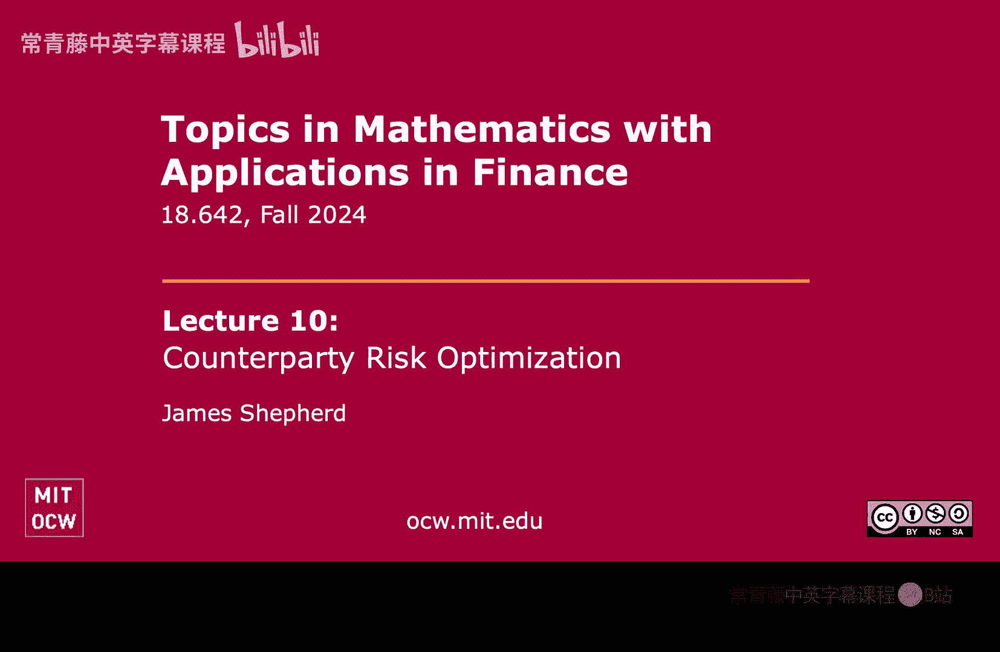
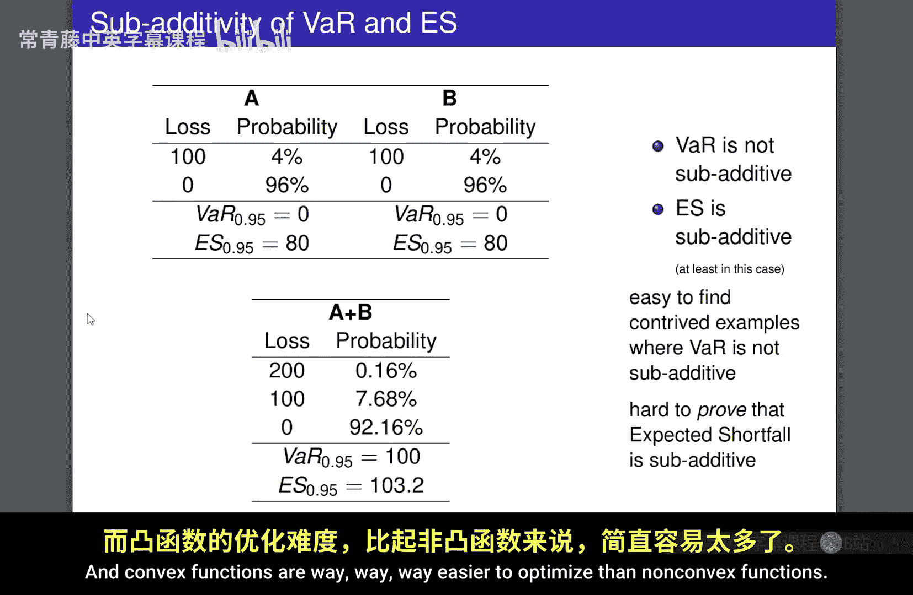
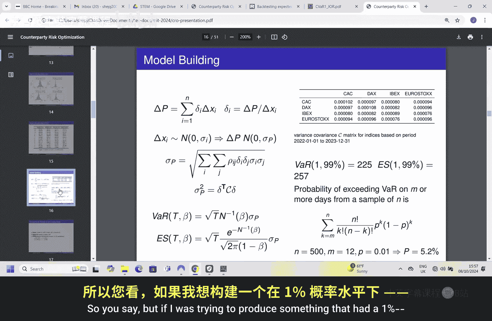

# 麻省理工学院【中英⚡数学专题及其在金融中的应用｜18.642-Fall-2024,-Topics-in-Mathematics-with-Applicatio】-p11-P11-Counterparty-Risk-Optimization--BV1iLrjBrETS_p11-

All right， well today's guest lecture is James Shepard with Quantile Quantile which is a wholly owned subsidiary of LSEG。

And your background。And quantnt finance is quite long。

Y and so I'll let you share some of the highlights Okay thank you very much， Jane。

 thank you very much， do I need that No okay thank you very much。

 thank you for having me This post to finish about a quarter to four yeah。😊。

I like leave some time for for questions。 Okay， thank you very much for having me。 Yes， I'm James。

 Yes， I work for quantntile Techologies。 That's a fintech company。

Founded in about 2016 to do counterparty risk optimization， which is the subject of today's talk。

 A couple of years ago， we got bought out by the London Stock Exchange Group。

 which is why my email now says LSCG， prior to that。 I was Morgan Stanley for quite a long time。

 which is where I know kind of Vasil and Jake from which is kind of how I've ended up here。呃。

So we're going to talk today。 We're going kind of work our way up to talking about optimizing a thing called initial margin。

 which is a measure of counterparty risk。嗯。So we're gonna start off talking about different types of risk。

 sorry。I've just emailed them to Peter。 Sorry about that。

The first view is just kind of like warm up stuff。 So you're not missing too much。 So the first。

 the first part to talk， we're going to talk about different types of risk that you have with derivative trading。

 and we're going to talk about expected shortfall and and value at risk just that of interest that people know what these terms are。

 or is it worth my explaining them a little bit。Okay， I will do that。

Then we'll talk about how that relates to initial margin and counterparty risk。

 And then we'll kind of work our way work to how we optimize this initial margin。

Within a network of financial institutions。 and we'll talk a lot about the sort of challenges that you get in in the real world。

 because this is a maths kind of talk。 I feel morally obliged to chuck some equations in the thing from time to time。

 but largely I'll kind of skip over that and talk a little bit about some of the intuition and some of the toy models and I put a bunch of references when you get the thing theres a bunch of references at the end。

 which has got sort of some of the proper maths and proofs a more detailed stuff behind it if you're interested in that。

Okay， so in the shape of derivatives， when we talk about theres different kinds of risks that can arise when you are trading derivatives。

 market risk is probably the most common one， right。

 So that's the value of the derivative goes up and down as the， as the market changes。Credit risk。

 again， is sort of reasonably well kind of understood。 It's。

 there arises when you've got exposure to a data defaultulting。 right， operationalal risk is。

 is largely when somebody screws up。 It's probably actually the hardest one to do any mathematical modeling on operational risk because it's quite hard to。

 to。To， to model people just messing up， right， which is really what that is。

Liquidity risk is when you've got a transaction， which is。It's well， as the name suggests， illliquid。

 it's gonna happen when you've got a very large position。

 So if you're trying to sell a massive position in some particular stock。

 you start selling that thing。 And then because you start selling it， that moves the market。

 And so you can't sell the whole thing at the position that the market was kind of when you started。

 So liquidity risk happens It happens if it's a kind of obscure instrument and will come back to it in this。

 It happens again。If you've got a very， very large position。

And what we're mostly going to talk about today is counterparty risk。

 which is the the exposure that you've got to when you trade derivatives to a counterparty defaulting。

I think maybe question you might come have here is what's the difference between counterparty risk and credit risk。

 So the example you can have to differentiate is is if I do a trade with Goldman Sachs that say credit derivative swap that has some JP Morgan corporate bond as the underlying then I have credit risk with respect to JP Morgan。

 because if JP Morgan defaults on its corporate bond。

 then the value of my derivative will change and I have counterparty risk to Goldman Sachs because the on what happens at the value of that derivative。

 Goldman Sachs may or may not pay me that amount of money。I that that's。

 that's the difference between those， those two。Make sense。Okay， so once you've got type of risk。

 once you've got some risk， generally speaking， you want to mitigate it。

 I reduce either the probability of it happening or reduce the impact of， that risk happening。

 not just for counterparty risk， for all kinds of risk。

 right hopefully reasonably obvious that people want to try and make the， the impact of the。

 of once you've identified the risk， make the impact of that smaller。

 So there's a bunch of different ways that you can do that。

We're largely gonna to talk about the hedging， right， which means book some trades to offset。

 book some new trades， which will offset the risk that you've just discovered that you've got。

 And we'll talk about collateralization， right， which is really paying margin payments from。

From the person you got the person you have， you're exposed to。

 you would collect a margin payment from them， which is kind of like an insurance payment against them defaulting。

 And we' mostly what we're gonna talk about today。 there are other things you can do。

And there's a thing called central clearing counterparties。

 which I thought nobody would have heard of。 But apparently。

 someone's Andrew Gustenson has already sort of mentioned this a little bit。

 So I hope I might skip over this slide because they are kind of important in the trading of。

 of derivatives。So have a quick slide on CCPs。SoNormally。

 you trade derivatives and their bilateral trades， right。

 So JP Morgan trades with Goldman Sachs and so on。 So we've got here， you've got four parties。

 say A trades with B， A trades with C。 it's got position of 100 versus B。

1 hundred and 25 in the opposite direction versus C。

 And what a central clearing counterparty does as the name kind of suggests。

 is that it steps into the middle of all these trades right。

 And so instead of a facing facing B and A facing C， A just facings the CCP， right。

 And so does B and so does C and so does D。Just by doing that， you haven't really achieved much。

 You've just changed your counterparty risk from being from being versus B And C to versus the CCP。

 But once the thing is in the CCP， you've got both the 1，2。

5 and the 100 and you can net those two positions together， right， And so you can net that down， say。

 well， and now instead of having 100 plus 125， I've only got 25。Right as my， as my risk。

 right and the same story for all the others。 right， So in the case of B， right。

 when it had exactly equal and offsetting positions， Bs ended up with no counterparty risk at all。

 So Bs in a very， very happy situation。 And everyone else is slightly happier than they were before。

 There are other advantages of CCPs。Which I'm not really going to talk about too much， but。

The thing to know is that some derivatives are mandated to clear at CCP So interest rate swaps。

 pretty much if you have a standard vanilla interest rate swap， you have to do this。

 You don't get a choice。But more exotic trades， like say， an interest rate swap or something。

 interest rate swap， they are not eligible to be cleared at a CCP。 So some are some are not。

 So what you end up with is a portfolio with some bilateral trades versus a bunch of different counterparties and some trades at the CCP。

 right， So almost everybody will end up with a mixture。Of stuff。Okay。嗯。

So now we're going to talk about quantitative risk risk measures， right。

 So what you want from a risk measure or any general risk measure。

 It should quantify somewhat the size of the total risk or the size of the total impact。

 How much money could you possibly lose。And it should also quantify the probability of。

Of losing that amount， right， So there's two aspects to it， the size and the probability。So in 1999。

 there's a paper by Arttna。 There's a reference in the at the back kind of came up with these。

Properties of a risk function， which are sort of nice properties， right。

 which are known as as as a coherent risk function。 If it satisfies those5，5 properties， right， Most。

 they say things like the function behaves kinder normally。Right， we'll come back。

 So the important one is sub additivity。Right， anyone heard of sub additivity。As a thing。

 So basically what that says is if I have two portfolios， X1 and X 2。

 and I've got some risk on x1 and some risk on x2。 and then I bashed those two portfolios together right。

 And now I've got a combined portfolio， the risk on my combined portfolio。

 according to my risk measure， ought to be less than or equal to the some of the risk on the two portfolios that had in the first place。

 which seems kind of sensible。 if I put， if I put some stuff here and some stuff here and put it together。

 It seems unlikely that I've manufactured some risk of doing this。

 But conversely it seems highly plausible that there might be some diversification of putting these two things together。

 And so my overall risk might well be smaller。 It seems a very plausible and reasonable property to ask for from a risk from a risk measure。

Okay。So we're gonna talk about two risk measures in particular， right。

 which are probably the two most common ones for looking at a whole portfolio。 One is value at risk。

 which I probably will keep referring to as Var。 and the other is expected shortfall， right。

 So value at risk， right， is this， this amount here says if I've got is is。

What is the maximum for a given confidence level， What is the maximum amount that I can say that I will。

Lose。More than that amount， right， So， for example。

Can I be 99% certain that I won't lose more than $10 million over， say， the next 10 days。 right。

 So we have a confidence level。 which is called beta。 There's a time horizon。

 which we'll talk about in a sec and the v is that that how much money can I be 99% beta% confident that I won't lose more than this amount okay。

The expected shortfall says。Conditional that I've exceeded that amount of that amount of loss， right。

 So given I'm in the the 1% tail， right， if if be is 99% or the 5% tail of beat is 95%。

 if I'm in that tail， right， What is my expected loss， given that I've exceeded v。 right。

 that's what expected expected shortfall is right， So hopefully it's indicated on here this is percentage this dark area here is1 minus beta。

 So this is say 1% or 5% right， the var is the biggest amount before I get into the tail right。

 and the expected shortfall is the average value of that tail。Yeah。Clearly。

 the expected shortfall should be bigger than the var。 right， Hopefully， that's obvious。

 for the same， for the same confidence level。嗯。So on that。

Sva was kind of popularized by JP Morgan in about the 1990s。

 something that expected shortfall came around in about 2000。

 and both of them are heavily used by regulators and lots and lots of kind of counterparty risk measures today。

嗯。Var is probably the most well known one， right， and most common。 It's got a couple of problems。

 right？ The first problem is if you have these kind of weird sort of fat tail probabilities， right。

 So you've got two probability distributions， red and blue， right。

 the blue has this weird fat tail bit over here。 right， And we just say， well。

 the area under the blue blue bit and the red bit is the same。

 So both these distributions have the same var。Right， because the area up to here， right。

 I assume there's a little bit of blue here。 The area up to here is the same as the area under that。

 So both these distributions have the same var， right， But clearly。

 the blue1 has a much bigger probability of doing some fairly horrific loss， right。

 and also hopefully， clearly， the blue1 would have a much bigger expected shortfall than the red1。

 because the average of the blue1 is about here。 The average of the red ones about here。Right。

 so that var doesn't distinguish between those two different cases， right。And you might say， well。

 this is ridiculous because nobody's gonna have in real life。

 that kind of distribution can't possibly exist。 but that is not completely ridiculous distribution。

 It's not totally uncommon to trading policy to have to sell a whole bunch of out of the money options。

 if you sell a bunch out of the money options， what most of the time going happen。

 is you're gonna to take a small profit from the sale of those options。

 And most of the time they will expire to allow of the money。

 They won't get exercised and you're gonna to take a profit。 But some of the time。

 the market will move enough。 And it moves enough， they'll get exercised and you're gonna to lose a lot of money on those options。

 So that even though I did contrive that for the purposes of this lecture。 right。

 that kind of distribution is not as ridiculous as you might think。Okay， so that's the first problem。

The second kind of related problem is that value at risk is not sub additive。 right？ So this， again。

 a little bit of a contrived example。To show that if you take say the 95% var。

 I take two portfolios A and B with those kind of probability of happening right A and B by themselves that the var is0 right because there's a 96% chance I'm going to lose nothing So 95% v is going to be zero the expected shortfall of those things is given I'm in that last 5% tail right1% of the5 I'm going to lose nothing and 4% of the5 I'm going lose 100 So I get to 80 right And if you do the maths and just add the two things up and you do the a plus B you can discover that the var of the combined portfolio is 100 and the expected shortfall is 103 right So that is a kind of example that shows that var is not so additive expected short obviously this is not proving that expected shortfall is sub additive。

 It is in this case。 It's quite hard to ish to prove that expected shortfall is sub additive。

Is and I put one of the things at the end is， is7 different proofs that it is so additive。

 So you can pick pick pick your favorite one from the the the thing at the end。

 I also put an example at the end。 So even though this one is a very contrived example。Right。

 so in real life， most things are kind normal or normal like， right， And in that case。

 vr is sub additive， right， So in real life situations。

 this is not as much of a problem as you might think。 And there's a paper at the end。

 It talks a also a lot about that。And says actually。

 lots of people criticize Var because of they come up with these kind of crazy examples。

 but it's not too bad。For our purposes， given we kind of want to go on optimizing stuff。

 it is critically bad， right， because sub addivity is we'll come back to this again in a sec is basically the same thing as convexity。

So not being sub additive means var is not really a convex function in general。

 and convex functions are way， way， way easier to optimize than non convex functions。

 So even though it's not a problem。 if you just want to know var， it is a massive problem。

 if you want to optimize one of these things。

Right， we'll come back to this again in a little bit。

I just wanted to quickly point out that there's lots lots of other risk measures you can possibly choose here。

 viaar expected shortfall just happen to be the two kind of common ones。

 You can kind of characterize a risk measure by sort of how much weight it puts on a particular percentile right？

 So Var is putting all of its weight on the beta percentile。

 expected shortfall put zero and everything less than beta and average is out everything above beta right。

 But you can say， well， both of those。 you could， you can make some criticism of them。You could say。

 well， I should put a little bit of weight on something。 It's a bit less than the be of percentage。

 and I should weight the， the really， really extreme tail losses。

 I should weight the more than than the just beyond the tail losses， right。

 So you can imagine having these sort of these exponential spectral risk functions that have these kind of functions。

 which do exactly those things that they put an awful lot of weight on the really bad losses at the 99 and 99。

9% things。 And its sort of scales off going down， right。

 It's just to point out there's a few different choices you can make here。Okay。

So both of our unexpected shortfall， they've basically got two parameters， right。

 They've got the confidence level， and they've got the time horizon。So we'll talk a bit about the。

 the， the time horizon， right， So that means。I want to make sure that I'm going to lose less than this amount of money over one day。

5 days，10 days。 right what that's the time horizon。 How。

 how long have I got to avoid losing this amount of money， right。

 If you were to make the assumption that the change in the portfolio。

 So there this Delta P is a normal distribution right。

 then var an expected shortfall would have these two these， these two formats here， right。

 So they would also be normal。Or and if you assume that people make these kind of assumptions thing that the。

The， the mean change， right， on a daily basis this is 0， which is not a crazy kind of assumption。

 Then both our and expected shortfall would be proportional to the standard deviation。Right。

 with these things， they would be normal。 And if you did that and you assumed that all the daily changes were independently。

They were all kind of independent， identical normal distributions。 so you could add them all up。

 Then you would discover that the T day var and the T day expected shortfall is proportional to square root of the one day var。

 which is the normal approximation that that people make with those things。In reality。

 it seems that the。The losses， the changes that you have on a typical portfolio or a typical market data are not independent。

 right， If you lose a lot of money one day， use reasonable chance。

 you might lose the money on the the market might go down on the second day。

 So there's a thing called kind of auto correlation。

 which is basically the correlation of a time series with itself shifted by one day， right。

And so you can， which is watch this thing here。 And if you assume that that auto correlation row is。

 is some。Ner， then it would modify the T day varor well for two days by， by this formula。 right。

 So I put in this in this table So the top row is assuming that there's no auto correlation， right。

 So that's one root 2， root 5， root 10 so on is the top row。And then as you increase the autocor。

 the T day var， right， as a function of the one day var gets bigger and bigger。 right， So I did some。

 I'll show you some market data and a sec， right， So I took one a set of observations from the Euro stocks stock index。

 right？ And that suggests that the row， right the the auto correlation is about 01。

 I did some other indices there were all between 。05 and1。15。 So now that so 。

1 is kind of reasonable。 And generally。People take a 10 day var thing is a normal thing。

 So you'd be looking about this this number here， right， this 3。46。

 it's about that means to say that the standard approximation of using the square root of saying the square root of the of the one day v the square root of T times the one day var is probably going to underestimate the actual t day var by about 10% right because the 3。

46， divided by 3。16。Okay， but nevertheless， almost everybody just says that the T day var is the one day var at times root。

呃。Okay。This is where I got the data from。 So I picked for， four stock indexes， Iex。

 Dx and Euro stocks。 that's。If you don't know， Spanish， French， German and a of pan。

 European stock stock index。So from 2006 to 2024， you can see there's a couple of periods of stress in here。

 one in sort of 2008 kind of time， time frame， round about kind of here。

 which is the global financial crash and one in about 2020， which was Covid， right。

 and some degree of calmness in in between those in between those two periods。 right，Clearly。

 some correlation between these things。嗯。不是 that。On a practical note。

 ass a couple of things worth pointing out， I pick these stock in indices because they're all European。

 which means I don't need to worry about F X rates when I'm playing with these things。But， because。

 but even though they're European， they're from different countries and the different countries have different holidays。

And so you have to decide what I'm gonna do， what you're gonna to do when one of these indexes is。

 is on a holiday and not not and not trading。 What I did here was that if all of them were on holiday。

 I'm ignoring the day。Completely， and if one of them was not on holiday， but the rest were， I just。

 I just fill forward。 And so you'd see a daily change of0 on those。

 The might not necessarily be the most sensible thing to do。

 doesn't really make that much difference。 But the reason I mention it is because if you work in this kind of industry and stuff for that。

 you end up spending a surprising and disproportionate amount of time dealing with both F X and holiday calendars。

 right， you probably don't expect to be doing this。 But holiday calendars。

you spend a lot of your time trying to work out。 What are you gonna do with these kind of things。给。呃。

So there's a couple of different ways you can estimate Var。 One is historical simulation， and one is。

Doing a model building。 We'll have a quick look at both of them。So the historical simulation basis。

 we're gonna go back and look at these look at the time series。

 We'll look at the well look at the value of each of these indices。

 theex and Euro stocks on each day， right， and we'll come up with a portfolio。

 So I made up some portfolio。 So I'm gonna have 3000 units of ca 4000 das and so on and so on。

 we'll call that the portfolio weight。 And so now I can I can figure out on the day the change in value on on day I right。

 is going be the relative change in the underlying market index， right， So。For example。

 the second row minus is the first row for the first day and so on。

 multiplied by the weight for that， that that index。 then just sum it up over all the indices， right。

 And that will give me the change on the Earth day。给。嗯。

And so then I can take the distribution of those things。

 and I will get something that looks like that。 Hopefully， that's big enough。

So one thing to add here is that。When you're doing that， when you're looking at these。

EHistorical simulations， you have to decide over what period。

 Over what historical period am I going to look at。Right。

 and the main thing to notice here is that depending on what historical period you look at。

 it makes a massive difference to both the var and the expected shortful。 So what normally happens。

 if you normally talk about v， you talk about the most recent， say， two years。

 these are all two year periods， by the way， right， So the top left 2022 to the end of 2023。

 given my series went up to the end of 2023。 This would what this this top left box would be what you would normally put in as as v。

 the most recent 500 days， basically， assuming's2，50 days in a year， which is more or less true。

The ones on the right there from the two kind of stress periods， right。

 the global financial crisis and Covid。 And as you might imagine。

 if you compute Var based if you compute var based off those two periods， you get a much。

 much bigger number than you do of either of the kind of calm periods， the kind of most recent one。

2022 or a period in between the global financial crisis in Covid to 2015 to 2016。

呃With with with that。So that makes by far and away the biggest difference， which。

 which period you choose。And because of that， regulators have recently introduced the that recently introduced the concept of a thing called Stresvar。

 So in addition to taking the most recent two years， five years，10 years。

 whatever you decide to choose， you also pick a fixed period known to be stressful right So people will pick either Covid or they will pick the global financial crisis。

 right， And then that's generally known as Sva or stressva。

 right because there's such a big variation in these， in these terms。That that that are there， right。

And then just to kind of break it down in terms of what you actually did here。

 what I actually did was I took all those changes right。

 So it was 500 changes in each period more or less I ordered them from the biggest change the biggest loss to the biggest gain。

 these things here。 And then the fifth worst one。 That's the var for the 99% v because' that' 1% and the 12th worst one that's the 97。

5， Sos it's not that complicated。 you just ordered the thing。 you take the fifth worst one。

12 worst one。 That's what v is and expected shortfall。 for the 99%。

 You take the average of of the worst four right and for the 97。5。

 you take the average of the worst 11 there is some debate about that Some people claim you should take the average of the worst5。

 including the 320 and the average of the worst 12。

 I think standard market convention is to take4 doesn't matter that much But that's all that's actually。

Happening here， right， to do these。Okay。Well， okay， so far。To do the model building approach。

It's kind of similar， right， We just make the assumptions that everything is normally distributed。

 The daily changes are normally distributed with mean 0 and Sigma I。

We assume that there's some kind of correlation between all the different indices。 And so you say。

 well， the sigma for the portfolio is going be this this term here， right。

 So there's a variance covariance matrix between the right that you that you get and using the assumption that via an expected shortfall are proportional to the sigma again。

 you get these two you get these two expressions。 So all you need to do for the model building approach is figure out what the variance covariance matrix is between these different elements which I computed here。

And they come up with a var。 and I get these two numbers，2，2，5 and2，5，7。

 The main thing to note about that is that it's significantly significantly less than the historical var。

 right， So the 99th this is computed for the 2022，2023 period， right， so。

The historical var was those equivalent numbers were 3，20 and 3，7，7， right。

Basically showing that these normal distributions， right， It's clearly not a normal distribution。

 There's a fatter tail in there than you'd expect。But you can say， well。You can work out。

 is this an acceptable var model， Yes or no， right， So what you can say is。

Given I've got something where I'm going to take 500 trials。

 and I expect to see and I expect the var， the actual loss to have exceeded the var 1% of the time。

 that's the definition of var， right， And what is the probability that I'm gonna see 12 or more So this there 12 violations。

 by the way。 So if I take this2，2，5， right， and say how many times did it actually。

 according to that period， how many times was it actually the loss was bigger than 2，2，5。

 or there were 12 scenarios bigger than 2，2，5。So what is the probability that I would see 12 or more days out of the sample of 500 that exceeded。

The that exceeded the var。 right， So that's come from the binomial distribution。

 which is that formula。 and you get 5。2%。And the general rule of thumb is that if the probability is 5% or more of getting that degree of。

 that number of， of。Violations of the var， you say that the model is O。 And if the。

 if there' the probability is less than 5%， you'd probably reject the model and say the var is。

 it's not， it's not a good model。 So even though the var here is significantly lower than the historical simulation。

You would probably accept that as as an okay kind， kind kind of model。嗯。

And the only other point I wanted to make。On。That is that what we've basically done there is a back testing of v。

 right， So we basically came up came up with a model。 And we said， how good is that model， right。

 How many times based of some historical simulation was the var exceeded。 right， So it's really。

 really easy to do back testing of var。The main single main reason why people still use Var over expected shortfall is because doing this for expected shortfall。

Is quite tricky， right， It's not even clear what it means to do back testing of expected shortfall。

 because。I mean， your， the expected shortfall is， is。A function of the probability distribution。

 It's the mean of the tail。 You can't really compare that with one sample that I've drawn from the distribution。

Right， it's like comparing apples with oranges。 there's a whole bunch of debate around whether back testing expect expected shortfall is flat out。

 impossible， difficult or not。 And there's a bunch of papers at the end， kind of on， on this， as。

 as well。 But it's definitely a lot trickier than doing it for Var。

And that is the main reason people still use vr despite its shortcomings around the sub additivity and the handling of the tails。

Okay。So I'm gonna skip over some stuff。 This is some stuff around regulation。

And I was quickly mentioned this slide。Because like so one of the problems with expected shortfall is it's kind of defined in terms of v。

 right， because it's the property。 it's the mean loss that you would get。

 given you've exceeded v in the first place。What you can do， This is a。This function here。

 this is in the paper by Rockefeller and Riya Seev is in the the back。 if you take this function F。

 which is this expression here。Right， and。You try， and then you minimize that over alpha。

 You consider this to be a function of X， which is the portfolio。 and alpha is just a number。

 And you minimize this over alpha。 Then the minimal value of that function is the expected shortfall。

 And so you can find the expected shortfall。By taking that F and minimizing it right。

 And that is basically， if you replace the integral with a， with a sum。

 that's basically a linear problem， right， And so it's relatively easy to find the expected shortfall。

Moreover， if you minimize it with respect to alpha and X。

 now what you've done is you found the portfolio with the minimal expected shortfall， right I。

 you have minimized the expected shortfall， which is basically what we're trying to do in this whole in this whole thing。

 So you just have to consider this function here， you can minimize that over x and alpha， right。

 which is basically a linear problem， and that essentially is how you minimize expected shortfall。

 no such equivalent thing exists for， for value at risk， right。

 So even though expected shortfall is trickier to。Is trickier to back test。 It's easier to minimize。

 which is what I care about more。Okay。嗯。's skip over it。 So that's expected shortfall and var， right。

 So now we're gonna start talking about counterparty risk and and margin， right。So， if you have。

In the derivative。World， right， So if I have A has got two trades，1 with B，1 with C， right。

 derivatives typically swaps。 means I're gonna exchange a series of cash flows between the two between between the two parties。

 right， And typically， those cash flows will be exchanged over a three month period or six month。

 six month period， so。A， in this case， is receiving some cash flows。

 is's paying the series S I to B and receiving T I from from B。

 A is exposed to the fact that before the next cash flow arrives from B。

 B might default and not pay the cash flow right And the same story for， for C。

 So A has counterparty risk to both B and C because when we get to the next cash flow date。

 It say three months time or six months time or years time。

 they might not pay that cash flow that they're due。 right。

 So that's the fundamental reason why they have counterparty risk for， for derivatives。

In order to mitigate against the fact that they might not pay that cash flow。

 what actually happens is that they pay is that both all these counterparties exchange on a daily basis。

 they exchange variation margin。Right。Which means that。

 which is equal to the value of these derivatives。 right。

 So as the value goes up and down of these things， they'll be paying variation margin to one to one to one another。

 right， And that mitigates against the cost of the cash flow not getting paid。

But if they're paying variation margin from one another and then one part to the other goes， goes。

 goes bust and defaults， then you've still got to pay the variation margin to the other person。

And as soon as one party goes bust， what A would try and do。 So C goes bust here。

 A would try and replace that trade。 It would take it some number of days to replace that trade with something else or unwind that trade。

 right， during which time。The value of that trade might go up。

 And because the value of that trade is going up， it's having to pay an increased amount of variation margin to。

 to B， right， And so therefore， it incurs a loss， right。

 And so it incurs a loss because during the period between when the C defaults and when it manages to replace that trade。

 the value of the trade will change will go go go up， basically。And that that is gloss So in order。

 in order to mitigate against that risk， right， A will collect initial margin。Right。

 that's what initial margin is。 that's the essentially covering you for the risk in between when a party defaults and when you manage to unwind or replace that position。

给。That's why I just says， what I just said。Okay， and then I have another slide which says the same thing again in a picture。

 right， So you have the variation margin is getting paid up until here between all these things。

 You get some default will happen here。 We don't know what's gonna to happen。

 the risk can go up or down。And there's some loss could potentially be incurred， right。

 at this point。 This should hopefully sound to you a little bit like what we just discussed， right。

 with Var an expected shortfall。 And so initial margin， right in order。

 how much initial margin should I， should I， should I collect， or basically。

 it's gonna be a var based on how long you think it's gonna take you to unwind that position。

 which is call the margin period of risk。Right。There's two kinds of initial margin。

 depending on whether your trade is a cleared trade or a bilateral trade， the cleared margin。

Is set up by the clearinghouse， the CCP。 And that's what we been case for years and years and years。

 Up until 2016， people were not paying initial margin on bilateral trades that changed when is the came up with their standard initial margin。

 which is the form I quit the formula down here。 But it's kind of similar it's basically vr right。

 is what they put here。 And the only difference compared to what we just discussed。

Is that because it's handling nonlinear portfolios， there's a gamma term in there。

 which I didn't talk about before。 And when you work it all the way through。

 you make exactly the same assumptions。 that everything is normal mean mean is 0。

 You end up with the exact same term we talked we saw before。

 right you also Sim assumes that it's a 10 day margin period of risk， right。

 And it's a 99% confidence interval。 So the 99% confidence confidence interval。

 is that's the inverse normal of 99%。 That's the10 day margin period of risk。

 That's the exact same term we looked at in the v before。

 And then you get two additional terms that come from the convexity which is kind of similar。

 The main point is that。Initial margin is basically some variant of V or potentially expected shortfall。

Okay。嗯。In real life， there's lots and lots more simplifying assumptions that people。

Make around all these things to try and simplify stuff and all these kind of correlations between all the different parameters。

 This covers the entire world all， all different asset classes by the way。

 And so they get kind of recalibrated on a yearly basis。 If you Google Sim Covid。 Now。

 you'll probably see quite a lot of stuff in there because Sim 2。

7 is about to come out in the beginning of December。

And thatll be the first one that's calibrated without any of the Covid or global financial crisis data in there。

 And what's going to happen， what people expect to happen is that the initial margin calculated by this S is going to massively reduce by somewhere in the region of kind of 5% to 20%。

 And what that will do is release something in the region of kind of $40 billion of margin back out into the wild。

 because today， people are paying initial margin or these different things with these high levels of using these high levels of R。

 when they recalibrate in the first week of December， everything will come down。

 everybody will release all the initial margin。So there's quite a lot of stuff around that kind of in the news at the moment。

That just talkeds about how the structure you， you。

Roll everything up into one number across all the different portfolios。呃。And I'll skip over that。

 So that's what margin is， right。So now we come on to trying to optimize。The the the initial margin。

 I put margin here。 I mean， I mean， initial margin。 right？

 So the the situation that we're thinking about we've got multiple different financial participants。

 A B D E， think of them as banks， right， And we've got I've put one CCP， right， there could， in fact。

 be multiple CCPs in the middle， right， And all these participants have got a bunch of bilateral trades versus each other。

 And they've got a bunch of trades versus the CCP。 that's the situation that that that we've got。

 right， And they're all posting margin to to each other。 right in this situation， Okay。

 And what we are trying to do。By optimizing stuff。Is come up with a bunch of hedge trades， right。

 which is these X， H variables between all the different participants in order to try and minimize the margin I the v in the entire system。

 right， That's the goal of what we're trying to get to， okay。And you might say， well， what。

 why are there no trade versus the CCP， were you ignoring the cleared margin。

 That's just the practical issue。 You We can't book， you can't book trades between the CCP and。

 and the bank。 all you can do is book bilateral trades between A And B， A A And E。

 all these different things。 And depending on which trades you。

Choose some of them will be cleared or not cleared。 If you。

 if you pick a trade where the trade type is like an interest rate swap。

 then that'll be mandated to clear。 And so even though it's between A and B。

 it'll get cleared and it will affect the cleared margin and not the bilateral margin。

That's why there's no actual trades booked between the CCP and any of these people， okay。

Because that's what we're trying to do。So。That's the problem we're trying to solve， right。

 which looks like a lot of maths。 But in fact， is not that complicated， Right？

 So what we're trying to do is we're trying to minimize summed over all of the parties， Right。

 all of the banks， ABC， D E， right， the margin of all those people。

 So the margin is made up of the Sim， the bilateral margin。

 summed over all the all the counterparties， right， plus。

Declared margin summed over all the CCP that are there。

 So that just says the sum of all the margin in the system is what I'm trying to minimize， right。

 And we say， well， we're same and the initial margin。

 there's some functions of risk as we've discussed， right， We know what the function is。

 It's var like， let's say， right。So we know that Sim and whoop， sorry。

Initial margin are some functions of the risk。And we know that the risk position that's there is equal to the。

Initial risk， which is this the0 plus the sum over all the hedges that we're gonna book。

 So we're gonna propose a bunch of bunch of trades。

 So we sum over all the hedges that we're gonna book the size of the hedge， right， which is the X。

 which is the thing we're trying to find multiplied by the risk of that particular hedge。Right。

 so that's， that's how we know what the new risk is。 right。

 And we've got a couple of constraints that we need to put in the system， right。

This is the most important one， right？ This is， this is what we call the symmetry constraint。

 even though it looks like looks like an asymmetry constraint。What this says is that if J， if。

 if P sells something to Q， Q had better buy that same thing from P。Right， exactly。

 And this was when we first set this up， this was， in reality。

 the thing that people were most worried that we would mess up， right。

 Because the biggest problem that could have happened here is that we told we， we set up a thing。

 We tell Goldman Sachs。Go and buy 100 million of stuff from JP Morgan。And then we tell JP。 Morgan。

 go and sell 200 million of stuff， right， to Goldman Sachs。 So Goldman Sachs sees their thing。

 says buy 100 million。 I think D's good to us will agree to this， right JP Morgan sees their thing。

 which sell says sell 200 million of stuff to Goldman Sachs and JP。

 Morgan goes D good will agree to this。 Goldman Sachs doesn't see what we told JP。

 Morgan and JP Morgan doesn't see what we Goldman Sachs。

 and they only discover that something's going horrifically wrong when they try and do that trade right So the reason that doesn't happen is because we've got this constraint in the system。

 right， that says that whatever right whatever Goldman Sachs buys from JP。 Morgan。

 JP Morgan better sell that exact same thing to Goldman Sachs， right。

 That is the most important constraint in the whole system。Right， the second constraint。

 big one that we've got in there is this one， right， which says this is cash flow flatness， right。

 This says that for any party， let's say Goldman Sachs， if I sell something， if I。

 if I sell something to one party， I'd better buy that exact same thing from ever from some combination of other people。

 right， that's what that constraint says。We don't need that to be in the system。

 It's a kind of safety valve that's in there， right。

 The advantage of having this in here is to say if I'm definitely sure that everything is cash flow flat across the system。

Nobody's going make any money or lose any money out of out of the whole system because I'm gonna sell something。

 I'm gonna gonna sell something to there。 I'm gonna buy it from somewhere else。

 I'm just all I'm doing is shuffling risk around the system。Right， you could relax that。

 and you could say， well， some parties could make some money， Some could lose some money。

 It could change some risk， but it makes everything a lot trickier。

 right So we basically enforce this around around the system。

And then the last constraint is a risk constraint， which comes from their parties themselves。Right。

 what this says is that Goman Sas or some party might say， well， I don't really want to go。

 I might not want to go long a particular risk factor versus some particular counterparty for whatever reason。

 right。So the first two are sort of system wide kind of constraints that we kind of impose on the thing。

 And the last one is a constraint， which basically says， don't change the risk too much， right。

 which is what parties say。 right， So all of that， all of that math， that's all it's saying。Okay。

 so if we look at， it's kind of， if we look at a very， very simple example。

For take a three party system， right， ABC。 So this might be a bit more。

 And you put it in there and say， well how could I minimize the margin around that system。

 right And the way youd minimize it if you've got A C's got a trade 10， A B's got a trade with 2 and。

B， C's got a trade with 9。 Well， what you do is you move the median trade around the whole triangle。

 right， If you move one median trade around one trade around the whole triangle， right。

 I'm guaranteed to satisfy by construction， those first two constraints， right。

 because I'm only moving the exact same thing around the whole system。

 And if I'm moving just say in witness case 9， I'm gonna。A is gonna buy 9， cell 9。 B is gonna buy 9。

 cell 9。 C is gonna buy 9 cell 9。 So I'm gonna satisfy the second constraint as well。

 I've ignored the third constraint for now。 And the reason I pick that is those particular examples with 2。

9 or 10 is that actually， if you fiddle around with the math a bit。

 the thing you should move is the median trade given any triangle。 and you can take any network。

 and you can always break a network into a bunch of triangles， And for every triangle。

 you just move the median around， right that's what you should do the problems are this won't satisfy all the different if you have additional const causes problems。

 And obviously， some edges of this triangle would also be edges of other triangles。

 And so you end up， but you can won't generally solve the problem But it's a good way of thinking about it。

 we always think about triangles and how you would move risk around in a particular triangle。Okay。So。

 it's that。In reality， we just use a big numerical solver。

 So what we're in the business here is we're solving minimization problems。

 operational research type type problems。 Theyre of the form， minimize F subject to some other stuff。

And as I mentioned earlier， solving convex problems is way， way。

 way easier than solving general non non nonlinear problems。

 And convexity is basically the same thing as sub addivity。 right。

 That's the definition of convexity， right， And that should remind you of the definition we saw earlier of sub addivity。

 right， So we saw earlier， minimizing expected shortfall。

 That's basically a piecewise linear problem。All these things we're talking about。

 Sam is nearly convex， right， There are different adds that you can have， which are。Usually convex。

 and some of the math that we get into is that how do you come up with approximations of these things。

 which genuinely are convex， right， We tried using non like proper nonlinear solvers on these things way easier just to approximate the function you want and use a convex solver on it。

 because the state of the technology for solving convex optimization problems is really， really。

 really good right， it would be crazy to write your own version of a convex optimization solver because the road loadloads of open source and commercial availables。

😊，Things available。 So don't do it。 Just plug it into a system。 and it works。

 The thing to note is that how difficult it is to solve the problem。Is really， really。

 really sensitive on the specifics of the problem， right And that doesn't really mean the size of the problem。

 The size is not really too much of an issue。 It's， it's all kinds of the structure of the problem。

 How sparse is the problem in the thing。 These are the things that matter in the real world。Okay。

Also， it's a good idea to use modeling languages， right？

 So there are lots of modeling languages available。 Gro is the one we use。

 I think you many people might have used it。 I think you can get it free if you're academic institution。

 Ca anybody wants to spend 10 seconds trying to solve that in their head。

 So this is into your problem trying to minimize 5 x1 plus A X to subject to those two constraints。

 you can probably do do that in your head。呃。Should can do that。Sorry。😔，嗯。So we did it un Grobi。

 using the 24 physical cause probably is overkill for that problem。

 but it comes up in 10 milliseconds with the answer of 31。 which is hopefully if you did it。

 that's what you tried。Just to show how easy it is to solve some of these problems in real life。

 a typical problem that we would have might have sort of 25 different parties in the network might be safe for F X Delta。

30 odd different currencies right， that we've got in there。

We pick different kinds of hedge instruments。 So we try and pick simple ones。

 The reason for picking things like nondeliable F X forwards is that each individual hedge type there has exposure to exactly one underlying。

 namely the currency。 If I pick a dollar euro non deliverliable。

 that's got exposure to the dollar euro Fx rate and nothing but the dollar euro Fx rate right in this case。

 right， which turns out to be useful。 And if you do that， you end up with a system。

 which is something like， say， 20000 variables，40000 constraints。

 something like that is the real size of the is the real size of the problem， right。And really。

 when you're solving convex optimization problems， solving convex optimization problems is easy because they convex problem looks like a bowl。

 right， And so they have one minimum。 and so。You can convert the optimization problem into a a root finding problem。

 just find where the root of the derivative is sort where the derivative is equal to 0， right。

 So that's root finding。 People generally use something like Newton Rafen for， for root finding。

 when you use Newton Rafen。 You've got to compute a Hessian matrix， right。

 And then you need to invert that Hesian matrix。 That's the slow part of the entire system。

 is that you repeatedly。Inverting Hessian matrices， right？ So the matrix might be 40000 ish， right。

 Matri inversion is basically an n cubed kind of operation。

 So you end up with this unfeasibly large number of operations to solve in general。

 most computers will not be able to factorize a 40000 matrix for a randomly chosen40000 by 40000 matrix。

 right， However， the problems that we have here are very much not randomly chosen matrices。

 They have an awful lot of structure involved。 And they're massively massively sparse right。

 And any most solvers， The reason why they're very mature is they take advantage of all this matrix structure that's there。

 And so they can do way， way， way better than you'd expect from this。So in particular， for FX deelta。

 right？The matrix looks a little bit like this， right。

 So' got a bit of stuff kind of at the top of the matrix， which is a。

T I talked around around the symmetry constraints and the flatness constraints， right， But the vast。

 vast majority of the constraints are those ones at the bottom of that picture， which are the。

 the risk constraints specified by the individual parties。

And they are guaranteed to be block diagonal， right， because each， if I have a particular hedge。

 say the hedge A B， right， that's only going affect the risk between party A and party B。

 a worse case。 And then the hedge the hedges between A and C。

 they're only going affect the risk between parties A and C。

 So I'm definitely going get a block diagonal matrix down here。 And everything else is going be0。

 So the vast majority is going to be 0。 And if I pick these NDF trades as well。

 And those NDF trades only have exposure to one risk factor themselves。

 I'm just going get a straight diagonal matrix here。

 right And obviously inverting a straight diagonal matrix is trivially easy So I've got a bit at the top。

 which makes it a bit more complicated， but it's a little bit at the top plus basically a massive big diagonal matrix。

 that's called a Danig Wolf structure and's there are techniques known to factorize and invert those kind of things。

Okay。Then I like this slide。 I think I one slide I've used it all three years。

 the problems that you get into in real life are not solving the kind of。

The big minimization problem， you just literally write down the math that you want more or less plug that into the the solver。

 right， But in real life， you get situations where you've got nearly parallel risks。

 you have two trades， which are nearly the same， right。

 but not quite exactly the same or can't be represented exactly the same on on a computer So this example here。

 right， if I really wanted to solve this， this first equation here， right， obviously。

 everyone hopefully， you can see that there's essentially， there there's lots of solutions to that。

 right， with this， But you can't represent a third properly on a computer， right。

 So if you actually tried to represent that on a computer， what you might end up with， for example。

 instead of putting a third。A third X 1 plus a third Y 1 as your second equation。

 You might end up with this thing here， point3，3，3， X 1， sorry。33，3，3， x 1 plus 。333 Y 1， right。

 And that has this solution，01。But you make a tiny， tiny change to that thing。

 right So all I did was I flipped over the solution here instead of having three threes at the end。

 having four threes at the end。 And instead of getting a solution 0，1， I've now got a solution 1，0。

Right， and if I make another small change to those things， It says instead of I'm gonna get 。3。

 right， then that has a single solution of-1 10 hundred11。Right， that's that's。

 that's that's the solution to that， that problem。Now， it's highly plausible。 I might also say， well。

 I want all these X's to be positive， right， That might be a thing in there。

 And so entirely due to numerical noise， it will say if I want X to be positive。

 But the only solution to this problem is-1 101 11。 Any system is gonna go， well。

 that's in feasibleible。 And so we refuse to solve it and。😊。

So the problems that we get into real life is trying to understand these things and coming up with techniques to remove these kind of situations from the。

 from the， from， from， from the system。Alright， rather than trying to actually solve sort of convex optimization problems in in their general form。

🤧呃。that。This is the same thing as before， except now for the F X Delta to full kind of F X Delta problem。

 we're up to 48 cores now。 and you can see here。It really was 1 hundred and 14000。10000 10000 matrix。

 right， is what we ended up trying to solve。 It's worth noting this kind of preold thing here。

 removed close to half of it， right， What preol is sometimes you get all these different constraints and you have them in there and you end up with a constraint that says x1 is greater than1。

 And another one that says x1 is greater than 2。 right So you might as well chuck out the first constraints。

 You say， well， X1 is greater than1。 And it's greater than2。

 Chuck out the first one and just keep the X1 is greater than two constraint。 And that happens a lot。

 And so you can massively reduce the size。And we get down to a thing like this。

But you can see even this， this problem， we can solve it in 11 seconds， right， And with very。

 very few iterations。 It was basically a testament to the。

 the amazing power of Newton refft and quadratic convergence。😊，嗯。

So what happens when you try and solve it。This is kind of how you have the initial risk。

 And this is what the optimized risk on the right hand side。 As you might expect， it tries to form。

 It tries to basically get it that I don't have some positive numbers and some negative numbers。

 It tries to nest all the risk together right as what you can kind of see here。🤧呃。

You try this on a 20 party system。 again， just removing all the constraints。 Again。

 it can remove almost all the margin between the different systems。 and you end up with either。

 if for any given row， either pink stuff or green stuff。 It's either positive or negative。

 but you don't have pink and green stuff in the same row or in the same column。

 right what that says is it managed to get rid of all the situations where I was up。

 I was up here and down there。 I just want to be up or down， So I've netted all the risk together。

 That's what the system was basically trying， trying to trying， trying to do。Okay。

You try it on a real system with all the constraints and stuff for that。

 It's less convincing what it was trying trying trying to do because the constraints hold this stuff in。

 in check here， right， with with there。Just that of interest。

 this kind of diagonal line down the front。 that's essentially the margin versus itself， right。

 So you obviously cannot pay margin to yourself， which is why you get。

I kind of blank sort of line down the diagonal。 And the square stuff in the middle。

 I originally thought that was kind of some bug。 But what that is。

 is trading between inter affiliates of the same of the same entity， right， So somebody like JP。

 Morgan or Bank America will have lots of entities。

 Some of which don't pay margin to it to it to each other。

 what I probably did here was I ordered all the entities alphabetically right， So this is probably。

 I'm guessing。Given I did that， that's probably all the interres of JP。

 Morgan is the one in the middle。 since that's or maybe it's Morgan Stanley， It will be some。

 some company， which has got a letter roughly in the middle of the alphabet with many entities。

 not trading margin versus each other。that。嗯。It's another example， doing interest rate stuff。

So what we've discussed so far is solving the optimization problems。 It has to be feasible。

 which means it satisfies all the constraints， and it has to be optimal， right。

 which means it finds a good margin saving， right。But on top of that。

 it's interesting to try and make them nice， right， and try and make them fair。

So what a nice thing would be is that you don't really want to have horrible looking notions。

 You don't want to have to have a trade with some like complicated notionional there。

 You'd like to just have trade 100 million of this or 200 million of that， right。

 The biggest amount of headache we got into ever was trading with these N D F F X trades。

Where we would trade it with a dollar notional with some like。200000 million point74。

 And then something else with the euros like  point53 in the euros。 And then we compute the F X rate。

 which would be the， the the one divided by the other。

 And the F X rate would come out to be a like 15 decimal point number。And everything would be fine。

 And then we give it to the the banks， and they would complain。 And they would say， well。

 our system only handles6 decimal places or8 decimal places in the trading system。

 And when I do that， and I put 6 decimal places in the Fx rate。 it changes my Euronotional。

 It gets a little bit off。 And so we ended up having to put notionals in that were round numbers of dollars。

 and they came out as an exact round numbers of euros using a 4 decimal place Fx rate or a 6 decimal point Fx rate。

And that turns out to be quite tricky because you need to round all these numbers， right。

 And you can't just take a solution， right， and just round it to the nearest 10， right So if I take。

 if I have a party which there I've got， hey and I'm， I'm selling。

 I'm selling 8 units of something to one person and I've offset that by buying four units from a second person of four units from a third person。

 everything is flat。But if I round everything to the nearest 10， right。

 then I've rounded the 8 to 10， right， and I round the both fours down to 0。

 So now I'm no longer flat。 So you can't do this rounding as a post processingcesing step afterwards because it breaks the flatness in the in the whole system。

 So you have to do it as part of the optimization。 If you do it as part of the optimization。

 that makes it into a mixed integer problem。 And that makes it considerably， considerably harder。

Right。We also people also want by nice， they want like a small number of trades。

 They don't want to have to trade thousands and thousands of trades in order to get some of this margin saving。

 Theyd like to have a a small number of trades we talk about as notional efficiency。

 And there are other advantages of CCP， I mentioned earlier。In addition to just the netting。

 And so there's some advantage of saying， well， I want to put。

 I I like to put more trades into the CCP。Right， and so you might do some。

 that might be a nice thing to have， right， for other reasons。

 not directly related to initial margin。 So you can add all these niceness features into the system。

The problem without the nice things like round numbers， small numbers like trade counts， these。

 these kind of things， they all make the basically continuous problem into a mixed integer problem。

 which is， which is hard to。Which is hard to solve。And。So let's get that。 And then fairness is， well。

 the first question is， what does it mean， What does what does fairness mean in an optimization problem。

 So you have this example， hopefully you can see this This is a four back to the triangle system right。

 fourpart system。 Okay， it's kind of symmetric between A and D。

 There are four the three possible things you can do all of which have the same kind of overall saving here。

 right，  essentially， you can ignore D right， and solve the ABC problem in which case D gets no saving right。

 you could ignore you could ignore A right， and get this and get the same saving， right。

 or you could kind of split the saving between A and D， right。

 So therere the three different scenarios that you can get right So put down in the table at the bottom。

 So scenario one is the ignoring D。 This is the saving that you get A gets a saving of ABC or get a saving。

For right， D gets nothing， right。嗯。So this is where this is。You can argue， that's not fair。Right。

 because D gets， gets， gets nothing there， right， You can argue scenario 2 is not fair because A gets nothing。

 right， You can argue that of these scenarios。Scenario three is the fairest。Right， just intuitively。

 right， It still might not be the fairest because， well， why did A get2 and B， D get2。

 But B And C got their full four allocation， right。

 So the concept of fairness is not a well defined one。 One thing you can look at， right。

Is whoops have a。Two step system。Right， so you， first of all。

 figure out what is the best possible saving that any one party can get。

RightSo the best possible saving that all these people can get is always for， right。

 And so you do a whole bunch of optimizations where you ignore everybody else。

 just try and optimize for A， then just optimize for B， then optimize for C， then optimize for D。

 Now I get the best possible thing that each one can be subject to all of the constraints still being there。

 right。When I know that now I'm gonna to say， what I'm actually going to solve is how do I minimize the square of the difference from my actual solution to those things。

 right， So I've got a least square problem that's that's in there， which is this， this problem here。

 and that's the things。 And I'm going do one more optimization at the end， when I solve that problem。

 right， And I'm going to say that's the answer that I've that I've got。

 And you can see if I did that in this case。 clearly。

With a squared scenario3 is going to definitely come out as being the best solution is B And C will be zero in those things。

 And then for scenario 3， I'll get。4 plus 4， right， whereas in scenario1 and scenario 2。

 I will get a 16 right from the from the square， right， So if I were to do that on this case， right。

 it would， this would， this would be an algorithm that would deterministically give me scenario3 as as the fairest But there are other ways of defining fairness And I don't think it's a well established kind of thing Yeah。

 I think it's the single most interesting problem that we've got kind of in the optimization kind of kind of space。

And then let's skip over。 This are just some pictures of what we've kind of really got terms of saving。

 The more interesting one is really this， right， which is showing the kind of network effect。

 right So you could kind of expect， obviously， that as I put more and more banks or parties into the system right。

 the savings should go up， That's kind of a reasonable thing。 But more than that。

 the saving divided by the initial that also goes up。

 right So you get not just the total saving in the system goes up。

 but the total the efficiency increases the more people you add into the system。

 I wouldn't put too much faith into whether it's really linear or whether it's kind of not linear thing in there。

 but there was clearly adrift upwards in these things。

 which basically says that if you want to do this， the most effective thing you can do is get big networks of people and big networks of people are beneficial to everybody。

In in the system， that's basically the story of that， of that picture。呃， that。Think that is the end。

Yeah， so that's just a quick summary。 We talked about value at risk and expected shortfall。

Talked about the centrally cleared and bilateral。We talked about counterparty risk。

 What variation margin is， initial margin。 What we're really trying to do is optimize this initial margin。

 That basically comes down to doing constrained convex optimization。

 The difficulty in constrained optimization is really all the numerical issues that you've got and actually the interesting problems not it's too much solving the feasibility and optimality bit。

 But how do you add the niceness and the fairness on top on top of that。Hopefully。

 that is the end of your slides。Take go。 Thanks very much。That makes sense to anybody or。

Anyone have any questions？Go ahead， the question about。Yeah。Yeah， yeah。

It would be the first one where it's not。ととま。Like a stressful。Yeah， yeah， yeah。

I was wondering what goes into。to cut咗 and then。What。有啊。这实。要は？This is affecting the。

So I don't think it will necessarily， well， the effect on the economy is gonna be potentially it's gonna be a lot of margin released back into the system。

 right， Sos actually margin is money that cannot be used for trading right it's essentially locked away segregated accounts。

 So the release of all that margin into the system there's more margin available for trading that's kind of the effect it would have on the system。

 in terms of the kind of choice of parameters， I think effectively must show that really it's sort of roughly a two yearear look back similar to what I was doing in the toy examples that I had earlier。

 So this though it's looking at other different things， the stress roughly 2021，22ish。

 something like that。 So basically it's going to be looking a region say from 2021 or 2022 beyond And that's the reason that all these big shocks that happened in 2020re too far in the past to be counted in the。

These days。 now， of course， there might be some more the exact same thing was about to happen in 2018。

2019， just before that happened。 And they would also been about to say， well。

 that's just smooth it all out。 and then what did happen was then all these shocks came in and people decided that what Sim was doing was massively underestimating the var。

 and the fact that they were only recalibrating on a yearly basis was kind of problematic because they had to wait a whole year and in fact。

 a year and a bit because of the timing they had in December and the way they come out before they could start including these shocks that were that happened in 2020。

 So actually， as a result of that， they moved from a annual recalibration process to a semi reanual process so that they could bring these the effect of these shocks in more quickly。

Is regulated is the International swaps derivativeatives Association。So there's a panel。

 they chair it is， it， is is this model。 They're the ones who ultimately put put that thing there。

 But there's a lot of collaboration with various banks and other other sort of parties and in interested parties。

Yeah。北京。Increasing wage on leverage。It's a different beta。Yeah， so that's a beta in terms of， well。

 this beta here is just a confidence interval， Right， I was just saying I。

 it's the beta is the I'm 99% confident。 I won't lose more than this。Yeah。

Do you want going back to side we talk about。Back testing or at the limitation of the back testing。

是风。Yeah， hangang on。That one。因为。呃。I in mind。What are some ways that you can almost cut corners or like make some assumptions that allow you to calculate expected shortfall。

 what do you have to assume for to be possible？To be possible to back test。也不。Well。

 you kind of have to make some assumptions around the form of the tail， right？

 See if you were to say well the tail is kind of flat or you have some structure in that。

 I think you could start to you could start to say does it fit in there。

 what normally happens in real life。 is that regulators have moved from var for saying， well。

 your actual initial margin and capital should be based， that used to be var， Then it was stress v。

 and now it's moved to expected shortfall。 But they still require you to back test var。

 So what you generally do is you build a model which which will will predict both var and expected shortfall。

 you compute the number using the expected shortfall number。

 and then you back testest the var because that's a lot easier And then you say， well。

 I've built the model consistently。 And all I did was apply a different multiplier for the expected shortfall versus the var。

 So if the var back test properly。 then I'm prepared to accept the expected shortfall。喂，上佢啲啲。

If you like assume a different shape of tails， then theoretically that's like not necessarily。你点觉咧。

Like statisticalWell， it is。 But when you're back testing， right you're back testing and you say。

 well， what happened on 23 December22015。 Well， there was no distribution。

 That's just whatever happened on that date， right， So there's no distribution there。

 So you can't say it's difficult to make an assumption about whether or not that was kind of。

Predicted or not predicted because it just it， it's a single draw from the distribution as opposed to the shape of the distribution。

 It doesn't tell you anything。 You can make any assumption you want about that， about the， the tail。

 But because I've taken one number， It doesn't really show me anything。 Does that。

 Does that make sense。Yep。Build up on that。 So you mentioned that you can that pass。房作对。

And far on bars。看家这看的会。LikeAnd then how to predict moral。Are these monoth accurate enough？

To account for。8。And。And they， well， it depends how you build up the model， Right。

 So essentially my model here， right， The model wasn't really a var model or an expected shortfall model。

 The model that I proposed here was that everything that that the daily changes are normally distributed。

 right？ And in this case， that they're independent all the daily changes are independent。

 That was essentially my model， right。Having made that assumption。

 I get a var number and an expected， joyful number， right， And I can back testest the var。

In real life， people make more sophisticated choices。

 They don't assume that it's normally distributed。 You can have other distributions。

 You don't assume that all the changes are independent of of each other。

But the model is not really a var model necessarily or an expected shortful model。 The model is。

 what did I assume about the distribution。Having made those assumptions， I get a var number。

 and I get an expected shortfall number。Does that make sense？

this example when you were explaining it。You said that let's see I guess。actual shortfall was 5。2%。

 was it？Through the mall earth。Through the historical simulation。 But yeah。

 so what so what so what I said was that this came up as so the var came up as 2，2，5。

 right based on the model。 If I go back to this table， right， So this is the leftmost column here。

 right？ in reality， we can see that there were 12 there were 12。

 there were 12 actual days when I exceeded that number， there should have been 5。

 that was the intention right， So you say， but if I was trying to produce something that had a 1%。

 I'm supposed to exceed var1% of the time。 That's the definition of var， right。

So if I'm trying to come up with a model that I'm where I expect something to happen 1% of the time。

 or I expect the var to be exceeded 1% of the time， right， then I do 500 drawers of that thing。

 And I say， well， how many times was it actually exceeded。That。

 and then the probability of that being 12 is 5%。At least thiss conservativeserved that therefore it's okay。

Even though it's wrong。At least it's not calibrated。 It's， it's conservative。

 It's not that conservative。 A conservative v would be bigger than the historical v， right。

 So the actual thing is the historical v was 300 or something。 Conservative would be a bigger number。

 right。But it's not overly aggressive。Let's say， I think that's probably the way to， to， to put it。

Any other questions？Anyway， thanks very much。 Thank you。

