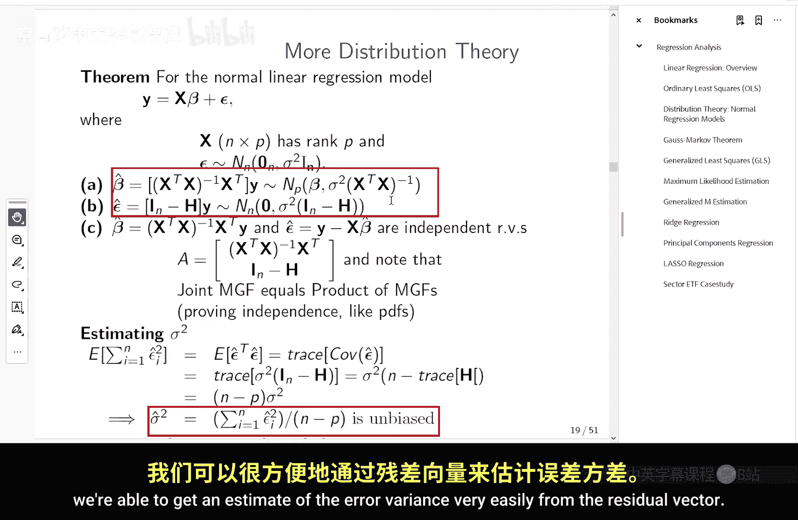
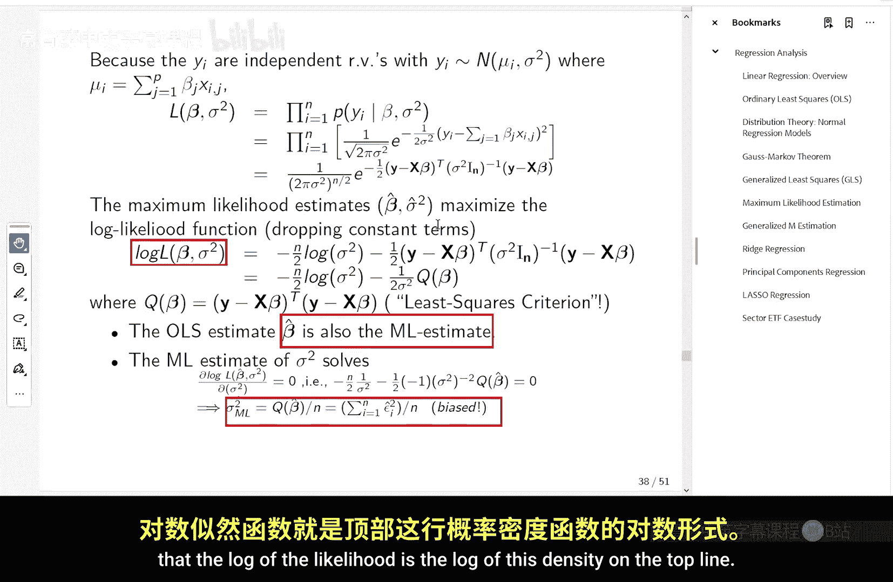
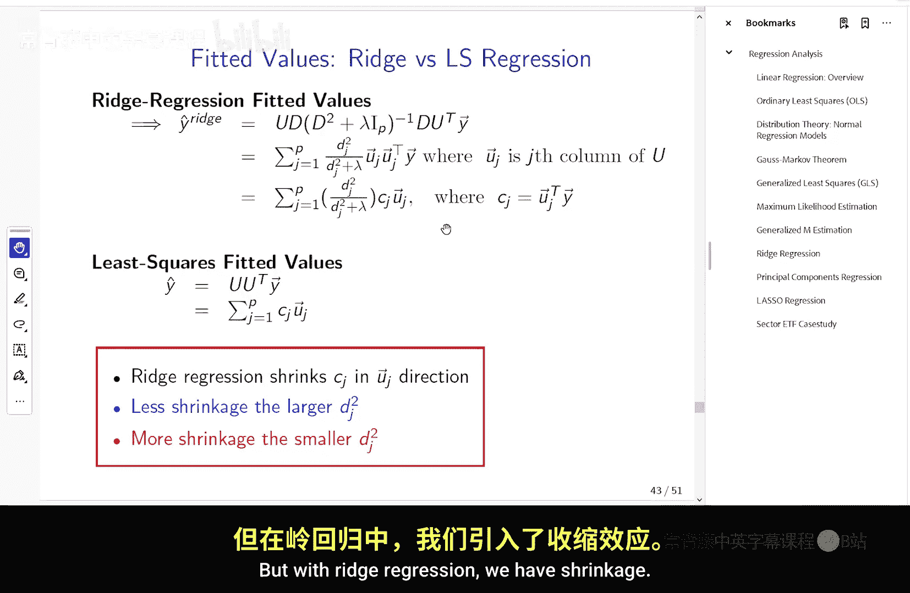
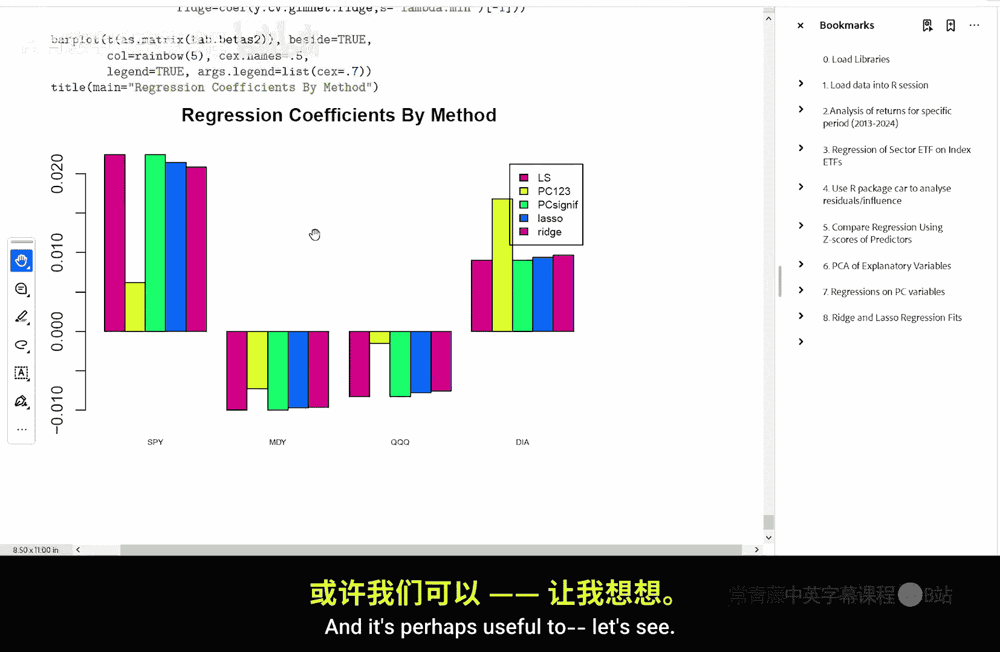
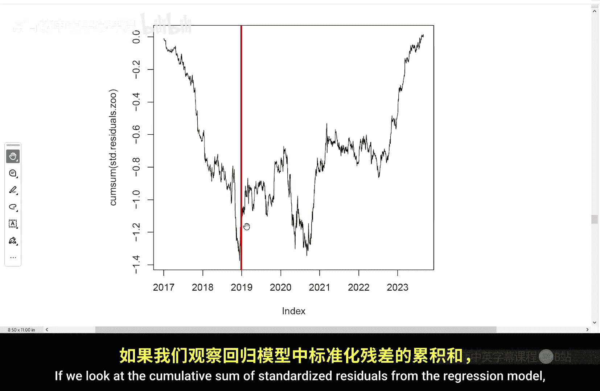

# 麻省理工学院【中英⚡数学专题及其在金融中的应用｜18.642-Fall-2024,-Topics-in-Mathematics-with-Applicatio】-p12-P12-Regression-Analysis-(cont.)--BV1iLrjBrETS_p12-

。All right， we'll get started What I want to do today was to make sure we thoroughly cover the theory and application of regression modeling。

To begin， there's a recap， which is。The theory for， if we have linear regression。And we have。

 in particular。A normal。Linear regression model。 Then we have these properties of beta hat。

Being distributed as a multinmal。Random。variableable with mean the true regression parameter and covariance matrix given by the x transpose x inverse multiplied by sigma squared。

And we also have that Epsilent hat。Is a multi normalormal distribution。It's actually not a full rank。

 but it's in n dimensions with mean zero， a zero vector， and the covariance matrix is sigma squared。

Times the identity minus the hat matrix。And with these properties。

We can show that they are independent random variables if we have the normal model assumption。

So these are independent。If。The error vector。Is multinormal。And。With that。

 we're able to get an estimate of the error variance very easily from。

The residual vector， the sum of squares of the residual vector。

Can be solved for having expectation equal to n minus p sigma squared。

And that leads to dividing the sum of squared residuals by n minus p to get an unbiased estimate。Now。

 what's interesting？Mathematically， is that because this。

Estimate of the error variance depends on the residuals， which are independent of beta hat。

 We can then use this information to construct T statistics for the least squares estimates。

 So we have。T statistics。For。Jaith component。Of the least squares estimate。

 so beta hats sub J minus beta J。Divided by。Sigma hat。CJJ。

Where CJJ is the Jith diagonal entry of the。Variance。Inverse variance。 And actually， the C J。

 J should be。Equal to the square root。Of x transpose x inverse sub J J。

So there's a square root missing there。And。This distribution。Under the normal linear model， has。

Or this formula has a T distribution。So this is distributed。

As a t distribution with n minus P degrees of freedom。Degrees of freedom equal to n minus P。

And this is true。If we plug in the true。Beta J。So normally or centering our least squares estimate at beta J allows us to write that out。

 So if we look at our beta hat。Value。And consider it。Around the true beta J。

 we basically have a T distribution for the outcome。

And why this becomes very useful is that if we want to test the hypothesis that beta j is equal to zero。

Then。If this is。Zero。We can basically define。A an interval。Around zero。And consider rejecting。

The null hypothesis， if our T hat with beta J equaling 0。

In magnitude is greater than some critical value。Say， some constancy。

And so this T statistic is commonly applied in judging different regression models。

Of particular interest is whether factors can be excluded from the regression。

So if a beta j component is equal to zero， that means we can just exclude the variable。Now。

 interestingly， if。We want to test whether。Multiple beta js are equal to 0。 A special case of that。

Is just to say， let's assume that the first。K， beta Js。Are non zero。

We'll just assume that that's true。 But let's test whether。The beta js for J above K are equal to 0。

And what we can do is calculate。Resuals under。The two hypotheses。First， assuming that therere。

All nonze， we get an RSS1。But if we assume the submod is true。

 we can get a second set of residuals and。Because。The full model is more。

It minimizes the sum of squares further， we can look at the difference in residual sum of squares。

Normalize that by p minus k and compare that with the residuals sum the squares。

Under the full model divided by n minus P。 So this is an estimate of sigma squared using the full model。

This numerator is also an estimate of sigma squared based on。The null hypothesis being true。Now。

What's interesting to highlight is that。The F test。When K。

 the number of non zero coefficient is p minus-1， then this F test corresponds to testing。

 whether the P。Btata j is equal to zero。And so it turns out that if we have。T hat P。Sorry， T hat。

 yeah， P of beta。Of the true beta。The beta with beta p equal to zero。This。

Squared is actually equal to this F statistic。U。I'm just going to。

There's a huge rumbling in the room right now。 And if anyone。

Finds out that it's something serious we should be thinking about， please let me know。

Or let the whole class know。It sort of sounds like an earthquake。

Which I experienced when I was at UC Berkeley。Anyway， all right。😊。

I'll continue unless I get warnings from you all Anyway。

 it turns out that this t squared statistic is actually equal to the F test formalized here。

 so F tests are very useful in special cases they're equivalent to the square of a T。

AT test statistic。 Now， let's see。With。The notes from last time we went through these we。Highlighted。

How。With generalized least squares。This is another key takeaway。In regression modeling。So。So。

 generalized。Lease squares。With generalized leaf squares， we have an error vector， which is not。呃。

A diagonal identity。Times sigma squared but。It's。Some base matrix sigma。Times little Sigma squared。

And with this setup， we can actually transform this regression model into one which satisfies our Gaus Markov assumptions。

And then so with x star and y star being the model equation multiplied by the inverse square root of sigma then。

This model satisfies the gaus mark of assumptions，0 mean constant variance。 And so this estimator。

With the X stars and y stars， but the same beta gives us our best estimate of the beta hat best in terms of minimum being unbiased and having smallest variance。

Okay， well。Next。Important。Aspect of regression modeling is looking at maximum likelihood estimation。

MLE。And。For maximum likelihood estimation， we use the probability model。Of。The regression。

 which in this case， is normal linear regression models。 So if we have normal。Normal epsilon vector。

Then we compute the density of our data Y， given。The explanatory variables in X， and the beta。

Regression parameter beta。 That should be a beta there。 And we simply。

Identify those parameter values that maximize this probability。

 So we're looking at the parameter values that make the data we observed the most likely。

And intuitively， that's maybe be a reasonable thing if you take mathematical statistics。Next term。

 you'll learn that that in fact， is an optimal estimator in terms of having smallest variants。

In large samples as large as the sample size， the number of cases and increases this will lead to the best estimator and this MLE。

For the best the best estimator being the MLE will be true for different distributions as well。

 We're going to show what it is for the Gaussian distribution。And。What we can see。

On this slide is that the log of the likelihood。Is the log of this density on the top line。

It can be equal to minus n over 2 log sigma squared。Minus a half。Sigma squared Q of beta。

 where Q of beta is our least squares criterion。So maximum likelihood estimation for normal linear regression models can proceed in two steps。

First。We can see that the beta。Regression coefficient enters in only through a factor of Q of beta。

 So minimizing Q of beta gives us the M L E for beta。And then once we have the ML E for beta。

 we can plug that into the likelihood， the log likelihood。Or the likelihood。

For varying sigma squared。And when we do this， we actually can just maximize this。

Sort of partial likelihood with beta fixed at beta hat， maximize that over sigma squared。

 and that turns out to be a very easy computation calculating the first order equation for the log likelihood。

And we get the maximum likelihood estimate is simply the sum of。Ritz squared residuals divided by n。

Now， with maximum likelihood。In this case， we have actually a biased estimate of this error variance。

 and it's important just to note that that's the case。All right， well， what's interesting？

To generalize is to find estimators。Which minimize。A Q function。

 which may be different from least squares or sum of squares。 And so we can consider a Q function。

Which minimizes the sum。Of a function H evaluated at case I。Let's see here。H this down。So。So， with。

We generalized。With generalized。M estimators。We think of Q of beta。Being the sum one to n of H of Yi。

The X。Beta。AndSigma squared， I guess。嗯。And the choice of H， well。

 if we choose H to just be the square of。The linear estimate of y， given Xi， that's least squares。

There's no reason。In principle， why we should use squares。We could use absolute deviations。

 and some those。And。If we wanted。Maximum likelihood estimates。

We could choose H to be minus the log of the density。And。

There are robust estimators and statistics and these robust estimators。Consider variations。

 basically， of least squares and。Mean absolute deviations as special cases that yield estimators that are robust。

 Now， what's to me， very interesting is that。If we were to know what the density is。Of the errors。

Then maximum like estimation would say， use that。When we don't know the distribution。

Then these others may be。Very useful as alternatives， and。

Robust estimators were originally proposed for models where we may have a normal distribution most of the time。

 but some contamination distribution with large errors， a small percentage of the time。Now。

 another interesting example of this generalized M estimator is the quantile。Etator。

Where we consider sort of mean， absolute deviation。But we scale that for positive residuals。

By a factor tau。And。For negative values of the residual。

 we scale the absolute deviation by one minus tau。This H function。Basically， is equivalent to。

Mean absolute deviation when tau is equal to 05。But when Tao。Is if we have H。Let's see。So H of Y x。

When this is equal to tau Y i minus Xi beta。When this is。Positive。And it's equal to one minus tau。

When this is。Actually， it's equal to。Minus this。When this is less than 0。Then。For example。

 when tau is equal to 09， this turns out to be a quantile estimate that is。

Tt working to estimate the 90th sort of percentile。Of outcomes。 So when we have a regression model。

And we are。Sort of。It just。If we have a bunch of points。And we consider a linear regression model。

 this would be know y equal to。A Y hat equal to sort of the mean absolute deviation estimate。

We actually。Can get estimates of the 90th percentile of outcomes of the regression model now。What。

Interesting， mathematically is。How would one calculates or the mean absolute deviation estimate or this quantile estimator？

Well， we would want to minimize。The sum of these H functions。And these H functions actually are。

Convex。So as James Shepherd said， you know， this is like a bowl shaped problem。

 but it's a bowl with her square。Or with with straight edges around， around it。

 And so if we take this Q function with this H， we can't minimize it by solving the first order equations。

So if we have Q equal to the sum1 to n of H of the arguments。We can't solve this。呃。

We can't solve for this， equaling 0。But we can solve for。What the derivative is， at any guesses。

And we can move our guess to a lower value of the Q function with that。 and that's in fact。

 how we learn that the median of a sample，Is the。Best estimate of the center of the data if we consider mean absolute deviations。

Okay。Well， let's consider another extension of regression。

Famous enough to have its own name Ridge regression。 And so with Ridge regression。We are estimating。

They're regression parameters。Where we have。Basically， it's sort of least squares plus a penalty。

For our criterion。So。The left argument。Of this。Expression is simply the sum of squared residuals。

 But then we're adding to that， a penalty。Depending upon the squared length。Of the beta vector。

And so。In order for this to be。A reasonable。Thing to do。 We actually。Need to， or as we don't need to。

 But it's useful to consider standardizing our independent variables。X。Making them have mean 0。

And also centering why。And then， consider the regression。Where we rescale the。

Columns of the predictor matrix。As centered with the inverse of the covariance matrix between those。

So in this formulation， this is the。呃。The statement of how the Rige regression parameter estimate is specified now。

The centering of。The independent variables and scaling them to have unit variance。

Is important because it places all of the variables。

 all of the predictive variables on an equal footing。If we are looking at the sum of squared beta Js。

Then if we just use different units， we could make any J beta beta j as large as we want。

 but with this standardization， we basically eliminate that aspect。

 so there's no dependence on the original units of X。And。Let's see with this Rige regression。

 the notes go through how we compute these。I want to。Highlight， though。

 how this ridge regression is actually related to Bayesian。

Models where we would assume a prior distribution。On。Our regression parameters。And so， the。The。

 if we consider a bay。Prior。On beta。And that。Bys prior is basically multi normalmal。In P dimensions。

With。A mean vector of zero。And a covariance matrix。That。Is。Let's see。 I'll call it omega。

And omega is proportional to the identity matrix。With P dimensions。Then。What we've done is。

We have a criterion that corresponds to the。Exponential part of the log likelihood for。Plus。

 the log likelihood of the prior density。So， so this Rige regression is。

 is interpretable as putting a a prior distribution on the betas。That。

Have this form mean zero and covariance proportional to the identity matrix。

 and what that suggests a priori is that sort of any direction in that p dimensional space is equally likely as any other for characterizing the regression parameters。

And this beta hat， which minimizes this argument， ends up being the mode of the posterior distribution。

So that's a neat connection to be aware of。The notes here go through。With ridge regression。

 how we compute them。The minimization。Basically leads to formulas for the Rige regression estimate that look almost like these squares。

 except we have this additional factor lambda times the identity inside that braces before we take the inverse。

And with Rige regression， we can。Look at the singular value decomposition。Of our。

Independent variables that have been centered and standardized。And when we do that。

We basically have these， this final formula for the。Rid regression。And we end up basically having。

The fitted values， why hat。Just being equal to。A sum of factors times C， J， U J， where these。Factors。

R 1， when lambda is 0。 So when lambda is 0， least rid is equal to least squares。

And so the least squares fitted values are given here。But with Rige regression。

We have shrinkage。And what's curious is that there's less shrinkage。

For the larger squared singular values。 And there is more shrinkage for the smaller ones。

So if we think of the independent variables or predictiveor variables。Being in P dimensional space。

Then。Ridge regression will。Not shrink much those regression coefficients。That are correspond to。

Regressor variables that are along sort of the first principal component axis。

And there's much more shrinkage。In those dimensions where there is very little。Variation， so。

 so these are actually connected to。Pinncipple components。Variables。

 which is actually covered sort of in the next。Section。U。So。You know， it was。

We introduced Rige regression using the singular value decomposition of x， but we can。

Motivate principal components， regression。Using the same singular value decomposition。

So with our data。Preddior matrix X， we consider the sample covariance matrix of those row vectors。嗯。

And。We can compute the eigenvalue， eigenvector decomposition of that。And with these eigenvectors。

 which are。Normalize to have length 1， we simply multiply our。Matrix x by the Jith eigenvector。

 and we get our Jth principal component variable。So this is familiar to us in terms of how principal components。

 sort of computations work。And。With principal components， regression。1 has。

Pinncciple component variables， which are orthogonal to each other。

And so the computation of their coefficients is very simple。We can calculate them separately。

And we can consider using maybe just the first M principal component variables in our regression。

And so if we do this。We。Can see some easy formulas for the estimates。嗯。Ultimately。

We get fitted values。Of y from principal components to regression。

 which are a projection of the y vector。On to the space spanned by the first。In this case。

 the first M principal component directions。And。What's curious is just how。These three methods。

 least squares， ridge and principal components for regression。Are estimating。

The response variable or dependent variable using essentially the same fundamental pieces。

The CJ and UJs。But are either sort of skipping the last p minus M for principal components。

 shrinking those based on the size of the eigenvalues for ridge or using all of them。Now， as you。

Might expect。Researchers have extended estimation methods beyond these， the Laso regression。Model。

Or regression estimate is one where instead of having the penalty be the sum of squared。

Beta js or the length of the beta J。It's the sum of the absolute values。

And this penalty is a really interesting one。And some let's say， I'm sure some people here have。

Perhaps used lessso regression has anyone here used lessso regression？Nobody。That's fine。

 that means this isn't。Sort of repeat information。 But it turns out that。Well， let me just draw this。

Suppose we have。Beta 1 versus beta 2。And。We're considering。Penalties。嗯。

So the sum of the beta J squares equal to a constant。This is the sort of ridge penalty。So。And so if。

 if we have a beta hat。Say a beta hat here。Point that we observe。

 It basically is sort of shrunk toward 0。Or we have beta hat。And the beta hat Rige。Will。

Be shrunk towards this sort of prior mean。Some amount with the laso penalty。

We have the sum of the magnitudes of the beta Js is equal to a constant。Then。We basically have。

Sort of diamonds。Where along each of these diamond edges， the penalty is the same magnitude。And so。

With lasso regression， we basically consider。Finding。An estimate that is minimizes the least squares。

But also is。Constrained to have sort of some of。Absolute magnitudes that's smaller。

 And so this kind of penalty ends up。Actually， leading to。呃。Sort of shrinkage。

 which tends to concentrate at the vertices of this。Palty function。

So so what we end up getting often is。A laso estimate that has some null parameters。

0 valued parameters。 So it's a way of excluding variables from the regression。

 depending on what lambda is。🤧嗯。All right。Well， let's see， there's this ETF case study。That I posted。

嗯。Which。And sort of a long document to sift through。 But I guess what's important。

Is just to look at the table of contents to see what's of interest to check out in this。And。

What I set up as a problem was to consider collecting。Prices on exchange traded funds。

That correspond to different sectors in the US market。And so in the US market。

 there are about 10 sectors。Consumer staples， energy， financials， health and so forth。 And then。

There are also exchange traded funds that correspond to market indexes， like the S&P 500。

Or the Dow Jones Industrial， or。The Nasdaq market， and。I consider。

Regressing a sector ETF on the index ETFs。Now。Why would we be interested in regressing a sector index on。

These。嗯。Market index， ETFs。Well， let me just。Go through here。 Okay， or this。

 this document goes through listing the symbols for all of these different ETFs。Plooting them。

And actually， then converting。The prices to weekly returns。

And then looking at how they're correlated with each other。So， in this example。

I believe it was the Consumer Staples sector fund。That。I'm thinking of regressing on the SPY。

 which corresponds to the S&P 500 MDY， which is a midC index， QQQ in the diamonds。

And if we look at these sort of cumulative returns of these different。ETFs， you know。

 here's the cumulative return over。I don't know a 14 year period or something。Well。

 any more thoughts on why we might want to regress this on these？Indexes Aj。The index。

What's the entire variation explained by there。Ifum and everything you can。受てる。

They should explain perfectly。Right， okay， so that's looking at almost the other way around。

 if we are looking at the。index ETF as a function of the sectors。

 We should have almost a perfect ex explanation of that in a regression model。

 What can be useful with this regression is if we wanted to invest in consumer staples。

 But we wanted to have our investment be hedged against the sort of market risk。That is large， and。

And so if we could eliminate the dependence on the S&P 500。

 eliminate the dependence on the mid cap and the QQ Hes， then。Our sort of hedged investment。

 we'd be less concerned about major drops in the market。 So we'd be reducing the market risk。

 So this is where it can be very useful now。This kind of approach。

Has also been used to try and mimic hedge fund strategies。And so there's。

Some papers out there on hedge fund replication where hedge funds basically。Maybe。

Have most of their returns attributable to。Liquid market instruments that one can trade。

And a portfolio and so hedge fund replication。Methods have actually done that kind of regression as well。

Anyway， with this。With this setup， we can just regress this XLP on the index ETFs and we get。

This regression。Coeicient table here。What's important to see is。Whetherath。Their regressionion。

Coics are significantly different from 0 or not。And。

The T value and P value columns basically tell us that， that all of these explanatory factors are。

 are useful here。And。Let's see， when we。When we study。Let's see when we study the regression model。

 okay， we have the r squared of this multiple regression。

The correlation of the fitted and actual values is given by or the square of that is given by the R squared。

And we can do various regression diagnostics， which are used here。

 what I'll let you go through these details that's a bit repetitive from what we talked about in the last lecture。

But。Let's see。 We can also model。The independent variables。

Or do a principal components analysis of those。And if we compute a principal component analysis of our independent variables。

 in this case， the index sector exchange traded funds， we then have。A。

Sort of decomposition of variability。W whichch indicates that the first principal component variable explains 90% of the variability in these data。

The first 2，97%。 So we're actually explaining a lot of variability with just the first two。Now。

In looking at。The regression on the PC variables。嗯。Let's see。We can。Consider， well。

 each of these PC variables， principal component variables are orthogonal to each other。

 So in estimating the regression coefficients。We can do so with simple linear regressions。Of。

The ETF fund。Why on that， on each variable。 And so the first principal component variable has an R squared of 0545。

嗯。And the second principal component variable。Has almost no correlation。And so it's。

While it's almost none， its P value is still 0。0518， which is almost statistically significant。

 with very large samples。 We're able to judge small correlations of being statistically significant。

 but maybe it's not practically significant。And then， the third。Has a small R squared as well。

 and the fourth。Again， rather small。 But what's。What's of interest is。Whether the。Or basically。

 just how statistically significant are the principal component variables。

And in this sort of updated example。嗯。Let's see here。Well。

 if we consider the regression parameter based on only the first three variables， we basically get。

These results。 Now， when I did this。A few years ago。It ended up being the case that the。呃。

P values for， I think it was the second principal component variable was not significant at all。

And so in choosing to。In choosing what factors to include in the model。

The principal components regression approach of， basically， including successive。High eigenvalue。

 principal component variables in。Successively， so long as they're significant that actually。Sort of。

Doest doesn't include really necessarily the important regressors in the model。

 so we can have statistically significant high order principal component variables。

That don't have much variability in them。 but they actually are explaining significant factors affecting the response variable。

So anyway， this note goes through。Additionally， considers Rige regression and less so regression。

And so with the Rige regression。Result。The display of regression parameters is traced out。

As we consider different constraints on the。L 1 or on the well， on the L2 norm。

 And if we look at the L 1 norm of these estimates。

 one can see basically how as one sort of decreases the penalty。For。

The complexity of the regression parameters。 We get final estimates given by these。Ending values。

 But if we。Increase the penalty on those。 Then they basically are shrinking。Toward 0。

 although the shrinkage isn't necessarily in a monotone manner。And then， if we。

Look at the Laso regression。With a same。L 1 norm， sort of scaling。

One can see how as that lambda parameter associated with the penalty is increased。 We basically have。

The L1 norm getting smaller。Of the resulting estimates。 And this shows you how。

I guess the third variable is the first to be excluded。 then the second。 and then finally。

 the fourth。So。Alright， so， so anyway， so this note goes through an illustration of lessso and principal components for regression。

And it also provides a comparison of different coefficients by method。And。

What this final sort of chart shows is。The comparison of。Beta estimates by method。

 and one can see that most of the methods give similar results。

 but using just the first three principal component variables gives us a very different estimates。

Of regression parameters。 So， the， so there's sensitivity of。The estimators to the data， and。It's。

 perhaps。Useful to。

Let's see。Well， it's useful to consider these alternatives with very large sample sizes。

 you generally don't get much difference in the ridge or the less cell results。

It's usually in smaller sample sizes get that you get differences with the principal components for regression。

In this example， the first three principal component variables end up giving estimates that are in the yellow。

But if we chose which principal component variables to include based on their statistical significance。

Then， the。The more significant principal component variables ended up。Leading to this green values。

 which are comparable to the others。So， so this suggests that。Well， actually， in this case， the。

 the green values。Are equal to least squares just because all of the principal component variables were statistically significant。

All right。Well， the next。Thing I wanted to。Go through。嗯。Is。

This linear regression modeling for the capital asset pricing model。And in this note。

We first review what the capital asset pricing model is。

 how it relates to returns on stocks and returns on a market index。

And what we're going to do is go through。The computation。

Computations involved with an empirical analysis of this capital asset pricing model。

And then consider testing hypotheses about individual coefficients。

And then conclude with actually fitting this capital asset pricing model to。

All stocks in the S&P 500 index and comparing the results of the capital assett pricing model parameters for that。

So with this。We begin with。Basically， a description of what the capital asset pricing model is。

We went through this， I think， in our third lecture， which says that。In an efficient market。

 the expected return of。A stock asset J should equal the risk free return plus a beta factor times the excess return。

Of the market。And so， beta J is。The sort of the， the market risk factor and。

The excess return of the market portfolio is simply how much bigger that market return is compared with the risk free rate。

Now， with this， with these parameters。If we。Have。Data， consisting of empirical returns， are。

For stocks J at different times T， different values over T of the risk free rate。

And we consider the excess return。Of each asset。And the excess return of the market。Then， this。Data。

Can be used to specify。A linear regression model。Where we have an intercept alpha J and a slope beta J。

For the。Regression。So we're looking here at。Our star market。And this is our star J。And we'll plot。

Values。Overtime T。Of。These excess returns。And we can basically fit a regression model。

Where we have Y hat or R star。Jt。Is equal to alpha J plus beta J。Our star M T。And。

If the capital asset pricing model holds。Then。The alpha Js。Should be zero。Because。The alpha Js。

If we take the expectation in this equation。With residuals that are mean zero constant variances。

Then we get the capital asset pricing model equation when the alpha J。Is equal to zero。

So what we can do with real data is fit this model。And then test whether alpha J is 0 or not。And。If。

 if it is consistent with a zero value， then the pricing of the asset can be judged to be sort of in an equilibrium。

Described by the capital asset pricing model。And so， let's take a look。I think what's。

Perhaps useful is just to see the code for。Doing these computations， it's included。In the note here。

But if we pick a particular stock。GE stock。And fit the regression model。We basically in this code。

 the only thing we need to do is specify the symbol for the stock。And then， extract from our。Data。

Object， the excess market return and the excess asset return。And then fit that regression。

 and we get this coefficients table here。Now， in this example。The intercept。

Coient is the estimate of alpha。And if GE is being priced consistent with the capital asset pricing model。

 then that estimate should be consistent with the null value and the P value for testing whether that intercept is zero or not gives us evidence supporting the capital asset pricing model。

Now， the market。The excess return of the market has an estimate that's about one。

With some standard error， it has a huge T value and a huge P value。Those。

Values being large or a huge T value and very small P value are not surprising at all just because they're correlated。

And a zero value for the slope is sort of meaningless here。

What could be useful is testing whether our beta coefficient is consistent with sort of the average market risk of beta equal to one or not。

嗯。But here's basically a plot of the linear regression model for GE。And。A discussion just of。

Getting comfortable with our squared values。And calibrating our。

Views of scatter plots to those values。嗯。And then there's residuals analysis that is very important。

 as I introduced at the beginning of our regression study， we make assumptions about our model。

 and we then once we fit the model， we check our assumptions to see whether those are satisfied or not。

And in this case， we might。Assume that the residuals are normally distributed。And here's。

A histogram of the residuals from this。G， E regression。

 And there actually are two bell shaped curves here。 There's one。

That's in green that corresponds to the maximum likelihood estimate of the mean and variance of that normal。

But there's also a blue curve。Which corresponds to a robust estimator of the normal distribution parameters。

 So and we just talked a bit about normal linear regressionions and their being optimal。 Well。

 they're optimal so long as the normal distribution is applied。And one can。

Calculate what's called a Q， Q plot of the residuals。Where the theoretical distribution is normal。

 we can think of ordered samples of normals。From smallest to largest。

 and pair those with our ordered residuals from smallest to largest。

And this plot will look like a straight line， if the residuals are。Gausian。And。

The green line corresponds to the ML LE。Fit of the Gaussian， basically。

The slope will equal the standard deviation of the distribution。

 and the median roughly will correspond to the mean value。

 But what we have is a robust estimate of the。Standard deviation of the residuals。

Gives us this blue line and the robust estimate of the residual variance is based on the inter quartile range of the residuals。

 so the middle 50% you know what kind of standard deviation would match the middle 50% range of the residuals？

And。There's an argument that this robust estimate。Might， in fact。

 be better and another way of evaluating the residuals。

Is to compute fitted percentiles under the residual model。So if we observe an epsilent hat。

With mean mu hat and standard deviation Sigma hat。We can do the。

 the inverse of the probability integral transform。And get the。Percentile of that outcome。

And so it turns out that these percentiles。Should be uniformly distributed from like 1 to 99。

If if this normal model is correct。And so we can actually consider different estimates of sigma hat。

From robust to。M LE， and with the ML LE， here's the histogram of the。呃。Fitted percentiles。

It's basically， underestimating。Percentiles。That are close to the mean or the median。

And and so it really isn't fitting。The residuals very well across the whole range。

And if instead we consider fitted percentiles from the robust。Estimate of the variance， then。

The residuals。Fitted， the fitted percents of the residuals is consistent with uniform。

In the middle of the data。Except in the top 1% and the bottom 1%。 So it's very possible that。

Our data has a non normal residual distribution or error distribution。

And perhaps that non normalormal distribution could be well modeled with。A mixture model。Now。Okay。

 there's regression diagnostics， which I'll let you read through。嗯。

And then there's this section on testing hypotheses about individual model coefficients。Let's see。

 if you have this on your computer， you can probably see a little better than seeing this。

 this screen here。 but with the normal。

Or with our testing of individual coefficients， we basically use the fact that our least squares estimator。

Is multivariate normal。With mean equal to the true beta vector and covariance matrix given here。

So， so we can make various tests。呃。Of different regression parameters。

 so we have the T statistics for testing whether a parameter value is0 or not。And。

Use the T distribution to judge how statistically significant that is。

 In our capital asset pricing model case， we actually are interested in testing whether the alphas are0 or not。

And one could also consider testing for whether the beta factor is equal to one or not。

 one for the beta is actually what the average beta is across all stocks in the market。

And so one can consider judging whether very whether assets sort of have significantly high risk。

High betas or low betas。Using a test of whether the estimated regression coefficient is significantly different from one or not。

 and so with this， I've basically computed this for GE。And it turns out that。嗯。I guess the。

T stat for。G E， which corresponds to a beta of 1。083。

 that's fairly close to one in terms of absolute magnitude， but it's actually a bit。

It's statistically significant， according to the arguments given here。Now。

There are many packages in R， but one of them is the car package。

 which allows one to conduct tests of linear hypotheses like these。 And so it goes through。And。

Performs the same kinds of tests for whether the intercept is0 or not。

And in implementing these hypothesis tests， this car package uses the sort of F test。Approach。

 so one has。Results that give us different residual sum of squares。

And F statistics and P values for the F statistics corresponding to these。Now。Let's see， with。

Let's see， before showing the results for all the stocks in the S&P 500。There's another note。

On regression。Analysis， hypothesis testing。And。What's？Interesting to think about is。

We can consider testing。Whether a submod， a model without as many factors in it is suitable。

But one can also。Test for whether there's a change in model parameters。

With a regime so that maybe there's an initial period with a given set of model parameters。 and then。

A regime shift following that where the parameter values have changed。And so。

The mathematical theory for this is covered in section3。

 and one can consider testing with the capital asset pricing model。

 maybe whether there's a change in regression parameters over our entire period。

And so what I want to。Just go to is the。Results， actually。

 the linear algebra for these hypothesis testing methods is very。Straight forward。

 and I encourage you to read through these just to see how they play out。But。Let's see。

 What's interesting， I guess， is。With this change between two periods。If we consider。

Sort of an original regression model。 Y equals x beta plus epsilin for a very long period。

We might consider splitting it up into the first part， period A and the second part， period B。

 and have two equations for the respective sets of data。And in thinking about。The two periods。

 we basically contest。Whether。The regression parameters for the second period are the same as the regression parameters for the first period。

And we can。Write out the model equations。With appropriate matrices。

And then we basically have an F test statistic for seeing whether these regression parameters are different or not。

And。One can also， instead of considering separate parameters。For each period， one can consider。

A beta value here for。The entire period。And then。Use that beta value together with。

The change in parameter values。And period B， from period A。

And so one can set up the regression model where。One is interested in whether this change parameter delta is equal to 0 or not。

And so mathematically， we get F test from that。Now with the GE stock。

I subjectively chose this period。Split for A from B。 If we look at the。Cumulative sum of。

Standardized residuals from the regression model， then。

We basically have。Residuals that are consistently negative。Cumulating。To a lower value around 2019。

 And then later expanding beyond that， so。

This sort of time series of。Cumulated residuals sort of highlights that there's strong time dependence in the residuals。

嗯。😊，But if we fit the regression models to these separate regression models to these two periods。

 we end up getting。Highly significant results for。The change in the two periods。

 There's basically an intercept， which is the alpha， which changes from negative to positive。

And the market risk basically changes from 077。3 beta in the first period to。773 plus 。3537。

In the second period，These。Capital asset pricing models are not expected perhaps to hold over really。

 really long periods of time。 And if we。Wanted to apply them。

 wed likely sort of choose a rolling window approach， perhaps。

 which then leads to questions of how do we decide on what rolling window is appropriate。

 opens up other issues to study。So。Anyway， so with， with that background for hypothesis testing。

 let's go back to。Fitting the capital asset pricing model to all stocks in the S&P 500。嗯。

Let's see the code here basically fits this capital asset pricing model regression。

For all the stocks。That have data going back several years。 So there were， I think。

 around 380 or 400 stocks。And they're grouped by sector。

And we can see how the R squares of the regressions。Vary from 0 to1。 They typically are above 02。

So there's some reasonable r squared。Relationships that are being explained。

And if we look at the alphas。By sector。Here's sort of parallel box plots of the。Alphas。

 the alpha estimates within each of the sectors。And so， this。Highlights how， some。

Let's see some sectors， like， I guess， construction sort of had。Positive alphas。

 as did computer technology。嗯。Let's see the conglomerates tended to have negative alphas there。And。

We can。Calculate the P values for testing， whether the alphas are consistent with 0 or not。And。

This graph here shows。How the P values。For almost all the stocks。Exceed。The P value threshold of 005。

So if we。Can't reject。The null hypothesis of alpha。Equaling 0， the P value is above 005。

And one can see that。There's basically sort of a handful or a couple of handful of stocks。

That have a significant alpha。And if we use a 5% threshold， well。

 we'd expect 5% of the results to be statistically significant when there's no statistical significance。

 and so maybe these， in fact， are consistent with。The capital asset pricing model pretty well。Now。

Let's see one can plot the alpha versus the beta across all the stocks and get this result。

 which suggests that when you have higher beta， you may get higher alpha as well。

 and when you have very low beta， maybe the low beta is partly due to a lower alpha。Potential。But。

This chart doesn't show。How alpha varies by sector。And so， if we。

Try to look at alpha by sector we get。Sort of different fits for different sectors。

Which is too complex really to interpret as graph here。

 but it sort theres a first step at trying to understand how alphas might vary within different sectors。

嗯。Perhaps interestingly， here's the beta。Coeicient。By sector。And here。

 one can see that certain sectors， like consumer staples。Have much lower beta。Values。

And other sectors like computer and technology， have very high bes。

So in terms of identifying those sectors that we'll have。Low market risk or high market risk。

 these properties play out quite well。And。Let's see， in terms of looking at the top and bottom。

Stocks by beta。Well we have consumer discretionary。

 computer technology sector stocks are though have are the sectors where the top 10 betas are。

 And if we look at the lowest betas。Ranging from 0。37 down to 0。18。

 most of these are in consumer staples。Finally， if we look at the top 10 stocks。

With significant alphas。Okay， here is the table of alpha values。That were highest。And。

One was in oils and energy sector， E NPH。呃。

With the alpha value。Of 。003。LetSee， here's。So if we have an alpha value。Of 0。003。It's actually。

That's it to 3。Whatever。I won't have the extra， but this is a daily alpha。

If we wanted to annualize this daily alpha。What would that annualize。

 How would we compute that annualized alpha。If you're earning this alpha every day。

It sort of is an increment of return that you're。Expecting to get every day。

And so if we have one plus alpha hat。To the number of days。There's roughly 252 days per year。

And then subtract one。Then， we end up getting。Let's see。I computed this。It's， it's。2。12 minus-1。

 basically。 So this is like 100%。 So this stock happened to just deliver huge amount of returns。嗯。

But what's interesting to see though， is that this relatively simple model。

 the capital asset pricing model， appears to be consistent with the stocks over a long period of time。

 that being said， you know， the more complex models are warranted and the data。

Collection phase of this our project included importing phMma French factors that are extensions of through the market risk that can be used in these models。

