# 麻省理工学院【中英⚡数学专题及其在金融中的应用｜18.642-Fall-2024,-Topics-in-Mathematics-with-Applicatio】-p13-P13-Portfolio-Management--BV1iLrjBrETS_p13-

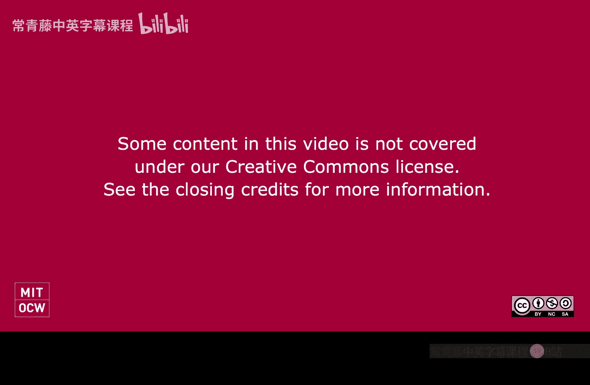

So today， well be talking about the portfolio management as one of the application lectures。

So I will share some of my research work from a practitioner's point of view。

 so ratherm from rather than from pure theoretical or mass point of view。

So as we mentioned at the beginning of the term， we've been teaching this class since 2012。

 And in 2013， this class was recorded for MI， I T Opencourseseware。

The link I put it here is the lecture from 2013。 Some of you may have watched that lecture。

 It was actually turned out to be one of the top most viewed courses。

 Our course is one of the top five， actually on open courseware。

So I want to promise you in today's lecture， I will give you lot of new content。 So you， you will。😊。

Make your， you know， showing up the presence here worthwhile。 So we can also make it interactive。

So this is the outline of what I will be talking about today。So first。

 I talk about what is really all this portfolio construction is about coming from very basic level。

 Then we'll talk about what is the endowment model。 How do we manage your endowment fund。

Then I'll talk about the portfolio theory and illustrate in some really special and simple cases for you to understand the math。

Then I will really switch gear and talk about the limitations of this theory。

 But the theory was proposed in the 1950s。 I mean， of course。

 a lot of people have worked in the field， try to overcome the shortcomings of these theories。

 So I myself has been spending a lot of time thinking about these problems。

 So I will talk about my own research work in terms of how to improve the portfolio construction theory。

 for example， how to improve the risk measurement using volatility and shop ratio。And to。

 and how to model crowding behavior。 And also， you probably heard the power law。 also power law。

 how this behavior actually originated from the crowding behavior。Now， summarize。

So before we start the lecture， I want to do an exercise with all of you。

 I'm gonna hand over a piece of paper to all of you。 Yeah， please pass it down。

 make sure everyone gets one piece of paper。

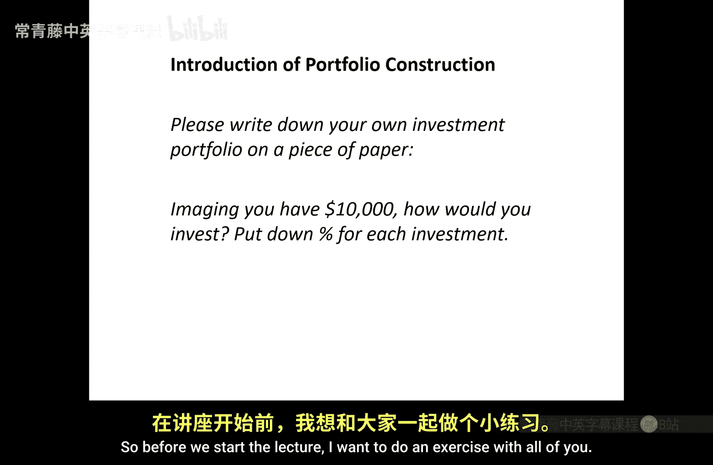

What I want you to do is to write down your own investment portfolio。

Just hypothetically think about you have $10000 to manage。

And put down investments you like to have in the portfolio。

 Put down the percentage of each investment。And I also want you not to think too hard and also too long on this。

 Just use your intuition。 Imagine you are now a fund manager。

 sitting at a pension fund or endowment fund or hedge fund。 right。

 Just ask you to pick a your investment。And then。Just hand it back to me after you finish。

Then we will talk about from where you started， how to do the portfolio management。

So just spend a couple minutes。 Don't overspend your time。

 So why I'm talking so you can write down your choices。So when you receive that blank sheet of paper。

 So you must be thinking， what are the criteria for me to do this， right？

 What are the considerations。So this is exactly I want to lead you into how to think about these problems。

 First of all， you need think about what's the objective of doing this exercise， right。

 So always say， oh， I wantna get a great return for the investment。 Sure。

 So youll have a return objective。But is that， what is the great return， Is that 10%，50% or 100%。

What is the time horizon we are talking about， right。And because investment is highly uncertain。

What's your loss tolerance， right， You think about you have $10000。 How much can you afford。To lose。

 right。 So that those are the questions。 Then when you pick those investments。

 you should also ask yourself。What's your own ability of picking a winner， right？

 Why do you think you have an edge in predicting that market or investment。Then， of course。

 how many investments you should have in the portfolio。Is that 1，5。Or 50 or 100。Right。

 how diversified or how well mixed that investment portfolio should be， right。Then ultimately。

 the most important question is， how do you size each of the investment。It comes all down to sizing。

 Okay， so portfolio construction， I will show you later。

 is really about when you have a list of investment you like。

 how do you size them accordingly in relative， in you know。

 relative amounts to each other to the whole portfolio。 So now， please hand it back because you。

 I I want to listen to me， not just spending the time on writing down your portfolio。😊，Okay。

 you can it's your choice。 name or no name is fine。 Yes， I'm， I'm not gonna call you names。

 but I will probably use some of your answers as examples to talk about investments。

So as we are collecting these。Portfolio choices。So I'm also gonna talk about in your decision making process。

So when you choose investments， you probably were thinking about what markets， right， First of all。

 you will be selecting your investments from。

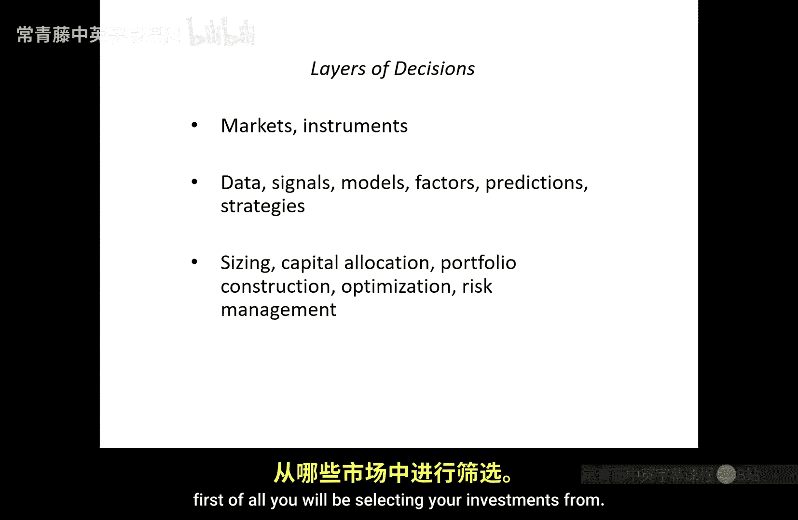

And。What are the instruments。So。😀Yeah。😊，we mostly finished。 So by the way， for you。

 we are doing an exercise。 We asked you to put down the your investment portfolio。

 Just put down the percentage， whatever you can do， okay。😊，So anyway。有单的OK。Okay， for the rest of you。

 if you want to take longer time， that's fine。 I'm just gonna use some of the examples， okay。

So the decision making process I was talking about。

 you need to decide which market to pick your investment。 Then you think about what data to collect。

 what kind of signals you can derive and what the models you need to build。

 What the factors you need to take into consideration。What predictions you need to make， right。

 then assemble them into strategies。Then we're talking about sizing and allocate your capital portfolio construction。

 then optimize it。 Then at the end， really to manage the risk。So。Now。

 you can see what we really come down to is how to compare different investments to understand the relationship between different investments is is to understand the return and risk profiles of all the investments。

So what is risk， So in the， in this chart we are talking about here。

 I'm using volatility for the time being， which represents uncertainty right of the outcome。Later on。

 I will kind of come back and telling you volatility is now really the best measure for risk。

 But let's save that for later。 But before we talk about the investment choices。

 let me look at some of what you have written down。So one portfolio here has half in S。Straddle。

 So this is actually an option strategy。And then。30% in Vx related ETFs and 20% in。

Dollar index futures， so。Sounds like someone has done an internship somewhere。

 knowing option strategies。呃。So this portfolio has about 8 investments。The largest one in it is cash。

20% and 20% in Q， Q Q， which is Nasdaq ETF。Let me see。This one is 70% bonds，30% stocks。

 This one is quite interesting。Because when we normally talk about 60，40 or 70，30 portfolio。The。

 the bigger piece tends to be the equity piece。 but this one probably has。

More risk neutral or risk parody type of construction。 So well get to that。

This has many single name stocks， Microsoft being on the top。And this is 50% S and P，50% vanguard。

Pll fund。I think probably that's what he's written。And this one，00% S and。Yeah。

 very much represent in the average market。And。So， this one probably。Has five stocks，20% cash， yeah。

50% US Treasury bonds，25% S&。Okay， so fairly similar。 So now you got the idea。

 And Peter and I used to kind of reveal over the years。

 year to year change of the investment selection。Only three years ago， in 2021。

Most of the class chose some。Cryptocurrencies。And doge coins being the top one being selected by everyone。

 I haven't seen any crypto investments today。 So that just tells you。

The index investing ETF seems to be the theme of this year。You know， I don't blame you。 I think it's。

 I think it's a pretty good idea。 You know， S MP， if you don't have particularicular edge。

 you feel you like to have investing in index is a pretty good choice。So on this graph。

 I'm showing you here return versus volatility。 So we already touch upon a lot of people choose chose cash。

 right。Cash， basically， you can view as0 volatility。Has some minimum return， you know。

 Fed just cut interest rate is still。Over 4%， you know， close to 5%， they may cut more。

 But compared to the interest rate where it has been in the last 10 years。

 This is actually not a bad place to park your capital。Bonundds have slightly higher return。

 a little more uncertainty of return。Stocks definitely have more， but the index has less volatility。

 and the index。Return wise， you may not be lagging the broad stock market。 I mean， as you know。

 the index now is heavily weighted towards large tech large cap tax stocks。 And lately。

 those large cap tax stocks has been have been doing really well。 So if youre long Q， Q。

 Q or S and P you essentially long。 the magnificent7 stocks。 right。

 And so the E TF investment choice here is not bad choice or index investment。

Further up on the right is the private equity and venture capital choice。

 which I haven't seen anyone put it down。 So you， you may be more thinking about the public markets。

 but private equity and venture capital are basically investing in private companies。

 not publicly listed on stock exchanges。So those companies tends to be ill liquidd。

 You cannot get your money out easily。 You have to stay with them for a very long time。

But a lot of times， you have more influence on the company's operation and venture， for example。

 use investing in startup companies。 Those companies can。Grow very fast， can also fail very fast。

 So the outcome， the uncertainty range is very big。 but overall， over the years。

 they tend to produce higher returns to justify the uncertainty or risk premium you are dealing with。

So coming back to the return objective and loss tolerance。So， we should think about。

When you write down your portfolio， right， So you try to maximize your return for sure， right。

 is anyone here disagree We you should maximize your return。Probably not， right At the same time。

 you should minimize your risk。 In this case， minimize your uncertainty， right。

 So you want to maximize the ratio of return over volatility。Right，That's one of the objectives。

But you may have constraints as well， right， There are certain investment you may not want to participate in。

For example， many universities declared we don't want to invest in fossil fuel。

 right for the environmental concerns。 And in the past， like tobacco companies or you know。

 some kind of weapon companies， you know， people have， in principle， reasons to go against them。

And so there are constraints of what you investment universe should be。Then there's liquidity， right。

 you know， how much you need to use the money， The $10000 you， you had in the portfolio。

You may not want use it in all in the investment or liquid investment all the time。 So you may want。

Spend 5% a year， for example， right。So you need to take into account your spending needs。And also。

 on the downside， how much you can afford to lose is really a very important question。

So if your $10000 becomes $5000， do you， will you feel really bad。You would just say。

 I'm gonna stop investing altogether， right， So that's， I cannot afford to lose。

 maybe that situation I saved for next year。 right， I put aside just want to earn some return。

 I don't want to lose it。 So then your risk tolerance is very low。 is very different。

So for many asset owners， inflation is also an important concern because wealth represents relative purchasing power。

So。How much wealths do you have is not really just the dollar amount you have in your bank account。

Is。How much you can buy， right？ So when the price of goods services are going up。

 your purchasing power is going down， right， So that's inflation。

 And it's also relative to the next group of people a person how much they can buy， right。

 So for universities， that means you want to hire a professor。You know， if they are competing offers。

 how much more you can offer to the professor to get them to come to your university。So。

 so there's definitely absolute return angle for the requirement of the portfolio。 right。

 And there's also a lot of people nowadays talk about be a benchmark， beating a index。 You know， you。

 many of you have chosen S and P as the index。But if you can produce more return on top of S and return。

So that's called the offer， right， relative return。

 That's also often being used as a measurement of investment skills。

 So you don't just just put in a beta or broad market investment。

 You actually can extract more return。So。As a liability matching， cash flow is very important。 right。

 So 2008 taught many asset owners a big lesson。When you don't have the right asset liability match。

When your portfolio has a drawdown。Your liability side will basically dominant dominant on your balance sheet。

 You need to cut your spending budget。You know， stop you building projects and lay of people， right。

 so that those are painful lessons。 You need to have the cash flow well planned。So time horizon。

 I mentioned， is very important。 When I gave you that piece of paper， I didn't say time horizon。

On purpose， I want you think about。 you should ask the question。

 this portfolio is for how long is that for one day or for a year or for 10 years， right。

So in the investment world， people always compare returns like year to year。

 sometimes even quarter to quarter。 Like peers try to say， oh， I outperform a outperformed B。

 So therefore， A is better than B。 So this is actually， lot of times。

 unhealthy exercise because for long term investors， You should really focus on long term return。

But inevitably， in the real world， people look at short term returns。 So you cannot ignore it。

 but that's the the peer pressure for a lot of investment managers。

 That's the career risk because they board。 may think in the short term， they are not good。

 They try to replace them。So coming back more on why investing， right， so。On the， on the left， if。

 on， on your left， if you look at the personal income and spending as one person's age。As age。

 as the function。So， you。Income level kind of peak somewhere in your mid career。 Okay。

 so let's call it around age of 50， right， So you' earning the most。

 You're probably also spending the most。But as you， as you are a student。

 you probably don't earn that much。 You don't spend that much either， right？ I mean。

 same is true when you。Over the peak point， you getting into the retirement stage So you don't earn that much。

 You don't spend that much。So you need to plan accordingly of your personal portfolio that that's related to the question of time horizon。

And also， the marginal benefit of having more wealth and money starts to diminish when you。

Have had certain minimum amount。 So that's the bottom curve。Your benefit start to kind of a plateau。

 And so also， do you want to take more risk or not at that point， right。

But for organization or endowment on the right is a little different because it's a perpetual portfolio。

 It's a very， long time horizon。 and the spending keeps going up as per inflation goes up， so。

You cannot basically be complacent and say， I just put all the portfolio into some conservative investments。

 You have to keep producing those kind of returns。So the endowment set up for university， typically。

They spend 5% of the portfolio。And on top of that， there's expected 3% inflation。So。

 the nominal return target is。8%， right， so。As you know。

 it's probably not always easy to make 8% consistently year over year。

 And especially when interest rate is low， you don't have a bond or safety bond you can put in。Also。

 endowment tends to have。Long time horizon， definitely more than 10 years。 That's what the。

People always say， you know， universities have hundreds of years history。

 right and looking to have another， you know， many more hundreds of years。

And on the university spending budget， operating budget。Now。

 roughly about 40% of the budget is coming from endowment spending。

So you can see universities are now more and more relying on endowment returns。

 And that's because the， you know， the research grants from federal agencies and industries are coming down。

 So this has to be made up from the investment portfolio。And。

So this is just a list of the strategies endowments tend to invest in。 I mentioned cash。

 government bonds。corporateporate bonds and credit products， meaning the issuer。

 unlike US government， it has the risk of defaulting。 So therefore will pay you higher interest。

So they are hedge funds betting on the macro markets， right， betting on the Fed or stock market。

 the general direction。Theyre also quantitative funds doing the trend following people usually call it C T A。

 Yeah commodity trading advisers， or set up， which is to capture the relative value between a pair of stocks or actually many pairs of stocks。

 So its a statisticalage they called it。 So which is really to find statistical patterns to generate returns。

 So this is heavily computer driven strategies。 many big quantitative shops。

Still doing a lot of these。So they are fundamental equity hedge funds。

 They buy stocks and also sell short stocks。And they are also the platforms you probably heard。

 you know， the big platforms called it multistr or multi multi PM portfolio manager platforms。

 They hire hundreds of different teams trading on the same platform。

In a very different wide range of strategies， but achieve a high degree of diversification。

 and they can level up the portfolio quite a bit。And so I mentioned private equity earlier。

 there also real asset investment， real estate， natural resources， farmland， Timberland。

 those type of investments。And new assets， such as， you know。

 crypto or intellectual properties or legal claims and so on。 So basically。

 anything you can think of can generate return。 it can also be considered。呃。At the first lecture。

 I already highlighted some of the features of the endowment model。

 So endowment model nowadays tend to focus on hiring external managers。

And doing both public and private investing。And we hire both journalists， you know。

 look at everything and also specialists in certain domains， such as biotech， you know， AI and so on。

We focus on both absolute return and also relative return to the benchmark。

So we are mostly active managers。 So we。We have some passive。Beta index investment。

 but its a minority of the investment is also not always permanent。

 So whenever we can find an active strategy or manager to beat a benchmark or index。

 we will always go for the active investment。呃。Yeah， so as you can see。

 this investment process is centered around manager selection， right。

 selecting the good investing fund managers。 And Harvard actually in the old days used to have a lot of internal fund managers。

 But that model has changed from seven years ago。 Yeah， to focus more on external managers。So。

Now I'm gonna shift gear a little bit to talk about portfolio construction problem。

 So shifting towards the math part of the discussion a little bit。The。

 the classic portfolio construction problem is stated as such。 assume you。

 you know your return objectives， you have a loss tolerance。

And you can predict each investment return。Volatility， which is the standard deviation。And also。

 the correlation matrix of these investments。The question is。

 what percentage you should put in in each of the investment。

 So that's the portfolio construction problem， right。And the objective of that。

 as we mentioned earlier， is to maximize the return for the whole portfolio while minimizing the portfolio risk in this classic problem is to minimize the uncertainty or volatility of the whole portfolio。

So， as you can see。The portfolio construction problem。

Really is a sizing problem of investments at all different levels。

You can relate that to asset allocation problem。 So what is the asset allocation problem。

 So you group those investments into different asset classes。 So as I showed you earlier。

 So the list of these strategies， you can also think of them as list of different asset classes。So。

 from top down。The discussion needs to be had is how much you want to be in each category or each asset class。

And sometimes people would say， well， that's still way too many asset classes。 right， you。

 if you have 10 to 15 asset classes， that makes the optimization problem very hard。

 So people tend to reduce them to big risk factors。 So sometimes， you know， say3 to5 risk factors。

 usually equity bonds。 and plus one of the other things could be you know， inflation。

 It could be currency It could be。C and other dimensions。

 But the factor analysis or can also expand into many detailed levels。 You can have， you know。

50 factors， so even hundreds。Fact， but it's just different ways of grouping the investments to make the optimization problem little easier。

 okay。So then what is the risk management problem of a portfolio。

So risk management problem in many ways。It's actually the same problem as portfolio construction。

 It's the sizing problem。 But in addition， you need to think about how to avoid concentration， right。

 concentration， of course， is also a sizing problem and also ill liquidity。

And what's unac unacceptable losses and unwanted risks to constrain the portfolio。

So I'm gonna spend a few minutes on the。Ptfolio theory， which is illustrated in two assets。好。

Asset 1 has a return， R one， volatility， Sigma 1， and will have a weight in the portfolio of W 1。

Similarly for asset 2。 So the some of the two weights should equal to1 W 1 plus w 2。

And the portfolio return， which is denoted here as all sub P。

 is the weighted return of all one and all2， right。And。

The variance or in this here is the sigma P square， the volatility square。

Can be expressed in terms of the weights and the volatility of each of the two investments。

 as well as the correlation role between the two investments。

 So this is a very common equation you probably have seen many times in the。In any you know。

 probability of statistics class， classes。So， let's look at the。Some special cases。

So when the correlation role is positive  one， meaning the two assets。Or perfectly correlated。

1 moves up， the other moves up at the same time。 One goes down。

 The other one goes down at the same time。 right， So that's called。perfecterect correlation。So， if。

R equals to one。And we can simplify the sigma P， which is the portfolio volatility。

 becomes the weighted sum of the two volatilities。 W 1 times Sigma 1 plus W 2 times sigma 2。

Or you can also express the。W1 in terms of y minus W 2， right。 So therefore。

 solving for W 2 in terms of sigma P and sigma 1 and sigma 2。So。

Then you can derive the overall return of the portfolio or sub P in terms of W 2。

 because W 2 above is a function is a linear function of sigma P。So， you know， in this case。

 the return of the portfolio or P is a linear function of。Sigma P， okay， so this is on this chart。

 You can see that straight line when row equals to one， that's the special case。😊。

When rh equal to  -1。That means they are perfectly。negatively correlated。 So one goes up。

 The other one goes down。So when that is the case， you will actually easily derive that the sigma P is actually。

 you have two branches of solutions。So， depends on。The value， W 1 sigma compared to W 2 sigma 2。

So that's the two separate lines on the left。 That's the other solution。

In the middle is the other values of the correlation between negative one and plus  one。

 and including。0 correlation， row equal to 0。So what if the first asset has zero volatility。

 Sigma 1 equals to 0。So then from the equation earlier， we can derive sigma P。

 The portfolio volatility is simply W 2 times sigma 2， right， because sigma 1 is 0。

 and therefore W 2， the weighting on the asset 2 is sigma P divided by sigma 2， right。That's。

 that's straightforward， a result。And， the portfolio return。Or P now can be written as。All one。

 which is the first asset with zero volatility， which you can think as a cash， right。

 we mentioned earlier， a cash has zero volatility。 So this cash or riskless asset has returned all one。

喂。Its R P is still a linear function of sigma P。Right， but it's a straight line。In this case。

 you can see the slope of that line is determined by the difference of all  two minus all  one and divided by sigma 2。

So by the way， so this is so called capital allocation line in the portfolio theory。 Okay。

 so we can look at， let's say a constructed portfolio。 You already have a sigma P。

 which has many assets in it， right， and also R P by adding one riskless。Asset or cash。

 which returns all F。 all， R F is。Basically， like risk free return。

You can draw a attention line over。The sigma P point， you pick the。

One point on that efficient frontier， I should explain efficient frontier。

 meaning that on that return versus volatility chart。Because you'll have different weightings， right。

 So let's come back to this。Let's look at the this curve。

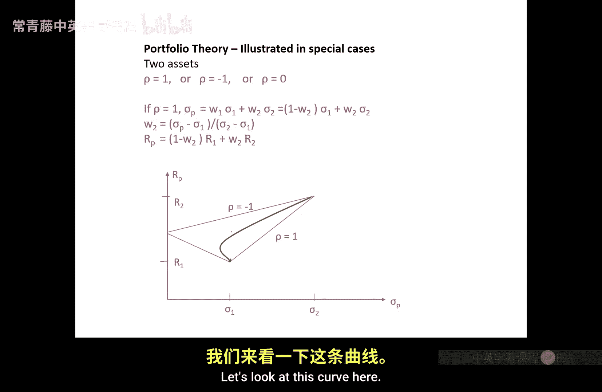

Here。So for different W Y and W2s， you can have different resulting portfolio return and portfolio volatility。

 right， So this line。The upper part of this is called efficient frontier。

 because by lowering your risk and moving your return up。That's your objective。

 You are improving the portfolio。 So any point on this line。

Is a potential solution of that portfolio construction。So。Why， when we add the risk free asset。

On this R F point。 so we can basically combine that risk free asset with the existing portfolio。

To further improve the risk。The efficient frontier to move up to at the straight line。So that slope。

 or P minus R F divided by sigma P is so called shop ratio。In simple terms。

 think about your return over volatility， right？ So that's kind of a the shop ratio definition。嗯。

Sometimes you also hear the term alpha and the beta。 that's compared with the benchmark。 right。

 So in this case， you can write down the portfolio return minus the risk free asset in terms of alpha plus beta times benchmark minus the risk free return。

And， the beta is the function of correlation of the portfolio to the benchmark and the ratio of the volatility。

嗯。What if。You want to level up the portfolio and borrow more。

 So meaning make the weight of the first risk free asset to be100% and make the other asset be 200%。

 So still sum up to one。 So that means youre borrowing money in。In cash。

Youre putting the proceeds into the risky asset。 So you're moving the。

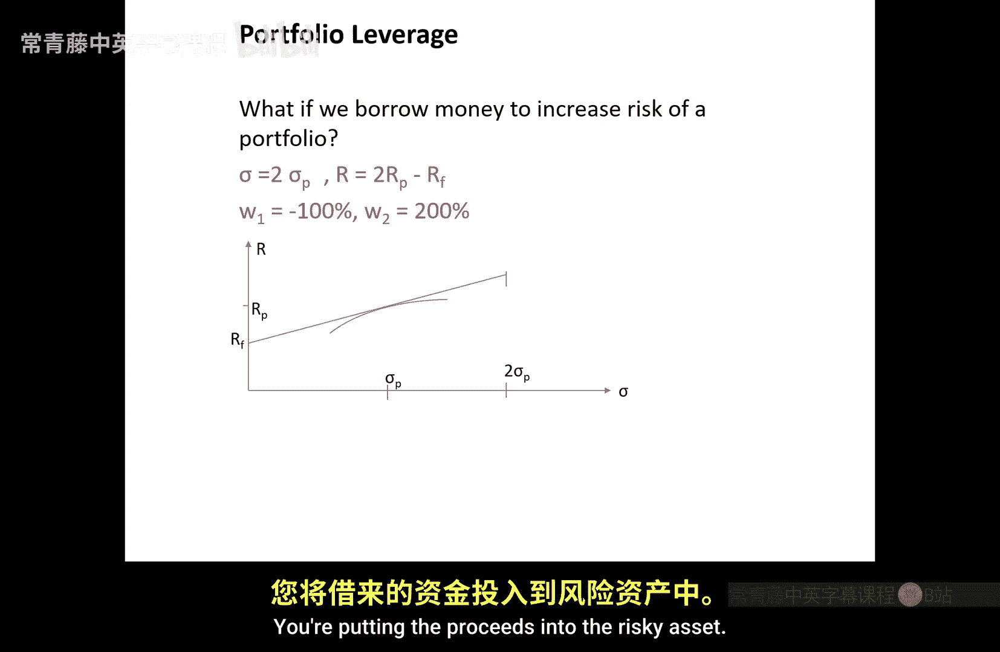

Vololatility up to this point。

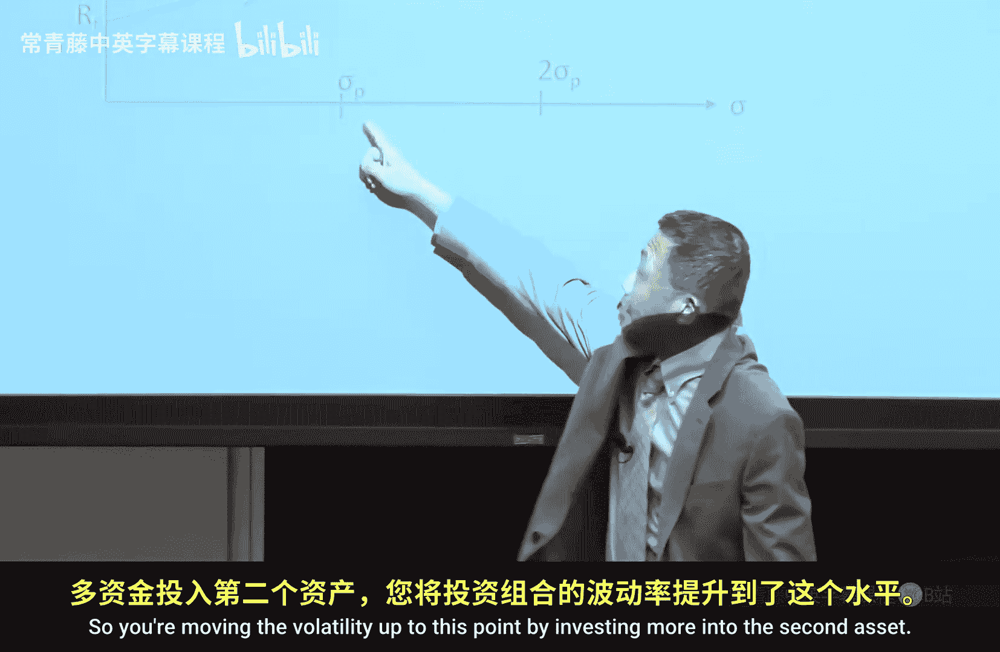

By investing more into the second asset。So that's also possible。

 That's a typical exercise people do in risk of parity portfolios。 By the way。

 if you don't follow any of those， that's fine。 The reason I want to talk about this is really give you some flavors of what the portfolio theory is about because then I'm gonna tell you in practice a lot of these needs to be improved。

So the example of portfolio with two assets， we talk about the 60，40 equity bonds， right。

 Some of you wrote down 70 bonds，30% stocks that's very much similar to the risk parity portfolio。

 which they try to make equal risk contribution coming from the bonds and equity by borrowing more to invest in the bonds。

Because bonds typically have lower volatility than equity。

 So you need to have more to make them have equal risk contribution。 So that's the idea。 Again。

 today， I'm not going to the the math in the previous years。 sometimes I spend more time on that。

 But I feel I want to talk about other things bit more today。But before we move away。

 I want to talk about the importance of rebalancing。嗯。Because we had this 2013 OCW video。

Just two weeks ago， I think somebody made a a clip out of that class， speed it， sped it up to 1。

5 times and made it three minute。video of the only free lunch of diversification。

 which is exactly this example。 So I'm gonna go through it with you quickly。

 Just think about you have two assets or two。Asets in the two year period in year one。

 the first one doubles。And then year2， it has。 So I think it's a little easier to to show on。

 on the blackboard。 But the other one。

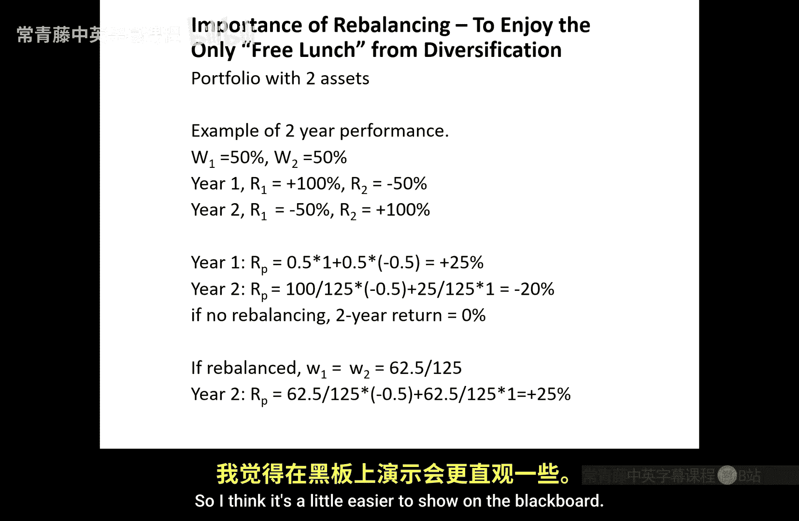

That's the opposite。Right。So they both started here。 the first asset doubles。Thenhan hs。So this是夜晚。

This is year too。The second asset hs first， then doubles。So。Those were the all one and all twos。

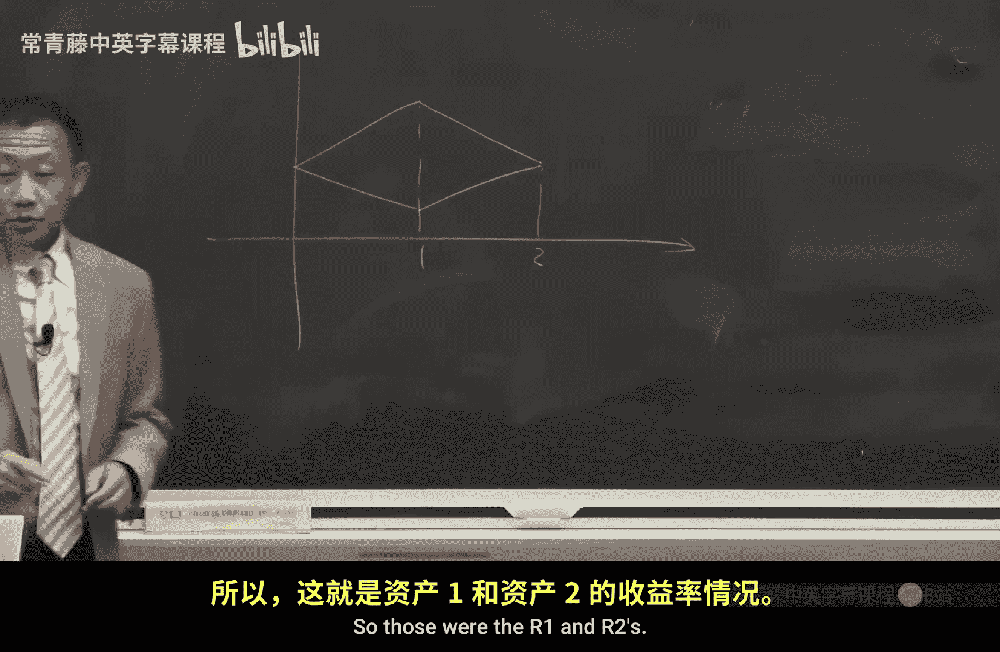

So if you saw this equal weight of the two。And after year 1。

 you can calculate the portfolio is up 25%。So this is just a simple math。 you know， the first。

Assd one is 50% weight。 Asset 2 is also 50% weight，1 doubles，1 halves。 So total， you made 25%， okay。

But if you don't do anything at this point。 So asset  one will be dominating the portfolio。

 As 2 will be just a small portion， right。Then because ES a 2 then doubles。

 you're coming back to the same point。 After two years， your portfolio's returns exactly 0%。Okay。

 even though you had a diversified diversified portfolio with perfectly negatively correlated assets。

But if you rebalance at this point。To equal weight。

Then your portfolio in year 2 will make another 25% return in year 2。

So youre making compounded return of 25%。Two years in a row， right。So some of you may point out that。

 isn't this just betting on mean reversion， you know， and if， if you think it's a trend trade。

 you shouldn't do this。That's right。The question you should ask yourself。

 what is the basis of your sizing。Or weighting of the two assets， right？

 So you started with the equal weighting， meaning that you think the two assets have the same likelihood of performing and the same amount risk。

 That's， that's why you size them equally。And， of course。

 you also know they are negatively correlated。So at the year， at the end of year 1。

 do you maintain that view or not。If you think is that still the same projection。Of risk and return。

 then you should maintain the equal weight。 You should not change the weight unless at year 1。

 your projection has totally changed。You think。Asst 1 will continue to outperform asset 2。Yes。

 in that case， you can change to a non equalal weight。 So that's the point。 if you believe they are。

They have the same probability distribution。 And there's no reason for you not to rebalance。

 So people say this is a free lunch。 The only free lunch is diversification。

 but you have to rebalance to， to eat it。1。That's on that。So then I'm gonna shift gear to talk about。

The limitations of so called modern portfolio theory， ensured MP T。

I mentioned this was mostly developed in the 1950s， and。Harry Mark pioneered in this area。

 He actually got a Nobel Prize in the， I think early 90s for his work。

 So all I have just described to you so far， the mathematical part has a lot to do with his work。

 okay。But you can tell already， right。So a lot of these depend on your confidence in the capital market assumptions。

Which is。The projections of return， volatility and correlation matrix of these investments， right。

And the mean variance optimization problem。All often has unlimited number of solutions。

 and you have to put artificial constraints to bound solutions。

 They are very sensitive to a small change of these capital market assumptions。So in practice。

 it's very hard to use。 probably not many people use it。So。With those questions， I myself。

 have always been curious about this and have done various research work in this。

 So today I'm gonna highlight a few。 The first one is more related to the sizing question using a different approach。

嗯。I called， you know， a gain loss ratio。The second part， I will talk a bit about， you know。

 the effect of crowding behavior and how to model it。And lastly， I will talk about， you know。

 the power law distribution coming out of these crowd interactions。

 Why these are all relevant to a portfolio construction。So issue number one for the MPT。

 So volatility is a poor measure of risk。Why do I say that， you know， because volatility。

Is just the standard deviation or the range of uncertainties。So， if。I am long。

 other money call option。Think about it， right， You have one investment。Sthen， you studied。

 your workdown options。 You probably can get this easily。If I have not other many option。

Do I wish my the the volatility to go up or down。Do I want my portfolio have a high vow or low vow。

 right。I want my portfolio。 Yes， yeah， yes， right， the higher all the better， right。

So on the other hand， if I'm short all the money option， I probably wan to have lower all， right。

 the better because I don't wantna get exercise。So it really depends on， you know， you。

Gain situation， you payout or your potential loss。And the sha ratio is derived from volatility。

 So basically suffers from the same issue。So over the years。

 there are methods like a soino ratio try to differentiate the opposite range and the downside range。

I think it's a good measurement。But it it doesn't give you direct link to sizing。 You know。

 the ultimate question we need to an answer is sizing。

So the new way to compare different investments。I'm basically using what I came up with is to use expected gain and expected loss。

 I call the G and L。 here， I both use positive numbers。 So when I say loss。

 these are absolute numbers。So。We are looking for the best skill。

 which is gain much bigger than expect much， much bigger expected gain than much bigger than the than the expected loss。

Or written in different forms in the。G minus L， which is the return divided by g plus L， okay。

And you change the format a little bit。 It becomes y-2 L divided by G plus L。This is really。

Exactly the sizing percentage。From Kellys criteria in a。Binary bedding。

So this number is bounded from -1 to plus 1。So it can be directly translated into sizing。

And so let me give you a few examples to help you understand this。

 So if you are flipping flipping a coin， right。You know。The head has a certain probability。

 and the tail has certain probability。And when it's a ahead， it has a payout you will get or lose。

 And when still you have a payout or lose。 So expected again is the probability of the head times the payout。

 right， if you bet on head。Expected loss is the probability of the tail times the payout on that side。

So in that discrete example is fairly easy to understand。But in a continuous example。

 is the terminal distribution。Let's say you have a probability density function describing all the outcomes。

Then you need to use that probability density function times the payout， right。

 In over all the losing part and integrated over all the gaining part to get the expected loss and the expected gain。

So。It doesn't have to be always separated by 0， right， If you have a target return。

So you integrate over， say， from minus infinity to the target return。 That's your expected the loss。

 That is what needs to be included in the L。So when you do this。

Your optimization problem is no longer return versus volatility。

 But in the vertical axis is gain in the horizontal axis L is loss。

 So you need to basically max G Y minimizing L。So this is all relevant because。

 as I just explained earlier。Minimizing volatility is not not always for your benefit， right。

 when you alone an option， you need to， you need to have higher volatility。But in this case。

 when you specify expected laws， that's what you need to budget and control your investment。

So in the investment game we gave you at the beginning。

 I hope you have all have you submitted your choices in September。

 and some of you be balanced in October。I wanted you to track the daily gain and loss in dollar amount。

And at the end of the game， which is mid November。I want you to summarize。

All the daily gains and also summarize the daily losses to derive the G and L。 So some of you said。

 you know， in order to win this game， why don't I just pick the highest volatility stock， right。

To have the best potential to produce highest return， yes。

But your higher volatility investment will suffer on the denominator， which the G plus L。

 this ratio will indicate the quality of your investment， even though your G minus L。

 which is the return， may be good。 but the denominator will normalize it， right。

 to make it basically comparable to other investments。So the optimization problem， yes， please。

In practice， what do you use to estimate the expected gain。Yeah， bless you。

Estimate like a distribution of the pricing。Yes， but no more difficult than getting the return and standard deviation。

Yeah， so it's the same amount of work。It's just you are separating the numbers。

 You're calculating half distribution instead of the whole distribution。So it is。

 So especially when you do the optimization problem， as I'm about to explain， these lines， basically。

 for example， the 45 degree line indicates G minus L equal to 0。 So 0 return line。

So you don't want to pick any investments below that 45 degree line。

You want the lines have higher slope， right， So indicating higher G over hell ratio。

But when you combine them， combine， let's say two assets into one。

 calculating the combined portfolio G and L， which is actually pass dependent。

Which actually should be， because when you have two investments。

The final outcome of the expected gain and loss indeed， will be pass dependent。

 That means you probably need to do a lot of Monte Carlo simulation to derive that。 Yeah。

 but it's no more work amount than the traditional distribution calculation。Yeah。Okay。

 let's move on to。Modern portfolio theory， issue number  two。

How do we predict future based on the past。How confident can we be in the capital market assumptions。

 return， volatility and correlation。So because we human thinking process。

 right our thinking process always extracting patterns from the data。 So we have observations。 This。

 I'm just outlining the typical thinking process。You have observation。You have measurable data。

 Try to quantify them。Then you try to extract useful information or。Recognize patterns。

Then you try to build models， having inputs， outputs and conditions。

Then you predict output from the input and conditions。Then you repeat your observation。

Then you iterate， try to calibrate your model parameters。When you are very good at it。

 you can actually control conditions and inputs to get the desired outcome， right， So that's。

That's true。 for any subject。Physics， engineering， finance， right。

 But finance involves human behaviors， which is much more complicated。

So the historical patterns are may not be repeatable， right。

 and also the crowding behavior and also adaptive behavior of human players will make the process much more complicated。

So I want to show you a video。Let's see if this works。

So what are you watching is a video of birds or birds。In a totally self organized way。To form。

A group behavior。What they do is they watch their neighbors。They adjust the actions。And。

The group as whole， displays certain patterns。The financial markets is very similar。To this。

So except there's a central observation。You can actually see， which is a stock price。You know。

 you can also。Look at your neighbors， too。 But nowadays。

 it's much easier to look at the central observation。O。In the past。

 I've also shown the London Bridge video。 You probably how many of you have heard the。

 the millennium Bridge of London。Yes， okay。 it open is a millennium bridge around 2000 on the。

In the first day， when people walk on it。It starts to s。And then people try to keep the balance。

They all think， they become synchronized in steps that made the sway even bigger。So。

Market does the same thing when。Panic fits into panic or greed feeds into greed。

 Market can form bubbles and crashing， and these kind of behaviors are not easily predictable。

 but it's a part of crowding behavior。So how to， how to understand and model this kind of behavior。

 So we can look at as a feedback loop， right， So as here is the agent's action。O is the observation。

A is kind of amplifier or agents action feed through into the observation。 As you can see。

 the change of their observation is the sum of the agent's action times the。Pow they have。

 which is a。Then， agents action。The change of agent action D， S is influenced by external force。

 as well as the feedback loop of the observation， and plus some random noise。

So that's the basic framework of crowd modeling。When。The agents behave in the normal conditions。

 They are more rational， so they are less reactive to the observations。

 or you can call it the feedback loop Pri B is actually taking a lower value。

But when observation changes more volatile in a more volatile fashion。The agents tend to react more。

 They get into a reactive state。So more agents in the crowd get into reactive state。

The crowd actually becomes more synchronized。So if we look at the， the order parameter。

 which I define as。The ratio of the sum of all the actions together。

 divided by the sum of the absolute number of the actions。So if they are all synchronized。

 so that number should be one， right， If they are not synchronized at all。

 that number can be very close to 0。So what the first chart on the left shows is。

The order parameter as a function of number of agents in the crowd， in the reactive state。

So then when more agents become reactive to the observation， the order parameter can。

Become very high。The crowd gets synchronized。And on the right， you can see the order parameter。

Is also a function of the random noise term in the。Previous page。The higher the noise。

The less likely the agents， the crowd will be synchronized。So。This type of behavior， by the way。

 is not new in physics in。In some of the you know circuit engineering， circuit systems。

 when you inject a noise， you can also reduce the order parameter synchronization。

 But in social science， this actually is also a similar behavior。

So I further simulated the bubble process。So when you have external force showing on the up left。

It's kind of ramping up， then come down， then oscillate。真。

Number of agents in reactive state starts to pick up。

 then also drop when the external shock diminishes。The observation， as a result， also follows。

 but then。Comes down。But if the external shock on the other and maintains at a higher level。Forever。

Eventually， all the members of the crowd， all the agents。Get into the reactive state。 So they。

The whole crowd becomes synchronized。 The observation basically goes on。Shoot through the roof。

 So it becomes a very unstable system。 So that's the bubble at that point。

 when the system becomes unstable， you bubble will burst。呃。

So that's the part of the crowding behavior。 So the purpose of showing that is when we look at portfolio management。

This type of bubble forming and bursting process is a very important aspect of。

Our understanding beyond fundamental analysis。 right， this is all about behavioral。financeance。

 right。Has nothing to do with the fundamental of the economy or the fundamental of a company。

But then。You probably also have heard power law distribution， right。

 So what is power law distribution。Is the winner take off the 8020 rule or the Matthewos effect。

 many different terms describing。Essentially， a social phenomenon that。啊。The。

There are small number of percentage of the Asians taking a majority share of something in the。

 in the group。So let's think about the wealth distribution， right。

 So 20% of the people probably have 80% of the wealth。And。This is also true。 You look at the top 20%。

Within that 20%， the top 20% has 80% wealth。 Now within that is still true。

 This is so called scale free or scale invariance。This is the unique property of power law distribution。

So in mathematical terms， So the probability of B times X， X is the random valuable。

 B is a scaling factor。Equal to some function of G of B times the probability of x。So this。

 you can prove mathematically。If and only， if。This P of x is a power law distribution。

 that scale free property maintains。So， example of power law distribution。

I mentioned the wealth distribution。Venture capital funds returns。The top tier funds tend to get。

You know， majority of the profit of the startup companies。There's a book published two years ago。

 It's called power Law。So by Sebastian Mannaby， you， you should check it out。 It very interesting。

 It's not mathematical， but it talks about。How the top tier V C firms winner take all phenomenon。

City sizes， same thing。 big cities gets bigger， right， Why in the network theory。

 Because all the nodes want to connect to a more popular node to attract more traffic。

 So the network space， Internet connections， web pages。Of social media posts。

 this type of power law is very common。不 in。Nature， we've observed a lot of fun normal distributions。

Such as height， right？ So a lot of people probably centered around。You know。

 called it between 5 to around 6 feet， right， maybe just under 6 feet。

This is the majority of the population。It's not like most people are very short。

 but there are few giants really just much taller。 So that's power law。

 Power law does not exist in the height distribution。So now we comment on social。

 many social phenomena obey power law distribution。 But why， right， This is the question always。

Make me very curious。So what's the cause。Of such skilled wealth distribution。So， eventually。

I realize this actually has a lot to do with the crowd interaction。So， at the same。

Mechanism we look at earlier， the agents。Have the feedback loop。

 That's the reason of the cause of this type of power law。In nature。

 you don't have that kind of a feedback mechanism。Once you are born， you grew to certain height。

 Your height doesn't change。But in social phenomenon， that is。That's keep changing。

So agents have different powers influencing the market in financial market。 It can， rich。

 can get richer。So we need to model each agent differently。 So we call heterogeneous agents。

So for a random variable， X。The normal distribution we're all familiar with right is the E to the x minus the mean divided by two sigma squared。

But for power law， people a lot of times get confused about terminologies。

The Pararetos law talks about the cumulative。呃D function。Of the probability。And zips， zip。

 zips law talk about the rank of that。Outcome， so basically。

 the random valuable X versus the rank of x。Which is more displayed in this chart。

But they are all related when we normally look at the power power law in a probability density function。

So that behaves like this versus the normal distribution。 So even distribution， of course。

 is a you know， deelta function。

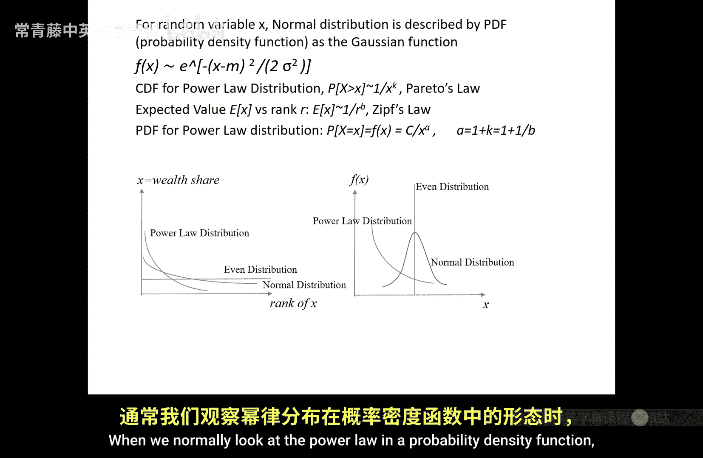

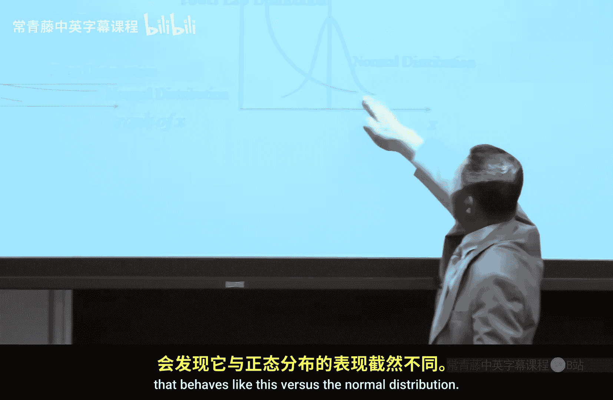

So the parameters of these three different ways of representing power law， they are。

All linked by that formula。 So power law probability density function。Is C over x to the power of a。

A is related to the cumulative density function power K， as well as the zips。

 zips law of parameter B。So if we look at the， the feedback mechanism。We can。Deriveve that。

The agents with more power in this case。Which is represented by a。

Ving over time can gain more power when they be in the right direction that when the observation shows their betting is in the right direction。

That's how rich gets richer。 So that's how concentration of power is formed。

The super agents will be born， in this case。A system may， may not become stable when that happens。

And I mean， this actually can be expanded into a discussion of entropy。 You know， what is order。

 what is stable。 But this is beyond the scope of this lecture。

Just to come back why this is all relevant to portfolio management。

So I want to summarize in this page of what we learned today。

So portfolio management is about how to size each investment。You need to clarify your objectives。

 You need to know your lost tolerance。Diversification helps， but you need to rebalance。

Vololaility is not risk。 Sha ratio doesn't capture skill， nor provide sizing。

 We should use the new ratio I presented to you。Capital market assumptions are not reliable。

 and crowding behavior can be push markets to extremes。

You should pay attention to powerful super agents。Who are the most powerful super agents you can think about。

Anybody has any idea in the market。Yes， yeah。 the Fed。 So when you invest in the market。

 you have to pay attention because they have such a big power to change the direction of markets。

 yeah。😊，And in the old days， some hedge funds have more power。 But I would say nowadays。

 definitely the governments， yeah。So you need to understand the key drivers of your portfolio。

So I want to stop the lecture here。 I want to take some questions。

 Then I will save a couple minutes talk about the investment game。 But before I get there。

 let's open up for questions。packed in a lot of content for today。 I know。

The idea is not necessary to ask you to follow in details because some of the math you probably need to derive yourself to get a feel。

 But I want to give you the concepts。What the portfolio construction is all about is about sizing。

 right of investment。 Sizing is about comparison about investments。 So how to compare them。 That's。

 that's what it really comes down to。So for that。Please， questions。Yes。我 the报。再到了看到。ItInvest。真系人譬较。

The capital things or how long or something。Very like我下 to my这。Certain types of investigator。

More tax sensitive than others。 I that something that。Consider by heavily。Yeah， so that's。

 that's a great question。 You know， endowments tax free， right way。 So don't consider that。

 But if you run a family office， you have to be very careful to plan your capital gains， right。

 So the family offices or private investors tend to invest in more in long term private equity because they don't have to realize those gains。

 They invest less in public equity for the tax reason。 So it is a very important parameter。Yeah。

Any other questions？ Yes， what is the best measure。So I。

 I still think we should try to understand the potential loss or expected the loss。So that's the L I。

 I discussed earlier。You know， because。People tend to think， you know， gain and loss are symmetrical。

 but normally it's not the case， right， because you can construct your positions at very asymmetrical payouts。

So you need to understand when， when you buy an option， of course， you。

Maximum loss is the option premium you paid。 It's very clear。 But when you buy a stock。

 that may not be so clear， right， So you need to understand how much the stock can lose。

 can move down and come what's likely range。 it can move down to。 and those kind of things。

 So you need to， I think the risk measurement should be shifted or focus more on the downside protection。

 Understand your downside。So which is really expected loss。yeah。

 the a question of like expected laws of the sports case。我时候。Yeah。

 those those are two different things， right， So roughly， you can think about w loss， maybe a。

 you know， few standard deviations away。 I mean， expected loss， probably。

Is really the weighted average of outcome times the payout， that kind of a thing。

So you cannot construct your portfolio or based on a worst case。

 Then you would not be doing anything， right， So， but so that's why expected loss is probably a better way to measure and for sizing your investments。

 but you need to be aware of your worst loss。 Yeah， in， in case something happens。 Yeah， yes，哦。Yeah。

 so yeah， you， you， I think its a very good question。 Both of you brought up。

Sttop loss is an interesting concept， right， So stop loss typically is not set at the worst loss。

 right It's kind of said usually quite close， probably even closer than the expected loss。

 if you're trading at the hedge fund platforms， they give you very tight stop loss。

 for the reason that they try to artificially construct asymmetric payout for the portfolio managers or the traders。

 when you lose a little bit， they cut your position you have。

 then you lose another few percentage points cut another half than get you out。

 So when you make money， they try to let you write on the wins to create that kind of asymmetric optional。

 But that forces you to pick investment has that kind of probability distribution。

 So if you think investment has a worst case loss， which is。Very bad。But has a very low probability。

 let's just say， right。 And so you need to， you need to think about， you know。

 if that almost like the firm takes that risk for you， right， because they stay。

 they are responsible to cut you out。 right， But if you think the upside is very big。

 then you should take that bet。 right， you get it。Yeah， yeah， right。RightThat's kind of that's， yeah。

 that's the kind of the， the， you know， lot of the issues with hedge funds， right。

 They get a cut on a profit。But they don't bear the downside responsibilities。 right， so they long。

 they are long a free co option。So， yeah， so that's why a lot of people want to be a hedge fund manager。

So I， I will just touch upon the investment game。 Okay， we already talk about it。

When we pass November 15， we can。You look you， you should keep track of the G and L numbers and let us know how you performed。

 and I， I will try to verify。 But last slide， I want just， you know， coming back to the point。

 A lot of people ask how to become a hedge fund manager， right。So I wonder。

 maybe I want to pull the audience here a little bit。😊，I there a value， you know。

 you think from that trading or investment game to do some paper trading games。

 or do you think you want more lectures on the research process， how to do data collection。

 signal generation， back testing， and all the all the things and portfolio optimization as we talk about today。

 or some people say， I just want to learn more about how to become a manager， how to do fundraising。

 how to build a team， how to negotiate the terms and how to assemble systems and back office。

 legal taxes and so on。

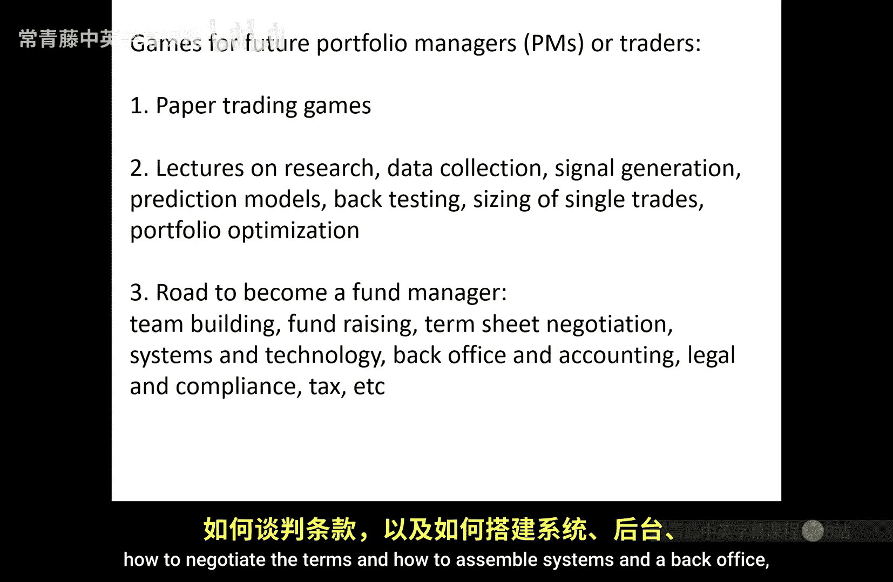

So， I'm actually thinking。每笔。There's something。You know， we。

 as an organization or some other people should really just help the younger potential PMs a little more to incubate them。

 to become a a better fund manager。If any one of you think that's something valid。 this， this idea。

 you can talk to me， you know， email me or just come to me after class。

 Maybe there's something in beyond what we talk in this class could be useful to any one of you。

So with that， thank you very much。有。

