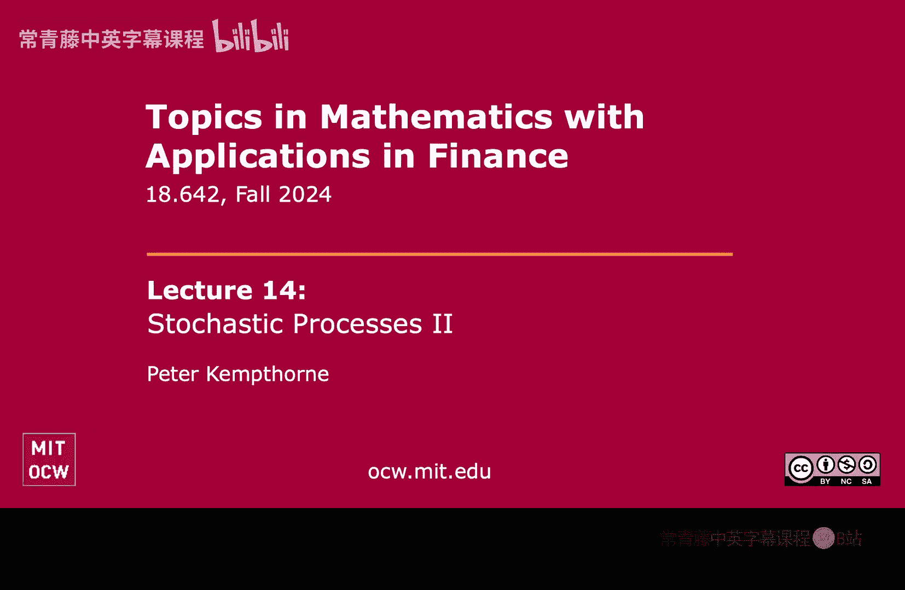
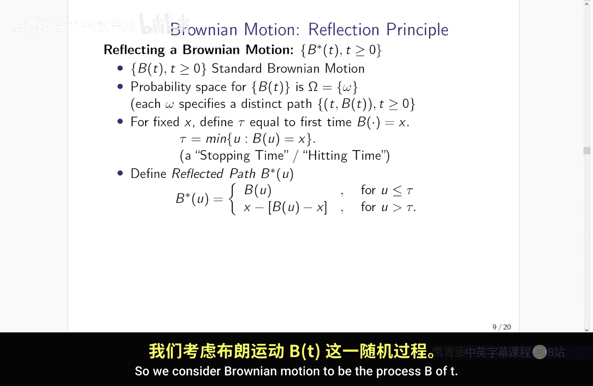
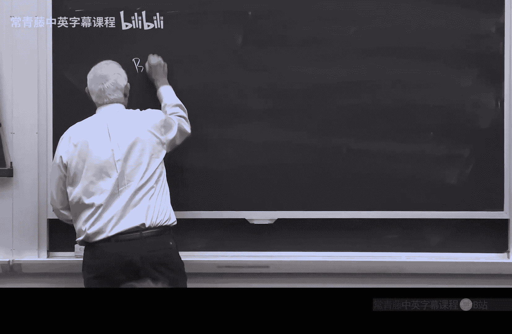
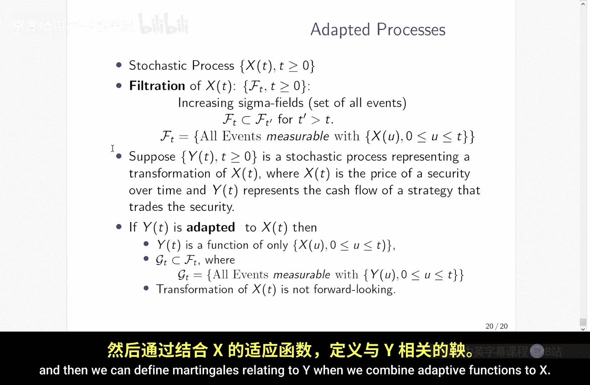

# 麻省理工学院【中英⚡数学专题及其在金融中的应用｜18.642-Fall-2024,-Topics-in-Mathematics-with-Applicatio】-p14-P14-Stochastic-Processes-II--BV1iLrjBrETS_p14-

Today。Today we're going to talk about stochastic processes， the second set of lectures。

And we're going to begin with a discussion of Brownian motion。Browian motion is。

A process that I'm sure most of you have heard of， and it was named after Robert Brown。

 an English botanist。And this is an interesting case where a scientist observes some dynamics in nature。

And then as concerned about what mathematical model might describe that behavior， turns out that。

It was， I guess， Albert Einstein， who。Formalized this Brownian motion model， mathematically。

And Norbert Wiener， our MIT hero， those of you。Familiar with the math department know about the Norbert Wiener。

Room that we have。 And he developed a mathematical foundation for Brownian motion。Now。

 let's take a look at a simulation of brownieian motion。In two dimensions。

 so this is the kind of dynamics that Brown was observing。And so in these slides。

 we're going to start the process at the origin of the space where the red dot is。

 and then move around in two dimensions where each step is a random move in the X direction and a random move in the Y direction。

And。For this simulation， we use Gaussian distributions。But as I page through。These graphs。

 one can see how。A particle。Moving according to these dynamics。

 we'll start at the origin and evolve to the final red dot。And if we。Hold down。

The graphs and see where it goes。You can see that。Basically， there's。Purely random dynamics。

 but of a very special kind。 And so the special kind is that the movements are jagged。😊。

And unpredictable in terms of their direction。Something that's really quite interesting when you just look at this。

And page through the dynamics here sort animating the process。The movements， in fact。

 have no trend in them to move left or up or down。And so， the movements we see。

Basically are movements that are symmetrical in their dynamics。

 and so that's a very interesting property that we would like to characterize mathematically。

 So let's look at how we define Brownian motion in one dimension。So in one dimension。

 we are simply looking at。A graph。Let me find the eraser here。オケー。In one dimension， we have time T。

And we're going to。Think of a process BT， which will start at zero。And then， it's going to evolve。

Over time， in such a way that。The increments of the process from T to T plus Dlta T。

 So if we have T and T plus Dlta T here。And we look at B of tea here。And B。Of t plus delta t。

This vertical increment is going to be normally distributed。For any increment of time， Delta T。

And the normal distribution for the magnitude of that increment will be a normal random variable with mean zero。

And a variance that is proportional to the length of the interval。So， as we。Consider increments。

 Delta T that are larger will have greater variation in the vertical increment that's normally distributed。

Now， in addition to normal increments， we have independent。Disjoint increments。

So if we have different time points。Like T1， T2， and then T3， T4。

If these increments are separate or disjoint from each other。

Then the change from T1 to T2 and the change from T3 to T4。

 those will be independent random variables。Finally。B of T。

Turns out to be a continuous function of time if it satisfies these properties。And so this is a very。

Simple model。In terms of a continuous time stochastic process。Now， the properties of。

Browning motion and are that it's a Markov process。So if we're looking at the value。

At B of T plus deelta T。At this time point。That is equal to the value at any prior time point。

 well at B of T。Plus， the increment。And so given the information set up to time， little T。

 the conditional distribution。Simply is。Equal to that starting point。

 B of T plus the random increment， so displacements are independent of the past。

 apart from the last value of the past。Okay， mean invariance of B of T well。

Because the increments are normally distributed with mean zero。Then the expected value of B of T。

Into the future will stay at zero， but the variance of B of T will increase with time。

 and so the standard deviation of B of T。Will be proportional or will be sigma times the square root of T。

So if we think of。Drawing curves。Which correspond to sigma square root of t。

This corresponds to one standard deviation above the zero mean for the process。Okay。

 the covariance function of brought in motion。If we want to look at the covariance between two times S and T。

 So suppose here is time S and here is time T。Then。The process。Paths。

To time T include the process paths up to time S， but then have this independent increment beyond time S。

And so when we look at the covariance。Of the process at times， S and T。

 it's equal to the expected value of the product， but we can split B of T into B of S plus the increment。

 and we simply get sigma squared S for the covariance。

 So the degree to which the process is correlated with。Other values of the process。

 it depends on how much overlap there is in the time intervals corresponding to those two values。Now。

 this process that starts at。0ero。B of zero。Or b sub zero or B of0 equal to  zero。

 we could start it at any other level。And have a process that has similar properties。

 but just has a different mean level from time zero。So we can talk about。

Starting the Braian motion at any given point。And so in order to work with these models。

We'll find it convenient to introduce the notation for normal random variables。

And so if we have Z be a standard normal， that is a normal distribution with mean zero and standard deviation 1。

Then， the。Probability， density function。Is given by this formula。 I'm sure everyone is。

Comfortable with that。And the cumulative distribution function is simply the integral of the density from minus infinity up to C for phi of C。

And this notation of small case phi and upper case phi are standard for referring to Gaussian or normal densities and CDFs。

Well， if we have a normal with mean non zero mean mu and variance tau squares standard deviation tau。

Then we have the density of this normal y is a simple function of the density of the standard normal。

We simply subtract the mean mu and divide by tau inside fee。 and we have a tau。

Deenominator factor in front。And what's particularly convenient at times is that if we want to calculate the CF。

Of why。Then。This CF of Y is actually the CF of the。

Of under the standard normal of C minus mu over tau。So。We basically have。

You knowY is equal to mu plus sigma or a tau。Z。And so z is equal to y minus mu over tau。

 and so we're just substituting。In this equation for Y in terms of Z。Now， the probability model。

Of the whole Brownian motion process。Is。Given by we can represent it by saying the conditional distribution of the time T value。

 given the time S value。Is normally distributed with mean equal to the time S value x。

And variance sigma squared times the length of the increment。So its PDF has this form。So。

 the notation。Here is the density of y。At time T， given X。The value at time S。

We have this Gaussian density。That centered at x and the variance of y。Depends on。

The increment from S to T multiplied by the sigma squared。Now， with this probability model。嗯。

It turns out this density function satisfies the diffusion equation。

And the diffusion equation is going to arise again and again in this course。

 especially when we get into the valuation of derivatives。And so。For now， let's just。

Understand this diffusion equation。It says that the partial derivative。Of P。With respect to time T。

Is equal to a multiple。Of the second partial derivative of P with respect to Y。So。

This is easy to verify for S equals 0 and sigma equals1。And if we look at this。Set of graphs。

 Here's the density。Of。X。Given or let's say， here's essentially the density of y。Represented by x。

 so the notation symbol here is we're using x now instead of y。

 and we're considering the initial value of the Brownian motion being zero。🤧嗯。

And if we increase time。Then。This normal density drops in the middle。And it increases。

Far from the middle。And so the change in the density。Is negative near the middle。And positive。

Outside。And that's because if we look at the。Second derivative of this density function。

It's positive。Then it's negative for the second derivative， the curvature is negative。

 and then it switches from being a negative curvature to a positive curvature。

And those points of inflection with the normal density are actually at plus and minus1 standard deviation。

So if we increase the time from one。To2。To 3 or two and a half here。 You can see how it's。Basically。

Dropping in the middle of the distribution and it' rising on the other side。 So。

 so this kind of motion or dynamics。Satisfies the diffusion equation。And so。What's。

 I think important is just to have a good sense of what it means when。

A function such as the density satisfies this diffusion equation。Now。

Let's see this diffusion equation relates to sort of A。Conservation of probability for every X。

So regardless of what the sort of starting value is。

 we have the probability density integrating to one always。And the。It turns out that this density。

Is a unique solution to this diffusion equation。So， an important issue in。The mathematical。

Development framework for models is our solutions to our equations， do they exist， are they unique。

 in fact， for this diffusion equation we get a unique solution， satisfying properties。Okay。

In other disciplines， well， in physics， there's a heat equation in。

Let's see in the dynamics of sort of populations， there's the Fcker Planck equation and Col Mcgrath forwardward equation。

 these arise outside of。Mathematical， Brownian motion as well now。The interesting question。Perhaps。

 or at least the interesting question to mathematicians is， how do we。Really， define Brownian motion。

Forly as a stochastic process。And so it turns out that Brownian motion can be defined as the limiting stochastic process。

Corresponding to a random walk。So， let's consider。Random variables。

 X indexed by integers that are independent and identically distributed。And。

Let's assume that those x's have mean 0， and standard deviation 1。Then if we look at the。

Random walk with steps， X1 X N for the8th position of the random walk。Then the limiting distribution。

Of the normalized random walk。Is actually。A standard normal distribution。

So phi of C is our standard normal cumulative distribution function。

 the standardized random walk will in the limit as N grows large have。

A Gaussian distribution with mean 0 and standard deviation 1。So。What we can do is consider。

Normalizing the random walk process。Bye。Having。The sort of partial sums of the steps。

Divided by root N。But rather than focusing just on those。Increments， those integer increments。

We consider four times， say， between 0 and  one。We can consider。Values for time T between， say。

 integer k over n and integer k over n plus 1 over n。To define a continuous。Path of B， N of T。

 given S of N and T。And so what we then can do is say， let's consider。

The limit as the number of increments。Number of steps increases arbitrarily。

 Let's consider the limiting。Process， and that turns out to be a Brownian motion process。

So with this normalized random walk process。It turns out that this limiting。Distribution。

or this limiting process is invariant to the distribution of the x's。

So if we have random walks with independent steps that have mean zero standard deviation1。Then。

Regardless of what that distribution is， the limiting。

Normalized random walk will be the diffusion process。So let's take a look at two cases for the steps。

 Bernoulli X's。And Gaussian Xes， which of course， will be。Gauussian。And。So here。Is a。

Accumulation or a random walk with， with 10 steps。The top panel corresponds to unit plus one or-1 steps。

And the bottom panel corresponds to Gaussian steps。

And if we increase the number of steps and normalize them by dividing by root。Tea。

We end up getting these different paths tracing out。

 And so what's important in this display is that as we let N get arbitrarily large。

 the process will be equivalent to brownieian in motion。So we're going to go up to 2000 steps here。

And one can see。How this normalized random walk process evolves。And。When we get。To the end。

Of the simulation here of 2000 steps， this is what we have。And so the key takeaway is that。

The limiting process。Will be。Browie in motion。And it doesn't matter what the step distribution is in the limit。

And so this。Implies that this model may be useful in a variety of contexts where。

Underlying steps of the process increments may have some。Distribution， that's non Gaussian。

 but the distribution of。Increments over long periods of time will then follow the diffusion。So。

So the key properties of Brownian motion are independent increments and the variance of those increments are proportional to the time period。

Between the measures。Now。There's。A reflection principle。In working with Brownie in motion。

That is very powerful。 This is an example where。The mathematical theory is。A bit tricky。

 But if you're clever at solving。The problem， you may find an elegant。

 simple solution to the problem。 So let's just understand what it means to be reflecting Brownian motion first。

So。We consider Brownian motion to be。The process B。

Of tea。

And so this will be one realization of the path， perhaps。And then。If we。Consider。The first time。

The process hits X。And define tau。Equal to the first。Time。B of T。Is equal to x。Then。Okay。

 this is the first time。It hits that level X。If we consider。Reflecting this path。

About the level at time X going into the future。 So this would be。Sort of going like this。

And then up like that。Okay， this is。The mathematical formula for doing a reflection of B about X。

And we'll see some examples of this。In a minute， but what is important？

In these reflected paths is that the probability model。

For the original process and the reflectedive process。Those are identical。So let's take a look。

At this reflected Brownian motion simulation。 So what I'm doing here is simulating Brownian motion over 10000 steps。

And looking at an original process in red and then reflecting that in green。And because of。

Overlappping colors， I guess， the beginning。Process at time zero is the original and the reflected path。

 so it appears as the reflected。So once it hits this level X。In red， the green reflects。About x。

 the value。 And it continues reflecting。Across the remaining path of the original series。Now。

 here's another realization。A reflected Brownian motion has the same property。And。Here's a third。

 you know， basically with different realizations of Brownian motion。We'll get different paths。

And the reflected paths have these same properties。Now。The interesting。Question。Is。Well。

 it's actually， let me go back to the notes here。And。The interesting question is to ask。What is？

The maximum of a Brownian motion。Up to time T。So we can define M of T to B。

 What is the maximum value that the Brownian motion has realized between。Time0 and T。Well。

 the probability。Of the maximum。Exceeding x some level。Will actually be twice。

The probability that the ending value of the process exceeds X。

So let's take a look again at the reflected paths。嗯。So。If we look at。The reflected paths about X。

Then。The red and the green paths。Have the same。Probabilities of occurring。And。The， if the， let's see。

 if the， if we look at whether the ending value of the original Brownian motion。Sorry。

 or the the ending value of。A browning motion is exceeds a given level。Then。

There will be twice that number， twice， twice those realizations for which the maximum exceeded that level。

 So for both of these reflected paths， the maximum， let's see， the maximum of the path exceeded X。

And so。Looking here。The probability of。The maximum exceeding X。 Well， we can just look at。

The probability of a path exceeding。X at the end point。

 and the reflected intervals will match those one for one。 And so we basically have the formula that。

We have。Twice the final。Value of the process， exceeding X。

Is equal to the probability that the maximum exceeds x。And we can write out what that。Probability is。

 in terms of the standard normal CF。嗯。Now from this。Result。

We can differentiate this probability with respect to X。And get the。Density。Of the。Maximum。And。

So let's see here。So here is a graph of the。Sort of cumulative probability of。

The maximum exceeding a level x。And this is。Basically， we're interested in。

 what's the probability of exceeding x before time T？And with lower values of x like1。

 the probability is quite high if the。Let's see if X is， is very。Let's see， or sorry。

 Is that X there。Right， okay， so so so the maximum level， if the maximum is3。

 the probability of exceeding 3 is much lower and the probability of exceeding two is in the midway there。

And what's also very interesting is that we can use these results。

To calculate the density function for。The first hitting time of a given level。And so importantly。

 we have the probability of the max up to time t exceeding x is twice the probability that the ending value exceeds x。

And we can differentiate this with respect to T。And we get this density function for the density of the stopping time for hitting a given level X。

So。Let's see here if we have that。So here's the hitting time densities。嗯。

So with standard brown in motion， if we're looking at the time to hit the level 1。Starting at  zero。

 then there's this nice unimotal distribution for that time， which is relatively short。

But if we're looking at hitting times for higher levels like two or three。

 then that hitting time distribution spreads out。 So now。

 let's say we can talk about some extensions。Of Browning motion。

 One is just reflected Brownian motion around 0。So if we have the process。Buncing off zero level。嗯。

We can think of。That process being a positive， stochastic process。

And it's fairly easy to show that the expected value of this reflected brownie motion is。

A multiple root T。Squared of 2 over pi and the variance is 1 minus2 over pi t。

And we can also consider absorbed brownieian motion。嗯。

If we consider tau being the first time0 is the level 0 or a level X is hit， then we can define。

Our process being。Equal to the original Brownian motion。B of T or being zero for T greater than tau。

And so with absorbed brownie in motion， these kinds of processes are useful。For example。

 when we have。A brown in motion like process for a stock price。

Which is generally positive so long as the company is viable， but if the company goes bankrupt。

 then it the price gets absorbed at0。Now， we have。Another extension of Brownian motion。

 which is called the Brownian Bridge。And so。If we consider。

A brownian motion process starting at zero。And it goes up to。Let's say time1。Starting at zero。U。

We can define。We can can define the procedure。X。Which is equal to。B of T。呃。Let's see B of T minus T。

Be of。One， let's see。 Is that right。Minus t times b of1。So if we。Consider。U。Let's see looking at。

 well， let's see this process。 So x of1 is equal to B of1 minus1 times b of1。Which is equal to 0。

If we。Basically， sort of draw。A line。To。If we consider this。Line as one。 and this has slope。B of one。

Then， if we。Subtract T B of one。 We're looking at sort of pinning down the。Browie in motion。

And looking at the distance。From。So the constant slope， T， B of1 and B of T。

 And this particular process。Actually， arises。In a very interesting context。

Of normalized empirical distribution functions。So。What do we？Want to。Highlight here if we have。

A sequence。Of random variables。That are uniformly distributed。Between0 and1。

And we calculate their empirical。Distribution function。So it's the count of the use。

Less than or equal to t divided by n。Then。This empirical distribution function。Will have expectation。

Equal to。T。And variance equal to t times 1 minus t over n。 So if we think of。Please。Use。

So we have UI is distributed uniform。From 0 to one。We have the scale from zero to1。

And we consider a value UI as a realization。Then the probability that U I。Is less than or equal to T。

嗯。Is equal to T。And the。Variance。Of the indicator of U I being less than or equal to T。

This is a Bnoulli outcome。Which has variance equal to。The probability of occurring times。

The complement of that。So， we get this。嗯。T times 1 minus T being the variance of。

The indicator of the UI being less than or equal to T。And then。If we。

Consider the empirical distribution function。Which is summing over these indicators。Then。We get。

A process。Which。Has。A limiting value， which is。Basically。

 the deviation from its mean times scaled up by root n is normal with mean 0 in variance t times 1 minus t。

 And this is actually the Brownian bridge process。Now。With the。嗯。Let's see。

 with these examples where we use uniform。Random variables and properties of functions of those uniforms。

嗯。It's important to note that， for any。Continuous distribution。Say。Why？Distributed with some。

This is the CDF。Of why。If we。Calculate。F of y。This happens to be a uniform distribution。

So this is the probability integral transform of any random variable。And so。

When we have this property for the empirical distribution function。Of uniforms。 Well， of uniforms。

 if we replace the use。Which are uniform 01 by assumption with a distribution function F of y。

 where we have y1 to YN I IDD。With this。CDF。F sub y。Then。The you。I equal to F of Y I。F sub Y of Y。

 these will be IID uniform。So that's a really nice。Result， and it leads to issues involved with。

Moodeling， model selection。If we want to know whether given an assumed probability model for wise。

Is true or not， we can do this transformation and test whether the transformed series or transformed sample is consistent with being a uniform or not。

Allright。Well。With simple brownian motion， standard brownian motion。

We can consider an extension of that to brownian motion with drift mu。

 so we can consider a drift parameter and a volatility parameter。And。

Such a process will have independent increments。With variances of differences proportional to。

The time interval between S and T。And。We can。嗯。Work with the Brownian motion with drift。Using a。

One step analysis。And。In considering。This X。Process。So， x。Is equal to T U。Plus sigma B of T。

So this is x of T。嗯。If we look at。The increment ahead Delta T from little T， then。

Expanding out the representation of this Brownian motion with drift。

We get that it's equal to the brownian motion at time， little T。Plus， mu deelta T。Plus。

 sigma times the increment of the Brownian motion。Process。From T to T plus delta T。And。

So increments of x。Correspond to increments of time。Plus， times the drift rate mu plus sigma。

 the volatility parameter times the increment of the standard brownian motion。

So our process X Brown in motion with drift。Well， have non zero mean。Increments and increments。

 variances that are proportional to the change in time。And this。

Increment will have an exact normal distribution。With these properties。And what？Particularly。

Important is that as we let Delta T， the length of our increments get infinitesal。

Then the expected squared increment of x。Ends up being equal to， well。

 it's exactly equal to the variance of that increment plus the square of the mean。

But the square of the mean。Is a term that is small order of Delta T。

So our expected squared increments。Will be。To order deelta t equal to sigma squared delta T。

And then a small order of Delta T term after that。 also， if we consider。Powers of Delta X。

 So are increments to a power。Then。When our power C is greater than 2， it's equal to 2 here。

 when it's greater than2， then this will also be a small order， delta T。Now。

 the reason why we're interested in。These properties is because。We're going to be working。

 ultimately。With say。A value。Of some derivative。That depends upon X。Of tea。So there's basically a。

Derivative。Value。Which。Depends upon。Underlying。Underlying。How to say the underlying asset price。

And so the dynamics of this。Of the derivative prices。Can。Be written as。A tail series。

And so we'll want to be able to deal with increments of x。And。Powers of increments of X。As our。

Valuation function may be expressed if it has a Taylor series。Representation。Okay。All right， so。

 so let's consider a brownie the problem of Brownie motion。Underly a gambler's ruin problem。

So let's let X of T be brownie in motion with drift。Mux and variance Sigma squared。

And we'll consider a level。An initial level equal to x。 that's between two levels， A and B。

And we want to。Consider。The stopping time being hitting A or B。And ask。

 what's the probability that we hit B first？So。Over time T， we have。Basically。Levels A and B。

And an initial level x at time zero。And we're interested in。Hitting A or B。

So tau is equal to the hit。Time。Of A or B。And。We're interested in what's the probability of hitting B first before A。

And。This generalizes our problem in the first lecture on stochastic process where we had a random walk。

With unit steps， with drift。And so there was a bias of maybe a plus one versus a minus1 occurring。

 and we wanted to solve for what's the likelihood of hitting a level B versus before level A。

So with this。We use an infinitessimal one step analysis。

 And this solution approach illustrative of how。Many problems are solved with stochastic processes。

We can define you。Of x to be the probability function。Which is the probability that the。

Stopped process equals B， given that it starts at X。And so， if we consider。U of X。

And write it as the expected value u of x plus delta x。Then if our Delta T time。Increment。Is。Very。

 very short。Then， this。Expectation will equal U of x。So。

The likelihood of hitting B first will be the expectation of。

U of x a very short increment into the future。And so if we take the expectation with respect to。

The deelta x variable。Well， Delta X is。X of t plus delta t minus x of t。Then。If we。

Assume that our function U， this probability。Is。Twice differentiable than the Taylor series about the center。

 X。Will equal u of x plus deelta x times the first derivative。Plus。

 a half deelta x squared times the second derivative。Plus， small order。Terms of Delta x squared。

And so if we。Take an expectation of that， first。Taylor series。On both sides， well。

 the U of x is a constant。And then we have U prime of x a constant times the expected value of deelta x。

And then plus a half， the expected value of deelta x squared times u double prime。

And we have mu Delta T is the expectation of Delta X。Sigma squared Delta T。Plus。

 little O of Delta T is the expectation of Delta x squared。So we have this。Expansion。

From the Taylor series。And from what we。Said before。This expected value。

Of U evaluated at x plus delta x should simply equal U of x。And if that's true。Then， we get this。

Equation。For you prime and you double prime。And if we。Take that。

Equation in U prime in U double prime。We get。And we divide by Delta T。 We then get0 is equal to mu。

U prime U prime of X。Plus， a half sigma squared。You double prime of x。And to be。Really precise。

 a little low factor。To make it an equation now this。Equation here。Is。

A second order differential equation。And so what are solutions to。This second order。

Differential equation。This is。So have an interesting challenge。LetJust get some more chalk here。

It's maybe been a number of years since people have taken differential equations， right？But， let's。

Let's consider。Let's say U double prime over U prime。Is equal to。Let's see if I've done this right。

U double prime divided by U prime is equal to -2 mu over sigma squared。And so this is the derivative。

Is equal to the derivative of the log of U prime。And so if we integrate this。

We basically get log of U prime。Is equal to sort of minus2 mu over sigma squared。X。Plus。A constant。

And this is true if mu is not equal to zero。And so we basically get that u prime is equal to e to the minus2 mu x over sigma squared。

Times a constant。嗯。And what if we integrate？Both sides of this， we then get you。

So what function has a derivative equal to an exponential。Just the exponential。 Yeah， so。

 so we get U is just going to equal a constant times e to the minus2 mu over sigma squared x。嗯。

And if mu is。Equal to zero。Then。We have the log of U prime。Is equal to zero。Or the derivative。Yeah。

 we or we have， yeah， we， we basically have the derivative of the log of U prime。Is equal to zero。So。

We end up getting。Let's see， basically a linear function for the solution。 So。

 let me go to the notes here。But we basically get u is equal to a x plus B if mu is equal to 0 and it's equal to。

This。A constant a times E the minus2 mu X over sigma squared。All right， well。

 this general solution has to satisfy the initial conditions。U of a is going to equal 0。

 and U of B is going to equal one。 So if we start at a， where。Basically。

 we stop at a if we start at a， so u of0 is going to equal zero， and if we start at B。

 it's equal to one。We end up getting this formula for what you is。And so what's interesting to。

Ask is， how does this probability vary with different drifts and volatilities？Okay， so here's the。

Graph of these probabilities of hitting B before a。When。X， well， when a is 0。So if we have zero here。

And B is equal to3。U。Then。Here's。The initial value x between0 and 3。

And we have the probabilities of heading B。Before a， okay and。If our mu。Is very high。

 so the trend is up。In the Brownian motion。So basically， if mu is greater than zero。

Then we basically have sort of an upward trending。Path， on average。

And we get high probabilities of hitting B first。And as we decrease the drift from3。Down to。0。5。

 we get this brown curve and the limiting case where mu is equal to 0。So there's no drift at all。

Corresponds to。The probability given by this line。And so given the starting value X。

 the closer you are to be， the more likely you will be to hit B first and vice versa with A。So。

These probabilities vary with the different model parameters。

 Here is the corresponding graph when there's a negative。Drift。So， the likelihood of。

Sor of hitting B。First。嗯。It's sort of proportional when the drift term is zero。

 basically to how close you are to be。But， as we。Increase the magnitude of the negative drift。

 We basically get lower and lower probabilities coming out。So that's that solution。Okay， so see。

 the next comment about Brown in motion is a very important property。That。

The Brownian motion process is not differentiable。So when you look at a brownie emotion path。

 it looks very jagged。 And， in fact， that jaggedness is。

Characteristic of there not being a smooth derivative or or it's not being smooth enough to compute a derivative。

 And so if we look at the increment of the Brownian motion from T to T plus del to T and have that being normal。

With mean 0 and variance Delta T， the length of that increment。If we。

Normalize the increment by Delta T。 So we're basically trying to look at the。

Appr the slope between T and T plus delta T。Then that has a normal distribution with mean 0。

 but variance。1 over deelta T。So this normalized increment。

Is going to not be well defined in in the limit。 It's basically going to be equivalent to。呃。

The limiting value basically doesn't exist。 It basically becomes an explosive distribution。

So that's a very important property of Brownian motion。

Something that is a sort of a positive property of Brown in motion is the issue of quadratic variation。

And so to define quadratic variation。We consider looking at partitions of。The time。So we have pi。

 which is what a partition。Of the interval from zero to t， say。Wherere 0 to capital T。

So we have a time scale finishing at T starting at zero。And we can just draw arbitrary points。

 Tj J equaling1 up to n say。嗯。Or one to n minus1。That are inside。This。Interval。And they ordered。

If we consider。The partition corresponding to these time points。

We can define sort a magnitude of the partition。Equal to the maximum of。Tj。Minus Tj minus1。Over J。🤧嗯。

And then。We can talk about the quadratic variation of the process。Which is to look at increments。

Of B over these。Intervals from between Tj minus1 and Tj square those。

And some the squared of those values。This。Is a sort of an appropriate term for quadratic variation。嗯。

And。If we。Consider the。Limit as。The partition。Wd gets narrower and narrower then。

Willll define this limiting value to be the quadratic variation of the Brownian motion process。

So we can define the quadratic variation corresponding to a given partition and then the quadratic variation overall。

 if we take the limit over partitions that are getting infinitesally small。

And the claim is that this quadratic variation。Is going to equal。Capital T。The length of the period。

 with probability 1。So what does that mean， That means that。For every realization。Of the process。

Or almost every realization。This quadratic variation。Is going to equal a constant。So here。

I'm looking at。Examples of random walks。That are。Normalized to be sort of between time zero and1。

 so these are the normalized random walks。Which are effectively whose limits are Brownian motion？

And in the top panel， I'm drawing the path。Of the random walk with Gaussian steps。 And in the bottom。

 I'm drawing the cumulative quadratic variation。So this is up to 20， 30， 40 steps now。

As we increase to。100 steps。嗯。This cumulative quadratic variation is getting pretty close to the。

Time T over which we're accumulating the quadratic variation。And as we increase。The number of steps。

From 200。To。Many more， a thousand， and then 2000。You can see that basically the quadratic variation of the process。

Is。Cumulate especially to the time。Period over which that's being accumulated。So this property is。

A really nice property it。Highlights is that there， there are some。

Significant regularities to Brownian motion。And the regularity here is that the variation of the increments。

嗯。Normalizes basically to the length of the period over which they're accumulated。

 so the quadratic variation is proportional to the time period。Now， this idea。

Or this property of Brownian motion。Is one that can be sort of explored with。

Time series that we might think are well modeled by Brownian motion。So if we were to take。

If we were to look at。A time series of。The log of P。Divided by p0。4 p。Equal to 0，1。Up to capital N。

Basically， this。For prices of assets and equity markets。

 this corresponds to the log return from time 0 to T。And。That log returned from zero to t。

Might follow a Brownian motion process。With drift。Positive return。And so。

You know we basically can have this process。Evolving if we were to calculate。

The quadratic variation of this process。Then。If it followed。If it followed a Brownian motion process。

 it would tend to grow。According to a straight line with slope equal to sigma squared。And。

In empirical modeling， if we look at this quadratic variation of an asset。And see that。

It's not a straight line。There may be periods where the slope is low periods where the slope is higher and it curves around。

A way of trying to model the dynamic volatility。Could be。Suggested by studying these plots。

And and using them。So it's a very interesting property。Now。Let's say I want to。Let's see。

 there's one last note。In the slide and the notes。 But before doing that， I wanted to。Highlight。

A connection of Brownian motion。To the Laplace distribution。 And so if we。If we have。

Let's see if we have B of T。Which is Brown in motion。And we observe。啊。It at。Let's see， if we。

 if we look at basically x of。Okay， if we observe it at。At times， t equals 0，1，2。

Sort of discreteet times。U。Then。The Delta B of T。Are distributed as normal with mean。

I guess it's mu T。And variance sigma squared times。One， which is Delta T。And these are IID。

If so we have basically time points。0，1，2， and so forth。

If instead of observing the process at equal increments of time。Let's。

Consider the possibility that the time increments are random。So we have。Let's consider。B of T。

For T equal to。T1， T2。Up to TN。Where the Delta T's。

The increments of time are distributed as an exponential random variable with some mean lambda say。

So we're not observing the process at regular intervals， we're observing it at random intervals。

It turns out then， that the。Growund in motion process。Has increments。That are Laplaces distributed。

So the Delta B of T。Then will， in fact， have what's called a laplace distribution。And so instead of。

Having a bell shaped curve。Which is a Gaussian distribution。It'll be sort of a bilateral。

Exponential distribution about the mean。And， it turns out that。With standard。And Po's 500 returns。

 this Laplace model seems to fit the data much better。

Which leads to the consideration of what are called subordinated stochastic processes where the time scale is different than our sort of clock time。

All right， well， let's see the final slide here。For today。

 addresses what are called adapted processes。And so。In financial modeling， we can think of。

Therere being。A stochastic process， X of T， characterizing。Relevant dynamics in the system。And。

We can think of X representing the prices of a single asset or a collection of assets as it varies over time。

Then。As。We let time increase。There are。Events that relate to what has happened so far。

And we can think of these。F script F sub T to be the information。On realizations up to time。

 little T。And if we consider。Scrip deaths of T prime with T greater than T prime greater than T。

 then that corresponds to information about all realizations from T up until T prime。

 So it's giving us more information about what's happened with the process。Well。

If we want to look at。The stochastic modeling of。A process。Why that depends on trading on。

Assets with Dy， X。Then。We want。Our process Y to be adapted to X。

Which essentially means we can't see the future。In trading。And so our y of T。

 which is perhaps the value of trading up until time T。

 is a function only of the values of the process prior to time T。And so。

We consider transformations of our original process to the process of， say trading gains and losses。

 according to some trading strategy。 and these will be well defined if the process is。Addated。So。

 with that。The topics connect with what we had。In our previous lecture， which was。

We can have Martin Gaes。Defined on X。And then we can define Martin Ga's relating to why。

If when we combine sort of adapted fun adaptive functions to X And so the Martinale theory sort of extends to modeling trading strategies effectively。

And what's interesting with those techniques is that you end up transforming the process。

To have a constant mean。You know，Mart Gaes are processes with a constant mean。

And so those arguments are applied again and again in solving for their properties。

Option pricing can be expressed in this context as well。Allright， we'll finish there for today and。

