# 麻省理工学院【中英⚡数学专题及其在金融中的应用｜18.642-Fall-2024,-Topics-in-Mathematics-with-Applicatio】-p15-P15-Time-Series-Analysis--BV1iLrjBrETS_p15-

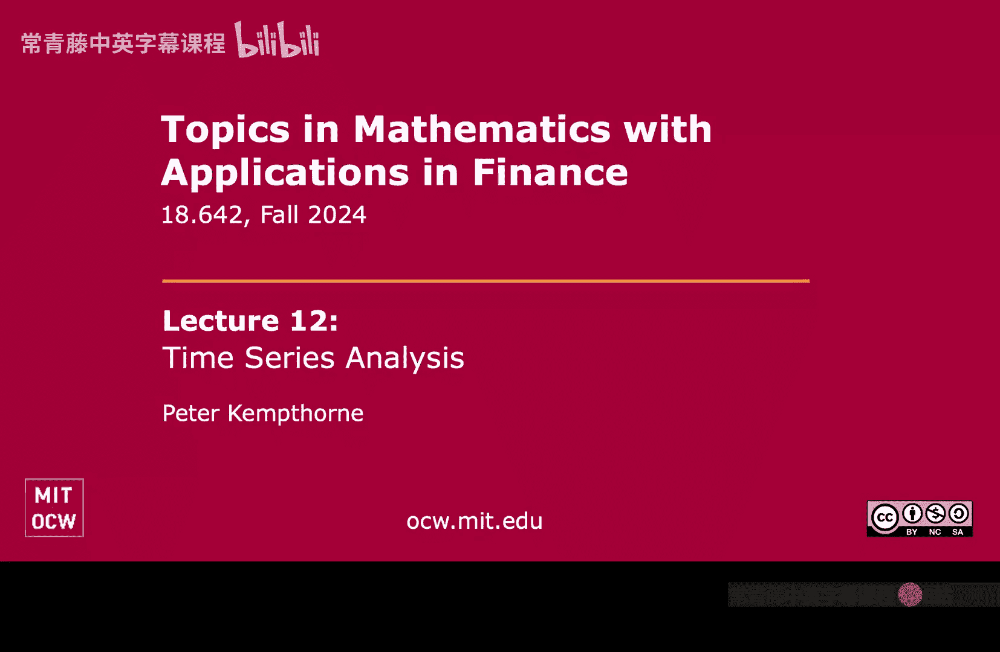

So today we're going to cover an introduction to time series analysis and time series analysis is really a very sort of powerful methodology in statistics and especially powerful when it comes to modeling financial markets。

I hope you'll find this introduction engaging and motivating。So let's talk about time series。

 we basically have notation indicating a stochastic process where x corresponds to the value of the process at time T。

And the time periods T can be discrete。This is most commonly what we'll work with， but it can also。

Correspond to a continuous time interval。And so we can imagine basically time periods。

 time indexed by positive numbers from zero。And in terms of。Modeling such a time series。

 we want to be able to specify the probability model。For any collection of。Time point values。

So when we say， let's specify a probability model for a time series。

 then that corresponds to being able to specify the joint density。Of any set of points。

 here we have M different time points。This generalizes to all cases of M。And。

Such a subset of the values of the process are a finite dimensional set of values。

 and so we'll have finite dimensional distributions for Xt。Now， importantly， we'll want to。

Consider time series that are strictly stationary。And a strictly stationary time series is one for which the distribution of any set of time points。

iss equal to the distribution of the same time points shifted by a constant。So if we're looking at。

The index of time， and we have Xt， if we look at， say four points here。

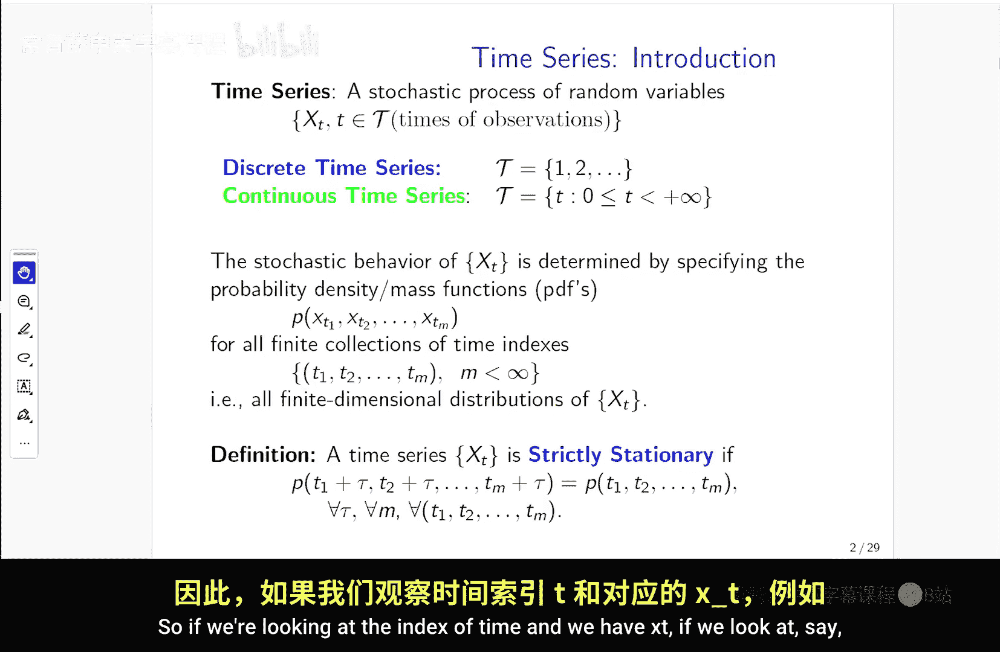

T 1， T2， T 3， T4， then the distribution of。The values at these time points will be the same as the distribution。

If we shift these time points all by the same amount， tau。 So T 2 plus tau and so forth。

 So we basically have that。In this window。And in this window。

The distribution of outcomes is the same。So what does that mean， Well。

 that means that if there's a mean value。In this period。

 then it's the same mean value in this other period。

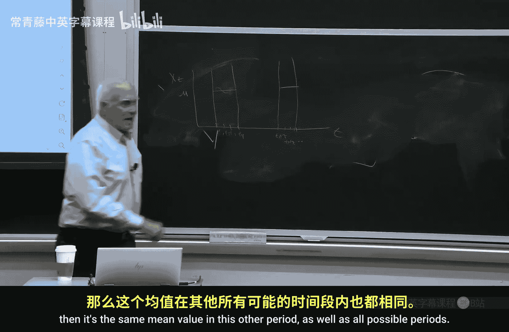

As well as all possible periods。 So we basically have。A probability model。

That is constrained in terms of。The level being horizontal。

And the amount of spread about that level is constant。Now， with statistics， we like to estimate。

Parameterters。Parameterters like a sample mean are very easy to estimate we get a sample of values and estimate the population mean with the sample mean。

And so we're maybe familiar with estimating constants。

And estimating means of populations is a trivial or a simple example of that。

With stationary time series， we want to consider。Perhaps a transform of our time series to a stationary scale。

And then there will be parameters of that distribution that we can estimate。And we can estimate them。

Because。The distribution is。The same basically across the whole range。

 So there's some hope that we'll be able to specify parameters。Consistently and with high precision。

Now。呃。A less strict stationity condition is called covariant stationity。

And with covariant stationity。We're looking just at the first and second order sort of expectations of the time series values。

 so the mean value of xt。Will be a constant mu for all T。And the variance of X T。

Will also not depend on the time T。 It will be stationary or constant over the time range。

 and the covariance。Of values that are tau units apart will have。

A covariance that simply is a function of how far apart the time points are。Here， you know。

 we're looking basically at sort of a mean level mu。

And maybe plus or minus the square root of the variance of x T。Being。The lower。And upper。Levels here。

 And then if we're interested in looking at how correlated different time values are， then。

If we consider。Say T and T plus。Tow， I guess。And we also consider another T prime and T prime plus tau。

Over here。Then when we have realizations of the process， they're going to be staying within。

A few standard deviations of the mean， and the correlation between values at different time points will be the same if the time period between those time points are the same。

So。So that's covariant stationity。Now， with。Such time series that are covariant stationary。

 Then we can look at the autocorlation function。And the correlation between Xt and Xt plus tau is the covariance between the two。

Divided by the square root。Of the product of the variance。

 So these are familiar formulas generally for correlations。

 And we call them autocors because we're looking at the correlation of a time series with itself。

And so we have row of T as the autocor。Now。Let's take a look at some financial time series。

Let's begin with just looking at the S&P 500 index。 So this is the。

Value of the 500 major stocks in the US equity market。And this is from， I think， 2011 to 2020 plus。

 and you can see how this over that period of time trended up with some dramatic drops due to COVID。

And with such a time series。It's clearly not stationary。

Because it's trending over time if we looked at different bands of years， they have different means。

 and so we really cannot consider this scaling of the index to be stationary or covariant stationary。

And what ends up happening with many， many financial time series is that we consider。The time series。

 Y TC。To correspond to。A random walk model。On the log scale。So。If we were to。Look at。

Taking the log of the series。And。Look at the increments of that。This is the log return。Of YT。Then。

The value of Y T。Is going to be an initial value。 Why not times the exponential of the sum of these log returns。

And we can relate these。Log returns。To the percent returns on a fractional scale。

This is log of 1 plus Rt。Where Rt is equal to。Y t minus Y t minus1。Over。White T -1。呃。

So what will commonly be the case is that。This sequence of log returns is covariant stationary。

And so what I'd like to do next is to look at some time series plots of different。

Financial time series。And see whether this transformation。

To log returns seems to make the series appear stationary。So。Here's the S&P 500 index。

These graphs here actually update the graph from before to the end of September。And。If we。

Change initially the。Absolute price to the log of the price。You'll notice that。

Sort of an exponential growth。Tends to。Transform to a linear growth on the log scale。I man。

That comment is。Representing the fact that the lower panel follows more of a straight line path than the upper panel。

 which has perhaps some exponential curvature to it。Now， if we look at the monthly log returns。

We can see that。Those monthly。Increments on the log scale。Have basically a flat time series process。

And so it's rather consistent with this movement across。A level that in this case is close to zero。

With constant variance。Now， with this。Data we might consider looking at the distribution of these。

Log returns。And see whether they're consistent with。

A normal model just as a benchmark example that we might use。And here's the。

Fitted normal curve to the data， and。You， would you say that this is a good fit to the data。

Do I see any nods？Or shakes。I think you had a shake。It looks like relatively。It fall like up ground。

Right， yeah and so the true height。Is basically the realized values that are close to the mean。

 and the normal fit is sort of underestimating those values that are close。

And complementing that the tails of the distribution maybe are underestimating the magnitude of the tails as well。

 And so this property is a property that is called leptocerptosis。hich means slender。

Leptto is Greek for slender。And then so let's take a look at what happens if we look at weekly returns。

Okay， with weekly returns。We get again， a series that appears to be fairly flat。The volatility。

 though， looks like it maybe isn't stable。 So the variation of the time series at different time points may。

Not be constant。 It certainly was extreme during the COviID crisis。As evident here， and here's again。

 the normal curve which has the same properties noted before， and then here's the daily log returns。

So looking at a higher frequency measurements。We again， get this property of。

Sort of stability in the mean， but maybe not a stability or stationity in the variance。And again。

 the normal model。It doesn't look like it's appropriate， and it captures a center and a spread， but。

Seems to be far off near the mean and far away。Okay， let's take a look at Amazon stock。

So we're just going to look at the same。Plos here， you'll notice that the absolute price has a rather notable exponential growth in it。

When we take the log scale， we have this plot and what's really important to see is whether the sort of variability in the time series。

Is constant。Or not。 And before taking the logs， we have a really narrow variation of the price series at the beginning。

 compared with the end。

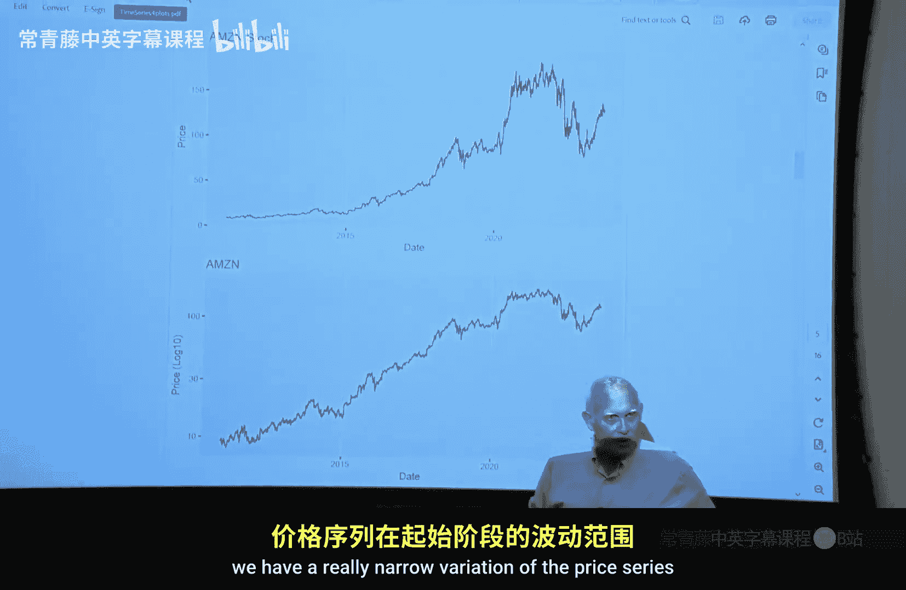

But on the log scale。The variation is， is more comparable。 So that's actually a good thing to have。

 We still have a trend in the series。

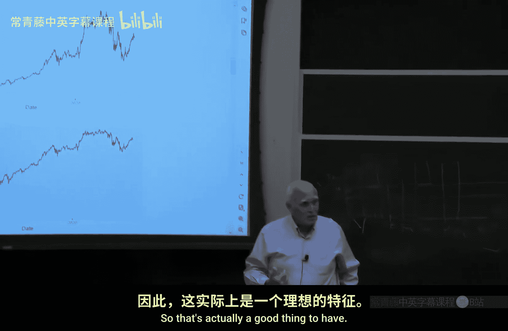

And taking。Differences in the log values。Makes this series。Stationary。Or at least a peer stationary。

 and here's the log returns on a monthly frequency。And。Here's the histogram of those。

Log returns and the normal fit its。Perhaps doing a slightly better job than for the S&P 500。

 it's not clear。Here is the weekly frequency time series again。

The top panel does look like it's consistent with a stationary series in terms of the properties we've highlighted so far。

 and the Gaussian distribution seems to be fitting a bit better。If we look at the daily log returns。

 then we have。This sort of leptocerptosis appearing in this histogram of daily returns。

 and in looking at the time series of the daily returns。

It looks like there are some significant spikes。That are not really sort of consistent with the rest of the series。

 so maybe。You know， that feature is something that we would want to incorporate into our models。Well。

 here's。gettingt away from the equity markets。 This is looking at the crude oil futures contract。And。

With the crude oil Fus contract。This。Future， it trades， I think at the Chicago Merantile Exchange。

 It actually has a。Dramatic feature that the value of the contract went negative in 2020。

Which was a shock to financial markets， especially brokers and traders in those contracts。

 You can imagine if you had 100。Contracts of crude oil。

On the day you woke up and the price was negative， you basically owed your broker100 times that negative value。

And。Brokers actually sometimes were unable to tell you what your position was because their systems didn't allow for negative prices if we tried to take the log of the series and look at the differences。

With these negative values， that's actually a huge problem。But nonetheless。

Let's see I did graph these。Which essentially will sort of exclude those days when there were negative values for the contract。

And looking at this， here's the monthly log returns。So this is excluding the negative price periods。

On a monthly basis， on a weekly basis。And on a daily basis。

 And so what's really important here is just how looking at different financial time series with the same。

Framework。Of log， logging the series， if it's positive and looking at increments on the log scale。

 which correspond to percentage changes， the data。Generally is transformed or often is transformed to a stationary scale。

嗯。Yet another example is looking at the yields。Of the。10 year US Treasury。And so。The top panel shows。

It's called price。But it's really the yield in percentage terms of 10 year government bonds。

And so you can see it started above 3%， drop down to less than 1% following the COVD crisis and then was rising ever since。

And if we look at the。呃。Price or the yield changes on the log scale。 We get this plot。

 which isn't too different in its appearance。But then if we look at the changes in log on。

Changes in log， the increments in log， which are log returns。In sort of mathematical definition。

 log returns are not。Really the right terminology for the percentage changes in yield。

 but well basically be using the same terminology as before one can see that we basically get a distribution of increments。

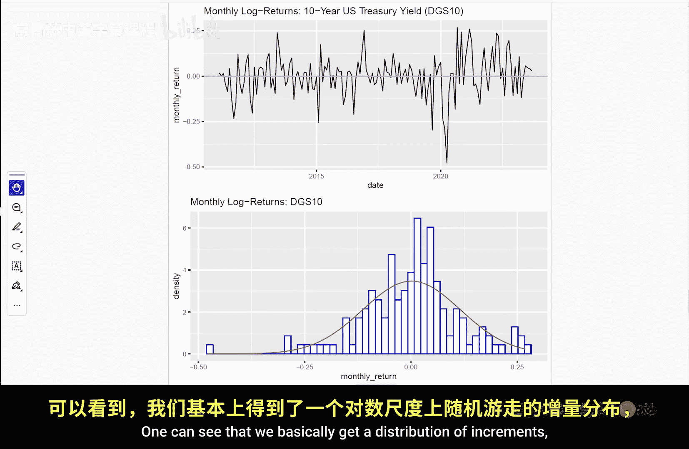

Steps in the random walk on the log scale that。

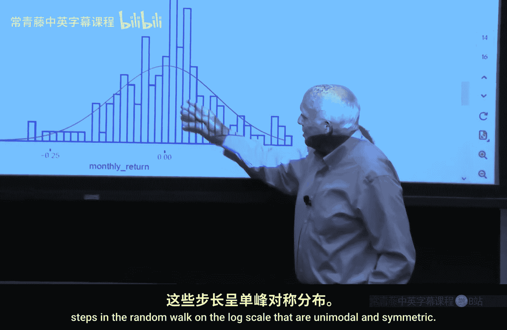

Are unimotal and symmetric。And as we consider。Higher frequency， here's weekly and here's daily。

 It's actually doing a better job， perhaps using a normal model for this transformed series than for the equity market series。

So。So with these cases。The same。Manipulations of the data。Taking logs。

 looking at log returns corresponds to transforming the series to。A random walk process。

And with random walk processes， we can think of。The sum from 0 to t of。Or it's capital T of x sub T。

And called this。Maybe S sub T。U。In modeling。The random walk by this sum。

There will be many different models we can consider for this。

The simplest model would be one where these x's， the steps are。

Identically distributed and independent。 So it's like a pure random walk。U。

And more complicated models will。Consider ST or the X Ts to be dependent upon each other。

So what we'd like to do then is。Let's see， as we。Let's see here。If we think of。

This autocorlation function。The correlation。Between。Xs。That are tau units of time apart。

 we can actually calculate autocorrelations。For。Each of the series we just looked at。

 And so here is the autocorlation function。Of the monthly log returns on the S&P 500。

And one can see that。

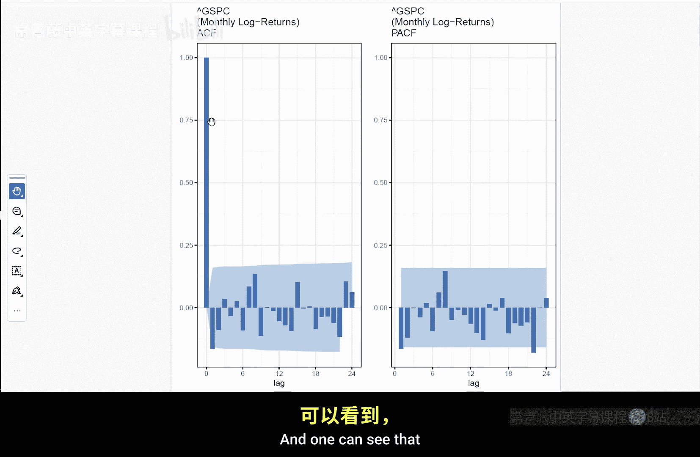

There actually was。A large， negative autocor for one month apart。

And the other autocors varied around this blue range。And what's important。With auto correlations。

 if we have a time series。

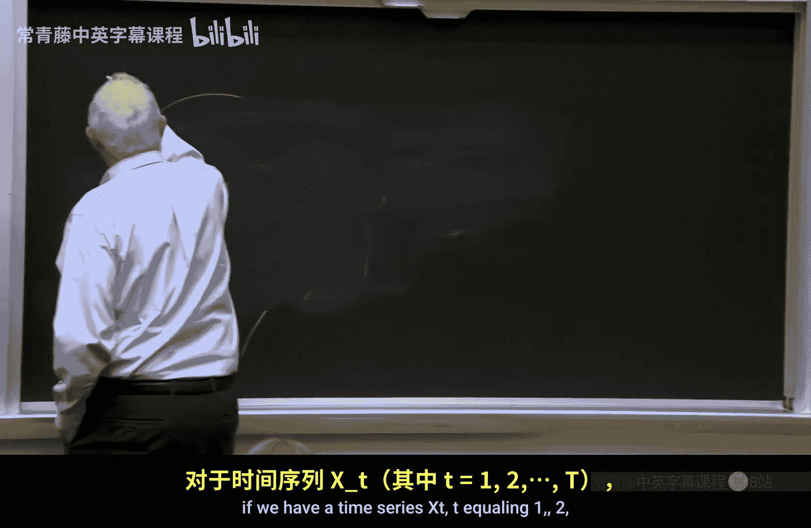

X T。T equaling12 up to capital T。And then we consider the sample。Autocor。At lag K。

Then this is an estimate of the correlation between xt and Xt plus k。And we call this RK。

And I'll maybe put a hat on it to indicate that this is estimated from the sample。

It turns out that this is。Approximately。Distributed。As a normal。With。A mean， or I guess， okay。

 a normal with the roque。The true。Autocor。And a variance that's1 over t minus k。So， if we。Look at。

These bands， these bands correspond to。Sort of the region of sample autocorrelations that are consistent with a zero。

True auto of correlation。 So if we want to。

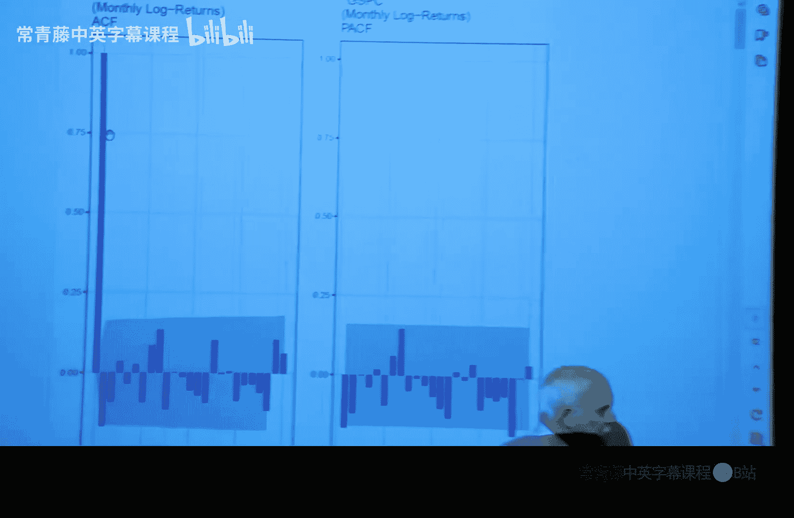

If we want to test a null hypothesis that ro k is equal to zero。

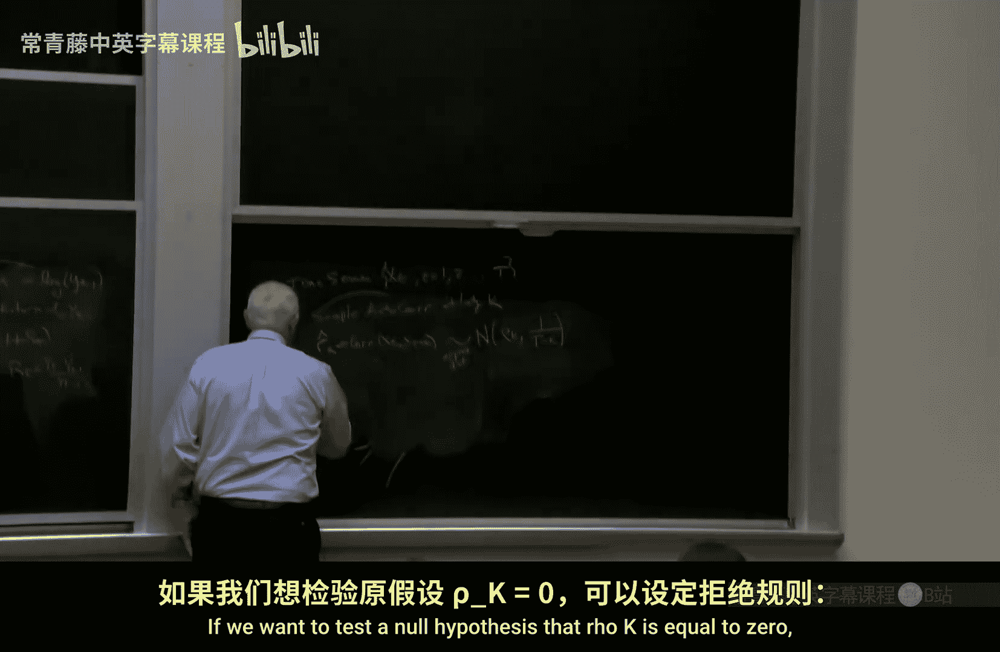

We can say reject。If。R hat K。Is greater than。1。96 times the square root of 1 over t minus k。

Applying a normal model for that。Return distribution。 So we basically have for the RH K。

Where we have a row k here。We have a bell shaped curve。

With a standard deviation square root of1 over t minus k。And if we consider ro k equal to zero。

 then we do the rejection if it's outside these bands。Now。

Let's take a look at how these autocorrelations vary as we vary the frequency。

Here's the weekly frequency。For the computation of log returns。 And we have this。

Pattern where grab there are somes。Significant negative autocorrelations。At， say，5 weeks apart， and。

What would you say is a property of。A time series that has negative autocors。Say of order。At lag 5。

What does that really？Mean， in terms of what you would expect， yes。Mean river， yes， exactly。

 so the negative autocorres。Are consistent， perhaps with mean reversion。 So that means that。

If you the。Price changes are too high， they'll revert back， or if they're too low。

 they'll revert back。And。Let's see also on these graphs are partial。Autocors。

 which we'll discuss later。But partial。Autocors are correlations at a given lag， after accommodating。

The dependence on lower order lags we'll see that how that works out in the case study later。

 but let's take a look at just these other series， So here's the daily series with the S&P 500。

 and so you can see oh there's actually some reasonable。Strong autocors。Here's Amazon stock。

I'm not sure why it doesn't have the band on the lower side。

But it basically is symmetrical with that blue band where the correlation is consistent with zero autocorlation。

Here's the weekly。Here's the daily。 So interestingly。

 Amazon stock doesn't seem to have any significant autocors， regardless of the frequency。

 Here's the crude oil future。You can see that with the crude oil future。On a weekly basis。

 we have a negative autocorrelation at two weeks。And then a positive autocorrelation at three weeks。

 So there's some interesting patterns that perhaps can be exploited。And here's daily again。

 one can see the rather significant autocors at the low。Lag values。And let's see with the Treasury。

Yields。Looking at the autocors and how the log yield changes。

 one can see that there is some strong time dependence at the weekly basis。

 as well as the daily basis。Now。Let's see this discussion of autocors is。

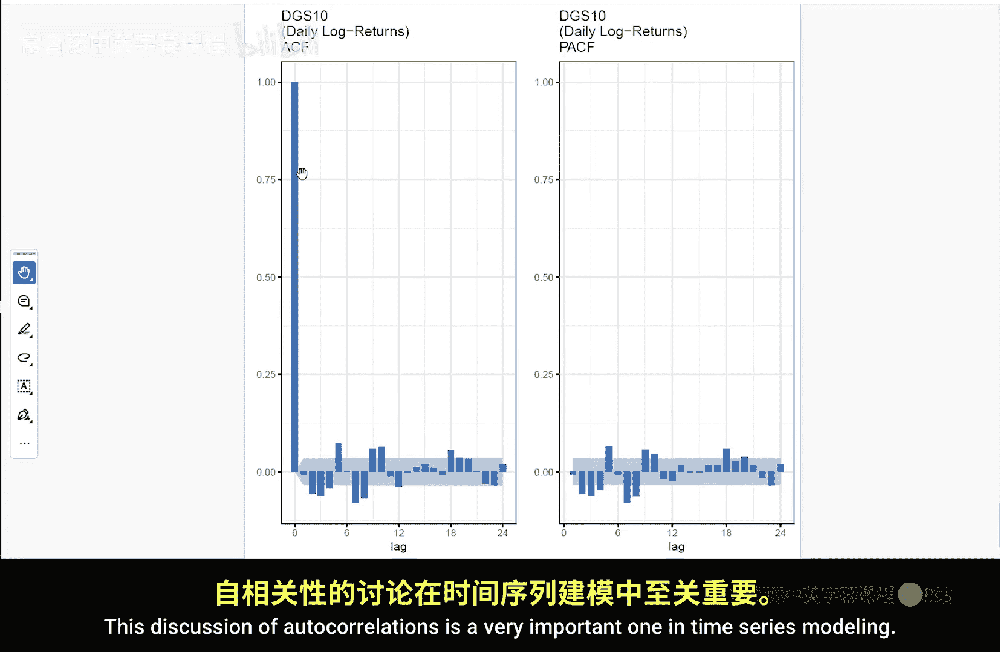

A very important one in time series modeling。And I would just want to。Highlight how， if we have。

A time series。And we have a， we fit a time series model。And so we compute， say， y hat T。

T equals1 to T。Then the residual。Series。From。This fit of the time series model is the set of errors。

Which are Y T minus Y hat T。And。You know， we can just write why T is equal to y hat T。Plus。

 Epsilent or Erity。A good model。So。The model。Is good。If。The E Ts。Basically。Have。Mean  zero。

Constant variance。Are uncorrelated。With each other and。

So these assumptions are basically assumptions of a white noise process。So， if our model。Basically。

Predicts up to this。Residual process， which is unpredictable。

Has means zero constant variances uncorrelated。 There's no information left in the residual series。

And so we can use the auto correlation of the。Residual series。We can use。

The auto correlation function of。The error series。To test。If。Model is good， basically。

And a good model。Will be a model that has。Captured all of the time dependent information in it。And。

Predictions from these or forecasts from this model are ones we have confidence in。

 And so there's actually another assumption here， which is that。

Let's see if the epsilent T are normal or Gaussian。Then this gives good predictions。

And by predictions， I'm thinking of not point forecasts of a series。

 but a prediction interval and how wide should that prediction interval be depending upon the variability。

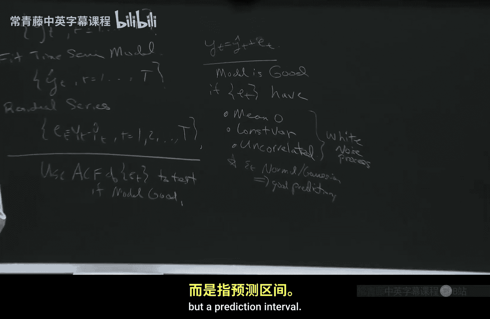

So， if when we work with time series， we're actually are。

Going to work often with autocors of residuals to see whether there's。

Any time dependence in the series。And。If we。What what's rather interesting to note is that。

One can fix a single correlation。Lag。And use that to test whether the data are consistent with a zero autocorrelation of a fixed lag。

We can also。Use sets of lags and test whether the whole set is equal to zero or not and so。

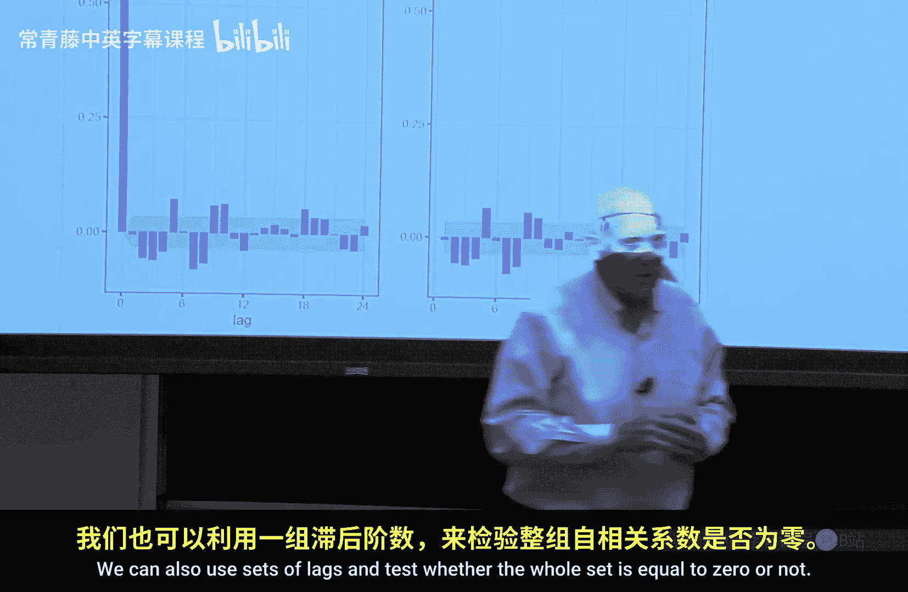

Let's see。Let me just write it over here。So。If。Say row1 equals row two equals。OkayK。Is equal to zero。

Then。R hat J。Which is distributed as normal zero， roughly1 over t。For J inkling1。To to K。

Our hat J squared。Times T。Hiss approximately。Square of a normal 01， which is a chi squared1。

Random variable。And if we look at the sum of t are at j squared。From one decay。

This will be approximately a chi squared distribution with K degrees of freedom。And so we can then。

We can reject。The null hypothesis。If。This test statistic， I'll call it。 Well， actually。

 I'll call it B P。Because it's actually called the box Pierce test， if B P。Is large。say， larger than。

A critical value， C star。Which where this is determined by the chi square distribution。

And so this is actually called the box Pierce test。And。So。Will actually be very interested in。

Autttercors of the original series， but then autocors of the residual series。

 And whenever we have a model where the residual series still has significant autocors in it。

 then we're really not done yet。 We really need to continue。Okay。So， we have。Now。

 the next topic is a really。Sort of extraordinary theorem。The old representation theem。And。With。

Stationary processes that are covariance， stationary。

Then it turns out that any covariant stationary process。Can be decomposed into。A V T process。

 which is linearly deterministic。So it's that means that。Basically， the current value。

 VT as a linear combination of past values。And ST is a moving average process。Where we have。These as。

 which are white noise。And our ST process is just a weighted sum of those white noise terms。And。

The white noise terms are also uncorrelated with the linearly deterministic process。So。Let's see。

When I first learned of this theorem， I was。Had an issue with， well。

 what is a linearly deterministic process？

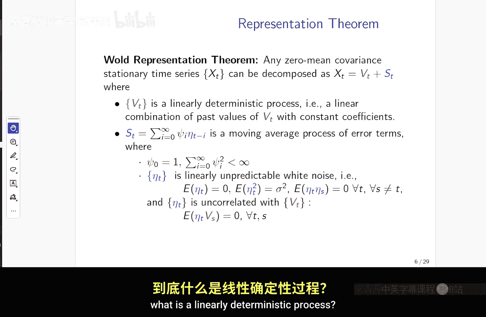

So can anyone suggest what a linearly deterministic process is？

Or an or could be or an example of one。So we have VT。Is linear。The deterministic。So if we have VT。

So if we observe V T over。A sequence。Of time points。Will， for what patterns of V T will that。

Determine。The VT process into the future。Can you think of any。

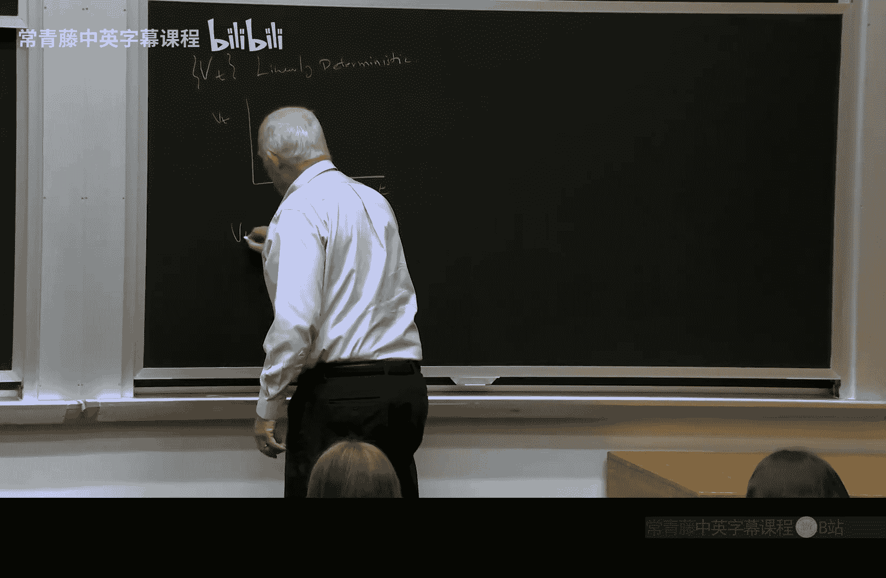

So， if V T。Is equal to mu。Plus， say cosine。Of。Theta T。Then this thing will just。Move up and down。

 And we can actually determine。That cosine function from enough。Values of VTS。

So does that mean like any periodic process would be you yes， any？And。It's interesting。To know that。

 I those， those of you who may have studied harmonic analysis。嗯。Could come across the。

Result that if we have， say different。Period， different cosine or sine functions and take sums of those。

Then that will also be a linearly predictable process。And so， if you look at。

Suming signs of different。Frequencies， which basically corresponds to Fourier series that are flat。

 Then those are linearly predictable。嗯。So， so that's。The VT process that we。Should be aware of。

 But what's really interesting is that the variation about that deterministic process。

 the S T process can be。Expressed as a moving average process。And this。

Representation holds for any covariant stationary time series。 Now。

 for any covariant stationary time series。嗯。Let's see。With the covariance。Stationary。Process。ST。

We have basically that mu is equal to the expected value of ST。Sort of sigma squared。

 which is the variance of ST。This is constant over time。 This is constant over time。

 and the covariance of X T X T plus tau。Is equal to gamma of tau。For all tea。So。Any。

Covarit stationary process。Can be represented as this moving average。Of white noise process。And so。

 well， how would we。Use this old representation theorem。Well。

 if we have a time series X T that we want to specify a covervarient stationary time series model to it。

Well， the first thing we would do， perhaps is sort of de trend。The series， X T， so that it has。

A constant mean level。 So if we had a。Linear trend or quadratic trend。 We would subtract that out。

 So X T is a series that looks like it has。A flat path。And then we could initialize。

A parameter P indicating the past。Number of observations。

That explained the linearly deterministic term。And。We can then。

Project our time series X T onto the space spanned by the lags。The P lags。

And then look at the errors about that projection。So here we can think of having the time series values y1 to yn。

And we can project those onto the lags。Of the Y values， so。For the first sort of P rows。

 we actually need to go back in time。 So that means we have to start。

Not from the beginning of our time series， but maybe P units ahead。

And then we can apply ordinary least squares to define the projection。Matrix onto those。

Lagged values。 And then we have this projected residual。

And what we would want is that this projected residual。嗯。Would， if it's。

A stationary time series we could use time series methods we' learn。

About how to specify a moving average model to these series and get estimates of the size。

And also estimates of the white noise terms。And with this。Step， we then。

Can evaluate whether our residuals。Are orthogonal to lagged values。For lags， greater than pe back。

So these residuals。Should not have any dependence。On。Lags of。Why that are further back than P， if。

 if not。If if those are not orthogonal， then we should increase P。

And then we want to look at whether the8 to Ts in our moving average model。

 whether those are consistent with white noise or not。And so if they are， we're good， but if not。

 then we need to consider sort of changing the specification of the moving average model。

And perhaps adding other variables， such as deterministic variables that could be useful in the projections。

 But what this demonstrates is how this theory can。

And sort of the abstract be applied to real world data。And。So。You knowAs we increase P。

The number of lags we use for the projection。We end up getting a limiting value。As P gets large。

 that this sort of is capturing the。Lineniarly predictable part of the series， the VTs。

But this assumption basically requires。If we let pea grow arbitrarily large。

We probably want to make sure that。P over n。Goes to zero so that we're estimating P parameters。With。

A number of points。That。Is large relative to P。嗯。So this is just a way of thinking about how。

We might approach our modeling effort exploiting the world decomposition。

 but what' what's really important here is that。Any covariant stationary model。

Has a representation as this moving average process of white noise。

So that's a fairly powerful result。 It says that once we have transformed our data to a scale that where covariant stationity is appropriate。

 then。We can。Restrict ourselves to the class of moving average processes。

And what we'll see is that there are alternatives to moving average processes called auto regressions that are very closely related to moving average processes。

Yes。就。Yes my question is why you need to specify covariance stationity for the？Okay。Well。

 with the representation， okay。Okay。Let's see where is it here， you know， it's fine， here it is。

 okay。Basically， if。If we consider this process ST。Which has some set of weights。

si times white noise， Eda T's then。If these conditions are satisfied for the size。 So the sum。

 theyre square summable。You know， finite then。This process， S T。Is going to be covariant stationary。

It'll have finite mean and variance， this constant。

 and the covariances will also be constant over increments of any lag。What's。

 what's powerful is that this representation。Can be used for any covarient stationary model。

So this is covarient stationary。But any covariant stationary model has this kind of representation。

Yeah， sure。And of course， you know。Covarit stationary is a nice assumption， it may not be satisfied。

 so you need to have more complex models， but it's good to know when you have these assumptions satisfied that this is the representation。

All right， so we next want to introduce you to this operator called a lag operator or a backshift operator。

And because I call it a lag operator， I labeled it L， and so L。

Operates on a time series X T and just shifts the time。Index back one period。

 So we're thinking of discrete time series。With integer values of T。

And the lag operating on XT shifts the time。Units back one period。And we can think of。L。

To the zero power。Doing the identity。L 1。One power L shifts back once if we apply L twice or L squared this shifts back two periods。

 and of course， if we apply at n times， then we shift back n periods。And so with these lag operators。

 we can think of inverses of those operators as well and sort of consider sort of shifting the time series forward if that were useful。

And so， when we think of。The world representation。We can express it as。

The sum of the moving average process。And the linearly deterministic process V T。

 And we can represent the。Moving average process as a polynomial of the lag operators。

 possibly of infinite order that is multiplying the Ada Ts。Now。A useful sort of application of this。

Moving average representation is that。If we think about how。Was。

The value of the process at time T affected by the white noise process Ada J lags ago。

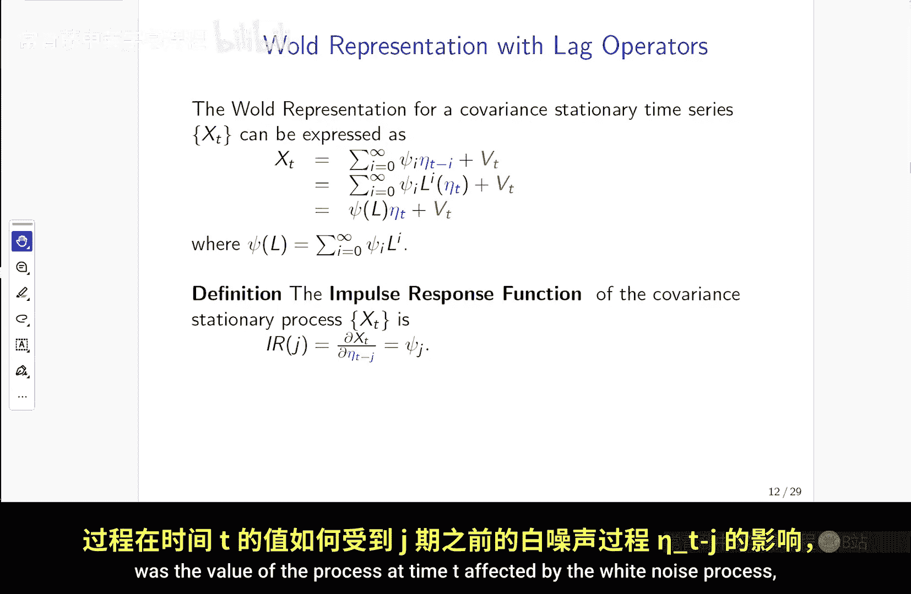

Then。The partial derivative of X， T， with respect to that。

J lag back white noise term is given by Psi J。 So when Psi J is large in magnitude。

 that means that the current value of x is dependent on the J lag of the white noise。And。

With the representation of the X T series by this Psi function。

If one sort of graphs the psi function over lags。

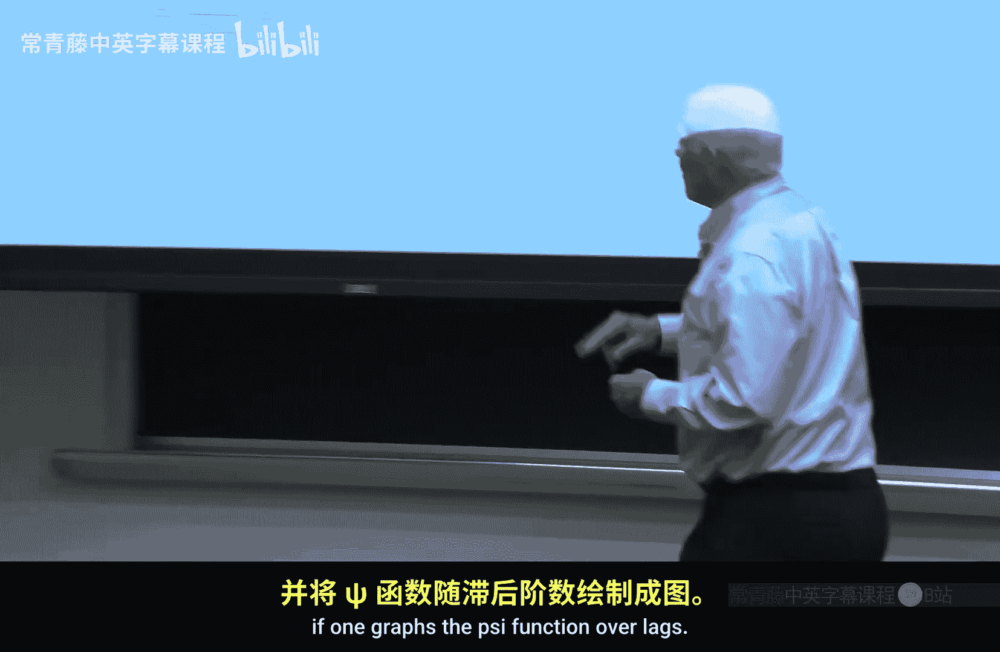

So。Let me do it over here， so if we look at Psi J。As a function of J。And have。We might have weights。

 beside J。That very positive and negative。And so if this were the case。

It would indicate in this graph that the impact of。The white noise sort of three periods ago， as。

A significant impact on X now。 So it can capture sort of delayed。

Responses of the time series X T to the white noise terms。And if we look at the long range。

Impact of aided。Jy。Or sorry， the long range， yeah， impact of。Or the cumulative response of X T。

 basically。Corresponds。To the。Some。Of the size。And so there's basically a long run cumulative response of X T to the。

 to a given。8 to T。So this is the long run cumulative response to the white noise terms。Now。

 what's interesting about。si of L process。So if we havesyaelle。Is equal to the sum。From。0。

To infinity of Psi J L to the J。嗯。It's possible that this operator is invertible。And。

If it's invertible， there exists。An inverse operator。

With coefficients psi star and the product of these two polynomials is simply equal to the identity。

And。If that's the case。That an inverse of the psi of L operator exists， then。We can。

Write our model for the stationary process。As being equivalent to。

Applying the inverse operator to both sides。And so we get an inverse operator。

Which is a polynomial lags operating on X T is equal to the a to T。 So this corresponds。

To actually an auto regression model。That has white noise terms。And so。When this exists。

 this is the format of that。 And what we'd like to do is。

Show you how this works with some different examples right now is perhaps a bit abstract。

 but when we look at the special cases of an autoaggressive order one model。

 many of these terms will become clear。Now。We can introduce with this notation of lags and polynomial lag operators。

Arma。PQ models。Where ArA stands for Autoregressive。And MA A stands forMoving average models。

And the P。Corresponds to the order of the autoaggressive and the Q corresponds to the order of the moving average。

We can think of our time series X T being a sum of terms， autoaggressive terms on the top row。

 And then the second row corresponds to moving average terms of the white noise。

So notice in the top row。We have X， T。And actually， if you look at that equation， if we sort of take。

X T minus mu。This turns out to be equal to phi1。X T minus-1 minus mu。Plus， v 2。And so forth。

 So these are lag terms of the mean adjusted x's。And then we have the next row is the sum of the white noise terms at time t t minus1 up to t minus  Q。

 so armma Pq models are。Parsimonious case of time series models， where we just have。

P auto aggressivegressive parameters Phi1 to P P and Q moving average parameters， theta 1 to theta Q。

And if we write。If we group all the。Terms with x's on the left hand side and all the terms with the Adas on the right hand side。

We then get this phi of L operator times x T minus v is equal to theta L a to T。And。

The world decomposition of this。Armma model。Is to multiply this。

Arm equation on both sides by the inverse of Phi ofel。

And so mu plus psyal a to T is the world decomposition representation of the process。So。

 let's look at。autoaggressive。Models。So we'll assume that there's no moving average term。

 So we have the phi of L。Operator。Operating on x t minus mu is equal to the white noise。And so。

That model basically says that X， T。Is a linear combination of。The P lags of X T plus white noise。

So this is。A regression model for our time series X T using predictor variables。

 the lags of this time series。And。If we。Take expectations of both sides。We basically get mu。

The constant。Expectation of the covariant stationary process is equal to C plus the sum of Pji times mu。

The expectation of each of the lags。Plus 0。 And so C turns out to equal mu times phi of1。So。

We have that representation of the constant term。Now。What's。

Important with time series models is whether the time series model。Is stationary or not。And。

It turns out that for an auto aggressive model。With parameters， Phi1 to P P。

That if we look at what's called this。Characteristic equation。1 minus phi 1 z。

Minus vhi2 is z squared up to V P z to the P power。If we consider the roots of that polynomial。Then。

Well， if we have roots， lambda1 to lambda P。Then。F of L has to be the product。Of these terms。

 each of these terms。Each of these factors are equal to0， when sort of Z。Equals。Lambda one。

So if z equals lambda 1。Then the first term is0 of z equals the P。

Root lambda P then this last factor is0。 So this is a representation of this P order polynomial。

In terms of its roots。And the condition for stationity is that。

All of these roots have to lie outside the unit circle。In the complex plane。And so。

If we look at one of these roots。Fix just lambda as a root。

Then if we take the inverse of this factor。It has this geometric， sum expression。

Of1 plus1 over lambda L plus 1 over lambda squared， L squared， and so forth。

And so it's basically an infinite order。Polynomial。In lags。

And the coefficients are one over lambmbda。To the I power。So， if these lambdas are。

Bigger than one in magnitude。Then the inverse of those。The reciprocal of those。

Is smaller than one in magnitude。 So these terms will die down。With a limiting value of 0。

And that's necessary for this representation to。Be appropriate。So we get a covariance stationary。

Some of laairs。Lagged white noise terms with this representation。 So the phi inverse of L。

Is actually the product。Of P of these。Reciprocals。And so the condition that each of those reciprocals。

Or each of those terms。Is defined by lambmb de jas that are bigger than one in magnitude。

Makes their geometric series expression converge if the lambda does。We're inside the unit circle。

 the magnitude。 Then when we multiply them together， square them， they get bigger and bigger。Okay。

So let's take a look at what this。Works out to be just for an auto regressive process with p equal to1。

With p equal to 1， our characteristic equation is simply1 minus phi z equals 0。

And so the root of that is clearly one over fee。And so， the a。

That p equals one autoregressive model is going to be covarient stationary if and only if the magnitude of p is smaller than one or equivalently。

Its inverse magnitude is greater than one。And so we end up having these first and second moments and these covariances。

Which are very easy to。Compute。And you， this will。probably be an homework exercise problem。

 but with the first order auto regression model， we have a constant mean and a constant variance。

 which is sigma squared over 1 minus phi。Time sigma squared。And the covariances。

Basically are the variants。Times fee to the Jaith power。So with an auto correlation， the fee。

Is the first。Oder autocorrelation and phta the Ja is the jor autocorrelation。Okay。Now， if。Fe is。嗯。

Between or-1 and1 for feehi between 0 and1， the process。Exhibits exponential mean reversion。

And when phi is negative。But no larger than negative one in magnitude than it exhibits some oscillating。

 exponential mean reversion。But when phi equals one。Then the world decomposition does not exist。

 and the process。Is a simple， random walk。Which is nonstary。And when phi is greater than one。

 then the process is explosive。So in financial markets there。These first order。

 autoaggressive models， actually。Are used quite frequently with interest rates where there's maybe a constant long term interest rate level。

 and there's variation about that this Ornstein Ulenbe process corresponds to the first order。

 autoaggressive process。嗯。With these other series， these are financial。

Or time series in financial markets where the level of the series is expected to be stable over time。

 So perhaps interest rate spreads would be。Moodeled as being stable or stationary。

 real exchange rates， perhaps。Or valuation ratios。嗯。So。

 so these models arise in these application areas。 Now， to fit an auto aggressivegressive process。嗯。

And we could simply just fit a linear regression。Model with P lags of the series as explanatory variables。

But what's rather interesting to know is this approach。Called solving Yu Walker equations。

If we take our model equation。That first equation line， we have the mean deviation。

Of X T is equal to a linear combination of phi J times the J flag deviation from U。

There's a typo there， that second。Phi2 should have an X T -2。 Then if we。

Multiply both sides of this model equation by X T minus J minus mu。Then we basically， for each term。

 we're adding x t minus J minus mu as a factor。And then take expectations of that。 We have our Jath。

Lag autocovariance。And it's equal to。The phi 1 times the J-1 lag auto variance plus phi2 times the J -2 lag and so forth。

And if。The J is equal to 0。 Then we also have a sigma squared term。Where， we're looking at。

Obviously that， that well， that term comes in。So。So we basically have。Equations。

A system of equations。If we vary Jay。And so if we consider J equal to 1 to P。

 we get a system of P linear equations in the Pjs。And this is。Our your Walker equations。

Gamma1 is equal to the first row， of the matrix times the vector of p and so forth。

And with the properties of the autocovaris。They are symmetrical。So we can actually use these。To。

Make the computations of the matrices。When we use this eule walker approach to estimate the parameters。

We're actually using。A sort of method of moments， principle for estimating the。

Auttter aggressive model parameters。Method of moments。

As a principle and statistical estimation where we basically equate sample moments and the population moments and solve for what population parameter values match the sample moments。

Now we can。Do a similar analysis of moving average models。

 So here we have a Cu order moving average model represented by a polynomial theta of L。Of order。

Q in terms of powers of L。And the properties of this process。Can be  studiedied。

 And one thing we might want to do。Is。Invert this moving average model。Into an autoregressive model。

By basically multiplying the model equation on both sides by the inverse of the theta。Aelle operator。

And so if we do that。Then we basically have。An auto aggressivegress representation of the moving average order Q model。

And if you calculate simple。Second order properties of this moving average process。Well。

 the mean is simply mu。The right hand side of the equation is just。Wighted sums of Adas。

 which haveth mean 0。And so the expectation of the left hand side is simply equal to U。

And if we look at the variance of X T。It basically is the variance of the weighted sum of the Adaus。

And it turns out to have this simple form。With covariances of the series。

With moving average processes。If we look at time increments， J。

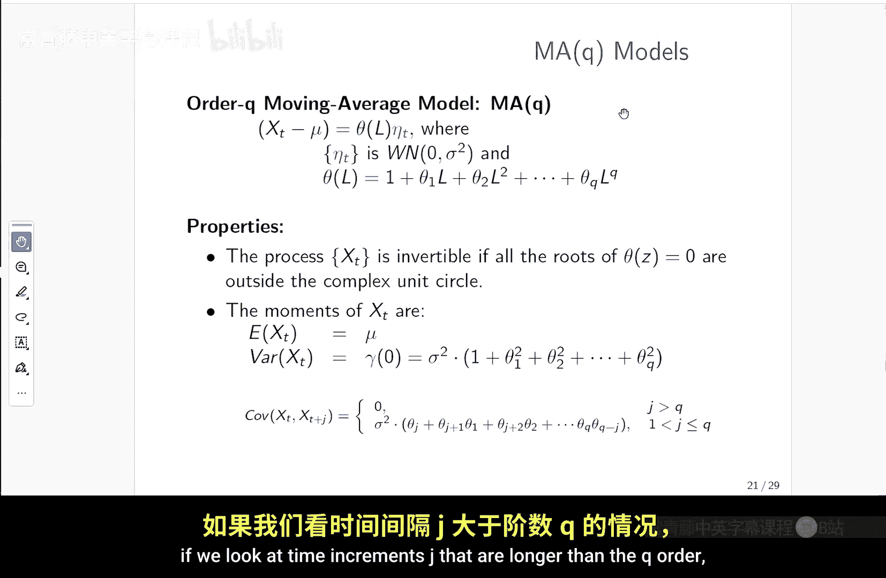

That are longer than the Q order。Then there's no overlap of white noise terms。In X T and X T plus J。

 And so their covariance is going to be0。 when there is overlap， then we get this formula。

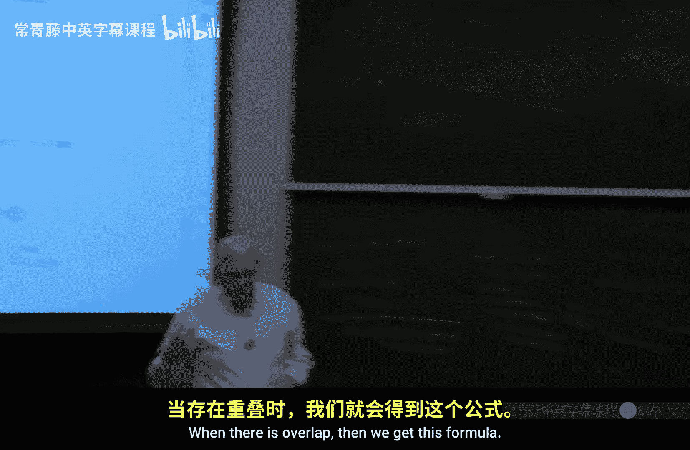

Okay， so next。嗯。We want to deal with how。We can。Accommodate non stationity in time series。 So far。

 we've just assumed。Examples and models like autoaggressive and moving average models。

 where this series is stationary。There will be cases when our time series is not stationary。And。

Differencing the series。Will generally render a series to a stationary transformation。And so。

If we consider。First， order different。We have。

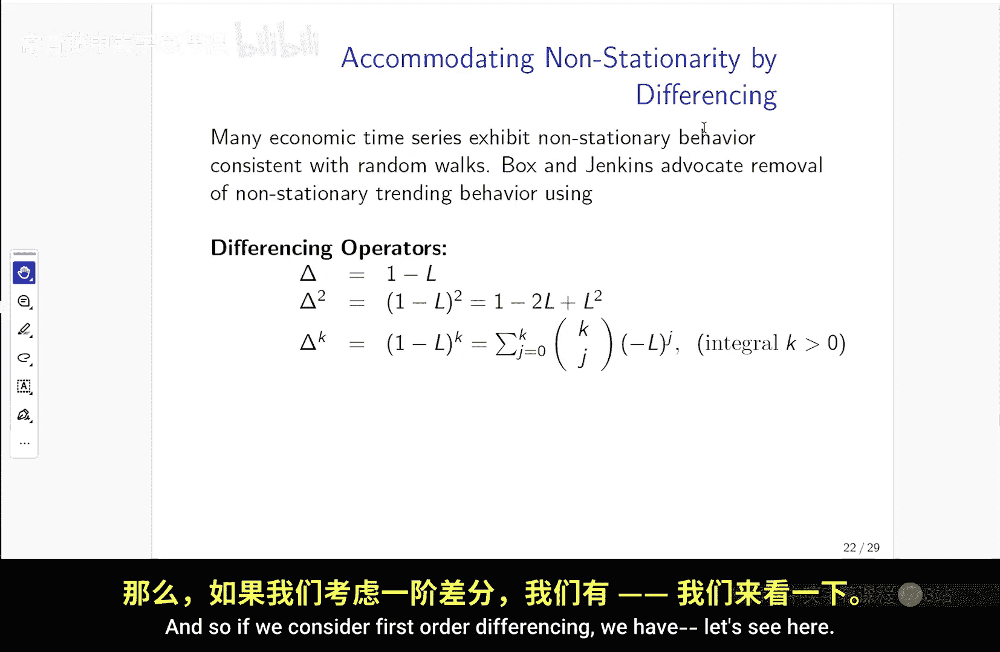

Let's see here if we do Delta yt equaling 1 minus LYt。Equals Yt。Minus LY T。

Which is y t minus y t minus1。Okay， this is first order differences。If we。Apply the。

First difference of this， we end up getting。Y t minus Y t minus1。Minus y t minus1 minus y t minus2。

And this turns out to be equal to y t minus2 yt minus1 plus。Y t minus-2。

And there could be case order difference， but in practice we'll only generally use first or second order different。

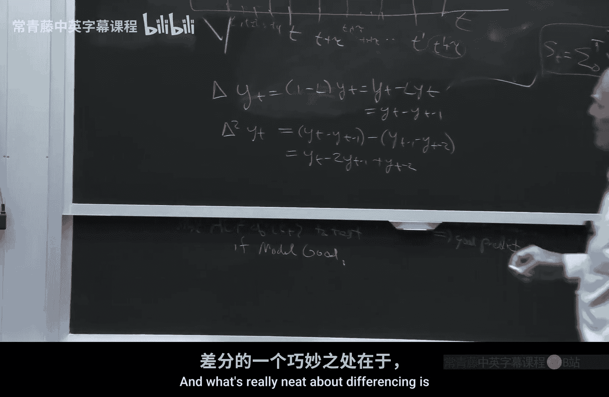

What's really neat about differencecing is that first order differencecing。Well。

Eliminate a linear trend in the series。Basically， if we have a linear trend。

 then the difference will just be a constant difference。

And the second order difference is appropriate。If there is。A sort of quadratic。

Trend in the series and second order difference will eliminate that quadratic trend。

 So we'll finish there for today。 But this issue of。Modeling differences of the series。

Or second differences of the series as stationary corresponds to。Having time series models that are。

Looking at the dynamics of the slope of the time series， or。

Which is like the first derivative or the second derivative。And assuming that those are。

Perhaps constant level。And constant variability。 So。

 so those mathematical features end up now being very intuitively applied actually with with different cases。

 Okay， we'll finish there for today。

