# 麻省理工学院【中英⚡数学专题及其在金融中的应用｜18.642-Fall-2024,-Topics-in-Mathematics-with-Applicatio】-p17-P17-Volatility-Modeling--BV1iLrjBrETS_p17-

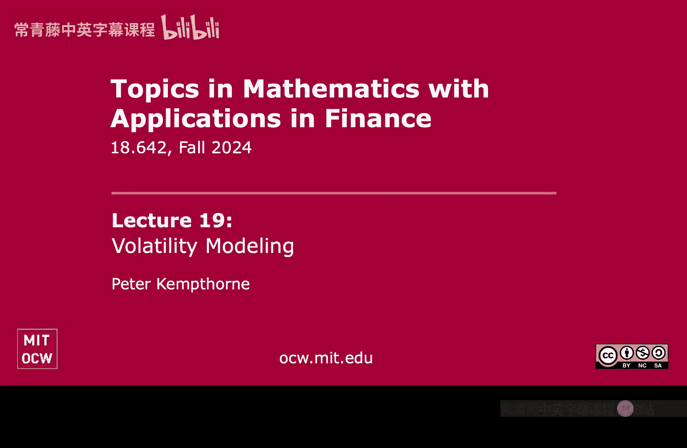

Well today we're going to talk about volatility modeling and this topic in finance is one that has really interested me for decades and there are a lot of subtle details involved with understanding volatility。

 how to measure it how to forecast it and we've had some talks already with the group projects about dealing with volatility estimation and measuring volatility in particular implied volatility today we'll focus more on realized volatility and modeling that。

And so， to begin。Here's just an overview of different ways one might。

Define volatility and its basic definition is the annualized standard deviation of the change in price or value of a financial security。

 And， of course， this。This concept is really important for measuring risk。

And evaluating the value of options on underlying assets， y。我申你过单子。What that means， Okay， suppose。

Suppose we have。A sigma day。That's equal to。Say 。01。Percent， so 1% variability per day。

 If we wanted to measure volatility on an annualized scale， then we could。Consider。

Possibly the squared of 252 times sigma day。So it's a matter of scaling the volatility up to an annual horizon。

And the value of that rescaling is that we can talk about volatilities over different maturities。

 and they're measured on the same scale。嗯。And with different estimation approaches。

 there's historical sample volatility measures。which don't require really any probability models with them。

 then we have geometric brownie in motion， that's a very familiar model to everyone here and we can consider extensions of that to the Poisson jump diffusion model group。

Delivered a nice lecture note on the Poisangju diffusions。

 and then following these cases are cases where volatility might have some time dynamics in them。

With these geometric brownian motion and Poisanju diffusion models。

 we think of volatility being some constant which is the same from one period to the next。

 but it turns out that there can be time dependence in volatility。

 and so there are arch and garch models which stand for autoregressive conditional heteroschastic models。

And then the garch are generalized versions of those。And then there are stochastic volatility models。

 as well。I know let's see the Heston option pricing model uses a stochastic volatility。

Term in its in its formulation。 So we have those kinds of extensions。 And then finally。

 there's implied volatility from options and derivatives。So let's just look at。

Computing volatility from an historical series of。Actual prices。If we have prices PT。

 then we can define the log returns。By looking at the ratio of prices from one day to the next or one period to the next and taking the logarithm of that。

This is a useful way of measuring returns as an alternative to simply the percentage change in value using the log scale。

Or the log return， if we look at the cumulative change over successive periods。With log returns。

 they just add。Whereas if we were using percentage returns。

 we'd have to basically multiply factors together representing that now。In modeling volatility。

We consider models that correspond to stationary processes for our returns。

 So the log returns of price series are often consistent。

Via tests with a stationary distribution of returns。

 And under the assumption of covariant stationity， we can define sigma。

To be the variance of or the standard deviation of those returns。 Now， in this notation here。

 this sigma for the volatility would be corresponding to a frequency of observation that's daily or weekly or monthly。

And we'd have sample estimates given by the square root of the。Sample variance， where we。

Traditionally， use the。Etimator for variance， which is an unbiased estimate of the variance。

 So that factor。Devisor 2 T-1 is included there。And then if we want to annualize these values， it's。

Common practice just to treat these returns as。Independent。Or uncorrelated over time。

 so that the variance of a sum is the sum of the variances。So theyre roughly 252。Days in a year。

 So we。Multiply by the square root of 2，52 for daily。Returns for weekly， returns。

 we'd do the route 52 times Sigma hat and Ro 12 for monthly。Now。When。Measuring historical volatility。

We can think of。A simple historical average sort of since the beginning of our time series。

 so this historical average would use all available data。

It's reasonable to think that volatility isn't necessarily stable。

Over the entire time range of a price series。 And so we could consider just using the last M values。

 So take a rolling average of the last M。Values of。The sigma hat squared T minus J。 Now。

 if we define sigma hat squared T to just be。A single。Days volatility。 That could be like the。

Square of the daily return。On a given day。Now， using equal weighted values over。A window of length M。

Might be improved upon by using an exponential moving average。And so exponential moving averages。

Are averages where we take a weighted average of。The previous estimate of volatility。And the current。

eststimate of volatility using time the time t value。

 so this one minus beta beta weight allows us to weight the past versus the present in an exponential way and with this formula it's recursive over t and so it can actually apply across an entire range of historical data。

An alternative to just the regular exponential moving averages and exponential weighted moving average where we only go back maybe M periods。

But we decrease the weights on。Past volatility estimates， according to the power of beta J。 So beta。

J is or beta is a decay factor in estimating volatilities。So。Okay， additional。

 one could consider regression models with these volatility sigma hats indexed by T and。Depending on。

The relationship of volatility to the past， you know we might use more data to increase precision of estimators。

 but use data closer to time T when we believe that the volatility may be changing over time。

And what's neat about these estimation methods？Is that we can evaluate， say。

 the exponential moving average estimates of volatility over different assets and different asset classes。

And this。Approach was applied in risk metrics here。

 there's a web link to the risk metrics technical document。I think I have it listed here。嗯。So。

Actually， this risk metrics was。Created by JP。 Morgan back in the 1990s。Coincidentally。

 when I was at the Sloan School teaching statistics and financial modeling。

 I was part of the Financial Services Research Center that was sponsored by JP Morgan and other groups at when this risk。

Mets document was， was created。 And if we look at。Let's see。 there's a section here of risk metrics。

Dey factors for volatility。Basically， for different countries。

One can use the exponential moving average of。Asset returns for foreign exchange。10 years。

 zero prices， equity indices and other assets and what's。

Interesting to see is that the decay factor is generally well above 0。9， it's more like 0。95。

 which suggests that volatility is changing slowly over time。

And the way they chose these decay factors was to look at how predictive they were。

With mean squared error of volatility。These are reasonable estimates of volatility。

An important aspect of these measures。Is having benchmark values that people couldn't agree upon。So。

We're not arguing that these are the best estimators， but they're。

A simple objective estimator that can be applied。 And when we communicate about these other people。

 understand what we're measuring。So those are important。Now。Let's see， with geometric Brownie motion。

 turning now to having a。Sttochastic process model for the prices。

 if we have this stochastic differential equation， the geometric Brownian motion one。

 we see that and it's totally obvious， but if we divide both sides by S of T，We get mu Dt plus。

Sigma D S of T or D Sigma Dw of T。Where W of T is a。Standard brownian motion。

 So by looking at essentially the percentage change on an infinite tsal。Level。

 we basically have a linear trend that's deterministic and then a random walk with Brownian motion steps on that scale。

And。With this。Geometric browning in motion。 we have。Basically， independent increments。

With normally distributed increments on this log scale。For the burning emotion。And。

With our homework exercise this past week， we actually dealt with estimating the drift parameter and the volatility parameter in geometric brownie in motion。

And so if our increments of time。Our unit increments， then。We can estimate ad driftft term mu star。

With the average log return， and we can estimate the。

Period volatility or period variance with the sample variance using n instead of n minus-1 now。

These essentially are correspond to maximum likelihood estimates of these parameters。

And what's important to note here is that。

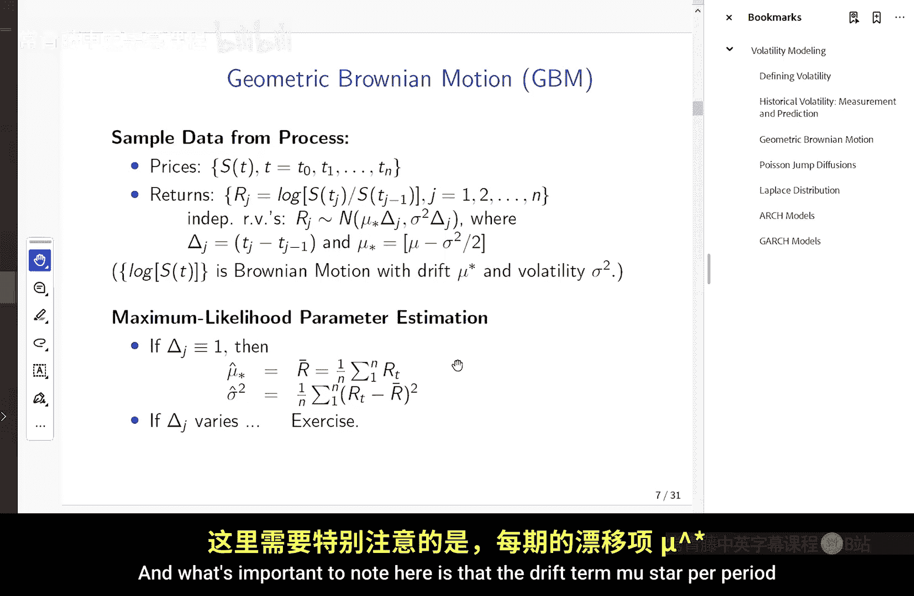

，Drift term。Mus star per period。

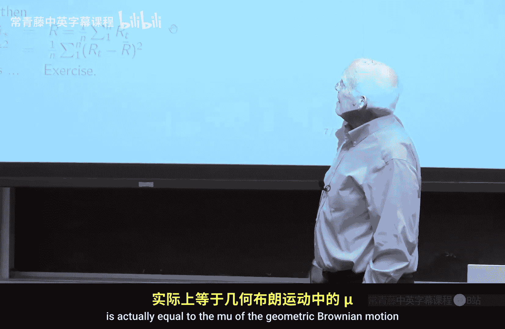

Is actually equal to the mu of the gimetric Brownian motion minus the square of the volatility term divided by  two。

And so what's important is that when we。Apply this。Sttochastic differential equation。

There basically comes an extra term in the drift that's due to the squared variation in the process。

So in working with these stochastic differential equations。

 it's important not to just look at first order terms， but to look at second order terms。

In your Taylor series approximation。 And that's how that mu star gets。

 gets in there to be different from you。Now， an interesting。Exercise。

 which hopefully was of interest to people who worked on that last week。

 If we vary the increments Delta J over which we observe this。Price process。Then。

We can talk about how accurate or how precise are our estimates of mu。Star and Sigma squared。

And it turns out that。If the。Delta J， the increments between observations， varies。

Then our estimate of mu star。As always the same。It corresponds to just the。

Cumulative return over the entire period divided by the length of the period。

 So it's the average rate of return per。Per period。Interestingly。

If we increase the number of increments。Then our precision on the variance gets more and more precise。

And the variability of that actually goes down with a factor of n。

So that was a homework exercise that。I think is， is an important one。To。Realize。Now。

A really interesting extension of sort of maximum likelihood estimation with。

Normally distributed increments。Coming from the Brownian motion process is looking at。

The problem of using more information than just the close to close prices。And so what we want to do。

Is introduce you to the garment class estimator。And。Let me just turn to。The garment class paper。

These papers are distributed in canvas in the volatility notes section。But if we think of。

A period of time with one day。Going from yesterday's close。To today's open to today's close。Then。

In thinking about。Measuring volatility， using。The difference between today's close and yesterday's close。

That can be very useful。But it's missing out on other information that we may have access to。

Such as what's the opening price？Today， what's the low value today， what's the high value today。

 and how can we use that extra information to have more precise estimates of volatility？嗯。

Anecdotally， when I was。Sting for a doctorate in statistics at Berkeley。嗯。

I was a research assistant to Michael K。And I was getting interested in non statistics。

 topics like finance， and so I took a course from Mark Garmin。Who this， wrote this paper。

 So it's rather interesting to have that had that exposure。 Actually。

 it was a very inspiring set of classes that I took， which motivated my。😊。

I guess lifelong interest in financial modeling。So。Let's take a look at some notation， very simply。

 will。Think of just a single period， like one day。And refer to the closing price on day J。

Opening price on day J。The high and low on day J， as well。Importantly， the。

Notation here includes this。 Well， includes the time points， but it also includes the。Parameter F。

 which is the period， the length of time that the market is closed on a given day。

 So the time between the close and open of the next day。So we have this notation。And if we。

Consider just focusing on single periods。And in this case， the first one。

If we look at the change in closing values。Now， perhaps it makes sense to think of these on the log scale of the prices。

嗯。The close to close squared return。呃。Basically， we'll have mean sigma squared and variance equal to two sigma to the fourth。

Now， this corresponds to the theory of normal random variables for returns。

 which comes from the Brownian motion and the expected squared value。呃。Is well， actually。

 we can think of maybe the mean return being。Zero or being subtracted from all their returns。

But the variance of this sigma not hat squared is the variance of a chi squared random variable with one degree of freedom。

And so in probability classes， we learn that a chi squared random variable has expectation equal to the degrees of freedom。

 and if it's a scaled chi squared。It's the scale factor， Sigma squared times that。

 and the variance of a chi squared is equal to twice the degrees of freedom。

 So that's where that formula comes from。Now， if we look at the close to open squared return。

The same arguments lead to this sigma 1 hat squared。

 looking at the squared return from close to open。Nmalized by the length of the period。

Between the close and open。This will also have expectation equal to sigma squared。

And its variance will also be two sigma to the fourth。So if the model applies。Throughout。

The time periods。Of the market being open as well as the market being closed。

 and these formulas apply。Now， we could also do the open to close squared return。And。Again， get。

If we normalize the squared。Change in。Price or log price。

 if we normalize that by the length of the period，1 minus F， then we get the same。

Properties of the moments for these estimates of sigma squared。

 So all of these have estimate are have expectation equal to sigma squared。

 and all of them have the same degree of variation。Well。对是。Second in Earth。

 the index one in two cases。Are estimates that use different。Time periods， different increments。

 disjoint increments。Of the process。And so these have to be independent if our。

Browian motion model applies and so。If we simply take the。

Weighted average of these or the simple average。Then。The expectation is unchanged。And the variance。

Is equal to。Basically， a half squared times the sum of the variances。And that equals actually。

 sigma to the fourth。 So we're able to get a more precise。😊。

Estimate of the volatility using these two increments separately。And so。It's common。In。

Statistical theory of estimators to talk about the efficiency of one estimator versus another。And so。

 if we compare。This。Sigma star。We can divide its variance into the variance of sigma not squared and get a factor of2。

So we basically have。Let's see if I got that correct。

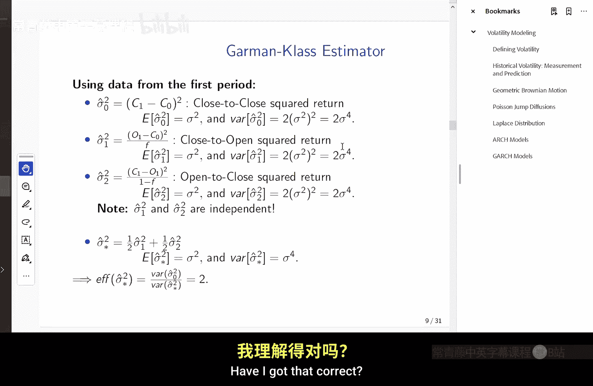

Right， we basically have have twice the efficiency in this case。

 So we're sort of thinking of inverse relationships of the variant。

Now。Let's see， Parkinson。Came up with。Considering the high and low values。Over a period。

And showed that this estimate。Sigma hat 3 squared。Is an unbiased estimate of sigma squared。

When F is equal to 0。And has efficiency equal to 5。2。So， this。High and low data。

Really has a lot of information in it。Compared with just the clothes， the close returns。

We our precision with estimating sigma squared basically can increase by a factor of five with using the high and low values instead of the close to close。

嗯。And let's say I just posted today the。Problems up due next week， where。

There is an article by Parkinson discussing issues of high and low。

Or extreme value estimates of the variance， which I think will be interesting to read。

Somewhat fun to read the sort of classic papers in these areas。

 especially because the older they are， the easier they are to read。

 I think although sometimes that's not totally true。Anyway， what Garmin and class did。Was they。

Considered alternatives。Which included the high， low volatility estimate。And a simple average。

Are weighted by a。And1 minus a of this high low estimate of Parkinson and the Sigma 1。Which is the。

Let's see this go back in the S 1， which is the open to close value。

This has an even higher efficiency of 6。2。And a rather striking result of their paper is they were able to derive the best。

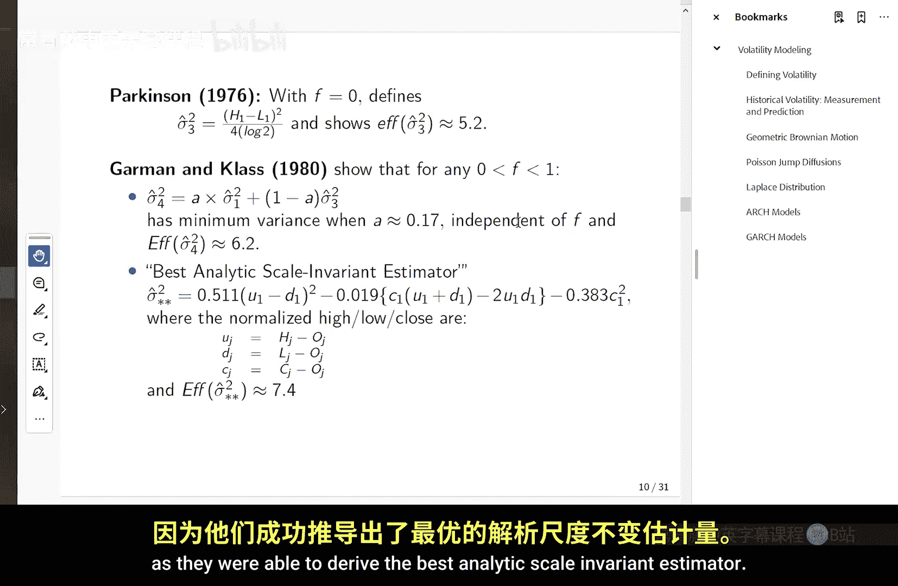

Analytic， scale， andvariant estimator。

So depending on whether you like mathematics or not， you may like this paper or not。

 but it's really interesting to see how。A property of finding a scale invariant estimator。

That is best。Among the class of such estimators， that's actually derived by garmin and class。

 So let me just。Sort of highlight。How this Section 5 in their paper。

Talks about best analytic scale in vary estimators。And you may be able to see from。

The derivation here that their arguments just are dealing with some quadratic forms and solving for properties。

 minimizing these quadratic forms。And so it's rather neat that they're able to achieve this result。

我还是1。这到就是他们该。都系在。Right， well， well， with a higher efficient estimator。You can have。As precise。

 an estimator。With a smaller or shorter time series。So instead of using， say， 20 days close to close。

You could use a week。Of data and have estimators that are。Comparably precise。Yeah， yeah。

 And that's right。There are all these extra assumptions that complicate things。

 and in many of these developments there are simplifying assumptions like the mean is zero。But。

But if you were trying to model time varying volatility。Then rather than looking at。

Say close to close volatility and how that changes over time if you use these other estimators。

The garment class， for example， you could maybe use a much shorter time period and be able to track or model changes in volatility over time with that。

Okay。Well， let's see。So then finally， there's this composite estimator， which has efficiency 8。4。

 and finally， there are a number of extensions of the Garmin class。That are listed here。

And the one that is actually recommended these days is actually this yang Jang model。

 which has a drift independent volatility estimation based on。The high low close。

 So the fact that it's drift independent deals with that assumption that was just just mentioned。Now。

Let's see。A case study of using R to calculate these different volatility estimates。And。

Let's see here。So here's。😔，Case study， which。Goes through。

Calculating different measures of volatility using close to close Parkinson's all the way down to Yang and Jang in Section 1。

6， and then comparing those。For the S&P 500 index。And。We'll go through these。In a moment。

 but following just looking at these individually， we consider time series modeling of these different volatility statistics。

And so in terms of understanding realized volatility。

A useful analysis is to be able to predict how our realized volatility is going to change into the future。

 so there may be some predictability there。And what we'll see is that。

In the time series analysis of these volatilities。呃。Time series models such as auto aggressivegress。

 integrated moving average models can be applied and can be very useful。 And in particular。

 there's a role to be played with。Seasonal are models， so。Let's take a look at that。

And just as a preview， let's say， one of the problems in the next problem set。

Is to look at this same。Analysis set of analyses。For the S&P 500。

Look at the same analyses for the stock ARKK， which is Kathy Woods ETF。

And just see how different the results are and what's。

Nice is that the R markdown files that create this case study can be applied to any other stocks you want to analyze if you so choose。

For the problems that I hosted。Two versions of this study for S&P 500 and A RKK。

 So you don't need to do art all， but。If you。Set up a posit。Cloud account for with our studio cloud。

 you should be able to just upload。The file， the R markdown file。

 and rerun the programs and do so with another stock。If you want， so choose。So， so in this note。

 the first section just goes through。And。Looks at the S&P 500 index。It actually is going through。

A couple of days ago。It's a good time to be。Have an equity exposure。嗯。

And if we look at close to close volatility。嗯。This is a graph of the 21 day variance。

Scaled up to an annualized。Basis by multiplying by Route 252。And what's important。

Is to see that volatility generally is。Well below 25%。

Often it's sort of around like 12 to 15% when it's low， but it does have spikes。 And during COVd。

 there was the huge spike up and。More recently， there was some elevated volatility。

That suggests that volatility is not constant。So anyway， this is the close to close volatility。

If we look at the。High low volatility of Parkinson。Then， we just are averaging。

The log or the ratio of the high to low。And scaling it up。 And so we get this plot， which is very。

 very similar。嗯。In principle this。Etimator is more precise。

 at least if our underlying sort of browni emotion model or geometric browni emotion model is true。

But it gives us different values。And then， the garmin class。Model is here。

So what's useful just in this case study is partly just seeing what the formulas are for the volatility estimates。

And then being able to compare those。And then finally， this。

Yangzang model is an extension of garmin class。And as it says here。

 this is currently the preferred version。volatility estimates。 now。

 in looking at these different volatility estimates。嗯。We can。

Create a panel series of all the volatility measures。 This sort of shows。Not surprisingly。

 there's peaks at the same times with all of these。

What's more interesting is to look how they move simultaneously。And if you look at too much data。

 it's hard to see exactly what's going on。 So there's a graph here of looking at just the last year。

Almost two years of data and seeing how these different volatility estimates vary， so。

What this highlights is how a choice of volatility measure matters。

There can be significant differences between them。And。What would you anticipate is。

Sort of a good property of a volatility。estimator。That's a very general question。But。Intuitively。

 what would make one estimator better than another。And there's no right or wrong answer to this。

But I think it's useful to think about。What you would like to have。And an estimator。And whether。

These estimators might。Be consistent with that or not。Any， any thoughts？Well， one of the problems。

I guess I'll call it a problem。With the close to close estimate。

Is that if you have a rolling window of close to close variance estimates。

 then if you have a spike in returns positive or negative。

 that spike is going to remain in that window until it falls off。

And so there can be elevated volatilities due from in the close to close series。

Volatility series that may not be as persistent。With the other earies， so。

When there are spikes in volatility， often that those spikes occur when there's。

Some great uncertainty in the market that gets。Resolved。And the volatility often drops。

A fair amount after that。And so I would think that those volatility estimates that basically drop faster following the spikes could be better。

And certainly， if we're trying to use these volatility estimates。

To predict future realized volatility， that property could be useful。🤧嗯。Now， what's？

Interesting in Section 2 of this case study is to just consider some really。

 really basic time series modeling of the different。Volatility measures。 So the。

 so what we are modeling is。Different volatility measures over a 21 day period that's rolling through our time series and so。

One of the most basic forecasting models。There is， as a model called the naive model。

And with a naive model。We have a time series YT。And。We basically have that。

Y hat T is equal to Y t minus1。And if we think of。Y T is equal to Y hat T。Plus， an error term。

Then our errors。Are equal to Y T minus y hat。Tea。Which is equal to y t minus y t minus1。

And this specification corresponds to a random walk model。

So there's basically a random walk model for YT。And the random walk model is consistent with sort of efficient markets。

Where our best estimate of what's going to happen is what's where things are now。So。

So this naive model basically has an autocor function， which has a very high。

Or the our data has a high first order auto correlation。 And if we。Calculate first differences。

Which are the residuals from this model。Then， we get this。Residual diagnostic information。

 the time series of residuals。The auto correlation function of the residuals and the。

Histogram of residuals now。Would you say that these residuals are consistent with。White noise。

That may be Gaussian or normal。I see some going and's going。嗯。嗯。Well。

 one thing that's important is that the autocor function。Of residuals。

If the residuals are consistent with white noise， there should be no significant autocorrelation at any lag。

And so there are some spikes of autocorlation that break beyond the critical levels。

And so those are suggesting that this is not。White noise。 And if we look at the distribution of the。

Residuals。They're unimmodal， but they certainly aren't well described by a normal distribution。嗯。So。

Let's see。So， we can。Sor of plot forecasts of this naive method。And then。Let's say， we can also。

Fit an arema model to this close to close volatility series。And with the arema model。Actually。

 there's this package in R。

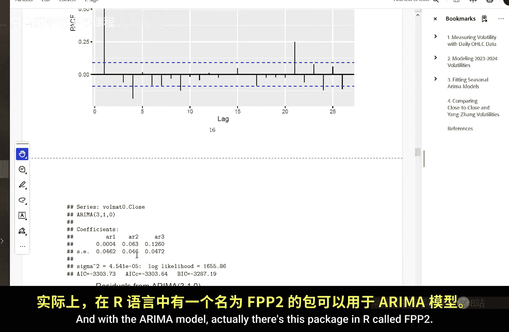

Called FPP2。And this。Was created by the authors of a book forecastecasting Principles and Pra that's in the references to this。

They have an automated arema modeling function。Which will take an input， a time series as output。

What。Is judged to be a decent。Auttter regressive， integratedtegrative moving average model。

 And so this。Arima 3，1，0。

嗯。Corresponds to。Arima， P equals 3。D equals。1。And Q equals 0。

 where P is the order of the auto regression。 D is the order of different， yes。How was。Yes。

 it uses a criterion that's called the corrected。Akiki information criterion。And so。

There's this AICC， which is equal to the corrected。

AIC and the corrected AIC is due to the fact that with shorter series。

 there's a bias in the AIC that is systematic and so this corrects for that bias。Now。

 when we do this with any。Sort of fitted model。 What's really。

Important to check is how our estimated coefficients compare with their standard errors。

When the signal estimate to noise standard air ratio is bigger than two。

 we have some confidence that that's an important factor in the in the model。 And in this case。

 the A3 is almost。three。Has a signal to noise ratio of almost three。

 and the AR2 has a ratio that's one and a half。Now。If we go through。Let's see。

 this second section sort of does the same analysis of the Yang Zang。Volaatility estimate。And。

I guess importantly， here。We have。An ama model now for this。Yangzang model， which is an arerima 111。

And。The coefficient estimates are many multiples of the standard error。

 So these are highly significant。And this。Is our residual analysis check。Which suggests that。

 for the most part， the residuals are consistent with white noise。

 The autocorlations tend to be close to。 However， there's this large spike。At 21。

And here are the residuals。 Now， why do you think there's a large spike at 21。Well， we're computing。

 rolling。Statistics。And so， the window。Is of length 21。 So this corresponds to cases。

Entering and exiting the windows。And so。Interestingly。

 we can accommodate that by fitting a seasonal aroma model。And so with the seasonal arema model。

I'll sort of jump to the。Conclusion here at the very end。Which is。For the Yang， Jang。

Vololatility estimator。 This is its simple autocor function。Before the model。And then， when we。

Fit the seasonal a model automatically。 It gives us a 2，1，3 and a 2，0，1。

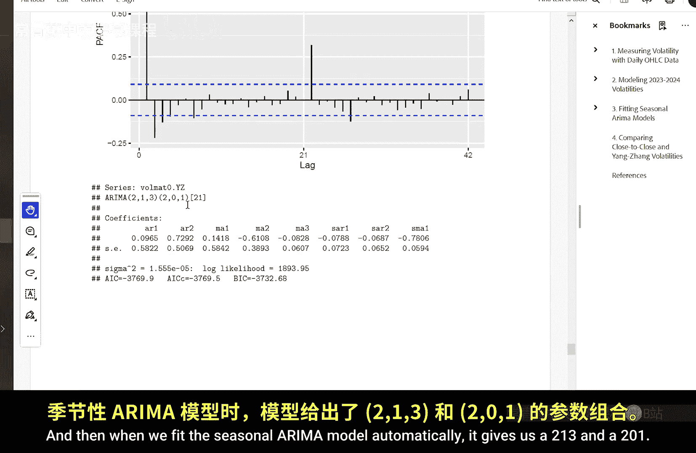

And。Let's see when we introduced you to time series models before。嗯。Let's see if we have。And arema。

Model。Which is PD DQ。We basically have。1 minus phi1 B。Minus feethi to be squared。Minus VP。

Be the P power。Times Y T。Turns out to be equal to1 minus。Theta 1， B。Minus theta 2 be squared。

Minus theta or sorry 1 plus here。Plus， datata Q。B。To the Q power。Times。Our error term。

 So we have this kind of mathematical equation for an are model。Where。We assume that the aent T。

Series is white noise。Which means that its expectation is always zero。And the。

Vararianances are constant。And the correlation between any different aence。As equal to0。

 F T is not equal to T prime。嗯。The power of auto aggressivegress。

 integrated moving average models is that。These。Sort of autoaggressive terms。

As well as moving average terms can account for all of the correlations。

 autocors in the original series。And。Our residuals， which are estimates of this error sequence。

 should be consistent with white noise now。What ends up happening with。With。Actually。

 I should maybe put here Yt prime， where yt prime is maybe equal to 1 minus B to the power D Yt。

So if we have an ordered D。Model， we take the de order difference and put that into an Ar model。And。

If we have。A seasonal are model。We actually add。A capital P， capital Q capital D， capital Q。

And here we have sort of the frequency of the data。 And in this example。

I considered a 21 period frequency， just to correspond to。The window size。And。

What this model does is。It sort of has another polynomial。Of。So this is B to the2 times 21。😔。

So we basically end up having backshift operator polynomials。That。Work with the。Seasonal frequencies。

Of the time series。And so。So， okay， so this is a。A polynomial of order Q。Of order P in B to the 12th。

Sorry， beat to the 21。And then we would also multiply this。On this side， perhaps。By a1 minus。

Capital theta 1。Be the 21。Plus， plus theta 2。B to the 21 squared。So。Times 2。And。So。

 so this kind of notation leads us to these coefficient estimates。This sort of simple order。

 auto aggressivegressive terms and moving average terms。Order  two， auto aggressivegress order three。

 moving average。But then for the seasonal， autoaggressive terms。We have。These terms here。

 and for the seasonal moving average， we have。The last term here。

What's generally important in fitting models is when you consider the。

Last terms to enter into a model， such as in this case， the。Seasonal moving， average term。

It is its estimate is many multiples of its standard error。So that's a very important factor。

In the model， and。

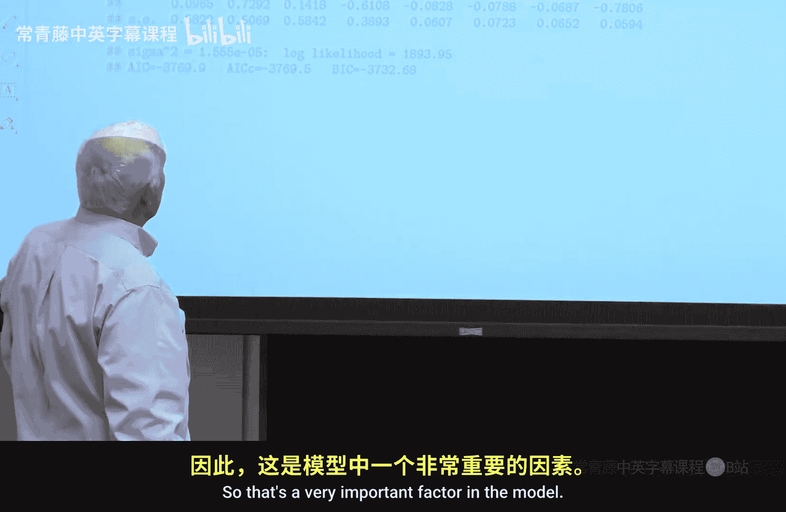

Let's see just。As。Let's see。As an anecdote。Let me just say。Let's see if we take a series YT。And。

We look at a seasonal difference。Operator and a first order difference operator。嗯。

This turns out to be equal to the first difference operator multiplying the。

Seasonal difference operator。And it equals basically，1 minus B。Plus B to the 21。Sorry。

 minus B to the 21 plus b to the 22。Times Yt。And so， with seasonal differences。In。

Autoregressive moving averages。Whether we take first differences。

Non seasonalally and then seasonal differences。Subsequently， or reverse the order。

 we end up getting the same transformation of the data。And so what's well。

 actually with economic time series where we have a seasonal frequency of， say， months。

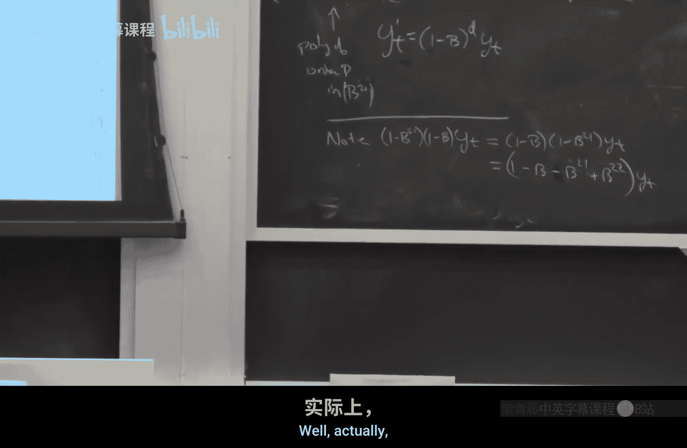

Then， the。Basically， the seasonal differences correspond to year over year changes。

 whereas the simple differences are just period by period differences。Anyway。

 with this final example here。This is。Sort of how the。Residual analysis looks。

 and it actually does yield residuals that do look a lot like white noise。

 although there is still this sort of persistent spike。

Just beyond the sort of window width for the computation。

The distribution of the residuals looks more Gaussian， perhaps than。Well。

 much more than than the cases before。So with that。Let's see in。

In analyzing different time series models， there are these accuracy statistics that can be computed for any forecasting model。

And so you're probably familiar with root mean squared error or mean squared error。

But we also have the MAE， which is the mean absolute percent error。

And I actually find that pretty useful for judging how effective the models are。And。

What's really nice about the FPP2 package。Is that one can just ask it to plot the time series and the forecast。

And it generates a point forecast in a solid blue line and prediction intervals about that forecast。

Which assume Gaussian or normal distributions for the error terms。

 But one can see how those evolve into the future。And it's really consistent for。

Prediction intervals to get wider， the further out we forecast。 and that's happening here。

 What's rather interesting about this forecast。Using the Yangzang。

Measure and forecasting that into the future is that it actually。

After being at a lower level is predicting that it might go back to more of a mean level of volatility。

So that's an interesting property。Okay。Well， let's go back to。The notes here。And。Let's see。

 there are extensions of。Geometric brownie in motion that we。Have seen before。

 one of them is a Poisson jump diffusion model where the stochastic differential equation has the Brownian motion part as the first two terms。

 but then has a jump process。As a last term， where the jump process can be modeled as。

A poisson process。 So a jump occurs。At some rate that defines the Poisson process。

And the rate is lambda。 And if。An event in the Poisson process occurs。

 then there's a jump in the stock， which is given by this。Factor here。 So one can actually model。呃。

Data with this Queangju diffusion model。And。Let's see。

 I ended up working with David Pickard and Arshad Zachariia on。Fitting this Poang diffusion model。

 And it was an interesting。

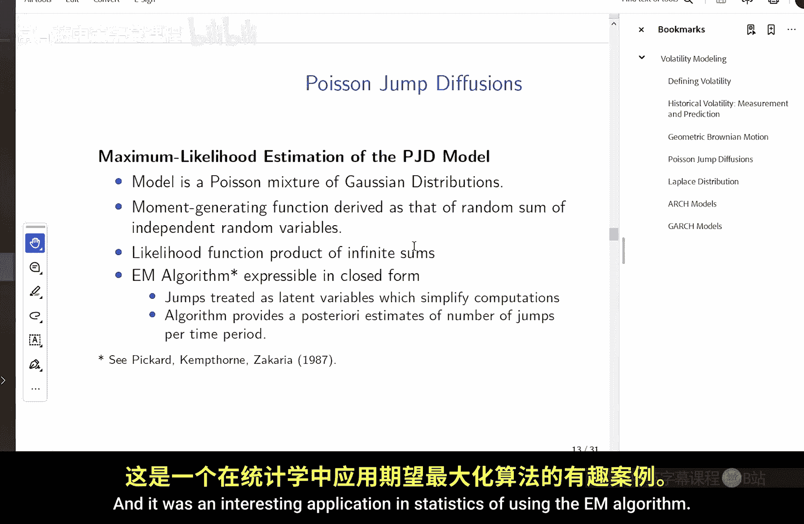

Application and statistics of using the EM algorithm。嗯。Basically。

 the jumps are treated as latent or hidden values in our data。And those hidden values。

Occur according to Poisson probabilities， like the probability of one jump or two jumps。

Can be computed using the Poisson parameter。

And one can apply this E algorithm to obtain maximum likelihood estimates of all the parameters。 And。

 in applying this， an interesting property that。Occurred。Was that。There were quite frequent。

The rate of poisson events was quite high， like every couple of days。

And what the model was doing was capturing。Heavier tail distributions than a normal distribution。So。

 instead of a single。Normal。Model for the return， one has a mixture of a normal with no jumps。

 a normal with one jump， two jumps。Waied according to plus song rates。

Implication of the model fitting was that。One didn't have sort of rare events necessarily that occurred。

 but one had。Or there was evidence suggesting sort of a jump process that related to trying to capture the excess variability of the stock price returns。

 Now， that leads to。Another model extending Brownian motion。 And this is。The Laplace distribution。

 where。If， instead of observing。A time series。Over equal increments。So between zero。You know。

 one can think of just equal increments of time。So T1， T2， and so forth up to T N， say。

From time zero to capital t。It may be that we observe。The Brownian motion process at random times。T1。

And then here's T2。Here's T3。Where。The increments of time themselves are also random。

And it turns out that。If the times at which we observe。Have。Sort of the time。

Increment that's exponentially distributed。Then。The increments of the Brownian motion follow a laplace distribution。

So heavier tail distributions。Then normal。And this is the density of a laplace。Distribution， it's。

Depends on the exponential of minus the magnitude。Of the deviation of x from mu。

As opposed to the square of that deviation， a Gaussian or normal distribution would have a power to there。

With the Laplace distribution is the absolute。And。With this。Distribution， we have a mean。Mux。

 which is sort of at the center of the distribution。

 The variance turns out to depend on this scale factor B， which is twice B squared。So。

So let's just take a look at what theplace models look like。

 They basically are bilateral exponential distributions。And if we consider fitting。

The daily returns on the S&P 500。This is data for， I know， a four year period。嗯。

This sort of peaked distribution with exponentially decaying density is fitting the data really quite well。

And。More importantly， much better， really than a Gaussian curve does。

 So here we have the fit of the Gaussian。Bell curve in red。

 comparing it to the laplace curve in blue。And。An interesting question。Is how do we。

Judge whether one model or another is a good model。And。A useful tool。Is。To construct a Q， Q plot。

Which is a quantile quantile plot。So we consider points where the vertical。

Value corresponds to the magnitude of our data。And the horizontal。

Coordinate corresponds to the theoretical value。For。The smallest from a sample of the place。

 the second smallest from the。Given the pla distribution。And so we basically plot， sort of observed。

Quantiles versus theoretical quantiles for the fitted model。 So this。Fits quite close to a line。

 although it's not perfect， at least if it were perfect。

 it would even sort of snake around the straight line where the。

Sample quantiles equal the theoretical quants。 If we do the same。QQ plot for a Gaussian or normal。

Model， this is what our Q Q plot looks like。And so， one can see that。

This second Q Q plot is not fitting the data very well at all。So this would favor。

Using the Laplace instead of the Gaussian。As a model for independent daily returns。Now。

The independence of。Or period by period returns is one that may not be satisfied by the data。

 And Robert Engel proposed looking at time series。Of returns and considering the possibility that the variability of these returns given by the variability of the Eilent T terms。

That these， in fact。Have time varying volatility， Sity。Where。The sigma T squared。

Evolves according to a sort of moving average of past squared errors。So an auto regressive。

 conditionally heteroschoastic model is what he proposed。And。And looking at this model。

It's interesting to note that。If one。Normal or one can sort of re expresspress the arch model in terms of。

This。Squared error term。And have this model in the second equation being consistent with the first。

And this second model corresponds to。Therere being an autoregressive model。

Consistent with the squared returns。And so this Lagrange multiplier test。

Can fit the autoaggressive model to these Abpsilent hat squares and test whether there is auto aggressiveive structure or not。

And if we look at the autocorrelations of the S&P 500 returns squared。You can see that the first。

Almost 10 autocors are significantly different。From 0 in magnitude。

 So there is strong time dependence in the log returns。

And so how does one sort of fit this model well。The go to， typically in in statistical modeling。

 is to consider a likelihood approach。Where we consider。A density for our data。

Specified by the model。 So if the errors， epsilon T are。Independent。

Gausian distributions with different variances。Then this likelihood function defines。

The joint density of our data， given underlying parameters。And what becomes tricky。

With this likelihood specification is that there， in fact， are constraints on our。Parameterters。

 so with the arch model， we can't have a negative alpha。Because with the Gaussian squared epsilon。

 that could be arbitrarily large， negative。Or epsilent could be。Sorry， sorry。

 if the alphas were negative， then the epsilon squares could be arbitrarily large positive and we get a negative variance。

 so we can't have that。Also， we have this property of the sum of the autoaggressive parameters is less than one。

And this corresponds to the process not being explosive in its movements。嗯。And then。Let's see。

 an extension of the arch models。Was。Gun by Boer's love。

And this basically adds to our arch model terms。Like an order P arch model， it adds an order Q。

Set of terms on lags of the volatility。And if we consider the special case of the Garch 11 model。

 this is its form。Which is very simple and parsimonious。 What's rather surprising。

Is that the empirical specification of these moes。Such that the Garch 11 model is often chosen or identified as the best garch。

Order case。So we end up having a very simple model with just a few parameters to characterize the。

 the volatility。And。Let's see。 Okay， these notes talk about how the Garch model induces an armor model。

 So this is some time series results that are gone through here。 And there's a long run variance。

Of the Garch model that is given here。 and with a Garch 11 model。There basically， is a。

Sort of long run。呃。Vololatility， Sigma star。Which has this particular formula。And。One， basically。

 can。

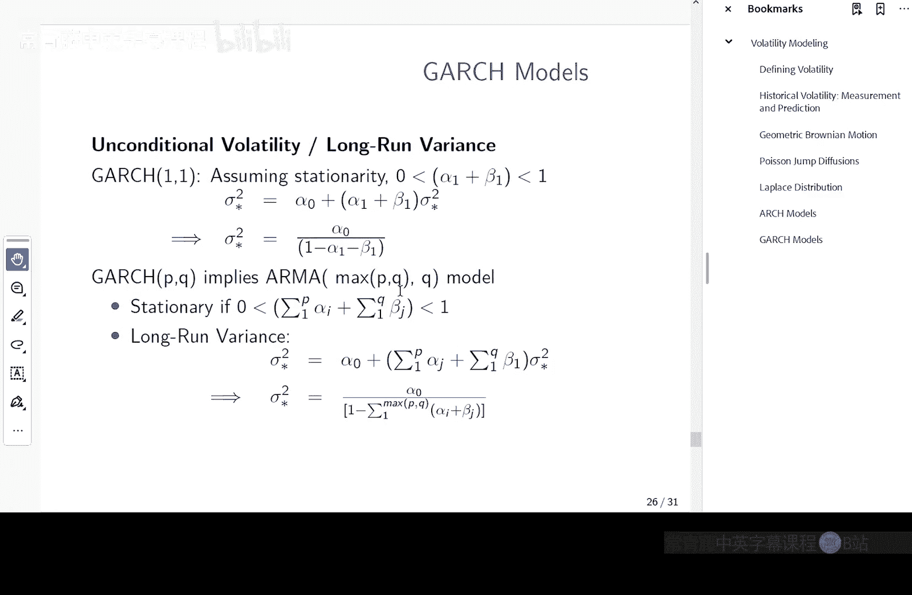

Okay， so one can find the long run variance of a Garch model with this formula。

This formula also leads to sort of updates of volatility being a multiple of the long run variance。

 plus a deviation from that long run variance。

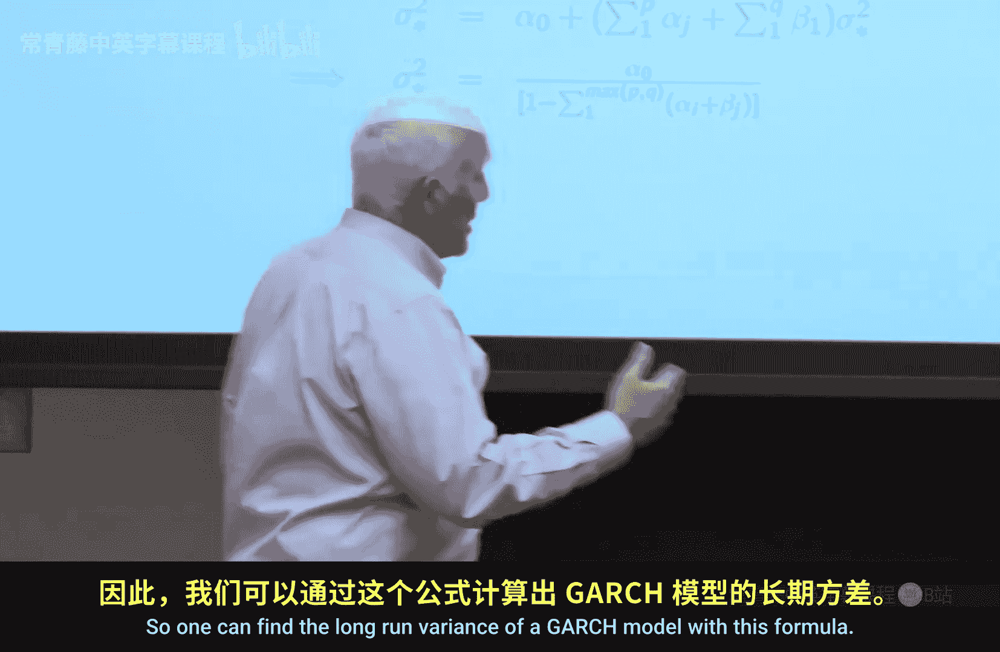

And so。Alright， so we have maximum likely estimation for these models。 Now， I wanted to。

Share with you。 Let's see。 a case study。Using arch and archch models with foreign exchange returns。

And so， this。Note uses data collected from。The Federal Reserve。On foreign exchange values。Section 1。

2 actually fits Brownie in motion using different time scales， so not assuming time dependence。

It actually， is sort of interesting。To。Think about different time scales。But if we go to Section 1。3。

1。3。And look at time dependence and squared returns， this is the dollar pound returns。This shows。

The auto correlation and partial auto correlation of the returns。So there are sort of strong。

 partial oer correlations。Of the actual series。 And if we look at the squared returns。嗯。

The actual series。Has high autocors over time， but the partial autocors have very high spikes at low lag。

 So this suggests sort of an auto aggressivegressive model in the squared returns。

And the note fits an arch 1， and arch 2。So one leg or sorry， one autoaggressive。Term。

 two autoregressive terms， or 10， and then fits the Garch 11。And the results。

Are highlighted here just showing you the different coefficient estimates for these different models。

They're all statistically significant in terms of the parameters。 What's of interest， though。

 is just to look at the。Time series plot of the fitted volatilities， using arch。Of different orders。

 So here's the arch1 model。Here's the arch 2 model。A property of this， these archmalds is that， know。

 it never goes below 0。 there's sort of a lower bound。Here's the arch10 model。

 which looks like it's maybe tracking time varying volatility well。And then finally。

 we can compare that with the Garch 1，1 model。So instead of having 10 auto aggressive parameters in arch。

 the generalized arch model is capturing time varying volatility in an appealing way， you know。

 whether that's really。Valid or not is of interest。

 but it certainly is an alternative to these arch models that is quite powerful。And in the。Well。

 here's just a graph of all three together。This， this note actually does a final section of looking at what happens if our error distribution。

Is not Gaussian。But is it T distribution。The code that there are packages are U Garch。

 which allow us to specify。Parameterters and fits using T models。

 T distribution models for the errors。 And what's very curious is。In judging the。呃。

In judging the histogram of standardized residuals， the T distribution seems to do a decent job。And。

So here's with Gaussian residuals， I guess。And then。Here's the Gaussian Garch residuals。

And a QQ plot associated with the standardized Gaussian assumption。And， finally。There's the。

Q Q plot of standardized residuals with a T distribution assumed。

 So what's significant is just how the quantile quantile plot suggests that this model is really fitting the data much。

 much better in terms of characterizing the variation。And the choice of which。Order。Model to use。For。

Let's see， for the。Degrees of freedom。There's this。Negative log likelihood function。Of models。

For different tea distributions， as we vary the degrees of freedom。For the tea。

And a T distribution has a heavier tail than a Gaussian distribution。

At least if the degrees of freedom is really high is virtually equivalent to a Gaussian。

But this is suggesting that there's possibly a 9 degrees of freedom for that。

So that's a very interesting finding and。It actually arises with some mathematical analysis that sort of T distributions。

Our。Appropriate。If we think of spherical symmetry。In the number of dimensions equal to the degree of freedom。

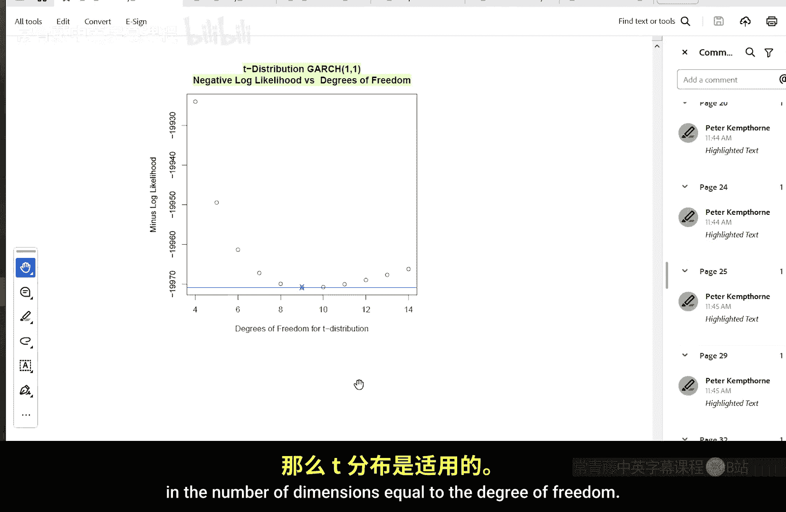

And so if you imagine sort of a joint distribution。

That ispherically symmetric in really high dimensions。

When you project that down onto coordinate axes， you end up getting a Gaussian distribution。

But if they're symmetry。Is just of。Say，9 dimensions。

Then you end up having a T distribution for what those projections are。 So， so this suggests that。

In terms of time periods over which。The distribution of volatility sort of is， is stable， you know。

 could be close to sort of。9 dimensions。So perhaps corresponding to nine periods of data， I believe。

All right， well we'll finish there， there's a lot of interesting material for you to check out if you like。

I hope you can enjoy reading some of the articles of people who studied volatility and see what their work。

Has contributed， and。It's a really interesting area for。Final papers， modeling volatility。

 predicting volatility。 This is really scratching the surface of the topic so。

There's a lot of interesting problems you could study。All right， thanks a lot。

