# 麻省理工学院【中英⚡数学专题及其在金融中的应用｜18.642-Fall-2024,-Topics-in-Mathematics-with-Applicatio】-p18-P18-Black-Scholes-Formula,-Risk-Neutral-Valuation--BV1iLrjBrETS_p18-

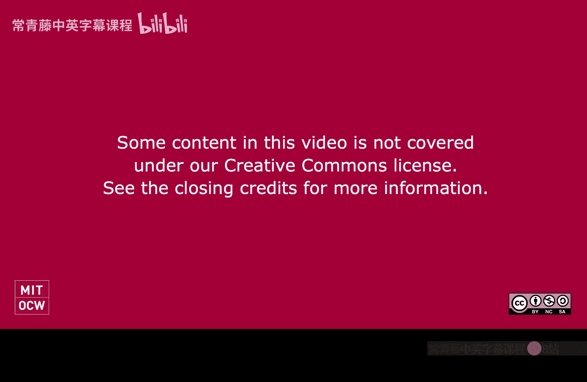

So the， what I'll talk mostly about。Risk neutral pricing and black showss will be more of of an illustration to。

 to， to the method to more general method， which I think is very important and very important for pricing derivatives and many a few of you did look into black shas And so my hope is to。

To give some a little bit more depth and a little bit more perspective on how whats the bigger picture of derivative pricing through。

 through risk neutral valuation。 But as promised before。

 let's start from from the interest rates from， from the slide which similar slide which I showed you in on the first class and Andrew Gusson already talked about yield curve construction。

And everything。 But yeah， so that's how what happened since， since we started， that's the U curve。

Or it's just as spting as it was in in September， just before beginning of the class。

 And that's where we are now。 So quite predictable in a sense。

 because F moved the rates for by 75 basis points。 and that's that's exactly what what happened here。

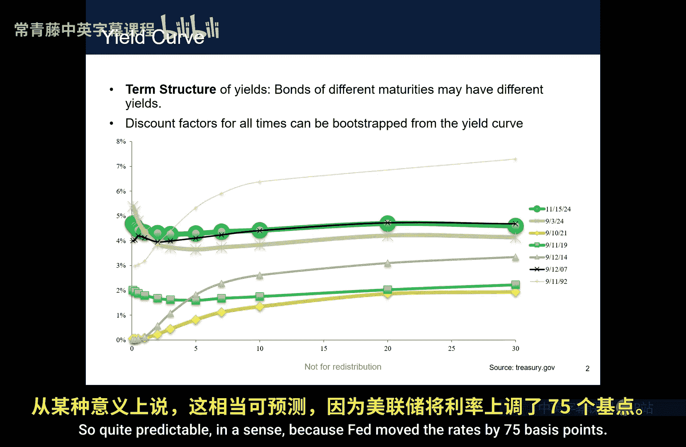

the。呃。The the。The parallel shift is only at 70 base points here， but more of。50 here。

What now a little bit of heuristics。 How does it look like？ Well， right now， it looks like。

We are very similar to， to this shape， right。Which was。呃。19。Right， on the other hand， this shape。

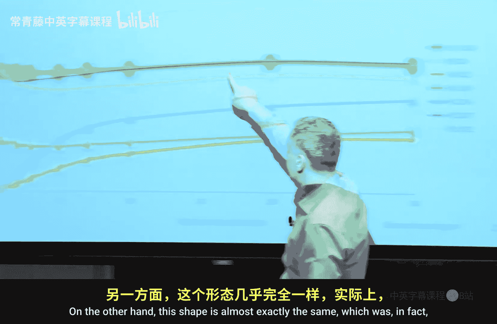

Is is almost exactly the same， right。Which was， in fact， just before the crisis。So in both cases。

 recession full。 I mean， in both cases there， the curves are inverted and in both cases。

 the recession followed shortly， shortly after， I certainly think hope that it is closer to this because just this is basically the next snapshot in in 21 and the curve is completely normal shape and and the economy was the recession was very very short and the economy was on a very solid track by then。

 but and hopefully we are not in this situation because this is just before the crisis。

 It's before before bear turnss collapse before lemon collapse。

 So a lot of bad things happened after that。 in any case， this is all。Non non scientific prediction。

 And the， the real question here would be to， to to do some sort data analysis。

 something like Stean Stean Andreev talked about about analyzing the shape of the curves and bond markets using。

P A principal component analysis， but always fascinating to look at the data and always fascinating to look at the curves。

 which， in my opinion， are。In the middle， in the center of finance。Okay， let's move on to。To the。

topic of our class。And the idea is to， to see。How replicating the payoff can help us to price derivatives。

And how to learn that actually， if we can follow market market dynamics。

That how it can help us to price derivatives And actually。

 that the real world dynamics is not that important。 It's， it's what market implies。

That's what's important and how it is connected to Mor Gaes and to mathematical apparatus to。

 to stochastic calcus connecting that。 So， but here is a simple example， horse bedding， right。No。So。

 let's。Assume。すっごいな。That we have two horses。Horse 1 and H 2。And we， I mean， you're a bookie。

 And you know the horse as well。 You know that this horse has 20% to chance to win。

 and this horse has 80% chance to win。Right。But people bet， bet on the market and。10000。

Is bet on this course。 People don't know exactly these probabilities。

 They know that this this course is better than this。So the， they bet， rather。The public bes。

50000 on this and 10000 on on this， right。And what you do， you just take a commission， right。Say 1%。

And you， you have。6000 in your600 in your pocket of the commission。So now the question is。

 you need to set the odds for， for this race。 right So， well。

 one way to set the odds is knowing the real exact probabilities。 One， it's reasonable to say。

 let's make it4 to one。So what， what outcomes are possible， right， then course starts。Hororses race。

So。H1 wins。 H 2 wins。So if a horse， the first horse wins。You will get。50000。Right， this， this amount。

 and you will pay out four times this amount because you said， you set the odds 4 to one。So。

This will mean that you will be left with 10000 profit。This is low probability outcome。

 you know that second horse is better。 So what happens is second horse， second horse wins， well。

You will keep this money， so it will be。Consultent。And you will pay a quarter of this， right？

And this will be。On my books， minus。2500。At the end， right， So you， you will lose。

 You will have to pay， right。Of course， if you compute expected value。If horses run along many。

 many times， it will be 0， right。10 times2。2 plus minus22 and a half times 0。8 is 0， right。

 But for this， on average， it it the， the horses have to run a lot， right。Now。

 let's consider a different way of setting， setting odds。You forget about the， these numbers。

 You just look at at at what was bad， right？ And you rather said the odds。5 to1。Okay。

 let's see what happens。Well， you have the first horse wins。You will get。500。Qu50000。

And you'll pay 50000， right。Well， if second horse wins， you'll get 10，000。And one fifth of this。

 So youll pay out 10000。So no matter which horse wins wins。You are， you break even for sure in。

 in this particular outcome， right。So， and if you were collecting some fee， you just keep the fee。

 Youll do it next time。So。Basically， what you did by setting the， the， the， the odds。

 according to the market， you hedge yourself。 You， you eliminated every uncertainty。

Which is probably。The， the outcome which you want。Alright， so this is all about betting。

 and we are not betting people。In fact， we are scientists。So， and。Will。

 we'll be talking today about pricing derivatives。Again， some simple examples and derivatives。

 which we'll be looking at will be call put options and and forward contracts。 just to refresh。

 So what are those。 So here the， the simplest possible。Derivative is a forward conduct。

 which is an agreement。To buy a security， in our case， a stock。In the future， for。

 for a price which is set today。Generally speaking， so the， the payout of， of a forward is。

Just the difference。Off。Of the strike， and。The， the。Price at the expiration， right， at the expiry。

So the payout is S， S minus k。Where K is a strike， agreed price， right， and for forwards。

 the agreement is that。The strike is set in such a way that it costs you nothing to enter it today。

You basically say， we agree with you today for a zero price that。I'll buy the stock at the price K。

 right。So quite use， useful diagram is the， the payout that's that's sorry。 that's a blue line。

 So it's， in our case， it's S minus K。So， that's forward。Now， call option。Colloption is an option。

To buy。A stock at price K， right？ So basically， at expiry。You will decide。Are you buying。

The stock at price， K。Or if it's， if you don't want to， you， you won't。And generally speaking。

 if the stock ends at the money higher than the strike， you will buy it， right。

 because it will be cheaper。 And if if the stock ends below the strike price。

 it youll say thank you very much。 And the contract will expire worth less。

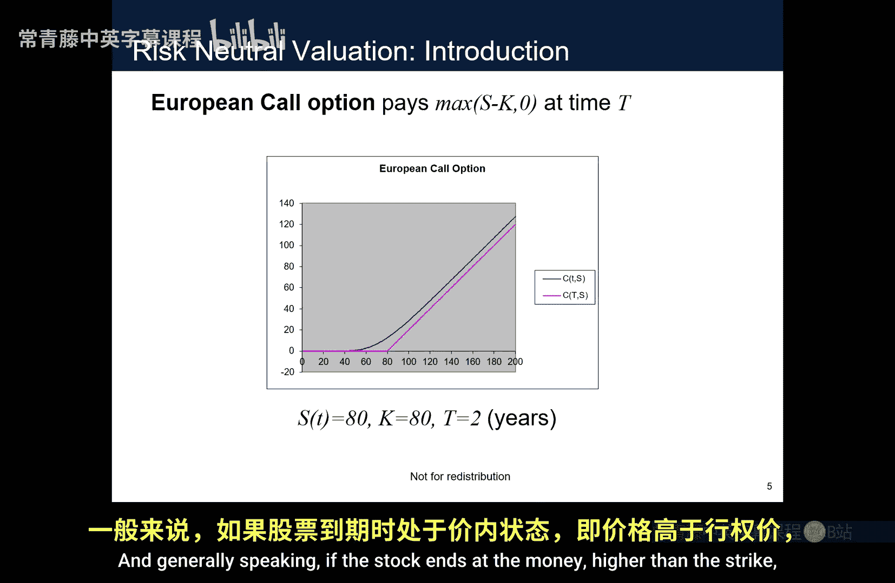

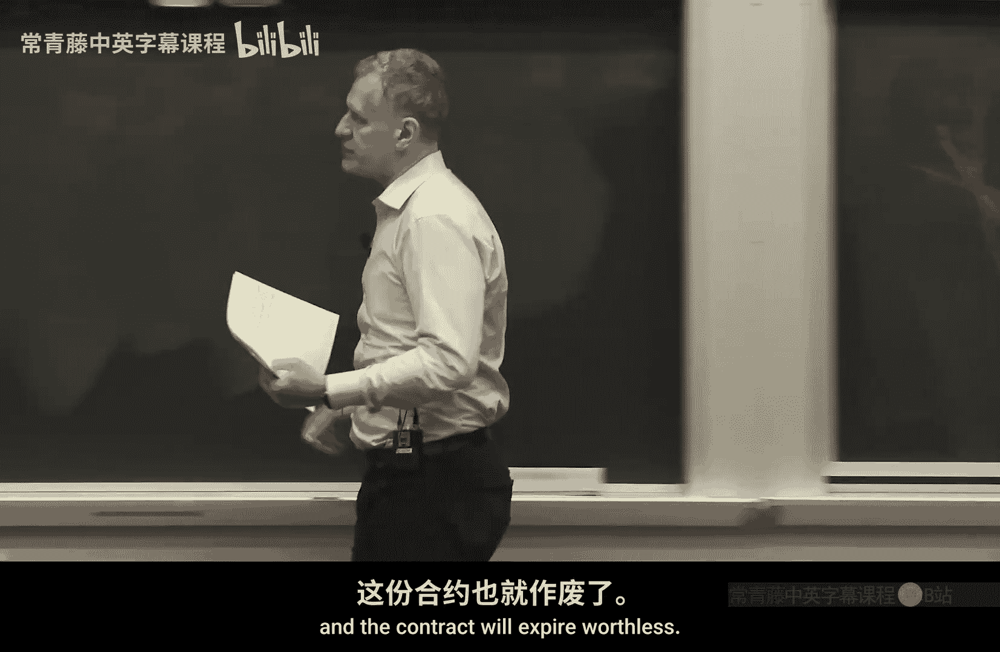

So this is the payout at the end。 And this is the price of the call option today， right， Obviously。

 it is not zero price contract。 It is。

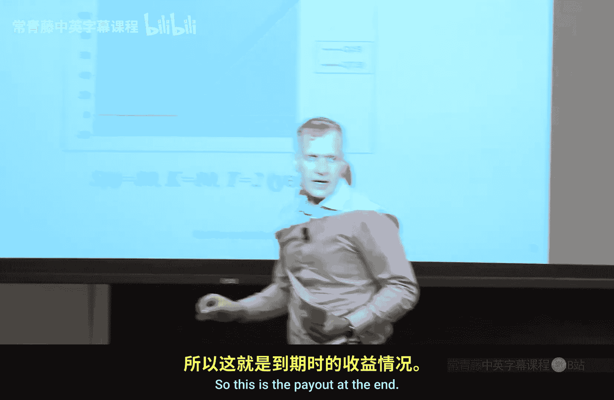

You， you will pay some money to enter into this contract， right。呃。Another。

Uual and simple contract would be a po option。which is an agreement。To， to sell。The。

 it's kind of opposite， right， It's， it basically prevents if， if the， the option。

 the stock is too high。

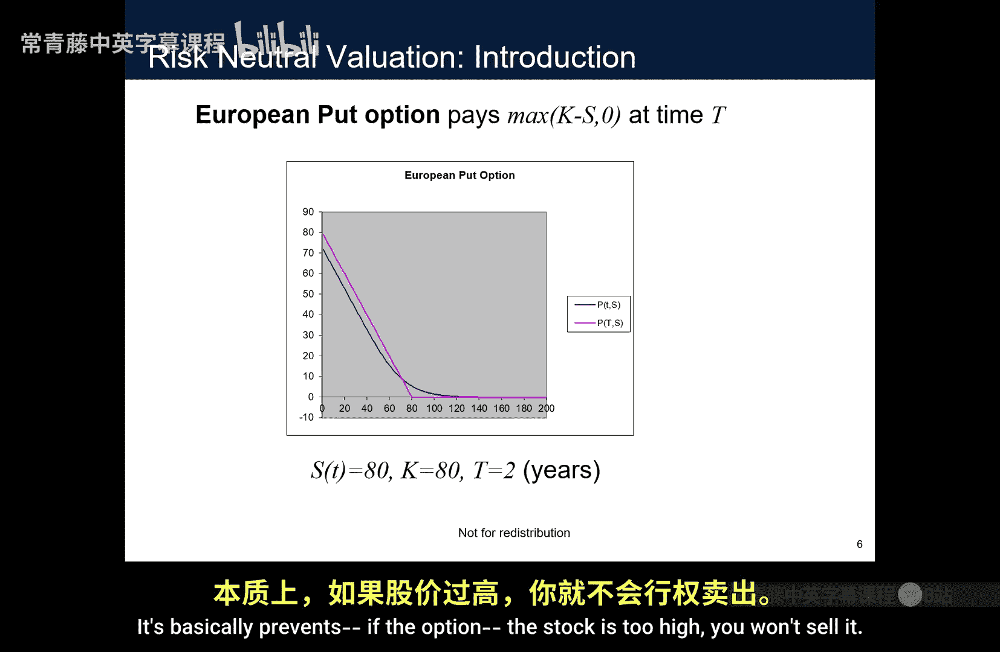

You won't sell it。 You， if the stock ends low， you will sell it for a higher price。

 So it is basically。Insurance， kind of insurance of， of against stock falling below。

 below the the strike price。And here is the。The current price。

And what we'll be doing today is deriving these curves， deriving the current price。

 a price today for the options and the forwards。

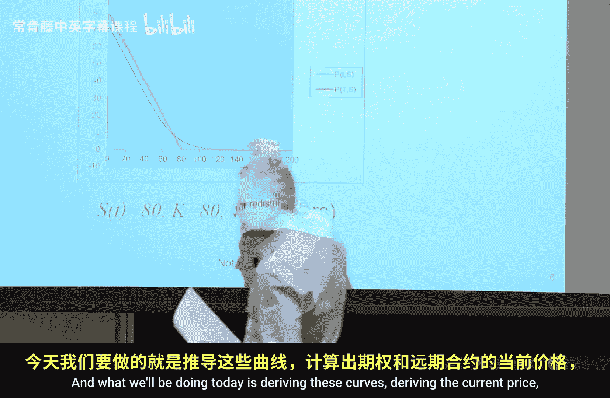

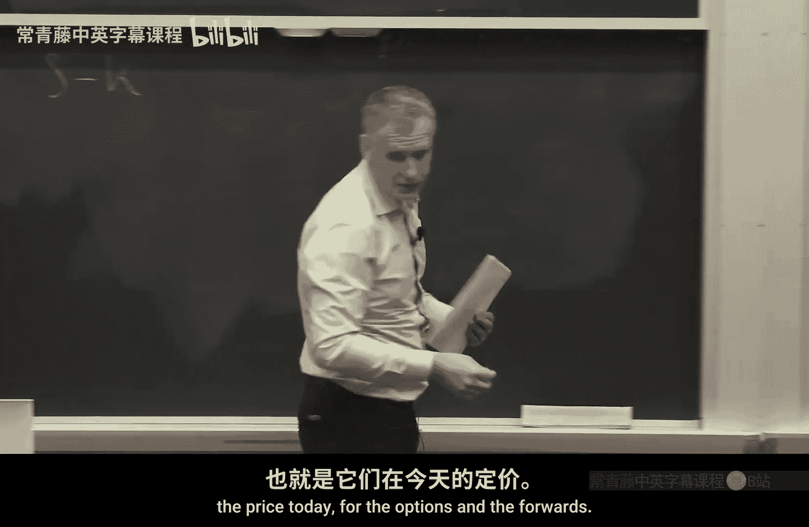

And what we'll see。Is。A few observations that。呃。The only what will matter it is assumptions on。

 on the dynamics of the stock price， some assumptions on how the stock behaves。

 some assumptions on interest rates。呃。And， and given， given that。

 there will be no uncertainty in in the price of the derivative。 And this was， believe me。

 this wasn't clear to market participants before black and shows。呃。And the。the other。

Important observation， which we will see that the the preferences of market participants will not matter。

 It's similarly in to our horse racing example， well be able to， to。

 to find the riskless ways to replicate， replicate the price， the price of the option。Allright。So。

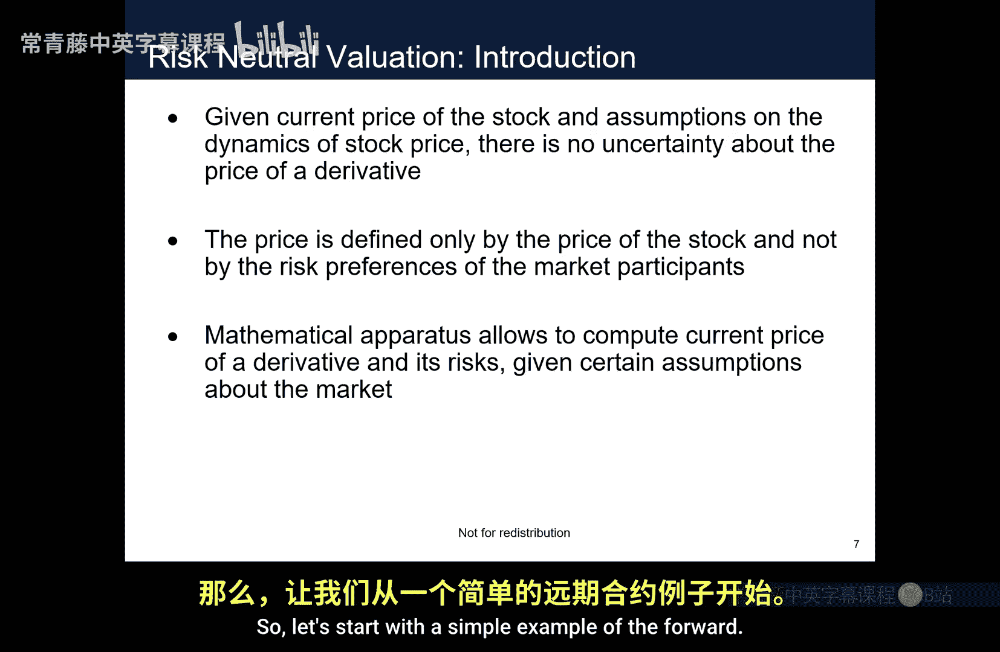

Let's start。With， with a simple example of the forward。And let's start from from a discrete time and。

 and， and stock prices。And because it's， it's simple， simpler to understand。And呃。

So what does it mean is that right now， we。Have。Some price of our stock as 0。

We have price of our contract。F 0。In， in the case of of the forward， we assume that it's 0。Right。

 because we， we assume that we， the were entering at the world contract at zero price。Right。

 and there are two outcomes that we are only one step away。So， some time， D T。To the future。

 and at the outcome， the the outcomes either S 1 or S 2。 So the stock can go either here and here。

And our derivative。According to our formula， will be， will go to。Its1 minus k。Or。S 2 minus K。喂。

So again， from naive perspective， one can say， well。

 there is some probability for stock to go to go up to。

 to S1 and some probability1 minus P for stock to go down。And。

1 would say that we can assume that our price now。Is actually expected value。

With this probability of。Of the value of our derivatives at the end。Right， and。So we to be。

P times F1 minus。1 minus p times F 2。呃。And well。P times。It's1 minus k。Plus。1 minus B。Times。

That's2 minus k。And from， from here， we can actually。Well。

 what we what we are looking for is the agreed price on our forward， Right。

 so we can say that our strike price should be PS1。呃，不。1 minus B。度。But we don't know the。

 the probability。 And， in fact， that， as we'll see in a second， it's not a good。W approach。And why。

 here is why。Because here is a suggestion what we should do。 Here is a suggestion how we。

 we can construct。A risk neutral portfolio here。So。That's what we are going to do。So。At time 0。

We enter into into forward contract with strike K。 andll in a second。

 we'll see what this strike K will be at at zero cost cost， right。Enther。Forward。At， at zero cost。嗯。

And we will borrow money to buy， to buy the stock。 So we are borrow。As 0。 So we'll buy。

 we'll borrow money in a bank and。And buys a stock。For a minute。

 let's assume that our interest rates are 0。For， for simplicity。 Okay， so what happens at expiry？

 What happens？ It's time， time equals 0。Time equal D。So， at。At， at expiry， what we'll do。

We will deliver the stock， right。Because we have it。Deliver S。And we will receive our strike price。

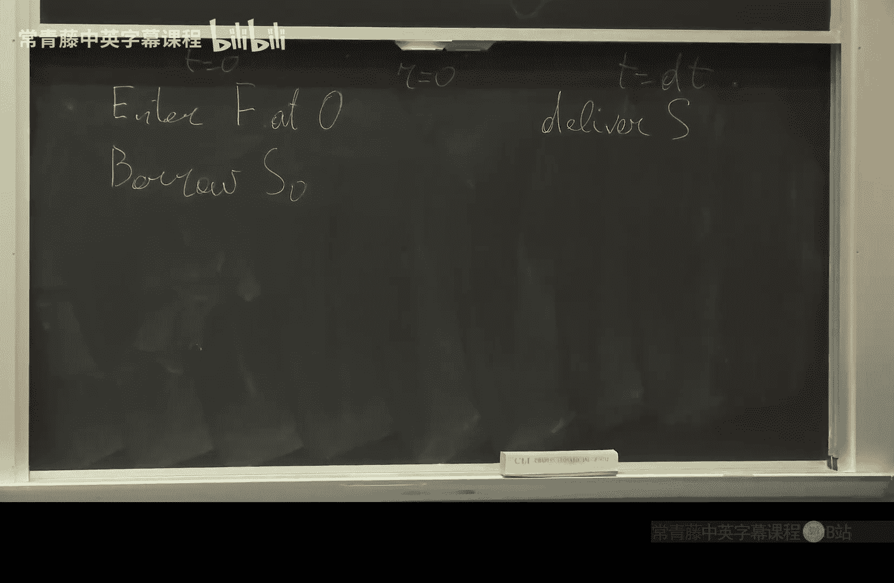

And repays a loan。So basically， what happens here。We， we， we borrow here。 We had a stock。

 We came here。 We delivered the stock。 This cost nothing。 So we receive K。

 That's a agreed agreed strike。And we repays the loan。

Which we started here it because interest rate is 0。We， it， it didn't change， right。 If it changed。

 it will be some E to the minus E to the R T times as， as 0。So。Now。That's what we'll get here。

 And here we started with 0， right， because it was， we paid 0 to enter。What can we say about this。

Well， if this was greater than 0。为。We for sure， receive money， right。There is no other outcome。

If it's less than0， before sure lost money。No arbitrage assume will tell us that neither is possible。

So because the price was initial price was 0， this has to be 0。Because this replicates our payoff。So。

 our strike。Cas to be as 0， right。So if there are no interest rates。The forward contract would just。

We， we， we would agree to by ourselves the， the， the price and the stock in the future at the current price。

 if interest rates are 0。So no， no choice。 And we don't care about real war probabilities。

And we don't care about。About what， what， how the stock behaves in， in real in real life。

 we just replicated everything。 What's interesting， though， What interesting， though。

We can find a probability。Which will give us our， our strike or we， which will give us this formula。

 right， So what， what will it be well。Well， K is equal S 0。And so our P and I'll call it。Neutral。

Risk neutral probability。S 1。plus。1 minus PM N。Thats2。Right。And that's。And we。

 we can find our PM from here。It 0 minus S 2。Div that by S1 minus S2。啊。

What's interesting observation here Well， first of all。

 that we can find these re neutral probabilities。And。We， we actually could price our。

 our forward contract using these probabilities using these expected expected payoff。

 The interesting， the most interesting part is that。Our current stock price， our underlying。

Under this risk， neutral probability is expected value of the future move of the stock。

And that's what we will see。 So that that's basically our risk neutral matter。

 And that's how we will be looking for our risk neutral matter， because。We can always find a measure。

 which implies that our。Our current underlying value， asset value is。

Expected value of the future payoff。 And that's a measure which we can use to price the derivatives。

Okay， so let's move to something more interesting。And let's。D。And。Coll option。

 but still in in discrete time， right。So。Our coal option payoff would be。Maximum。Of the。

Devalue at expiration， minus k。And0， right。Right， as here， that's。That's our payoff。

 That's the hockey stick。We still assume。For， for this exercise， well。

 let's still assume interest rates0。So， our diagram will be。Our value of coal。

 which we'll be looking for at time 0。Our stock is 0 S 0。 stock goes to S1 or to S 2。

And our value of our coal。Willll go。We assume that S1 is greater than 0 S 2 is less than 0。

 so here value of our option will be what。S T minus k， right。And。

While your follow go up here will be。0， right， because it will be this， listening。Okay。Good。So， now。

What we want to do。We want to， to find a replicating portfolio。

And here is suggestion how so a replicating portfolio in the case of For was stock itself， right。It。

 it， it was replicating the， the payout。 Now， my suggestion is to do the following。

 Our replicating portfolio would be some amount of cash。And some amount of stock， right。And。We。

 we want to find these values of。Of cash and how much stock we need， such that our。Our option。

Payoff is replicated here， right。Well。We， we certainly can can't do it in， in this simple case。

 right， because， well， in the beginning。Our， our portfolio will be。B0 plus a S 0。At the end。

 it will be B1。Plus S1 or B2 plus A S2。Right， and。Our condition of replication is that in this state。

 it should be equal to this， right。And in this state。

 it should be equal to this because we are replicating our payoff。And， let's notice。

That because our interest rate is 0 again。This thingt doesn't change because it's just cash， right。

Well。Nice， nice and easy。 From here， we can find that our A， well， if we subtract。

This equation from this equation。 I mean， we， we have two equations， with two unknowns。 So B。

 B 0 is one unknown， and the second unknown is a。 So from here。

 we can easily find that a is equal S 1 minus k。Divided by S1 minus S 2。哎。And be 0。B0。Mussical。

S two times。K， minus S1。Divided by S1 minus S2。And。

Knowing that if we replicated the the same as before。

 if we replicated the we have a replication portfolio， that's what where it should be。here。

 and this is our C 0。 And that's what we are looking， right。

 We are looking for the value of our option。At time 0。So。Our C0。Is equal to a。As 0 minus S 2。Or。

It is。啊。Its 1 minus k。Divided by S 1 minus S 2。Times S 0 minus。2猪。Okay， so basically。

 by the same replication argument， we were able to， to find， to find our value。😊，Now。

 coming back to our risk neutral。Sure enough， if we use this， this same probability。

Which is derived from， from expected value of， of the stock。The price of our C 0。Is actually。

P neutraltro。Times S T minus k。To us。1 minus spin。Times 0。Right。

 so if we know this probability and we can derive it from here， instead of。

Doing all these difficult machinery， we can just take the。

Pay off and take expected value of our payoff。Using this probability and get the value of our。

 our derivative now。All right。So that's discrete world。啊啊。And yeah， so。

They just for your reference here， it is the same set of formulas for， for any。For any payout。

And one other interesting。useful。Comment here is that。We started with replicating our portfolio。

 So we， we started with some cash and some stock。In order to replicate the the value of our option in on the next step。

 right。On the other hand， one can。Rewrite it and say that this portfolio。

Is because this is just cash。This is riskless portfolio。

And we will see just in a second that sometimes it's more convenient instead of talking about replicating portfolios。

 about talking the portfolios without risk， so basically form a portfolio of option of full value of option and some stock such the combination is riskless。

Okay， so that's。Our discretereet world。With that， let's move on to。Continuous world。So， and。

In continuous world。For today， we'll be looking。 We， well be working with。Log normal dynamics。

But we'll see that it's not absolutely crucial。 He's just nice example， once again。

And long normal dynamic is， basically。Dyna， which implies that there is some。Some growth。

 and there is some random component。Well， one can also write。呃。It in this form。

And let's talk a little bit about D W， what it is。So， the W is。Random walk， winner process。

 So expected value of D W。Is equal to， to 0。And standard deviation。Of DW。

Is equal to square root of D C。And that's what always。

Boths me why standard deviation has to be square root of D T。Why， why do we know that？ Well。

 and here is a hand wavy reason without any measure theory。Or anything else is。The following that。So。

 our。Suppose we have M。D D T steps， right， Our random walk had9 n steps。Right， so。

The collection of those will be。DW 0， D W 1。So， on in。DWM。And the no， not equal。 So our D W and。

 the final value after n steps， it will be some of all the smaller steps。Right。

 so what's expected value of。WM。Well， it is some of the expected values。Of all D Ws。

And each of them is 0， so it is 0。 It's， in fact， Martiningale， right， It stays 0。Well。

 and what is the standard deviation。Orvariance。Of our D W N。Well， it will be sum of squared。

Of each step。2。Yeah， and what I forgot to say to tell here。Is that。P。Of us going。Up。We， we。

 we are going by one either up or down。And on each step。呃。It is one half with probability。

 one half will go up or or down in correlation。Our， our steps。呃。Are not correlated， right。

 That's important。 So then the， the variance。Here will be。Some of expected values of。DWI。Squared。

Each of them will be one with probability， with probability12。So， it will be。It will be M， right。

So with probability12， it is1 with probability12。 it's minus-1。 So some of squares will be or one。

 So and after n steps， it will be n。Okay， fine now。

Let's put our N steps on on a finite period of time， right。Let's。Assume。 let's， let's assume that。

We have a final period of time， and we split it an N equal。Periods of Delta T， of small Delta T。

And we also， let， let's assume that instead of doing the steps of one and-1。Let's assume that。

They are some number D， right。Plus or minus D。Right， it was for。sorry。Okay， so expected value of。

 of our random walk still stays 0， and our variance now becomes， becomes what。

Some of one half d squared。Plus，1 half。D squared。Right。So， M D squared。In our end， we。

 we assume that it is。Just split。呃。Period of time， so。C D squared divided by Delta G， right。

 So basically what， what I'm trying to say that if we put our steps on a， on a period of time。

That's what's our variance。 And now， if we make the steps smaller。The。

 the time steps smaller and the space steps smaller as well， right。

 we're kind of taking into infinity。 We， we make， we are taking a limit。

Over the finite period of time。And the only way for this to stay finite。Or n not0。Is for this。

To be of order of magnitude。Of a squirrel of tea。So。Alongong winded。A question。long winded answer is。

For。For why。Stern deviation of our Brownial motion has to be square root of T， because otherwise。

 we either will have00 variants or exploding process。 So for this process not to explode。

This has to be true。All right。Now， another observation before we go to， to option pricing。Is to。

To talk about Taylor formula and itto。Formula as。At a follow up to it， right。So if， if， if our life。

Was deterministic。 And there was， a function of two， two variables。And S and S and T。

Then our tailor formula to the first degree or to the second degree， let's， let's write it down。

Right， we'll take the partial derivatives。With all with respect of both。

And then we'll have second derivatives， right， So one half of。D2 F Y D T squared。D T squared。Plus。

 one half。You do of my。Square？The S squared。Plus。Mix derivative。Right。

 so this is to second degree plus。Plus delta， right。 This is to the second degree now。In our。

 in our satochastic world。These two terms have kinda different magnitude， right？ So this。

 the deterministic term is of magnitude G T and， and stochastic term is of。

 of magnitude of square root， right？ So if we go back to our。Our tailor formula and still and。

 and would like to to have expansion to the first， to the first degree。 what， what we'll have to do。

So， in our satochastic world。So this is the first degree， right， So this we keep。This is。

First degree， or。La at least less， first degree or less， right， because our D。

 S is D T plus this is of order of magnitude of square root D T， right？ So this will keep。Completely。

Now， if we go to mixed terms。This is second degree， squarely。Get rid of it。 Now。

 this is certainly more than first degree。So get rid of it。

 But here something is left and what is left is， is square of this， roughly speaking， right。

So we'll have to have a term， which is coming。From， from D S squared。So， which will be。1 half of。寄出。

F by D S squared。And from from the S squared， the first term will be D T squared。 not。

 not interesting。 The mixed term will be D T times D W will be more the less than。D T。

 but the square of D W will be exactly on the of the order of magnitude of D T， right。

 So here will be sigma squared， S squared。Dt。D S expert， sorry。Right。And so。

 and this is called Eta's formula。Very important for stochastic calcos。

 And this is quick and dirty derivation。哦，对。Okay， now。Let's move on。To our。To our。Now， this。

 this will leave。不贝。So we'll need this， this。But this regard。So， let's move to pricing。

So we still want to price。え。Some claim， derivative claim。And we'll call it F。In our case。

 and we will form a replicating portfolio。And as before。

 our replicating portfolio will consist of some stock。Some cash。

And what we want to do is to replicate our， our value of our claim on each step， on each step， D T。

 right。Now。Let's do the trick which we did before， Let's rearrange this， right， So let's notice that。

AT。Minus F of T。 So the combination。Or F minus a sorry。More。That this combination of。

 of our derivative and stock is riskless。And what does it mean。That， well， now we are。

 well assume the。呃。That interest rates are not 0。 What does it mean， It means that。This thing。

 if it's riskless， it has to grow with time as to the to the R T， right。By definition， so。李奇。

Is equal E to the RRT。Times B 0， right。So we started our strategy at time 0。 And since then。

 our cash。Is growing with interest rate T。And what does this mean， Well， this means that。Our D。

 B is deter deterministic function。 No， no need for E or anything like this。

And we all can differentiate。Exponentials。So trivial mass。 that's how R B works。So now that's。

 so let's try to differentiate the whole thing。 We。

 we know the right side because it's deterministic。 It will be this。So， the。Derivative。

Of our risk class portfolio。Will be R times。Our riskless portfolio。Times D T。Good， now。

Well keep it as the right hand side。 And for this。We'll use our， our E Es formula。Right。Well。

 let's do that， so。We continue to differentiate that， and we get。D F minus a。Yes。

And our F is stochastic。 We use our either formula to be。The of D。That wasDT。Plus。Yes。Times Ds。Plus。

 our stochastic term。Plus，1 half。D to F by D S squared。D， squared。And we。Don't forget to。

Subtract this。And if we just continue， continue further。And start collecting terms。So we。

 well expand our D S according to our formula， right。

 and we'll collect terms with the certain terms with D T and uncertain terms with our DW， right。

So if we're collecting our terms with D T here， it will be。D F by D T。不啊。Plus。One half。呃。

1 have coming from D S squared and D S squared。 Remember， it will be。Sigma squared S squared D T。

 It comes from， from this only， right。So， it will be。Oh， sorry， sorry， sorry， sorry， sorry， sorry。

 sorry。 Well， yeah， not okay。 that's fine。 plus one half。D2 F。By D， S squared。

Sigma squared S squared。 And I missed this one。 And if we are collecting the D T terms， it。

 it has to be that， right。Plus Tf by D S。Times mu S。Right。And。We should not forget。

D T term from here。Minus。A。M。And that completes our DT term， right？Now， let's see what happens。

With our DW term。Well， the W term will be partially from here， right。D F by D， S。Sigma S。From here。

 right。Mus。Part， apart from here。A sigma。S。And this is equal Dw。Time D double， right。

 and what is equal to， Well， it is equal to this， right。对。

How come we can say that Dw squared equals Dt because I thought we just knew that standard deviation was a square with Dt but。

So， D W squared is D T。But I thought W was random。 I thought D W was random。

 So how can you say that when you square it you get somethingistic。Well， the。

That this is more of an notation。But， but yeah， we， we kinda， yeah， it is not very， very。

Rigrous notation。But that's basically。What， what， what Eho's formula tells you。Right。

 so if you go into the strict proof that that's what you'll get basically for， for the second。

 for the square term， right。那第二。So that when we talked about Brownian motion， the quantum variation。

ABrow emotion is constant。Over it's infinitesimal and the fact that the st deviation is of order of magnitude。

 but yes， you are right， is it is kind of slope annotation。Okay， so， and this is equal to。RF right。

Mus R S， R A S。呃。DT。And because we， we knew that this， this part is deter， right。

 So there are no D W terms on， on this side。So what does it mean？That this has to be equal to this。

Right， and this has to be equal to 0， because right， right hand side here。

Is completely deterministic。So， uncertainty has to。Disappear why it disappears by construction。

 Because we from the very beginning， we said that we want to find such an A。

 And that's what we'll get just in a second。 that this portfolio is riskless。

Or another way that we can replicate our derivative。 So if this is equal to 0。Then， our A。

Is equal to G F by D S。喂。And we are done， right。So， what。We are done， in a sense。That。

We arrive at the following equation。Basically， what should I write， How about this。So， our main。

A equation will be this equal to this， but we will substitute a。AndLet me write it here。The equation。

 which we arrive at at。D F by。The T plus1 half。でか。F by D S squared。

Sigma squared S squared is equal to R F。对。Mus R。D F by。Yes， that us。

And this is the black Sholl's equation， right。So that's what we are looking for。

 And that's what we will be solving。So， just。To give。Yeah， so in the slides， there are。Nice， Sir。

And more。Cleaer right up。嗯。Yeah， so they basically what， what we found out that。Any。Derivative claim。

Any pay payoff has to dis satisfy this。This， this equation。Well。

 under assumptions of far log normal motion， if， if we assume some other dynamics of the stock。

 the equation will be different， but we still can derive it in， in， in a similar manner， right。

and but， but the beauty of it that any derivative claim， any payout at any time。

 time before expiry has to satisfy the this， this equation。 more， moreover。

 this equation doesn't depend on our drift。On our real world drift。And we， willll come back to this。

 come back to this shortly。呃。So， so it doesn't matter What， what matters is volatility， right。

And that we will touch upon， hopefully， we'll have time to touch upon it further in black shall theory。

 It is assumed constant， but it doesn't have to be it it you can assume some function。

 or you can assume this to be stochastic itself， which will make the the equations more complicated and more complicated to solve。

 but， but once again。So， and that's， that's what Fisher Black Martin Schs and Robert Merton。

Discovered or published in our their 1973 paper。 Bel or not it was quite controversial because。

And actually wasn't very much applauded at this time， but was recognized by a Nobel Prize in 97。And。

The always fun fact to， to say that all three of them are associated with MI I T。

And Bob Merton is still， I think， a professor。At MIT。Which is， obviously。Quite， quite nice to。

 to talk about it in these walls。So。Now coming， well， maybe a couple of remarks。Yeah。Yeah。

 so Bere said that so any derivative satisfy this equation， it doesn't depend on real world。Drift。

 we obtained this equation by， by replicating strategy。 And that's the most important。The， the。

 the other beauty of it it's not only replicating strategy。 It's also hedging strategy， right。

 So if we know our a， which is actually derivative of our current price with respect to stock。

 we can hedge out all the risk。Right。So basically by holding option and some amount of stock。

 this amount of stock， our portfolio becomes riskless， which is very important， practical conclusion。

 the more mathematical technical observations are that this is actually a form of heat equation。

 and a good technical exercise would be to to to figure out what what change of variables gives you the heat equation。

 and this is a very well studied and solved problem， even though it will be， it has to be numerical。

So as any partial differential equation to solve it。

 it will require it will require the initial or actually， in this case。

 final conditions and boundary conditions。 And what is our final condition。 Well。

 our final condition is actually our final payoff。Which will be this。 This is our final condition。

This for now。Right， and what will be our boundary condition for for coal will be that at 0。

The value of the call is 0。And the other boundary condition would be， would be that at infinity。

 it is actually the approaches as， as， as as minus k， right。And if we imply。This。Boundary。

Conditions and final conditions。 And this is the conditions for， for put。

 We can derive the arrive to analytical or semi analytical formats for， for the prices。Of course。

 it's expressed in the terms of error function， which has to be tabulated。Yeah。

 in in more complicated cases， in， in the cases of more complicated dynamics， of course。

 the the formulas are not so nice and most probably it will require some numerical numerical integration and numerical procedures。

 which is a big part of numerical finance。 In fact。

 what I wanted to talk about is coming back to risk neutral pricing， and let me。

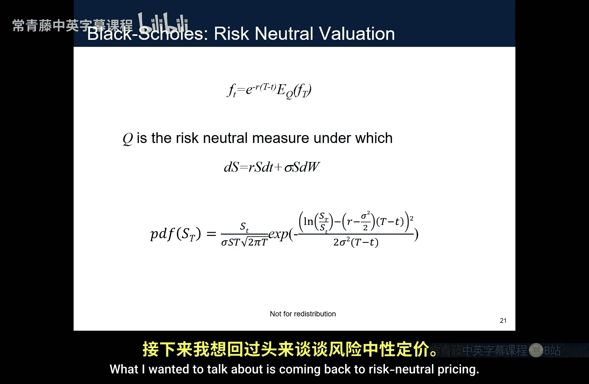

呃。Let me。Do it here。Basically， how， how do we find our risk neutral matter。

And how do we find our risk neutral P D F。Well， actually。In the case of loglog normal。

 it is pretty simple。Because。Well， our DS S。Is equal to。M S。第气。Plus， C mass， D W。

So here is a nice trick。 If we take expectation value of both sides。

Then we'll get a differential equation for。Well， for。expected value of this is 0， right。

 because expected value of D W is is， is equal， is equal 0。 So an expected value of this will be。

Mity， right？So nice differential equation for our expected value。So。Our expected， the。

 the expected value of。Of the stock。Should be equal to initial value of the stock。

Times e to the mu T， right。But for our risk neutral assumptions。Remember。

 so we said that in discrete case， the whole point of。呃。

Risk neutral probability was that expected value of our stock。Should be。

Our stock may be compounded by， by interest rate。Right， well， when interest rate was 0。

 it was constant。It was so。In， in log normal dynamics， DS S over S will be Martin Martinale， right。

 So this has to be equal to S。E to the R T， because in under risk neutral dynamics， our stock。

Has to be， has to grow with R。 So basically， it tells us that mu has to be equal to R。Under our risk。

 neutral matter。Right， so。Now， O， mu is equal to R。But， but we can easily find a P D F。Of。

 of this process。At time C。And that's what it is of log normal process， basically， right。With。

 with mu substituted by R。So。Yeah， so。New substitute buy。 And what， what I'm saying that now。

 instead of solving。Our black Shos equation for any claim。Our under log normal dynamics， we。

 we could just take。The our payoff。And integrate it against this P DF， the final P D F。

 and get the value of the function now， as is expected。

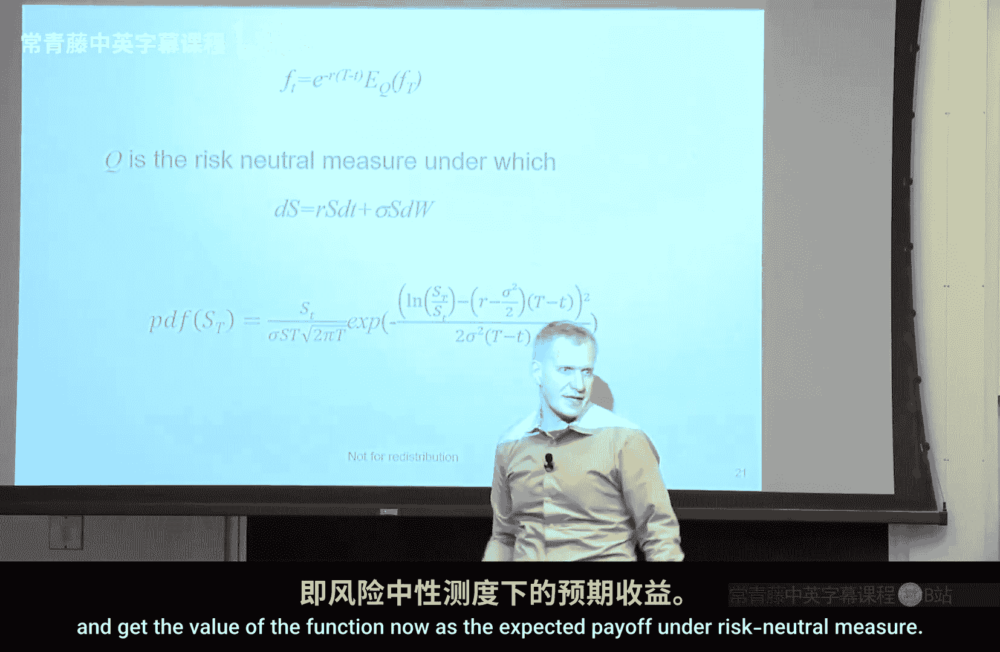

Expected payoff under risk neutral matter。And that's our risk neutral measure。哎，对。

So that's a nice benefit， of course。It is easier for log normal， for other， for other processes。

 It is not that easy。But it's certainly an added benefit。Another。Another example。

 which I want to give you in the past。In the last 10 minutes。Is another replication example。嗯。So。

Let's form such a portfolio。Let's。Buy a call and celebrate put。So what， what， what is it。Well。

 let's draw a diagram。And let's draw a diagram at time maturity C， right， So were long a call。

SoWith some strike K， right， So， this is our strike K。 So our call is。Looks like this。We short put。

 right， So put would be like this and short put， it will flip it， right， So it's like this。

How does it work。It looks like just like a forward。对。So。At maturity。But。

 this portfolio has zero uncertainty。 It's forward。So at any time before maturity。

It has to be value the， the forward value of the stock。Right so it， it always has to be。So at。

 at maturity， it is S T minus k。So， well。At maturity。So at any point of time。The difference。Of call。

 and put。Has to be。The difference of。Value of the current value of the stock and to tell the truth discounted value of of the strike。

 right。T minus T。And the beauty of it that we， we made zero assumptions about dynamics of of the stock here。

This has to be true。 Always， it's just how the payoffs look， look like。

Because we always know forward， it is only dependent on， on interest rate。 It doesn't depend on。

 on dynamics of the stock。 And this portfolio doesn't depend on the dynamics of the stock。

And it's quite powerful because it basically tells you that if this is different at any point of time。

 you have an arbitrage。And to illustrate that。I actually。呃，我。1 oh oh， sorry。Went to Bloomberg。

Took real prices of coals and puts。 This is Apple stock a while ago， admittedly。And here， I。

 I literally plotted。The data here from here。For coal and for， for Put and literally summed it up。

 And you see that it， it is a straight line and no surprise because if it， if， if it wouldn't be。

It would be an arbitrage。 People will jump on it immediately。People check for it all the time。

The beauty of it， that。The， the dynamics of the stock is not log normal。And how can we see it， Well。

 I also plotted here implied volatility。For， I think I did it for coal here。

And if it would be log normal， the volatility should be straight lined， and it is not。Right。

That's why we need more complicated models for， for stock dynamics。 That's why。

Black tros is a nice example， but， but we need stochasticical aity。Or， or others。 jump diffusion is。

 by the way， a tricky thing because the Martin Gas， this jumps。Don't really work。 So the。

 the life becomes。Becomes more complicated。So。Yeah， so， that's a nice。

 another nice example of replication， right？ So， and in general， that's how a lot of things function。

 You， what you try to do， you look at the payout of a portfolio and you try to replicate the payout with the instruments which you have at hand or at least approximate the payout。

 because if you did it， you know the price now。Or you know an arbitrage。 the。

 the other way to do it is for some form some complicated portfolio。And find misplacement， right。

And that then it becomes arbitrage。 Nowadays， it's practically impossible， but。

But people did a lot of things with more complicated options， even 1520 years， Well，25 years ago。

I think。Jake has a good story about that。How he was starting in f options。 Yeah。

 just in another illustration， I did the same for IBM stock。 And yeah， sure enough。

 it's the same straight line。 I didn't plot the implied wall， but it's probably even a layer here。嗯。

Yeah， we're about at time， but I would leave you。With a little bit food for salt here。呃。

So this is called digital option。 They pay out payout of digital option or all or nothing option。

 right， it's basically either pays you 0。 if you end up out of the money or it pays you one if you end up in the money。

Right。

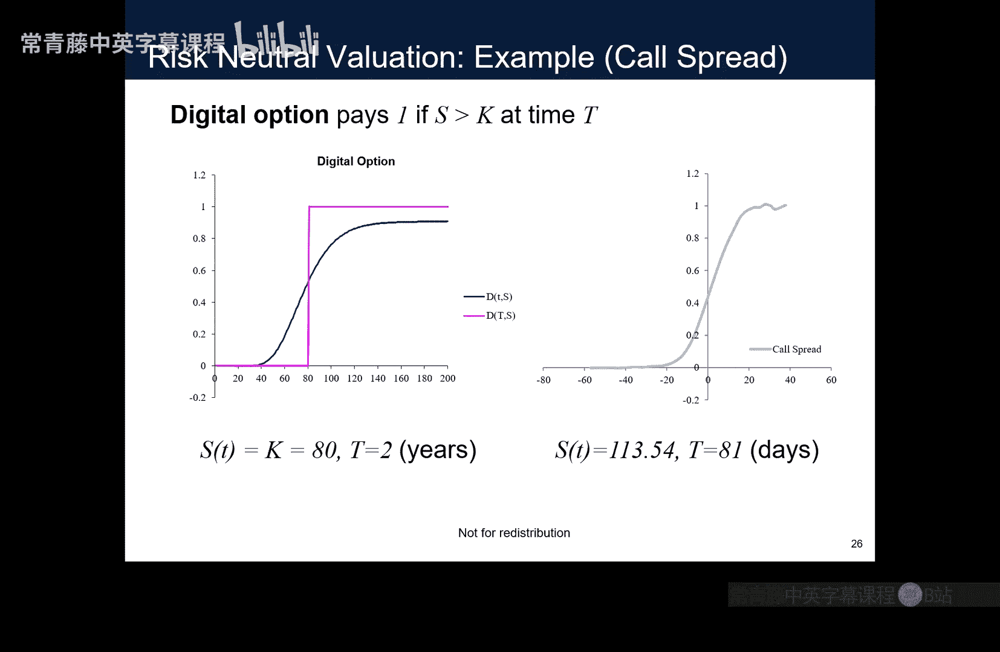

呃。This is how black shas would price it。 This is actually how cold spread looks from， from the data。

 which I just showed you。Pretty close to this。 So my challenge to you is find a replicating portfolio。

Which， which price is a digital。Because I claim that you don't need to have a dynamic of the stock or do any complicated things here。

You can replicate this， this payout。嗯。Practically exactly， actually approximate the， the payout。

 And that's how actually how people hedge digital options。Yeah， so think about it。嗯。For with this。

 let me stop。 stop here and any questions happy to answer。Looking forward a little bit。So。

 we have two。Classes， tool， two invited lectures。嗯。And one of them， the。

 the the the one in in the week time will be by John Hall。 It will be by， by by Zoom。

 and he will be talking about。Machine learning。 And I think it will be an interesting lecture。 Well。

 at least interesting， because for me， John Hall is an icon。He， I mean。

 not only he wrote the most famous deal with his pricing book。He also created Hall fors， and。

Made a lot of contribution to quantitative finance， so。And， I。We， we are working on。

 on a couple of collaboration projects keys in University of Toronto。

 He is a professor of University of Toronto。So yeah， a little bit of advertisement。Alright。

 thank you very much。

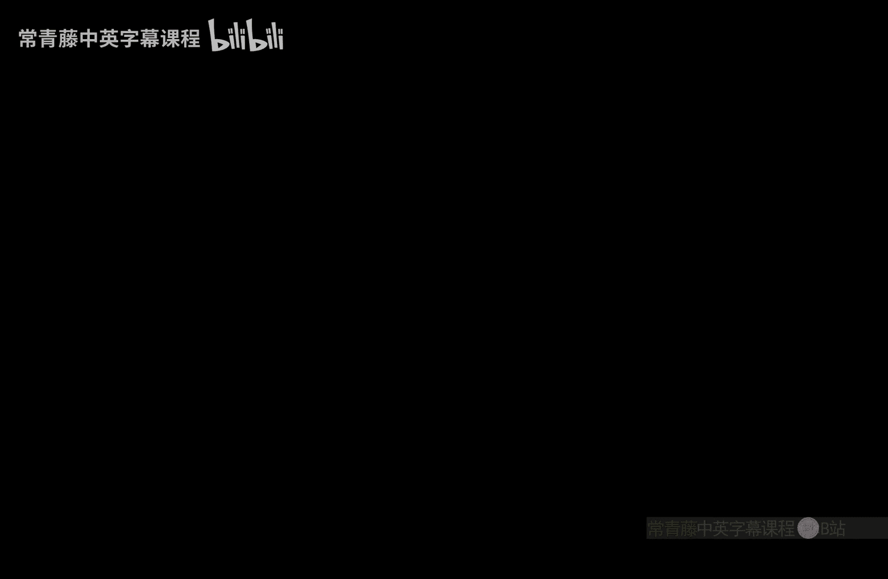