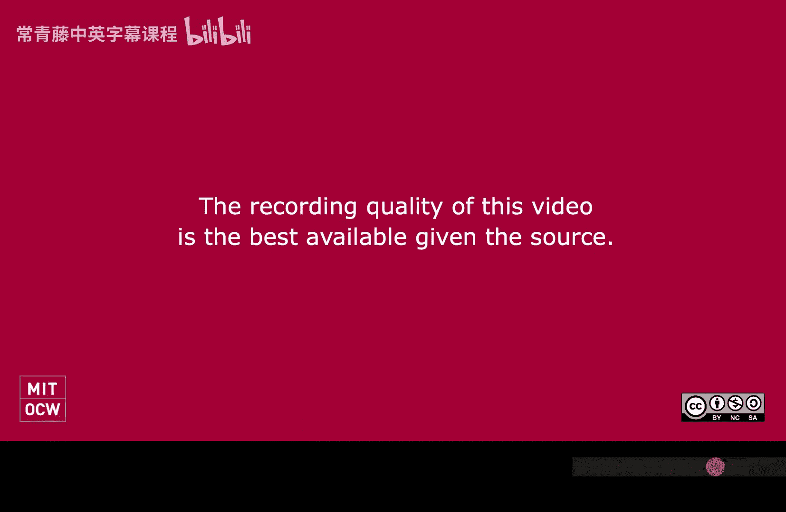
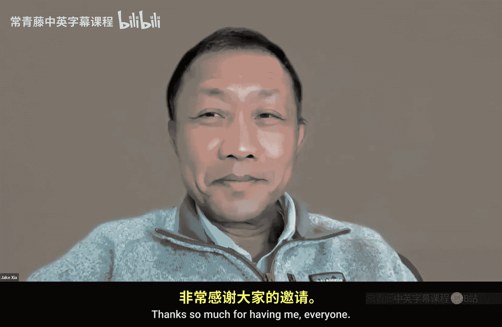
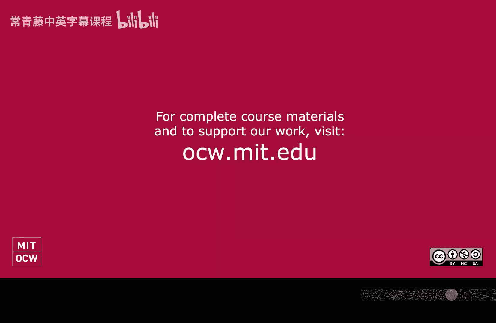

# 麻省理工学院【中英⚡数学专题及其在金融中的应用｜18.642-Fall-2024,-Topics-in-Mathematics-with-Applicatio】-p19-P19-Building-the-First-Federally-(CFTC)-Regulated-Exchange-Dedicated-to-Trading--BV1iLrjBrETS_p19-

Yeah。Okay， Tak has just joined us， I believe。Hey， everyone。Hey， Tak。Well。

 welcome and just as a brief introduction， I'm really very proud to introduce Tarik Mansur to everyone。

 he graduated from MIT。About six years ago or seven years ago， and he was actually in this class。

 and so we're really very pleased that he has come as a guest lecturer and his background he left when he left MIT。

 he joined really the giants of Wall Street， Goldman Sachs， Citadel and Bridgewater。

 I'm sure most of you are very familiar with those names。And three years ago。

He started Kalhi with Lujuana Lopez Laurara， another MIT student。

 and I think it's been a phenomenal success， especially in the last month。

 so let me hand it over to Tak too。Share his experiences。Details on khi。Yeah， well， first of all。

 thanks for having me Peter， you know， really， really excited to be back in the class。

 I know the one I did last year。I think I did the year before that and maybe I'll talk a little bit about background sorry the way other thing about doing this is just I'll talk a little bit about the story of Cal how we decided to do it what is the long term vision what we're trying to achieve and I will do a little bit of Q& A and then' it goes from there excuse me T just a quick question your video isn't on。

😊，For us， I don't know if you can turn it on。 That would be great。It should be on， but let me check。

It's on for me， so it's on on Zoom。 so let me check， let me double check one sec。Oh， that's great。

We can see you now。Oh great， great。 Sorry about that。 I think I'm in a little bit of a unstable。

 unstable wfi。So yeah， I mean， I I maybe I'll talk a little bit of my my my background。

 I really like going back to to to this class because a lot of served the interest。

In financial markets and math， I think stem from the class。 So I was born in California。

 I grew up in Lebanon。 I think one of the。😊，Things that I basically really enjoy doing and middle middle school and high school is I truly love math。

 I really like math and I think it felt like MIT was the right place to go。

If for someone who basically loves math and and so got into MIT and。

Thes the thing I realized is under the best application of math is finance。

So start working in a number of。Whether it was like sellside or buyite or so banks。

 like Goldman Sachs， I worked at Citadel， I worked at small， I few small prop shops。And then。

The thing I realized is like， it say like I realized two things， I mean one。I like trading。

 I really like enjoy trading， but I realize I prefer sort of building more I like I like the sort of notion of building new products and building something new that is sort tangible。

And two， when。I was a Goldman， I mean， I think a lot of the thing。That。We've sort of seen。Is it like。

 you know， financial instruments do get developed over time They take a long period of time。

 but there is a lot of up to basically develop new things。

 and there's always needs for a lot of new things。 One example in 2016 is that a lot of people were actually trying to get a hedge and exposure to Brexit andt they weren't really like the right instruments for that。

 people would use traditional financial instruments like stocks and options and others to get that sort of binary exposure that people were looking for and it was just not perfect。

 It was not it was proxy was indirect and it was super expensive because it was what we call over the counter OTC traded。

And。And so。What we thought， know， and it was gonna really early at the time Its like， well。

 what if we have a financial market。 So we have a financial market for equity， So the price equi。

 one that prices credit， like bonds and so on， one that prices commodities。

 and we have financial markets for currencies。What if we had a financial market that prices basically any question about the future。

 any event that is in the horizon that is meaningful， economically or socially or culturally。

I think the thing that became very apparent is。1。IfIf such a market were to exist。

 it could it has the potential to be the biggest financial market of all。

 mostly because it's just broader than anything else that came before it。And two。

There were a lot of regulatory issues with that。With that type of markets。

 basically historically the US has made these illegal or unregulated。

 they haven't let anyone do it and。You， at the time we were very naive we。We thought， well。

 that sounds like a problem we could solve and。We just got into it so we decide to start a company I didn't go back to Citadel so we just decide to start Calhi and the premise is really like it's like you know about what if we build sort of the first large scale operation market and we want to do it as a financial exchange a regulated financial exchange so that this can become an asset class that's traded one day by the large hedge funds and institutions and brokers and so on and so forth and。

You know， when when we first started was it was toughpped， so I think that the。The well。

 any company is really tough to start， but I think this was particularly tough because like。We。

 it is kind of funny story。 It was like we called pretty much every single securities slash derivatives lawyer in the country and asked them like。

 hey， we're trying to do this like what what know， can you help us And the answer was basically like everybody's sort of like the range was like either being laughed out of the room all the way to sort of like。

 hey， this is， this is just not at work like。😊，The CFC and the regulators just like never wanted to do anything like this。

And。The reason we kind of kept going is because none of the answers are actually they're actually satisfying like there wasn't a kind of a clear answer like okay why they're like well because of you know there's a degree manipulated like okay but like that's sovable same it with solve its stock market And then the other one is like。

 well， it could be gambling was like well why is this gambling and you know something like you know a great future is not I mean know some people are spec on grain futures and sure some people aredging on great future。

 but it's the same thing for Brexit like a lot of people are exposed to Brexit and。And we kept going。

 We basically got the company regulated， we took three years。

 So we took two years and a half to three to basically get it regulated。

 and we basically launched the first legal exchange or legal prediction market in the US after that。

 It took us a very long time。 it was a very long journey。 but we got the exchange。

 We got the clearinghouse。 Well， we got the exchange at the time。And we got up and running。 And。

 you know， I think Peter has seen on the sort of journey of the company。

We we started running and then we grew a lot and then we had a bunch of sort of like。

 I would say like issues and infighting between us and the federal government， the CF toC。

 especially this kind of prior administration， which was kind of really tough in financial financial service and financial innovation。

 and the big thing that happens that didn't let us let the election market。

 which we always believe is gonna one of the biggest markets of all， basically。

It was you we took a very long time to make that decision。 It was a very tough one。

 but we ended up suing the federal government， so we were really one of those first。

 you know I would say examples of a regular company is suing its own regulator iss very tough and painful decision to make at the time。

 obviously it was the right one now looking back in retrospect and we won earlier this fall and so that win was actually the first time in 100 years that you can actually trade legally on the election in the US and that opens up a lot of options beyond the election because what the lawsuit was about is like you know it's really expanding the universe of things that are considered financial instruments now。

And so where KaC is at now， you know we've grown a lot over the last few years。

 but definitely the last month， we have we've done over a billion of volume in in the last month alone and you know now kind of as we think about our future expansion plans。

 we're getting into a number of different categories， you， financial services。

 like just just basically like financial markets， sports。

We wantna basically have a market for every single piece of news that's out there in the world。

 And we want to over time。 what we're doing is like we're integrating some of the large brokerages where we're going to。

Have， you know， people can come to cash。com to trade the asset。

 but also if you want to trade the asset from your own brokerage account like zero41 k in your stocks。

 you will be able to do that on Schwab， Robin and Fidelity and so on。

' talkalk a little bit about sort of you know， kind I finishing the narrative Arc。

 and then I'll talk some of sort of personal stuff going from being a student to starting company and so on。

 but。One of the things that you know was interesting throughout the journey is。

A lot of what it basically ends up taking is is just perseverance around。

Ba perseverience towards the goal that you're trying to achieve。We。You know。

I mentioned the beginning that we were naive when we first started and retrospect。

 I think that was actually one of the best things that or I'd say one of the best tools that we had actually being naive。

Because a lot of the people that like， if we knew how hard it would be。

 this why we just wouldn't have done it。And there's something to be said about， you know。

 when you climb mountain and people tell you just look at the next step， one step at a time。

 don't look at the summit just because when you look at the sumit。

 you get tired and I think there's a lot to be said I think this applies to pretty much anything meaningful in life。

 I think just doing anything meaningful basically par lot of perseverance。

The company has raised more than $100 million on a few investors， Sequoia， KKR， Schwaitzel。

 YC and a bunch of others C Valley and I think that's about it I think I covered most things Peter I was thinking we could do a little bit of Q&A and then we can sort of orient the conversation some of the places that the students want to hear about。

Yes。Great， thank you， Tak。 And let's say， with questions just so Tak can hear you will'll hand you a microphone or we'll pass a microphone to you 1。

2。😊，Okay， I don't know where you can see me from。 So yeah， this is really fascinating。

I'm just I have a question which is like what is the difference between like this and a betting market like to me。

 it sounds like the same like you're betting on an event because surely like if someone wanted to hedge against Brexit。

 they could just go into a betting market and bet you know。

 a certain quantity of money on whether Brexit happens。If you think so there's a lot of similarities。

 I mean， and I would say there's a lot of similarity to embedding markets and just any traditional financial markets。

 there' a lot to go at like our speculating or bedding or gambling on a lot of really a of markets。

 including crypto and stocks and really anything。But I think like it's a bit more of a structural difference like first of all。

 this is an exchange。 people are trading against each other。 we're not there's no book。

 there's no bookie， there's no concept of bookie and actually any institution that wants to hedge against Brexit we're never do it on a vetttting market just because the prices are set by the bookie。

 they would do it probably with an investment bank， which is what they're doing right now。

 but the prices are kind of bad at the investment bank， it's like over the counter。

 you negotiate by liabilityly with the investment bank instead of just basically doing it on exchange or like there's other people that are independently pricing the event。

So that you can basically know what the right price is to basically make the transaction at。

 I think like there are a lot of similarities。 And frankly， like I haven't。

 you know we don't really discern them quite quite much I think like over time。

 the two are converging and they're got to end up being one on the same the fundamental difference。

 I would say like from regulatory or legal perspective。

 but also like sort of like why is it the financial instrument。It's like。

 are you trading on natural risks or are you trading on artificial risks？Right。

 so like when you go to a casino and you roll of dice。

That's like a risk that you're creating for the purpose of entertainment， whereas。You know， Brexit。

's， it's not a risk that you're creating for the purpose of entertainment。

 That's a risk that exists that some people have and they're exposed to。

 and they may want to basically transfer to someone else。

 And and so that's sort of the delineation of why this is a financial market and why you know。

 having it on a financial market is appropriate。 But yeah， I mean。

 I think two main difference like it is an exchange。

 Like we have an order book people are trading it the same way as a stock market the same way they trade in a stock market。

And then two， it's risks that exist。 And so people can basically do what they want with their risk。

 whether they want to get exposed to it more by speculating or they want to get exposed to it less by hedging。

It's a great question。 Thanks。 Can I just ask a quick follow up， which is like， is。

 and this has just come to my mind。 So maybe a silly question。 But is there any like。

 has there been any like arbitrage opportunities between like the betting markets and and this exchange。

Yeah， I mean， well， we're the only legal one in the US。 So there there's kind of， I mean。

 in terms of there more， there's more arbitrage。Between us and traditional financial assets so with the election for example。

 people were arbit like a lot of our hedge funds were arbitrging the election market with other assets like crypto or or like S&P and so on and that we see a lot of that。

Okay， yeah， that makes sense， that's fascinating， thank you。I think there's Steven。

 I't know if you can give him， I don't know if you can unmute yourself or。Oh， yeah， question。

Can you hear me。开入入。Yeah。I'm also like interested in careers in trading as well and I find it fascinating as well so it's good to hear that you were interested in that and did that as a career。

 but I was just wondering how did your experiences working in trading kind of help you to or if those skills help you with like what you pursued Pa off。

I would say like。Maybe like a few things so one， I mean。

 it's always get good to get firsthand exposure into how things are done in a market that you're you're like trying to be trying to to。

To disrupt。It's like like you have to have a reasonably good understanding of how things work。

 and the thing I' say is like it's interesting。It has stay in an industry for too long。

It actually gets a bit harder to disrupt it。 You get two conditions。

to how things are done and and maybe you get maybe it gets harder for you to become to have any degree of divte。

 which I think is not a very good thing， but I think some degree of experience is good so that you have like based on understanding of what your end customer。

 how your end customer basically thinks about the word and how they use different products and adopt them。

The second thing I think is。I would say I learn a lot from the， from the Citadel culture。

 maybe less from Goldman and some of the others， but Citadel。I really enjoyed working at Citadel。 I。

 I really like a lot of the aspects of the culture and the way that things are done。

 And I would say like its， it was interesting because I I think Citadel had sort of this like ultimate version of。

😊，嗯。嗯。It's call like sort of like performance driven culture。

 but and what I mean by that is like it's a full meritocracy。

 very little sort of like management layers， even if you're young。

 they will give you a lot of ability to sort of take risks and do big things。

And they're uniquely fit to do that because in trading。

 that something that's very unique to trading is that you。You have a P L， like。

 it's undeniable whether you're doing well versus not。 You know， if you make money。

 you're doing well， if you're not， you're not， whereas in a lot of like in tech and others like。

 there's a lot of politics like， you know， the boss likes you versus not。 I mean。

 there's just like a lot， lot of noise。And and I think we try to kind of bring that to to the culture of the company as much as we can。

 We're very flat as a company。 like we have a lot of people， you know。

 there are a few years out of college。 A lot of them are from MIT。😊，You know。

 theyre they're running huge， huge chunks of the company already with teams and so on and and just because like。

 you know， for us it's very similar， like if you do well。

 you basically grow extremely fast within a few months of the company and if not then not and so that comes a bit from the trading culture。

 I would say。Okay， yeah， that makes sense。 Thank you。I can fill in a question。Hey， sorry。

 good see you back in the class。Good。 good senior。 So can you talk a little bit about the your margin requirement and also maybe central clearing。

 I guess， you know， you have two parties， right， taking the opposite side of a contract。 I mean。

 the payout， that say 100%。They， they may have paid， you know。

 a percentage of that total payout When the market moves。

 do you require them to post the variation margin or how do you， How do you monitor that。Yeah。

 so we we are fully cashized right now。 So what it means like people put the money up front。

For their positions。And then we basically walk to market every day。

 actually work to market on a real time basis， so we do it real time。

We are going to introduce leverage next year。 I think， and that's going to be pretty interesting。

 We're thinking about， you know， what kind of our margin model is going to be。

 And maybe for the class explain。 So， so in all financial markets。😊。

You what people consider say kind of marginal leverage is like when you buy。

 when hedge fundss basically buy， let's say， you know， an interest rate future or like S&P future。

That's say they want to buy like a million dollar worth of SM&B future。

 they don't put up a million dollars with a clearinghouse in the exchange， they put up。

 let's say $100，000 or $10，000， which will be 10%，1% margin。And then as the thing moves over time。

You know， the Clinghouse ask you to， you know， if if you made a little bit of money。

 the Clinghouse pays you and if you lost， the Clinghouse asked you to put up a bit more margin to cover your losses and it goes like that over time。

Gshi is a simpler model where like we actually ask for 100% upfront we tell everyone like hey。

 give us all the money upfront so that there's no risk in the system and you're always sure that anything you lose is like what you lose upfront like what you put up up front you cannot lose more than that over time we're gonna start introducing leverage which is like we don't take 100% up front that's what Jake was asking about and I think it's a complicated that's a complicated thing because regulars are becoming very strict about how we do this and we have to be we need to make sure that nothing like 22008 can happen again and so there's a lot of like requirements around how this needs to be done and。

You know， so we expect to basically just maybe margin like end of next year potentially and you know we'll see how that goes we do have some products where。

 for example， if there's a lot of strong correlationordination between two products we return some collateral to the participant and we've already started doing some of that but you know over time we'll do more and more。

Yeah， it's a great question。Yeah， so I have a question on like kind of how the projections for the company have changed since the election。

 like I assume there's a lot more volume going through Kahi during that election period。

 have you guys been able to retain a lot of that trading volume or did you see a huge fall off and like how did just the election general change where you see the company going？

Yeah， I mean， I think I think it's like the election， So obviously it's super cute。

 but it's interesting because our volume right now is actually higher than it was in the day leading up to the election So and I think that's how exchanges work like once you acquire acquiring onboard and open accounts for customers。

 they kind of retain this stick they do other products now we're seeing a lot of uptick in crypto we're seeing a lot of upicicks in our economics products。

 we're seeingtick on a lot of the politics like what's going be in the cabinet there's going all these questions about like what's going look like in the next year and then you have a lot of like crazy categories like whether people like are very active on sort of daily weather markets and then entertainmenter markets and so on So we see a lot of opportunities across all these categories。

And yeah， I mean， I don't think like so you know， it's not going to be the same levels of what we've seen in the kind of two days leading up to the election。

 but I think we're you know at a much higher level than what we were prior to the election now。

 it was a huge thing it as like a huge marketing marketing moment for the company and that enabled sort of the product to go mainstream。

Me， Dek， specifically。Yeah， hope to see you。yeah， a question。

 so can you reveal what's the percentage between institutional clients and individuals on culture at the moment？

Right now， I say the breakdown of volume is like 30， 40% institutional and the US is retail。

And I expected to basically go towards 5050。What we time。

It's interesting like institutions do a lot more volume， but you can charge them less。

Whereas retail like you know individual customers they do less volume they can be charged much more and you know historically you know people have seen the business model being kind of institutional first。

 like the large exchange is like NasdaAq or CM they're mostly institutional but I think it was kind of a strategic mistake and I think they're waking up to it they're realizing like oh God。

People on Reddit and Twitter and and average people now hold a lot of the power， right， Like。

 you know， they can decide that a company and video is gonna be worth， you know。

 a few trillion dollars like and， and， and that wasn't possible for like people are richer now。

 People are more involved in the financial market and they're less price sensitive。

 And so you see companies like coinbase are doing incredible well。😊，And yes。

 they have much less like con volume on a yearly basis is around like anything like 50 to 60 billion。

Cmes volume is like a quadrillion， right， Like it's like not even comparable。

 but Com changess a lot more， right， they charge you a lot more per per dollar traded。 And。

 and I think we see that same balance。 And and I think that。You know， it's interesting like。

The thing that we see。And I see this trend sort of continuing in the next few years。

 especially with the Trump administration。Like there's a very strong appetite for new。

Like new financial markets and new media， like there's a lot of distrust in the system。

 both in the sort of Wall Street and financial markets， but also media。

 people just don't don't really believe the kind of fundit and and traditional social authorities。

And。😊，And I think like prediction marks are very uniquely suited to be get at the intersection of both and that's like that's like that's a retail first market that's like a retail first and then institutions follow rather than institutions first and then figure out how to get the retail to adopt essentially and then we're seeing that we're seeing that。

very interesting， thank you。Stephen。yeah， I had a question about because you said that you were trying to also get into。

Worts as well， right？So I was wondering if you like plan on offering like。

Or similar things to like other sports books and stuff like traditional bets。

 like money lines and stuff like that or be more of like the more like a broader prediction type sports bets。

We嗯。That's a good question both basically is the where I put it you know， I think both， you know。

 the prediction stuff is the one that's more interesting because that's the one that like people news thinks about like。

What are some of the kind of big things that are going to happen in the next few？

F few months or years and then the moneyline is just like very retentive like people come back and they do it over and over and then they engage with the product meaningful in a very consistent way so I think that yeah。

 I think that the answer is both we have some regulatory work to do on that front。

 but the next administration can be very favorable。I mean。

 Trump himself has been coining our markets a lot， he loves the market， he loves the companies。

 I think it's going to see a big shift from you know an administration that was somewhat anti financial innovation to admission is going to be very。

 very pro financial innovation and prediction markets specifically。Okay， yeah， that makes sense。

So Tari， feeling another question。 I don't know if you can talk about the revenue of the company。

 is the company profitable so far or the revenue model is from a commission model just to kind of give students some idea how why。

 you know， the investors are interested in owning the company。嗯，在讲不你。

Can be profitable if you want to， but we don't right now。 And， you know， it's you know。

 oftentimes a little bit of a counterintuitive thing。 But I think， you know， increasing the like。

Growth at this stage is more important than profitability and law of cases because and the reason why exchanges are very popular businesses。

 they're very hard to set up， it's unbelievably hard to get an exchange up and running。

 it's just really really difficult， but when it's up and running and you have liquidity it's actually one of the best form of businesses。

 it's some of most profitable businesses are exchanges actually。

and so right now the strategy is basically like hardcore expansion， just grow， grow， grow grow。

 go mainstream， get people use the asset we're making revenue。

 but it's just like we're reinvest it all into marketing and growth and then over time we're basically like you know。

 as we taper and as we get to even larger scalere basically like you know。

 turn on the profit machine。And the source of revenue is interesting we make money on trading fees like CME or New York Stock Exchange。

 you take a fee of every transaction， like if you put $100 on cash we take 1 to$2 and then on market making so we have a separate arms like Cadel market making on this product and they're already kind one of the prime market makers。

 they have competition so they compete a lot against SG。

 which was one of our major partners and then there's a few other prop shops or like market making like a hedge fund the。

And then three over time， right now， we make it all three and open source。

 but the data is very valuable。😡，We have a lot of very valuable data about like trends and where the word is going。

And there's all the demand to kind of like get the data。

 but for now we're just like making it open source， anyone can use it。

 anyone can make use of it over time we can basically capture value at that as well。

Just follow up on that。 you know， you mentioned the Citadel Sig those market makers。

How do you incentivize them to， you know， come to Kaoshi And are there any requirements of how tight the bid offered the spread they need to make when they make market on certain contracts。

Yeah， so no a definite requirement。 so so you know， I' give it an example in the election market。

 there had to be one cent spread with a million dollar on each side。At least。

And it was funny because Jefffias， the founder of Sig actually texted Elon and asked him if he wanted to do $100 million trade on Khi during the election。

 but then Elon was too concerned of conflict of interest in a bunch of things but and they could have done it with  one cent so the spreads were very very tight saying this because they could do up to $100 million within like 1 cent slippage which really awesome。

And so yes， there are requirements on spread and。And and， and depth。

 I in the way we think about like the the ecosystem needs to be。But the way it structured。And嗯。

You know， you give some incentives at the beginning of markets that after that you basically let it do and their incentives basically did we're getting flow。

 they're trading against a bunch of other people and then they hope to make money market making and doing like getting better spread essentially and so that's of like I would say like the structure and it's pretty common structure in the traditional markets。

 I think your question is good because the stock exchanges。

 they do a lot of incentive because stocks， there's a lot of stock markets。

 there's like a lot of stock exchanges are're very competitive with each other。

Because of the way that the SECCC has set up rules in the CMC world there's not a lot of competition。

 that very monopolistic in nature， like each one has their like CMmeE has the interest rate swaps and S&P I has all the energy stuff。

 and I think we may be able I think looks like we're going to be able to dominate anything that's event related。

So I'm just intrigued as to how you've gone from like just like working in like a company like Citadel Goldman to just having this idea of this exchange and like actually just being able to make it。

 because to me， it seems like even if I had like an idea of like。

 this would be a great thing to turn into an exchange。

 Like just the idea of actually making that happen seems really like hard to achieve。

 So like how from like like from the idea to actually like getting it into a reasonable。Like product。

 How did， how did you， like， what did you have to do。

 Did you just like have to literally start emailing people in the industry and then start like working your way up。

 Like， how did that work。So yes， yes， that's it。 I mean， that's Li like I。There's one of the。诶。

I'll say a few things about this in it because I thought about this a lot， so。嗯。

It was a tough decision to leave Siadel like when I and I don't know， I think Peter。

 you and I had a conversation about this as well。 Like I think at the time， like we。You know。

 Cadel pays a lot of money， you know， like like even as the first time it's like crazy And and so like。

 you know， I didn't come from a very privileged background。 So like whatever I think I of my fans。😊。

It'sLike like hey， I wanted to start this company're like oh what is it about It's like oh this thing operation they had no idea know what I was talking about's like。

 I mean there's another So it's like illegal in the US now and I want to do this and they're like。

 okay and so like you have to leave your job like yeah， and then they obviously got inflamed。

 they were like what are you talking about like these guys are being all this money like what doesn't make any sense。

And I think like the thing that pushed us to do it is like， I think I kind of like。You know。

 some people make decisions based on regret minimization， it's like in 10 years。

 what path would I regret the most？And I just thought I would regret if I hadn't done it。

 I just thought like I would be very regrettable if I didn't do this or at least try or give it a shot。

 And so I just had to do it。 and then I really like the idea。

 I just like really love like I love the idea of basic creating a market where it comprise anything and making the world just smart about the future。

😊，So then like， okay， like what do we actually do？呃。The simplest way to describe。Like。

Like what it takes to build a company so so Mark Andson has this code。

 I forgot Mark andson or Ben Howard， one of the 28160 guys about how like when he talks about a lot of CEOs。

He basically has this kind of whole thing about like all the， you know。

 the pretty like the good CEOs usually respond with like， okay， like when he asked them。

 how did you do it， they say， you know， it was like a great strategy， you know。

 great sort of execution， we had all these great decisions， bh， blah， blah blah。

And then he says the absolute great CEOeos， usually， their answer is。Is we didn't give up。

We just we just push harder than anyone else and and I think there's a lot of truth to that I really do like because like when you're young like people say well when you're young。

 you have to wait and get experience to build a company and it's more constable when you're too experience。

 I think it's hard to to be a little crazier and do like bolder， crazier ideas。

But when you're younger， you kind of don't know much about anything， really。

 like you don't know how to manage people。 You don't know how to you know， raise money。

 you don't do any And you just have to stumble like you just have to kind of like run and fall and then stand back and run and follow again and stand back。

 And then you do it enough times。 then you get used to falling。

 And then you get used to falling is actually one of the best superpowers you can ever have。

 literally， like I think。The the capacity to kind of ball and stand back up。

 I think is a single best determinant of the entrepreneurs that go furtherest， really。

 and and you can look at it。Even you don't need to look at small private companies like or big private companies。

 you can look at public like massive large companies like。You know。

 just look at the stock price of meta and Tesla and see how it goes。

 it's never it's just not straight to the right， It you know。

 goes to the shitter for a few and goes back up and then it repeats and in every cycle it goes higher than the prior cycle and they keep going so。

So I think that's really what it is and you know， kind of when I think about sort of my younger self。

 like what is the type of advice I would give？You know， I think take more risks。

 And this one of the things I learned a lot from my cofounder to wana， like she's always。

 she's always been risk loving。 She never really。你。Worried about much。I。

 I was more of like a person that would think about optimizing my career and what's the highest expected value path and my。

 you know， how and what I learned over time。From the coming year from her he's like actually you just need to take more risks。

 taking risks is a very good iss a very good way to live a life。Because like。

 what's the worst case you fail， and then you do it again。And。

I would say number two is like pick something and just stick with it。

 like just try to pick something if you don't know what it is yet， that's okay。

 like take a few years to figure that out。 But once you feel like you really like and enjoy working on something。

 you just pick something and just stick with it like just go for it and you know。

 have conviction and usually the results， the results up being pretty positive。 It's a very。

 very tough road， I mean。😊，Profesor Gum Thorne can tell you about a lot of the stuff we have to go through to get here。

 it's a very tough road， but if you have convictionre excited about what you're working on。

 I think you can get very， very far。That's great。 So did， did you ever set in your mind like。

 essentially like a stop loss where you thought， like， right， well， if this person， like， you know。

 I've asked， I've asked this many people， if this person says no， maybe it's not actually possible。

 or did you just never have that in your mind。 You just kept going。You know what I what learned。

Not really。 basically， I mean， like。Definite not like a people driven thing。 Like， like。

 what I've learned is like。Also a lot is like don't， don't really listen to authority figures。

Like you'd be surprised by the extent to which like。

People just don't really know what they're doing and by people I mean like not like average I'm talking like like the president of the United States like the Supreme Court judge。

 you know Elon Musk， like like Mark Zuckerbergt， like people don't really know what they're doing really like everyone is fig it out on the fly and it's interesting because like。

If anyone had the answer of whether something is going to be a multi billionion dollar cup。

Forny sorryrry about the noise， by the way。If anyone had the answer if anything was going to be a multibu dollar our company。

They would just do it like you know why didn't they just do it。 So so in a lot of cases。

 like you can already get the answer from outside like it's interesting like you really can't。

 you just have it to have it have it inside you and you may be wrong。

 That's a risk you may be wrong and you may fail and it might suck。

 but that's a risk that you're taking and but it has to come from within you。

 It's like do you have a conviction of this thing and you believe it can work one day and if you do then you know。

 go for it。That's amazing， thank you so much。So Tak， if I could just chime in there。

 I think what Tak。Has is passion， persistence and energy and you know。Knowing。

how hard he worked and how inspiring he was that inspiration led to significant investments from top people in finance and so you know I think it's you know a testament to those characteristics he mentioned also it's a great benefit to have a good partner and Luanna Lopez Laura really I think is a great。

Partner with Tarik and they've helped each other achieve this。Yeah， and I appreciate， I mean。

 maybe like my last few kind of fighting with unless's any other questions， I mean I think like。嗯。

You know。I was still at MIT， and I't know how many of you are sophomores， freshmen， juniors， seniors。

 but。Here's how someone I tell myself was still I might like。诶。I would take。

More classes like Peter's class and less classes that are sort of purely theoretical and like far removed from practical many practical things。

嗯。I would probably study a little less and have a little bit more fun。

 and I would worry a little bit less about the optimal career path。

And just sort of explore what interests me more。 It's crazy the extent to which a lot of these things matter much less than you think and。

And a lot of life is just actually trying things out and seeing what works and just making sure you're excited about the things that you're working on。

 But yeah， if you guys have any questions， reach reach me， just please don't share the email。

 but it's Ta atc do co My first name at the name of the company co。

 happy to help in any way shape or form。 But yeah， you know congrats to you guys making it to MIT and out of MIT and really excited to be here。

 Thank you for having me。😊，Tok， before you go， I have to ask you this question。

 What was the most memorable thing you learned from this class when you took it and do you recall anything you know。

 interesting， you heard from this class or advice to the students， yeah。

think I think there was like I realized that every mathematical concept had an application towards finance。

And I think it was like a very palpable thing。Essentially。

 like it was a very very palpable thing was like， okay， well， you know。

 kind ofm learning this mathematical concept， it's pretty cool and of itself。

 And then when you applied to finance， you see there's like our actual real practicalities the whole thing。

 And I think I stuck with me like I think that because a lot of the other class I was taking was basically mostly pure math or like you know。

 kind of very remove from industry whereas here， like I remember one of the projects we had to do was there was this paper we had to write。

😊，呃呃。And I think the one I wrote， it's been a while， it's been like， I don't know now。

 like six years， seven years， but the paper I had to write was。

We were running some form of regression， it was kind of a complicated form of regression on that。Now。

 I remember I wrote a paper that was。Trying to kind of use reinforcement learning to predict the stock market。

And it was like， I think our final paper of the class and。That was pretty hard。

 I don't think our model worked。As you would expect， but it was really interesting just trying。

 like I think that was very useful after when that I went into trading like， you know。

 people would be talking about like Mark chains and like how they wanted to apply them at Citadel。

 And I kind of had already done that in the class。 and had already applied them。

 And when I use it at Citadel， know， the PM like shit a genius don't know anything like people did this every day。

 know and that was the next MIT guy， by the way。 now you should Google him John。

 he's one of the most successful portfolio managers on Wall Street。

 know'ss totally this desk is one of the best performing desk at Citadel。

 the reports is that apparently they made $2 billion in 2022 alone and they've been making Morris since then。

 And then they were impressed by some of the stuff that I learned in this class that I was applying on the desk so。

😊，And I think this goes to kind of the broader thing that I was， I was mentioning like。

I think it's just good to to be practical， just， just very good to be practical。 Like get very。

 very smart， but also be practical because a lot of the world is like and you see it left it like。

Like can I mean like like Z。The people that have run。The largest company。

 even the largest hatch fundss， are not exactly the smartest。 Maybe Jim Simons is like an exception。

 but they're not exactly the smartest。 LTCM blew up。 and those were the smartest guys。Um， you know。

um，h a lot of the others like Steve Cohen and some of the others， they're pretty smart。

 but they're more well rounded。They're just much more well rounded than just being the best at math and I think there's a lot of learning to that。

Great， thank you。Well， great， well， thanks so much for having me everyone。

 and hopefully we'll catch up soon。

Great， thank you very much， Tarik。I'm care。But I think his comments about basically having passion and persistence。

And energy， you know， you can really achieve。Many things and achieve your dreams。

 So I do want to you know encourage you all to take stock of that and just as a general comment about my career。

 I start off in academics and then found consulting projects to be very stimulating and engaging and I decided to leave academics and start my own company。

And ended up starting a couple of hedge funds and then doing investment management for 20 years。

Then10 years ago， I had the opportunity to come back to MIT and teach and I've been savoring that experience as well。

 so don't be afraid of changes in your life and changing your paths and taking risks leads to great opportunities。

Hopefully you'll all benefit from that kind of perspective。All right。

