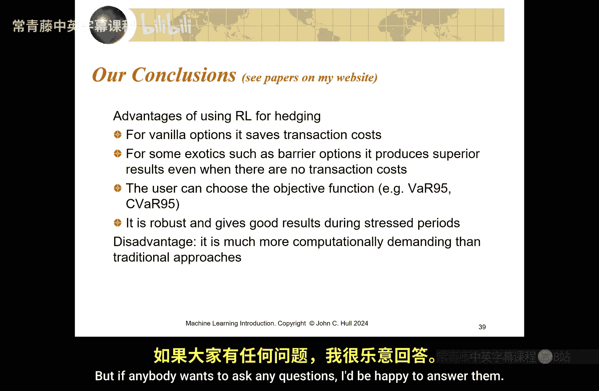

# 麻省理工学院【中英⚡数学专题及其在金融中的应用｜18.642-Fall-2024,-Topics-in-Mathematics-with-Applicatio】-p20-P20-Introduction-to-Machine-Learning--BV1iLrjBrETS_p20-

But yeah， we are very glad to have John Hallal with us here so John please well thanks very much it's a real pleasure to be here Let me just say a little bit by way of introduction I've probably got a similar background to many of you。

Math was always my my best subject at high school。That was in the UK and。Not surprisingly。

 ended up doing a math undergraduate at Cambridge。And， you know， after。Graduating。

 I decided that I wanted to apply my math。In business， so I did a master's in operational research。

 which was a fairly new thing in those days。来茶。And then an amusing level。Back Tod。

I worked for two years after graduating with my masters。 I worked for two years for a shoe retailer。

 everybody sort of。Firsturt out laughing when they hear this， actually。

 it was a large shoe retailer in the UK。 It had 2000 outlets， and actually。

 it was a pretty interesting job。 I mean， it was all about deciding which outlets should stock which shoes in which sizes。

😊，And so on。 and then， you know， which outlets should be closed and where we should look for new outlets and that sort of thing。

 So there's lots of interesting stuff。But after two years。With this company， I sort of moved。

Back into the academic world。哎。I I won't bore you with all the details， but I wound up。

 I got my PhD and ended up teaching here at University of Toronto in what we call the Joseph L Rutman School of Management and I've been at University of Toronto for about 30 years now。

Probably。嗯。Probably I'm best known for my work on。On derivatives。

 which I understand you guys have had quite a bit of instruction in but。And you know。

 most of my 30 years has been spent doing research and derivatives， but about。

 I guess it was about 70 years ago。啊，哎。Began to see that。Yeah， machine learning。

And AI were becoming really important to our students and so。

I sort of switched my focus and in fact all of my teaching is now in the machine learning area。

And pretty much every。So let me advance。Pretty much every。🤧嗯。🤢，Coour that we offer。

At Ratman actually has either a compulsory course or an elective in machine learning。

 so it's not just me that teaches machine learning I' nowve got quite a few colleagues who do so as well。

I wrote a book。Whi is now in its third edition， Machine learninging and Business。

 an Introuction to the world of data Science， and you can find out more information on the book from my website。

But I'm not saying you should buy the book now， in fact。

The reverse is true because the fourth edition。Will be coming out in probably about two months the fourth edition is going to be with three co authors who are actually the other people who teach teach machine learning here at Ratman so you know the fourth edition is going to deal with。

一楼。I mean， third edition came out and I think it was 2021。And since then， of course。

 we've had a lot of things happen in natural language processing， large language models。

 that sort of thing。I wanted to bring the book up to date。And my colleagues have helped me do that。

So you know， I'm really today's presentations in three parts。

 I'm going to talk about the nature of machine learning。嗯。

Then I'm going to move on to talk about applications of neural networks and finally what I've been working on quite a lot over the last little while。

 applications of reinforcement learning。Okay， I don't know whether there's any easy way you can interrupt me to ask questions。

 but I'm， I'm happy to be interrupted with any questions you have as we go along is is it possible for them to interrupt me with questions。

Can they speak up to the question？I will I will hear them Yes， good good， Okay， no。

 I don't mind being interrupted at all， okay。So。Next slide， please。So what is machine learning？

It's a branch of AI and the idea underlying machine learning is。

Is that we give a computer access to lots of data and just learn， let it learn。

 learn about the relationships between variables and make predictions。M哼。😊。

Some of the techniques of machine learning date back to quite a long way。

The key thing that's different today is that computers are really fasted。

So we had all these techniques for doing what we call machine learning quite some time ago that really computers went fast enough to make them a practical tool。

 We're now reaching a stage where all of these ideas。

Suddenly become practical tools because of the speed of the machines。Okay， I think， you know。

 it's important to。Distinguish between machine learning and all the automation that's gone on before it。

 I mean computers have been used for many years to automate many better decisions， payrolls。

 sending out invoices， so on。This is what we could call the third industrial revolution。Okay。

 and machine learning is central to the fourth industrial revolution。

You want a bit of background here， the first industrial revolution was steam and water power。

 which was about 1760 to 1840， the second industrial revolution。Was electricity a mass production。

This is， this is not me。What's generally considered to be the case， and this was 1840 to 1920。跟。

Basically， computers and digitization were a third industrial revolution and we really haven't。

You know we now know how to use computers to automate things that human beings do。And。嗯。

So we can call that computers and digitization。And we could say that went from maybe 1950。

To the year 200s。And then。We're now living through。The fourth Industrial Revolution。

We'll be living through it for quite some time， which is really。You know， AI。

 machine learning and everything。We're going to be talking about today。Okay， next slide please。

So if you want to。LetGo back to6， slide 6。 If you want to sort of distinguish between。

The third and the fourth industrial revolution。One example I use is with loan applications。I mean。

 let's suppose we've got loan officers in the company and。

There are certain rules they use to decide whether a loan should be accepted or not。And。🤧嗯。

Those rules have been worked out。Then we could automate their activities and that would just be the third industrial revolution。

If we didn't know the rules。We could actually use machine learning to determine the rules。

We' collect lots lots and lots of data on loans that。

Came before the loan officers and the decisions that were made。

 and it would be an application of machine learning。We could go one step further though。

 and we could also say， well。Let's try and improve on the rules so then we could。

Killing lots of data on decisions that were made by the loan officers and how those decisions worked out。

And。Try and improve the rules for accepting or rejecting loans。嗯。

So the first bullet point here is the third industrial revolution digitization fairly straightforward。

 and then the last two would be applications of machine learning。Okay， next slide。So啊。

I'm sure you've all been trained in statistics and we all know that what we're supposed to do in statistics。

Is。Sit down。H will chair。Not look at any data and develop a hypothesis。

Then we collect data and test the hypothesis， that's the sort of standard way of doing things in statistics。

Machine learning is different。 Well， what we do， we don't develop any hypotheses in machine learning。

 We go out and we collect the data。And we try and explain the data， we try different models。

And we find him。Patterents in the data or try and develop a predictive tool or something like that are the key difference。

Between machine learning and the traditional。Statistics。嗯嗯。

Statistic approach is that in machine learning。无异议。Collect the data first。

 where in statistics you're not supposed to collect the data first。

 you're supposed to develop a hypothesis before you've even looked at the data。ok。嗯。Next slide。So。

There's various types of machine learning algorithms。Unsupervised learning。

 which is basically just looking for patterns in the data or clusters in the data。

Supervised learning， which is where we're trying to predict something or classify the data in some way。

And then reinforcement learning。Which is multis stage decision making。

 which we'll be talking a bit about later on。And was， you know。

There's other ways of subdividing the algorithms， but。You know， this is。

You know this is one quick classification， if you like。Machine learning has its own terminology。

And actually， this， when I first got into machine learning。

 as I say it was something like seven or eight years ago。

 I was pretty confused because the terminology is different from statistics。You know， in。Statistics。

 for example， we talk about dependent variables， independent variables and so on， whereas。

In machine learning， we talk about features。And targets。Targets， as its name implies。

 is the thing you're trying to predict perhaps and features the independent variables you're trying to predict from。

You know， things like labels， activation functions and so on， in fact。WhenWhen I wrote my book。

 which I showed you earlier， I have a whole section， I think iss about 10 pages long。

 showing all the terminology。Which you know which machine learning uses？嗯。

Some of which is quite different from the terminology that statistics use it and other branches。

It's a。诶。It's one of the things that you know just takes a bit of getting used to。嗯。And you know。

 these。This terminology， unsupervised learning， supervised learning， for example。

 I mean where does that come from？Unsupervised learning。Well， with unsupervised learning。

You're just looking for patterns in the data。So you could say， you know， you don't really need to。

You don't really need any supervision because。All you're doing is just looking for patterns。And。

So you just all you need to do is to throw the data the software and the software will find patterns for you whereas supervised learning you've got got to do a bit of supervision because you've got to tell。

You've got to tell the computer what you want it to do with the data。

 you want it to predict something， classify data in some way， and so on。So。Okay， sorry， next slide。

So just one slide on unservised learning then， so in a typical application what you're asking you know。

You give the software data。And you ask here to divide the data into clusters so the observations in the set and cluster have similar feature values。

Okay， and so a typical application would be a company wants to understand its customers be。So。

 it collects。Attributes of its custom as there might be。辩人。10 different attributes that it collects。

 you know like how much the customer spends every year。

 how many different products the customer buys， where the customer is located and so on and so on。

And。Basically。You give the software a list of your customers。With those sort of attributes。

 and it will。Clasify them or trust to them。 So you say， oh， yeah， we've got customers that。

Look like this， we've got customers that look like this。

 we've got customers and so on and I'm told that you know。

This is actually quite a powerful tool because sometimes you get to find clusters of customers that you never really thought of as being a cluster of your customers before。

 but you know this tool has actually enabled you to sort of find。Find， find the clusters。Okay。

 next slide。So supervised learning is where you are。You're not just trying to understand the data。

Great clusters from your date。 Yeah， you're actually trying to predict something。Typically。

And what you do。Is you divide your data into three sets。

 training set of validations set in the test set。Because remember。

 what we're doing here is not we haven't got a hypothesis， we've just got a lot of data。And so you思。

Typically， you put about 60% of your data into the training set。

20% into the validation set and 20% into the test set， and hopefully you've got quite a lot date。

Okay。So。You develop different models。Using the training set。So you try out different models。

And we'll see some examples of this in a moment。要。Compare。Those model is using validation set。Say。

 well， this model seems do better than this other model when tested on。You know。

 the parameters of the model are determined。Using the training sets。

And then you can see how well the models work on the validation set。And。

Decide which seems to be the best muddle。We're explaining the data。Typically， you know？

You can find a really complex model sometimes anyway， that will explain the data in the training set。

But then， it does not。Do well on the validation set， so the model can be too complex。

So we'll see so you want to typically you want to a rule of thumb。

 you want to increase model complexity until the model starts to perform worse。On the validation set。

 so once you've chosen a particular model。You can increase its complexity and the parameters and so on。

 but as soon as it starts to perform worse on the validation set。

 you'd know you've overfitted the training set。And then the test set is sort of kept to one one side。

And it's you know it's not being involved in the selection of the model or anything like that。

 and so it provides a good final out of sample indication。As to how well the chosen model works。Yeah。

 next slide， please。Thanks。So， this is。This is an example that I use in the book， it's a pretty。

Trivial example in a way， but it's for predicting salaries for people in a certain profession。

 in a certain area as a function of age。And we try out different models。嗯。

didnn't have a huge amount of data for this particular one we try our different models， which are。

Just polynoms。Polynomials。Of the person age。 So the first。

 the extreme left model is a fifth order polynomial， and it fits it fits the data pretty well。

But actually。What的。What is fitting is the。嗯。😊，First。60% of data that you use。To compare your models。

Okay。It doesn't fit the validation set well。So it's overpitting， you find。

The linear model is underfitting and the best model actually for the data that I used was。

Was a quadratic model。So salary increases and then sort of slightly tails off as you get older。

All right such an example of。You know， if you just， it depends how much data you've got， of course。

fo人。But comparing your models， but you know。But it quite often happens that you wind up overfitting。

A model， and。嗯。Maybe we just go back a slide or two。次轮啊。Yeah， so the training sorry， so the training。

 so you use the training sets。But you know， you find that you have actually fitted the training set really well of a model。

Doesn't extend well to the validation set。So you then say you've overfitted the train set。Okay。

So that's an example of when I'm talking about increased model complexity until the model starts to perform worse on the validation set。

Thanks， Peter。Let's move on neural networks well maybe I'll just stop there。

 are there any questions that。Anybody really wants to ask or points anybody wants to make before we move on？

嗯。😊，Okay。If not。Okay， let's move on to the next slide。

And the next slide and so we're not going to talk about neural networks。And here's a picture。

Of an artificial neural network， or it's abbreviated ANN。So basically， what we're trying to do is to。

In this example， predicts something。From certain variables， so the input layer。

Would be the variables。That we know。Okay， and the output layer are the one or more things we're trying to predict now I know I've got multiple variables in the output layer here。

 typically though in many applications there's only one thing you're trying to predict so let's think into I mean if there's multiple things you're trying to predict then obviously you've got to。

In terms of your objective you've got to weight how important is it to predict this one。

 how important is it to predict that one and so on。

 so let you know let's just for the moment assume there's only one variable in the output layer。

For modelists are your most。分没脸位。A muddles that。Predict。The output from the input in one go。

 as it were。Linear regression。Would be a classic example。But。You know。

Any more complicated model is also likely to you know predict the output directly from the input。

 the key thing that we're doing with an artificial neural network is we're not doing it all in one go。

We're using the input layer， the variables。That we know。To predict。

These variables in the first hidden layer， V11， V12， V13 and so on。

 and then we use those variables in first hidden layer to predict variables in the second hidden layer。

V21， V22， V23， and so on， and then the third hidden layer。

So the key thing is about a neural network is that you're going through a number of stages。

In predicting the output from the input。It's not all done in one goes。

 so we're not writing down a nice neat equation。For the relationship between the output and the input and predict。

Preticting the parameters of that equation， we're saying there's a number of stages we go through。

In getting from the input to the output。And。嗯。That makes the model of course， a lot more flexible。

Next slide。So。What's the relationship between？The values in one layer and the values in a previous layer。

Well。嗯。What we're doing is we're relating the values at one neuron to a linear combination of values in the previous layer。

And。We're using these things called activation functions to do it， maybe we go back a slide。

Now Peter， if we could so。If we look here， phi11 is related to。The variables in the input layer。

 the variables we know， V01， v02， v03， and what we do is we apply weights。To those variables。

So we have a weight times v01， plus a weight times v02， plus a weight times v03 and so on。🤧嗯。

And then once we got this weighted average。Of the V01， v02， v03， we apply a function to it。

To get V11。 And then we do the same thing for V12。 we take a， you know， a weighted average of。V01。

 v02， v03 and so on。Different weight to average。And apply a function to it to get V12。And so on。

And then to go from the V11s， V12s， V13s to V21， V22， V23， we do the same thing。So V21， for example。

We take a weighted average of。V11， V12， V13， V14， and so on。And apply a function to it。

This activation function to get V2 on。Okay， and then so what of the things is。

 what are the parameters of this model， the parameters of the weights。What waits？

What weights do we apply to the Vs？Enjoing。From one layer to the next layer。O。And you know。

 there's a lot of weights in this example that you got in front of you there because when we're determining V11。

 we've got a weight associated with V01， V02， V03， and so on。But even if there are only three inputs。

 that's three weights。And then V12 is another three weights， V13 is another three weights and so on。

So you can wind up with a lot of weight， but those are the variables that。Those weights。

Other variables you're trying to determine， and then the activation function is something you apply after you've applied the weights。

Okay， so can we move on to the next slide now， so you see。

A number of different activation functions that you could use FY。

Fy equals y means that you've just applied weights。

To the variables in the previous layer and menu of just。

In't done anything else to them you've just said that that's going to give you the value in the new layer。

Now， if。Throughout。The whole。Your network， you just used the identity。If think about it。

 you just have a linear model。O。So if发。你说。The variables in the first layer were a linear function of the input layer。

 the variables in the second layer were linear functions of the variables in the first layer and so on。

And you went all the way through， then it would just be a linear model。

 and that wouldn' be very interesting。Because if we want' to have a linear model。

 we don't have to go through all this。However。As we'll see。

 you often use the identity just for the final layer。See， sigmmaoid is a popular activation function。

 So so once you have。Determined。嗯。😊，The weighted average。And the variables in the previous layer。

You just take1 minus1 plus e to the minus that。To get the value of the new node。And so on。

Hycrobolic tangent raylu and so on lots of different activation functions so you get the idea you've。

You're really saying that the relationship。位置。Between the output and the input。

Is a kind of a convolution。Of a lot of these activation functions。Applied。Two weighted averages。

Okayy， next。收啊。嗯。How do we actually solve the model？Well。Basically。You've got typically in these。

In N models， you've got lots of parameter values， all the different weights that you're applying。🤧嗯。

And。You say， will you start off？By assuming some values for the weights。

 probably not very good values， but you assume some values， and then you calculate gradients。

 you say well。Which perhaps we're trying to minimize。Some value。Or minimize a function。

So we're trying to determine。The input values that will minimize some function。

So we calculate gradients to determine the direction in which the parameter values should be changed。

To improve things， to actually make the function smaller。 And then you take a step。

And then do the whole thing again， calculate the gradients。And。And。Move the parameter values again。

In a certain direction and so on。🤧嗯。So。It's a case of。Fish somebody trying to call me。嗯。So。Basically。

 what you need is you're trying to minimize some function what you need is。

The partial derivative of that function， with respect to all these parameters。

 all these weights that define your model。Now that seems a pretty tricky task， but actually。🤧嗯。

Itho was， I mean， clever， maybe。You could say almost obvious way of doing this is to say。

What we're really talking about with this model is。

The final thing that we're interested in being a function of a function of a function。In other words。

If you know。We're a function of the final weights。And those final weights are a function of the。

Weights that come immediately before the final weights and then those final weights， you know。

 so each weight。And of course。In calculus， we know how to calculate。

The gradient of a function of a function of a function， so there are some clever shortcuts。Over。

Instead of calculating these gradients that you need。To sort of movie。

Aameters in the right direction。They're not starting from scratch。

In terms of calculating each gradient。Next，Next slide， please。So this is a very simple example。

 but it illustrates the nature of what you're doing， I mean。

 let's suppose you wanted to calculate the value of x that minimizes。This function。

Y equals x squared minus ax plus 20， of course， you know we could all do this with calculus very quickly and x equals4 is the answer。

 but。Suppose we were doing it in the way that I just described。

Then we'd start with some estimate of x， it might be x equals1， not a very good estimate。

And then we'd look at the gradient。Of。Of this when x equals1。And what is it， it's you know， two eggs。

inus8， so its the gradient is minus6， so we move。🤧嗯。You know， you know， we move。

The value that we're looking at in the direction， which minimizes。嗯。Why I wish。

You know the gradient was minus six so we take the negative of the gradient because we're trying to minimize something and。

Move it。In the direction indicated by the Grians。Bs the amount。

When we see that we're then at a little bit more than two， then we calculate the gradient again。

 move it again， calculate the gradient again， so you can see how this method would work。

In this very simple example， whether。嗯。Well there's only one thing。That we're having to estimate。

Okay。Obviously， when there's many things we want to estimate。

 it's the same basic principle except where we're working in many dimensions。Okay。Next slide， please。

嗯。😊，So。We continue training the model， until。The results for the validation set divergge from those for the training set。

 we don't want to overtrain。Choosing the learning rate is important， the learning rate is。

How far we move once we've estimated the gradients。

We have to decide how far we want to move in the direction indicated by the gradients。And said。

That's a。Well， there are， you know， there are some clever ways of determining the learning rate。

 as it's called。But clearly， if we could just go back to the previous slide a moment， you can。

 I think you can see here if you choose them really。Small learning rate。Then， I mean。

 the gradient at one would be the same， but you'd move only very short amount and then you'd out the gradient again and move a very short amount and so on。

 you'd never actually reach the bottom of the never in a reasonable time reach the bottom of the curve if you made the learning rate too small。

Because the learning rate is determining how far you move once you've determined the gradient。

On the other hand， if the learning rate is too big。

 you could oscillate and sort of move from above the minimum to below the minimum to above the minimum。

To below the minimum and so on。So determining the learning rate。Is important and some， you know。

 you can do it by trial and error， as I say， there's some clever ways。Of of doing it。As well。Okay。

 next slide， please。It also turns out to be best to scale the variables。

When you're doing all of this and back propagation is used to calculate the partial derivatives。

 that that's what I mentioned before， which is really just。Saying the partial derivatives。

You're talking about taking the partial derivative of something which is a function of a function。

 we've known how to do that in calculus for quite a long time。Okay， next slide please。So， here's。

You know， one application that we've used it for it may may seem a little artificial， but actually。

It's not， as I'll explain in a minute， but。Basically， I generated 10，000 coal option prices。

Using the blackhell's Merton model。And added a normallyly distributed error。

So I generated a lot of data I said that， you know。The asset price is the strike price K。

A risk free rate。The volatility sigma。And。The time to maturity。

 you can see in the second bullet point there what I chose is the。As the range is there。 So we。

 we sampled parameters randomly and then added。A normally distributed error term。

To the blackholl's murderrton model。 and then said， you know。Let's see how well a model。

Can actually determine。What are the functions。And actually use three hidden layers。

 20 neurons per layer this。And sigmoid activation function。🤧嗯。

Except the final layer and this is a point if I' use the sigmoid activation function everywhere。

 it wouldn't have worked because。Sigmoid activation function gives you a value between zero and one of course the black shows price is not between zero and one so I use the。

嗯。😊，Identity， activation function。For the final error， that's not uncommon。

To use the identity activation function for the final layer。

 because the activation functions you're using for earlier layers may be constraining the answer you get。

嗯。And you know。Divided the observation between the training set the validation set and the test set in the way that we were discussing earlier。

 6000 for the training set， 2000 for the validation set， 2000。The test set。嗯。

Have the next slide please， Peter。So you can see。嗯。What happens？

The epochs of the training set has increased， which just basically means， you know。

 we continue to try and match。The training set data as closely as possible。It improves things。

For the validation set up to a certain point and then。Start to get， we's see what's going on better。

Next slide。We can。So to take a moving average。And this is so you can see what's going on here。

 we keep trying to improve the model。But we stop off to 2575 epos。

 Just think about the epoch as a trial。 Okay， so you can see that。Things improve。好好。

The validation set。Up to a certain point and then they seem to get worse。So it's best to stop。

So the model that we actually wound up with was the model after 250。75 epochs。嗯。😊，Next slide， please。

So。We only had 10，000 observations， but we found that the neural network actually imitated the blackhell's Mer model very well。

In other words。The random noise that we added to the blackhell's Merton prices didn't， you know。

 it managed to overcome that random noise pretty well。Okay。More details about that in my book。

So in the next slide。NowYou may say， well， that's a pretty artificial example we don't need a model to。

You know， we don't need to use neural networks to determine the backshalls model because we have a formula。

 but it turns out that actually derivative companies are using neural networks。

To value exotic derivatives， there are some derivatives which can only be valued using monoclo simulation。

AndMocol simulation is slow， it can take， you know。

 three or four minutes to come up with a price and youve got。

You knowIf you're going to climb on the end of the line， that may not be very good。So。🤧嗯。Basically。

 instead of doing this with the black Shohoal's murder model。

You could do it for some exotic derivatives model。I mean， you run your multicolor simulation many。

 many timesn。To create data。Which relates the price to the inputs。

And then you create a neural network to replicate the prices。As closely as possible。

 and then after you've done that， you have a really fast way。I mean， obviously you don't。You know。

 if you're doing this。In the way that I'm describing， you wouldn't actually add an arror。To it。

 you just want to create the prices as accurately as possible。And。Once you've got a neural network。

That will actually create these exotic option prices。You can then very， very quickly。

Calculate any new price you want to because all you're doing。Take work。

To calculate a new price is working forward through the neural network。So。You know。

 instead of being three or four minutes， it's you know， almost instantane。Thanks。Because you work。

 as I say you work forward through the neural network。

To obtain the price and this can also be useful for scenario analysis because scenario analysis can be very slow if you're having to calculate。

This exciting option over and over again using mono simulation。

But if if you've constructed a neural network。To produce the price。Thenenice's， you know。

 much faster。And scenario analysis is perfectly feasible。Can we have the？The next slide， please。

Another thing we've looked at as part of our research is we've looked at。The relationship。

Between volatilities and how volatilities change as the return on the asset changes。嗯。Yes。If。

 you know， the standard way of。Doing hedging， of course， is to say he will。I mean。

 let's talk about Delta hedging， but it applies to other hedging as well， but with Delta hedging。

 you say， well。嗯。How does the price of the option change？

When the price of the underlying asset changes and will assume that the implied volatility remains the same。

That's the standard assumption， Applied volatility remains is the same and。

You just calculate Delta as the。Rate of change。The option price with respect to the asset price。嗯。

But。Perhaps there's a tendency for the volatility to change。测事。Asset price changes， in other words。

 if there's a positive return on the assets or the asset price goes up。There's less overall。

The company is less high to leave it。At least in the market value sense。

 the company is less highly levered and so。Maybe the implied volatility goes down。

 whereas if the return on the asset goes down。The company becomes more highly leverered and therefore this tendency for the volatility to close up。

So maybe we should take this into account when calculating Delta。So can I have the next slide。

 please， Peter。So。We。Calculated。In your network to investigate this and to see what's the relationship between the daily asset price return and the change in the implied volatility。

And。So。Input layer had money ininess， time to maturity， daily asset price or return。

 and the output layer had change in implied volatility Next slide， please。These were all the。

All the details in the interest of time， let's move on next slide please。And。We can see that。知楼。

We actually， in this particular case。Found that validation set started to get worse after 5。

826 epochs， you kind of see that a little bit in this diagram， so we stopped the training after 5。

826 epochs。Next slide。嗯是。It wasn't， you know the first。

But first we're pretty disappointed with the result of this research because the。The test set。

 which is。Final result， E only gave an 11% improvement over a simpler analytic model。

That my colleague， Alan White and I that who worked on in 2017。一亮。

It didn't give a hugely better relationship。Between the return on the asset and the volatility。

However。We played around with it a bit when the VIX index was used as a feature。

There was a further improvement of 60%。And what we found was that the behavior of the volatility surface was different in high and low volatility environments。

 in other words， if you want to predict what's going to happen to the volatility surface。

So you know how to change the implied volatility when you change the underlying asset price。

You really want to know whether you're in a high volatility environment or a low volatility environment。

 so that this actually gave kind of an interesting result。

Which you'd be unlikely to get just playing around with the data。不是。Next slide， please。O。So。

We've got 20 minutes left， so let's use the last 20 minutes to talk about reinforcement learning。

 which has been subject of quite a lot of my work over the last little while。Next slide， please。

So what is reinforcement learning is concerned with finding a strategy for taking a series of decisions？

Rather than just one。So you're in some sort of an environment is changing in an unpredictable way。

 and you have to decide。嗯。Well， you've had to decide what decision you're going to say today。

But you know you're going to have take another decision tomorrow and another the next day。

 you know you're going to be taking a series of decisions。Not a single one。And。

This has actually been hugely successful。Is it this kind like a trial and error？

Kind of approach to this that has been hugely successful， I'm sure many of you have heard of success。

The software aside in playing games like chess and go。

It's actually we've developed software that can be the best human players of chess and go。

I used to play a lot of chess when I was younger and in ways， it's disappointing。You know。

 computers can now do this so much better than human beings。Next slide， please。

So the general model is。You have actions。States and rewards。So you take an action。嗯。

If you start with a certain state， which I call there zero， you take a certain action， time zero。

And that moves you。To a new state and maybe you get a reward， then you take another action。

Which will move you to yet another state。Perhaps give you a reward and so on。

So you've got to look ahead and think of all the。Actions you're going to have to take not just at time zero。

 but at future times。And the states at future times are somewhat uncertain。Next slide， please。

So one of the fundamental， I mean， this is really a trial and error sort of process。But。🤧嗯。

youAnd obviously' you don't know anything when you start。

 say you're going to sort of be choosing some sort of a random strategy。And and then。

Slowly over time， you learn that， you know， doing this in this situation works out well。

 whereas doing something else in that situation works out badly。

And this is where exploration versus exploitation comes in。At any given time。

 there's a certain probability。That you'll randomly choose a decision。

Okay this referred to as exploration， and there's a certain probability that you'll choose the decisions thats actually worked out best so far。

Which is called exploitation。So initially， the probability of exploration is one because you don't know it。

So you're going to randomly choose a decision。And then over time， you'll slowly reduce。

The probability of exploration。And increase the probability of exploitation and after a sufficient number of trials。

You know， you're probably side that actually。The probability of exploitation should be one。

In other words， you' pretty much decided。Yes。But you know what the best decision is in all different situations。

Next slide， please。So I don't know whether any of you have come across this game Nim。😡，Okay， but。

Its a very simple game， but。It's a good game for illustrating。How reinforcement learning works。So。

Suppose youve got two players。And， you know， so I'm playing against you and there's a pile of matches on the table。

And we take turns。Each of us can pick up one， two， or three matches。

And you lose the game if you have to pick up the last match。Okay。a lot of matches。Take turns。

 picking up one， two or three matches， and the person who has to pick up the last match loses。Well。

If you were being good mathematicians， you'd work out how to play this game very quickly。嗯。😊，Yes。

Basically， I mean， that's。Suppose there are only five matches。On the table。And it's your go。

There are five matches on the table and it's your go， I'm going to win。

Because if you pick up one match。😡，I'll pick up free matches and you have to pick up the last match。

If， you know。If you pick up two matches， I'll pick up two matches and you have to pick up the last match and so on。

So if I can leave you with five matches on the table， I win。

And then we can go once staged beyond that， let's suppose I can leave you with nine matches。

On the table。Then I can make sure I leave you with five matches next time because。也能。Again。

3 or nine matches on the table。If you pick up one， I pick up three。😡。

You're then left with five matches on the table。Okay， you pick up two。

 I pick up two you' left with five mention and very quickly you decide that。

And you the way to win this game。Is to always leave your opponent。😡，If you can。

 with 4 n plus one matches。ok。So I mean， you know？suppose N is5，4 n plus1 is 21。

 so if I can leave you with 21 matches matches。I will win。Because I'll leave you with 21 matches。

Then whatever you do next time round， I'll leave you with 17 matches。And then the next time round。

 I'll leave you with 13 matches and so on so。Okay。However为。Let's see how well the machine does at。

Working out this best strategy。And I'm going to assume there's only eight matches initially on the table。

 although you'll find on my on my website， you can find some software for。

Seeing how well a machine does in a lot of other situations。But some。

We'll assume that the reward is plus one from winning and minus one from losingine。

 and your opponent behaves randomly。I can。Change things so the opponent learns as well if I want to。

 but okay。So basically， we start with this state action table。Okay。

 state as the number of matches little left。1，28， and the action isn't number but picked up。

Next slide， please。So basically， as I said， trial and error。So let's suppose， I mean。

 you don't know anything。So randomly you choose to pick up one match randomly your opponent picks up three matches randomly you choose to pick up one match randomly your opponent picks up three matches you win。

O。So。We can update Q 818 being the number of matches on the table and the one being the number picked up。

 So the first argument is the number of matches on the table。 The second is the number picked up。

 So we know from that that。We have a trial where。We win。Q81 leads to a win and Q41 leads to a win。嗯。

So。We update。Q8，1，241。ok。And we have to have an updating parameter of the formula formula for updating is。

I iss there and we say， well， okay， we don't want to update too much。We giveive it5% weight。

So we have the old queue。SA plus 5% of the gain minus the old Q essay。And。Can we have the next slide。

 please？On each trial， we observe states， certain states， take action in those states。And。

The gain used in updating the cues can be either a final reward。

Referred to as the Monte Carlo method， or it can be the value of the next state。

Assuming the best decision is taken。So， you know， if I pick up。You know，Can I pick up one match？

And you pick up one match。In the value， there are six matches on the table and in terms of updating。

Instead of waiting to see whether I win or use， I could just say how good is it for me if there are just six matches left on the table。

 and that would be。You know， the way we would do the updating So we start with the queues all zero and then we update them in the way that I was describing。

Next slide， please。And with a Monte Carlo method， which is where we wait and see whether we win or not。

You can see， I mean， we all know that。With eight matchess on the table， if it's our go。

 we pick up three。And leave our opponent with five matches on the table。 That's the best decision。

After a thousand trials。It hasn't really found the best decision。

 it still looks as though picking up one match is marginally better。The Q value is 0。562。

 as opposed to 0。522。After 5000 trials， it definitely beginning to look。

 that it's best to pick up three matches and after 10，000 trials for sure。

So you can see what's happening here， which is doing more and more trials。嗯嗯，你在。What？

What we did here was we had this epsilent parameter， which it determines。

You know whether you behave randomly or you use the best。Decision that seems to worked out so far。

 we have epsilons starting at one and having this decay factor of 0。9995。

So it does appear that reinforcement learning finds the best decision。Next slide， please。And in fact。

 it finds it even more quickly with temporal difference learning， this is where you looked。七 see。嗯。😊。

You know， how much is it， how much does it turn out to be worth to be in the next situation that you're in after you've taken the first decision and it turns out that。

As often is the case， temporal difference learning works better than the raw Monte Carlo simulation。

But it's definitely。You know， worked out that。嗯。It's best， it's best to pick up three matches。

It's not and it doesn't look so bad to pick up two matches or one match because remember your opponent's behaving randomly。

So you， and when you've learnedt a lot， you could behave much better than your opponent。I've done。

 I've done other。Tests where the opponent is learning as well， in which case you。You know。

 picking up two matches or one match is going to allow your opponent to win。嗯。

And so you have you know negative numbers， opposite the two and the one。嗯。Next。Slide， please。So。

🤧So this is， you know， this， this Nim。Game illustrates。Amittedly in a fairly simple situation。

How reinforcement learning works。 very often， you've got a much more complex。

State action table to be。Sort of filled in and。You have to sort of combine。

reinforceinforcement learning with artificial neural networks because you've got this state action table。

 you're able to fill in some of the。Some of the numbers in the state action table。

But not all of them。But you know there's some nonlinear general nonlinear function， which is。

Describing the whole table。 And you have to do the best you can with the numbers that you do have on the table。

Next slide， please。Okay， so five minutes left， what I've been spending。A lot of my time in the last。

A little while on is saying， you know， can we use reinforcement learning for hedging derivatives？🤧嗯。

The traditional approach to edgings， of course， three letters where， you know you calculate Delta。

 gamma， vor， and so on。And you really。You're really looking a very short period of time ahead because you're saying。

What's see a， how your derivative？Of the value of my portfolio， with respect to。Whatever it is。

The low asset price。Volaility or whatever。Reinforcement learningny sort of has a different approach。

 it says。Let's take。 let's look several periods ahead。And try and take a decision。

Which will work well。Over our， over our time horizon。So what have we found？Next slide。

This is my last slide， so what we found is that。You know， we've found that you know。

 in some situations using reinforcement learning for hedging， in other words。

 looking several periods ahead and seeing which strategies work our best is。

Can be useful for vanilla options。It's。It does overall， it does about the same。

As the Greek letter heging。But it does save transaction costs。

And actually save significant amounts of transaction costs because you can think about it this way。

 you know， you're hedging of vanilla option。I mean， let's just talk in terms of Delta， I mean。

 you know， let's suppose Delta is 0。5 right now。And。Delta goes up to 0。7。

But maybe there's a 50% chance。Then your next hedging date， Delta will go back down to 0。5。

So the question， should you。Should you change。Should you do your hedging。

To reflect Delta going from 0。5 to 0。7， even though you know。

 there's a 50% chance it'll go back down to 0。5， or is it better to wait？

And see what happens over perhaps two time periods。

And the answer is if there's a lot of transaction costs。

It's better to wait so we find reinforcement learning and save quite a lot of transaction costs。

Even though when you don't take account of transaction costs。

Theres not a huge saving for knit options typically。Okay， and of course。

 transaction costs are really important when it comes to v and gamma hedging as well。

some exciting options， such as barrier options。We find reinforcement learning produces superior results。

 even when there are no transaction costs。And one of the nice things about using reinforcement learning is that you can choose your objective function。

ok。Whereas of course you can't do that with Greek letter hedging。So。嗯。You know。

 we've experimented with， you know？Looking at the tail of the distribution and V95 is a shorthand for。

You want the 95th percent centile point of the lost distribution。To be as high as possible。

Or Sibar 95 is where you want the conditional value at risk， which is the average beyond the 95th%。

Of the loss distribution to be as low as possible。So， you know。

 you can have an objective function that focuses。啊自。Things you're most concerned about。

Which is perhaps the tale of the distribution。We find it's robust。

 gives good results during stress periods， and it's interesting JP Morgan。Is， you know。

 our main competitor competitor in terms of doing this research is JP Morgan。

 JP Morgan's been doing a lot of。Work looking at reinforcement learning for hedging。

Gos the disadvantage。Of reinforcement learning is that it's。Much more computationally demanding。

And traditional approachesve。You've got to run these trial and error programs， which。You know。

 it can take a few minutes。Not they're getting faster。

So whereas it takes no time at all to calculate a Greek letter。

 it will take you a little while to calculate the best strategy。

For doing reinforcement learning hedging。But， I think。Come back to my earlier point。

So computers are now sufficiently fast。Yeah， that it's becoming a feasible tool。So啊。

Brings me to my last slide。嗯。We're one minute over4 o'clock mark。

 but if anybody wants to ask any questions， I'd be happy to。To answer。Well。

 I have a question for you， John。

About the choice of activation functions。You know， have you found， as you did in this case that。

I guess was that the sigmoid function was applied in your example？Or was it the RE E LU。Yeah。

 we've had a lot of success with the signal right function。

That may be just chance chance events or maybe there's something。Special about the sigmoid function。

You know， I mean， of course there's nothing to stop you trying。

Several different activation functions and seeing which works out best in a particular situation。嗯。

And we did that in。You know， in our implied volatility。Research。

And we concluded that the soid function worked out best， as a matter of fact。

 but we tried several different activation functions。So。But。

I think I remember correctly all the activation functions we tried。喂。Pretty close to each other。

In terms of how well they worked out。So I think choosing the activation function may not be in many situations anyway。

 may not be a big deal。What you also have to think is， you know how many。

How big do you want the models to be？You know how many neurons？The step。

 how many steps in total and that sort of thing。I think that's very typically what happens。

They're willing to benefit from sort of building the neural network with say， two layers。

And then use the results of that to add a third layer， or as the。3 layer。

Neurural network just that's a good question， as far as I know know you've got a start from scratch。

When you go from， say two layers to three layers。You can't。嗯。

You can't use what you've done with two layers。There' a shortcut to doing three letters。

It may be wrong there， but I don't think this anyway。Actually， for the classes's benefit。

 I checked your references。And on your Toronto。Website。

 you actually have material like the Python code for various examples in your book。

I think students might find that very accessible and useful。有。Y。

 there's I should have mentioned this yeah， there's a lot on my website， you know I think。我'吃饭。

Lo of different things we've done at different times。On them。You know。

 in this sort of machine learning research。So。If you want to read more about it。Certainly。

 my website will be a good place to go。How do you choose the objective functions in your examples？

Was there？Theres some issues involved with choosing those specifically。And what as was。

And what was the difference in them？Yeah， I think。I think every situation is different as far as that's concerned。

And you've got to。You've got to think。You know what objective function fits in with？

With what I'm trying to do。嗯。In the particular situation that you're working on。O， I没。I mean。

 if you're if you've got some anxiety option and you're trying to match the price as closely as possible。

And then obviously it's the difference between。The price you're trying to match。

And the price given by the neural network。This's going to be most。月亮。

This is going to be an objective that you're trying to minimize。

