# 麻省理工学院【中英⚡数学专题及其在金融中的应用｜18.642-Fall-2024,-Topics-in-Mathematics-with-Applicatio】-p21-P21-Stochastic-Calculus--BV1iLrjBrETS_p21-

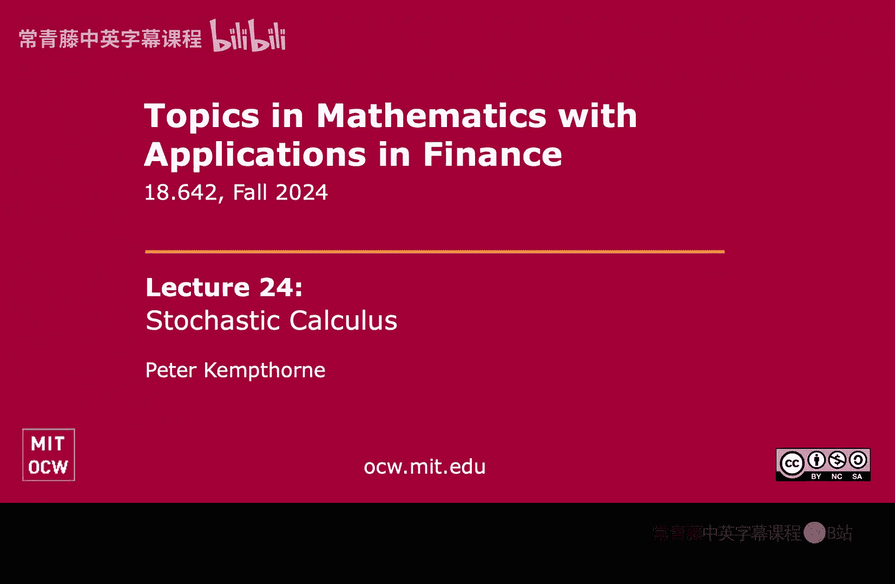

All right， so today's topic is stochastic calculus。

And this topic is really an engaging one in quantitative finance。It extends。

Ordinary calculus with real variables to calculus that depends upon stochastic processes。

 and in particular， brownian motion processes。 And so when we are thinking about how to model。

And the value of。A stock or of a derivative， such as a simple option or a more complex option。

We can model the dynamics of these assets or derivative contracts as integrals of functions。

With respect to Brownian motion， where Brownian motion characterizes the underlying dynamics of the asset。

And so it's really neat to see how we can develop stochastic calculus and relate it to what's familiar to us with ordinary real calculus。

 but see how there are extensions of the formulas that accommodate the randomness。

In the increments with which we're integrating。 So let's consider。Just reviewing first。

 Brownie in motion with drift， we discussed this earlier in our discussion of stochastic processes。

And a standard Brownian motion model。Is one where we have our process X。

Depending upon the underlying brownieian motion， standardized brownian motion， B of T。

With a drift parameter mu。And a volatility parameter， sigma or variance parameter sigma squared。

And the key property of Browning in motion。Is includes independent increments。

And the variation of increments of the process being proportional to the length of the increment。

So with standard branding motion where we have a drift parameter of zero and a sigma volatility of one。

The extension of these properties to have essentially mean zero and standard deviation equal to sigma times t is to have the mean depend upon time with the drift parameter and the volatility。

Are variance to be proportional to sigma squared times the length of the interval。Now。

In terms of understanding。Browie motion。 it's going to be useful for us to focus on the conditional distribution。

Of。The value at time T plus delta。As a function of。The value。At time。X of T。And so when we think of。

A graph of browning motion， which is some。Path。If we fix。Add a given value T。The value。Of x of T。

All right， maybe I should write this as S。The value of X at time， little T， then if we。

Know the value at time little T。 What is the distribution。

 the conditional distribution into the future。Well， this increment。T plus Delta T， Delta T in red。

We can just expand that out to mu T plus delta T。Plus， sigma B of T plus delta T。

And then we can group。The known terms on the left hand side。

Of the or the left hand terms of the second equation， U T plus sigma B of T。

 Then we have a term U Delta T， which is。A constant， not random。

 but then we have the increment of the Brownian motion process from time。

T to time deelta T T plus deelta T。 So actually， there's a typo here that should be B of T plus deelta T minus B of T。

And so we have that our Delta x。Increment is mu Delta T plus sigma Delta B of T。 Now this。

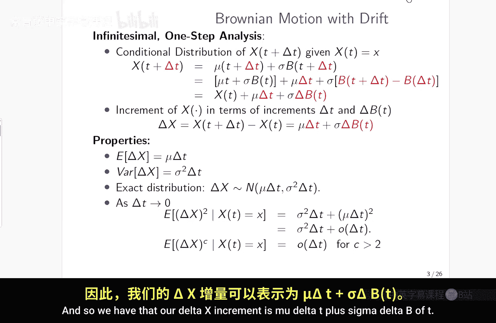

Increment has mean mu delta T， variant sigma squared delta T， and for brownian motion with drift。

This。Increment is exactly distributed as a normal random variable， with that mean and variance。

And what？Useful to think about is what happens as the increment。Delta T。Gets infinite Tasal。

And so if we look at the infinite tsimal increment。For Delta T， then。

The expected squared value of the Brownian motion increment。Is equal to sigma squared deelta T。Plus。

 mu Delta T squared。 This is actually an exact formula。

AndBut what's important for us is that as Delta T。Goes to 0 as it becomes infinite tsimal。Then。

This squared。Increment has expectation。 That's of order。Delta T。

And it actually equals sigma squared delta t plus little o of deelta t。

So this little O notation means that as delta t goes to0， this remainder part goes to zero as well。

And if we consider。Powers of our increment of Delta X。Where the power C is greater than2。

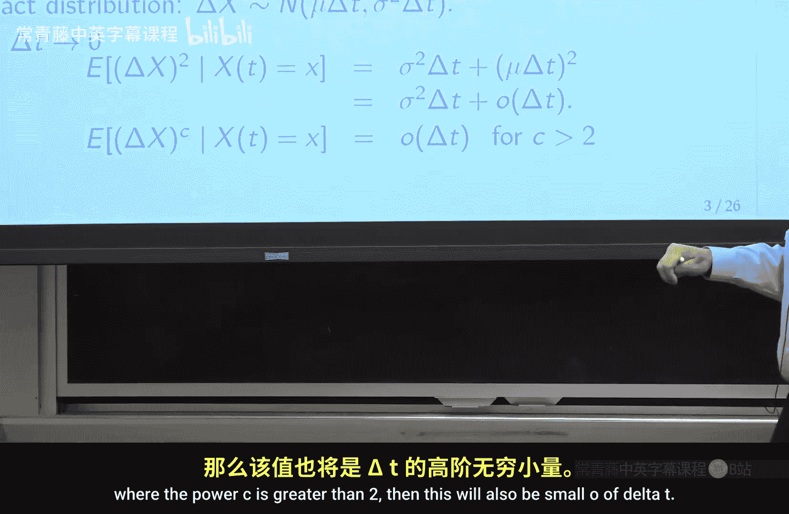

Then this will also be。Small o of Delta T。So expressions that depend upon second or higher order of deelta x will actually be comparable to sigma squared delta t。

So with Brownie in motion and drift。We have the notation for a stochastic differential equation。

Which is simply the increment of x is equal to。Mu Delta t or Dt rather plus sigma db of T。

And with this notation。The solution。Turns out to be x of t is equal to。

The value of exit time0 plus the integral from 0 to t。Mu Dt。Plus。

 the integral from0 to t of sigma D BS。And。This solution sort of seems obvious。

When we think about what， how we understand sort of。Differential equations。Or with real functions。

But it does extend to this solution when we have brownieian motion。And so， as noted there。

This is equal to x plus t minus0 times mu plus sigma times b of t minus b of 0。

So our sort of integration of。Functions of brownian motion sort of have this nominal solution。

 which seems very reasonable and will， in fact， show that this solution is。Useful。

 and it actually extends to more complex。Equations， now。

 the more complex differential equations are one where we consider a drift term mu that's not a constant。

It may vary over time， and it may also vary depending upon the magnitude of the process。

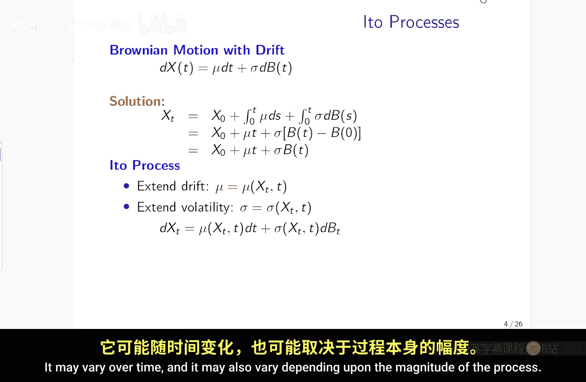

So this kind of an extension is quite general。And we can think about the same extension to the volatility。

Rather than being a constant， it might vary with T， and it might vary with X T。And with derivative。

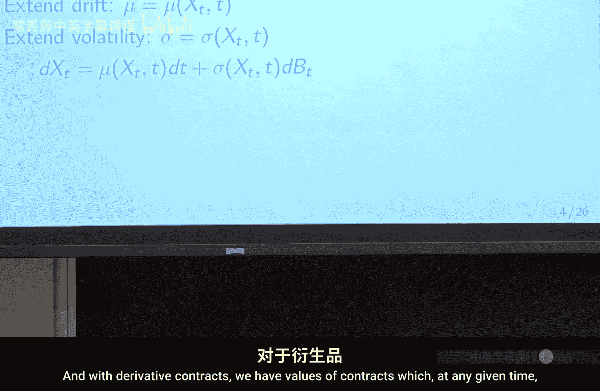

Contracts。嗯。We。Have values of contracts。Which， at any given time。Depend on time。

 maybe time to maturity。And the level of the process。

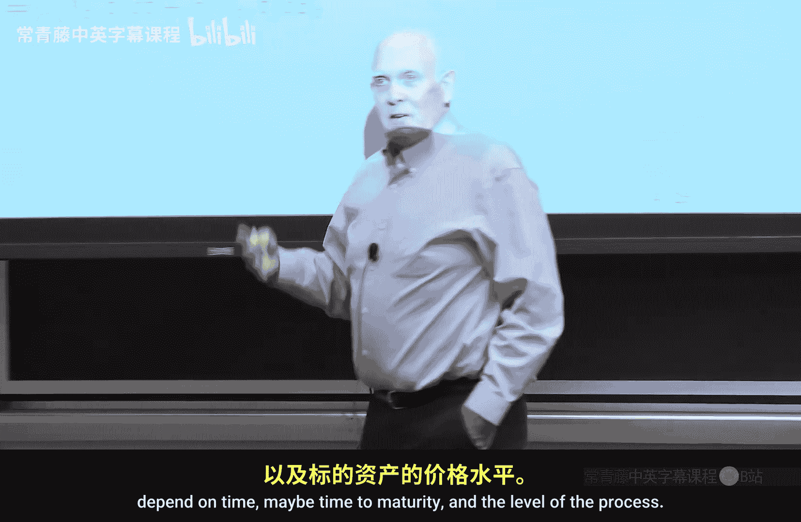

And apart from those two sort of features or properties of the derivative at time， little T。

We have a valuation model that applies according to some function。

 so it'll be very useful to have these generalized drift and generalized volatility parameters， yes。

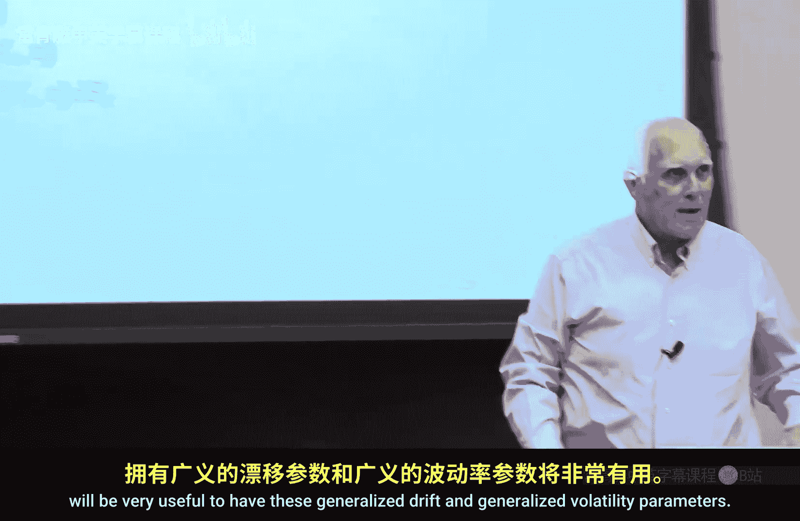

Second。 its like obviously were the first ones I did。I have re。What about the second one？Right。

 and we will get there in a moment。 But you know， if we're integrating from。Well。

 here it's from zero to t if we're integrating the process over increments。

 we're basically going to be summing over the increments。

 although summing on the infinitesimal time scale over the entire period between zero and t。

And so if we break that sum of infinitesimal increments。

 we basically get the last value minus the first， and so we'll see that come into play。

So what we will determine。With this general setup， though， is that。

When we have extended drift and volatility， we then will have a solution to this brownian motion with drift with sort of generalized drift and volatility。

Satisfying this equation。 So we're going to want to be able to compute these。Integrals。

In a consistent way， and the EO calculus provides us with that。So we have to define EO integrals。

Well。In defining EO integrals。We have this notation that we need to be comfortable with。

We are going to， first of all， consider a。Probability。Process。That。Ha is defined by this triple。Now。

 let's see， have any people here taken sort of advanced probability？Her measure theory。Well。

 we basically have。Here。Sort of a sample space。And here we have what's called a sigma field。Of sets。

Which are subset of mega。And then here we have a probability model。Where if we have。A。

 a subset of omega。And it's an element of this sigma field。We have this probability of that set。

Is well defined。So。This notation sort of encompasses the generality of probability models。

That are important to specify and be comfortable with。Well， with the omega。Set here。嗯。

These are a collection of little omegas。Which are possible sample paths。Of this。Brow in motion。And。

We can think of。Okay， here's one path。One possible path。Another possible path。Actually， matches。

The first path up to time T。But then continues on somewhere else。Another path。

Could be one that is sort of。Reflected。About a given level。

 we went through this a bit in our discussion of brownie emotion processes。

And so we can think of just the collection of all possible paths。Now， the filtration F T。We think of。

Scrip F T。This is going to be the sigma field。Of events。嗯。Or paths。Which are fixed。Or known。At times。

S less than or equal to T。So。With script F T， the information up to time T， if。Sort of this is。

Our path up to time T。嗯。The event of。Following this path up to time T。Sort of is deterministic。

If we look back。Deterministic。For S less than t。But then， it's random。Random for S greater than T。So。

 we have a。A value or in script FT， it basically says， okay， we can work with。

Paths that are deterministic before time T， but then are random after time tea。And so， that's。

Relates to the concept of being measurable。So we say that events in FT are measurable with respect to BS with the information set up to time T。

 so if we consider times before T， the path is actually just a constant。Or as as a function。

 a path valued function that that's constant。Now。If we have this probability measure on omega。

 the space of all possible paths。If we consider the sort of conditional distribution。Given。

X at time T。 then we're trying to specify the model for。

All future paths that start at the level X at time T。And。

So that probability measure over the entire space of。

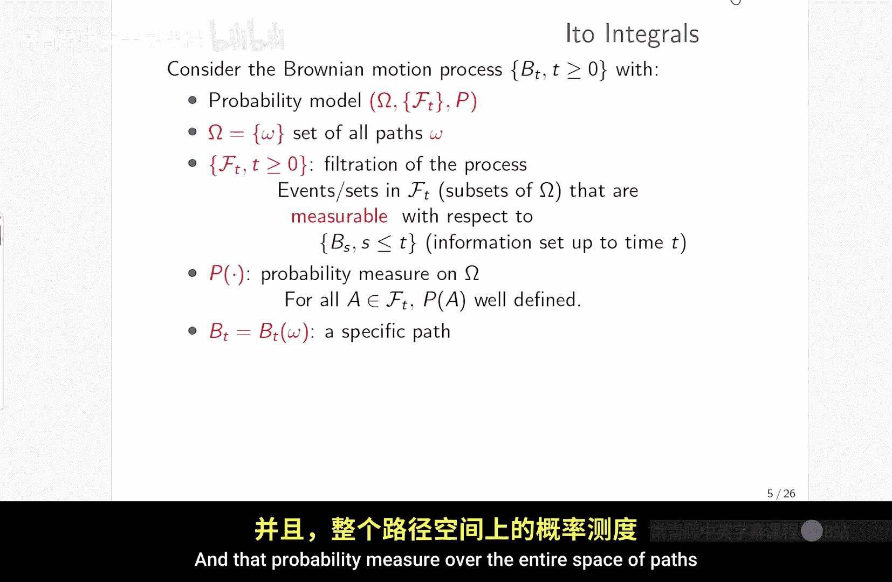

Paaths can also be restricted to the paths up to time little T。So we can。Basically。

 focus on probability measures。That are unconditional but restricted to the information set up to time T。

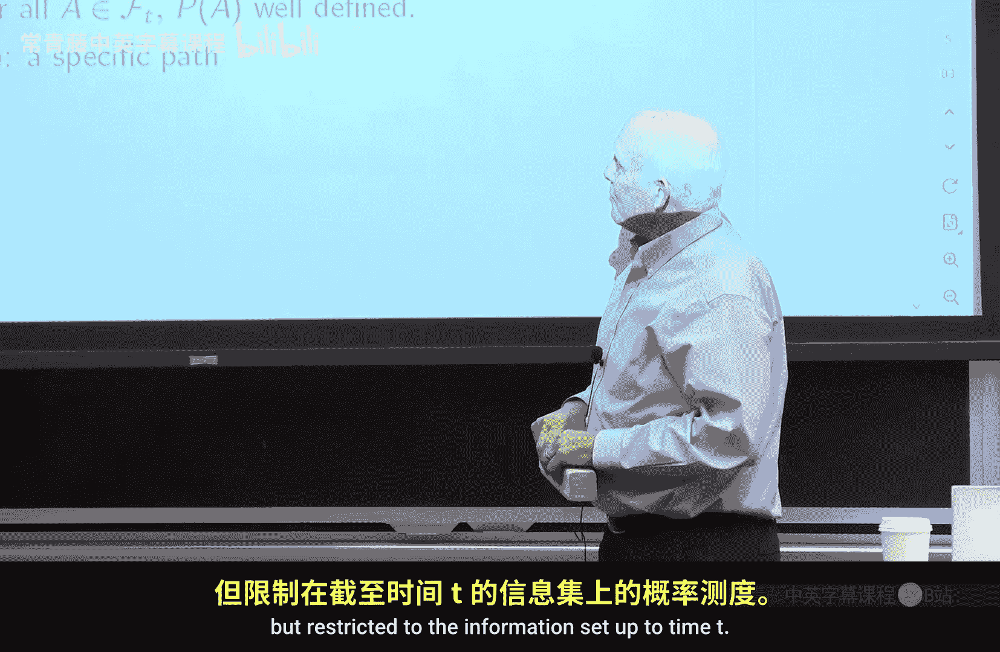

Now， we'll want to refer to the value of the Bian motion at time T。And it's important to。

Know that often this notation BT is implicitly the value of a specific path。

So to emphasize that will indicate that it's the Brownian motion path。Indexed by little omega。And so。

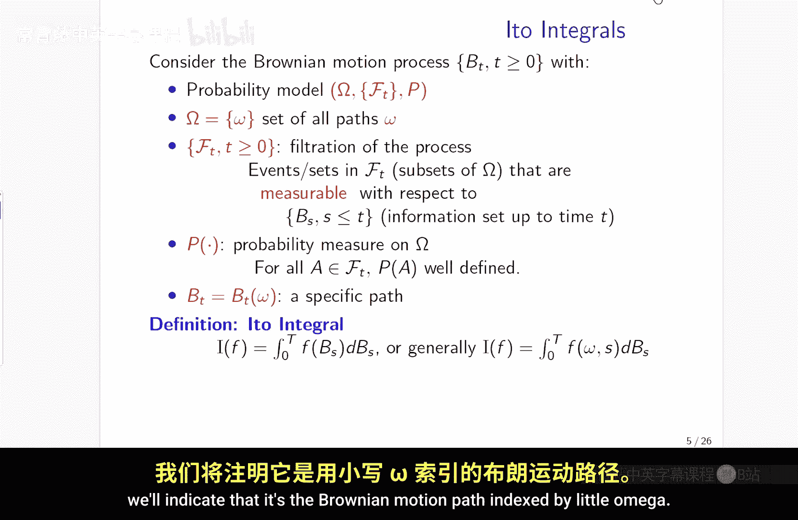

We then want to consider the。Eto integrals with respect to Brownian motion， first。

 where we consider simple functions。Real functions。Where F of B。

 S is the value of little F evaluated。At the position value of the Brownian motion。And。

We'll want to consider integrating that function。From 0 to t。And so。This is our notation。With a。

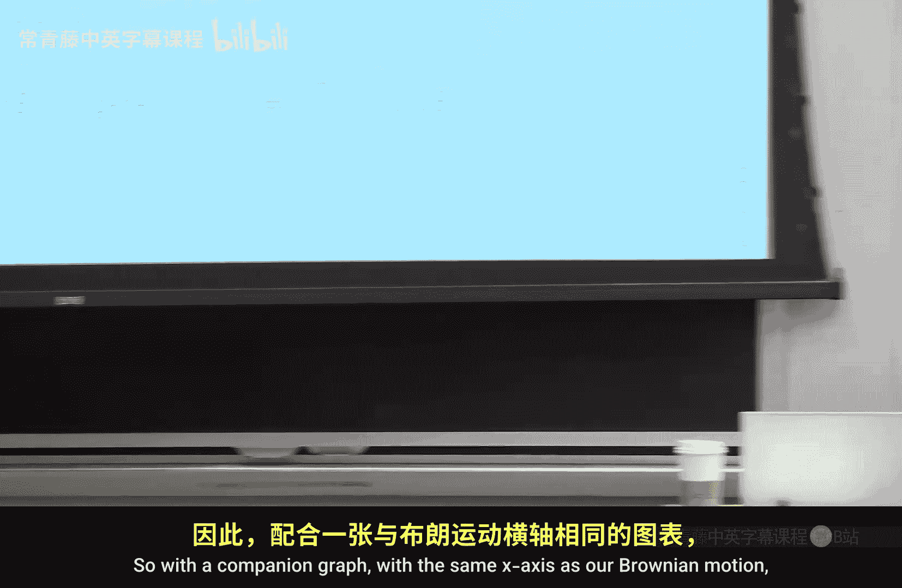

Sort of companion。Graph。With the same X axis as our Brownian motion。We could have F。

Being some function。Which varies， and we want to basically integrate。This function。

F evaluated at the Brownian motion。 So actually， this is。This is actually a rolling graph I used。

 but we had had the same， same graph we basically want。For。Sort of， let's say， X equals B， S。呃。

Ohomega。Some function。All right。Well。If we。Consider this notation to represent our Eto integral。

We're going to develop。The formulas for these EO integrals。And。Importantly。This EO integral。

Is going to。Have。Basically， a sort of deterministic， simple。Real integration term for each path。But。

The paths indexed by omega are random。And so this EO integral is actually going to be a random variable。

And as a random variable， if it exists， it'll have an expectation and a variance。

So let's consider a number of special cases。That will。Define EO integrals。Okay， the first。

Case is the simple one where F of x is equal to1。So。Let me just erase this。And have the level one。

So we consider。F of x。Equing one。So， if we。Integrate the increments of Brownian motion over。

From  zero to capital T。Let's propose that。 that's equal to。The increment from 0 to。呃。From 0 to T。

 for each path。So the right hand side。Corresponds to the sort of simple。Integral。Of this。Path。B。

 S of mega。Between。B T between time 0 and capital T。And。I guess it's not in the notes。

 but if we were to。Consider。The integral of0 to t。DBS。Of Oomega。We could think of this as。

Some from zero to n。Of。Ae。Tea。Over and。Let's see。Let me do this。I equals 1 to n， I minus1 T。

Over n the integral from i minus1 t over n to i。Times T over。Over in。D， B， S。

So here I'm thinking of basically dividing this increment from zero to t into different increments。

Of with。Capital T over N。And。If we approximate。Or each of these integrals here are basically looking at the integral of or the change in B。

S from these。Lower limits to the upper limits。 And so。The integral of D B， S of omega。

In a consistent way or well defined way is defined by this increment of the whole process。Now。

 if that's true， then the when we consider the randomness in omega。

The expectation of this integral is 0。Where B is the standard brownie emotion and its variance。

Is equal to the length of the interval times， the sigma of standard brownian motion。Well。

If we change。Our function， F。To be not the constant one over the whole real line。

 but just the indicator of an interval。It's just one between A and B。

So we have A and B here and we have basically zero。Up to a。 And then。It equals。1 up to B。

 And then it's 0。Beyond。嗯。Then this EO integral。Is essentially looking at the change。

And Brown in motion from time A to time B。So。No surprise that that's a reasonable definition。Now。

 from these reasonable definitions。We can consider。A second case where our function， F。Is again。

 a function only of time。S。But it's given by a step function over time， with steps。

Are levels given by the AIs that are constant。So， we go from this。

Single step function here to considering。嗯。Basically， different step functions。For our function F。

Now。These step functions could correspond to like the number of shares held of an asset。And so。

 you know this。Integral could correspond to the gainer loss if the underlying asset sort of followed Brownie in motion。

嗯。But here， with this particular step function。We can define the EO integral。To just be the sum。

Over the increments of this step levels times the increment of the process。

And so that's a pretty sensible definition of the integral。

 and it would apply if we had assets traveling。Values going by a brownian emotion process and say shares given by the A constants that were maybe deterministic。

Now， at this point。We're using functions， F。Which are deterministic functions of time。

We can then extend。This to sort of random functions。And actually， before I do so， just notice in red。

The mean0 and the variance of this。EO integral of the step function。

The variance is simply the sum of the squares of the。Levels。Times the length。

Of the increment over which that level applies。So now case three， things get more interesting。

We can allow our levels。AI to be random variables。And these variables， random variables， AI。嗯。

So AI equal to AI of omega。This is。A path。And so we can have the levels vary depending upon what the。

Path value is。And so。We want。The AI。To depend。On。呃。And I guess bys， they'd be deterministic。On。

Scrt FT sub I。So， if we。Define our levels。To。Be functions that are in this。

Are measurable in this information set。Then that's what we're doing here。 Now， earlier。

 we talked about non anticipatory。Variables。And so this is a non anticipatory variable。

 It Spy says that the level from T I on。For whatever that increment is。Is going to be。

A function of what's happened in the past。 So this is like， a realizable。呃。Function F。

 where when we apply the F function to the Brownian motion increments。

 we're applying known increments at。All times。And so with this。Case， we actually want to。

Make an assumption。Of measurability on that Ih information set。And we want a bounded， squared。

Expectation of the level。So。If we have those two properties， then we can write out the EO integral。

As this formula。And it will have expectation equal to zero。And variance equal to。

The sum of the expected squared AIs。Times T plus1 minus ti。Okay。So。I guess rather importantly。

With these developments so far。We're thinking of。The time S ranging from 0。Up to time， capital T。

And we have increments T。T I plus one。Where this increment。Is something for simplicity。

 we could define this increment to have length， say T over n for n increments。

And have equal increments。嗯。But this formula for the EO。Integral is considering integrating。

The Brownian motion。Over the interval from0 to t， so。So integral from 0 to t。F of S。BS， DBS。

This is our integral， our EO process I of F。And。We can write。I of F。

Evaluated at a particular path given by this formula。All right。Well。An interesting example。

 just from a math thematician's standpoint is。What if。We define our。

Levels to be equal to the value of the Brownian motion itself。So， we're integrating。B， Db。So。

We're thinking of this example， so case three。Special case three。Interral from 0 to t of B sub S DBS。

Well。If we consider sort of discretizing this EO integral。嗯。With。These random levels AI。Actually。

 I'm getting ahead of myself。This integral will be a limit of these。嗯。For any fixed。

Set of increments。That we。Applied this。Random level。

Given by the value of the Brownian in motion on those increments。Then。For each of these cases。

With N increments， we get that we have mean 0 and the variance。Is equal to。

Some of the variances of each of the terms。And that turns out to be equal to the sum over the increments of the。

Time increment T level TI times the increment to the next。呃。Time value。 And this sum of T I。

 T I times T I plus 1 minus T I is essentially。Equal or close to the integral from 0 to capital t of SDS。

Which should be a half t squared。Yeah。How do you conclude the？Pation is0。Okay。

 the expectation is zero。Because。Each of these increments here。Have expectation zero。

 So we're assuming b of0 is 0。Not independent like when you say the expectations， okay。Okay， yep。

 yep。Let's see， okay， AI of omega。Itsnative F sub T。So。It's。It's。Constant。On。F sub T。So。Let's see。So。

 AI of omega。嗯。And be。T I plus1。🤧呃。This。Increment。Into the future from time。

 T I is independent of the of the past。And so， it's expectation。If we take。

The product of these two and take expectations。嗯。We can take。The expectation。Sort of。Given。呃。

Or the expectation over T I times the expectation。嗯。Sort of given。Let's see。

Over TI plus one given TI。So we can break down this expectation into。

It's decomposition and the expectation of this factor conditionally will be zero。So。Yep。All right。

Well。This case four。Is the case that essentially defines E integrals in general。

 which is if we consider。Taking the limit。Oh。Interegrals with respect to sort of step functions with random levels。

 AI。But then allow the increments， the time steps to get closer and closer to each other。

Then the limiting value of this。EO integral of the step functions is equal to the EO integral of F。

So。We have。In our special case， where F。Of x equals x。

F of the Brownian motion is the Brownian motion itself。We end up getting this formula。

And here we have。Basically， the。Sort of discretized value of the integral。

And then what's of interest is to see how the limit of that。Equals this。Formula。And so to prove this。

There's a nice mathematical trick。And so。If we look at。This。Term on the right hand side here。

 which is an element of the sum。It turns out to be equal to a half the difference in the squared values at the endpoints of the interval minus a half times the difference。

Between T I and T I plus one squared。So， this。As simple to verify。It's trivial。But incredibly useful。

And so if we sum over all the time points from 0 to n minus1。We get。The sum of the first terms。

Minus the sum of the second terms。And so。This first term。It is actually a telescoping sum。

When you sum the terms， there's cancellation。Of it， of the middle value in successive terms。

 And so we're left at the end with。One half the square of the last term here minus the square of the very first term with I equals。

0 here。Which is 0。 So this is a half B T squared minus B 0 squared， which is 0。

 That's the first term。 And then。For the other， we have minus a half the sum。

Of the squared increments。And so。If we。Know sort of what。 the last。呃。Time interval turb is T N。

 that's capital T。And then we have the same terms on the right。And what。Important to know。

Is that the limit of the sums of these increments。Converges to T， capital T。

And this was the property of the total variation of brownian motion over any increment。

 If we look at the sum of squared values。Of increments and take。

The limit as the number of increments grows large and the sort of partition gets。呃。Fr and finer。

 then the limiting value of these sums of increments is equal to capital T。

So this is our formula now for the EO。Integral of B， D B，S。And。

Let's see。So what's really important to highlight。Is that。This is not equivalent to thinking of。

The Brownian motion process， like a real function。Where we're integrating B， D， B or X， Dx。

Which is x squared over 2。We actually have this drag on the integral that depends on the variation of the process。

Okay， now we want to generalize to the。General case of Edo integrals。And so。What we do。Is。We。

Consider defining the Eto integrals。From zero to t。F。Of Oomegaas。DBS。But then。We want to。Basically。

 consider this to be a process X T。Of mega。And we want to generalize this。2。

An X T of omega where we're integrating just。Up to time。Little tea。So。What we want to do is。

Once we have this。Definition for the Eto。Integral。Over a fixed interval from 0 to t。

We want to be able to define the etO。Integral， where we're integrating only up to time little T less than capital T。

And so。In order for this。嗯。Kind of。Fction to be。To be well defined。

It will turn out that we need some very strong mathematical arguments。

And there's a book by Steel chapter 6 on sort of quantitative finance。

Where he does go into all the details。And。I have to admit it's not really a fun read。

 It's sort of interesting to look and see what's involved。

 So you know how important it is to sort of be a good mathematician if you want to prove things。

 but fortunate for us， they're proven well， and we can apply them。😊，So what do we need。

 We need that the function little F needs to be measurable。Scrt F S。

 the information set up to time S measurable for every time S。And we want。Integral of the squared F。

Over time。Where that's。For each fixed omega， we can integrate the square of F。

And then take the expectation of that。We want that to be。Fite。So。This。TermThis term here。

 this expectation is taking the expectation over。The probability model， given by capital P。

And wherere。For each omega， we're integrating the squared F over time from 0 to t。And we want that。

To be。Finite。So。With this notation， we basically are extending。Our。Eto integral over。

Zero to capital T。With。The Edo integral from 0 to little T。And we can define this。By。

Just replacing our F function in the。Eto integral。I of F by simply the function F times this indicator from 0 to T。

So。That step basically chops off the integration at time， little T。And gives us our definition。Now。

Let's see。 Okay， the， the definition of this extension。

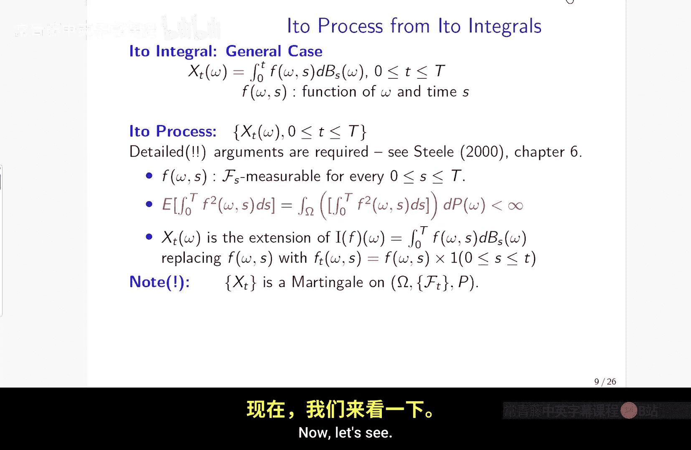

Of。Our EO integral over  zero to T to integrating it over zero to little T's for any little T less than T。

 That's relatively。Straight forward and intuitively obvious。What's not necessarily obvious， though。

 is that our process。X T。Is a Martin Gaale。With respect to this stochastic process model。

Given by the Brownian emotions。So。If we look at what it means for。A process to be a Martiningale。

 If we look at the conditional expectation。Of the time T plus K。Value， given time T。Then。

It equals the value of the process at time T， little T。Plus。

The integral of the process from time T to T plus k。And we're taking expectations。

 conditional expectations of that given X T。And so。

The expectation of this future sort of increment from T to T plus K is basically integrating a function times increments of the Brownie motion。

 where our function values depend on the past and the increments。

Are independent in in the future with mean zero。 So this expectation turns out to be satisfied。

And if we look at the conditional variance。Of the T plus K value given X T， then it's equal to。

The expected square of this。呃。F DS。And so when you look at the variance。

Of the discretized sum of increments。You get the discretized sum of variances of those increments。

Which are F squared， and then the DBS squared。R Dt。So this simplifies for the variance to that term。

And。Okay， all of this is fairly。And it's like mathematical results and it's sort of like who cares？

Well， it turns out that this。Variance。Turns out to be a squared norm。Of our function little F。

On the space of the probability space of paths across the time increments。And so。What。

Well， okay， actually， I'm going to get ahead of myself。But let me， let me get to the。

 let me get ahead of myself。And。Basically。Comment that。

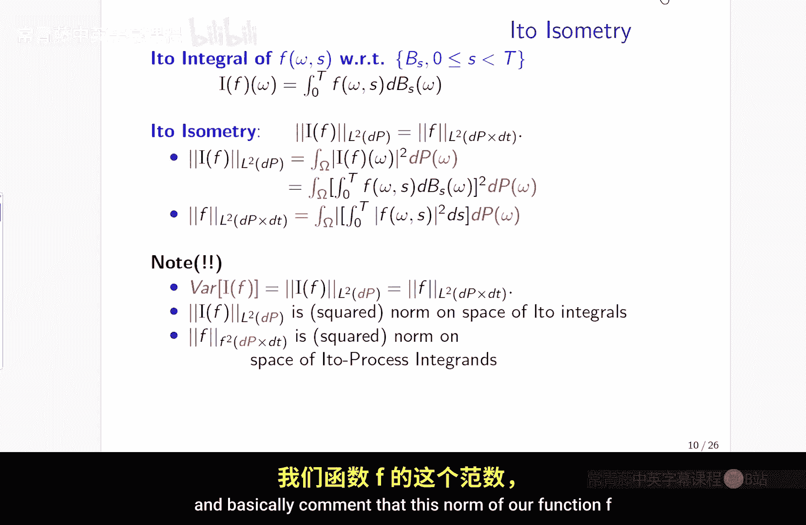

This norm。Of our function， F。Is going to be a squared norm on the space of etO processs intgrs。And。

Let's see。 those of you。Who have taken， I guess， real analysis or metric spaces？Yeah， what's， what's。

 what's an important value of。Norms。What do we do with norms？For squared norms。But with norms。

 we can talk about limits。Of elements of the space。And talk about whether limits exist。

And so with this setup， we actually will have。The space of eOprosses。

And we can calculate the squared norm。Between。Different EO integrals。And so we can characterize。

Limits in those spaces and be guaranteed that those limits exist。So。

With this sort of motivation of defining useful norms on different spaces。

 we have this etto isometry。Which is。If we look at the。Varariance of EO。

Integrals defined by integralgr little F。Then， those。Squared norms are the variances。

 basically of the EO processes， is equal to the L2 norm of the ingr little F。And。

If we write out the definitions of these sort of squared norms， we get these equations。And what。

Relevant。Here is。Being able to。Express。Our variance of the EO integral as the squared norm of the integral f。

So we have limits and convergences of sequences of edo integrals。And。

Something that's important mathematically is if we take the limits of these eO integrals。

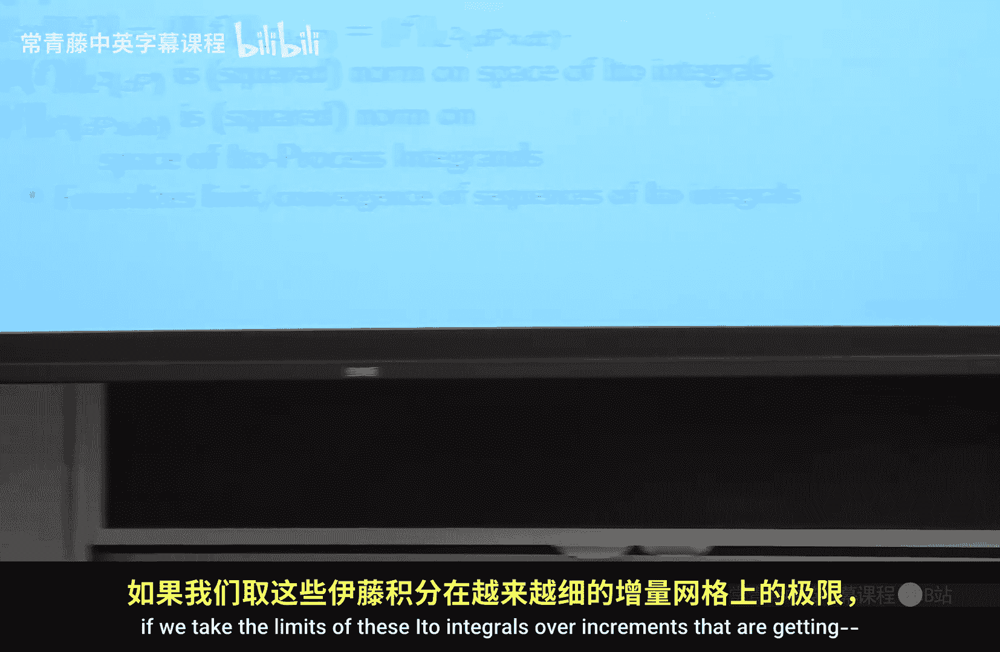

Over increments that are getting fine a grid of increments that's getting finer and finer。

 do we have a unique limit or not。And so， that's what's。

Important and is the squared norms and convergence properties are used to prove that。

So we basically can talk about closed linear subspaces。With these norms on the space。

So what this does is it allows us to define sort of the distance between different integralgrs， F。

And。The existence of a limiting EO。Ineggrral。As we consider increments getting。Infinitesal。All right。

Well。We can。Think of this Eto integral as a Rman sum， a limiting Rman sum。And。If we have time。Steps。

 T I for simplicity equal to I T over N。 We can consider the limiting sum。Of F of。

The Brownian motion times the increment of the Brownian motion。And。This。

Some actually converges in probability as n goes to infinity to the integral。

 So so we have a limiting。Value that exists converges some probability。And if we。Consider。I guess。

 the covaris。Of。The X process given by these EO integrals。From 0 to little t。Then。These will。

Or this X T will be a mean zero Gaussian process with independent increments。

And the covariance between。The process at time S and time T will simply be。

Equal to the integral of the squared F over。The times where they both are non zero。So。All right。

 so we take a petition from0 to t。 We get this result， and we can prove that the limit equals the。

This integral notation。 So basically， there's a limit that exists。

 And this is a notation for that limit。

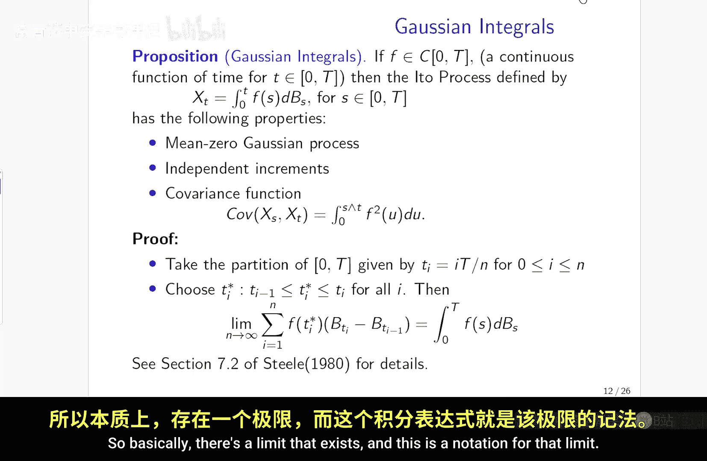

And Steel goes into a lot the details for that。Now。

Now what's of interest is that we can now consider sort of some general EO cases。

 which will be referred to as EO's formula for different kinds of function F functions F。

And so if we consider first， the case where F。Little F is a real function mapping reels to reels。

Then。If it has a continuous。Second derivative。Then， we can express。The function， F of B T。

In terms of。It's sort of tailor approximation， and we get this formula， which is EO's formula。

For F of BT。And in looking at this expression。What's relevant is that， okay。

 the first term F 0 is a constant， the second term。Is。

A Gaussian sort of process integral is an integral of browning motion。

 and then the third term is the integral of the second derivative of F which is evaluated at the BS value。

And so we have an adaptive sort of drift term。And we can improve this formula。

Outline the proof by saying， okay， let's consider the tail approximation of F at。X plus delta x。

And expand it to second order terms， plus a remainder。And then， if we take。The difference of F。

At time。T with B minus F at time 0 with B， then。We're looking at。The sum of the increments。From time。

T1 to T N。And。Those increments。Are equal to the sums of the derivative of F。

Times the increment of time plus a half， the second derivative of F times the squared increment plus the remainder terms。

And if we take the limits of those， we get the integral of F prime。D B， S plus a half the second。

 the integral， the second derivative。So Taylor series gives us this formula。And we can think of。

You know， developing a notation with Edo calculus， which is that our sort of differential of F at B S。

Is equal to。F prime of BSDBS plus a half F double prime times。At B， S times。That squared of。DB。

 which is equal to DS， the increment of time。So this is our EhoOS formula shorthand。And。

This shorthand。Corresponds in a similar way to derivatives and anti derivatives。

Where sort here's the stochastic differential equation。 and here's the。

Solution to that stochastic differential equation on the top。Now。What's really。

Neat and very powerful， is that。If we want to solve for the integral。Of a function。

So suppose our objective is to solve for the integral from 0 to t。F of B S。DBS。Well。If we have。

The anti derivative of little F。So that means that the first derivative of capital F。Is。

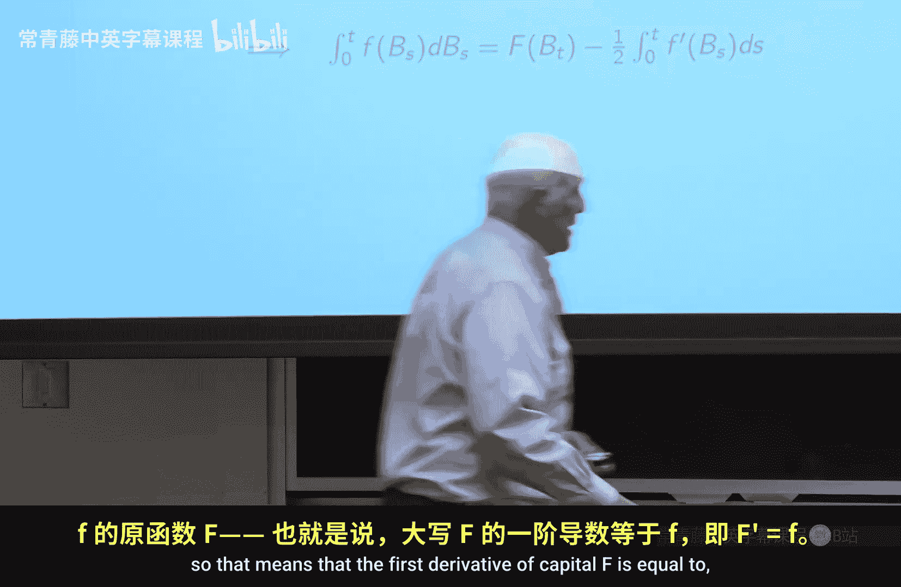

Equal to。So to the F prime。Is equal to F。Then。If we choose the anti derivative。

With f of0 equal to  zero。

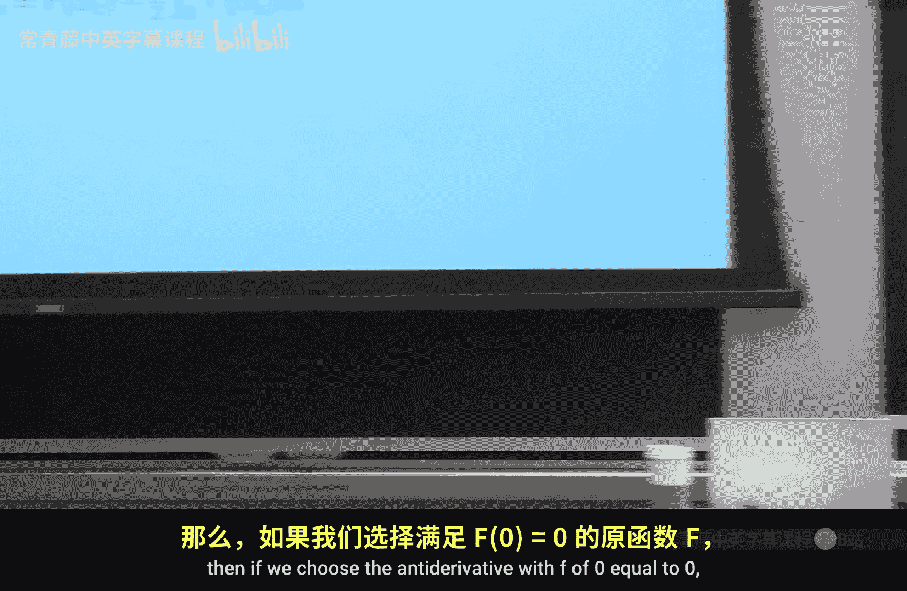

Then， we get。F of B T minus F of b0。Is equal to this integral of the derivative of F。

DBS plus a half the integralov。The second derivative of capital F， which is simply F prime。

So this formula。Is what we just derived for。Etos formula。And if we。Solve for this。

First term on the right。Then that's equal to F of B T minus half the integral。

Of the first derivative of F prime of B SDS。So what's。

 what's neat as a sort of technique and stochastic calculus is that if we want to。

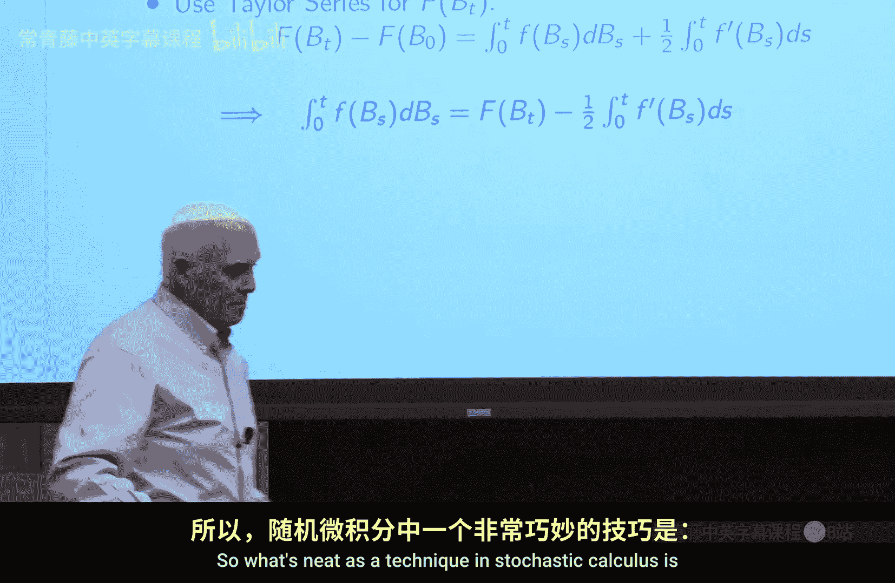

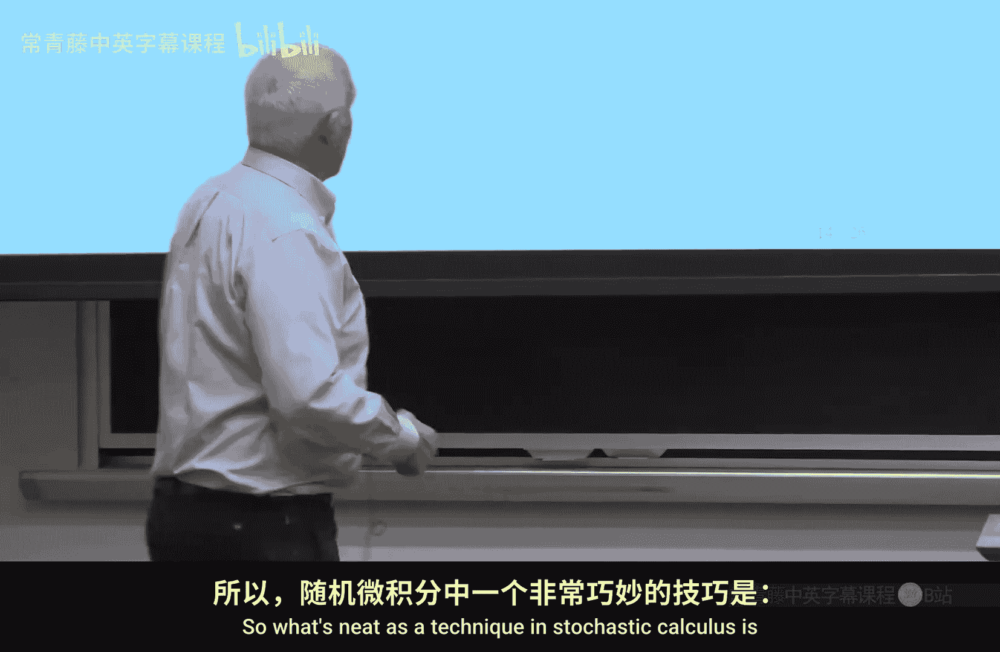

Integrate。A function， little F。Of BSDBS。Then we can just apply EO's formula。In reverse。And。

Characterize as the anti derivative of little F at B T minus a half that。

 defining the anti derivative to have F is 0 equal to 0。Now。

 let's apply this just for the case where。Capital F of x equals x， capital F prime。

 the derivative is 1， and the second derivative is 0。Then the integral of D B， S。Is equal to B， T。

And。Let's see。So， so basically。The integral of。B，S， D B， S is equal to capital F of B， T。

 which is B T。And then plus minus a half， the second derivative。

Or the first derivative the second derivative of F， which is zero。 So this gives us this result。

And if we consider capital F equaling in a half x squared。Then， little F。Is equal to x。

And little F prime is equal to1， and so we got the integral of BS DBS is F of Bt minus that which is a half Bt squared minus a half T。

 so this gives us sort of a verification of the limiting results we went through before with these。

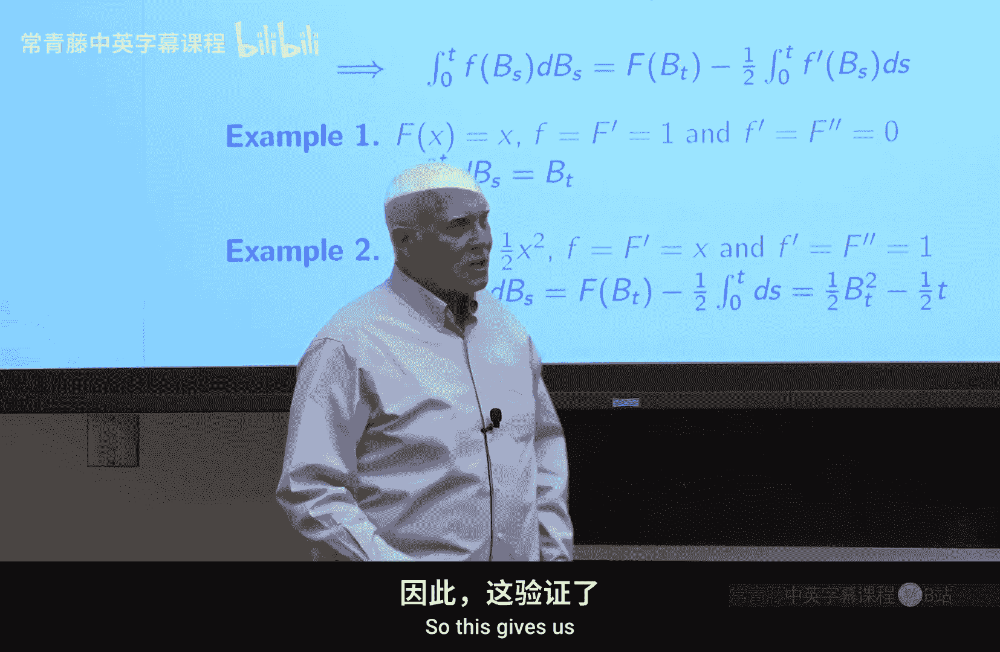

He told into girls。Okay， the next step is to extend EO。For to functions of more than one variable。

So we basically want to go from。Sort of F of x。So one variable。Fs。We want to go to two variables。

Functions， F。And we'll write the notation of S comma X。嗯。Which maps， basically。Let's see。

The time space cross。the time range， r plus cross the real line of x into the realels。

And we're going to consider functions， little F。

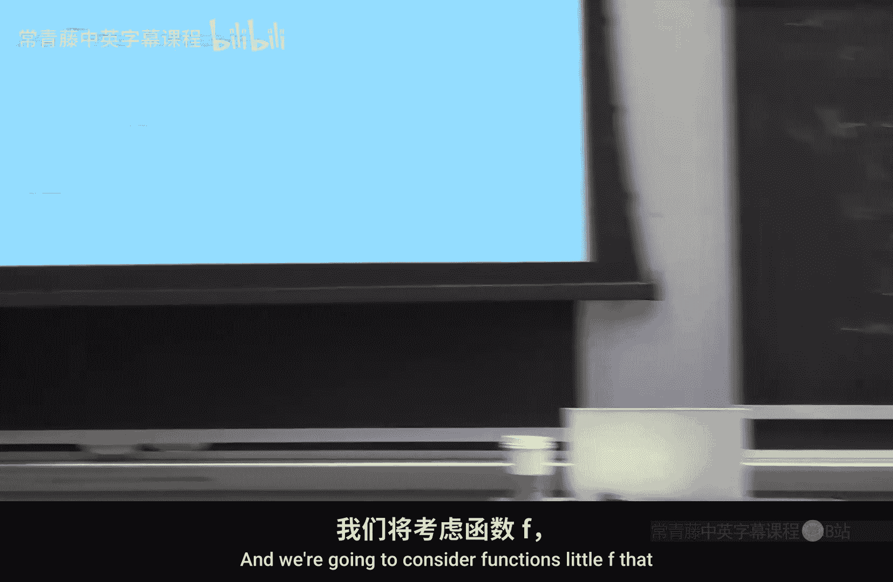

That are continuous to different orders。In terms of the time variable and the space variable。So。

We have。This notation C Super 1 comma 2， meaning that it's continuous with。First order， derivative。

 existing and continuous。And second order， derivative with respect to X and continuous。

And so we have。A tailor series for increments of this function little F now of two variables。

Which has the。Multidimensional。D equals2 Taylor series formulation， and it equals。The F。

Without the increments on T and X。Plus， delta t times the partial of f through respect to T plus delta x times the partial of f respect to x。

 and then we have part the second order partial。Differential terms。

 and the only ones that are going to be of interest are the second order partial of f with respect to x。

 which will be multiplied by deelta x squared， the other second order terms will actually be of small order delta T。

And with this。Second order， Tayloror approximation。 We're able to derive that。The function F of T。

 BT is equal to。The initial value plus an integral， where it's over time。

Of a function of the Brownian motion D S plus an integral over increments of the Brownian motion。

Plus one half this integral of the second partial of after respect to Dx squared。

And this integral here。Ends up。Being multiplied or。

Being integrated with respect to the increments of time because the deelta x squared terms。

Our infinite Tesim。Equivalent to increments， D， S。So， so for this。Formula。We have here。

 if we look at the difference in the little F function from time0 to T。It equals the right hand side。

 So this top formula here is simply taking this second order Taylor series。And looking at。

The increment from zero to t and what that equals。And what we get is a sum of two terms and integral with respect to time of。

The partial respect to time plus the half， the second derivative of F with respect to x。And。

With this notation。For。The value of little F。What。Important to notice is that if the argument。

In the time integral。If that's equal to zero。Then。This will be a Martinale。Because the second term。

Is an integral。Of。Terms times increments of the Brownian motion。

And the increments of the Brownian motion all have expectation equal to0。

So we'll have the possibility of this function being a Martin Gaale， if that's true。And this。

Intgr equaling0 is equivalent to this partial differential equation。On the little F。So， there's this。

Connection between Martin Gaes。And partial differential equations for F when we're thinking of a process f of T。

So， if little F。Is a Martinale。It will turn out that the partial。

Of f with respect to T will equal minus a half d squared FDX squared， which is a PDDE condition。Now。

 the other thing we want。Actually， for this to exist is that。The variance of the function。F of TBBT。

Which is bounded by the squared。Expectation。嗯。Is finite。And so。This will be finite。The variance。

 if that。Second term has finite variance。And so for that to have finite variance。

 it's the variance is the integral of the square of that argument， D FD X。With respect to time。

And so。All right。Now， what's interesting with this edo formula is。嗯。We can apply it to a function。

 little F， which is the exponential。Of sigma x minus sigma squared t over 2。And。Importantly， well。

 let's see。This partial of F with to T does equal minus a half sigma squared F。And so this。

Is actually a partial differential equation for little F。And， but D， F， D X is equal to sigma F。

The second partial of respect to x is sigma squared f。And Eto's formula。If we expand it out。

 gives us this expression for little F。And。This。Function。Little F is， in fact， a Martinale。

If we look at。The expected value of F。Given F of 0，0。It equals one。Now， f of 0。

0 is the exponential of。啊。Basically，0， which is one。And。But this function F， little F。

 if we plug in BT for x。It's a scaled， log normal， random variable。So this little F evaluated at x。

Equal to B， T。 So it's a transformation of the Brownian motion。Process paths BT by this function。

Is actually a scaled log normalmal random variable。

And so E to the sigma B T minus half sigma squared t is a scaled log normal。

And the expected value of this。E to the sigma B T is actually equal to E to the1 half sigma squared T。

 We proved that， I believe， in a problem set。And so the expectation of F of TBBT is going to actually equal 1。

For all T。 so this little F is in fact， a Martinale。

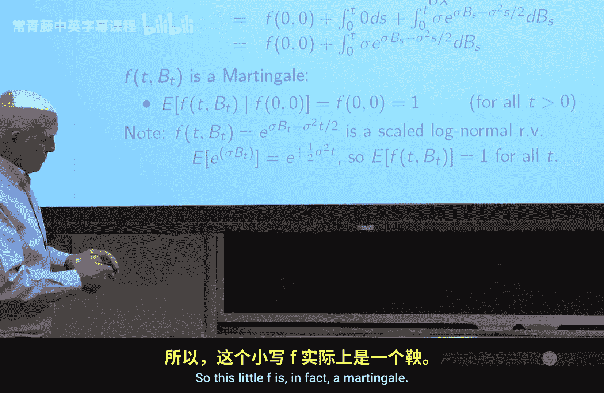

Now。Let's see， with。Brow in motion with drift， the ruin problem。We can actually use some sort of Eto。

Process ideas to deal with this。With this problem where we assume that X T is a brownian motion with drift。

 mu and variance parameter， sigma squared。So， here's its。Formula。

Sttochastic differential equation for X T。And we're interested in what's the。

Probability of stopping at a。Before B。Where the stopping time tau is the first time T that hits A or minus B。

And。This。Argument is one that's very typical of。

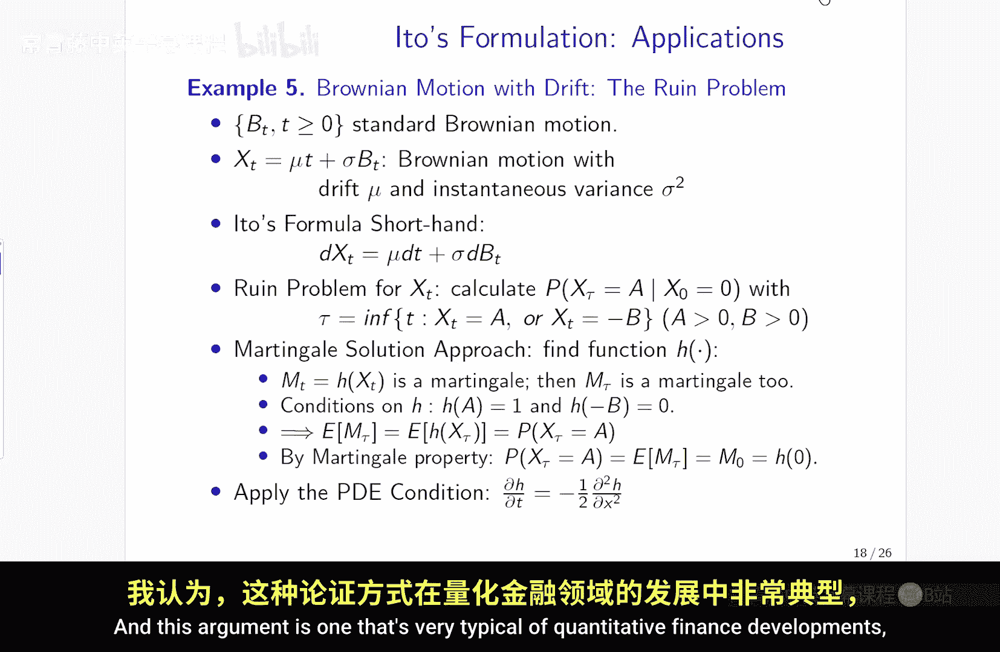

Quantitative finance developments， I guess， by mathematicians。And。

It's actually a very neat argument where I don't think I could ever have derived this。

 but the derivation using Martinale theory is really very elegant。

 and so let's consider trying to solve for this probability。By using Martin Gaale theory。

 So let's consider。A Martinale。Let's try to define a Martin Gaale。With value， H of X T。Defining M。

Where。The tao。Is the same stopping time。And。The condition on H。Is going to be that， if。

We sort of are at the value。 X T equals a。 Then the probability is one。And if we start at minus B。

 the probability is zero。So this is fixing the sort of terminal conditions of the function H when it hits the limits A or minus B。

Well。We can。If we have。A Martinale that satisfies this。Function H of X T。

Thenhan the expectation of the stopped Martinale。Is simply equal to the probability that x tau equals a。

And。By the Martinale property。The value。Of， or the expectation of the stopped time is equal to the。

M0， the initial value of the。H function。 Now， the initial value is the value when x。

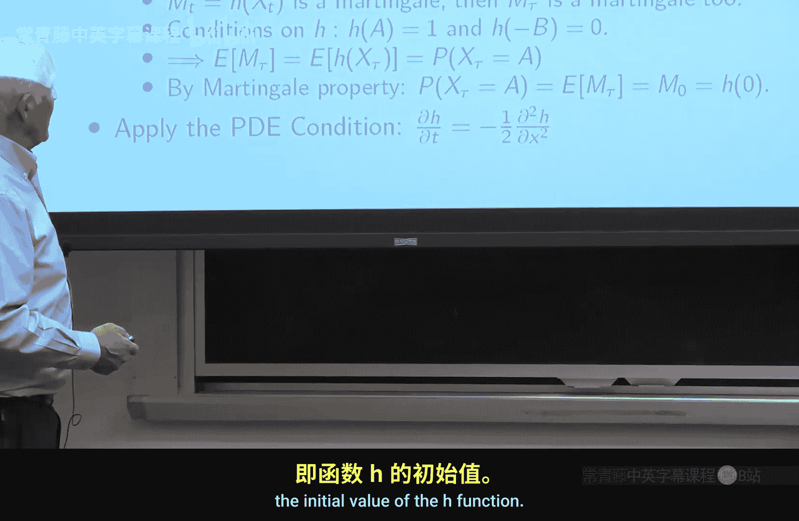

Is equal to 0。 So we're starting at 0 with the X process。 and it either。Moves and hits A。

 or hits minus B。So in order for this H function to be a Martinale。

We have to have that the PDE condition is satisfied on H。

So the partial of h with respect to t is equal to minus a half。

 the second partial of h with respect to D X。And so。If this H function。

 which is the probability of hitting a first。Depends just on the value of。X T。

Then it equals h of mu t plus sigma Bt。Substituting in for what Xt is。

So we can work with the function。Little F equal to H of mu T plus sigm X。

And if the partial of F with respect to T。Which is by chain rule mu h prime of mu T plus Sigax。

 if that equals the second partial of f thepectax。The second partial derivative of H with respect to x is sigma squared h double prime。

Then this PDE condition says we have this relationship， this differential equation for H。

 although it's in the first derivative of H。But we can then。

Rewrite this as the second derivative of H evaluated at argument Y is minus a constant times the first derivative of H。

And so。We can solve that equation。By。Noting that sort of H double prime over H prime。

Is equal to d by dx of。Log of H prime。So the derivative of the log of H prime is a constant。

 The solution to that is a linear function。And so we then end up being able to solve for a little H of Y equaling this formula。

So this is the solution to this problem。Alright， let's see we， we're at the end of our lecture today。

 So next， next time we'll finish up these notes。Talking about。

Standard processes where our sort of A function for the drift and our B function for the volatilities have to satisfy certain properties。

And if you read ahead in these notes。You'll see that。

We need the probability of sort of integrating the drift over time has to be finite and absolute integral and the integral of the squared B's。

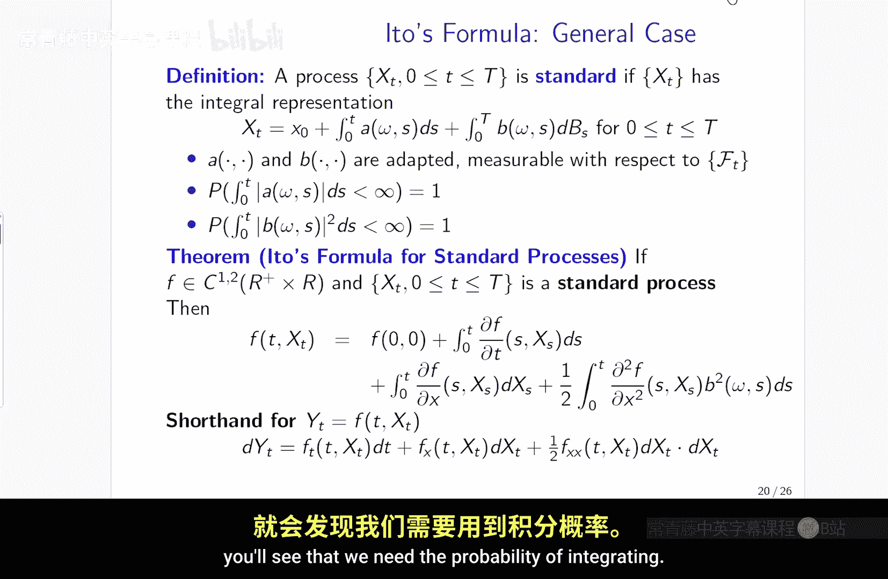

Have to also be finite。 If those were not finite， then you would say have sort of explosive behavior of these integrals。

 which where they won't exist。 So these are reasonable properties to assume for those。And anyway。

 we'll go through some interesting results here with this particular problem and then turn on to stochastic differential equations next time。

All right。Thank you。

