# 麻省理工学院【中英⚡深度学习｜6.7960-Fall-2024,-Deep-Learning】-p01-P1-深度学习导论--BV15QZ4B1E6v_p1-

So why are we all here？De learning has clearly been exploding in society。

 Machine learning generally is something that when I started studying it about 13 years ago。

 didn't work。

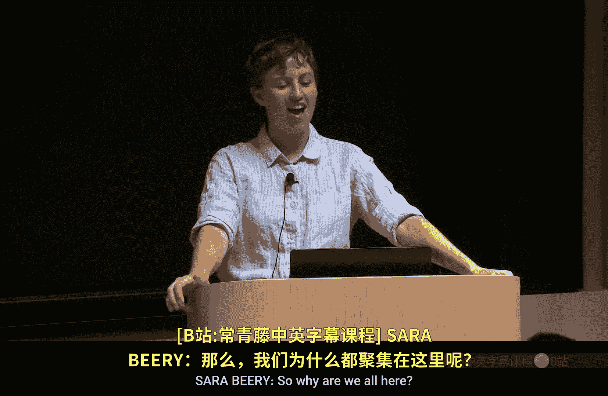

And now it works。So how many of you here in this room used AI in the last week？Yeah。Almost everybody。

 probably everybody and you know we're seeing massive advances in everything from you know AI assisted text generation to you know。

 3D reconstruction， things like Nerf， things like alphaphago， generating images。

 helping with writing code， playing games。

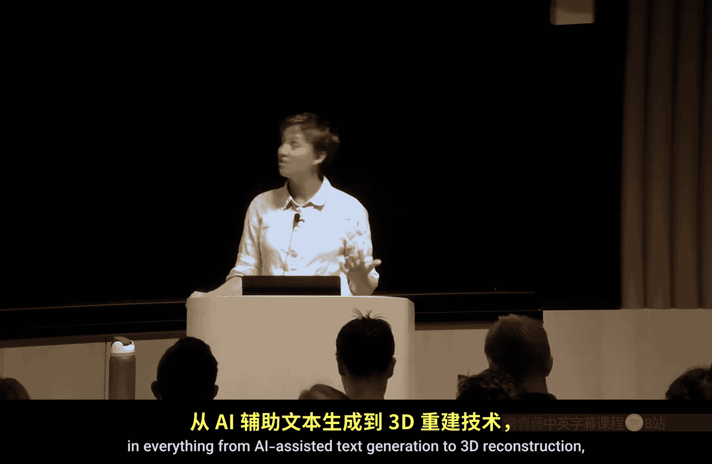

This has really started to touch almost every dimension of society。

 and it's definitely very exciting to see， and I think that hopefully all of us will learn a lot more about what that kind of means in this course。

So what is deep learning？First， I would argue that one necessary component of deep learning is the idea of neural networks。

 and these are a class of machine learning architectures that basically use stacks of linear transformations interleaved with pointwise non- nonlinearities。

 and these have really been a building block for a lot of the progress that we saw on the last slide。

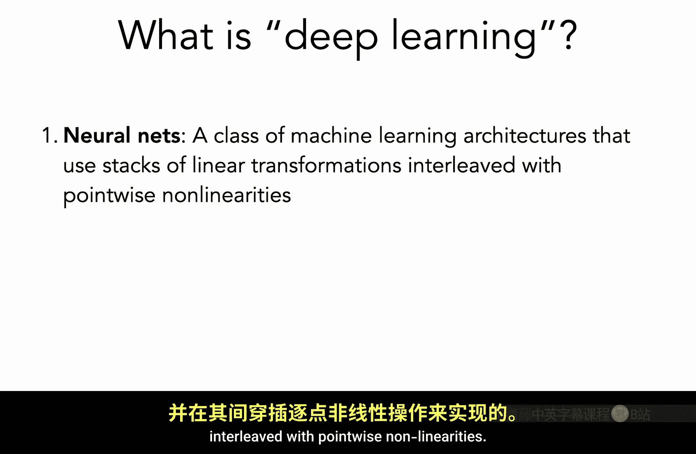

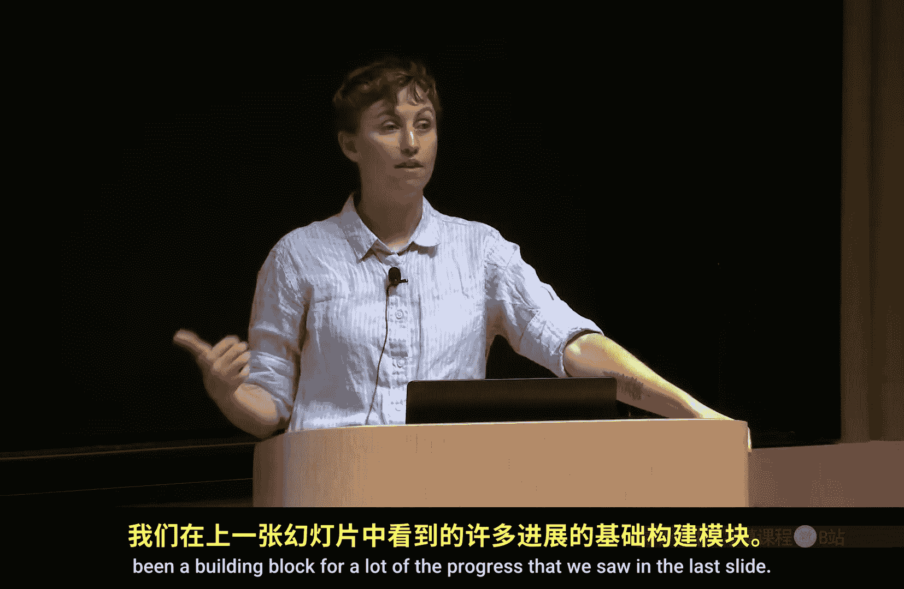

But the other really important dimension of deep learning is the idea of differential programming。

 and this is essentially a programming paradigm where we parameterize parts of the program。

And then let gradient based optimization tune the parameters to basically optimize that program or find some sort of at least local optimal for that program。

And these two things together is what we sort of posit make up deep learning。

 And we're really going to dig into both of them in this course。

So our philosophy for this is that breakthroughs in deep learning have been driven by a mixture of theory and practice。

 and both dimensions are really vital for future progress in the field。And so along those lines。

 this course should hopefully provide both a theoretical grounding in important deep learning building blocks。

 as well as give you practice， implementing， understanding， and using those blocks。Okay。

 I there's still a lot of people in the back who are packed in。

 I don't know if there's any way to come further forward。

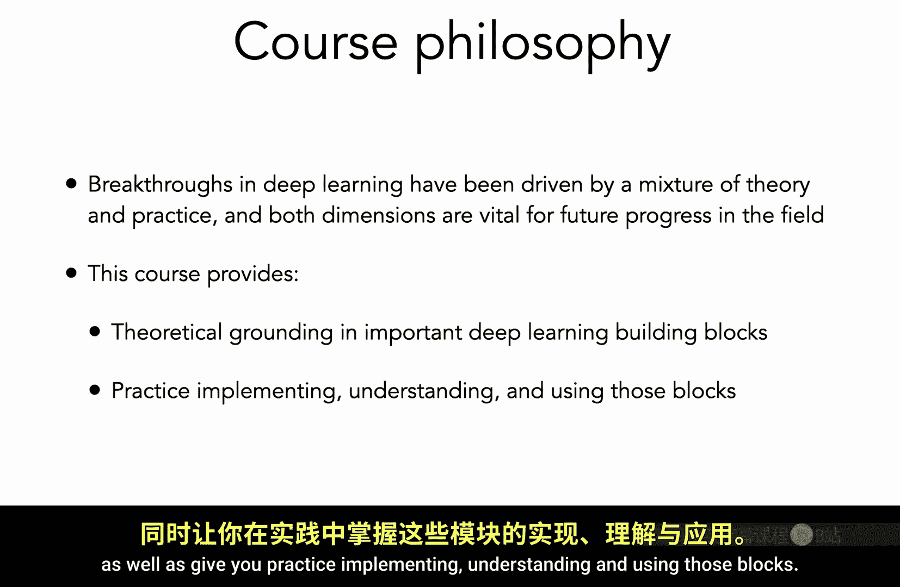

If not， well just， we'll do our best。

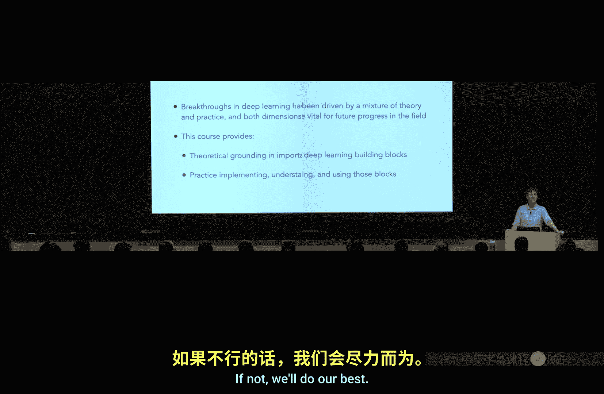

So the class's coursework is going to be 65% problem sets， you'll have five PS sets。

 each will be about one to two weeks long， and then there will be some combination of pen and paper or more realistically。

 maybe overle as well as code that you' will need to do and submit。

And then 35% of the grade will be a final project， and this is a research project that's focused on deeper understanding of some of the topics that we cover in the course you'll be asked to propose something for that project。

 so will be an initial project proposal。And then the final project will be a blog post that's trying to demonstrate novel experimentation of visualization and the hope here is that I don't know many of you。

 how many of you are machine learning researchers who have already written a machine learning paper is first author or anywhere on the author list okay so some。

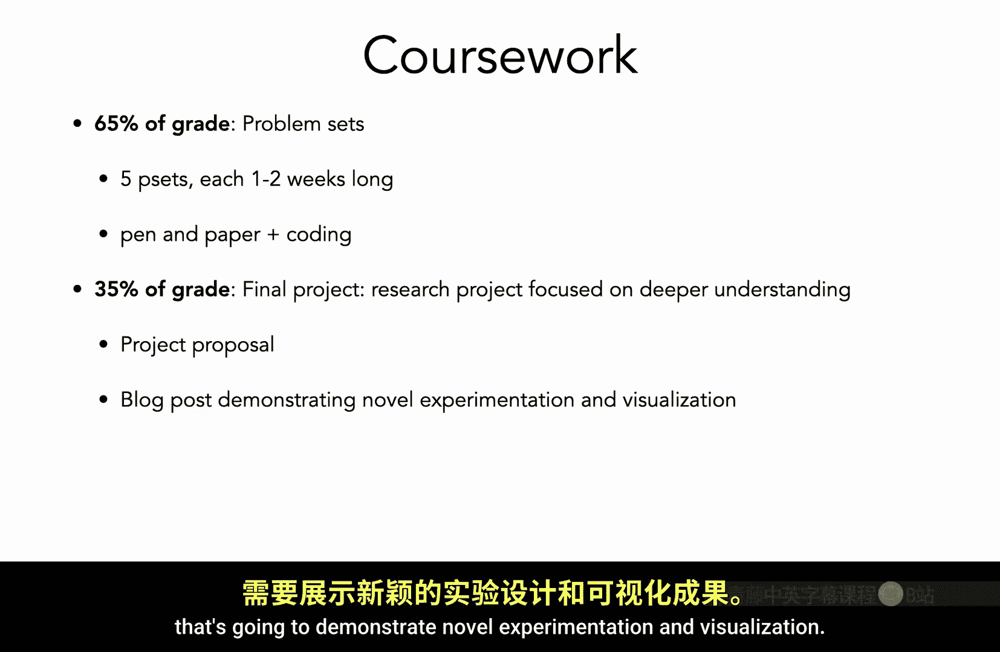

These days， when you write a machine learning paper， more often than not。

 you also have to write a blog post about that paper。 and that's intended to be catchy。

 make people sort of understand the material， but really get them engaged。

 And so one of the reasons that we have this as the format of our final project is to kind of reflect on the fact that this is kind of the reality we live in today that in machine learning research being able to write a blog style description of。

😊，The work that you're doing and not reduce any of the technical complexity or the information that's given across。

 but just do this in this slightly more visual and maybe even interactive format is a really valuable skill and one that we hope this can then help us think about and will allow groups but only up to two。

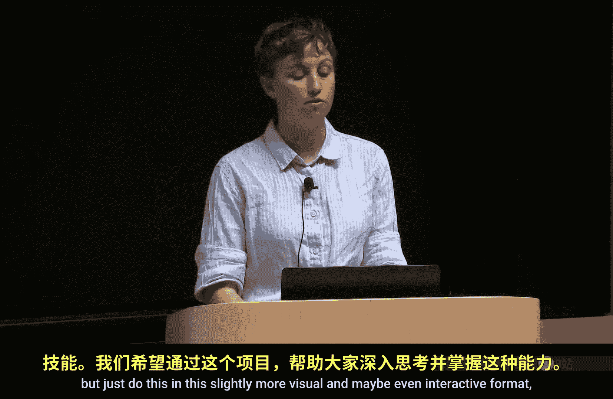

And another important component， we are not able to ride compute。

 we may be able to provide some very limited compute， but that's TVD。

 so do not plan your final project to be something where you need to get state of the art by crunching you know a huge architecture on a bunch of huge data sets because it's just not going to work you're not going to be able to outcompte open AI on this research project。

So this does not mean you can't do good research and it's important to kind of get creative here。

 and I think it's actually a really valuable skill。

 particularly as you know certain types of large scale deep learning become more and more centralized to think about how you can still do impactful machine learning research in a way that is not just bigger is better。

😊。

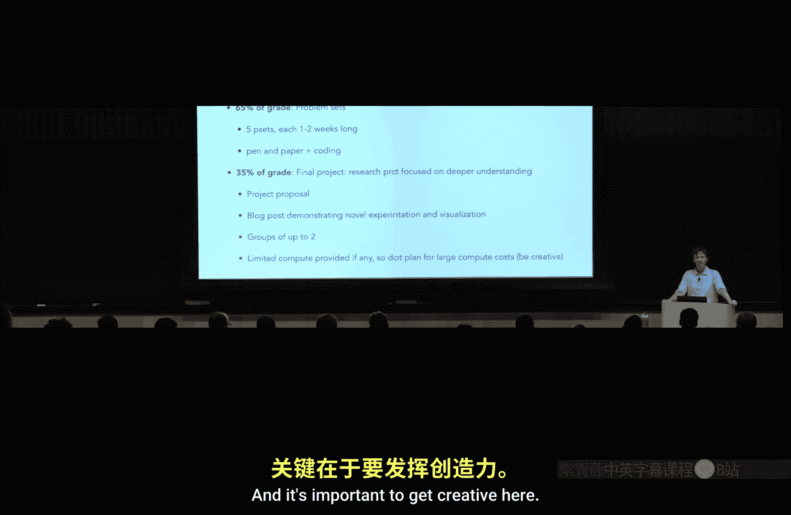

All right， any questions about coursework or logistics？Yeah。

 is the final project expected to be a mix of practical and theoretical research？So the question was。

 is the final project expected to be a mixed of practical and theoretical research I think it depends it depends on what you want to propose as your final project but I think we're pretty open what we want them is for them to be innovative but that innovation can be in an applied sense or it can be in a more theoretical sense so I'm going to do a really high level overview of the schedule just to give you a rough sense so today we're really covering basic interest of course overview。

 a rough introduction to kind of what neural networks are and basic building blockss and particularly in the context of signposting what we expect you've seen before because this is not an intro to deep learning class。

 this is advanced graduate level deep learning and then we're going to go into sort of how you actually train a neural net than approximation theory。

 some different architectures things like grids graphs then we'll hear from Jeremy about scaling rules for optimization and then we'll look at Jeremy。

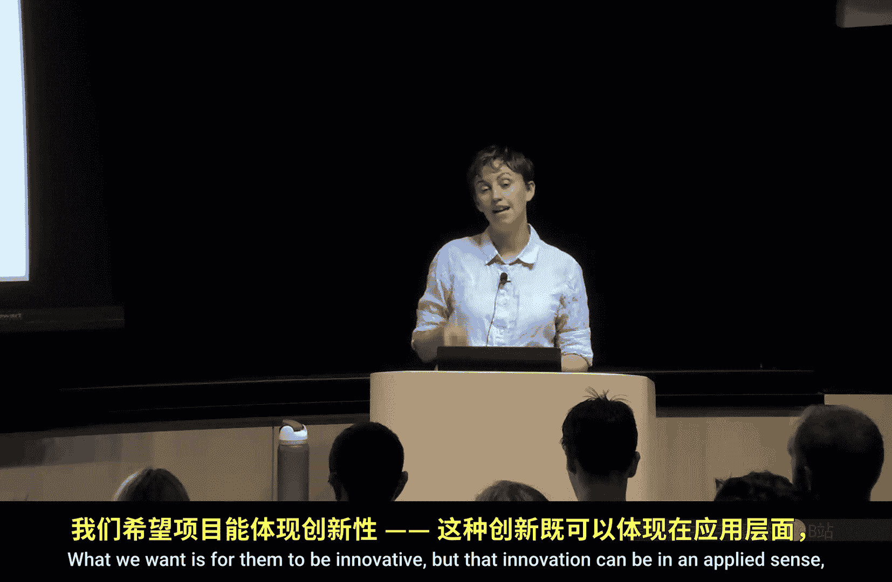

alization theory， more architectures getting into transformers will'll do a really fun lecture by Phil called the Haers' Guide to Deep learning that I think is quite useful and then we'll talk about memory。

 and then we'll get into representation learning。 So there we're gonna look at reconstruction based and then similarity based and then theory of representation learning。

 then we'll have a little bit of a series on generative models， the basics。

 how representation learning interacts with generative modeling。

 thinking about conditional models then we'll talk about generalization and particularly out of distribution generalization we'll touch on transfer learning。

 both from a models in a data perspective we'll hear about large language models。😊。

We'll have some guest lectures towards the end of the semester， and those are TBD。

Then we'll hear about scaling laws， automatic gradient descent。

 and potentially the past and future of deep learning。

 though I think there's some discussion as to whether that's going to sort of be a different lecture。

And then I think kind of importantly， right towards the end。

 we will have sort of class wide project office hours where we'll have a bunch of the TAs and the instructors all come and we can do sort of open discussion around projects before they're due。

嗯。So the next thing is that we're going to host PyTtors tutorials。

This is intended for if you're not familiar with pieytorrch and you think you need a refresher。

 and we strongly recommend。That if this is the case or if you even think it might be the case that you attend one of the two Pytorrch tutorials we're going to offer next week。

 So the question is， if Pytorrch is a requirement are allowed to use any other framework。

 So you're probably welcome to use any other frameworks in your final project。

 But some of the problems sets specifically willll have code that's already built into Pytorrch and you're filling parts of that in。

 So unless you want to rewrite all of it in Js or something， which I mean， like more power to you。

 I would recommend that you definitely make sure that you are familiar with Pytorrch。😊。

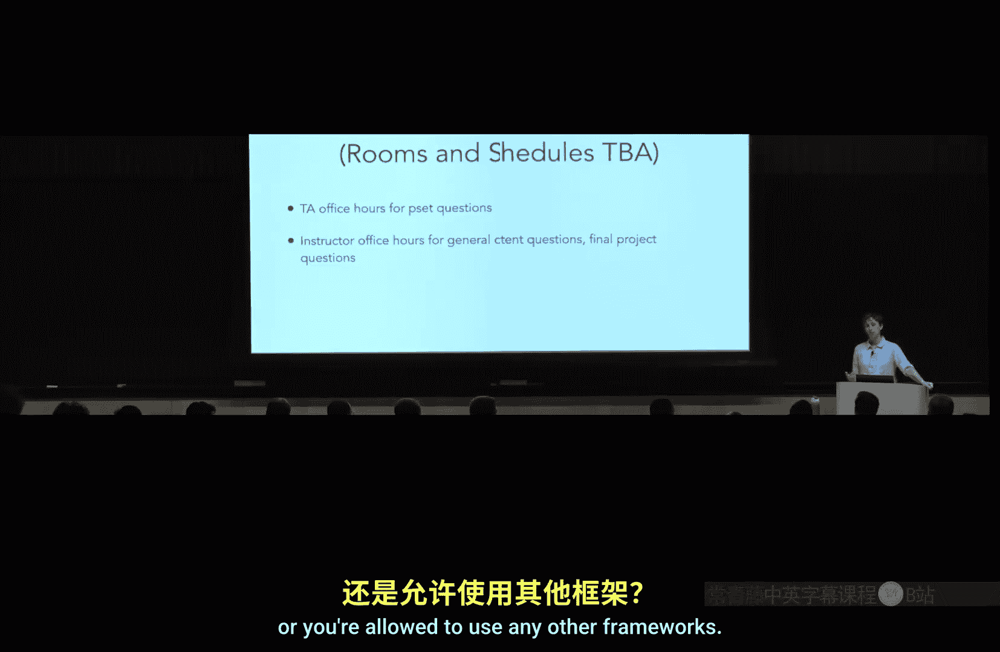

上海。Cool， so I'm going to talk about course policies and this stuff is important。

 and it's also all on the web page。 but I think essentially。

 what we want to touch on is what our collaboration policy is first。😊。

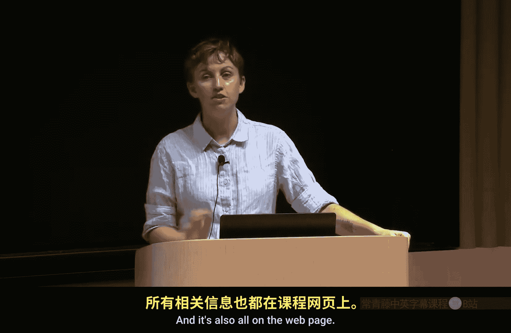

So everyone is required to write an individual pieceet。

 so when you're actually working on your problem sets。

 do not work on something together and then both submit the exact same thing you can work on the actual the content。

 you can discuss that with peers， Ts and instructors。

 but the problem sets you submit need to be your own independent and individual work and that also applies to the code that you write so you can discuss the code with others。

 you need to each write your own code separately there was some confusion about this in the past。

 just make sure that you're not taking the code someone else wrote running it and then submitting a PSet on it。

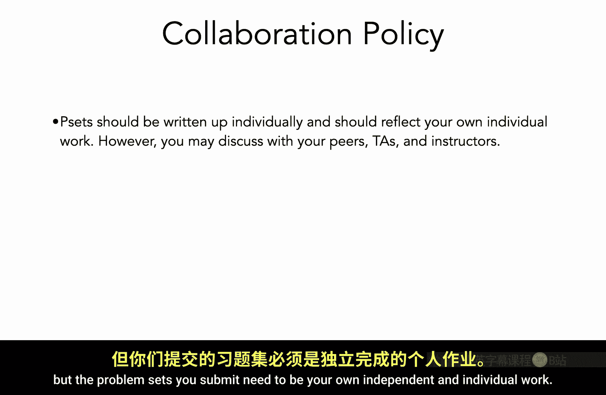

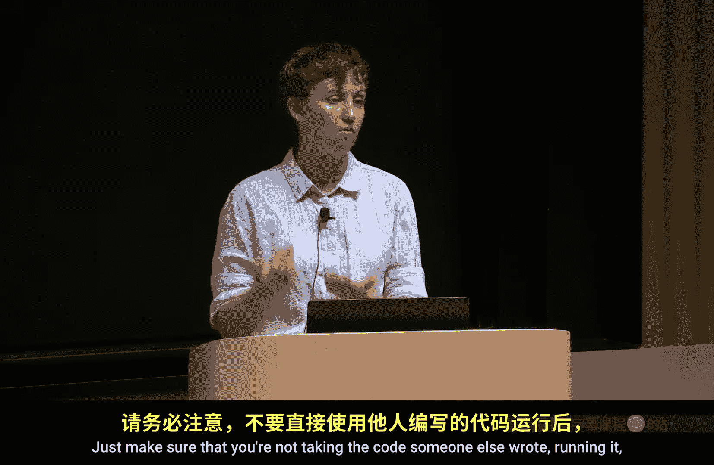

You should absolutely not copy or share complete solutions and you also should not ask someone else。

 hey， this is my solution， is it right and you shouldn't do that in person and you also shouldn't ask is this correct on Piazza or Canva So again the idea is it's your independent work you're sort of independent thought and I think it matters more that you've sort of gone through that process independently than actually getting it correct。

Because you'll learn from the feedback on your piece that's better if you submit something that you sort of came up with yourself and get。

Feedback on it， then if you copy somebody。And then if you work with anyone on the PSet other than TAs and instructors。

 we ask that you write their names at the top of the Pet。 So if you have a study group。

 you're all working together， we don't care if this is 10 people。

 we don't care if it's in this class 100 people， but we just want to know who was working together。

 I'd be impressed if you manage to come up with 100 person。Collaborative group。So AI assistance。😊。

We take the exact same policy about things like chat JPT or other AI assistants that we do with humans。

So。It's a deep learning class。 You should be trying out the latest technology， right。

 The idea is not that we're teaching you to ignore what's happening。

 but we do want you to treat them like a human collaborator Don't ask them to answer the question for you right just try to imagine from an ethics perspective that this is like a peer in the class。

 So don't say what is the solution to this， don't say write the code for me because you wouldn't go to your friend and say please write my code for me。

 but you're super welcome to use them as a discussion partner。

 ask them questions that are contextual you know kind of go back and forth。

 That's all fine but don't。

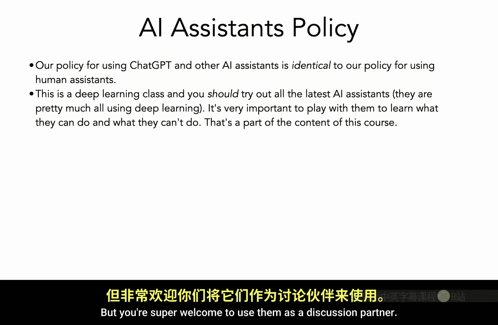

Don't treat AI collaboration as， as if they're not sort of a human collaborator。

 sort of think of it that way first， Like， is this something I would ask my friend in the class。

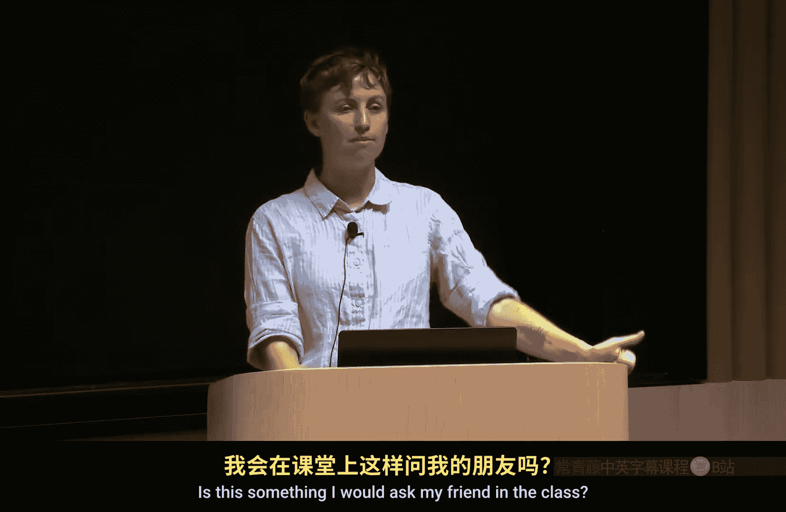

And then just like you can come to office hours and ask like the human questions about the lecture material。

 clarifications about questions， tips for getting started。

 you're welcome to do the same with AI assistance。Again。

You're not allowed to ask an expert friend to do your homework for you。

 Don't ask AI to do your homework for you。If you're ever unclear。

 imagine AI as a human and apply that same norm。And if you work with any AI on a PSet similarly to the fact that we're writing which humans we collaborated with。

 please write down which AI and how you used it。 and of course， this is a bit vague， but again。

 just kind of on our code。

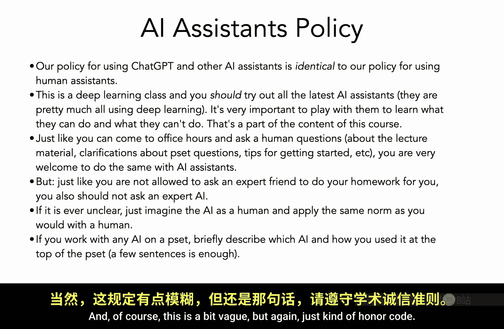

Any questions about AI collaboration？Or is that reasonably clear。Yeah， I had the。ま。

Can we show our work to。Yes， you're very welcome to show your work to the TAs。

 the TAs are not going to tell you how to answer the question though but they will kind of work with you to help you hopefully figure that on your own。

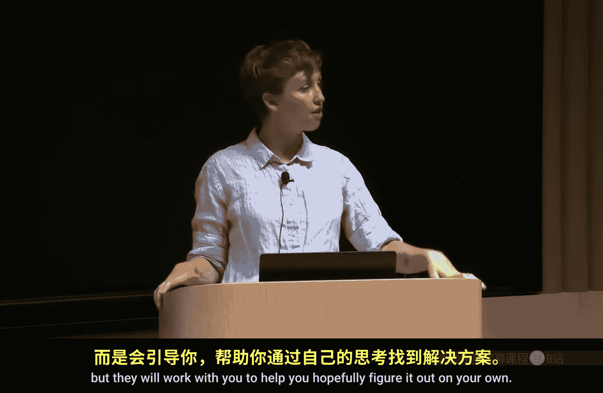

Why are we here？What's the goal， So what do we want to do。

 you know why are we all interested in things like deep learning？嗯。😊。

One perspective is that we're interested in modeling complex phenomena in the real world。

What are complex phenomena， Well， you interact with them every day， things like natural language。

 images or visual data in general videos， DNA ecosystems are complex phenomena。

 Climate change is a complex phenomena。Why is it hard to model complex phenomena in the real world？

They're complex。아。And so maybe one existence proof for deep learning as a solution to modeling complex phenomena。

 possibly we could talk about the human brain， right， all of you are here at MIT。

 which means you're pretty good at modeling complex phenomena in your brain， I'm guessing。

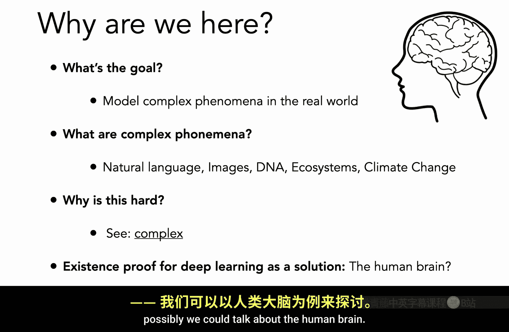

嗯。

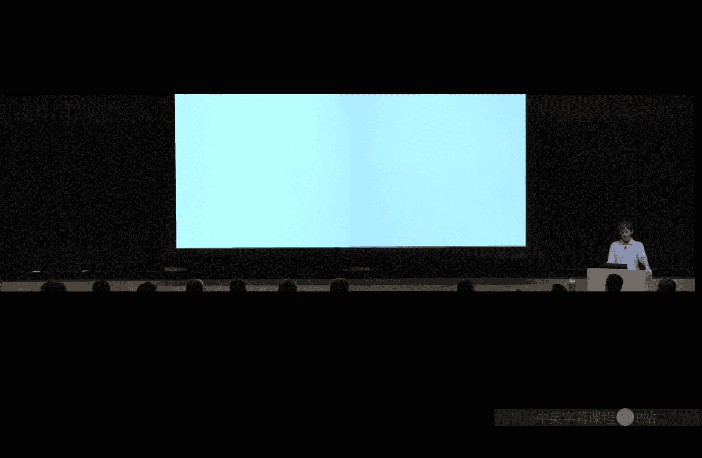

So。First， today。I'm going to just briefly go over how we got where we are today。

 This is a brief history of the field of AI， deep learning in general。

And then I'm going to go over what we expect you have already seen before。

 it's okay if you haven't seen these things before but we would expect you then to go and brush up on them so if there's anything that you know I talk about and you're like  oh。

 I've never seen that we expect that that's something you can go you know look at some of the openCsework courses at MIT。

 go find lots of resources online and pick it up before you'd go into this class and then I'll also talk about what we actually cover in the class。

So a brief history of neural networks， and I think a fun way to go through this is looking at this on a plot of enthusiasm for neural networks over time。

So if we go back way back to 1958。Rs andbltt introduced the perceptron。In psychological review。

And their percept was the first neural network。Arguably。

 and what this was intending to do was recognize or categorize images。

And the idea was essentially that you could take some combination of representations。In this case。

 particularly pixels， sum them， put them through some non linearity and get out a categorization。

And really， we'll see throughout the course， and even today。

 this idea still forms the building block for most of the deep learning that we do。

These perceptrons are components in many， many， many different types of capacities within things like ChattBT。

When this paper came out back in 1958， people were incredibly enthusiastic in mid waves， right？

And then。In 1972， Min's game Peard wrote a book called Perceptron's Expanded editionition。

And this book takes a very critical lens to the idea that a perceptron could be seriously considered a model of the brain。

 and it also carefully and mathematically describes and characterizes the limitations of what a perceptron can model。

And it did so， so carefully and so critically that all of a sudden。

 enthusiasm for machine learning really took a dip。😊，So in the 70s。😊。

We were not excited about neural networks。But then in 1986。

 this book came out called Parael Dis Proing， and this was fundamental because it introduces the concept of back propagation。

And this was really the thing that enabled multilayer perceptrons， so not just a single perceptron。

 but actually multiple perceptrons stacked on top of each other to actually be reasonably trained。

 reasonably fit， this concept of being able to back propagate a gradient through multiple layers of perceptrons。

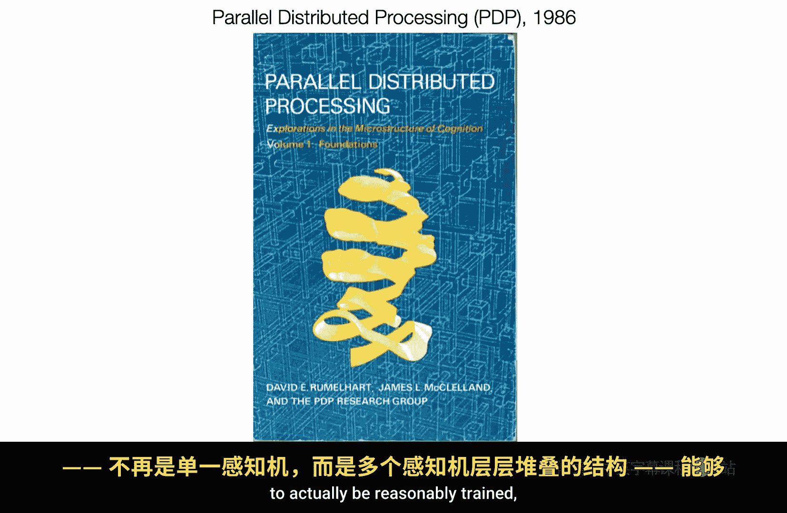

And what this enabled you to solve were things like the Xor problem for the first time you could reasonably solve categorization problems that were not separable from a linear classifier they pointed to back propagation as a breakthrough。

 it let us actually handle things where you need multiple different boundaries and kind of these- nonlinearar boundaries to be drawn。

 which is only possible if you have multiple layers of a perceptron。

 you'll never be able to solve the Xor problem with a single layer neural network。

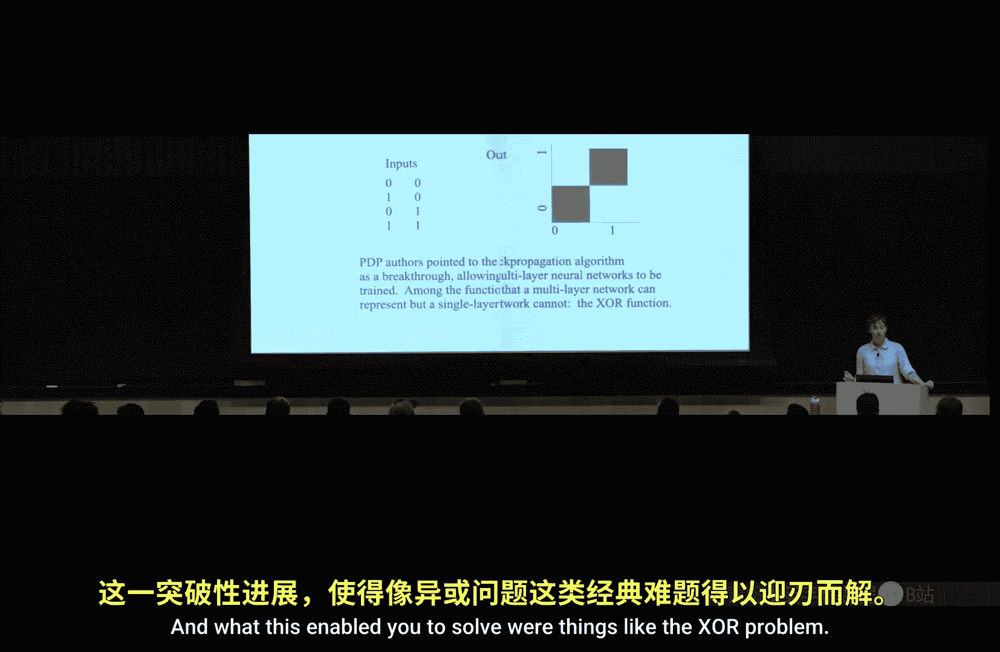

And everyone got really excited again。So in the 80s， yet again。

 machine learning was something that people were pumped about。

 and particularly this deep learning neural network perspective on machine learning。😊，In 1998。

 Young Laon put out convolutional neural networks。 There's an awesome demo that he has on his webp page。

 I'm sure many of you have heard of Y Laoon。And this。

Seems like it would mean that everyone was really excited about neural networks again。

 but if you go to Nips in 2000， this is the premiere conference on machine learning。

 it evolved from an interdisciplinary conference， which was on basically。

Like the science of the brain and machine learning to specifically just a machine learning conference。

If you look at that conference in 2000。The most predictive words and papers on the title for acceptance were belief propagation and Gaussian。

And the title verbs most predictive of paper rejection were neural and network。

So this is what we called the AI winter。 And one of the reasons it was called the AI winter is because even though we had the theory。

 we had the building blocks， we didn't actually have。The ability to train them efficiently。

 We didn't have the right programming perspective， and we didn't have the right hardware。 But then。

In 2012， Alex Krushzyevsky and his coauors published Alex Net。

AndAlNe was you know also another convolutional neural network， but importantly。

 Alex Fchsky was a brilliant programmer， and Alex Fchsky figured out how to program GPUs。

 graphics processing units that have been developed to handle massive scale parallel multiplications for graphics for video games and for sort of high resolution。

😊，High resolution images。But he figured out how to program those and repurpose that hardware for the training of neural networks。

 and I can't tell you how much of a sort of shot heard around the world this was in our field。

 but this for the first time， outperformed every single other possible method that was out there on IageNe。

ImageNe， how many of you have heard of ImageNe？Yeah。

 Imagenet was the first very large scale data set of its kind。

 And I actually think that this is an important component， right。

 what what made machine learning start to work。And I would argue that， of course， it was the theory。

And the programming， the ability to actually sort of efficiently fit these things。

 but the other really vital component was the data。

Machine learning does not work without large scale curated labeled data in many capacities still。

 though we're getting better and better at supervised learning。But so。All of a sudden we were back。

Everyone was enthusiastic again。 and actually， if you look。

 these were kind of hype cycles about 28 years， both of them。😊，And so the question is。

 where are we going to be in 2028 so it's 2024 now？😊，It's 2024。 So in four years。

 where are we going to be。 So， I mean， one argument would be okay， we're in another hype cycle。

 but I would actually argue that that's probably not true。

 Another one would be that we' just way off the deep end in terms of enthusiasm and by 2028 we'll be in some。

 you know， out in the stratosphere。😊，Or possibly we're doing something like this， right。

 Maybe in 2028， we're going to hit some new sort of plane of enthusiasm。

 and then we'll start to realize limitations and we'll oscillate again yeah。

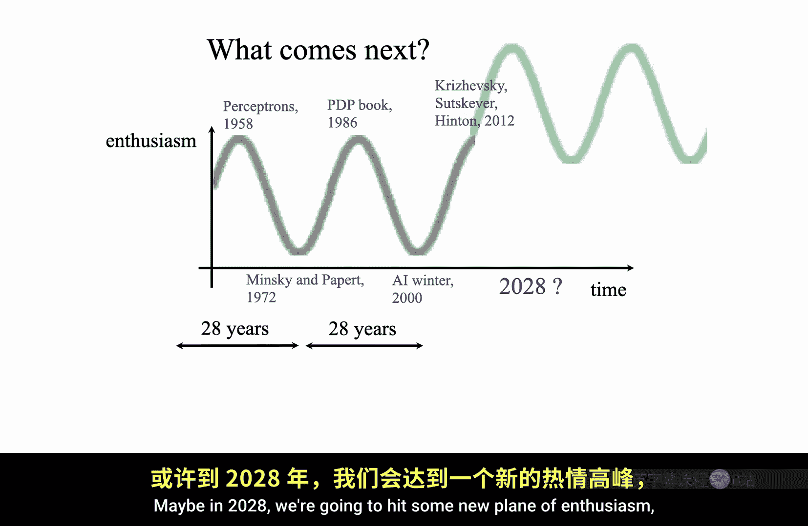

So the question is will AI take over society by 2028， my answer is let's see。😊。

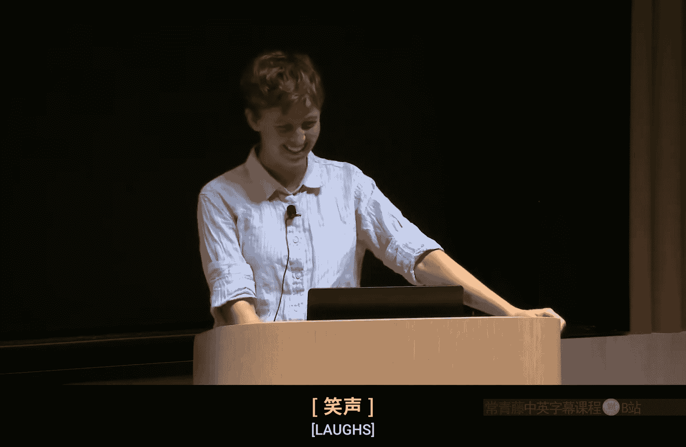

So what's deep learning today， what are sort of the components that make it up。First。

 I think a really important one is autograd。 These are coding languages like Pytorch and TensorFlow。

 They give us a really clever way to do things like implement this chain role in software。

 making good use of available hardware and this has enabled us to do things like approximate the gradient of any function。

 even if it's an approximation， these are a really important component of deep learning。

 and if you do anything with deep learning， I doubt that you're doing what Kerchsky did。

 I doubt that you're programming these things from Sctch。

 you're almost certainly working with existing programming languages that are built for machine learning。

😊，It's billion plus data point data sets， things like Ly。

So that scale of data that I talked about before is an incredibly important component of all of this。

Parallel training on thousands of GPUs。Again。This is what we're looking at today。

Billion plus parameter architectures， and this number just keeps increasing。

Million plus dollar training costs。So of course， it's not public knowledge。

 how much it costs to train something like GPT 40。I would bet it's definitely in the many millions。

Shockingly， good results。 I don't know about any of you。 I mean。

 I've been working this field now for a while， and。

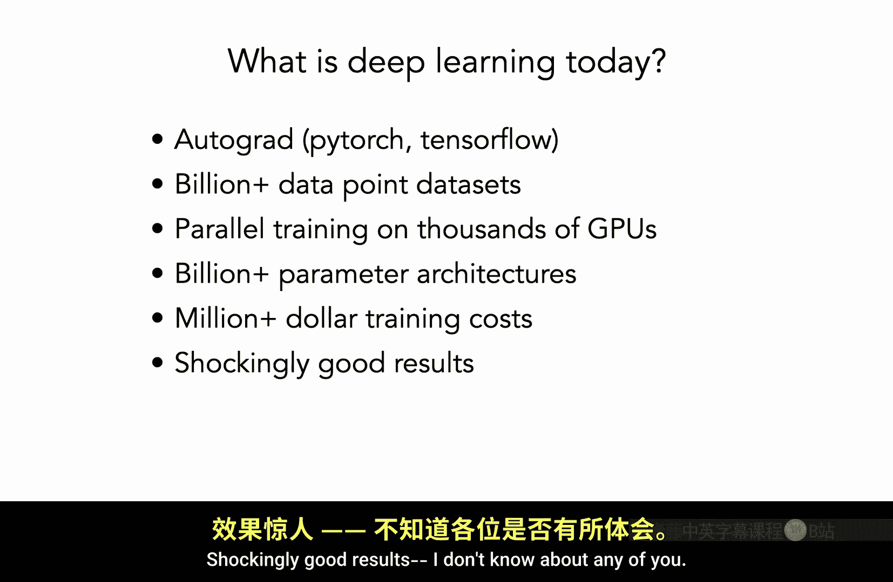

I think we've been seeing results recently that I didn't anticipate seeing in my lifetime from when I started back when things didn't work。

 So that's been both exciting to see。 And also sometimes I think for many of us。

 a bit overwhelming right because you're like， oh gosh。

 like the problems I thought were problems aren't problems anymore。 So what are the problems， right？

😊，Of course， I work in the world of。I work a lot on Mike。

Biodiversity loss at a global scale using machine learning。

 And I would say that biodiversity loss is definitely still a problem and one that machine learning is sometimes helping。

 but。Often also hurting because the carbon costs of actually training these models is significant。

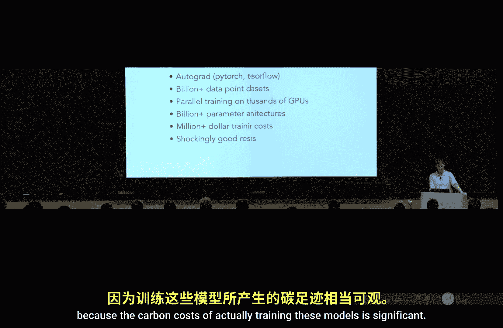

But。All of these massive these massive things， massive isn't necessary。

 So things like stable diffusion are actually pretty lightweight。 and were incredibly impactful。

 So things don't always need to be big， to be good。

And then I think another really important component of deep learning today is the idea that it is primarily an open source community where we have what we call modular reuse right so people take weights that we're trained by one person with one architecture。

 they might take that and use that entire thing as a module within another larger system that has you know many different components that are being pulled from different things Now I think that this open source perspective is really something that's driven a lot of progress in machine learning。

 but also one of the things that we have been seeing in the last few years is that things are less and less likely to be open source。

 you might have an API， but you aren't necessarily going to get the weights in the architecture for something like GT4。

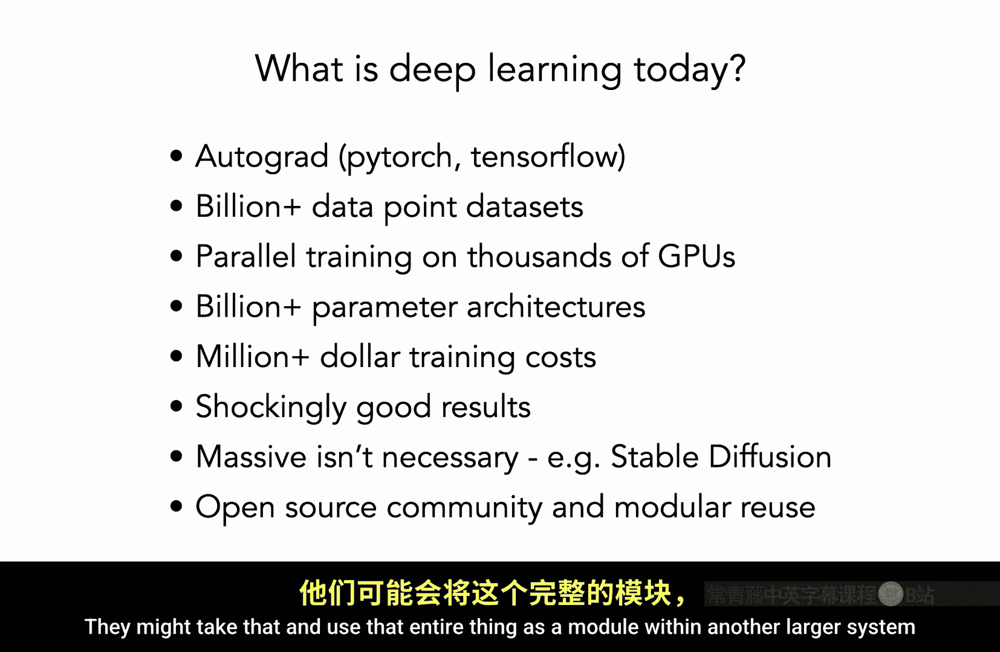

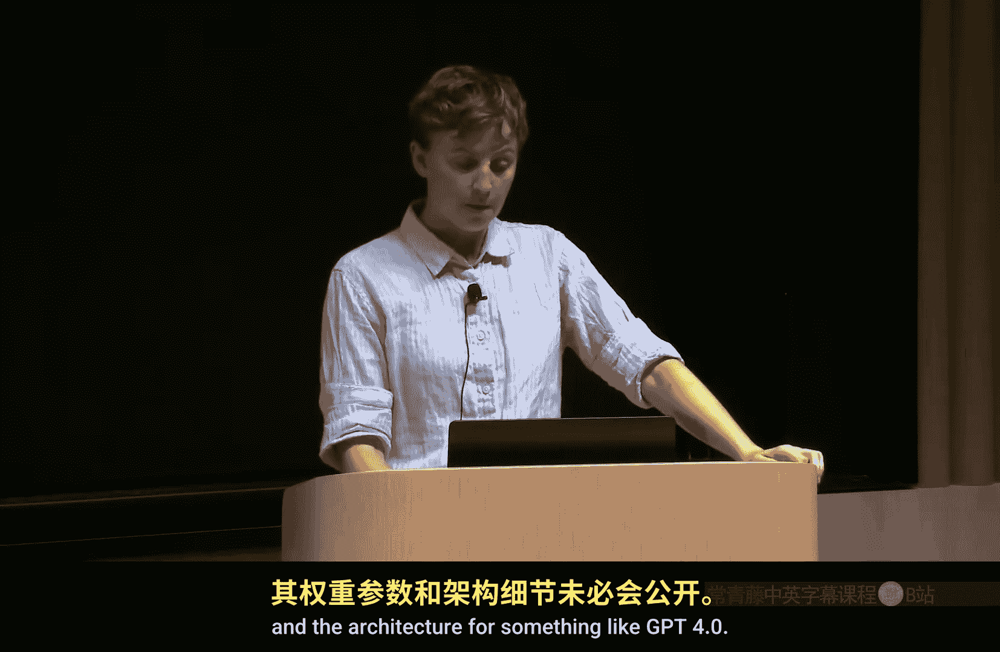

So。For the rest of the lecture， these are the signpost I'm going to use。Looking back。

 this is what we expect you've seen before。 the green looking forward。

 that's what we're going to cover in this class。😊，All right。Pretty straightforward。

I expect you have seen gradient descent before you come to this class。

So gradient descent essentially is the idea that we're trying to sort of optimize some cost function and the way that we're going to do that is we're finding some minimum over a set of all of our training data。

 some minimum set of parameters where then the loss is actually minimized for all of those different data points so what this actually looks like in practice you're trying to find some theta star which is like your optimal set of model parameters that minimize your cost function and so maybe you start somewhere random and then you know you sort of calculate your gradient now you update the weights of that model in the direction of the gradient and you kind of step through。

 etctera， et。😊，And I think many of you have probably seen this before and will sort of talk in an upcoming lecture。

 cover some of the different dimensions of things like stochastic gradient descent， et cetera。😊。

But we're assuming that you've seen this idea before。Pro an intro a ML lecture， for example。

Cing in this class we'll go into a little bit more detail backpro and specifically this idea of differential programming。

 so what does it actually look like to build programming languages that are structured around the idea of optity and optimizing through gradient descent for different components of that architecture and I think one of the things that's fun is thinking about you know what are you actually optimizing for and what are you pushing the gradients through too。

😊。

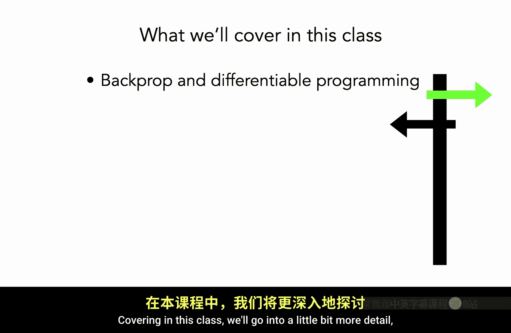

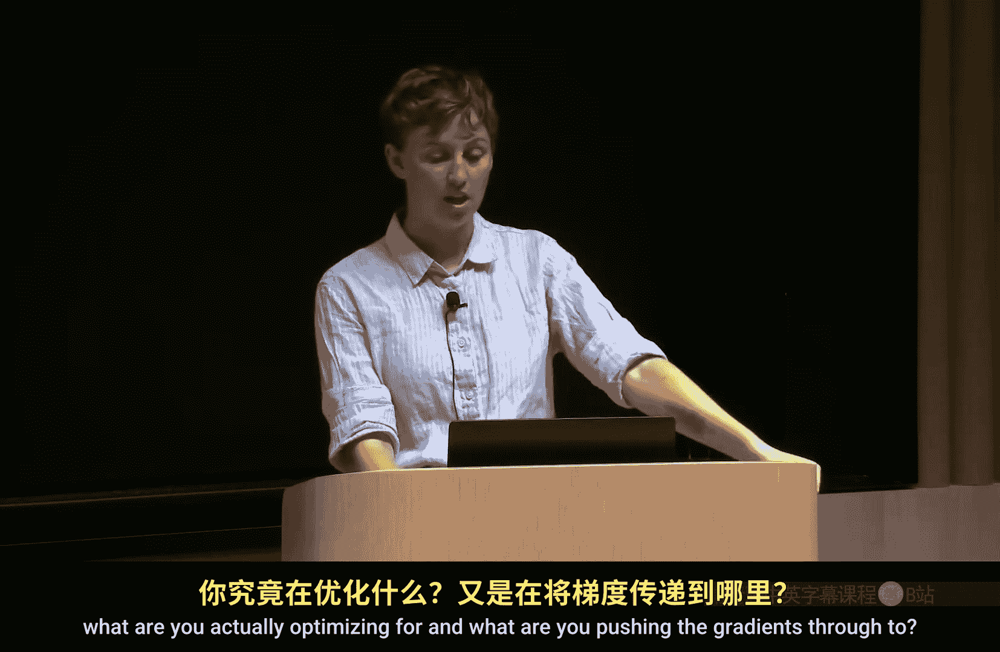

So。Here， one iteration of gradientding descent is essentially something like this。

We have some learning rate。And all of that， we're going to go into in a lot more detail next Tuesday。

 where we're going to be talking about， where does this actually come through。

 how do we think about what some of these choices are。

 and how we actually build out the learning structure for backP。

I do expect that you've seen things like multilayer perceptrons and nonlinearities。

 things like relo before。So computation in a neural network is often some form of vector in。

 vector out， and this arrow that goes from vector into vector out is a lot of what we're going to be talking about in this class。

What computation does that cover you know how does that actually build out so one cool thing about neural networks is that they often are reusing the same simple computational units over and over again right so there's often a lot of the same kinds of computation that are being repeated and kind of reused。

😊。

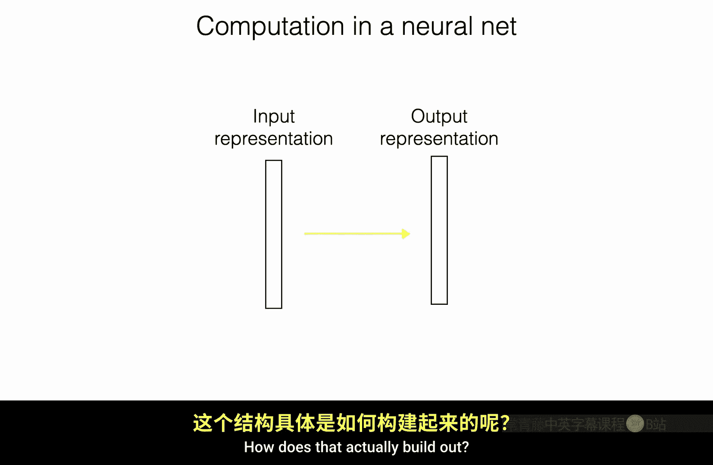

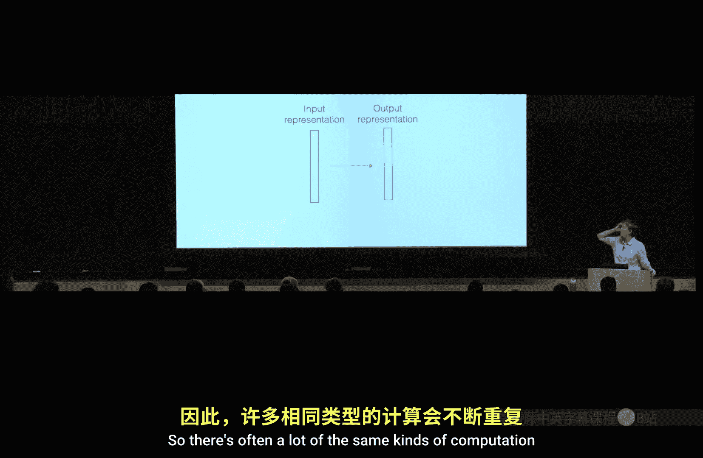

And what these actually look like， these building blocks that are being used over and over again。

 they're often some combination of a linear layer so here and we will be sticking with this type of notation for the rest of the class what we call z subj。

 so some component of this output representation in that linear layer that would be a sum over I of some weight times each of those input components。

 right？😊，Basically pretty simple， and that can also be written essentially this way where you have some set of weights and then you also incorporate a bias term and this is a term that does not actually take in any of those input components it's just a bias。

And that can also be written in a vectorized notation， which makes everything much more simple。

 So again， just with a focus on the notation， that output unit z sub J is x。

 that input vector transpose times W sub J。 So the set of weights that correspond to that output component and that biased term。

And then what we consider theta。 So that's all the parameters of the model。

 That's the set of all the weight terms and all the bias terms。

So what actually makes a neural net a neural net is the fact that it's not just linear combinations of inputs。

 you also have some sort of nonlinear function that is mapping your outputs。

 and that's something like G sub Z。 and in this case that's something like a pointwise non nonlinearity。

 so that's an important dimension that these nonlinearities are usually pointwise。

So one possible nonlinearity would be this one， right。

 J sub Z would be one if atu Z is greater than0 or 0 otherwise。

 Is this a good choice of nonlinearity for an neural net。Why not？

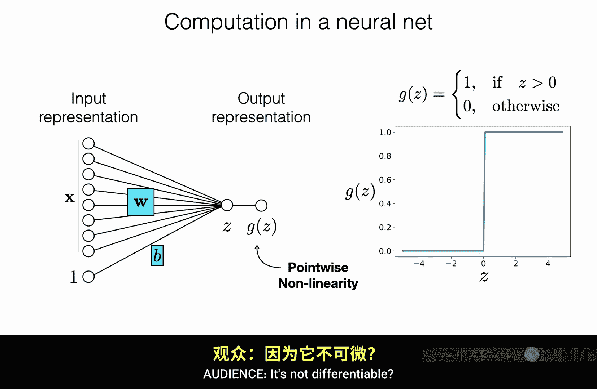

Yeah， so it's not differentiable， exactly。 And why is the fact that it's not differential， not good。

Yeah。It hinders back prop propagation， why？It makes it。

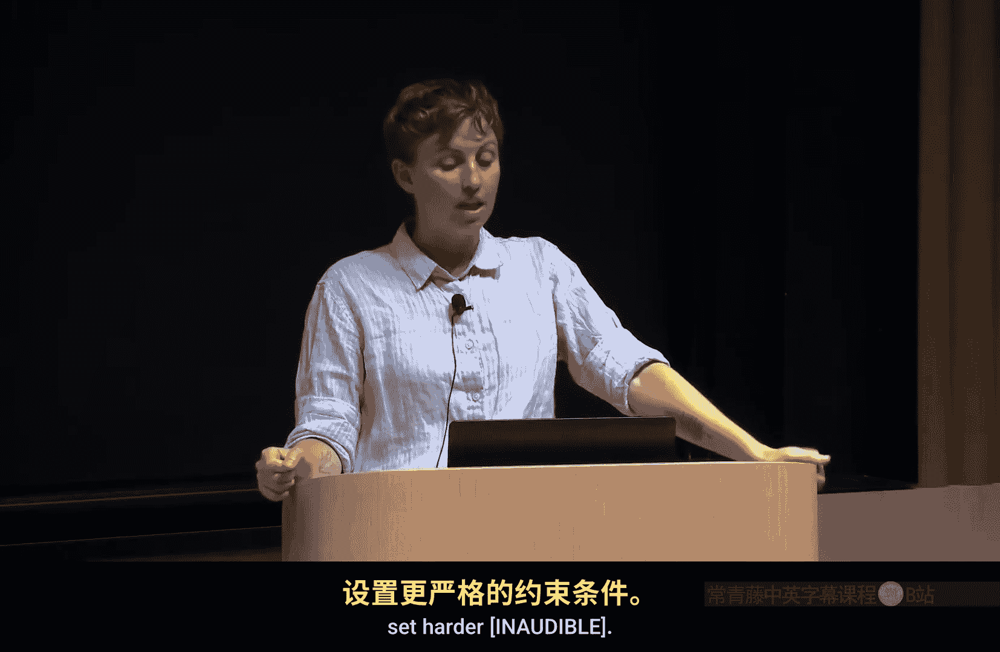

Yeah， so the directionality， right， like if you're。Anywhere on this graph。

You don't know which way to go。Essentially， the gradient is zero。

 so you can try to take a gradient of cent step you're not going to move because the gradient is zero。

 exactly。嗯。So this roughly is called a perceptron right。

 this linear input plus a non pointwise non nonlinearity and you actually can arguably do linear classification with a perceptron right so if you take a really simple version of this where your input is just twodiional x1 x2 and you have some W1W2 learned weight terms and used to combine to get Z。

 which is your hidden unit and then you map that via a function to y。

You then define Z as x transpoposedse W plus B， and y is now some function G of z。

What this looks like for sort of any set of values will be something like this where you essentially have almost like a ramp。

 right， It's， it's， it's a sort of。Clear and sort of standard gradient across。

Why would it look like this， so sort why is it sort of smooth and reasonably straight？

I maybe didn't pose that question super clearly so essentially the reason that mapping it looks like this is because it's a plane right。

 so any sort of two dimensional version of this is going to be a plane right with some orientation。

And then it's very straightforward actually to turn that into a linear classifier because all you're doing is taking some threshold on that plane。

 so even a single layer neural network can perform linear classification right。

 because now this threshold that's basically what that stepwise No nonlinearity is giving you it's giving you something that is you know thresholded at some value and so even with something quite simple you can do。

 classification。

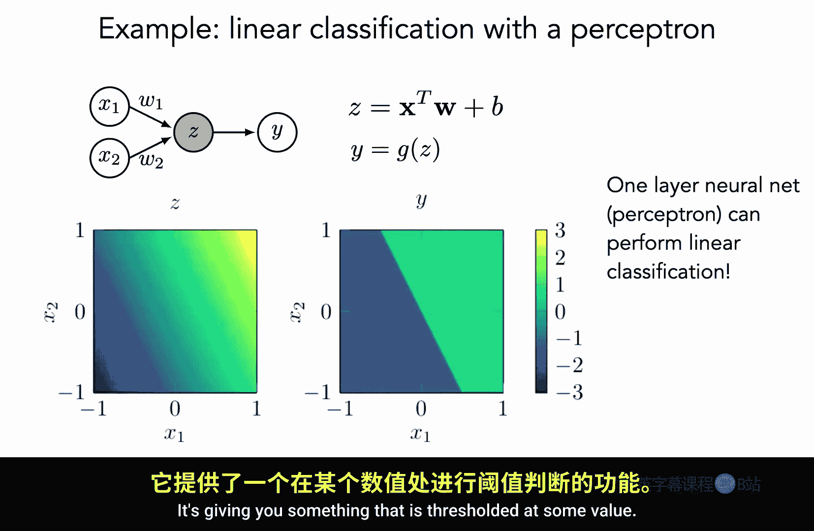

Now that's assuming that your data is linearly separable。

 right So if you have training data like this， which is linearly separable。

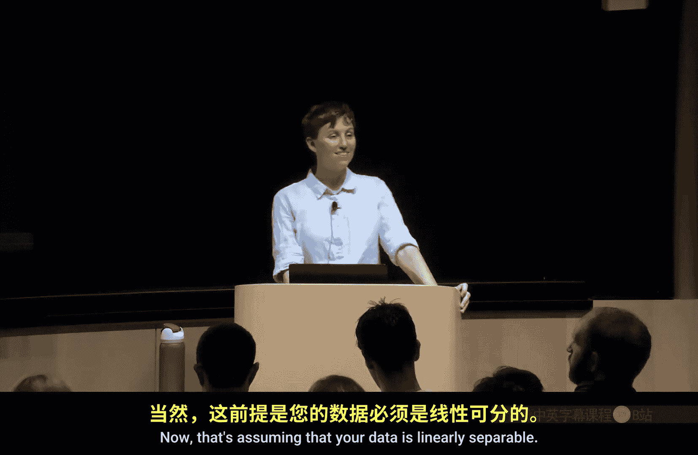

And now you want to find some optimal set of weights and biases that will minimize some loss term。

Where now again this loss is the difference between the true value。

 so here the true value is1 or0 and the functional mapping of the inputs to something like that value。

If you have something like this， this is what we'd call a bad fit， right。

 you have seven misclassifications。 you're actually doing。

You're wrong about more things than you're right。 And all of those sort of red values。

 those are going to give you a high value in your loss function。

Or you could find something that's sort of like an okay fit， less less misclassifications。

 and maybe this is something that your model updates to after a single gradient step， right。

 your decision service linear and now you're kind of fiddling around with what that classifier is basically which values of weights and biases you mean。

And then， you know， maybe after a few steps， you would find something that is a good fit where you're not actually misclassifying anything。

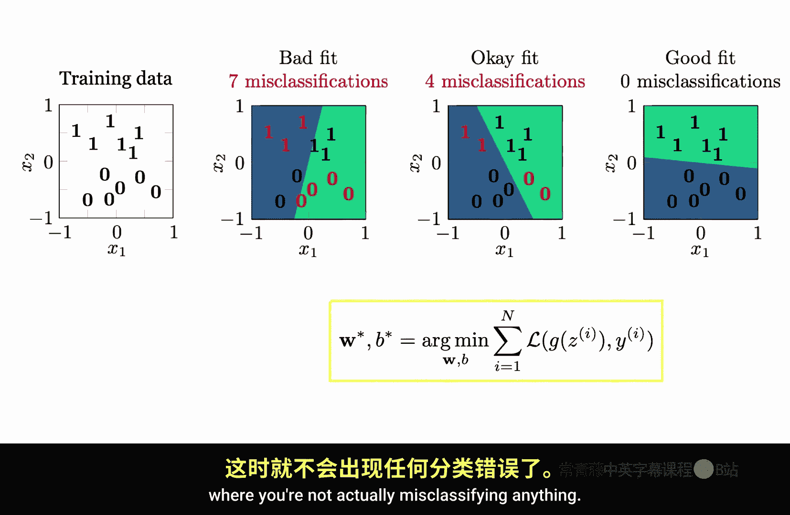

So it is possible to do classification of linear things， linearly separable things。

 even with something like a perceptron that's doing these really simple thresholdholding based nonlinearities。

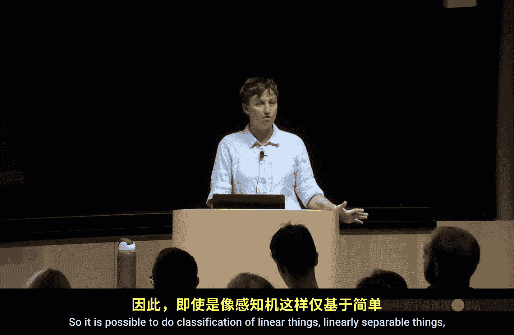

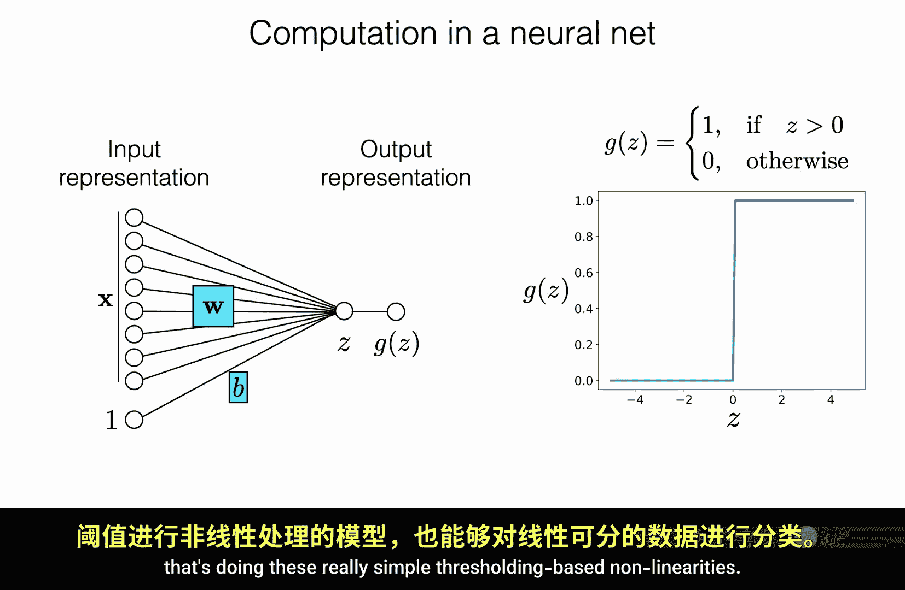

But like we said。This actually would be really difficult to learn， right？So instead， you know。

 maybe you would try something like a tanch。

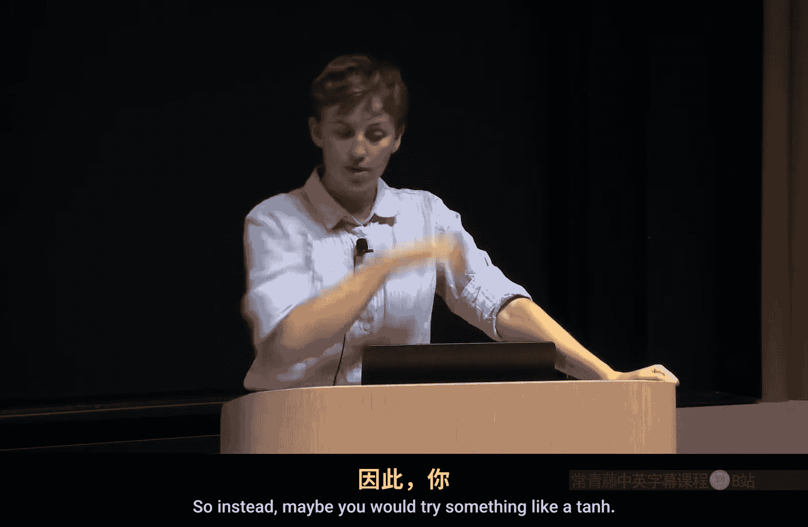

So this is another point wise non nonlinearity。And it was one of the sort of earliest ones that people looked at。

The things that are nice about this is it's bounded between -1 and 1。

 So none of the values are super huge。And you get saturation of the gradient for super large or super small inputs。

 you're not getting sort of explosions necessarily。

 but also if you start out somewhere that's really far from the center。

 you don't have a lot of training signal right because we're getting close to zero in our gradient。

And so those gradients do go to zero as we go to infinity。In either direction。

 the outputs are centered at zero。So the Tsha Z。Can also be written as two times the sigmoid of 2 z -1。

 So let's look at what that sigmoid function looks like。 So in this case。

 this is a sigmoid 1 over one plus E to the  H。And or e to the minus。Notation is wrong。

 Should be minus Z。 This can be interpreted as the firing rate of a neuron。

 was kind of the one interpretation of it initially。 It's bounded between 0 and1。 so it doesn't。

 It's not ever negative。Again， you have saturation of that gradient for super large or super small inputs and all those gradients go to zero the outputs themselves are centered around 0。

5 is kind of poor conditioning it's slightly biased in practice we don't actually use this So instead in practice what we often use is something called a rectified linear unit or a relo。

And this is just the max of0 and z。And this is unbounded on the positive side right so it can go all the way to infinity。

 which can result in for example， sometimes things like exploded gradients because the values can get very large。

 but it's super efficient to implementEssential the derivatives are just that step function。

And it also seems to help speed up convergence。 so in that Krchevsky paper。

 they showed that they got something like a6X speed up using a relo over using something like a tanch in terms of converging that model and learning。

The drawback is that if you're in strongly in the negative region， the units's what we call dead。

 there is no gradient， and so you essentially have this gradient collapse where you can no longer learn from that sort of component of the vector。

But this is our default choice， and it's widely used in current models。

 there's lots of sort of slight tweaks to this， but this is really， really common。Okay。

 so then the last thing we want to talk about in this sort of section is stacking layers。

 so we talked about sort of a single version of this where you have your linear projection。

And then you have a nonlinearity。But now you can take that and you just stack another one on top of it。

So now both Z and H are kind of hidden units， they're somewhere in the middle of the model。

 we don't necessarily， they're not seen at the inputs or the outputs。

 essentially then you can also kind of remember that all of these things are kind of stacked on top of each other almost in parallel as well because all of these inputs are mapping to the different components of the output vector and so you have weights for all of those different dimensions。

So this means that H， sort of our output of the first layer is going to be G。

 that pointwise non nonlinearity applied to now instead of vectorized w transpose x of j to give us sort of the individual J component。

 you can actually just think of this sound as a matrix multiplied by a vector。

 right all of the weights for all of those different dimensions multiplied by the vector x plus the vector of all your biases B1。

So now you have this kind of cleaner notation。And then now y is again G。

 that same pointwise No nonlinearity applied on top of your sort of outputs of your first thing。

 but now with H right multiplied by that vector of all your second layer weights and added with your second layer bias term and so now your set theta。

 your model representation is the set of all of the different weights from all the different layers as well as all the different biases and all the different layers oh theres thank you。

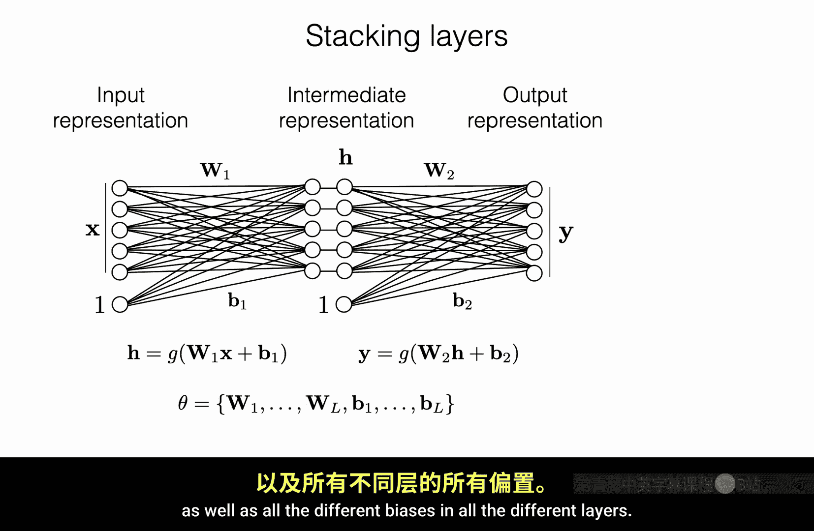

Oh yeah， thank you。So you're asking， in practice， are there any best practices for choosing the linearity based on different types of data？

I think in the literature， there's maybe sort of， you can kind of see it coming out。

 but often people really do use Relo quite a lot。I， but I， I mean。

 I wouldn't say that there's any sort of great general rules of thumb there and often。哎。Yeah。

I would say there's like different things that people have converged upon based on experimental success right so you'll sort of see in the literature like oh yeah。

 everything in this line of work on these data sets with these things。

 they're always using you know one or the other component and then people kind of build on that Sometimes that's called grad student gradient descent。

Because you're essentially writing research papers and like learning from those research papers。

 what parameters in terms of things like your activation functions make sense。😊。

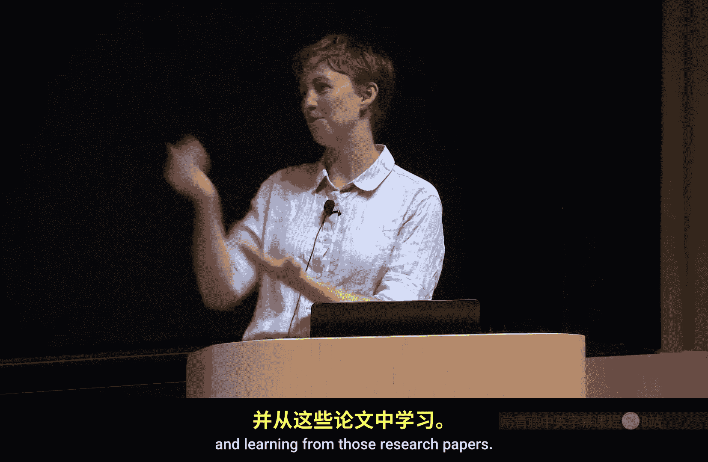

But yeah I don't know that I have great rules of thumb of like， oh， for this type of application。

 you should always use this or that。Do you Yeah it's not a hard science。

It's usually about what makes the network more trainable rather than like trying to model a certain kind of data but there are a couple of examples。

Using a sinusoidal known in the RD to pick out。That are。不 you做 and我。

Does learning a great answer that question Yeah， so what Jeremy was saying is basically it's not a hard science。

 we don't have like sort of theoretical guarantees of like this is what you should do。

 but in practice there are yeah there' there's sort of counter examplesamples to that so if you know。

 for example， that your features are sinusoidal it maybe makes sense to try to pick out like Fourier representations you're working the Fourier space then maybe you should use a sinusoidal activation。

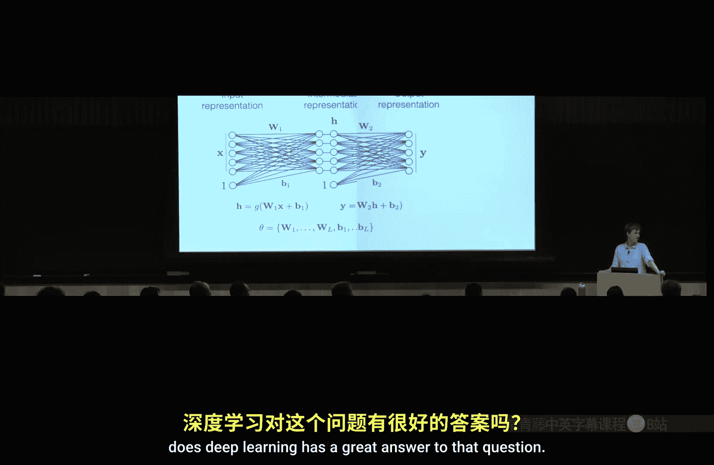

Anyway， but yes， I wish that we better understood it。 and that's。

 I think why we need a lot more research on the theoretical side of like understanding， you。

 how do we actually choose these things appropriately。

Instead of maybe learning everything from scratch or doing it experimentally。

 burning all those trees。U。

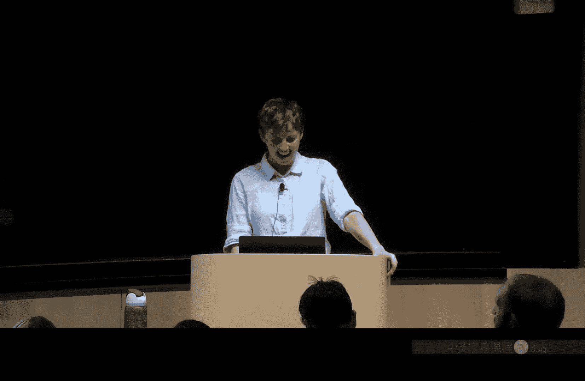

Cool， so the premise is we're modeling out all the different layers of weights and all the different layers of biases。

😊，And so， you know， like we said， you can do linear classification with a perceptron。

 but the fun thing is oops， you can do nonlinear classification with a deep net。

 even if that deep net is just a two layer perceptron。

 So here now we've built sort of a double layer。😊，Models still only in two dimensions。

 So now we have， know mapped through essentially just this simple non nonlinearity in between these two different layers。

Now， if we look at what this looks like， that first layer is giving us one kind of ramp。

The second layer gives us a different ramp， because it a different linear model。 And now。

 if you do this nonlinear combination of them， essentially what you get out is you can actually map almost like。

 it's almost like， think about。The intersection of one ramp with another ramp。 you won。

 you get like a kind of triangular， almost like a pyramidal component that will be。

Higher than everything else。 and so now you can still take a simple threshold of that and now you can get out a nonlinear classification and of course you can expand this into many more dimensions right but this is I think some nice simple intuition building as to like why you start getting nonlinear models when you're taking linear combinations but with these nonlinearities。

Cool， so another。 so we kind of expect that you've seen a lot of that before。 but moving forward。

 one of the things we are going to cover in this class is what we can approximate。

 So what do we know about what is possible to approximate with deep learning。😊。

So the one dimension of that is representational power， right， so you have a single layer。

 you can do any linear decision surface。😊，If you have two plus layers in theory you can actually represent any function and this is assuming。

 of course， that you have some non-trivial nonlinearity between those layers because if you don't have that nonlinearity。

 it turns out that a linear layer and another linear layer this is just a linear combination right it's still linear so you need that nonlineararity but doing that you can actually approximate anything and kind of one way to think about it is like given you some amount of capacity。

 some number of kind of different dimensions that you can do you can actually sort of approximate any function right。

This is kind of a rough hand wavy intuition thing。 but as you're shrinking the kind of size of these。

These kind of different。You know， vertical things bringing something like a ren sum， right。

 You can approximate any integral as long as you have enough capacity in terms of the number of small things that you're building up。

So this gets at basically one of the issues which is efficiency。

 so in theory you could approximate any complicated function with a sufficiently wide two layer network so this means not two dimensions。

 you know maybe thousands or millions of dimensions。

 but in practice that's actually very inefficient。So a narrow。

 deep model may be something that only has much fewer dimensions in terms of the size of each vector。

 sort of each input and output， but now many， many， many more stacked layers， you might be able to。

 with a lot less parameters， approximate the same complex function。

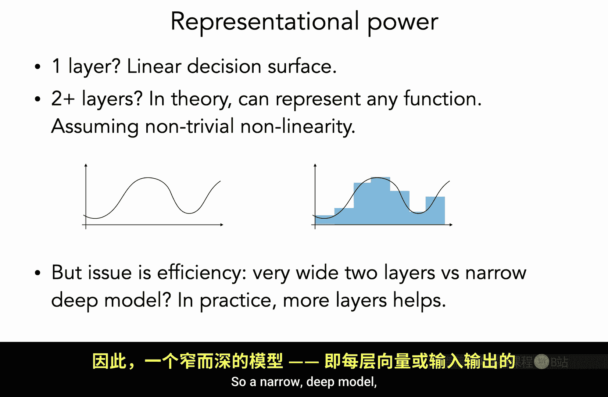

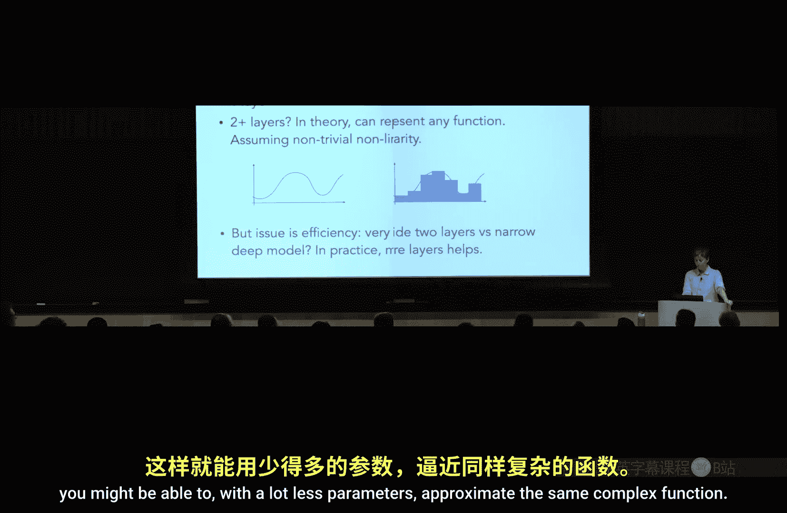

In practice， we do find。 That's true。 Mo layers helps。

And we'll get into this little bit in lecture 3， which is about approximation theory。

 the theory of kind of what it is possible to approximate。

And then the other thing that we're going to cover in this class is architectures。

 So you know we talk about deep networks really often we're talking about something that's roughly like this。

 right some cascade of repeated， simple computations。

 each of these new linear and then linear models of thelineity and then with every increasing layer。

 we're kind of getting more abstracted representations right you're getting a higher capacity model and this means it can form more complex and abstract calculations whereas a shallow network of you know if it's not sufficiently wide。

 could maybe only efficiently compute simple things like maybe finding edges deep network could efficiently compute harder things like recognizing this clownfish or translating into list to Chinese。

嗯。And so this classification of complex things， essentially your whole function F of x。

 is now this sort of stacked or almost like chain like mapping from your final layer。

 which is then a functional mapping of your previous layer and in and and and and and in。

 all the way back to that input。😊，And there's a lot of different ways that we've learned to build these mappings for different types of problems and based on the structure of the data we're trying to model。

 and we'll get into that we'll talk about CNNNs， GNNs， transformers and RNNs。

 so convolutional neural networks， graph neural networks， transformers and recurrent neural networks。

And then the other thing that we're going to be talking about in this class is when and why we can generalize you know so why did JeNes generalize essentially deepnets have so many parameters。

 they could just act like lookup tables， you just regurgitate the training data but instead they seem to learn rules that generalize and this actually defies classical theory。

 So the classical theory basically says that if your model is over parametera overparameterized。

 it will overfit there's this sort of capacity versus risk or error curve where if you don't have enough capacity。

 you're going to underfit the model and then with too much capacity you're going to overfit but in practice this is from this paper double desent what we see is that in this modern interolating regime we kind of go past that point of being overparameterized and we're actually then able to actually you know pass some interpolation threshold or ability to sort of have enough capacity in the model to interpolate between the data points。

We're actually able to then potentially get even better。

 even though the models are massively overparametized， yeah。

Cacity is the number of parameters in the model。 So that's both the width and the depth。

 basically how many values are captured in those model weights。Yeah。Yeah。

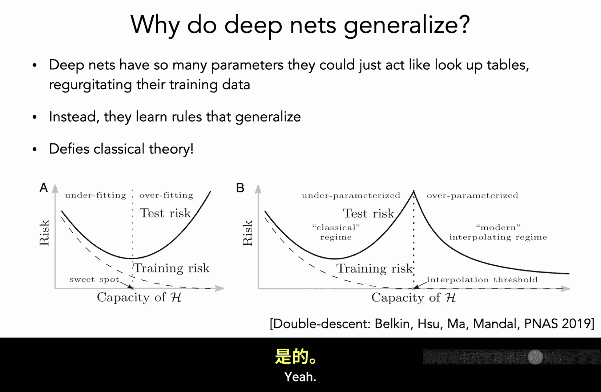

Yes， thank you。And how does that relate to the size of the data samples？Yeah。

 so that is not a dimension on this plot， but it definitely is also related right so if you have but it's related in a different dimension。

 if you're learning from fewer data points， it's very easy to learn to kind of maybe overfit to those data points。

 so you can kind of think of that honestly in another way maybe as being a different dimension of capacity here where it's like almost the capacity of your training data。

 of course there's not like a direct translation， but so if you don't have enough training data。

 you also can't learn to interpolate between those data points because you don't have enough coverage of the data distribution。

I live in that world a lot， we often don't have enough data to kind of learn a general representation without a lot of handy tricks and we will talk about some of those different tricks in this class。

 some of the different ways that we try to convince models not to overfit to data and try to learn to sort of generalize beyond maybe what is kind of captured in the data。

 but I think that dimension is really important， it's one of the reasons that none of this was possible until we started building big enough data sets where you sort of had enough coverage of the space that you wanted to model in your data to be able to start interpolating between them Yeah。

Oh。Yeah， so I mean， I think this paper would be great to read to be able to really get into it。

 but essentially the idea here is that in the previous literature。

 we sort of said that at some point， if you had kind of too many parameters。

 you were going to overfi and learn a model that actually generalized worse because based on the amount of data that you had。

 it was going to kind of there's really a classical example where you have like three data points and if you try to learn。

Like a you 12 dimensional function， it will learn something like this to fit those data points perfectly。

 but actually it's not likely to generalize because it's basically too spiky or toopey So that's the idea of overfitting but this idea of like overparametized is basically instead of saying underfitting and overfitting now we're saying that the new paradigm is underparameterized and overparametized and what they're basically saying is that you maybe can't be too overparametized。

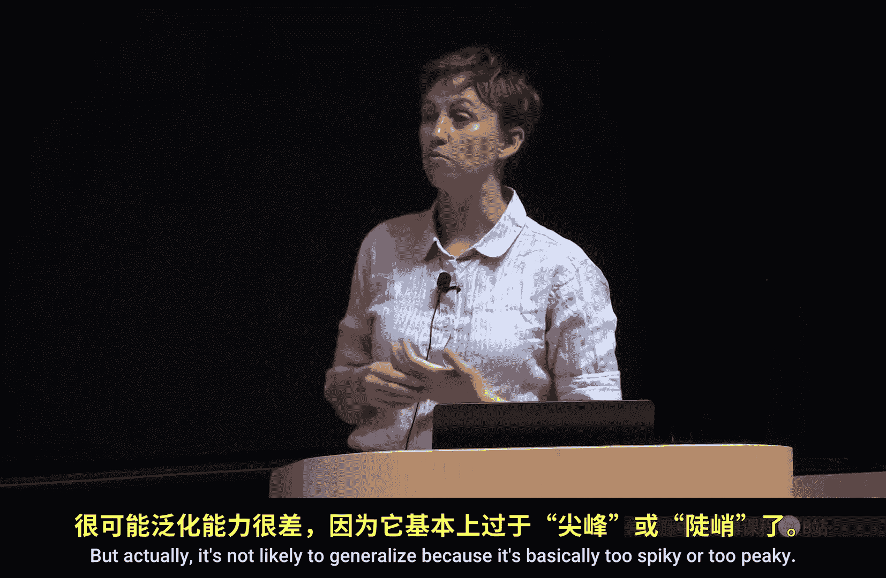

都。This perspective is one that doesn't take into account resources。 So， you know， there's many。

 many people in places and， you know， places that are at MIT。

 but even actually in this class where we don't have infinite compute resources。 So actually。

 what you really want is some optimal point on this curve where you get good performance。

 but you're not。

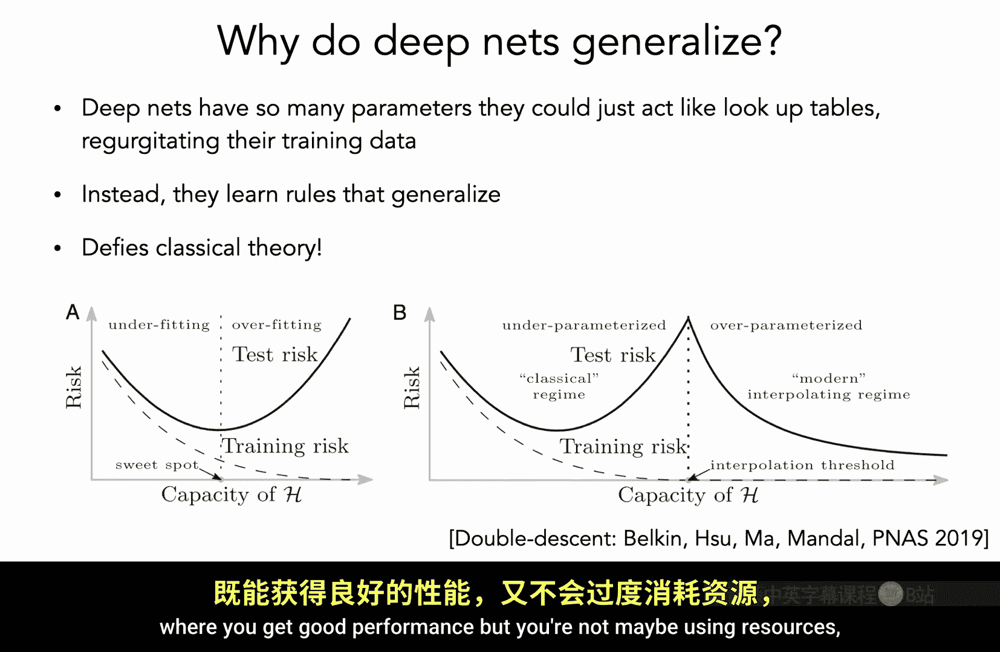

Maybe using resources that you don't have like super， super large memory GPUs。Yeah。

Can you give the example of using two very wide layerss versus multiple narrows。

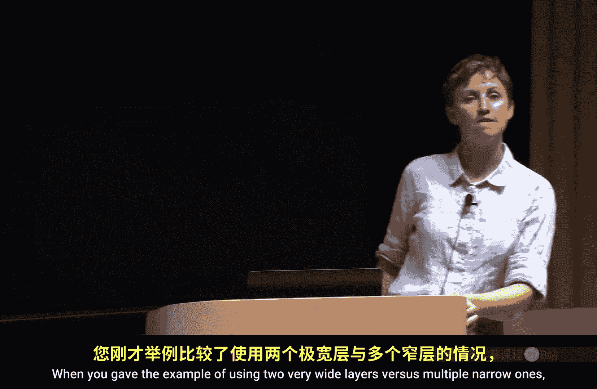

I说你么。Which is there。あ緊。全ち。Yeah， okay， we're definitely going to get into this a lot more in some of the later lectures。

 kind of like these choices between like breadth versus depth and bottles。But at a very high level。

 like your intuition， I think that you're getting at is kind of correct。

 Like if you have only two layers。嗯。Actually， maybe not because if you have two almost infinite parameter layers。

 like really， really high dimensional space， is' hard to interpret。

If you have lower dimensional space over many， many different now stacked。

Vions of these layers it's also hard to interpret， so I would say like in ecology， for example。

 people often still use just generative additive models of you know a bunch of different linear things because they need the interpretability or they feel like they do and anytime you get to large numbers of parameters in either dimension that interpretability gets more difficult。

😊，I was just going to add that。Even in like let's say， open AI。

 it's like a closely guarded seat for it。

What recipe of like width versus depth that they use in like GPT， whatever。

 like if you can come up with like a really scientific way to answer that question。

 you could go and get a job there and make seven figures？Yeah。

 so what Jeremy is saying is like there's no perfect prescription or recipe for width versus depth and what's optimal。

Yeah。

嗯。So the simplicity hypothesis in classical theory basically says that big modelss learn complicated functions and overfit the data。

 and the immersion theory is that deep deep networks actually learn simple functions that generalize。

 and we're going to talk about this a lot more in a theoretical and a more experimental lecture around generalization。

 both in and out of distribution。Okay， so again， what I've expected to see before。

 softm cross entropy loss， basically we have this model that we're trying to use to learn to classify something like confish and then we assume that we've seen some of these really basic loss functions that we use for this。

 so for example， if you have this is your last layer。😊。

And now you have some set of categories you're trying to learn to categorize over。

 The simple version of this is you take the argm and you say okay， well。

 the thing that's darkest on here is clownfish and then the loss that you would calculate is okay。

 the actual correct ground truth label is is clownfish and then the error between those two in this case is zero。

 So it's small。 So you've gotten the correct prediction。 and then。You know。

 maybe actually the real ground truth label is grizzly bear。 and you've said clanfish。

 Now what you'd want is for your loss to be large。 So you want some lost function that just does a good job of punishing you when you're wrong and punishing you。

 not punishing you when you're right。And the way we actually do this often is we if you assume the an net output is some normalized vector。

 then when you can kind of think of this as a probability distribution over different possible object classes and so what you want this loss function on the right。

 this is called cross entropy loss this essentially indicates the distance between what the model believes the output distribution should be and what the input distribution actually is。

 which in this case is what we call like a one hot encoding or essentially a vector that's zero everywhere except for the place where it's correct where it's one。

And so essentially just telling the network to maximize the probability of the training data。

 which forces the output to be a reasonably good probability model of the object class given the image。

 assuming you have enough training data。So what this looks like in practice， you say confish。

 the ground truth label is confish。Maybe this is your prediction， so now the score。

Is basically saying like this is how much better you could have done right。

 how much better you could have done， which is the difference between the amount of probability you gave the class con fish I'm putting probability in quotes here it's super important to know that these are not true probabilities right there're scores and then that red is kind of the dimension that you could do better and that's telling you the direction of the gradient you want to go in。

So， you know， maybe grizzly bear， you got it correct， it's grizzly bear。

 and now the amount that's left over is small。Versus actually if it's， you know。

Cmeleon and you're saying Iguana， essentially this thing is normalized。

 if you put a lot more probability on one thing than the correct answer。

 then you end up with a much smaller amount than now you're looking at the difference between it。

And basically the idea with all of this in deep learning is you're kind of taking all these different weights in your massive model and then you're fiddling around with them until you match the desired output for all your training data right you're basically just wiggling around all these different weights right。

😊，You're going through your training data， you're predicting something， you're calculating a loss。

 and you're doing this for many different data samples。

 and you're doing it over and over and over again until the model gets everything right or as close to everything right as possible。

We also expect that you've seen some amount of parallel processing and the idea of tensors before this。

 so this is the idea that a lot of this stuff because it's repeated calculations。

 you can be done in batch so each of these individual losses for the individual data points well it's all going to be summed anyway so you can do it in parallel and now you can take these batches and more efficiently calculate that sum and so look right you take the same layer for all three of these you can stack them and now essentially you get this matrix that's featureds multiplied by images and so that's kind of what your tensors are right these multi-dimensional arrays and every single layer。

 some representation of the input data。😊，And actually everything is a tensor。

 right a tensor is just a multidimensional matrix。 So you can say， okay。

 like here's our mathematical representation of this model。

 but you can also just represent it this way， right you have these vectors of your different input values。

 and now you have your batch dimension， which is now this like vertical stacking of all those layers and now you multiply that by your weights matrix and you get out your output and then you run that through pointwise No nonlinearity and then again。

 just another matrix multiplication and then you get your output Z2 and then you take that nonlinearity。

 you get y So this is kind of this is why the fact the GPUus can do so many multiplications in parallel was important because we can rewrite all of these models is just essentially sets of multiplications and we'll go into this in a lot more detail as well in the future。

What we're going to cover in this class is how deep networks represent data。嗯。Essentially。

It's kind of this idea where deep networks are a more compact way of representing knowledge in data and previous methods we saw were kind of more like lookup tables。

 but there's other and maybe better ways to learn a mapping between input and output。

 basically assume that there are kind of these lower level building blocks that are useful for many different possible downstream tasks。

 So one nice example is the idea of trying to learn a classifier for the letter T right So if you want to learn to classify the letter T。

 You could try to build a classifier just for the letter T。

 or you could take a classifier that classifies lines and you could say okay。

 here's a line and then you could rotate have a rotation of that classifier and you' say here's a line。

 And now all you have to do is understand the connection point between these two lines right So that line classifier is reusable in some combination to get a t classifier。

 And that's kind of the basic idea here。 and actually kind of in this。诶。Posttak way。

 we've analyzed what is learned in the layers of things like convolutional neural networks。

 and we do see that you'll get low level representations in the earlier layers and then get combined to more and more complex representations in those later layers。

And you can actually kind of see this as well， right if if you take an input image and you take those and you sort of cluster them in some low level representation of the space for each layers。

 the layers earlier on in the network are not going to cluster well by category because they're really just categorizing things like does it have。

Direectional orientations of light and dark gradients in the pixels。

 But actually where you get towards the end of the network， it's learning more concepts。

 And that's where you start getting these clusters of different things like fish。

And we will sort of talk about actually how that representation learns and is sort of structured through space in a bunch of different lectures on representation learning。

 where we talk about reconstruction， similarity and theory。

We're also going to cover generative models going forward in the class。

 and this is things like text based and image based generation， and we'll cover basics。

 representations， and conditional models。And then we're going to cover in this class how to think about weight reuse and some of the efficiencies in terms of training if you're able to reuse components of previously trained models。

So here again， you know， this idea that like， all right， well， you learned this thing to categorize。

picictures of animals and now maybe you want to categorize some sort of satellite imagery well actually a lot of those initial components about lines and orientations and structures。

 those are useful for both of these right so you know what do we really need to learn from scratch versus what is kind of generally useful in terms of the representations that are learned。

嗯。😊，And this is really valuable if you don't have big data or big compute， right。

 if you can kind of pregenerate representations that then you can learn on top of without needing to learn everything from scratch。

And so we'll get into whether or not these things are generalizable or transferable in these transfer learning lectures。

 we talk about models and data。😊，And then finally， we'll talk about scaling。So， you know。

 when you think about the scale of a brain， something like this little worm only has 302 neurons。

 so you can think of that as 302 different sort of。😊，Values in its neural network， fruit fly is 15。

000， human beings have 100 billion roughly。Elephants have 250 billion neurons in their brains。

 I work with elephants a lot， they're amazing。Um。And。

We'll talk about scale and deep learning and kind of what this means and actually get into some of the really great questions that different people asked in terms of how does maybe scaling rules change when you're thinking about optimization。

 what are the laws of scaling， how do we think about something like automatically learning。

 how to best optimize a model？Great。So。Tried to cover today how we got where we are today。

 basically just honestly mostly joking， but definitely like a brief history of sort of these fluctuation hype cycles。

I would say that。Everyone's pretty clear that we're currently in a really hypy part of the hype cycle。

How what we expected you maybe saw before and also a very high level some of the things we're going to cover in this class。

 so I'm happy to， if anyone has any final questions。

Yeah。How long it'll take the first lecture to get how many views？Well， I mean， honestly。

 the intro lecture is probably going to be the least watched of all the lectures。

Because it's just a bunch of course logistics， we might even edit those out， but great question。

 I have no idea。

