# 麻省理工学院【中英⚡深度学习｜6.7960-Fall-2024,-Deep-Learning】-p03-P3-近似理论--BV15QZ4B1E6v_p3-

However。Okay， I'm just gonna start it。所。Here's a question。嗯。And I'm genuinely asking， would you。

 would you rather to scale the width or the depth of your on your own network。嗯。

Does anyone have any thoughts。Wait， someone said something。I hit someone say death， but I。That why。

someone said it earlier， just you've heard deep learning， so it sounds not。It's not Yeah， okay。

 but it's kind of not really clear about like， how do you even answer a question like that。

I didn't know。I don't know if I， okay。It's something we gonna to think about。So in today's lecture。

We're gonna ask this question of what class of functions can a neural network express。

 And you may have heard this statement that neural networks is a universal function App those。

So we're gonna to think about。What that means， and。Well， if。

 if a neural network is a universal function appmator and it can approximate any function that we're interested in。

 then how should we make decisions about the architecture， Like。

 does it matter how many layers there are。Should we， you know。

 maybe a few layers is enough if you make them really wide， should you have lots of layers。

And ultimately， what do you want to do in practice and does thinking about neural networks through this lens of universal function approximation actually help you in practice。

唉。I'm not going to claim to answer all all of these questions。

 but at least try to provide some beginning of a framework for one framework for thinking about。

 though。Sir。In machine learning， you can think of it like bit like we have a puzzle。

 and there are different pieces of the puzzle。 We're not gonna solve the puzzle until we understand all of the pieces and put them together。

嗯。And I broke it up here into three pieces。Let's see。So the first is approximation。

 This is the question of， does there exist a neural network in my model family that fits the training data。

 So given my architecture， does it kind of even represent the function that I want that fits the training data。

The second question is optimization。 So let's suppose it does exist。

 Then that that's the question of can I find it。And third is generalization。 So suppose it exists。

 Supp I can find it。 Then it's kind of like， does it do well on unseen data。 So that's what I really。

 I really want all of those things to happen if， if I'm gonna like solve my machine learning problem。

 But in this lecture， we're only gonna look at the first question about approximation。

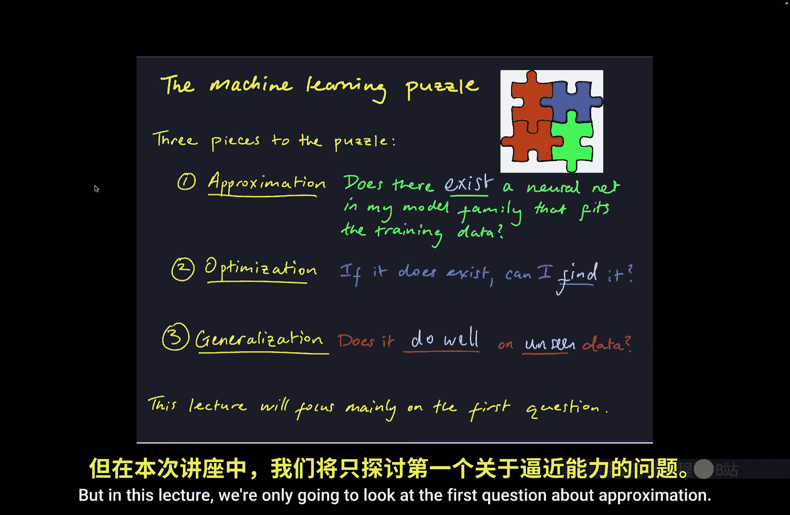

But just to remind you that there is this puzzle， we really want to solve the whole puzzle and put the pieces together。

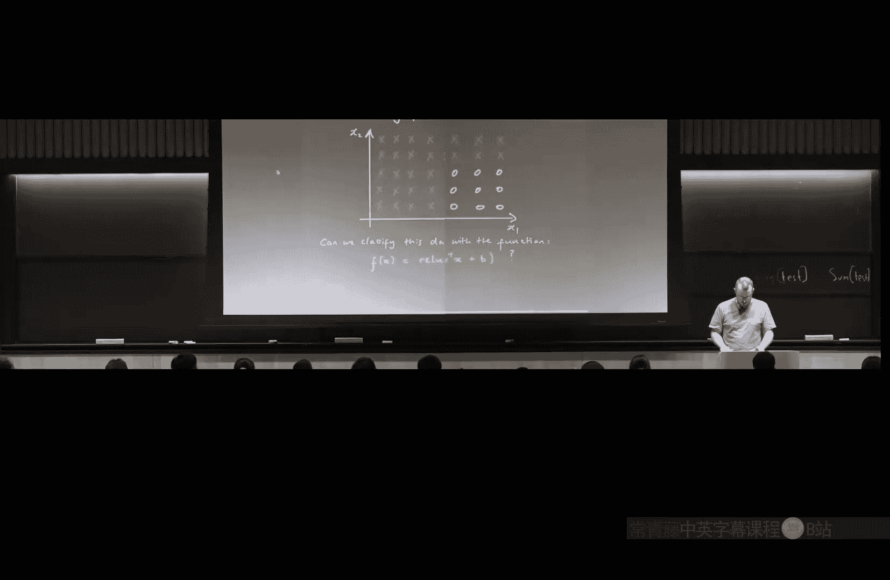

So here is a motivating problem。 So imagine I have like two dimensional data。

 Like it's got two coordinates， X 1 and X 2。 And like， there's two classes。

 the red crosses and the green circles。😊，And I， I've。

 I've come up with my think of this as like a one layer and you're on that sort of。 It's just the。

W transpose X plus B。 And then I take re of that。 Can， if that's my model， can I fit this data。

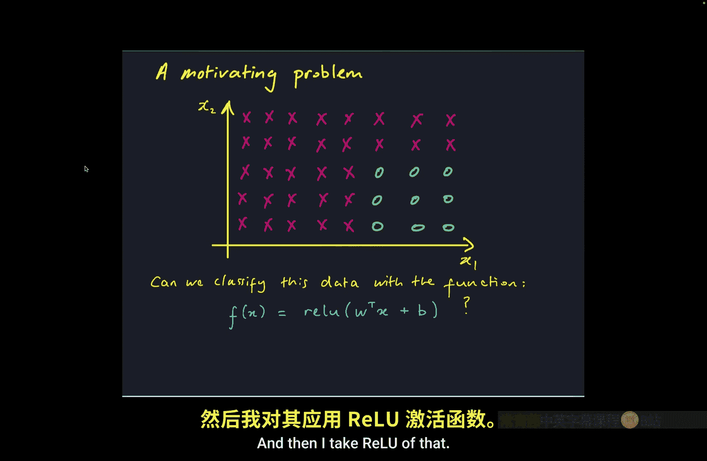

What's your name， sorry。mat麦 is成女喂喂。Linear like separation。

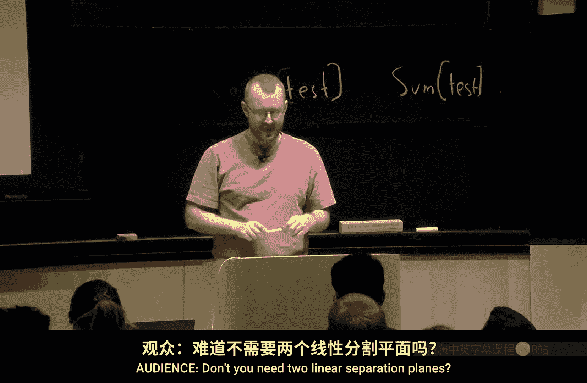

Yeah， so because because this thing is only one， there's only one hyperplane defined by D transpose X。

And， and really does not distort the shape of the hyper planee。

 It just applies an linear nonlinearity on the output。 You can't。

This is basically a linear separator。 And， and this class of day。

 this data is not linearly separable。 So this is supposed to be recap from lecture 1。So hopefully。

 it's reasonable， but we， we cannot linearly separate this。

But what if I had a two layer here on that， Do you think I could maybe do it with two layers。

Potentially， yeah， okay， so I think we can do it with two layers。 but you may need to think about it。

 but this is just supposed to be a refresher。 But it's saying we've got a kind of function that we're trying to fit。

 And we have a model family。 And we're asking， does there exist the function in that model family that can fit that data。

 It's a kind of warm up for thinking about this idea of function approximation。😊。

I have a second motivating problem。Does anyone recognize this function。You recognize it。What。

 what is it。Yeah， it's， it's why stresses function， which is everywhere continuous。

 but nowhere differentiable。 It's like a classic example of a pathological function。

 And it's like the question I wanted to ask is， do you think you could fit this function within your own network。

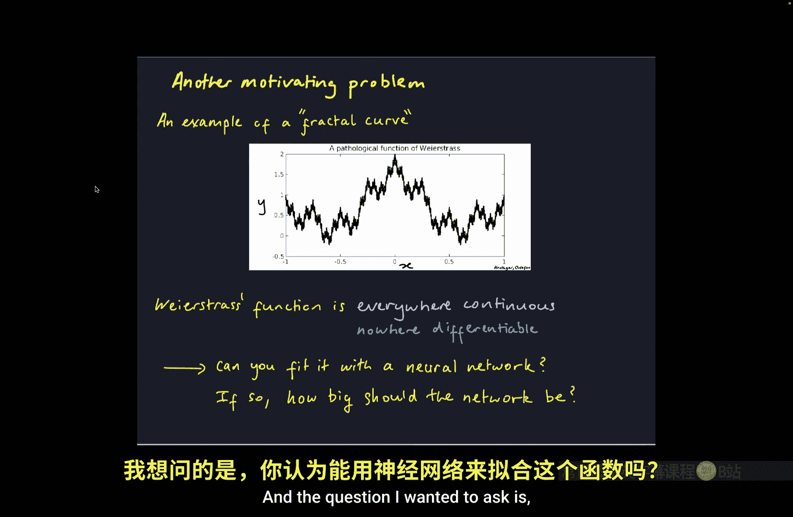

嗯。Does anyone have a thought。 wouldnn't it kind of like you'd have to like go to input。Asyntically。

It seems like you would need some kind of as audit it。 Yeah，Honestly。

 I don't know how what the answer is to this。 I just thought it was like an interesting。

 It's an interesting function。 And it's interesting to think， can I fit it within your own that。😊。

I guess as suppose that is maybe。 And I thought， you know， a good final project。

 if someone wants an idea is to like take， take all these pathological examples that via stress was thinking about and see if you can fit them with and you on that。

 But， but anyway， this is just more motivation， just something to think about。😊。

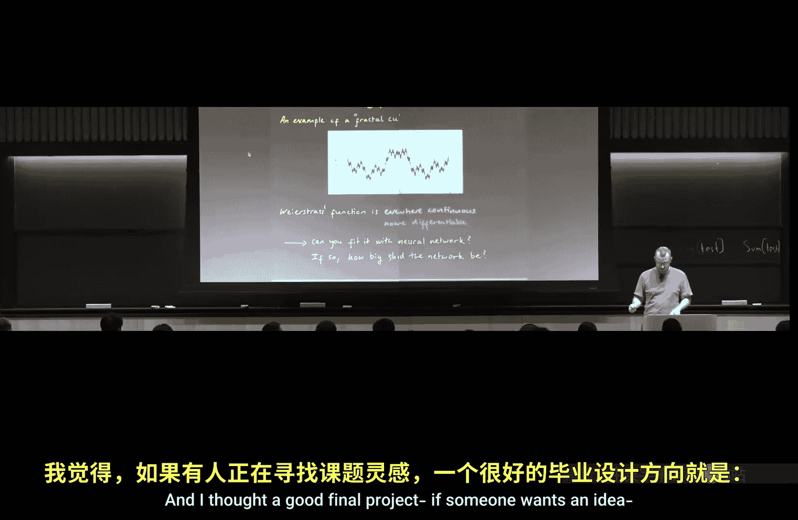

Oh yeah， so this is a fractal function。 It's like defined recursively。 It is like self similar。 Like。

 if you zoom into any piece of the function， it resembles the whole function。嗯。

So we want to now like， formalize this approximation problem that we've been talking about。

So given a family of curves。G， we think of these as the curves that we want to be able to approximate ideally。

 And you， we can choose what we want G to be。 Like we could choose it to rule out。

Via stress function， we could ask that G is differentiable， or we can。

We're free to pick whatever family of curves we we're interested in。 that's up to us。

And then we think of a family of neural networks， F。 this is like。You know。

 I'm gonna say I care about a5 layer MP，5 layer multi layer peret。That could be my family。

 So in other words， in a neural architecture could specify a family of， of functions。

And then I want to say， if I pick any curve in my， in my space of functions or or set of functions that I'm interested in。

 does there exist a neural network。In my family of neural networks that can fit that function to some small error。

嗯。And like we， we can kind of come up with different notions of error。 And okay， here， Epsilon。

 You should think of Epsilon as like a small number。 So like， we choose the epsilon and we ask。

 can we， can we fit， Can we approximate any function in the family of curves G。

To less than some small error。Okay， and we have to ask， what do we mean by the error So like。

 we could， we could pick whatever metric we want。So one example， we could call the。

The L infinity arrow， which would be the max over inputs of。

At F of x minus G of X and then take the absolute value。 So this is like。

 think of it like an L1 norm， but just measuring， sorry， an L infinity norm， but for functions。

So it's the max， the max discrepancy between the two functions anywhere on the input space。But。

 you know， another， another equally valid error measure could be， we could call this the L1。

 the L infinity measure。 Another， another measure would be the L1 measure。

Which would be like the integral over the input space of the absolute value of F， O X minus G of x。

So that would be another valid way to measure discrepancy。

 which is like integrate over the function and just sum up all the differences along the whole。

 along the whole axis。So in this lecture， just to， for the purposes of having something nice to present in the lecture。

 we're gonna pick a particular family of curves G that we're interested in。😊。

Whether neural nets can approximate this family。 And these are the lips's continuous functions。

So has， has anyone well。The clay， okay， I think it's nice to teach you about lipss functions。

 regardless of neural net approximation。 So that's another nice reason to tell you about this。

 So let's， let's just think what a lips' continuous function is。

 It's a particular notion of continuity。😊，So， what we're gonna do is we're gonna say that。

That a function G。From real numbers to real numbers is our lipsit。 So L is like a number。

 I Think it' is like 10 or 5， but it's just measures how lipsts the function is。

We'll say it's our lipss if。For any input point X。The absolute value of like G of x plus delta x minus G of x。

 So think if I， if I change the inputs by a delta X。

 I'm gonna change the function and the the amount that the function changes is bounded。

By the lipsick constant times the size of deelta x。So this， we call e lipsitz'itzs continuity of。

 of G。And intu， there's an intuitive way to think about what this is saying because you imagine。

 imagine that you can Delta X take， take the limit that Delta X becomes really small。

 Does it can anyone recognize what， what this looks a little bit like if we take the limit that Delta X becomes small。

Is it that the slope is always less than some constant exactlyact， yes， exactly。

 So it's it's you should recognize that if I take the limit that delta x goess to 0 is a bit like saying that the the derivative of G is bounded by L。

 Like you should sort of see a definition of the derivative hiding in here。

 So literally continuity is， is a kind of generalization of the notion of having a bounded derivative。

😊。

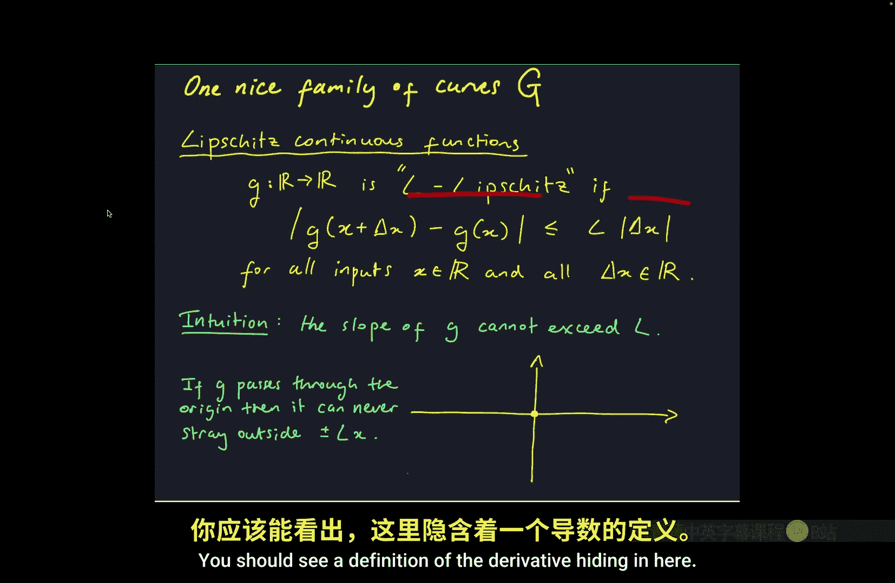

Well it may be equivalent， actually， but you need to think about that。And just to draw a picture。

 let's suppose that we set x to 0。 So we think about。

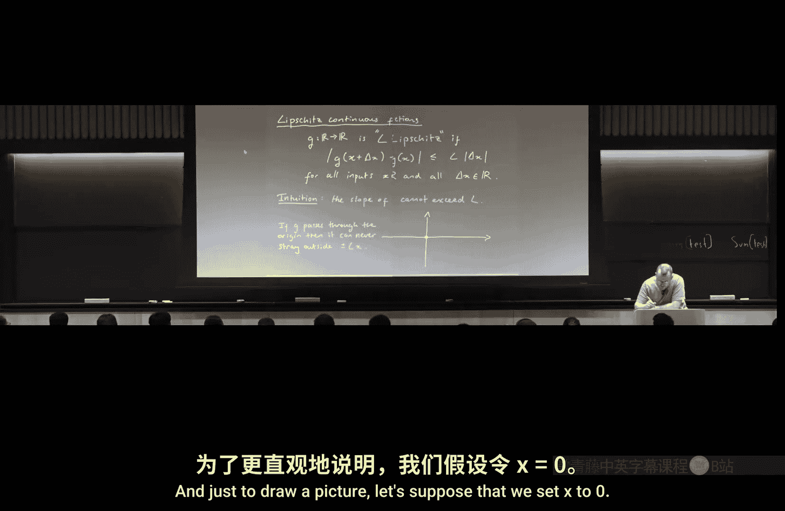

We think about this x as being 0。 And then we ask how， how large can G of Delta x be。

And what this definition says， if the function is ouripes， we think about during the line。

Like y equals L X。 And similarly， we draw the line， like the other line。Y equals minus L x。

And then it this， this definition implies that whatever function we have。

 o it's not supposed to be that squiggly。 It should be reasonably not too anyway。嗯。

The function had better lie within。Those balance。 So this is。The implication of the definition。

 if the function goes through the origin， it has to lie within those， those bounds。

 but the same argument applies at any point。 So it sort of places a kind of cone kind of shape。

 maybe or a kind of bow tie。 And the function has to belong to that bow tie at any point along the function。

 if that makes sense。You imagine translating the boat I alarm。So that's lipss continuous。

 And now I thought， well another great thing to introduce you to is how to generalize that that notion to functions with multiple inputs。

 So now we're gonna think about。😊，Generalizing this lit notion。For G， going from R D to R。

And basically， the inputs are now gonna be R D in R D， and the Delta X are gonna be in R D。

And you see， like， we don't really need to change anything here。 The output is still one dimensional。

 So that still makes sense。 But this doesn't really make sense。

Because you can take the absolute value of a vector， or maybe you can。 But that's not what we want。嗯。

What， what we're gonna do is we're gonna change the absolute value to the norm of the vector Delta X。

 And I'm gonna pick a particular norm that I really like with the R M S norm。So now。

 do you see that this is now a valid definition， as long as I define what I mean by the R M S the one。

So the idea is that， because the x is a vectors， we need to measure the size of the vector on the right hand side。

So， I'm going to define。The RM S norm of a vector x。To be the square root of one over D。

 which is the dimension of the vector。Times the sum over， of the coordinates。Xi squared。

Which we can also think of as just being one over a square D times the Euclidean norm of x。

So it's I just want to introduce you to the idea that if you have an object like a vector。

 there's many different ways to， to talk about how large it is that Euclian norm is one example。

 but the Euclideian norm is kind of a dimensional object。

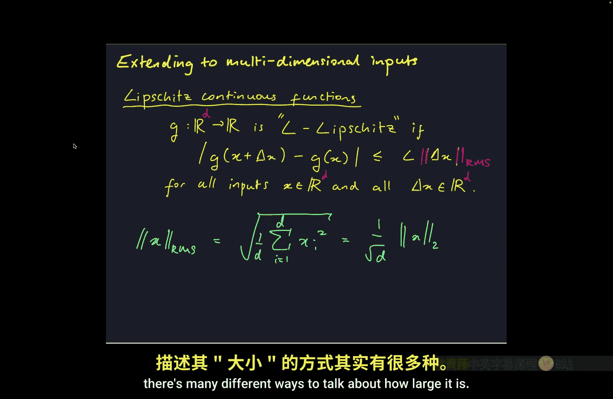

You can think about R M S norm as a kind of nondimensal analog of the Euclidean norm， because if。

 if all the entries of the vector are one， then the RM S norm is one。

 whereas the Euclidean norm would be like square D。 But anyway。

 this the point of this slide is just to generalize lips to functions with multiple inputs。

 And to point out that there's many different possible ways to measure the size of something。Okay。

 but I， yeah， why were we even talking about this。

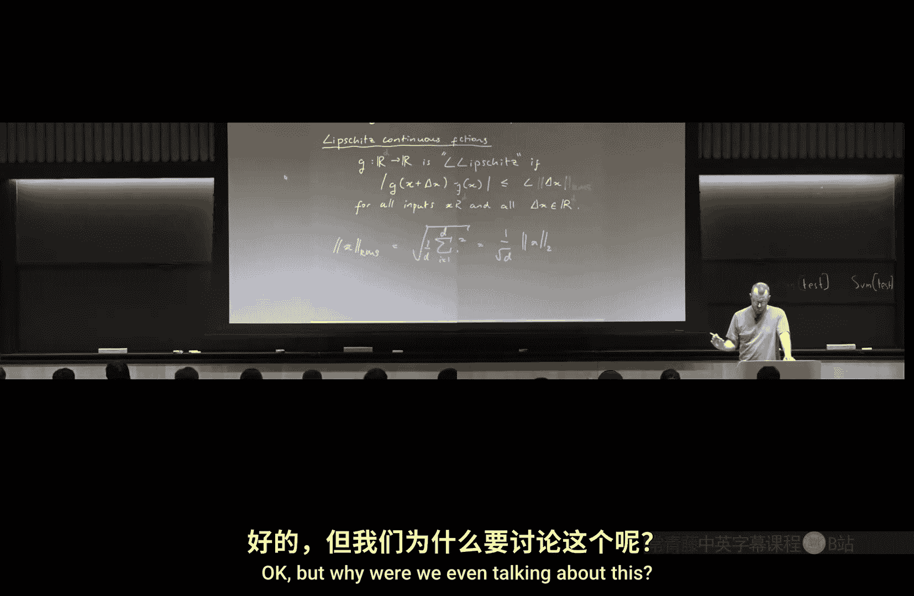

The point is that in this lecture， in the first part of this lecture， we are going to prove。

Something akin to a universal function of approximation the。

And the class of functions G that we're interested in approximating。

It's gonna be the class of e lips functions that map from the hypercube， the input。

 the domain or the input space is the hypercube。To the real numbers。 So this is the hypercu。

 And these are the reels。 And we're asking， we're only considering L lips functions。

 So functions with bounded derivatives。And the what we're gonna say is that。

 if we pick an error tolerance that we're interested in， then there exists a three layer re network。

With a certain number of units， such that。This integral notion of error。

 like summing up all the little pieces and adding， adding up all the absolute values of the difference between on your on and the function G。

 that integral is less than。Apparently， two absolutely。

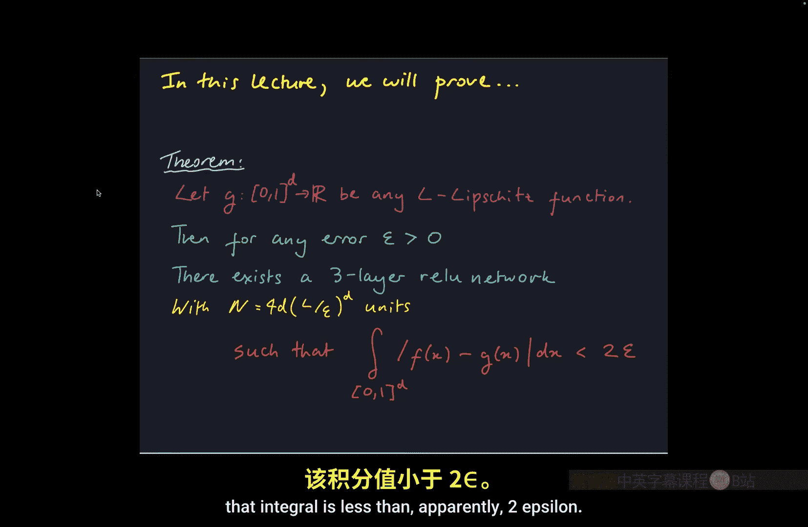

So that's what， does anyone have any questions about this。

 we could dwell on upon it for for a moment。This is our goal of like， basically。

 for the next 20 minutes。 Hopefully， we're just gonna try to prove this statement。 Well， like。

 why should we be interested in such a statement， That's another question。Yeah， go。Theyこ。可就。

That means0， the interval 0 comma 1 with square bracket refers to the interval of the real line just between 0 and 1。

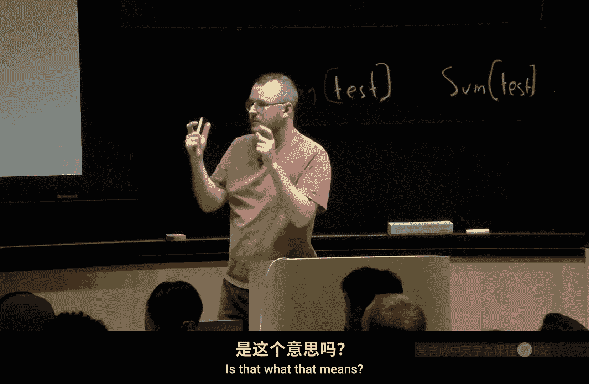

So that's just picking out an interval on the real line。

 And then raising it to the power D means that in all the dimensions of our D dimensional space。

 we pick out that interval。 So it's like picking out a cube in three dimensions or a hyper cube。

 It's just supposed to be。Abstract way of writing down the hypercube in de dimensionalal space where。

 where all the axes are between zero and why。你嗰阵。And。Is。

 is O N is my capital N is my symbol for the number of units。By the by units。

 we mean the number of neurons in the in the Relu MLP。

 So N is the number of neurons in in the three light in that way。I have a couple questions。反的。

I it's the total。 but honestly， because it's three layers for the purpose of understanding the lecture。

 you can just pretend that the number three is the number one。

 and that kind of question doesn't really matter so much。 But， but I really mean actually the。

The sum total of the neurons。

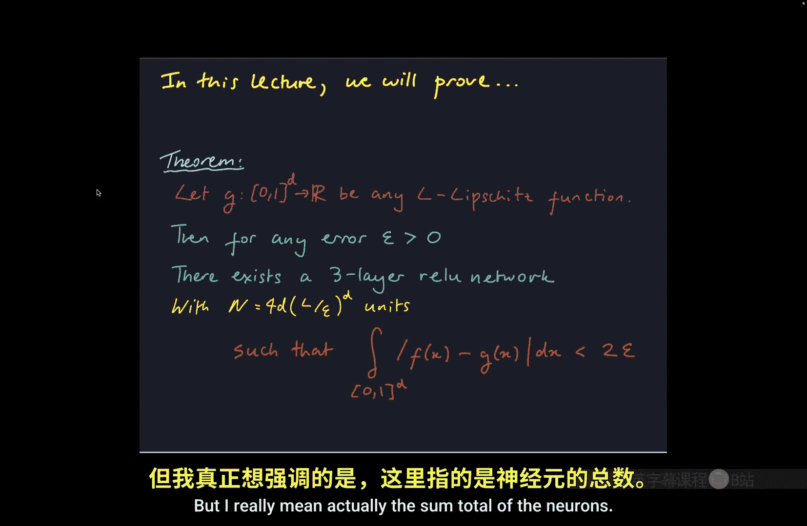

Second question。いか。One precisely。I precisely mean the thing with three weight matrices and one and two rally functions that follow the first weight matrix and the second weight matrix。

 and then the third weight matrix doesn't have a rally。The final question I had was like this。楽しそね。

但是。But whyhy do you care？

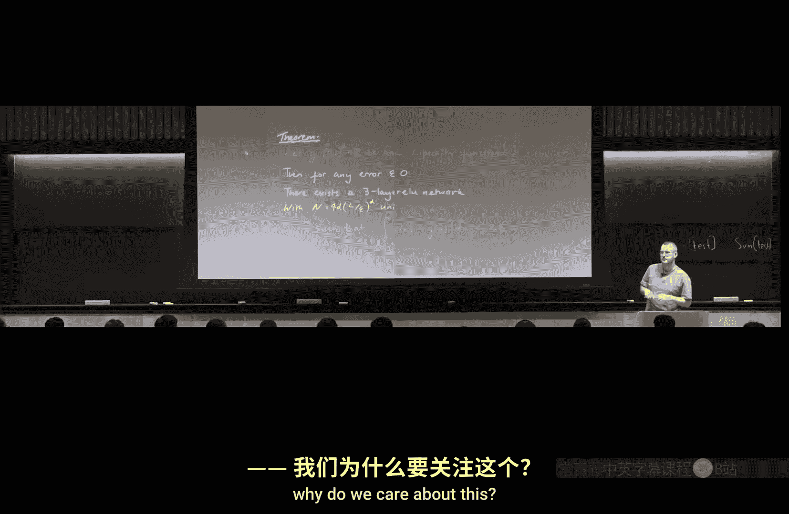

Yes。So that's a great question。 So the reason is， it' cause it's like。

The way to prove this theorem is not super involved。

 So the point is to show you an example of such a theorem。

 And you can see the whole proof and how it works。 And then there are I'll point you to some other references where they do different calculations or different things。

 It's just to show you an example。 And then we're really gonna think about， is this relevant。

 I'm not claiming that this is an important result。 I'm just saying it's something you can prove。

 And then we'll think a bit about is， is this an important result or not。嗯。

This da applied to networks that are more than one？And know it's。part me。about universal property。

For a single value layer。啊，你见面的妈的时。い话。话。This name applies。This is。

 this is applies to a three layer value network。 So it's not。

 this is not the most general thing that you can prove the result that you're talking about is a different result。

 This is just another result where there's a proof which I can。

 we can put into some slides and show to。 It's just to get you thinking about how。

 how such a result could look。 But there are other results。

 There are probably more interesting versions of this result。 This is just a result。

 But it's about three layer， three layer in that。😊，I for this。有些 possible的1分。多こす咧。Yeah。

 any time you see the hyper cubebe， you should think like I can probably just rescale that。

 And I'm gonna change some scaling numbers。 I'd probably change maybe what the Liitz constant is。

 Or yeah， you should be able to rescale it to be any。

 any hyper cubebe that has arbitrary sizes in different dimensions。

 basically or hypercuid or something like that， but。Yes。Why国 you want country everything。Q？

This means the origin should be finance。Yeah， that's an interesting question。 So why。

I is that like a toy， a toy thing about this theorem or like， But actually。

 if you think about in real deep learning， you usually normalize your inputs to be。

Coordinate wise is about one in magnitude。 like it。

 you could actually train the neural network on an interesting problem and actually project all the inputs that live within a hyper cube or M maybe a hyper cube。

 Yeah， yeah， so it's， it's actually quite that that part is actually kind of a realistic assumption that my data lives in a hyper cube for many problems。

 not for all problems。😊，Yeah， last question。So the whatever epsilon to the D seems pretty important。

 do you know if you relax the ellipitz？But take a different definition of continuous。

 if you still remain with that as the best？Maybed be better than that。Yeah。

 I imagine that with more knowledge about the problem structure， you can。Do much better。This。

 I'm not trying to claim that this is an interesting result。 And we'll talk about the limitations。

 And I think you would hope to do。If， yeah， just look at it saying that you need and the number of neurons you need。

You take the lipstitz constant and you raise it to the power of the dimension， which is really。

 that could potentially be massive。 And you also， you know， the smaller the arrow tolerance you want。

 the bigger the number of neurons you need in a way that depends exponentially on the dimension。

 So that's， that's。Really bad dimension dependence。 And we don't， in practice。

 really want to do that ever， so。That's， yeah， that's gonna be。 Yeah。

 It's great to point out that the result itself is not even the best possible result we might hope for。

 whether we can do better， It probably depends on structure in the problem。

 And I don't know even if under these conditions， maybe there's something better， but I'm not sure。

Okay， let's just pllow ahead now for a little bit。 So the strategy that we're gonna adopt for proving this result。

Is， first of all， we're gonna pretend that our inputs are one dimensional。

 We're just gonna treat the case of one dimensional inputs， one dimensional outputs。

 And we're gonna forget about reeling networks for a little bit。

 And we're gonna think about approximating our function just with like kind of rectangles that we。

 we sort of build that。 And we， you can see that you can sort of approximate a function by。

Taking these rectangles and， and putting them like this。 And we're gonna。

 and you can sort of see that the more， as you make the width of each rectangle smaller。

 you get a better and better approximation to your function。

And that's something we can quantify quite easily。 The second step is then we're gonna generalize that rectangle construction to multidimensional inputs。

 still ignoring re networks。 And then the third step。

I we're going to show that with really with a two layer re network。

 you can approximate a hyper rectangle of that kind。

 So then you can just use the third layer of the network to linearly combine all of your rectangles。

 and you'll be able to approximate your function。 So this is the strategy。

 like first approximate the function with rectangles。 then approximate it with hyper rectangles。

 Then show that really a two layer re network can approximate a hyper rectangle。😊，嗯。Okay。

 let's just p plow on in the interest of time。So， the first step。

Is to like construct these rectangular strips， which is each strip is centered on a discrete grid point。

And you can sort of think that this is like building a function。

 F of X is the sum over alpha I times。 Let's call this the I indicator。 where， where what you。

 what you should think is that alpha I is， is measuring the height of the I rectangle， alpha I。

And like indicator I is the， is the function， which is one if the input is in this interval and 0 otherwise。

And then if I， if I sum up。You know， a bunch of these indicators of this form， like that's。

 that corresponds to this approximation to the function。Is that good， Is that clear。Okay， so the。

 the next step is basically what we're gonna ask is if we approximate a function in this way。

 let's say we make the left edge of the rectangle actually touch the function。We need to ask， like。

How big is this gap。How how big can it be， And the， the observation is， do you， okay。

 does anyone have an idea of like how to place a constraint on how large that difference can be。

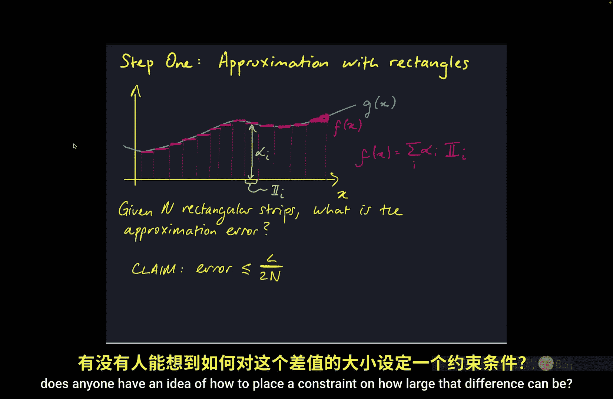

Yeah， we the just of the triangle。Exactly， so the， the observation is that we're assuming that the function G that we're trying to approximate is L lipss。

 Like we said， that place is abound on how large its derivative can be。

 And that gives us a constraint on like how big this triangle can be or the triangle could go under。

 But it， it tells us how big this， this thing can be。😊。

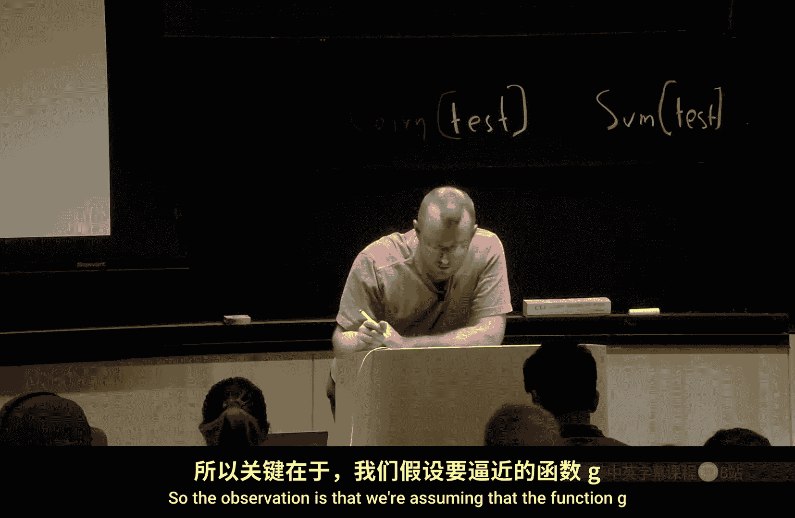

嗯。And so we're gonna ask given N strips where N， you know， we can ramp it up or we can， you。

 we can make N as big as we want。 But given given that we have N of them。

What is the approximation error and the claim。Is that the approximation error is bounded by the Liit constant divided by two times the number of strips。

嗯。And okay， so importantly， if I， if the Liit constant gets bigger， then the error。

 then if I keep the number of strips the same， the arrow would get bigger。

 But if I make the number of strip number of rectangles larger， the arrow would go down。嗯。Okay。

So to prove this， can you see that basically， we just need to do the geometry of what this triangle can look like and then sum it up over all the strips。

 So let's just do that quickly。So if we have N strips， each。

 each rectangle can can be is width one over N。And the heights of the triangle。

If you just think through the definition of lipsitz this。

 you just multiply the width of the strip by L。 And that will give you the height。

 the maximum possible height。And then， of course， then the triangle has aerial。What's。

 what's the area of this triangle or Does someone tell me。I I remember。

 it's at half L over n squared， right， the half base times the hope。

And this means that the total error。 Remember that we're dealing with the L 1 error of the。

 of the function approximation is just gonna be like。N times the error of each rectangle。 And。

 and that corresponds to actually the area of the triangle。

 the maximum possible area of the triangle， which is half L over n square。

 So this is just half L over n。And that， okay， now we just need to flip things around。

 That's the largest possible thing that error could be。

 But what we wanted is a statement of the form。 If we have this many rectangles。

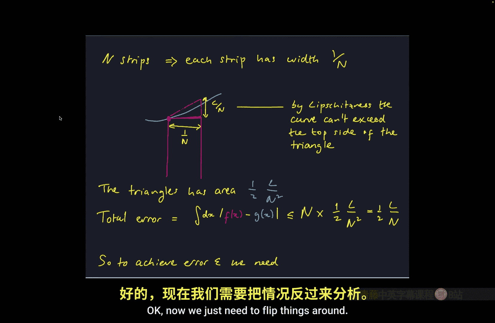

Then the error cannot exceed epsilon。 So we need to flip the statement around， so。

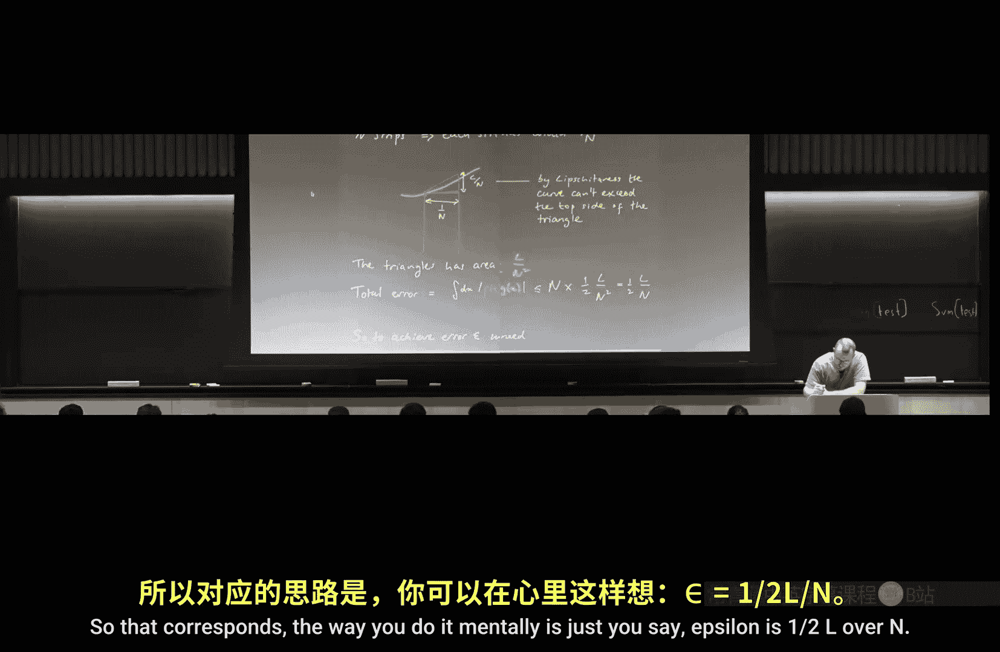

That corresponds。 the way you do it mentally is just， you say like epsilon is half L over n。

 So then to achieve our epsilon， we just rearrange this equation。

 we get n needs to be greater than equal to。Half alley the epsilon。

And if I don't care about this factor of a half， I can just， I'm free to just also erase that factor。

 because it doesn't really matter。This this， the form of this statement is if I set N greater than L over epsilon。

 then I will have an error Epsilon less than half L over n。

 So I'm just re rearranging the equation and， and being careful about the inequalities。

So this is step 1。 We have， we have， we know how many rectangles we need to get a certain error in the one dimensional case with one dimensional inputs。

 Let's think about how things change if we have multiple， multidimensal inputs。

And the thing that changes is we now have this hyper rectangle like a yeah。

 something like just think， think 3D。 whenever you need to think about high dimensions。

 like you kind of just think about like things in three dimensions。嗯。And。Okay， what I'm working。

 I'm doing。 I'm just repeating the calculation。The total error。

And then I'm breaking it up into pieces。So this piece is just the number of。

 number of hyper rectangles。This piece is like the Arab per hyper rectangle。No。

 it's the we think about the hyper recectangle as having a little cap on top where。

 where the hyper recectangle differs from the the surface G。 And we're trying to measure the。

 we sort of know the surface area of the top of the hyper recectangle because it's just like the width of the hyper recectangle raised to the。

The number of input dimensions。 So we know the surface area of the top of the rectangle。 that's easy。

 And then we just use the lips's constant to measure the maximum possible height of the hyper rececttangle。

 So it's just repeating exactly the same thing that we did。

 except instead of a tri the error being a triangle，' some kind of generalization of a triangle。

 So I'll probably just leave people to think think that through by looking at the slides。

 if you w to think more about that。 But this is。The heights of let's call it the error cap。嗯。

And then， this is。Is this right。Yeah， okay。 And then， yeah， it is right。

 And then if you think about what's the surface area of the top of the cap， Well， if there's N。

 if there's n hyper rectangles， if I sum up all the surface areas of all of them， I should get one。

Yeah， so then the， the surface area of each one should better be one over N。

 So we'll just call this the area。 If anyone wants to like think through this more carefully， please。

 please do soca But okay， and the claim is that we've， we've just done the same calculation。

 the only remaining thing is to rearrange it in the way that we just did。 So。

 and this would say that。We should need all over epsilon to the D。So I do the same trick of setting。

Apsilon equal to this thing。 and then just rearranging。 And， and now， okay。

Let's just zoom out and just try to assess where we're up to。

So what we're imagining is that we now have a function G with multiple inputs and one output。

 which we can think of as a surface where the that that would be the case where there's two。

 there's two inputs and one output。's like a surface。 And then in higher dimensions。

 it's a generalization of that。And the claim is that if we want to approximate this with lots of with N hyper rectangles。

And we want to get a certain notion of the integral of the error that。

 the number that we need to get an error epsilon is L over epsilon to the D。

And this should remind you a lot of the thing which appeared in the theorem statement。

And the reason for that is that the next step is to show that we can approximate the rectangle with a relu net with a small with a two layer relu network。

 So the number of small two layer relu networks we're gonna need is L over epsilon to the D。

 And then we just need to count how many neurons in each of those relay networks。

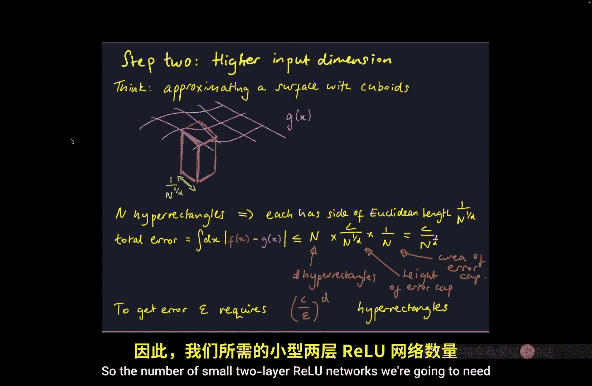

嗯。

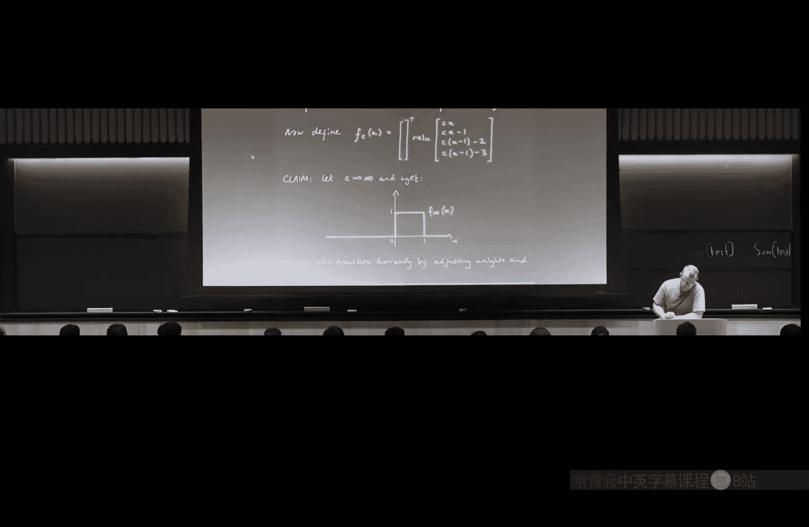

所。I just decided decided to。Let's just zoom over this because I want to show you actually how to construct this thing。

 But basically， the claim is that there's a two， there's a one layer。 I this one， Okay。

 we would call this a two layer reeling network。Where with a parameter C， a kind of weight C。

 And if we take C to infinity， which is seems like a bit of a trick。 But okay。

 that's what we're gonna do。The claim is that the that network converges to this function。

 which is exactly this。Hyper this this single rectangle in one dimension。

 So I just want to take a bit of a risk by。

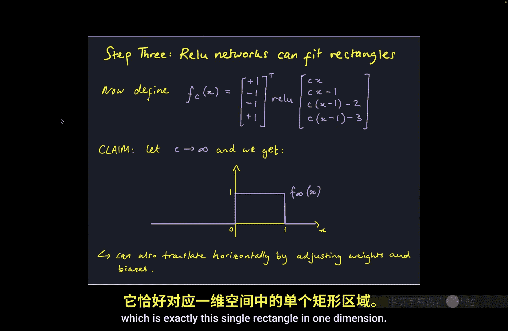

Switching off and hoping that I'm able to resha my iPad。

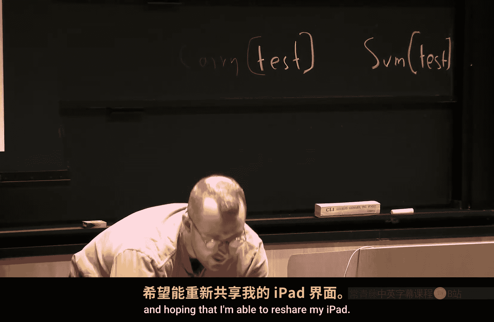

And just try to。Just try to build this thing for you。 So I've here。 yeah， Okay， so this is。

 this is a real。 by the way， this kind of manipulation is quite helpful on some of the homework problems。

 Probably this， I really recommend I'm not being paid by this， this， this graphing software。

 but it's really great。😊，嗯。And what I want to show you is， so here， I've got re with X。

And then I'm just gonna subtract reu of x -1。 using it kind of flattens it out。啊。And then I like。

 say， I want to like， curve it down。 So I subtract another re。And then I， you know。

 I wantanna like flat off that little flat bit that's not flat。 So I'm just gonna add a really。

 And like each， each time I'm sort of translating them one along。嗯。And then， but now I'm like， hey。

 that doesn't look like a rectangle。 the the slopes are too nonslope that I want them to be sloier or something。

 So I'm gonna。Okay， I'm gonna insert a constant C， which is initially one。

 So it's not changing anything。 And I'm just gonna use this constant to like。

 increase the slope of all the curves。And let's put it between1 and 10。 Okay。

 and then I'm just gonna increase it。 And I'm like， oh， it's making the， the slopes sier。

 but it's not。It's not， it's it's also squeezing them together。

 And so I can solve that problem just by。Tranlating， translating them back。

I hope that doesn't look like what I want to， but。啊 let's see。Oh now it looks like what I want。

 So I just translated them back。And then I， and then I'm just gonna let see like。

 get a little bigger， maybe 1000。And make it a bit bigger。 And you see， okay， I do it like。

 that's like just combining relos。 That's technically a tu layer in your on that。

 And I could approximate a square function。So that's， that's what this slide is doing。

Which I now need to hope， hope I can bring back。Okay。So that was the demo of like app。

 And you can see that using that graphing software。

 you can kind of just play around with things so you could figure it out。 Go ahead。 What's the。

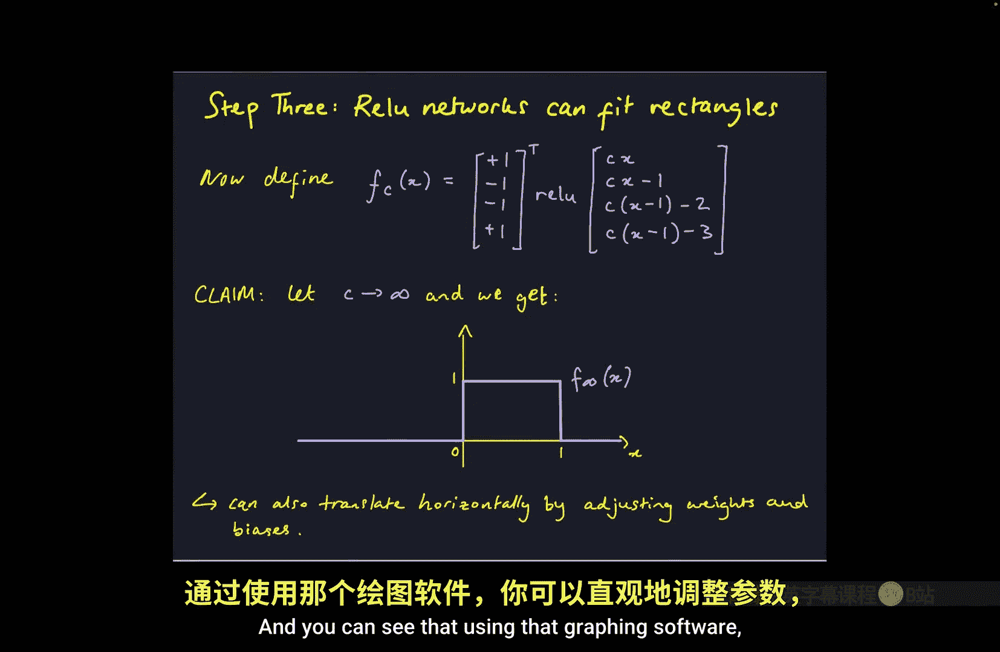

To later。Yeah， so we're gonna use one of one copy of this two layer network。

To approximate each rectangle， to approximate one of the rectangles in that reman sum kind of thing。

And then we're gonna wait each and that that you have to insert factors to translate it to the position that you want。

 So you translate it， and then you multiply it by a little scaler to get it to be the size that you want。

 and that。Scacalar would correspond to the third layer in the network to。

 to set the size of the react to how how tall it is or what its height is。Yeah。あわ。Yeah。

 it's to get a sense of the error when， when things are finite because we're not interested in actually taking the limit that the number of strips goes to infinity。

 We want to know for a finite number of strips。 So at least that's how we're using the lips this。

 But if， if it， I， yeah， I think it's necessary。 I'm not 100% sure。

 but we can maybe talk about that after the election。

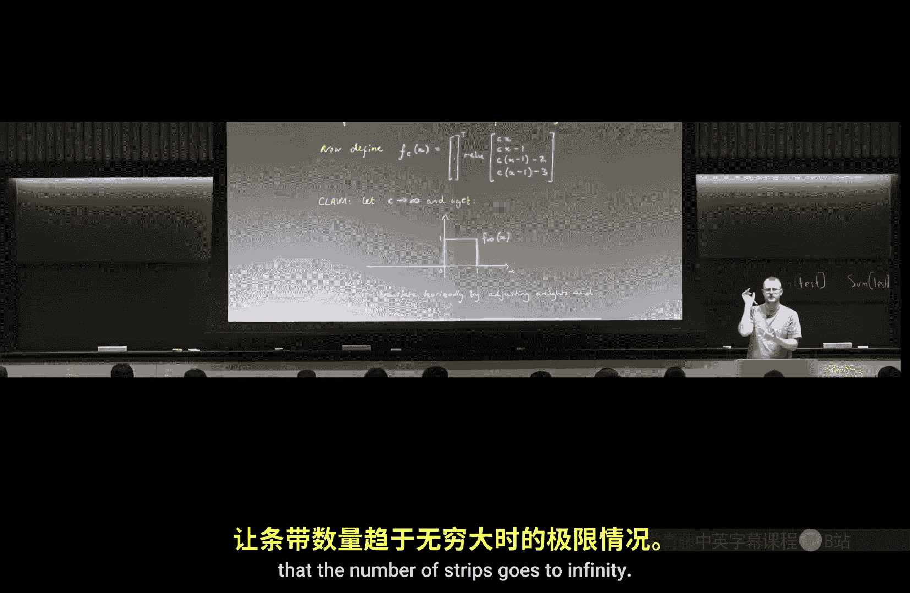

Let me just keep going because I bit I'm a bit worried about time。 Like。

 this is just half the lecture。 I guess we're nearly halfway through the lecture。

 So maybe we're doing okay， so that was a one dimensional rectangle。

 But remember that we need to be able to approximate like a rectangle with like a hyper rectangle like in two dimensions。

 it's the kind of cube。 And in three dimensions， it's a hyper cubebe kind of thing。 or okay。

 but there's another trick。This， it seems like there's a lot of tricks going on here。

 But another trick is we basically take a hyper rececttangle。That's aligned with one axis。

 And we take a hyper recectangle that's aligned with the other axis。 And we realize that。

Only in the place where they're both kind of on， if that makes sense。

 like where they cross each other， the height of the thing， if we just add them is 2。

 And then the height of the thing where only one of them on is one。

 So do you see like that's kind of this picture， we add them。

 and we get this kind of plus shaped surface where in the very middle， it's height 2。

 And in the other place。 It either height 1 or height 0。

And say the observation is that we can then add， add these。Rectangles in one dimension， subtract。1。

 in， in this case， or in general， D-1 and kind of bring the surface down。

 And then the only place which is kind of coming above the axis is the place where they're all intersecting。

And then we're just gonna threshold。 We're just gonna apply relu on top of that。

 And it's just gonna pick out the place where they're all on。Does， does that make sense。So that。

 they'll only all be on。Where they all intersect。 And then we just shift the whole thing down and threshold just to like slice off the top。

 And it's gonna give us that little cube by just slicing on。

 And we can do all of that just by adding and doing a relay。 So that's the logic。嗯。Okay。

 and now we're ready to assemble all the pieces。So the。

 the top thing is the two layer relo network that can approximate our rectangle。 We can then。

Some these things over dimensions subtract D -1， like we just said。And then take a re。

 And that this will now be give us the hyper rectangle that we always wanted with this constant C。嗯。

C is the thing that we're gonna take to infinity to like， kind of make the slopes slopeloier。嗯。Okay。

 and then finally， like， we're just gonna take linear combination of these things。嗯。

With constant alpha I， which are gonna set the height of each hyper recectangle。

 that corresponds to adding one more layer。On top of our network。 So you can， you can see that。

In this construction， there's a relo here， and there's a relo here。

So it really is a three layer network by the definition that we go。

And then the final step is just to let this constant sea grow really large so that we really do approximate the hyper rececttangles and。

 and we can approximate our arbitrary surface。 So just to。Let's just recap where we got to。We。

 we were going to try to prove this theorem。And the general idea was we're gonna approximate these。

 you could call them bumps or these hyper rececttangle functions。

 We're gonna use really to approximate those things。

 And then the final step is gonna be to take a linear combination。

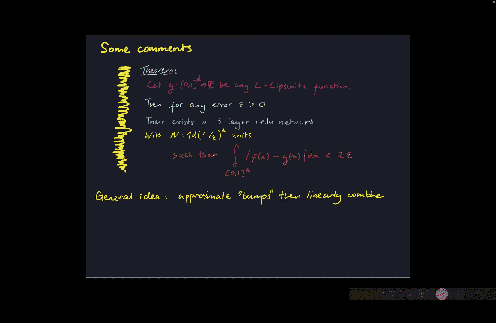

U。So I'm gonna dwell here a little longer。 The intention of this slide was to， like。

Think about some of the limitations of what we just did。 I felt。

 I feel like some of them you kind of already raised like throughout。 But like if anyone。

 does anyone want to discuss anything or。We'll point out。 Oh yeah。 go ahead。

 So the two different layers of view。

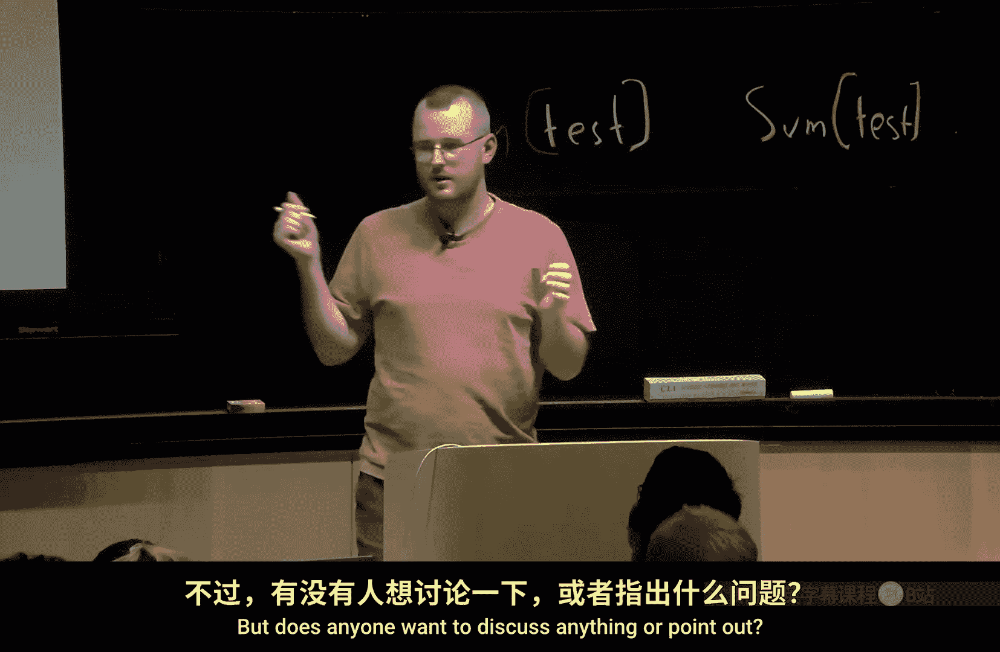

Different functions。Yes， one of them is about。Yeah， yeah。

 one of them is about approximating the rectangle。To to get the slopes of the sides。

 And the other view is more about like slicing off the top of the hyper rectangle。Y。Rese。Well， yeah。

 give me， let's talk about that on the next slide， because I'm pretty doubtful it seems like quite a toy construction。

 not toy， but it's like it has a very deliberate intention。

 which is proving this approximation thing。 And a lot of the steps seem a bit kind of fishy in terms of would this be something that a neural network actually does like letting the constant C tend to infinity。

 Usually you don't want the weights to blow up。 That would be a sign that something's going wrong in your neural network。

 So， yeah， I wanted to list here a couple of these like C turns to infinity seems a bit questionable。

😊。

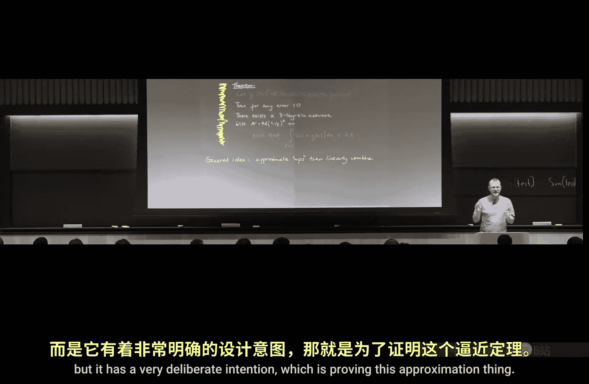

Yeah。

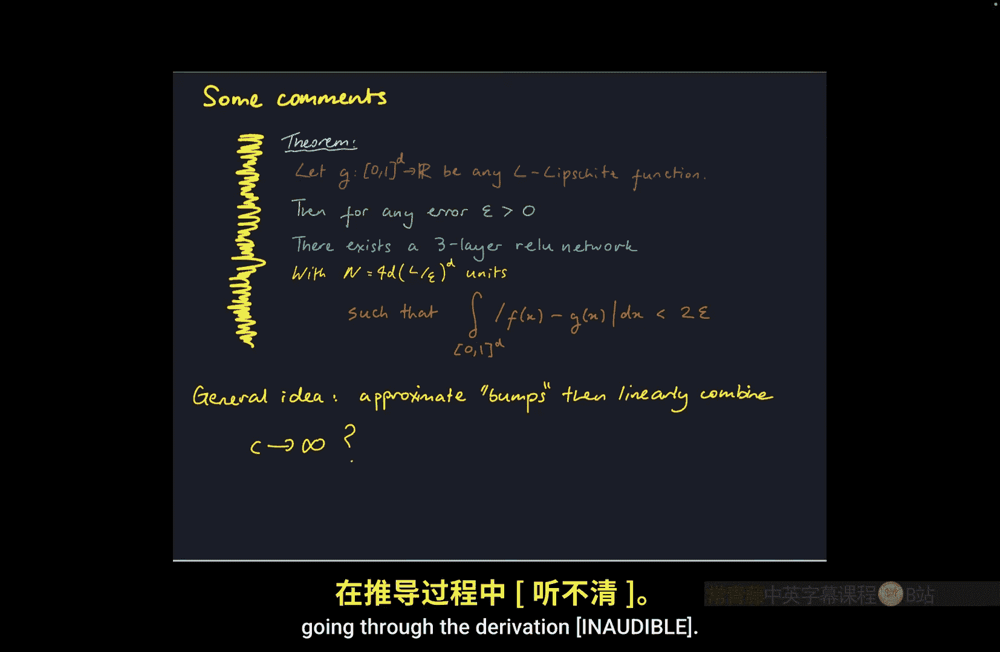

Yes。来啲。エックさ？2。Yes， it's because of the use of these。

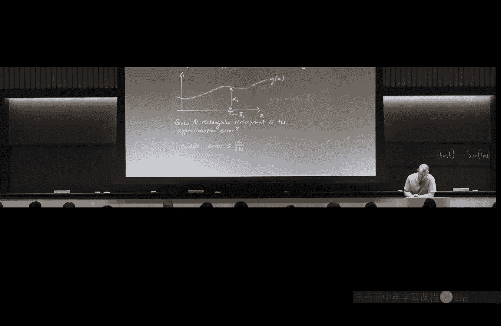

it's supposed to be we we're thinking about it like symbolically as being await weighted sum of indicator functions。

 So the you think of the rectangle as being a function， which is one。

 if the input lies in this interval and 0 otherwise。睇到时系你打喺度咧。Yeah， sorry。

 I didn't spell that in the in the like， there's an annotated version of the slides on the website where it's a bit more spelt out。

 but， but exactly， it's not an interval there。 It's an indicator。Yeah， the。

 the way to think about it is。For， for a given input， let's say this is our input。

 Only this indicator is triggered。And then it gets scaled by its height。 So there's a sum of terms。

 but only one of them will ever be active。开始。Let me okay， what， what last question， please y。Yeah。

 the， the 4D is about counting。Counting the number of neurons in this construction。

 And the point is that in the， in the top purple bit， the rectangle， there's four neurons。

Then in the hyper recectangle， I'm summing over D of those terms。 So it gets 4 multiplied by D。

And then so each hyper recectangle needs 4D neurons。 And then， and then I have the final term。

 which is the number of hyper rececttangles I need。 So that's why it's 4D。 Yeah。

 I hope it's right because I just tried to work up the constant yesterday， so。But let's see， Okay。

 let's just go ahead。 So I wanted to like， yeah think of it is this really realistic of what would actually happen in training。

 One of the questions is if we're just trying to say that a real thing is gonna approximate a rectangle。

 Then why wouldn't we just use a rectangle as our basis function to begin with。

 because there' something kind of circuitous about not just doing that。

 And let's just pretend that we've created a basis of these rectangles and that someone gave us some data。

 some xs and ys and we're gonna fit it and just think about how the training would go。

 and what I'm claiming is basically every time we see this data point。

 this this rectangle would get kind of drawn down towards it。 And every time we see this one。

 this one would And every time we see this one， this one And every time we see this one。

 we get this one。 But none of the other， you know， there's all these other other ones。

 which are never actually gonna move。😊，And so it's sort of a really kind of unnatural。

 It's like visually， the， the obvious way to approximate this data is just to draw a line through it。

 not to like take， take rectangles at each point and move them up to the height of the。

 So there's something unnatural about it。 But it is， you know。

 it's this is the construction that we use to prove of the theory。in particular。

 the thing I'm pointing out here is that。It seems like if you actually fit data this way。

 the training performance is gonna be really good， but the generalization performance is gonna be really bad because you're just。

Just fitting the data on little tiny little strips， which doesn't seem， seem amazing。嗯。Okay， so this。

 okay， just to re that where we're up to， the goal was just to introduce you to one particular。

Function of the approximation result of which there are many。 There are many papers on this topic。

 And there are some classic papers on this topic。 So one is called Baron's theorem。

 which uses something about the Fourier representation of the function that youre trying to fit。

 And there's a classic result。 So our our construction there was using three layers。

 There's a classic result， which uses two layers to to universal function approximation。

 And actually a more powerful result from my understanding。😊。

And it uses something called the stone virus str theorem。

Which I thought was interesting because Vi Strs was this mathematician who。

 I think he was alive in the 1800s， but I'm not 100% sure。

 But he came up with that fractal curve and was thinking about these like analysis questions。

 But he was actually seemingly thinking about approximation as well。

 And he had a theorem which was like。😊，You can use polynomials to approximate any continuous function or something like this。

 And it's just kind of interesting that this branch of math is。

 is related to like a very classical branch of math。 But that's what I have to say。所于。On this slide。

 I want to ask， is， is， is the thing that we just spent 45 minutes talking about。

 Is it actually important。And here， I'm just abbreviating USA to be universal function approximation。

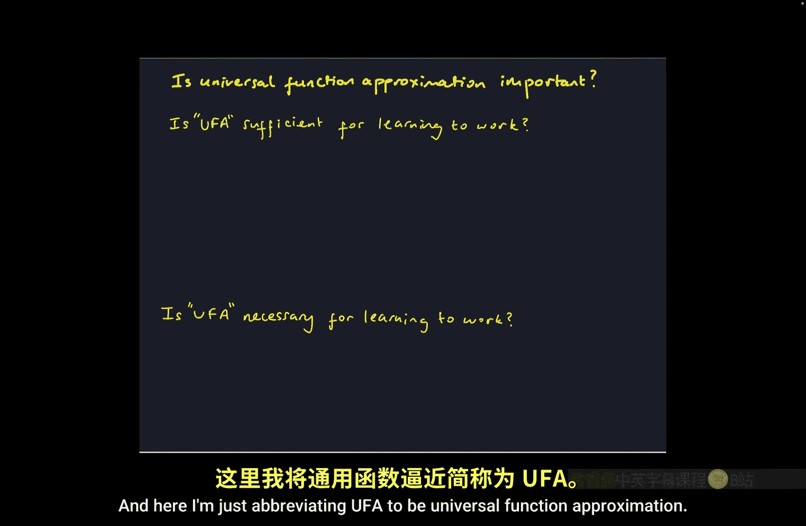

Where is this live where the university。ま十八。不认识。你认为。Ters。Or it's still expansion。全員が。你花よ。Well。

 that would be another way of just fitting the tail expansion up to some degree。

Which is a bit like that virus stress thing of using polynomials to， to fit a continuous function。

 It's like a valid mathematical way to approximate a function using a Taylor series。 Like。

 that's yeah， pretty， but it's just not what we're doing in deep learning and deep learning。

 We you take a neuraln that。 We， you know， it's just different。😊，Thinking about that question more。

 I think is great。 I， I don't have Yeah， any really， really great comments， but。

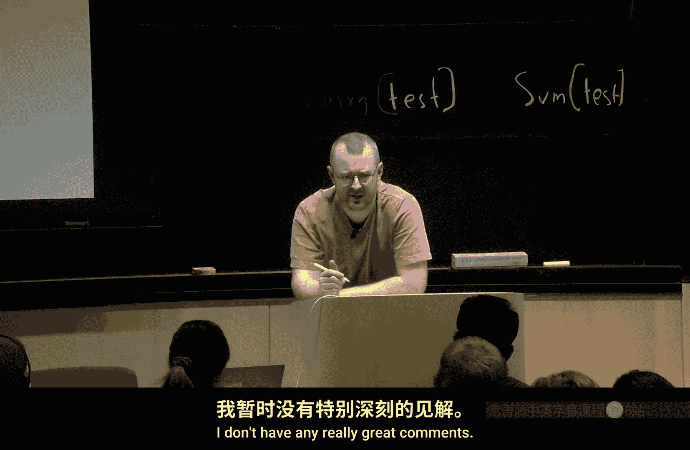

Its yeah， putting putting all of these different ways of thinking about things and trying to reconcile them is like a really productive thing to try to do。

Yeah， so the point of here was to say， is， is universal function approximation sufficient。

 Is it like， okay。That was lecture 3。 Now， for the rest of the class。

 we'll just do applications now because we understand the theory of deep learning， probably not。

So I wanted to give examples of other things which are universal function approximations， so。

Other examples would be like polynomials。 Can anyone think of another example of something which seems like it's probably also a universal function approximately。

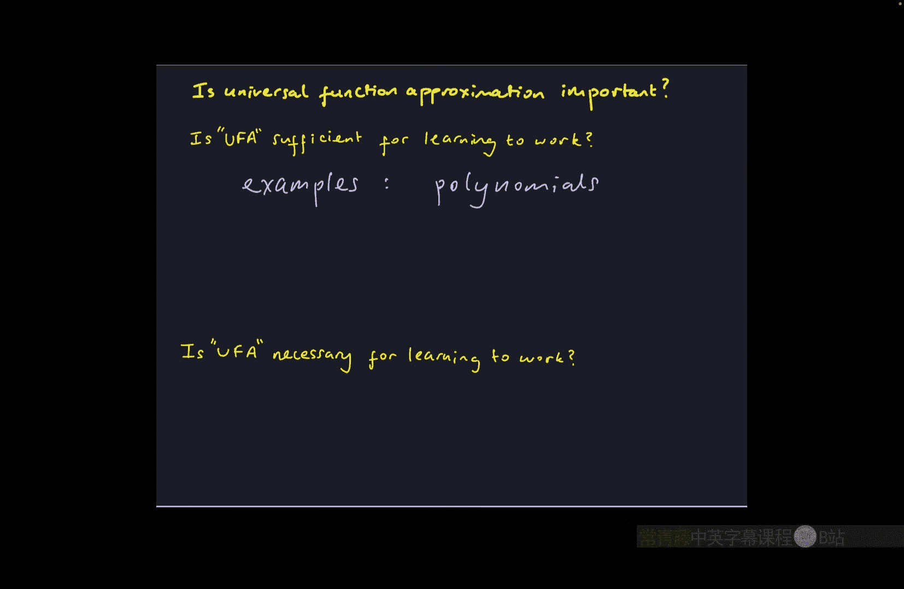

啊。Random， yeah， how would you parameterize the space of functions。So， in the example。

In the previous example， we have a hypercu which can of then segmented into N locations。

And then when retailer just gets up the water point， that's right。Yeah。

 so here we're not really doing training。 We just wantan to think about this。

 What is the space of functions。 So the space of functions you talked about there is。

Vineer combinations of these hyper rectangle bumps， which that's a valid。 it's a bit wordy。

 So I'm not gonna write it down， but that's a valid of that。

 The the other 1 I wanted to point out is like something like the space of Python programs。

嗯。So programming languages are， in a sense， a universal function approximately。 does that mean that。

We've solved machine learning because progress it's， it's like many。

 many things a universal function app is。 It's not。 it's just a piece of the puzzle。

 That's the thing I'm trying to point out。 Like you， just because you've installed Python。

 you can't start。Doing machine learning， you need， you need something else。嗯。Okay。

 and is it necessary for machine learning to work。 So if your machine learning model is not a universal function appd。

 should you be worried。

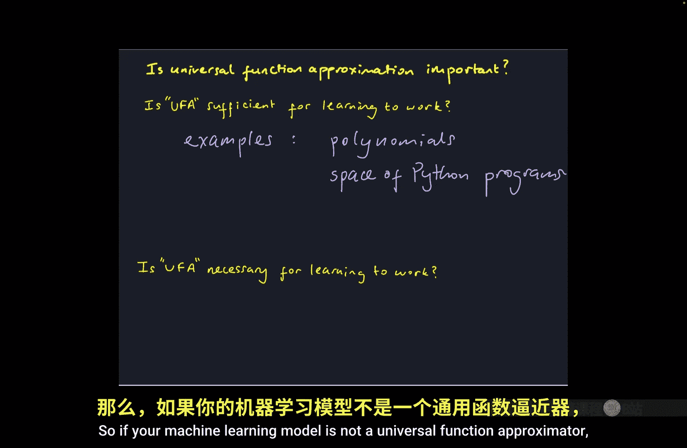

嗯。Someone saying， no， yeah， I sort of agree， but I'm honestly not sure。Yeah。

 I I think it it's just an interesting question to ask。 like， do we need it to be。

 I my guess is not like， my guess is probably we don't need to have a universal function approximated to do machine learning。

 But it's， I think it's a little unclear how to answer that。嗯。So， now。

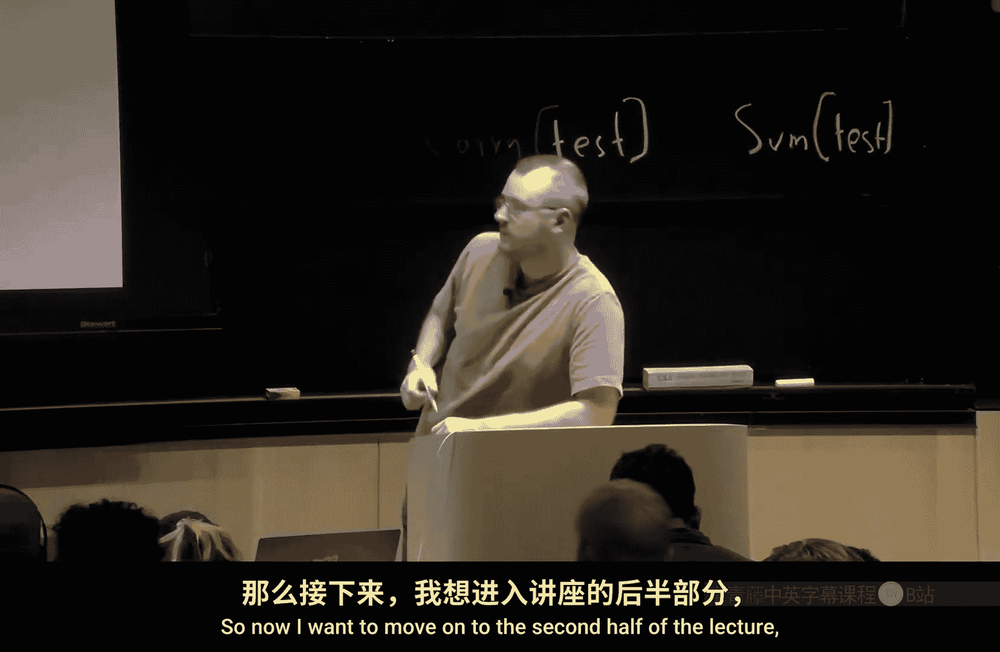

I want to move on to the second half of the lecture。

Which is going to be about thinking more about like that question of width versus death。

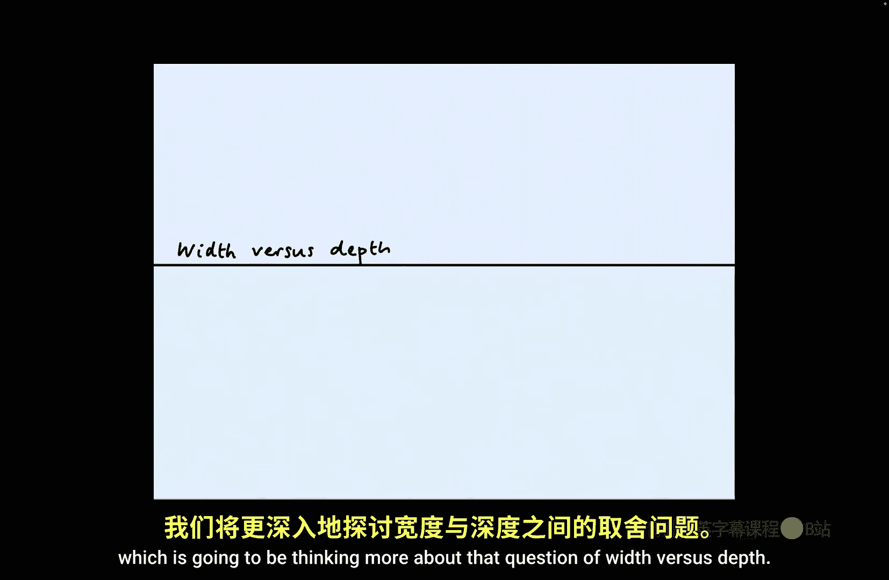

So again， would you rather like scale the width of your model or scale the depth。嗯。And again， like。

 we've just tried to prove in some sense that with a very small depth network， like depth 3。

 we can fit any function。 So that， that's like coming back to this question。 If， if。

 if three layers is enough， why would we ever wantna have a deep network， I just like。

 does anyone have a thought， what do。What do you think， yeah。guessing because of all。In terms of。一样。

You can approximate。Sorry。ます。

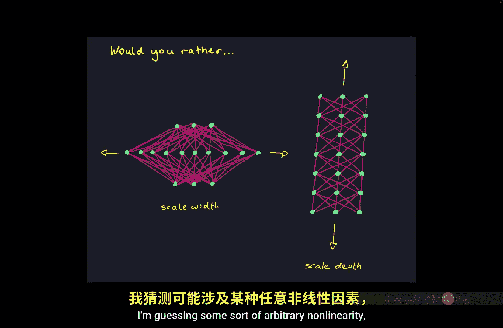

也会完咱们。自系。Of those with healthy。那个。他的。But width would be going back to。Right， So that's a great。

 Let me just summarize。 I forgot， I'm always supposed to summarize questions and comments。

 but I forgot about that。 But basically， if we layer layer lots of layers。

 then we have a kind of compound effect。 We have more nonlinearities。

 Seems like maybe that can give us a richer space of functions through compositionality。 That's。

 yeah， that's a great point。 Sorry， what was your。😊，まかずまで。那的 answer sir。

This is a great point that if you think about building a machine learning system。

Wth can be paralyzed。 It makes better use of parallel hard。 So in a lot from a systems perspective。

 if you can get away with a shallow network that's very wide。

 you would really love that because you can parallelze it。 So that's a great。

 Thats that's illustrative there's different constraints。 There's。

 can I represent complex and interesting functions。

 And then there's the computational constraint of how efficient is this to rhyme。 there's。

 there's other constraints of that sort。😊。

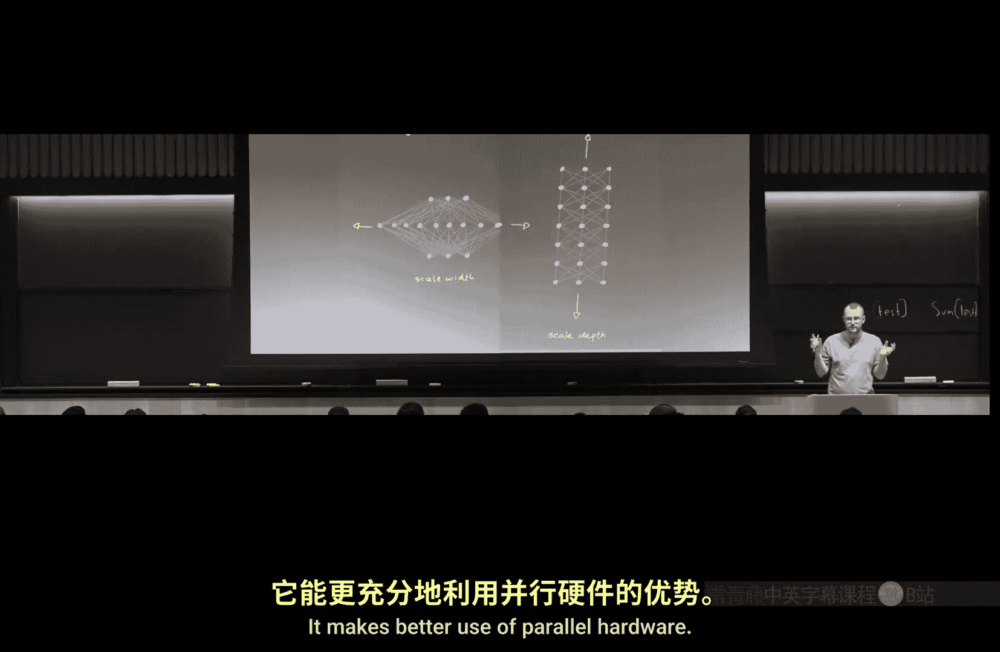

okay。So， on this slide。I wanted to just think， what are the advantages of with。So。

 one is parallelism。One is like a three layer in neural on that。

Is a universal function approximately or maybe even two layers is enough。嗯。

Can anyone think of any other advantages live with。You get future representation。来岁我。

Eas to interpret。I'm trying to remember if there were any others that I thought of。

 Does anyone else have any other。嗯。W is called like fashion。Yeah， easier to train。

 That's a good point。Easier to optimize。

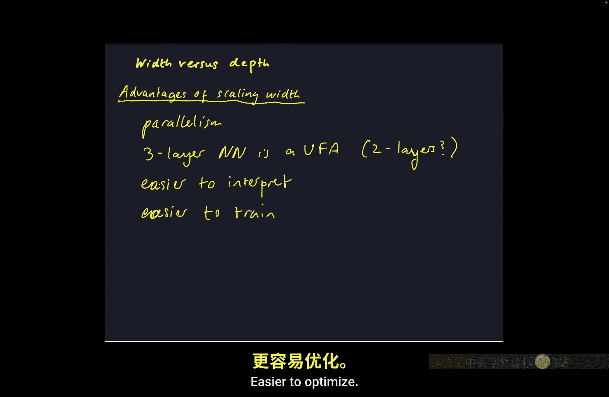

Yeah， that's yeah， because whenever you do compound anything。

 it is very liable to get out of control。 So making your network too deep without being careful about how you do that can actually just break the training。

 So like， if you just take a vanilla multi layer per and make it like 50 layers deep and just try to train it。

 you'll see like it's very difficult to get it to train potentially。Okay。

 I can't think of any others unless any else had。So the point of this light was to say， well， okay。

 obviously， why it is better than deep， right。That's obvious now。

 But then the next slide is supposed to say。

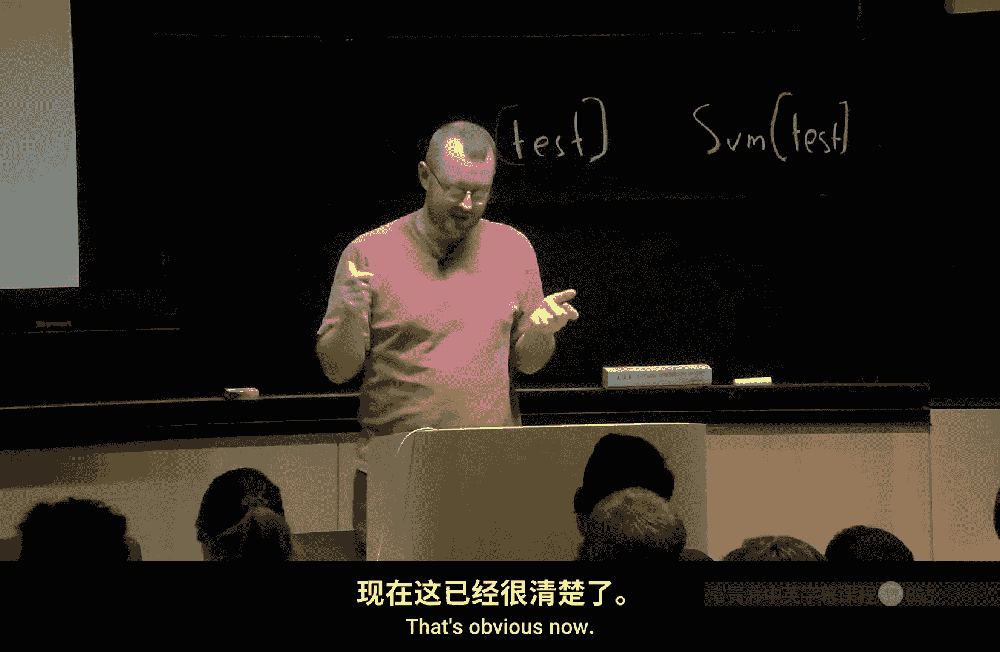

Is it。Okay， because now in this part， in the last part of the lecture。

 we or almost the last part of the lecture， we're gonna think about something called depth separation results。

 which is another kind of。Potentially quite stylized theoretical result。 but is。

 is quite interesting。So remember that the， the universal function approximation result suggested that we need to make our network exponentially wide in order to be able to approximate everything that we want to。

 And that seems bad。So the point of a depth separation result is to say that there's actually a deep network that can represent a particular function。

Quite efficiently。 And if you try to represent the same function with a three layer network or a shallowware network。

You would need like exponentially more neurons to do that。So。The。

 the shape of a depth separation resort， I'm just trying to break it up into stages。 is to pick。

 First of all， we pick a property of a function。嗯。And the example we're gonna think of is like the number of linear regions。

The we think of the function as being piecewise linear and how how many linear pieces are there。

And then we construct a deep network that has a lot of that property。

But its not a particularly big network in some sense。 It doesn't have a lot of neurons。

 And then we try to say that is a constructive thing。 We say here is a neural network。

 which has a lot of this property。 And then we say。

 now we're gonna prove that it's actually impossible for a shallow network to have that same property unless it has exponentially many neurons or a huge number of neurons。

So that's the shape of this result。 And again， there's a literature which just。

Proves different varieties of this kind of resort。 And， and they're called depth separation results。

 We're just gonna show you one particular example， so。Recall that a piece。

 a piecewise linear function is a function where like， if you break it up into segments。

 each segment is linear， and then they kind of stitch together。嗯。And the claim， okay。

 and we'll think， we'll think about defining the number of kinks in such a function to mean like。嗯。

A kink is how many， how many of these discontinuities are there in the derivative。 like。

 like how many places does the derivative suddenly change。 And so for this function。

 you can see that there's four kinks。And that's the property that we're gonna pick。So but and。

 and we're gonna show that there's a deep network with not very many neurons that has a lot of kinks。

 And if you wanna have that many kinks in a wide network， you need exponentially many neurons。

 So that's the。That's the shape of what we're gonna try to。

 that's the strategy of what we're gonna try to do。 But the。

 the first claim is that really networks are piecewise linear。

 So if you have a really network with one input and one output。

 it will look something like this green curve。 Can anyone tell me why that's the case。

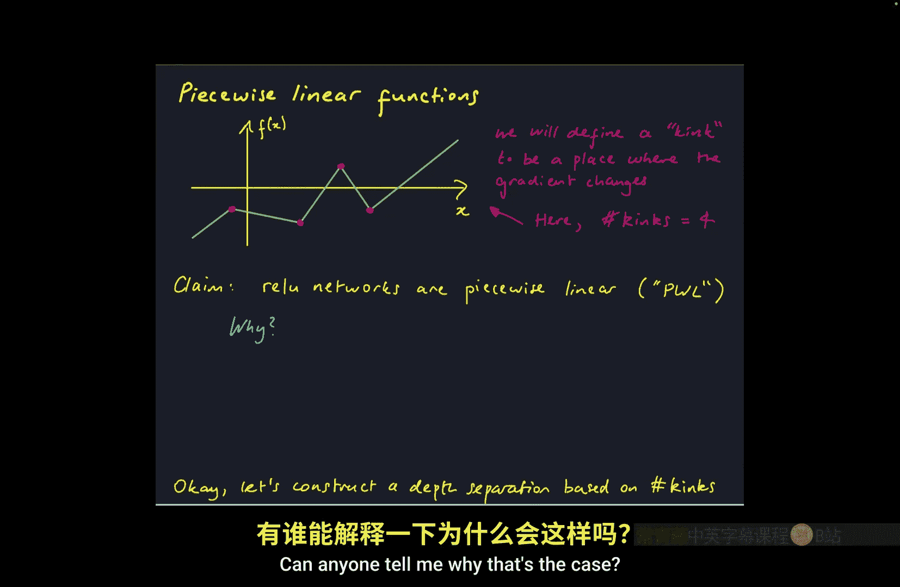

Or does anyone think it is the case or， or does anyone think it's not the case。嗯。Yeah。

 it's because the really is essentially a linear function， but with a threshold。

 so when you add them， it creates a kind of shape。transformation that you phrase being with somebody gave to us。

This。Great， so， yeah， I think with this kind of statement with many sorts of statement， Yeah。

 exactly。 But with running， many sorts of statements， we wan to break them up into kind of。

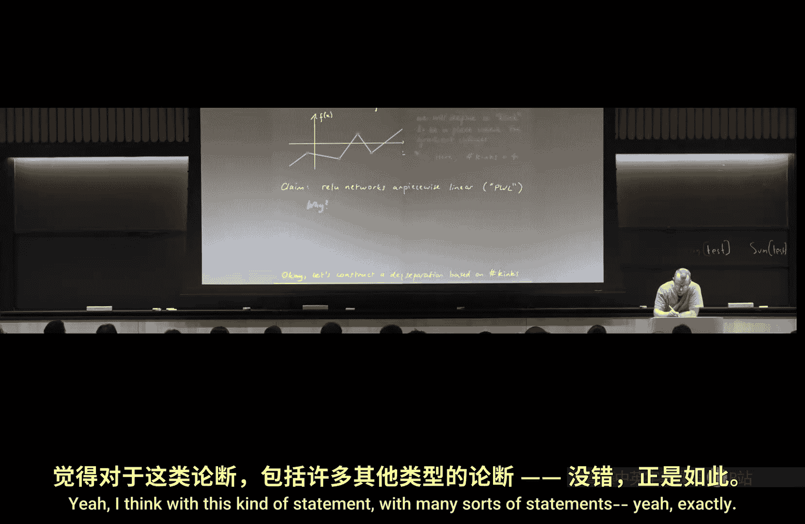

嗯。I'm not sure what the right word is， but we wan to be able to say if。

 if F and G are both piecewise linear， then that implies that F composed with G is piecewise linear。

 If F and G are both piecewise linear， that implies that F plus G is piecewise linear。

 If F is piecewise linear。Then alpha F is also piecewise linear。

 So you sort of break up the construction of the function into a series of combinations。

 and you prove that the property is preserved under those combinations。And then that。

 and then basically， you realize that， okay， a real neural network。Is built out of。You know。

 the really function is piecewise linear。 And then it's just adding and multiplying things。 So you。

 you're always gonna get something that's piecewise linear。嗯。Okay， so based on that。

 let's now construct a depth separation based on the counting the number of kinks， so。And first。

 give you the intuition。And then write something a bit more formal。 But first of all， think。

 think about the point of view of an individual on your own。

 and we're gonna add one extra input on your own。And we symbolically。

 and then we think about feeding a function into like a one dimensional function into as inputs。

 So that we're gonna think of the output of this neuron Y of X as just being the summation of。

 you know， a scalar multiples of the input functions。嗯。The， the， the。

 the observation of this slide is that if we add。Functions。The at most， we add the number of kinks。

And， I'm just like gonna try to persuade you that that's the case with a picture。

 So here we're thinking of the green function is our first function。

 And the blue function is our second function。 And then the purple function shows the result of adding them together。

 And notice this that the。😊，The green function has one kink。The blue function has two kinks。

And then the purple function， which is their sum， has three kinks。 and nothing more。

 you can't have more than that because you， you only can have kinks at the places where the functions that you're adding had them。

 So this is how we think about adding functions。 We can at most add the number of cakes。

 potentially they could， the kinks could happen in the same place in which case。

It would be less than adding because that wouldn't give you an extra one。 But generally。

 if they're generally spaced out， then， then they would die。Next， intuition。

The effect of applying relu。 So we think， we think now that we have a function F。

 and then we just take relu of F。 So we think that the output is relu of F of x。 basically。

 So Y of x is relu of F of x。 And then now the claim is that if， if we apply relu， at most。

 we double。The number of cakes。 And so this picture is supposed to kind of illustrate。

 We think about the red function as being F。And then if we apply reulu， we sort of just， you know。

 chop off the， the positive part。And the observation is that if we had a linear region。

That can most get split up into two linear regions。 So that's the And， if you do。

 if you just count on this picture， I think you see that the red function had 1，2，3，4，5 kinks。

Whereas the green function has like 1，2，3，4， No，1，2，3，4，5，6，7，8，9，9 kks。

 So you can see it did nearly double in this case and。Okay。So now to be a bit more formal。

 we're gonna imagine that we have like a deep net relo network with many layers。

 and we're gonna like。Examine one layer inside the network。And we're gonna give a recursive。

Definition of what this layer looks like。 So the， the function at layer L is real of the weight matrix times the。

 you know， the function from the previous layer plus the biasers。And each of， you know。

 this is gonna be an n dimensional vector。The weight matrix is gonna be an n by n matrix。 This。

 this is gonna be an n dimensional vector。 and the bias is also an n dimensional vector。

 So that's the shape of all of these things。嗯。And then we def， we define this capital。

Lettter ks L to denote the maximum number of kinks over the n coordinates of， of the output。

 So remember， this is an n dimensional vector。 Each coordinate could have a certain number of kinks in its functioncause each coordinate is a one dimensional function。

嗯。But then we define this variable to be the， the maximum over those coordinates and。

Maybe I'm just gonna write it as a claim。 But the claim is that like kinks L。

Can be no greater than two times the width。Times the number of kinks。

 the maximum number of kinks in the input。 So maybe you could think more about this。

 So the two comes from the doubling effect of the rer。

 and the n comes from the fact that you're adding n things。 And then the。

 the trick is just to think about taking the max over the， over each coordinate。嗯。And then， you know。

 the other observation is that the kinks that the input， the input is basically one because it's。

 there's no kinks。 So， maybe it should be。Does that make sense。It should be 0， right。

 but it's not gonna。We， we need to some let's think about this after that lecture。

 But the point is that。The point is that each time we can most multiply by 2 N。

 So I'm trying to get the answer that kinks。L is， is like， is no greater than2 and to the power L。

 But obviously， if kink 0 is。0。Okay， well， if kink 0 is 0， it's still less than equal to1。Like， yeah。

 it's just the some accounting problem。 But you， you kind of see what the argument is。

 I just need to figure out。

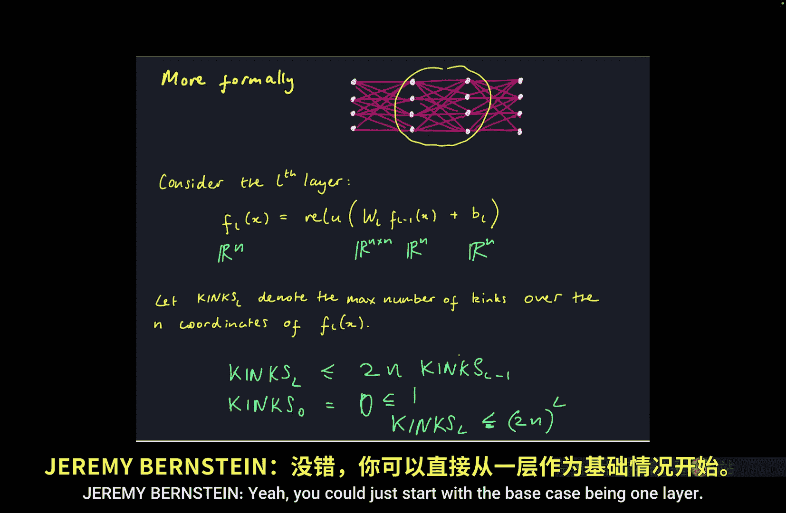

Yeah， to just start with the base case being one layer。 That's， that's a group。

You should measure a second。But。Rlo as a paint word that was not。じこれ。Yes， okay。

 let's just talk more about this。 But I think you get the intuition and like making this rigorous。

 You just need to think about it a bit to work out what the base case should be and。Okay。

But I hope that the message gets across。

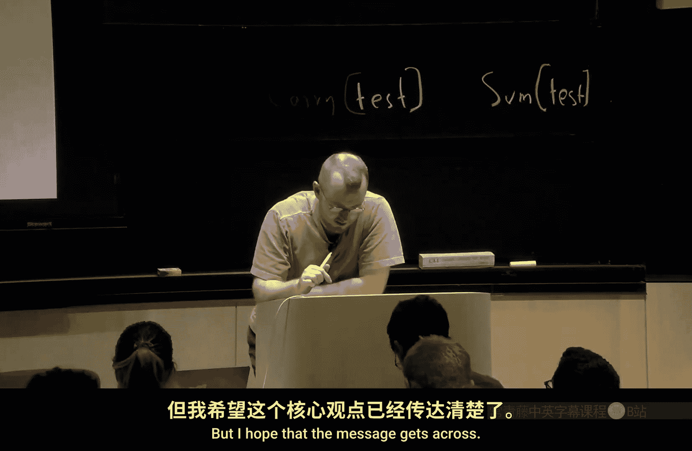

So。In principle， we showed this statement。嗯。Well， as a reminder， n is the width。

 capital L is the depth。And kin Z。Is should be the maximum over the coordinates。嗯。And so the， the。

 the point to， the thing we wanted to point out is that the upper band grows at most exponentially。

 no， at most polynomially。In width， but exponentially in depth。

So this is suggestive that there's a big。Benefit if we're trying to maximize the number of kinks in making the network deeper because every time we add a layer。

 we double things。Rather than making it while So if our goal is to be able to approximate。

Functions with many kinks， then。It's better to make the network deeper。Rather than worry but the the。

 the， does anyone have a an objection to what we've shown cause it， it is just the upper bound。嗯。

So the objection that you could have is like， that's just the upper bar。 Maybe it's never attains。

 Like maybe in practice， when you actually build a very deep reel network。

 it's very difficult to get there to be a lot of kicks and output function。 So the next step。

Is to provide a construction。To show you that， no this can actually happen。 And again。

 I'm just gonna like skip the slide。 So， okay， the argument is that。This G， G defined as a re。

 a small re network in this form。 If you plot what that actually amounts to it。

 amounts to a triangle。And the property of a triangle is that if you iterate it。

 you apply it to itself。 So you do G composed with G。You actually get two tri。s。

 there should be no gap there。Let's see。 You get two triangles。

And if you do G composed with G composed with G， you get four triangles。

So you do need to think a little bit to see why that is。But actually。

 I think I didn't need to show you the， but I was gonna like demonstrate it on the graphing website。

 But I think the hopefully the claim is clear that you can， you can just with res。

 make a triangle function。 And if you think about what happens to the triangle function when you compose it with itself。

 you just like kind of like recursively get double as many triangles each time。 So this is。

 the point is that this is an explicit construction of a certain re network。

 where when you compose it with itself many， many times， you。

 you actually keep doubling the number of kinks in the function。

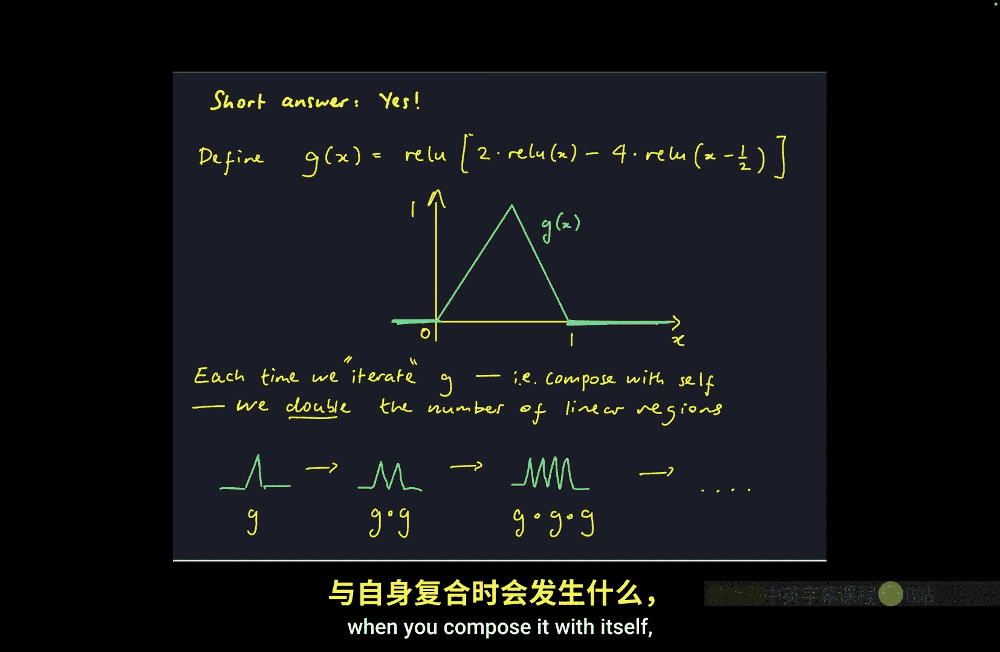

So， it can。It can really happen， at least with this one example。

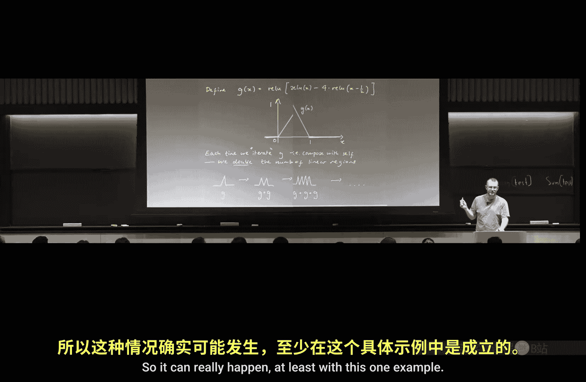

And then this is actually just running some numbers where I'm like。

 let's suppose that we take that triangle function and compose it with itself 500 times。

That would give us at most。you know，2 to the 500 kinks。 No。

 it would actually give us that many kinks。 It would really would give us that， that many。嗯。Actually。

 each G turns out to have two layers。 So this would be a 1000 layer MP。 And then if you。

 if you compute using the band that we constructed， how many， if you took a three layer MP。

 how wide would it need to be in order to fit the same function。

 you find that it would need to have almost 10 to the power 50 width in order to fit that same function。

 So this is the this is the point， this is the depth separation。Like。

 there's a function which is not even that difficult to write down。 It's just like a triangle。哦。

Self composed many， many times。 And if you wanted to get a shallow network to exactly approximate that function。

 it would need to be very， very， very wide。 This is also。

 this is like the reward for coming to the lecture。 But this is also one the first。Problems that。

 So just maybe when you're solving the problems that have a， have a think about this。So， okay， Im。

 I want to now think a bit more broadly。 what， what does this not say。This， this。

 this depth separation is suggesting that there could be a big advantage to making things really deep。

But it's not telling us that deep networks are very easy to train and they might not be。

 So it's not telling us about optimization。And it's not telling us about generalization。

It's not saying that the very deep networks would actually perform well on some particular data set that we wan to apply them to。

It's really， these are really just statements about thinking about approximation。

But this is not the end of the story。 It's just like one，1 piece in this puzzle。嗯。Again。

 there's more theorems of this nature and feel free to look more into them。

 The one at the bottom is interesting because they actually。A a question you could have is， is like。

 okay， if， if depth， increasing depth is so great， maybe I'll just pick depth like 3。Sorry。

 width 3 and just go really deep。 And this。This will work really well。嗯。

But what that paper shows is that if the input dimension has dimension。

 If the input space has dimension N， you need the width of at least n。To approximate any function。

 Basically。 So there's， there， there can be a minimum width that you really need。 Anyway， that。

 there's some further reading in case you're interested to go deeper on this topic。所。In the last。

15 minutes， I guess。Wanna think about。So more practical considerations。

 like those were theoretical results。 It's， you know， maybe they're really interesting。

 But if you're actually building machine learning system， I don't know if。

 if you need to think about that， those things， maybe you do， which would be great。

But we're more just trying to expose you to these different styles of thinking。

But now let's think a little bit about some more practical considerations。

 So the the trouble is in practice。 if you're actually building a machine learning system。

We were saying that that's these three pieces of the puzzle。

 And isn't it nice if we can like neatly tackle them1 by one。 But out there in the real world。

 it's not like that。 And basically。If you're training a system。

 you have all of these different issues conflated with each other。 and you do。

 if you've got a problem in your training， you don't know if it's because your neural network actually can't approximate the thing that you're trying to approximate。

 You don't know if it's because the training is failing。Interestingly， you。

 you wouldnt know if it was because it， it's not generalizing because you could just compute the training error and the test error and you could see if they're different。

 So that one's easier to diagnose。But the point is that all of these things are conflated。

 And the other thing that we were gonna say is suppose that you work at a large language model startup。

And that your job is to make the LLM training as efficient as possible。

 Then you actually really care about this question， like。

 should I make the network wider or should I make it deeper for all those reasons that we talked about the。

 you know， the computational cost of training， the computational cost of inference in terms of making the model work well。

 it's like it's in a sense， it's the most basic question that you think about when you first learn about neural networks。

 But it's， it's to a large extent， like an unsolved problem。嗯。And that's。

 I wanted to show you to talk a little bit about this paper by Kaplplan and Mcanish from 2020。

 which people， you know， this figure。People got t shirts where they just like had this figure。

 and then they would like try to like spread the word about。 And this is the this is the figure。

 which is basically saying， as you make GBT bigger， like， it gets better。

 And the point is that so in， in particular， like。The X axis is compute。

 like the amount of flux of compute， the size of your data set。

 the number of parameters in the model。 And the point is that the test loss。

 the Y axis is always going down as you scale any of these。

Axes and the loss cannot go down forever because， you know， eventually you。

 you can't have negative loss。 It has the， the loss has to get a 0。 So it has to saturate eventually。

 But back in 2020， they were like saying， hey， the， the models keep getting better。

We should pay attention to this because it's like the， you know， then。

 then all of these advances in Alls became， you know， Cha E T was created and so on。

But interestingly， they plot performance against parameters。 It's not this， in this top plot。

 It's not against width， and it's not against depth。 And the claim that they have in that paper。

Is within several orders of magnitude。TheThe， the allocation of your compute budget between width and depth doesn't matter。

 All that matters is number of parameters， a number of flops。

 You can have like a depth 20 network or a depth 10 network with with a commensurate number of width。

 It doesn't matter。 So that's kind of interesting that like， you just run the experiment。

 And you see that width versus depth within a large range seems not to matter。 And that they。

 they exemplify that with this。Lower plot。And the point is that once they subtract the embedding parameters。

 So if we just focus in on the bottom right plot， which is like the model with the embedding layers not counted。

嗯。Roughly， you get very similar performance。 Like I think that basically。

 they're saying beyond depth 6， it doesn't matter what the width is or what the depth is。

 The the curves kind of converge to each other。 and all that matters is。

 is scaling up number of parameters。 So this is just like a。

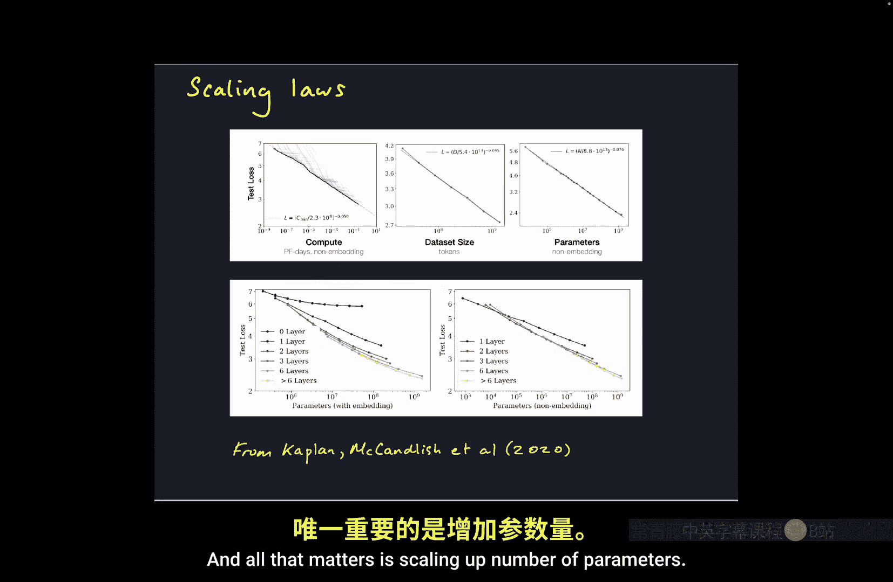

Very， very practical perspective。 But some， from some very careful， like empirical。

Very careful experimentalists about how things actually work in transformers。 And you see。

 it's quite， it's basically saying like within a large range width versus depth doesn't matter。

 All you care about is parameters。With that said。

That's something I wanted to draw attention to， which is this idea of confounders。

And there's another paper， which people are also excited about。

 which people refer to as like Chinilla scaling ruless。 The names keep getting stranger for these。

 for these things。 But， but it's， it's basically。They， they， they。

 they're interested in the same sort of questions as the previous paper I just showed you。

But what they， what they do is they question some of the results in that earlier paper。

 And one of the things that they suggest is that if you use a different learning rate schedule for the training。

 you can get。Qually， slightly different， but qualitatively different conclusions。

 So if you just had one learning rate schedule， and now you。Do a different learning rate schedule。

 You draw different conclusions。And this is just to say that precisely answering any of these questions。

Is very difficult because there are so many parts of the training pipeline that we don't understand。

 So you may have one experimental setup and you say， hey， like Whit versus is death doesn't matter。

And then you like change some detail about how you actually train the network。 And now it's like， oh。

 no， width is actually scaling width is a lot better because I because I fixed that issue。

 And I would call that like a confounding issue， which is just some aspect of the training that we don't fully understood。

 But is having a bearing on the results。 So this is just what I want to point out is that。😊。

Really resolving these questions， experimentally。Is really hard because there can be so many confounding variables and resolving them theoretically is also really hard because you have to work out how to think about these things。

 And a lot of these problems are unsolved because of the fact that it's kind of hard to figure things out。

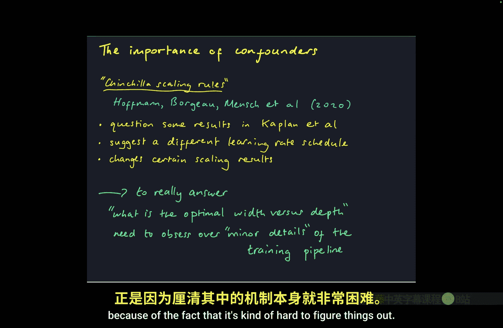

So in conclusion。

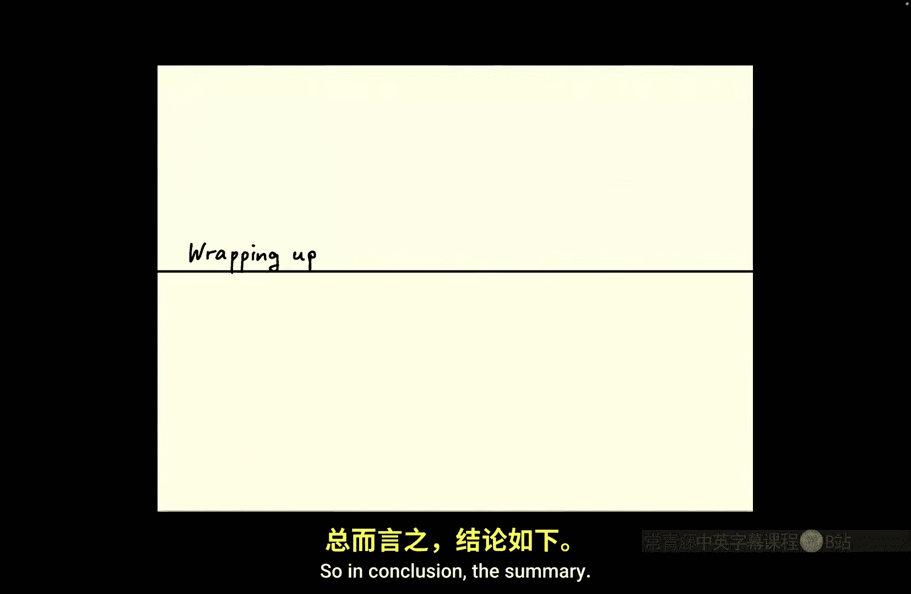

The summary。Oh yeah。 There's still another slide after this one。 When you leave the lecture hall。

 tried to do so quietly， that was someone suggested that justca okay， okay。

 so the summary of the lecture is。Very wide shallow in' on net。

 So a three layer MP with that's wide enough。Can fit any function within the within some class of functions。

 quite a broad class of functions。嗯。But deeper networks。

 then in the LED the second half of the lecture， we said that deeper networks can fit certain kinds of functions with many fewer in neurons because of that compositionality。

 And we called that a kind of depth separation result。 So that was something interesting。

 And then the kind of overall message or。😊，The overall message that I am hoping to。嗯。

Give give to empower is basically。It's unclear how important these results are。

It's unclear how they interact with optimization and with generalization。

 But it's still like really interesting to， to think about them and to have that as part of your toolki。

 If you're thinking about your machine learning system， a basic question is。

 can the network architecture that I have actually approximate the function that I'm。

 I'm asking it to approximate， That's quite a basic question。😊，And I w to like。

 just conclude or to wrap up with a little preview for what's come in the course。

 So I have a question。And it's supposed that we have two machine learning problems。

 Like one is an audio problem。And one is a image image classification problem。

 So the first little picture is like a waveform。 And then we're transcribing it to say the word hello。

 because， and then the second picture is like a photograph of a person。

 And then we're classifying that as， that's a human。😊，嗯。Okay， and then the thought experiment is。

 in both cases， we could like flatten those。Little pieces of data into vectors。 So we could flat in。

 okay， maybe the waveform is a vector。 and then we can flatden that image of a person into another vector。

 and then。We can just apply MP to both like we can take multi layerron with really non nonlineararity and try to fit the first problem。

 And then we can take another MP and try to fit the second problem。 And， you know， the。

 the argument is， okay， the MP is a universal function app。 So it should。

 it should this is a great idea。 And so I want to ask， like， do people think that is a good idea。😊。

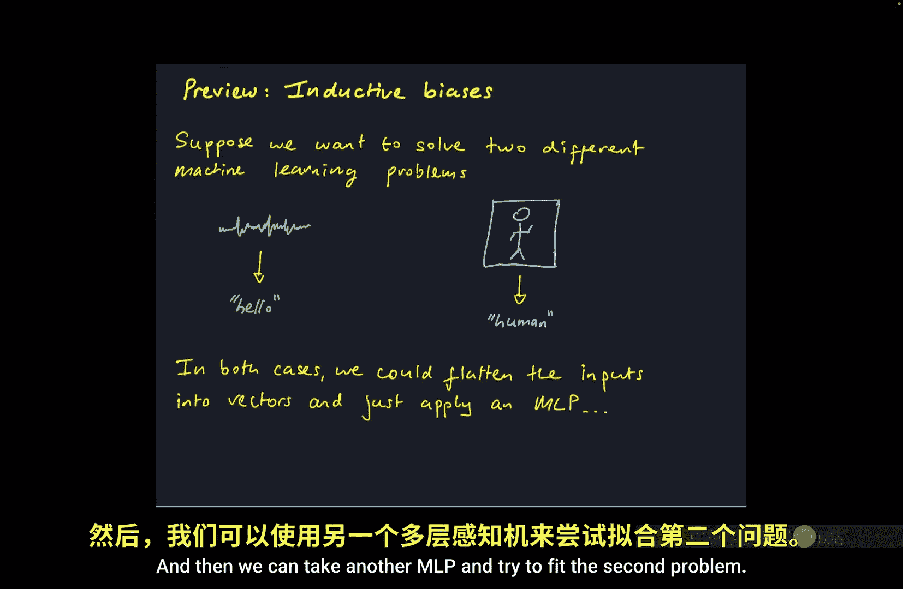

No， why， why not。Maybe but why， why not。依然。If you exist what you may。Yeah， that's one objection。

 That's a great point that it， that it could exist， but we might not find it。thought， yeah。あ I said。

好的就是。You may or may not find that。Finally， you may need to tune certain parameters than。Wow。C so。

Yeah， so the， yeah， the objection is it could be inefficient to use an MP。

 There might be another potentially another architecture that could be。More efficient。

And in particular， it could be adapted to the type of data。 sorry。

I was just going to say like and I know he doesn't take。So I open。Thats right。完。

That's a great comment。 So the comment is that the the two different problems have different structure in the data。

 And perhaps we want to adapt the model family。 And that's what I thought when I was writing the slide。

 And then I was like， but wait a minute， now we're just applying transformers to everything。

 So is that counter to that point。 And then there was like， no， actually， it's not。

 because even if you apply a transformer to audio or you apply it to images， actually。

 the preprocessing layer at the beginning of the network is very different。 So if it's images。

 you have a special 2D patch kind of representation。 And if it's audio。

 I assume they have some kind of better audio representation。

 So even if you just throw transformers at everything。 actually。

 this comment that you do adapt the architecture a little bit based on what the data is。 So yeah。

 I really agree with that comment。😊，But it was a big question。

 People even recently have been thinking about that。 way， a transform is all we need。

 Maybe we don't need to like model the data。 But I think really， you still。

 you still need to model the data a little bit。And also， it transformers， you know。

 you can ask how data hungry are they， Maybe they， maybe there's a better model family。

 which needs much less data in order to learn。 So that was the final thought to leave you with is perhaps we want to match the architecture to the problem that we're trying to solve or the structure of the data。

 Perhaps it could be more computationally efficient。

 Perhaps it could be make it easier to find the app that we're looking for。 Okay。

 that's the end of the lecture。 Thank you， everyone。😊。

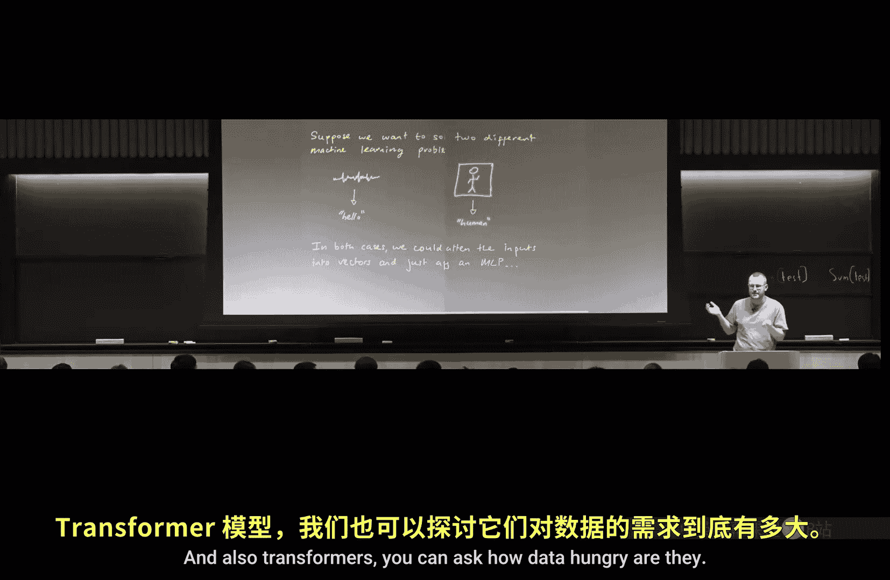

