# 麻省理工学院【中英⚡深度学习｜6.7960-Fall-2024,-Deep-Learning】-p04-P4-架构：网格--BV15QZ4B1E6v_p4-

So today we're going to start off the first of a series of lectures on machine learning architectures and so you know。

 moving beyond kind of the very vanilla architecture， we've been talking about sopar。

 which is the multilayer perceptron and starting to discuss different ways that we can encode structure or essentially build hypotheses about the space of models that we want to optimize over directly into the architecture of the model that we're going to optimize So what that's going to look like today。

 first we're going to sort of have a broader discussion about why we want to build better architectures and kind of what makes an architecture better。

And then we're going to do a bit of a deep dive on convolutional layers as like one specific mechanism you can build into an architecture。

 one that works particularly well for grids。And this might be a review for some of you。

 but we're still going to spend some time on it。Then we're going to talk a bit about pyramids and the idea of receptive field。

 then I'm going to go through a bit of a high level overview of a bunch of different kind of architectures and architecture components that have made up a lot of the progress in the last know 10 years or so。

 and then I'm going to finish with a first touch on neural fields and positional encodings so we'll talk a lot more about this when we get into lectures on transformers later on。

Okay。So。This is what we've been talking about so far。 the multilayer perceptron。So this is， you know。

 at a high level， the building block is this linear combination of neurons or linear combination of inputs。

 a neuron wise or a pointwise non nonlinearity， and then another linear combination。

And one of the benefits of this， like got described in the last lecture is the fact that it can。

 it's a universal approximator。 you can build any model。

 prove that you can build any model with this type of architecture。

Another benefit of a multilayer perceptron is its site quite simple right and one of the things this simplicity gives you is the ability to write really elegant theory about this model and this is one of the only models that we actually have really elegant theory for because the complexity is such that we can make reasonable assumptions。

 It maps well into our kind of mathematical tool blocks。

 And then another huge benefit of the multilayer perceptron is it's what we call embarrassingly parallel essentially this means that this type of architecture can be really easily paralleled in terms of computation。

 which means we can make use of things like GPUus that enable a lot of parallel multiplications。

 So you know one obvious example of that is that that neuronwise or that pointwise nonlinearity that's calculated independently for every single output neuron of that first layer and so that can happen completely in parallel。

 There's no dependence across the the data points another nice example is that linear。😊，of neurons。

 that densely connected layer or that weight that can happen in parallel across a very large。

 in some cases， batch of data that's done sort of independently per data point。

So what are some of the bad things about the multi layer perceptron？

So first one is that it has very weak inductive biases。 And so what we mean by this is that。

The model itself， it's a universal approximator， but there's not a lot of structure intuition baked into this model。

 It doesn't sort of assume much about the structure of the model you want to learn coming out。

And so one of the things that implies is that though you can use this model。

 So though you can use a multi layerer perceptron to approximate any sort of mathematical function。

It might be very difficult to do so。 given the data that you have。

 It's very sample and efficient or data hungry。 This basically means that in order to get this multilayer perceptron to learn maybe a very complex function。

 you might require。So much data that it's not actually tractable and more data than exists on earth to be able to really generalizably and robustly learn a function with this particular architecture that generalize as well。

And then another downside is that those dense layers， those fully connected layers。

 particularly if you want a model that's very wide because maybe the function you need to approximate is quite complex。

 those can be really expensive。 if your input data is an image， for example。

 a high resolution image that you might take on your iPhone today。

 then you need to flatten that out into sort of one long vector that's going to be thousands of input dimensions and thousand by that thousand multiplication and a dense way is a very expensive computational cost。

So。Why use other architectures？ Well， one， we might want to address some of those downsides that we talked about。

 But let's kind of。Take a sort of a meta view of this and， and and zoom out a little。

 So if this is the set of all possible mappings from X to Y。

 This is like all functions is contained in this little gray box。

 And maybe this is the true solution we're trying to learn。 This is kind of the。

 the correct model for our。😊，Our problem。Then。Possibly。

 given any data set that we're going to learn from。That data set will constrain the space event。

 right， So not every model will fit the data that we're using to learn the data。

And so now maybe you have this subset of all mappings that actually fits your training data and then within that。

 based on something about your optimization scheme。

 you learn some solution and it will be in that space， it will fit the data。

 but it won't necessarily be very close to the true solution。So what would happen to this。

Kind of high level diagram。 if we add more data。Anyone， what would happen？ああ、そうだ、さず一緒。Yeah， exactly。

 So that that green space， that'll get smaller， right。

 Therell be fewer models that fit all of the data if we have more data。 So that's kind of nice。

 So if you can add more data， then potentially you shrink the space you're optimizing over。

 and then you'll learn a maybe more optimal solution or something that's closer to the true solution。

 because the space is different。😊，But what if you don't。Have more data， right？

 That's not an option for you。 So then another alternative is to define a hypothesis space。

 and this is adding some structure into the model itself。

 and that hypothesis space is essentially going to shine sort of a spotlight on the space of all possible models is the way we've kind of connot it here。

 but's essentially it's a stronger inductive bias or a stronger prior over what we think the model is going to take the form of。

 and then if you have kind of that intersection of the models that fit the data and your inductive hypothesis。

 then then you might actually be able to find use less data， but still find a better architecture。

 right。So the idea is we can pin down or we can get closer to the true model by either adding more data or by using a more constrained architecture。

 And you can imagine that the culmination of the two would be even better， right， So more data helps。

 better architecture or stronger， inductive bias helps。 And those two things combined is ideal。So。

Let's look at this from a very， very simplistic model。 This is just a one dimensional model。

 it's a mapping of f of x where x is a scalar。So here， if we use， for example。

 and this is actually these are true outputs。 If we use a five layer relo net。

 so essentially densely connected layers with pointwise relobased activations。

 and we fit that to a single data point right well now the space of all possible models that fit that data point is very。

 very large and the one that actually gets learned is just this flat line。

 So that's not necessarily a very good learned solution as we start adding more data。

 you can see that you maybe start to fit slightly better in the region where we add data in the middle but it's still not a very good solution。

 and then as you start to add a lot of data。 what you see on the right is you start getting really。

 really nice fits in the distribution where you have data but you get really poor generalization out of distribution。

And so the intuition here is really that。That model hypothesis， that hypothesis space you build。

 that's really something that helps us generalize out of the distribution of the data we have。

And so what if instead we had a really strong prior over what the model was supposed to be So in this case。

 y equals ax plus sine bx squared right that that's very specific。

 it turns out that is exactly the correct model for this function and you can see that if you only have a single data point。

 that really good model is sort of insufficient you still aren't able to figure out where in that set of hypothesistheses。

 the correct model is but even with very， very， very few data points。

 we start getting a really nice fit and actually even when we add a lot more data points。

 we get really strong generalization out of distribution。

 but the difference between those two in the middle is actually not that big right so we can get a really nice fit even with just a little bit of data when we have the exact precise correct hypothesis。

AndSo that's what we're showing。 Architecture has enabled us to generalize outside the training distribution。

 and a good architecture is going to be one that can represent the true function of the data。

 and then is otherwise minimal， right， We want it to be easy to search over via gradient- based learning。

 We want it to be easy to parallelize fast on GPU， etctera， et ceter。😊。

And so here's a bit of a preview。 But it turns out that better architectures can approximate important function classes more efficiently。

 so。This is a result from a paper by another MIT professor Vincent Siitzman。

 where they introduce this model over here on the far right called siren。

And siren actually uses a sinusoidal activation space and that fits images more efficiently。

 if anyone's taken signal processing， this idea might be a bit familiar。

 a Fourier basis is a good basis for representing images and the fundamental building blocks of a fourier basis are sinusoids So if we take a look at what this is if you look at reluette or a attentionnet or these different models that are being compared here。

 and we're going to look at how they actually try to fit this specific image over time by sampling pixels from that image and then fitting that as the training data you can see that you start getting a pretty good approximation from siren siren much。

 much faster than you do from some of these other models and of course。

 after sampling enough points eventually all the models are getting reasonably good at estimating。

 but that siren model it's a better hypothesis to start with for the image space and so you get much more efficient convergence。

And so in this particular instance， now， instead of looking at a five layer really net。

 we're going to look at a five layer sine net where now those activations of nonlinear activations are sinusoids。

And you can see here that with a single data point， it still doesn't fit super well。

 but even just with a couple data points。We start seeing some periodicity that maybe starts to matchsh the periodicity in the function。

 And even though we're not generalizing perfectly， we're still sort of seeing some periodicity that seems to be moving more towards what the true function is。

 So why would you have that periodicity in the output space。😊。

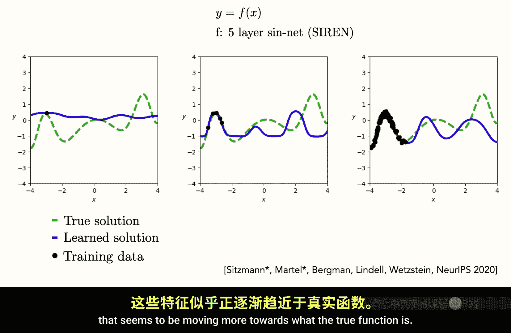

It's kind of an obvious question。Yes， it's a sign， signs are periodic。Very nice。But so essentially。

 we've just added an inductive bait bias in our model architecture that says that the distribution should be periodic。

And then it tries to find solutions that are periodic outside of the sort of distribution when we have training data。

Cool， any questions about this。It's really just intended to build high level intuition， yeah。

I'm wondering how constrained is this to the number of pixels？3月所。先在。

So one of the things of the Fourier basis is that you are building out the basis assumes different periodicities of s。

 and so you're reconstructing the image using different periodicities and weights of the sign you side function。

 so that handles some of the structure well and it's one of the reasons that we can compress images really well with things like the fast Fourier transform。

Yeah。

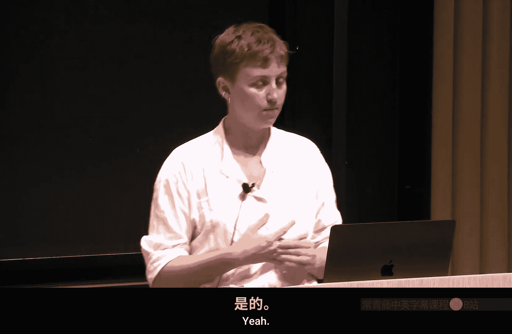

Cool， so let's now talk about convolutional neural networks。So。Here's an image。What's in this image。

Birds。Okay， so。What else is in this image？Sky。So if I had a whole image classifier。

 if I took this image and I ran it through one of the models we've talked about so far。

 what would we want it to say。What's the category of this image？Birds and sky。 I mean。

 that would be nice。 We haven't talked about multi output classification， though， yeah。😊，Nature。

 yeah， okay， so that's that's actually。I love that answer。

 So one of the things that's really interesting is like you can really see this trade off between generality and specificity。

😊。

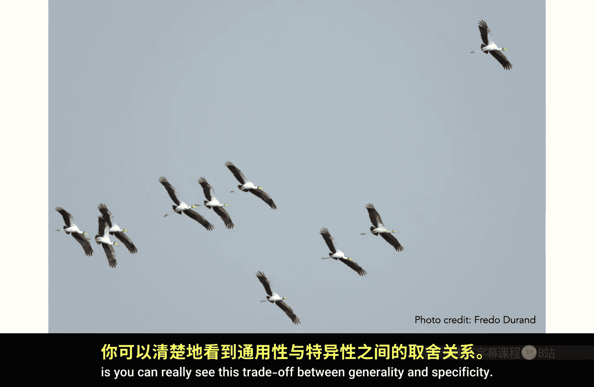

And so yeah， it's like， oh， well， that's too hard。 I'm just going to predict something coarser cred。

And you know， that's a reasonable fallback。 But okay。

 so so what I was kind of trying to get at here is actually for a lot of things we might want to understand in an image。

 maybe a single category isnt isn't sufficient information， right， This could be flock of birds。

 for example。 I mean， maybe that's a category。 But really。

 it's just that a single label is usually insufficient to represent the semantic concepts that are captured in images。

 And this is actually in the grand scheme of things a pretty simple image。 I mean。

 think about this versus an image like of Time Square， for example。

 how complex that image signal semantically could be。😊，So。If you were to take a picture， for example。

 from where you're sitting， I don't know out there in the audience。 Like， think about， like。

 what would you categorize that picture， Is it， I it lecture hall， Is it students， Is it projector。

Is it M I T， It's all those things， right， But so when we start to think about these more complex semantic signals and we'll get into a lot more of this throughout the course。

 One thing that starts to be more and more true is that there's often。

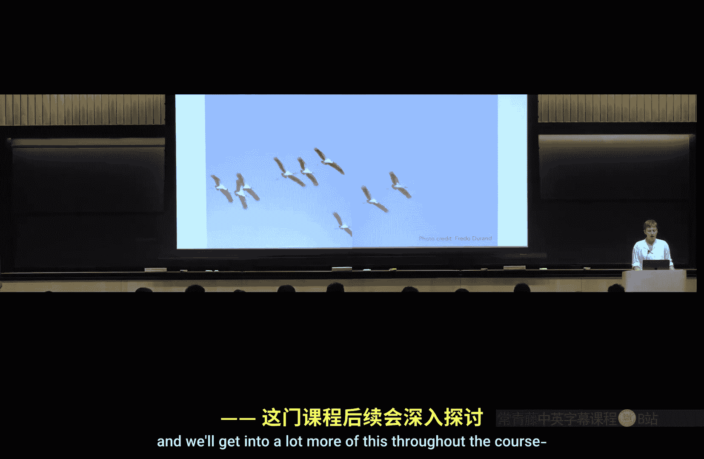

There's often maybe different categories or different bits of information that are somewhat locally constrained。

 And so you can think about breaking down the problem into something that actually looks at location as well as semantics。

 So one way that we could try to address the fact that this image kind of contains multiple things is we could first subdivide the image into patches。

 And then we could try to classify each patch separately， right， So you could take this image。

 trap it up into little pieces。 And then maybe you have a classifier。

 And now you send this patch to the classifier。 and it says bird。

And then you could run that classifier over the entire grid。

 right and you'd take all those patches independently， and you could then， you know， hey， bird。

 this one is sky。And you could densely populate that entire sort of space and and get out the category per little block or little patch。

嗯。And so if we think about this and we have some function that's going to crop this up and map every patch to a category。

In some way， this is actually giving us an image output， right， It's。

 it's it's a bit like a low resolution image。 It's got some spatial context， which is useful。

 But there are a couple patches here。😊，Where the objects don't necessarily fit super neatly inside them。

 right， So I don't know， maybe this one over here that's got like the tip of the bird's wing just in that one edge of the patch。

 You know， it gets a little ambiguous。 Do You want that to be that patch。

 that whole patch to be categorized as bird if there's any bird at all。 Do you want to be。

 what is the majority of the pixels in the patch。And so maybe we want a higher resolution output map。

 right， We don't want to just know at this really coarse resolution。

 We actually want a finer resolution of the output。

 So one way you could do that is you could use smaller and smaller patches。

 But it turns out that as the patches get smaller and sort of at the far extreme。

 the patches are a single pixel from a single pixel。

 you don't have enough context to determine what the semantic category is。

 It's not easy to recognize content as those patches get small。 So instead， the kind of winning。

Iea here with convolutional neural networks is we use large but overlapping patches。

And that's really the very， you know， the very high level intuition behind all of this is that you want context that's local to be。

 you know you want to be able to look around the pixel you're predicting at when you make a prediction。

 but you also want to kind of do this in a dense way。So。The way that would look is， okay。

 you have your sort of patch size and that patch size is probably a parameter in your model。

 you want to make sure that context window is kind of big enough that you maybe see the whole object of bird。

 but then when you're actually predicting， you're sliding this over as you go。

 and then maybe you're only predicting， for example， the object class of the center pixel。

 but given the context around that pixel。And so now your training data would be， you know。

 that patch and then the output category of that center pixel， for example。

And now if you actually run this categorizer over your entire image。

 you start to get something that actually looks pretty cool， right。

 that starts to look like semantically kind of the boundaries of one category and another。

 and this problem of categorizing every pixel instead of categorizing a whole image is called semantic segmentation。

😊，And here we're categorizing every pixel as one of a set of categories。 This can be extended。

 And maybe we'll talk a bit later about instance segmentation， which is a similar problem。

 But now you want to identify unique instances of a given category and capture them separately。

So now you have essentially the building blocks of a convolutional neural network。嗯。

And one thing that's nice about this is because you're processing each of these patches independently and identically。

 that means that。The actual model itself is in invariant to translations of the input。

 So this is an equivariant mapping。 essentially。 So since you're processing every single patch in the same way。

That means that it doesn't matter if the bird is in the top corner， the center， the bottom left。

 it's still those pixels are still going to be categorized as bird and another way to think about this is if you took your function and you applied it to a translation of the input。

 it would be the same as if you translated a function of the original input。

And why would this maybe be a nice thing to have for something like semantic segmentation。

Why is this like make sense as an inductive bias or a hypothesis for images and for categorizing like this？

Yeah。Yeah， yeah， yeah。 So， so the answer corresponds to that local context window， but。Yeah。

 if you took an image of a bird and then you moved that sort of portion of the image corresponding to a bird to a different part of the image or imagine you were actually taking a photo and then you shifted your camera a little bit。

 the object you're taking a photo of is the same right so there actually is this type of symmetry kind of innate to categories in the real world right and this symmetry is something we've built into our hypothesis space via the model structure。

And so， yeah， the world is somewhat translation imvariant。 A bird should look the same。

 no matter where it is in an image， of course， we're kind of glossing over pose。

 which is a more complicated factor here。 But if you have something at the same pose and you move it somewhere else。

 it still maintains the same category。So。裤。One possible version of this of this kind of model would be to compute a weighted sum of the pixels in each patch。

And then the weights of those sum， that sum， that's what we're going to learn。And so if you。

 if you do this， then essentially that， that set of linear weights， W。

Is a convolutional kernel that then we can apply to the entire image。嗯。And so what does this mean。

 What does this kind of concept of a convolution and and a filter or a kernel。

 So a convolution is a linear shift in variant transformation of， of grid structured input data。

And essentially， in signal processing， convolution is a way that you do filtering。

 So how many of you have taken， I don't know， signal processing class or learned signal processing。

 maybe like an electrical engineering class， raise hands。

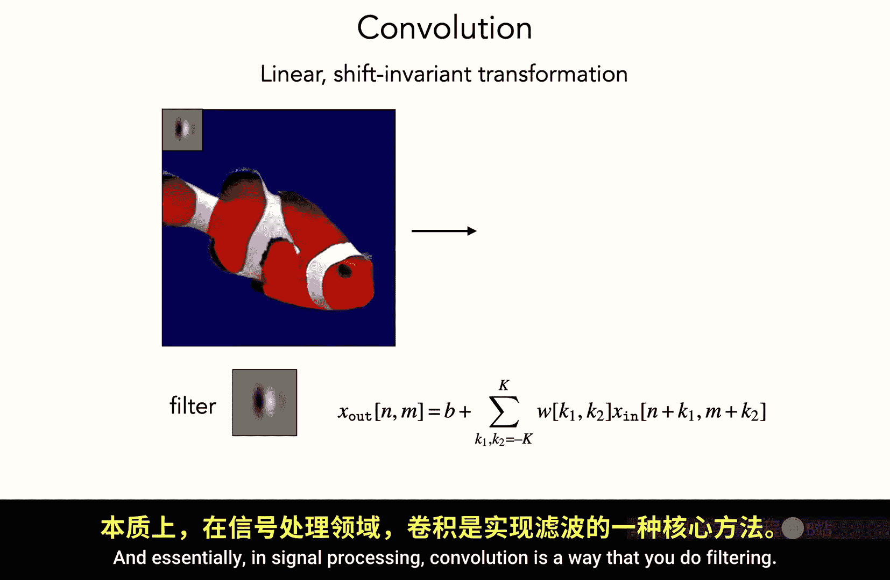

Cool， so a good number of you have seen this before， right。

 And here the filter are the weights we use to take that linear weighted sum。

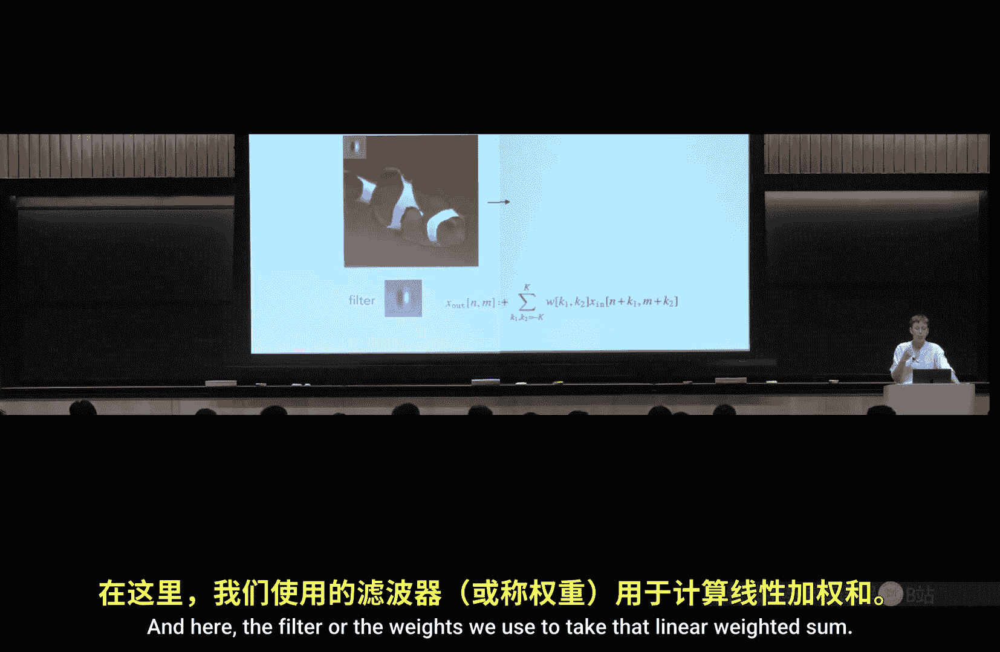

And then like mathematically， if we want to structure that out here at the bottom。

 the output for a given location when applying the filter is gonna to be some bias plus a linear combination of the filter weight for that coordinate times the pixel value for that coordinate in the image and then summed over all the filter weights and all the pixels in the patch。

😊，So really， what it's doing is for any given pitch pit filter。 like in this case。

 this filter is kind of。Diffuse all around。 And then you have something dark and something light。

 So this filter is gonna to look for that pattern by look for that's very sort of anthropomorphized。

 But you're going to produce maximum output values。

 when you have that same kind of dark to light transition。

 And so that actually looks like if you kind of run that filter over this image is you start to get something that's highlighting areas in the image that sort of match the filter the most。

 right。😊，So match it most closely。 So here we can see that we're getting really high values So the white values along the boundaries between dark to light。

 And we're actually getting really low values along the boundaries from light to dark。

 because that's the place that's going to be sort of maximally opposite to that filter。😊。

So in this particular case， what we've got is a filter that's finding us kind of horizontal edges between dark and light values。

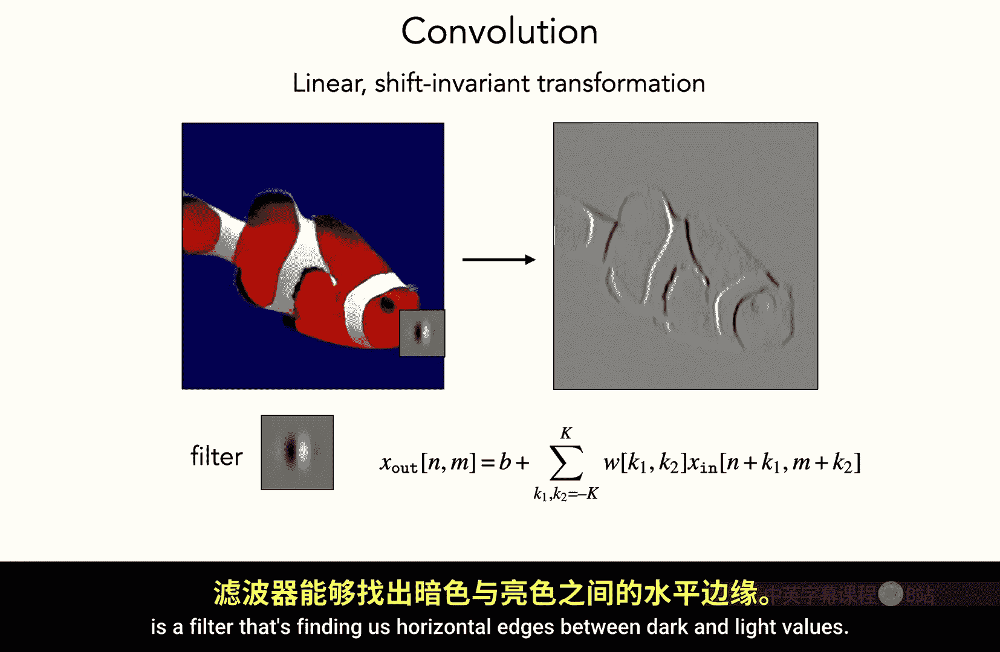

Any questions， yeah。

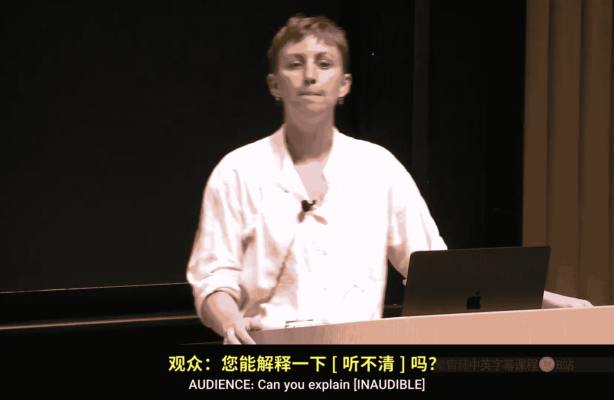

There transformation in in these countries。Yeah， so again， here， if I took this image of a cloudfish。

And I shifted it over。And I ran this convolutional filter over it。

 The output would be this shifted over。And so you could shift the input， then apply the convolution。

 or you could apply the convolution and then shift the output。 And the results would be the same。

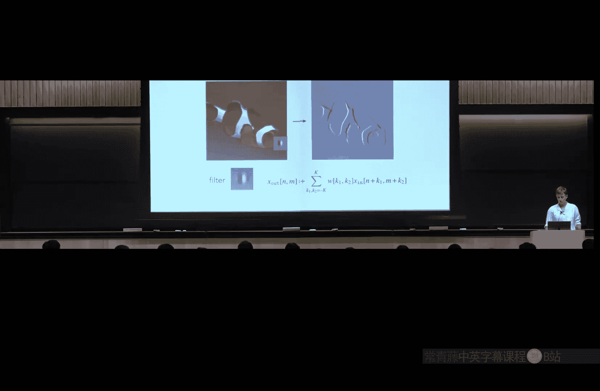

是。Now， let's look at this from a more sort of neural networky perspective。

So this is a fully connected layer。 This is what we've seen so far。 And here。

 all the outputs depend on all of the inputs。 And this can be quite computationally expensive， right。

 when things get very large。Instead of a fully connected network。

 a convolutional network is essentially a locally connected network。

 And so often we can assume that the output then of， of this model is a local function of the input。

So here， if we use the same weights you know for sort of these linear combinations， this W matrix。

 we use those weights the same regardless of sort of where that initial input values are coming from that gives us a convolutional neural network。

 and the way that we actually denote that is with this star operation for convolution。

 if you have taken signal processing， actually this is not quite the same definition is familiarly used in signal processing for convolution。

 usually has a bit of like a flipped value。 But here when we look talk about neural networks instead of calling this crosscorrelation。

 which might be what it is in the signal processing literature， we just call this convolution。

 one of those reasons is because in these networks it's very easy to learn how to flip a So it doesn't matter so much Yeah。

I mean， people， people do all sorts of stuff。 We are going to use a five point star in our lectures and in the notes。

嗯。I think it's kind of pretty。呃。So what does this actually look like so here we have this same linear combination of weights。

 we're running it over the local sort of structure and then you're taking that weighted sum and so the outputs for each of these values are going to be corresponding to just that local input。

 but it's going to be the same weights that are used across the entire input。😊，And the nice thing。

With that kind of thing is that you get this， again， embarrassing parallelism， right。

 Because now you can apply that same weight matrix across sort of only sort of smaller patches of the input。

 But you can do that in parallel。 And if you want to think about。Kind of what that looks like。

In this broader sense， if you're taking a fully connected layer。

 that's the same as taking your input vector， multiplying it by a dense weight matrix where every single one of those values matters。

 and then that's how you get your output。 And now you could think about actually a convolutional layer is the same But now the weight matrix has a very specific structure。

 So instead of being dense， it's going to be very sparse。

 So in this particular instance where we're only looking at a sliding window of maybe three elements of that input vector that those three elements are going to be the only sort of like above and below that diagonal。

 those are going to be the only components that have values。

 and the values are going to be exactly the same along the entire diagonal of that matrix。

And there's a kind of a special name for this type of matrix。 It's。

 it's a specific form oftops matrix。And so one of the things that's kind of cool here is that it's essentially a constraint on a standard linear layer。

 And there are fewer parameters that can be learned because you're just learning essentially parameters for just that local structure。

 So there's less of them。 and they're going to be repeated。

 And so that means you can have a lot less overfitting。 right。

 There's less sort of open flexibility and you're building some nice constraints into the system。

 You're making it equivari。 You're making it translation imvari。😊。

And then another nice benefit of this is because this thing has this specific structure where you have kind of zeros almost everywhere。

 except for sort of just above and below the diagonal。

 this can generalize to different input sizes because you can take that same that same weight matrix and you can scale it right it's not going to change anything about the model you've learned And so that means that convolutional layers can be applied to arbitrarily sized inputs。

 which generalizes beyond the training data in a really nice way。

 whereas if you took like an MLP and you apply it to an image and then you tried to apply it to a larger image。

 you couldn't do it right This isn't something that that you could apply to a larger image you wouldn't have weights for some of that size。

And so， you know， one way to look at this is like， you could take that same filter that we applied to the clownfish and you could apply to any image。

 and you would always kind of get out these edges， these specific things。So。

5 kind of high level views， yeah。し了で。Yeah， scale the。呃，D color。So we talked about how。The weights。

 right， So W1， W 0， W-1。 So that's like if if you're taking this from like a vector perspective you want to look at the weight just before and just after。

 that means that you're only going to have three values right And those three values。

 if you transfer this into a linear layer。 Those are going to be the values above along and below the diagonal for the whole matrix。

 So you just take that and slide like the ladder out along the diagonal。 It would do the same。

Like that。嗯。Cool， so。Some different ways to think about convolution。 So one。

Convolutional layers are equivariant to translation， So this is a built in hypothesis。2。

 convolutional layers enable patch processing， it builds in explicit parallelism into our computation。

 makes it computationally efficient。😊，3， convolutional layers can be thought of as kind of image filters。

 things that are highlighting specific structures and the input data in some useful way that's learned。

4， you can think of them as parameter sharing， right。

 You're using the same parameters sort of across the entire input data in a computationally efficient way。

And a last point is you could think of them as a way to process variable size tensors。

 because you have this kind of built in generalization across the input size。Cool。

So what happens when you stack convolutional layers。So here。

 what we've got is two sets of convolutional layers。 So first， our input data comes in。

 we have a first convolutional layer， then we have a non nonlinearity。

 and then we have a second convolutional layer。And it turns out that if you think of it this way。

 actually， then the entire CNN is a convolutional filter， but one that's nonlinear。

 So you can really think of this this way right and and so here now you know。

 this output depends only on the local structure of that input and that function even though it has that nonlinearity in the middle is the same for anywhere sort of any of these local patches in the input image。

 Does this make sense。 Yeah。

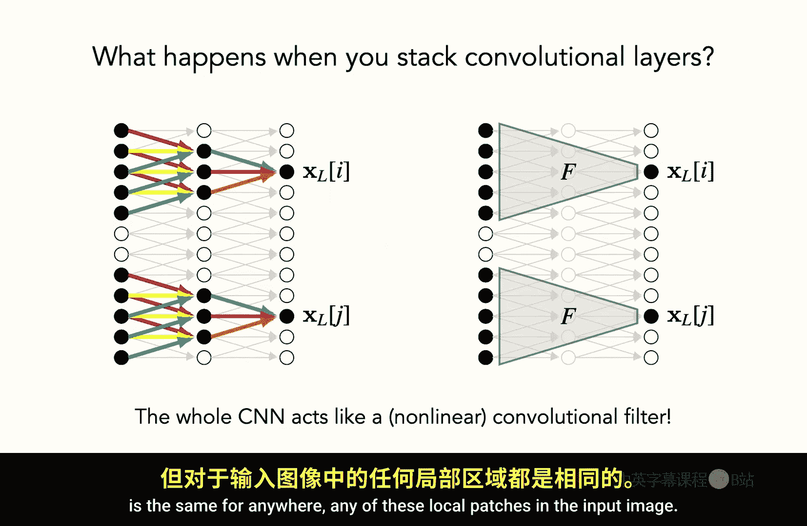

那给。Yeah， so I'm just saying here in this particular instance。

 assume now that you have a single convolutional layer， a pointwise non nonlinearity。

 just like we had for MLP and then another convolutional layer。

 So since we said that a convolutional layer is essentially a constrained version of a linear layer。

 you can essentially take it the same way。 but the nice thing is that constrained version of a linear layer。

 it maintains that local constraint， even as you start to stack layers。

But one thing that's very clear is as you're adding more depth。

You're increasing what we call the receptive field of the output。 So you're adding more， more layers。

 That means that the the local patch that corresponds to， for example。

 X L of J is larger than the local patch of a single one of those same layers， right because you're。

 you're taking an inputs from a larger size。 And then you're doing that again。

 And this is what we call a spatial pyramid， for example。Yeah。Sorry， can you be a little louder？

Oh yeah， yeah。 So the only reason this is nonlinear is because there's a nonlinearity in the middle。

 So from between that first layer。 So you have this first convolutional layer and then see where you have those nodes in the middle。

 What I'm saying is here， we've applied an activation， a nonlinear activation。

 And then you have that second layer。 Maybe that's something that in future years。

 I'll just put that in the diagram。 So you can see that kind of nonlinearity。 So be a little clearer。

 But I'm just saying it exists。

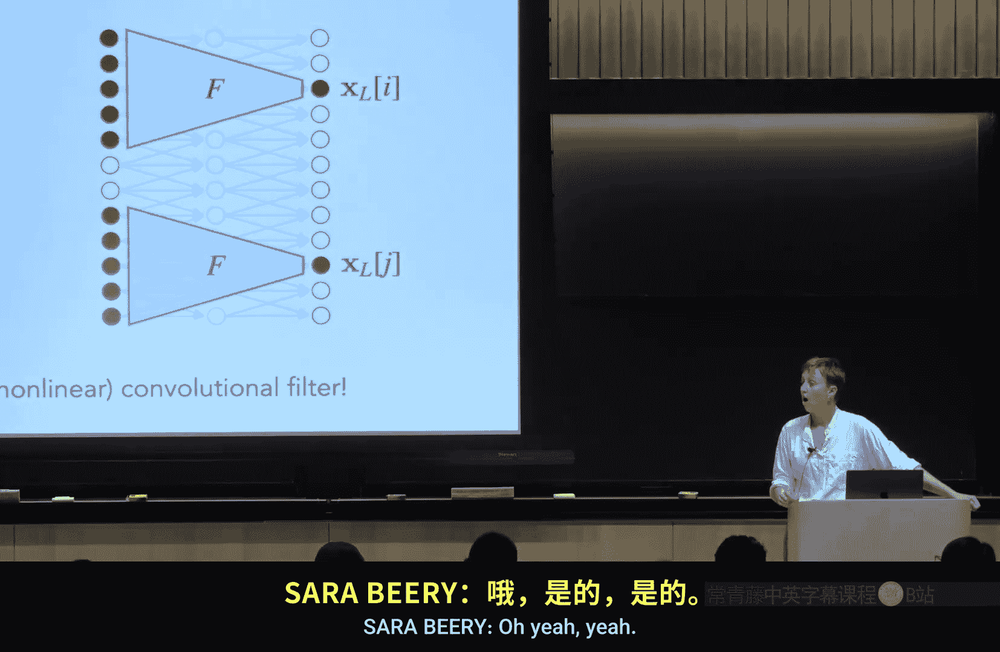

But so now you have a convolutional filter， but it's nonlinear because you have that non nonlinear activation that you've put in the middle。

Yeah， what is it called when there's being established when you're pulling weights through？depend。

A receptive field is one term that people will use。

 So if you're like increasing the receptive field of your model， you can do that in a couple ways。

 you can make the original patch size， input size larger so the the kernel size of the filter size can get larger。

 or you can just add more depth， and that will sort of also increase the receptive field。Yeah。

 doubleside of that。Bbs and exits。Does that。So that's an image that's been flattened。Yeah。

 so right now we're talking about vectors because they're really clean and easy to look at， but yeah。

 you can essentially say you take an image and you flatten it out。

Though I think it's a little more complicated than that because you wouldn't。

Take an image and flatten it out and then apply a convolution like this because you would have this weird。

 like stripewise structure。 So actually， we do take those convolutions in two dimensions。

And the second layer we use the same kernel。No， and that's what the colors are different， I mean。

 you could。

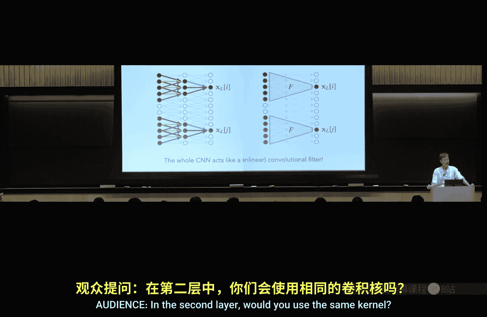

But usually， we don't。 Those weights are learned， but they are shared across the entire layer。ya 응。

よとこなんです。微可可。でた。这我可。I thats the report information。これ。Yeah。

So the question is like for each of these layers now that we have a convolutional layer。

 they can be represented as that sparse matrix where you only are looking along the diagonal。

 we don't always necessarily actually compute it that way。

 for efficiency or for parallelism often we just really do compute it patchwise but your your point was if you're now really restricting the search space by only allowing like a few parameters per layer doesn't that mean that you would really struggle to represent images or sort of learn and the answer is。

 Yes， and so that's often with convolutional layers。

 either we'll have quite a few different filters that are happening parallel we'll get into it later or we add a lot more layers in a dense way。

 but what we have found experimentally and there's some nice theory around it is that。

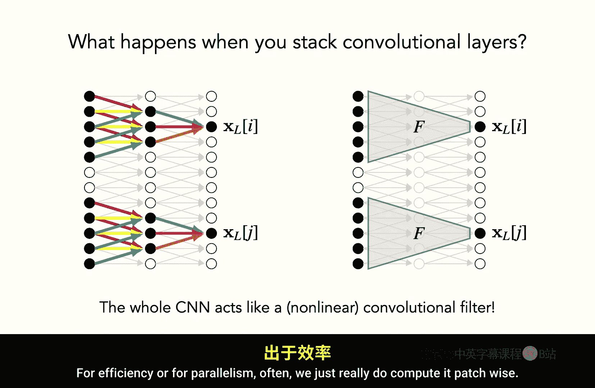

4 things where this is an appropriate inductive bias， you can learn more efficiently。

 You get a better fit with less data。cool。

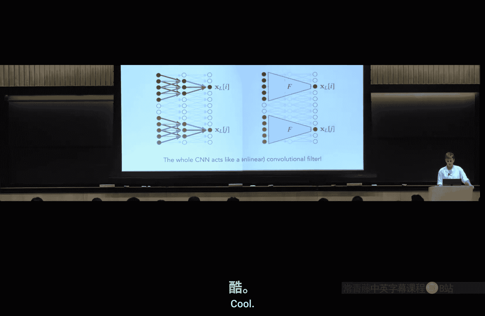

So。What if we have color。I mean， we're really taking a very image perspective here。 But essentially。

 what we're talking about with color is multiple input channels， right， So not just spatial extent。

 but you have kind of a tensor that also has something like depth。

So if you have multi channel inputs， So say you do have like RGB， that's what we're showing here。

What you do to do convolution over multichannel inputs is you learn a different set of weights for each of those input channels。

 and then you sum over all of that to get the output value。

 So you sum essentially over the convolutions for each of the input channels to get the output value。

 your summing per channel。Okay， so now。What that looks like is you would still have a single output value for each filter。

 But now the filter is going to have per channel weights that are learned。

 and you could arguably force them to be shared， but often we let them be separate。Okay。

 what about multichannel outputs？So if instead of having just a single output of your convolutional layer。

 you want to have multiple channels of outputs。 here。

 what you actually do is you learn what we call a filter bank or sort of a set of different output convolution。

 So here， instead of just learning a single， you know。linearar layer。

 you're going to learn sort of two in parallel， and each of them get to build their own output dimension。

 And so now you have a filter bank of let's say， C different filters。

 and you get kind of a different output activation for each of those filters from the same input data。

So then you can generalize this。 And generally， in most of our convolutional layers in。

 in deep learning， we have multi input and multi output functions。 And so here you'll have。

Essentially your output is going to have some number of dimensions or some number of feature channels。

 the input will have some number of input， you know dimensions or feature channels。

 and then you're going to have some number of filters that you con with that input to get this output and the number of features that you have。

 you're going to have the number of output dimensions。

 number of features or sort of filters each of those filters is going to have some kernel size that's K here so some sort of spatial dimensions and then for each of them you're going to have enough channels to match your input data。

So let me show a few more examples of what this looks like， so here's for example。

 a bank of two filters where you have multiple inputs and multiple outputs。

 so here you have two input dimensions， you've now learned this linear sum for you know your height by width sort of or this kernel size。

 which in this case looks like three by3 so each of these sets of weights， F1 and F2。

 those are learned separately， but they're shared across the entire image。

And so what those feature maps might actually look like。Inre， they kind of get increasingly complex。

 I would say。 So here this is your input。 These are， this is using an Alexnet model。

 So a convolutional model。Now you take that input。 after the first convolutional layer。

 this is the number of sort of feature banks that are learned or sort of output channels that are learned。

 So there's this initial input is convolved with this many different。

This many different convolutional filters。 And so now we're showing all of those different filters what actually activates when you send in this image。

 And so you can see， I don't know。 maybe some of them are capturing things like certain types of edges。

 certain types of structures。And then after that second convolutional layer。

 these things start to get maybe a little bit more complex。

 they can often be quite difficult to interpret， but every layer can be thought of as a set of C feature maps or channels and every feature map is some essentially like structural representation。

 It's an image。 It has sort of height and width Yeah do you that feature map is uniquely different。

A set of。So how do you make sure that all of the different future maps are different？

 So that's not actually something that's innately built in。

 but one of the ways that people will do this。Is through different types of regularization in the model。

 So sometimes things like drop out the try to make sure that you don't sort of。

Make the the model sort of too brittle to or reliant on different things。

 But usually the model will learn each of them uniquely because that gives it more capacity。

 There's nothing in here forcing it to keep them all the same。

 And so why would it not sort of learn to maximize the the sort of。

Types of variances that I could have。 But you can have like this。

Depending on the data and architecture and your optimization。

 you can have kind of like feature clefs sometimes where some stuff just gets ignored that you might not want to be ignored。

 And then you can try to build in different mechanisms to make that not happen。Alright。

 so we're going to do like a simple little quiz。So。Here's a layer。We have this input。

It's three channels。 So RGB by 128 by 128， very standard image size for an input。

 And then we have a filter bank full of three by three filters。

 The spatial extent of those filters is3 by3。 This is often the way we talk about it。

 So we're not talking about the channel dimensions。

 We just talk about the spatial extent of the size of the filters。

And then our output is 96 channels by 128 by 128， so by heighthen width。So first。

 how many parameters does each of those filters have？9， so why 9。Okay。

 but how many input channels did we have。All good。 Yeah。

 so so you have every single one of these filters has 27 parameters。

 We put this in because it's a little confusing， right。

 we talk about the filters being three by three。 but the thing is when just this is just convention。

 when we talk about filter size， we often only talk about the spatial extent of the filters。

 and the assumption is we don't actually convolve in channel space。

 though of course you could that something you can totally build in。

 So maybe you have something like a hyperspectral input。

 you actually want convolution across the spectral bands。 you could build that into your model。

 but sort of standard we often use sort of independent per input channel weights that are learned。

 And so then we only talk about the spatial extent。😊，So the filter banks are three by three。Alright。

 now， how many。How many filters are in our filter bank。Yeah。96， exactly。 There are 96 outputs here。

Which means we get 96 filters。 And then each of those filters will have those 27 parameters。

 So you're doing this for each of those 27 parameter input filters。

 You're running those over the entire image。 And you are getting now taking a linear sum over all three of those channels and you're getting a single output dimension。

 And so if you have 96 output channels， you need 96 different filters。Thanksice。Cool。

 so high level filter sizes， if you're mapping from。So you know。X of L。

 So this current layer where you have C sub L channels and then N by M output dimensions。

And you're going to map to the next layer where you have some C sub L plus1 output dimensions and n by M spatial dimensions。

 and your filter has spatial extent K1 by K2， then the number of parameters per filter will be K1 times K2 times C subl。

 and then the number of filters will just be c sub L plus1 the number of output channels that you have。

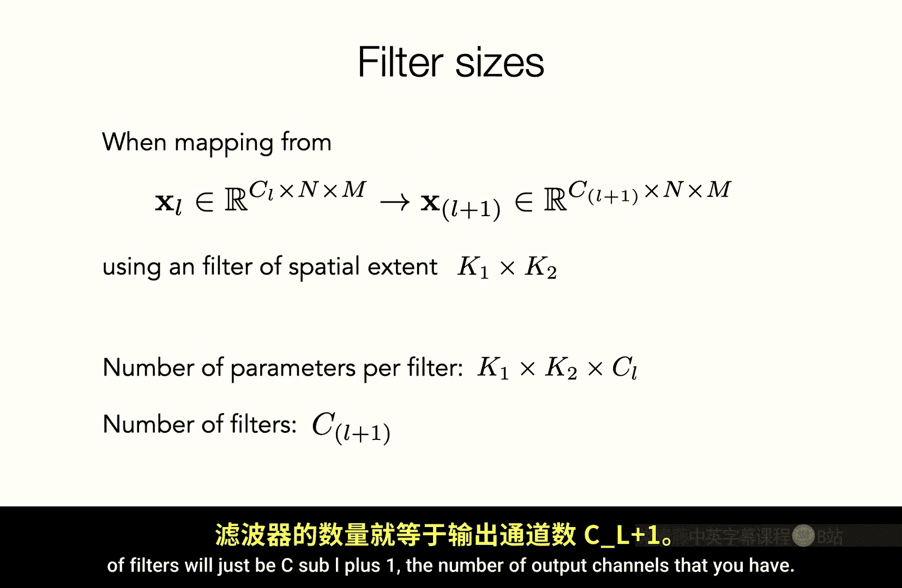

Yeah。四个。Absolutely， normally， the filters are square。 That is， that is totally standard。

 They don't have to be， right， Like it's just a convolution can be defined in a way that is not square。

 But I would say normally we see square convolutions， yeah。

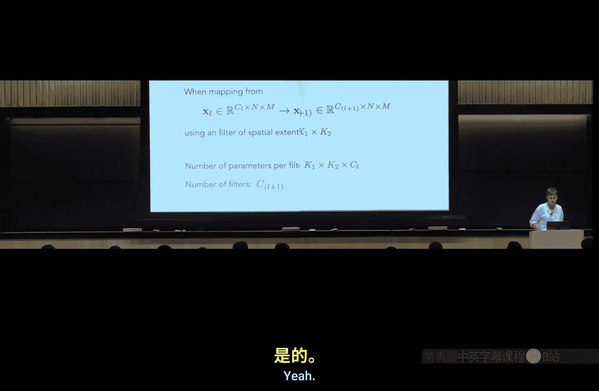

确。So。You have， say， your input image。Now you're going to run it through a first layer。

So essentially for each of your filters， you have a red， a green and a blue filter。

 those get applied。 and then you know you could think about， okay。

 so now if you take just one of those filters， that's going to give you just a single one of those output maps in in your feature maps that layer one。

 a single one of those output maps is going to correspond to one of those filters over RGB。

And now if you run that a second layer， second convolutional layer， now you have sort of layer2。

 your whole sets of features。 Now each of those are going to be instead of RGB。

 they're going to be you know， across the entire set of feature maps in your first layer。But then。

 you know， one of the outputs after that will only correspond to a single one of those C 2 filters。

So you can see how the actual representation gets highly complex， highly quickly。

 even with just a single， you know， even just one or two layers of depth。 when you have convolution。

 it can map really sort of complex functions。So another thing that we often use when we're actually building convolutional neural networks is this idea of pooling。

So here， you know， what we have is we have know this this convolutional layer。

 So you have your convolutional weights， you have your bias。

 and then you have your pointwise non nonlinearity。

But then one of the things that you can do is you can do what's called pooling over those output features。

 one of the reasons you might want to do that is because you can see that the dimensionality can get really large。

 really fast。 And so one thing， very， very common thing。

 It's something we call max pooling where here you just take some sort of local window and you just use the maximum value and you use that to represent your output。

Or you can also think about something like mean pooling。

 And here you're just taking the average over some sort of smaller local window。

So why do you want to do pooling？ So one thing that's really nice about it is pooling across spatial locations gives you some stability。

😊，So， for example， here， if you're taking the max over this window。

 you're still going to identify that there's an edge there。 right， There's like。

 there's still this like sort of white value that will get passed through。 and that will be stable。

 sort of as。The inputs move， right， So， so you'll get a large response to like something like an edge filter。

 regardless of the exact position of that edge， you get some， some more stability in the outputs。嗯。

And then sometimes we also will do pooling across channels And one cool thing you could think about here is if you pull across feature channels where all the feature channels are looking for those edges。

 but across different orientations of that edge filter。

 then you can get some new kinds of invariances。 So， for example。

 this would give you a filter that was finding edges and was invariant to the orientation of the edge。

Seems nice， right。过。So。Now， if we actually look at sort of a lot of the time。

 what computation in a neural network looks like， a convolutional neural network。

 we will usually take an input and then we will run it through stacks of this kind of building block right and this building block is some you know。

 computation over some set of filters。A non nonlinear activation。 So a relo。

 and then something like pooling。 And then we'll repeat that over and over and over again。

 But this is， this is a really sort of large network has a lot of density。

 And as we sort of maybe add more feature channels， as we keep going， this could get really big。

So particularly if you're trying to do something like classification。

Where the only thing you want to get out is sort of a low rank representation of the input。

 just something like a word or like a specific like one hot encoding。

Here we actually often use something called downsampling。

 where we assume that we don't actually need that high dimensional input structure at every dimension of the network。

 And so here， instead of just pooling， we might also downsle。And what that looks like。 So here。

 if you have sort of pooling， right， you've now done something like your， your convolutional layer。

 your activation function， and then something like max pooling。

 then down sampling would look something like this。

 So maybe you would only keep some subset of those actual values。

 And then instead of doing the pooling across all of them。

 you can also just do just straight down sampling， right。😊。

And one way that you can actually do both pooling and down sampling sort of together is through something called a strideed operation。

So this actually combines something like convolution or pooling and down sample。

 And the way that it does that is instead of going and sliding your filter by a single pixel every single time。

 instead you increase what we call the stride of the filter。

 So now you know you operate your sort of convolution。 And then instead of just moving one。

 you might move 2 or you might move 5。 In this particular example here we're showing a stride that's quite big。

 Usually for these models， we often have that stride be somewhat overlapping So you don't want to sort lose any of the context from the original input。

 So we'll have that stride be something that's overlapping。

 but maybe your input kernel is like 7 by7。 your stride might be 5， something like that。And so here。

 you're kind of combining that， that。Poolling that convolution and the downs into a single element。

And you can also think about doing something that we call using a dilated filter。 And essentially。

 all this is， is it's just a filter where we've set some of the values to 0 and sort of baked that into our model。

And this gives you a larger receptive field。 So I was talking about before。

 you kind of get more information from a larger spatial context or spatial extent with fewer parameters。

 There's less sort of flexibility。 There's less parameters that are learned。

 but you're kind of getting that larger context window。

 And that's kind of a tradeoff that you can optimize for。

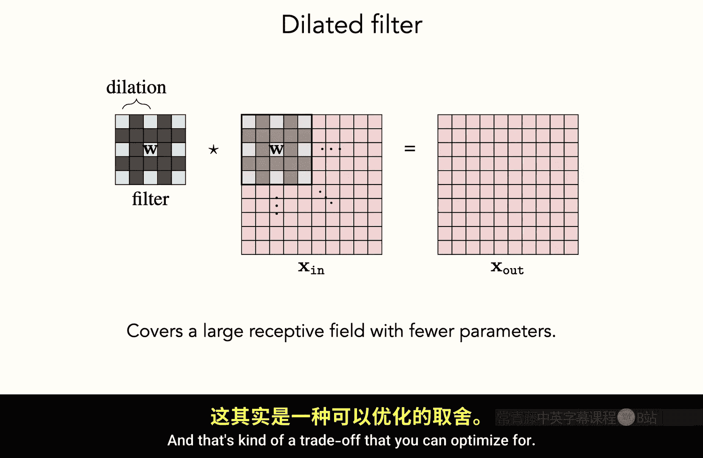

So， yeah。Oh， sorry。So bring me down sample。You cannot go back to even to your input dimension that's given。

Great。We'll talk about that in a little bit。 So the question was， if you downsample。

 you can't get back to the original input dimension unless you sort of add some more information。

 That's not necessarily true。 but you might not do it very well。

 So we'll talk about that a little bit。 Yeah， what are the。For when it's acceptable to you。

Ttriing and might not do。嗯。What are the current norms for when you would or would not use a stride。

 So I would say that this search space of possible architectures is vast， right。

 And even if we only consider the building blocks we've talked about so far。

 which is like linear layers and convolutional layers。

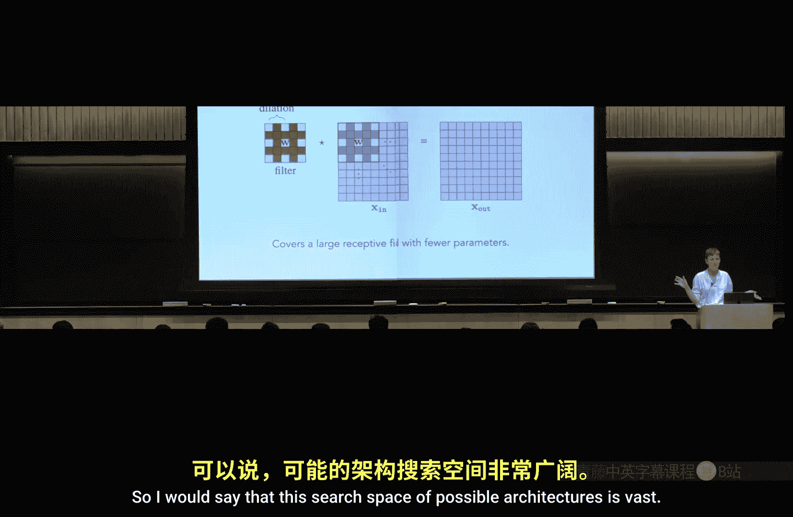

And then you can have varied input sizes， varied depth， various numbers of channels。

 all of a sudden you already have a really large search space。

 There's entire fields of research called like neural architecture search that actually specifically tried to optimize over the space of architectures to find the best possible solution。

 pretty computationally expensive to actually train those。

 but I would say that one of the things that's kind of proven out in the literature over the last sort of。

Maybe 10 years， just experimentally， is there seem to be some kind of standards that seem to be trends that are long。

 long held。 So， for example， in the original Alexnet paper， the filters were quite big， right。

 They had pretty large spatial extent。 and then there were less depth than the layers。

 One of the things that we've seen more and more is now we actually often see filters that are reasonably small。

7 or5。Spatial extent， but maybe then they're actually stacked quite deep。

 so then you end up with really large receptive fields。

 even though the initial filters were spatially quite small。And then with striding again。

 it's just that trade off between the amount of computation and the receptive fields。

 So there's different kind of optimalities。 and it can be really one of the things you can do is you can go look at a bunch of kind of the standard architectures and often they'll have these architecture diagrams you've seen them before probably where it's like you know the layer and then it'll have like a layer size for each thing and you can look at like what are kind of the similarities across the structures of these different models。

 Theres a picture that the nature。Yeah， experimentally， Yes。 So if you have like。

Really non complexplex pictures like Cf， for example。

 these like hundred by0 like really simple photos。 Then the the network itself often needs to be much less complex。

 If fine grainined feature details actually matter a lot。

 which happens for us a lot with the species images， for example。

 Then one of the things that actually tends to matter more than almost anything else。

 is the input image size that you use。 So a lot of these models， the input image size。

 you scale it up， then the computation scale up sort of quite a lot with that。

 So will often down sampleamp images to some smaller size before we run them through a network as part of the preprocessing。

 But we find that。Increasing the scale of that input image and then maybe downscal some of the computation is sometimes a better trade off。

 If you really care about fine grain features， you don't want to kind of lose that， that detail。Yeah。

このですのか。都つ。有为。How would you do you？198月。他。Do a certain part。How is that。あす。Yeah。

 it's a great question。 So， so the question was in， in signal processing， we're often。

Very carefully handcrafting our filters so that they are capturing a certain dimension of the signal that we want to capture。

 whereas here we're talking about filters that are actually being learned And what's the kind of tradeoff like when does it makes sense to try to actually sort of craft the filters to match something about our intuition about the problem。

 So what you're talking about is actually sort of this massive paradigm shift that happened。

 maybe 1015 years ago in the field where we went from most of the work was on what we called feature engineering。

In computer vision or in deep learning， where you would be building these really handcrafted sort of structures that then you would combine together into some larger system that would recognize stuff。

And when we started to see that filters just like these models being learned end to end were more predictive。

 That was， it was a bit of like a catastrophe emotionally for many researchers， right。

 because you were like， no， like I I spent my life learning how to craft these filters in this really you know。

 specific way。 Like I don't want to just cram a bunch of data through a structure and have that be learned and then have it be better。

 And， and it turns out that actually。The tradeoff often comes down to how much data you have。

 So if you don't have enough data to learn the filters well， then more handcrafting， more knowledge。

 more sort of inductive bias tends to be better， right。

 because you actually can put more constraints on the system so that you can optimize better with less data。

 But if you're in a space where you can get sort of huge amounts of data to learn from often we don't know as much as we think we know about what optimality might be in terms of the filters that are learned。

 especially when you think about it can be really intuitive to think about crafting a single filter。

 But how would you handcraft like the seventh convolutional layer in you know128 layer network for a single channel。

 very rapidly gets to a place where the system is so complex。

 that it's very difficult to build intuition about what it should be for us。过。嗯。

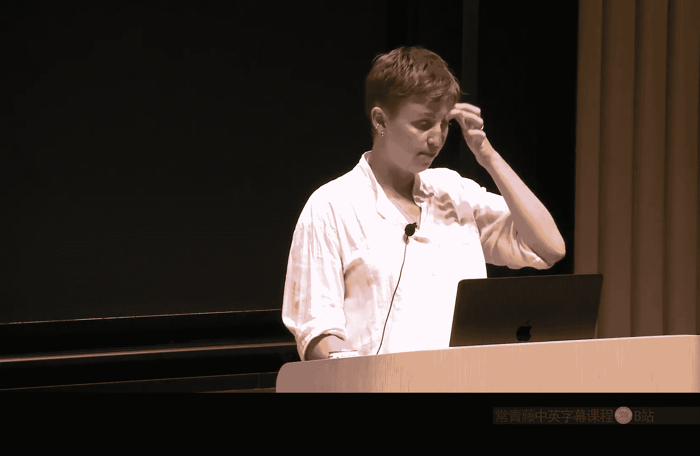

So receptive fields。 So one of the things we talked about is if you let this sort of input size of the patch get too small。

You maybe won't be able to actually identify the things you care about。

So in this particular instance， say maybe we have the input patches this entire bird。

 and then you we're running it through convolutional network， relo convolutional layer。

 and then we get some output， and that output for that patch is bird， right？So here。

 what we would say is the receptive field of that X2 output is the input patch there because receptive field essentially just says what parts of the initial input have any influence on this part of the output because we're doing this in a way that's translation andvari we're doing the same computation across different patches outside of that receptive field this model doesn't have any input information。

 So if there was something just outside of that field of view that was really informative and it wasn't actually in here。

 then there's no way for the model to get information outside of that receptive field。

You can also talk about the receptive field of input layers， right， So you can say， okay。

 like in this first layer， the receptive field of that component of the output of that first layer is that part of the input。

And what that kind of looks like， you know， as you kind of pass through the network。

 you can think about looking at the activations。 And you can see that。

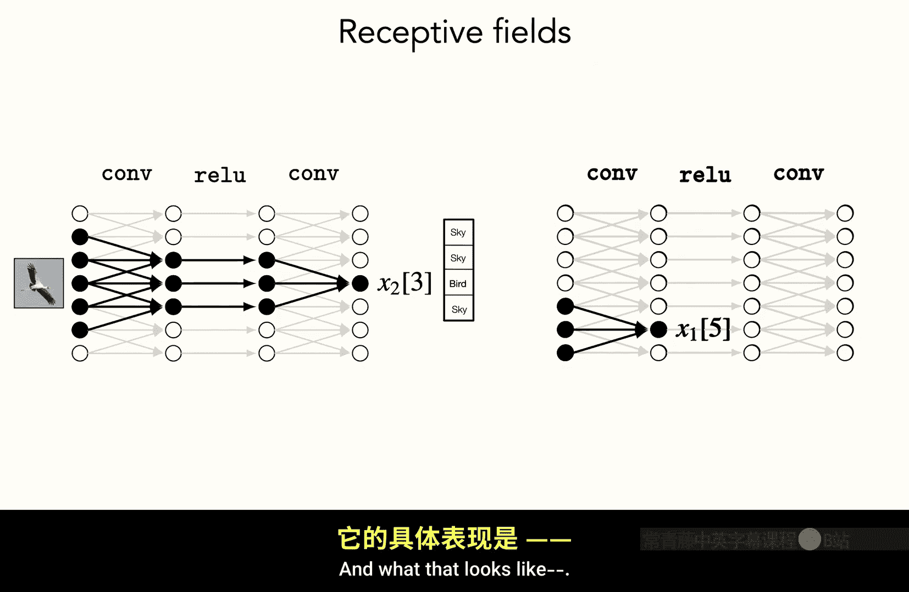

They go from being very fine grained or very detailed in the early layers。

 because maybe you're running them through。Convolutions that are much more local。

 And then as you get further out or further along in you know Alex N VG G16， Resnet 18。

 what you start to see are feature activations that are kind of much more diffuse And this has to do with that receptive field right because now each one of these output dimensions is actually collecting really complex information and mapping it through a bunch of different layers from this input。

So maybe you're getting output feature activations that are more semantically meaningful， but less。

 less sort of。Affected by like subtle texture or variation in the initial input image。Possibly。Yeah。

 this is similar competition to how you do Ga。So the question is if it's similar in computation to how you do Gausian blurring。

I think at a like at a high level， like the intuition is a little similar， but computationally。

 it's quite different。啊，我要随便。嗯哼。😊，Ones， six and eight are the ones on the earth。

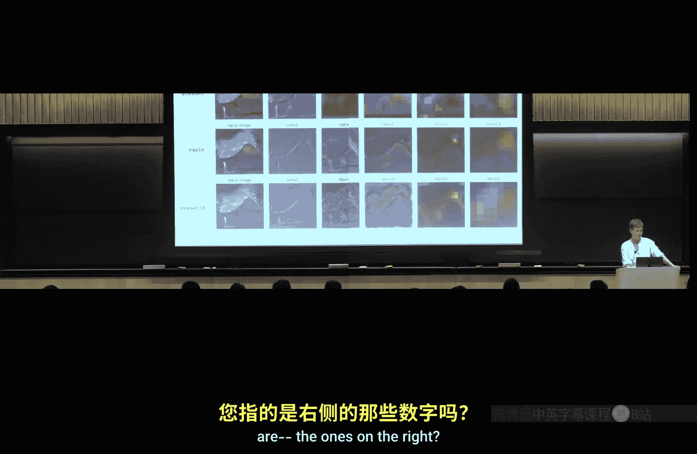

The right are those。The same pixel size as the initial inputs。

 or are they downs sampleampled and you just resize them。Weve resized them all the same size。

 but it actually is very dependent on the architecture。 So resnets， the actual spatial extent。

 once you get to block 8 is much lower。 And then there's a lot more channels versus the alnet。Cool。

 so in the last little bit， I want to talk through at a pretty high level。

 a bunch of these different high level ideas。 Maybe some of these like what。

 what one of you mentioned， some of these like things that have。Tended to。

Continue to be used over time。So we talked about one very。

 very classic version of a convolutional neural network is something like a classification network。

 and most classification networks have something like this structure， right we'll have filters。

 some sort of pointwise non nonlinearity and then some column of dance sampling and we run through a bunch of different layers like that to get out some sort of output classification。

But another really common structure in using convolutions is what we call an encoder decoder architecture。

 so here what you're doing is you're taking that input and you're doing convolution nonlineity subsampling or downsling to get down to some very lowdimenional representation。

 for example， this Z space vector and then in the decoder component you're going to take that low dimensionmenional representation and you're going to now do convolution。

 non nonlinearity upsamp and now so in that upsampling component you're actually just increasing the spatial extent of each of the layers going forward and the training signal here is you want the decoded output to match the encoded input as close as possible right。

嗯。Now。This is also used。 So this is used as one way to kind of get a low dimensional representation of an image。

 This type of encoder， decoder architecture， This is built into things like variational auto encoders。

 Maed autoenrs are increasingly widely used， though those use。

Those use attention as opposed to convolution as a way to kind of share information over space。嗯。And。

 you know， you could use。 you can take these different components and you can break them out。

 So we talked about。Kind of differential programming。 If you train an encoder， decoder architecture。

 you can use the encoder to build some representation of input images。

 but you can also use a decoder to generate images。

 So these components can be used separately and can be valuable separately。But another way。

 you might want to use this type of encoder decoder structure of architecture would be to do something like。

Get out semantic segmentation because you want an output space that is that has spatial accent that doesn't necessarily need to be the exact same resolution as the input。

 though it can be， but you want something that has a spatial structure in the output space as opposed to just like a single category。

Now。This seems nice， right， But it turns out that。This is both a blessing and curse。

 this bottleneck in the middle。 It's forcing the model to learn something that's kind of semantically useful。

 but it also means that often it's not possible with an architecture that just has downsamp and then ups to get a really precise output。

 that's the same size of the input because you've lost a lot of the spatial structure。

 You've lost a lot of the information about the fine grainin details in that spatial structure。😊。

And so an alternative would be to take sort of an approach to doing image to image like semantic segmentation where you don't lose any spatial structure。

 So here you do， you know， convolution relo convolution， Softm。 is is a very。

 very simple version of that。But every single one of these inputs。

 because you're keeping the entire dimension， this can be really computationally expensive。 So。

 so this， the size of this model would be really huge。

So to kind of bridge and get the best of both worlds where you're kind of keeping a lot of the high resolution structure。

 But you're also kind of building models that are computationally efficient and that are forced to learn something that's kind of semantically meaningful is the unit。

So probably many of you have seen this There are different variations of this。 But the。

 the big intuition here is we have what are called these skip connections across the different。

Encoder and decoder structures of this architecture。

 So you actually have a connection that takes whatever the size is。

 and it just takes that via the identity ands lets it be sort of skipped over towards the output And what this means is the model is not forced to kind of explicitly try to shove a bunch of fine grain spatial detail into some very low rank non-patly dimensional embedding。

 which is somewhat impossible。 it's able to kind of learn the semantic details through this information bottleneck。

 but then it also gets a lot of the spatial detail through those skipped connections。

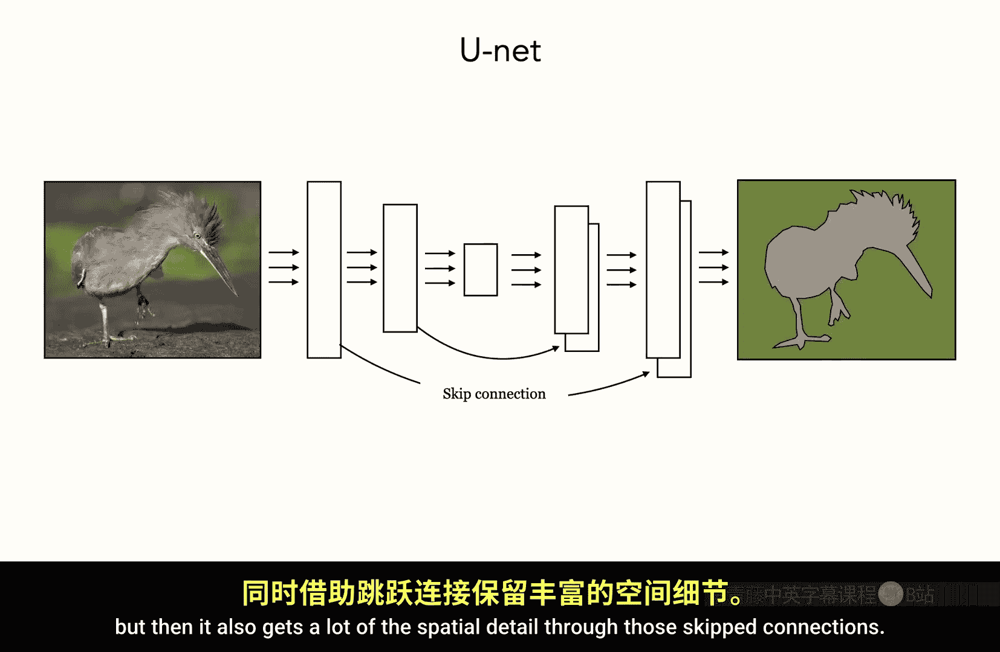

And this is really powerful。 Unit is a really old architecture。

 and it is still one of the most widely used architectures for semantic segmentation。

 It's used all the time， in things like。Remote sensing， like land cover mapping， for example。

And this idea of a skipped connection。 This actually is a really useful computational tool。

 and it's also one of the fundamental underpinnings of what we call the Ressonnet architecture。

 So Ressonnet was invented by Kaming Hi， who is also professor now here at MIT。

 And this architecture is kind of amazing。 we still use this all the time。

 And it's like 10 years old at this point。 but really one of the important things that was recognized is essentially one kind of cool intuition about a resnet is every single layer has this skipped connection。

 So it has this identity pathway that lets you sort of choose whether you want to run the input data through that layer or just kind of skip it just take this identity mapping and just pass it through to the next layer。

😊，So one kind of cool intuition about this is this actually means that this is a model that can learn something about its architecture。

 It can learn an optimal depth， right because you can essentially say。

 I want to just pass this through maybe three of these layers。

 And then the rest of the time I'm just going to take these skip connections out to the output。

 And so then the model itself can implicitly learn the optimal depth for the tasks that you want to learn。

😊，So one kind of cool intuition， I think， about resonance is that they kind of give the model the flexibility to kind of learn something optimal about the architecture without needing to test out sort of explicitly training a bunch of different architectures side by side。

😊。

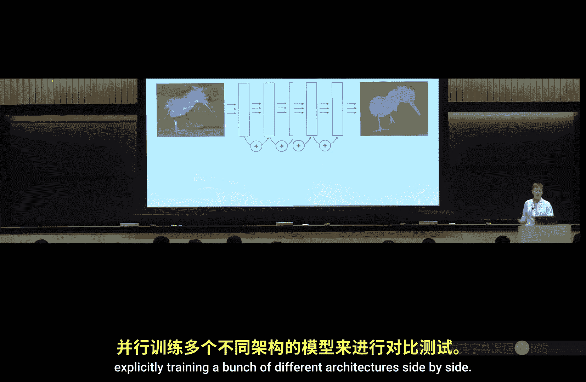

And these residual connections essentially are just， you know， X out equals function of X in。

 So mapping it through that layer plus the input dimension itself。

And if you want to actually change the dimensionality。

 so you want to have something like downamp within a resnet。

 then you can also have another sort of set of linear weights that down samplesles in that skip to action。

个。

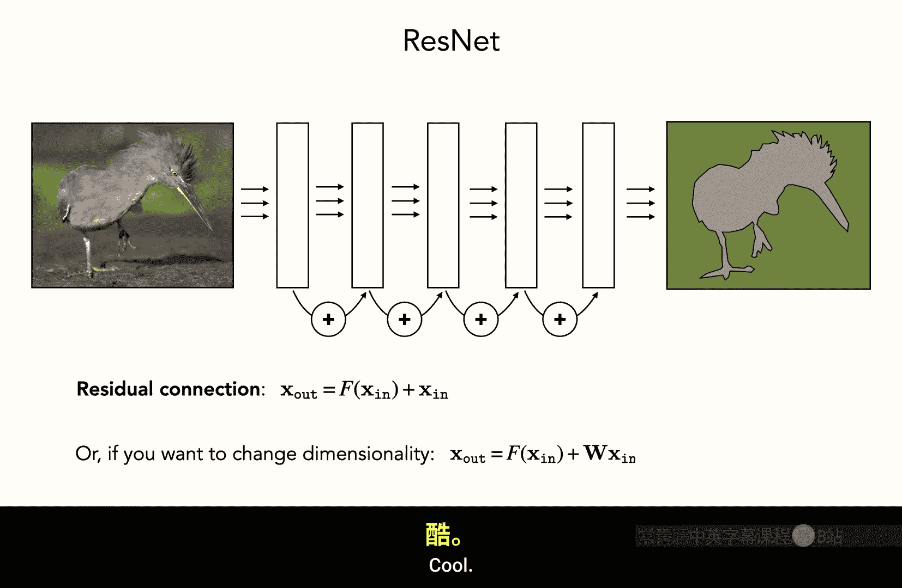

This is a really， really powerful tool yeah。So with these skip。Is the skip becoming another？

That's also like an output channel。Is it like actually choosing？It's。It's a。So， it's kind of。

Choosing one or the other。嗯。so the residual connection is essentially you。

 you assume that the output of your layer and the residual connection are the same size。

 and then you're adding them together。But there's different implementations of this that will have some sort of like learned weight。

 So okay， maybe you learn to completely ignore that identity。

 that same type of skipped connection is kind of also something that gets surfaced via self-attion in transformers。

 which we'll talk about more in the transformer architecture。

 but essentially just this ability to learn how to combine information is valuable。 if you。

 if it is just an addition。Or concatenation。 Or， you know。

 however you want to do that skip connection。 One of the cool things about。

Linear layers or convolutional layers， which are constrained Line layers is。Essentially。

 even if you just add them together， there's some version of the next layer that could basically learn how to kind of ignore certain dimensions that that input。

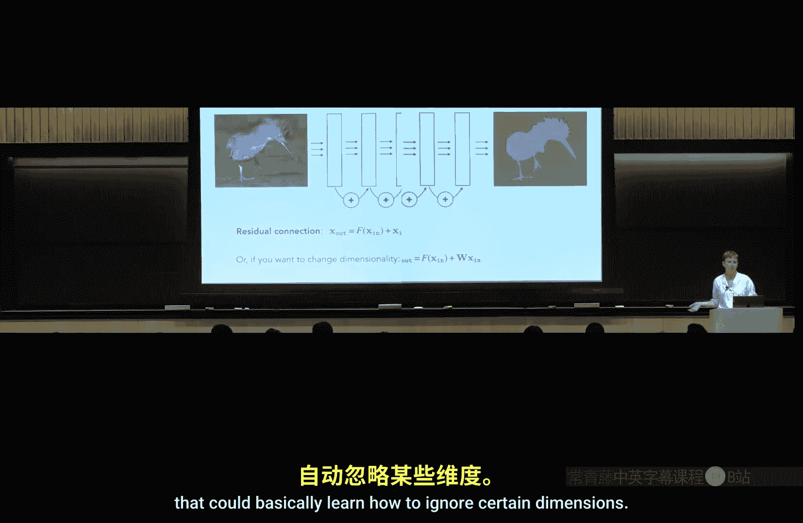

But。Yeah， like， for example， here， if you do actually want to change the dimensionality。

 that W layer that could be learned to be all zeros。 So you could just not keep any of that at all。

 if that's what the model wants to learn。Cool。So， so far， we've talked about。

2 dimensional or three dimensional grids。But one of the things that， of course。

 comes up all the time in the real world are。Additional dimensionalities。

 One really simple one is time。So here， you know， if you think about convolutions in time。

 So maybe one version of this is you actually have just a single scalar valued input。

 maybe something like temperature at a temperature sensor。

 And then you could think about doing convolutions over time。

 So instead of doing convolutions over a spatial dimension。

 you could take convolutions over a temporal dimension and build some representation with time as one of the dimensions of that convolution。

And now if you actually have something like video， so for example。

 now you actually have an image with red， green and blue channels and then you have these different frames of an image over time you can think about building like what we'll call sort of another you know tensor representation or this block representation where you have this spatial extent and here we're now using that third channel to represent time。

 but then you also have RGB for each of these right so it's actually a four dimensional input。

And then you can think of building these 3D convolutions that actually convolve over space and time。

And then， you know， your output would be maybe a lower dimensional representation that would actually have those space and time dimensions for each of your tensors。

And this is type of architecture， this type of 3D convolutions is often used when you're trying to do something like action recognition and video。

Now， one thing that this gives you is it makes you shift invari in time， right？ But you can imagine。

 actually， that for some types of recognition tasks， you don't want to be shift invariant in time。

 You don't want like picking a cup up to be the same action as putting a cup down。 And， I mean。

They're assumed ignoring the motion between if you had like really low frame light。

 if you had like this frame and that frame。 and then maybe you had that frame in this frame。

 you want the fact that one happened before the other to matter that translation and variances is not something you always want。

 And so if you don't want to be shift invari， there's a couple different approaches that we can use。

 So one use an architecture that's not shift in variance。 I mean。

 like an MP they're the position in time would actually matter。 But like we said。

 these are it's quite difficult to get these MP to learn really complex functions of almost infinite data。

 So another option and one that is really kind of shown to be a winner is this idea of adding location information。

To the input to the convolutional filters through something that we call a positional encoding。So。

 here。What we do is you have your input signal and then you also have this separate positional encoding。

 which is something you construct。 This is not something that's learned。

 it's actually constructed and added to the input and you learn an additional weight that incorporates that positional encoding as part of your convolution and so there you're kind of doing the same thing that you might with a normal convolutional layer。

 but you're adding this additional information from position。

And so here we might want to introduce the concept of what gets sometimes called a neural field。

 So a field from physics， can be a varying physical quantity of both spatial and temporal coordinates。

And a neural field。Is a field that is parameterized maybe fully or in part by a neural network。

 right So so there's different ways that you can think about doing this and representing these neural fields。

 But one way to think about it。 So siren is an example of one of these neural fields that model we talked about earlier。

 This is a convolutional neural network that's applied per pixel to map from a coordinate grids。

 So now the input is the positional encoding in an image。To a color。

 So you're actually learning to model a single image by learning a functional mapping from a position in the image to a color。

Right， and the way that they're doing that is through these sort of sinusoidal things。 And so here。

 what you actually do is you take the input is actually just the position。

 So in some coordinate space。 And then these these could be explicit。

 They could be kind of batched up。 or they also could be continuous， right。

 because the idea is this is something that's mapping from some sort of position to an output。

 And now you run that。😊，These inputs through a model that's just taking X and Y。

 and then you're outputting sort of the color of that value。

And this can take continuous coordinates as input， which means that we can then do something like think about learning these functional representations of input space。

 as opposed to only gridwise representations。And this kind of idea is the fundamental underpinning of quite a popular architecture recently called Nerf。

 which is essentially a convolutional network applied to a map from a five dimensional coordinate grid。

 which is by position and direction of sort of the camera relative to the scenem。

And then it gives you an output of color and volumetric density。

 And this allows us to then actually generate。What that same object would look like from different positions than what was in the original training data so what that actually looks like is you can you know。

 take some images of a scene and then generate these essentially walkthroughs of scenes。

 and these have actually gotten better and better over time。

 And one of the ways that this is really one of the fundamental underpinnings of this is this idea of building these appropriate positional encodings。

Cool Nfs are really fun to play with。Recently， some people at Woods holele a made a Nf for under the sea that handles the way that light bends underwater。

 very neat。 So concluding remarks here。 convolution is really just a fundamental operation for image processing or actually for processing anything that has some sort of structure。

 So this might be something like time or even time space and and multiple input dimensions。

 So say you wanted to use convolution over you know。

 hyperspectral satellite imagery taken once a week from the entire earth。😊。

Essentially what it means is you're just chopping up the image into patches and then you're applying the same function to each patch。

 but you're doing it through this like slide and some operation and this concept appears in basically almost all modern architectures。

 it appears in CNNs， but also things like transformers。

 though then the patchwise operation isn't necessarily convolution， use attention instead。

 things like nervefs and more。So today we talked about building better architectures and why we talked about convolutional layers。

 pyramids and kind of receptive fields。 We went through at a very high level some of these like different ideas that built out different types of architectures。

 and then we talked about neural fields and positional encoings that we'll talk a lot more about positional encodings in the transformers lecture。

Any final questions， and if you are going to leave during questions， just be quiet so we can。

Address them。Yeah。

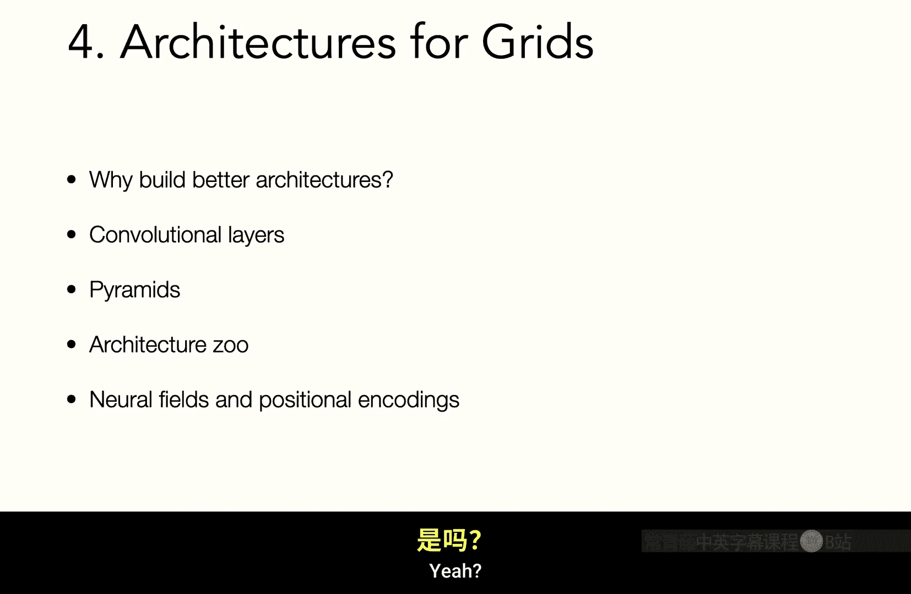

Could you use nerves for upscaling， yes。Yeah， yeah。 So one of the ways that people have。

Used nerves is to kind of increase the resolution of like， let's say。

 like a point cloud representation， not exactly like the original nerves architecture。

 but there's been adaptations of it that try to increase spatial resolution。Any other questions？Yes。

 and then quiet， please you guys， thank you so much。Yeah。

 so something like strideed convolutions can actually that's actually explicitly doing some form of pooling and downsampling together。

 So one way you could think about it is like pooling is essentially the same as running a convolutional layer。

 but now you're not learning weights you're just taking， for example。

 like the maximum function or that average function。

 that's like the function that's applied on that local patch right So essentially it's a constrained version。

 a non-learned version of a convolutional layer。😊。

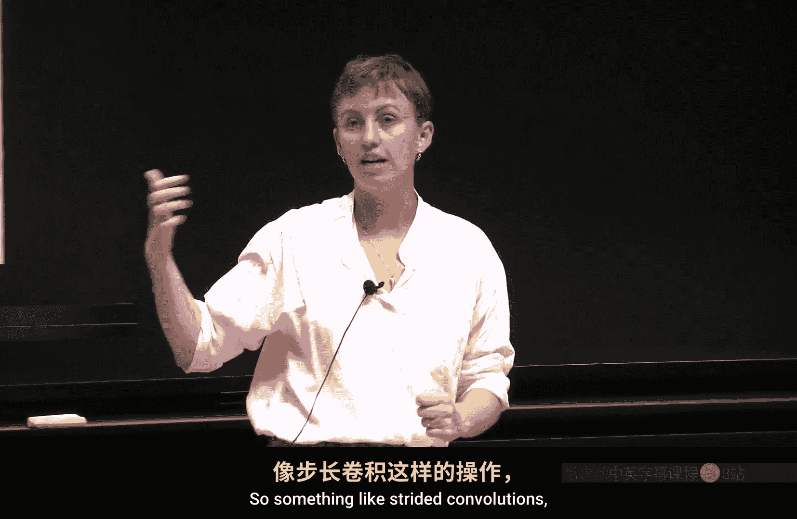

Yeah。Yes。Yeah， so the way that you train it is you take a bunch of different images of a scene from different positions。

 right， so often the training data for nurses will be someone taking a video like walking around an object。

 for example， And now you have a bunch of examples where now you you're going estimate the relative position to the scene。

And then now you can estimate the position and the direction from the input image。

 and that's your now for any given point， that's your training data and the output is the color of the image at that pixel。

じはと。Or it's just useful like。治。It it can be used for a lot of different things。

 so I will say that only just recently like last week。

 I saw the first kind of like large scale paper that was taking this concept of Nerf。

 which gives you kind of this creation of video that you can interpolate between and then actually trying to move that directly to something that was 3D modeling the scene because the output of Nerf is not a 3D model of the scene。

 It's， it's what that。

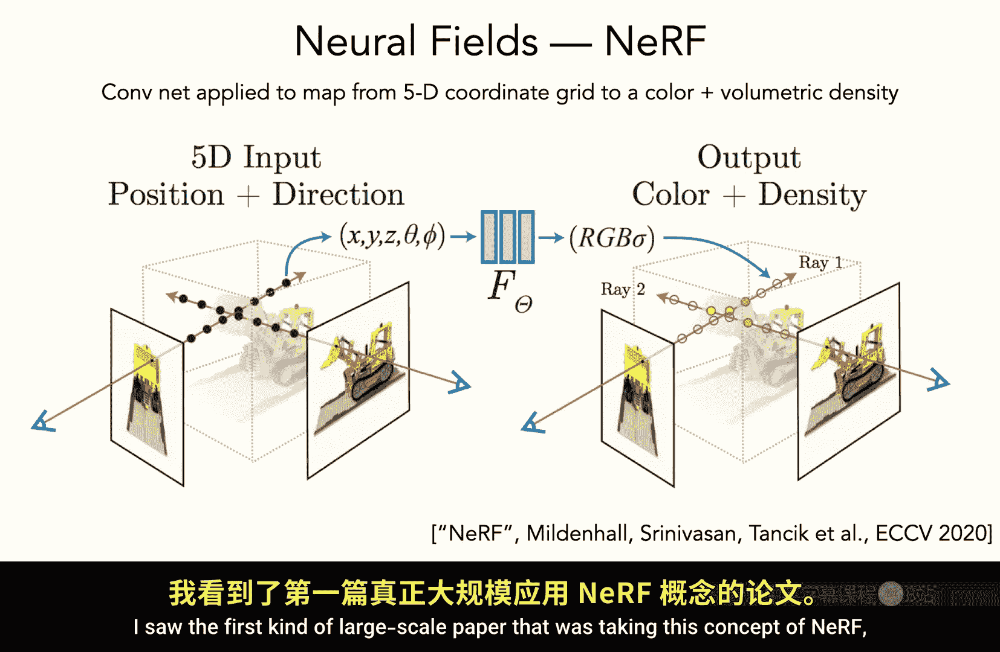

What the image would look like taken from a different direction。

 which is not the same as a 3D model of the scene。 And actually。

 a lot of a lot of real world applications， we would like to actually be able to use sparse monoocular image representations to get out a robust 3D model of the scene。

 And so they've just started to kind of bring those two things together in recent work from Ben Mildenha。

 I think was， was the person。I will say these are also really not super robust。

 You need a lot of input data。So classical N， like if you only have a few sparse images of a scene。

 it can be really hard to fit a N appropriately。 And the other thing is it works really well with stuff that is like not moving。

 but if you try and do it like a something like waving tree because the actual thing itself won't the math doesn't necessarily optimized because the thing that you're taking images of is changing position over time that makes it really hard to fit these models。

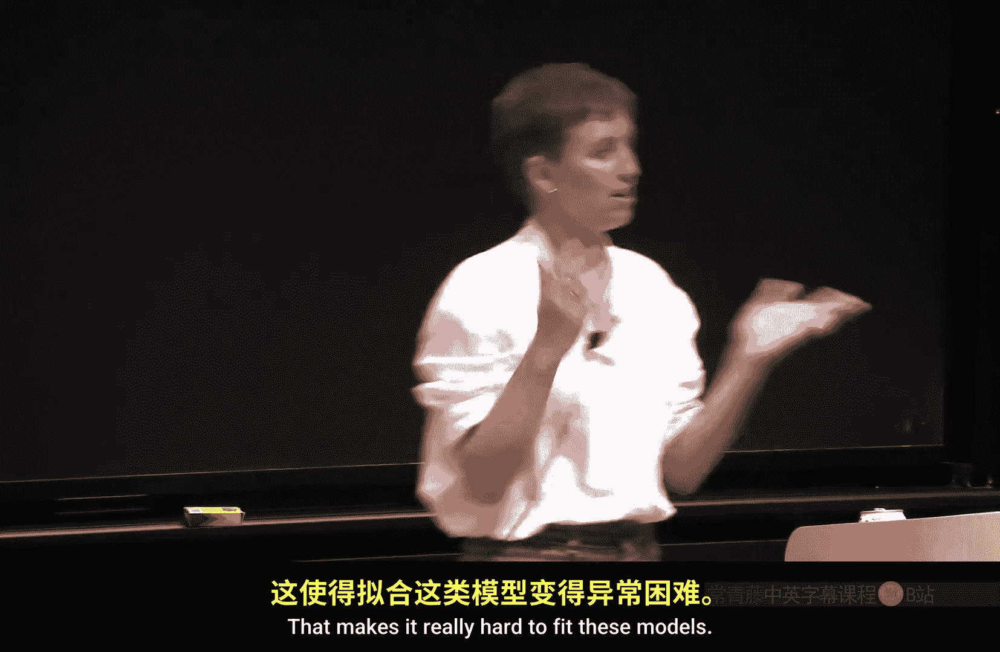

吓死我。Yes， whatever problems for that input is not just a picture， but a picture。

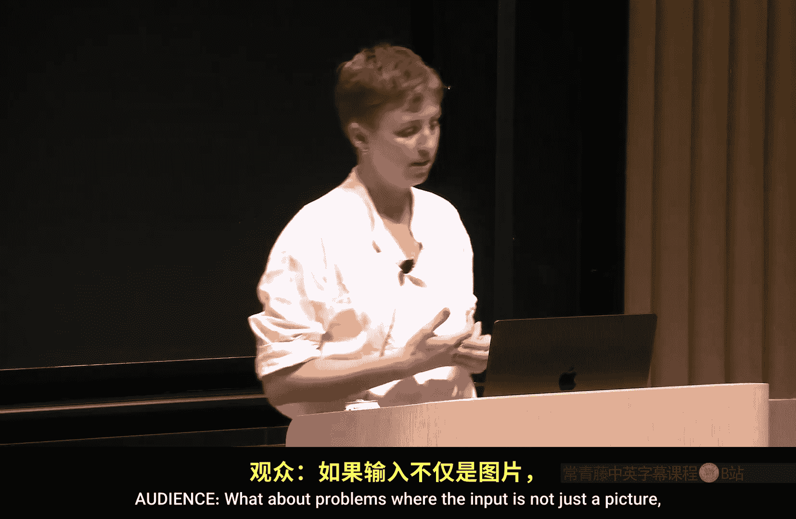

Like skater numbers that also contribute to how their picture should be understood。Right。

 so maybe like additional metadata。 So for example。

 I might have a picture and a GPS location where the picture was taken。

 So there's a lot of different ways that we try to incorporate that side information into into these architectures。

 and you can see lots of different examples。 But some really obvious stuff is you can just sort of run your image through that first convolutional layer。

 And then you can have a sort of a separate type of convolution or representation of that positional encoding。

 and you can either concatenate it to the entire input image。

 You can introduce it slightly later in the network。

 There's a lot of different ways you can kind of append additional information into the network during training。

有。꼭。Thanks， guys。😊，Oh， yeah。一生です。是么。face video。If you'd like stack you could just add additional channels。

Frame versus just doing it。嗯。Is there a big difference？ So if you add。

 if you add channels for all of the different frames in the video。Essentially that。

 that is 3D convolution。 Yeah， because you're， you're sort of taking those。

 those channels and you may be running， you know， your patchwise operation almost like a sliding window over time。

 Yeah， I guess like you don't add another test。So you， so， sorry， I'm a bit confused。

 So if you have an image model that's taking an RGB and heightened width。Now。

 you take that image model。 And now you're just saying， like， stack it over the different frames or。

how would you not add another dimension。If you have a time dimension， like。argue appreciate。Oh。

 I see。You could do that。 It would get really expensive。

 And I think one of the things that we definitely see with things like video。😊，Very rarely。

 is that are those convolutions in the temporal space worth it computationally。

 So if you actually look at a lot of the state of the art models for video。

 often they are down sampling in the temporal space because you can actually。

 you can actually recognize like most actions。Through like what we call like maybe a bag of images。

 so you don't need every single image and the difference between the individual frames is really small。

 And so like Elilyosha of F has a nice paper where they talk about the complexity of actions by essentially taking any action recognition problem with a video clip and then using the number of frames from that video clip that you need to be able to accurately recognize that action as a representation of the complexity of the problem and most actions are it's a single frame you can recognize it from a single frame。

 So because of the computational complexity and the fact that often we want these models to maybe run in real time。

 a lot of times the state of the art models for video are doing something what we call like fast and slow where they will have like a really low dimensional like subsampling spatially and maybe even also temporal that's running more frequently and then some sort of secondary channel that's taking high resolution input。

 So like maybe the full image frame size or something quite close to it。 but it's only。😊。

Doing that periodically。 And either it's doing it periodically kind of in some predefined way。

 or it's actually deciding when to run an image through that high resolution channel。

 So they'll take like sort of this。To pronged approach where like one model is maybe modeling something like the motion。

 and the other one is modeling some fine grain semantic details。对呀。

Video is fascinating and quite complicated， and。

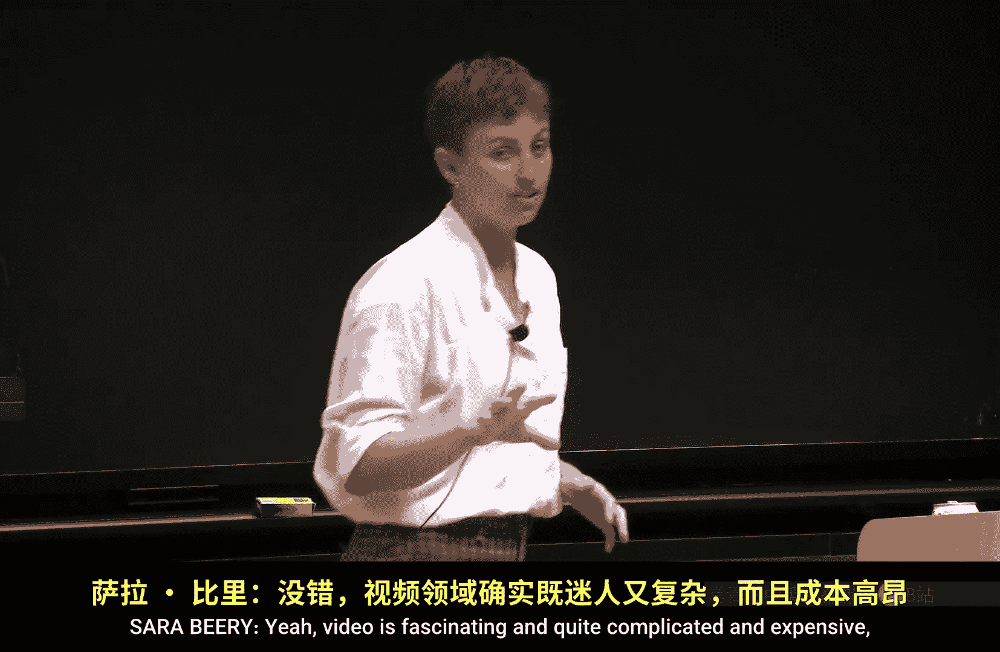

Expensive， expensive to store， expensive to train models on， expensive to run inference on。It'么。

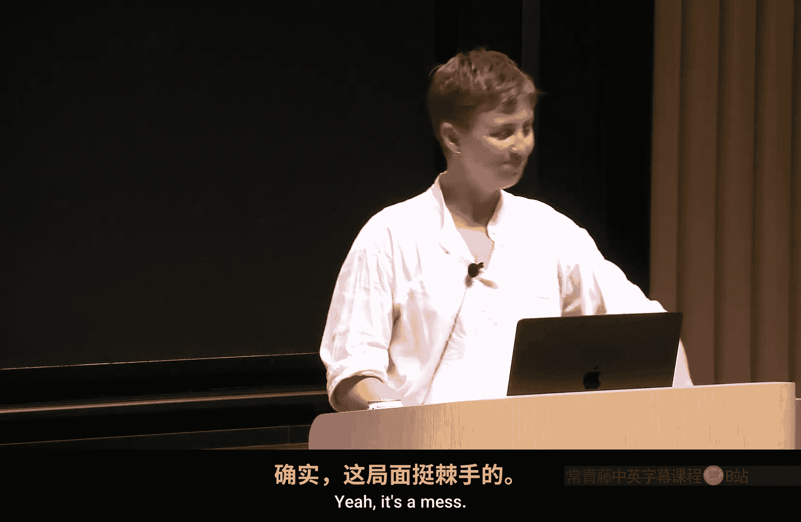

