# 麻省理工学院【中英⚡深度学习｜6.7960-Fall-2024,-Deep-Learning】-p05-P5-架构：图--BV15QZ4B1E6v_p5-

Okay， hi， everyone。So we're going to get started。嗯。I'm the third instructor for this， this course。

 So I'll just quickly introduce myself。 I'm Philip Sola。 Im I also go by Phil。 So you know。

 feel free to call me by my first name。 Just Phil is fine and。😊，I am a professor in E C S do just。

 I love deep learning。 deep learning is。😊，For me， the most。

Beautiful kind of math and intelligence that that I could imagine。

 I think that it's a very popular subject， obviously。

 but sometimes deep learning gets a little bit of flack because maybe it's too hyped or because you know。

 people feel like too much money is in it。 So there's always this kind of weird pushback to deep learning。

 And I just want to say， like， I just love it。 It's so cool。 and's okay to love it。 Like。

 we're gonna try to convey why it's so cool。 So deep learning to me is just the most。

 my favorite subject of all。 And it's great to get to teach you about it。😊，Okay。

 so there's a lot of beautiful things about deep learning。 You've already heard some of them。

 And today we're going to hear one more， which is graph neural networks。

 This is a continuation of the sequence that we have going on architectures。

 So we have four lectures we have the one that Sarah gave on Tuesday and convolutional networks。

 Now we're going to see graphnets that are kind of a generalization of convenets。

 along with a lot of other architectures， and then we'll see transformers。

 which are special kind of graphnet， and we'll see recurrent networks and memory based architectures as well。

😊，Over the next few weeks。Okay。So the outline of， of this talk is going to be first talking about what types of problems are appropriate to use graphnets on。

And then we'll talk about the main way that， you know。

 graphphnets work Well present that as kind of a message passing an algorithm。

 But you'll see that it turns out to be very familiar。

 Its just another neural network that has a forward pass and a backwards pass。

And then the last section of this lecture will be on approximation power。

 So this will be continuing on from the approximation lecture that Jeremy gave looking at what。

 what types of functions can graph nets approximate to what degree are they universal。

 What is their capacity to represent different types of functions。

And one of the kind of interesting things I want to point out here at the start is that graphnets。

Are not universal in the same way that M LP are。And in fact， that's where the power comes from。

 And that's， that's what Sarah mentioned at the beginning of last lecture as well， that。

The idea of architecture design is to make systems that are maybe better to run on hardware on GPUs。

 to make systems that are easy to paralyze and so forth。

 But another big part of architecture design is adding constraints。

 So making them making a function appator that actually can't fit certain types of functions because we want to rule those types of functions out。

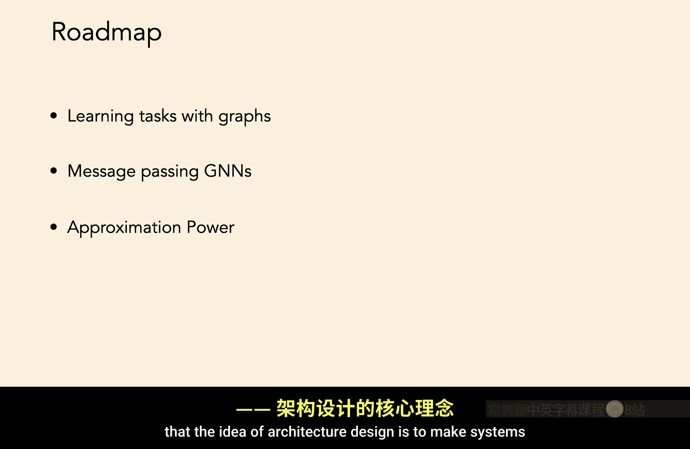

So graphs are a graphnets and graphs are a language for introducing constraints that limit your system from doing things you don't want to do。

 And this is one of the perspectives on， on architecture design that we'll keep on coming back to。We。

 we want to be able fit the data， but we want to constrain ourselves to fit it only in the right ways。

 So universality is actually not， not what we're after。

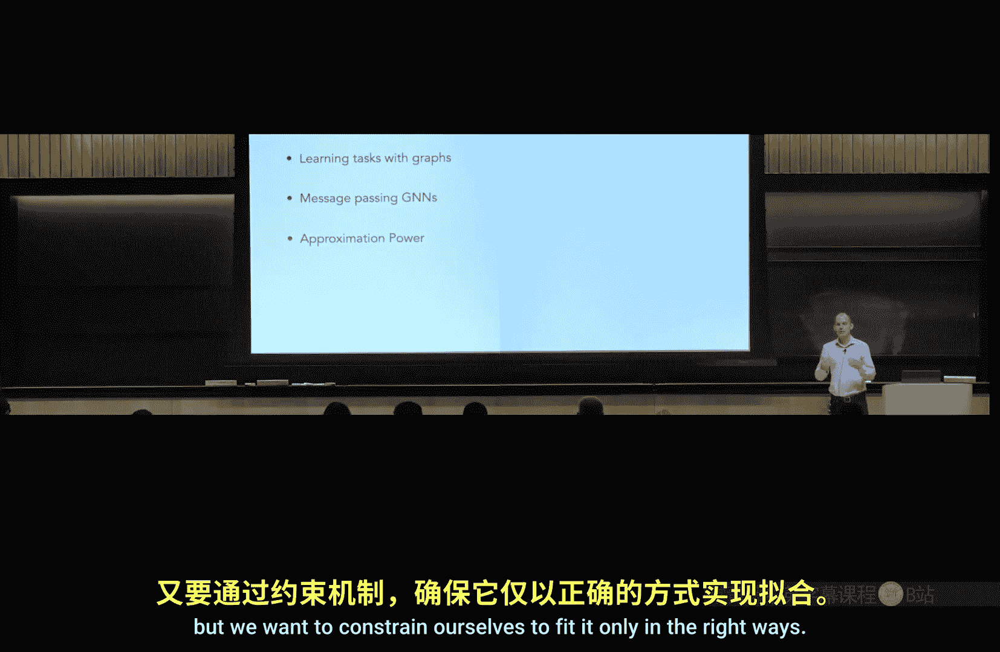

In architecture design。But。Within the family of functions that we do care about， we do want the。

 architecture to build to approximate them。 And we'll see what family graphnets can approximate。Okay。

Quick reminder on logistics is that problems that are due next Tuesday。

 So hopefully you're making good progress。 But if you haven't started， like start start now， it's。

 it's a two big problems that there's a lot of stuff in there。Okay。

 so let's talk about what types of problems graphnets are amenable to。

 And maybe before I tell you some examples that I have in mind， I could just ask the audience。

 So graphnets are going to be appropriate for problems that naturally can be specified with a graph or data types that exist on the graph。

 So in your in your work in your fields they are coming from。

 What are some problems that you can think of that are well stated as graph problems。Okay， yeah。

 let's go up here。Okay， so one when is social networks， social networks are， are graphs， you know。

 people and their friends or their connections。 Okay， another one。Yeah。

 hidden Markov models are one kind of probabilistic graphical model。

 And And this idea of graphical models for representing probability distributions is。

 is a classical idea。 And graphnets are appropriate for representing things like this。 Okay。

 back here。Gene interactions。 Yes， I'll have some examples on that。 So， you know。

 whenever I have different。Different genes that are interacting with each other or with， you know。

 proteins that they get transcribed from those genes。

 Then these could be thought of as like nodes and edges that represent relationships。

 Let's do just one more。different websites cross referencing different websites。

 So things like Page rank， hyperlink between different web pages like Google started as a graph search company。

Essential， they represent the web as a graph of hyperlinks。

 and then they tried to evaluate where the important nodes are in that graph。Okay， so。

Whatever problem you have， you know， if you're。Have studied physics or chemistry or computer science。

 I'm sure that you have seen a million graphs。 That's one of the basic data structures we use for representing the interesting。

 interesting types of data in the world。Okay， so graphnet are an appropriate technology for problems that naturally exist on graphs。

 And there's a few different things we might want to ask about a graph。

 So one thing is you might want to take a node in a graph。 Maybe this is a social network graph。

 This is a user in that social network， You want to classify something about them。

 You want to say you know， is this， is this person， somebody who likes jazz music or not。

 Maybe that's the the prediction problem that your social media company wants to make。 Okay。

 so that's like a node classification problem。 We can ask a question about a node。Other times。

 you might want to ask a question about the entire graph。 Like。

 what is the average number of friends that people have within this social network。

 Maybe that's the property that I care about。 So we can ask questions about nodes， about edges。

 relationships， about the entire graph。I'm gonna to give a few different examples just to。

 just to motivate why graphs are so important。 So another one might be this。

 I think this is from Pinterest。So it's users and the kind of the boards that they're interested in。

 So these kind of topic areas that're interested in so assigning， you know。

 you to what are the topics that you're interested in on this。

 on this website that allows you to see content under these topics。

 So this is like a graph between people and their， their interest。Okay。

 these types of graphs are often used in recommender systems。

 I want to recommend what you might be interested。 What， you know。

 what next video on YouTube would you want to watch。

 So it's like a bipartite graph between users and their interests or users and content。O。

So I think we had the gene expression idea previously， but in general。

 for biology and especially chemistry， molecular biology。We have graphs， which are molecules， right。

 Mocules are well represented as graphs。 There are atoms and bonds between the atoms and。

If we want to do things like predict which， where， where would the binding site be on that molecule for some drug or would this molecule be toxic to human。

 These are graph prediction problems in terms to ask ask a question about that graph。

 which is the molecule structure。ok。啊。So in biology and chemistry， graphnets are used extensively。

Here's another example， where we have。The graph of interactions between different drugs and the drugs effect on。

 on the human for some kind of medication。 So we might have。In this example。

 two different drugs that can， you know， have a positive effect on you。But if you combine them。

 they're negative。 These are the interactions between drugs that can be， can be bad， right。

 And you always have to read the bottle on the， on the pills you're taking like， you know。

 don't take this if you have this other drug， right， so。

That can be represented as a more complicated graph。 Now， in this graph。

 we have edges between pharmaceutical interventions。

 like the drugs you're gonna take and also edges between the drugs and the proteins that they affect。

And so different types of edges and different types of nodes can exist in the graph。

 And we are going to be wanting to learn properties of these edges and these nodes so that we can make predictions about what combination throughout this might be toxic。

Okay。嗯。So graphs also come up in just kind of classical computer science algorithms。

 So in shortest path algorithms in graph search of various forms， tree search algorithms。

 we often represent classical， discrete optimization problems as some kind of search over over a graph。

 So here's one example。 This is from Google Maps。😊，And they're trying to find the shortest path。

 You know， the， the fastest driving route between， you know， your。

 your house and where you want to go。 So you probably use Google Maps to do this all the time。

 So how do they do it， Well， this is a huge， huge graph。 It's a whole world of of roads。 So its。

 it's slow to use classical algorithms like Dexters algorithm。 And additionally。

 there might be a lot of constraints beyond just searching over the edge lengths of that road network。

 There might be it might try to optimize for。Other properties like how say for scenic is the road or avoid highways or there's different constraints that you can add on top of this。

 It becomes a very difficult graph search problem to solve with classical methods that might be too slow。

 And so one use of graph neural networks is to find heuristics and approximate graph search algorithms that can solve these problems more quickly。

 So Google and this。In this example is。Using a graph neural network to do faster search than classical algorithms。

And we'll talk a little bit more about that， as well。Okay， by learning heuristics。Okay， another one。

 I don't think anybody mentioned physics， but that's another place where graphs come up all the time。

 So one of the popular ways to simulate fluids or particles or atoms is by thinking of them as a set of nodes with edges between the nodes that are indicating the physical forces。

 So two particles might have an edge。 and that edge is describing the kind of repelling force between those two particles because we know that。

 you know， two atoms can't occupy the same space。 and they might have electrical forces that push them apart。

So in this example， it's a particle system that simulates fluid dynamics。 And。

 and this is represented as a graph neural net that takes in the graph of all of these water particles and the edges between them are going to learn to push apart those。

 those nodes， essentially。Okay。So just yeah， more examples。

 And there's some paper references if you want to read up on these in more detail。And then， yeah。

 most abstractly， just a lot of optimization problems， especially discrete optimization。

 combinatorial optimization。Take the form of a graph problem where we might have a set of。

Decision variables we're trying to optimize。 We're trying to find what is the setting of these x's that will satisfy a system of constraints。

 So on the right hand side here， we have a linear program。

 we're trying to minimize this linear cost function subject to some constraints。

 and that can be set up as a graph of constraints that will penalize a certain kind of interaction between the decision variables X。

 we want to find the setting of the decision variables that satisfy those constraints。

 And so we can phrase this in the language of graphs and there are graph neural networks that can help us solve these types of problems more efficiently。

 And something I want to point out here is that again， just like in the shortest path example I gave。

 we do often for these problems have classical algorithms that we know will find the solution。

And so one question you might have in mind is， why would we bother with a learning algorithm？

 Why would we bother with a neural network that's going to do something that we already have the kind of optimal classical algorithm for。

 We know exactly how to solve a linear program on the right。

 We know exactly how to solve the shortest path in a graph on the left。And the reason is essentially。

 that these classical algorithms。Can be slow。And if we want to。Use a learning based system。

 we can potentially learn a faster way of finding an approximate solution。

And the trade off is that the classical algorithm we'll find will be guaranteed to converge to the true solution。

But a， but it might be slow。 And the neural net， the graphnet might be able to use heuristics that work really well on the data distribution we train it on。

 And so it will solve the problem more quickly on the data distribution that we're training on。

 but it won't be guaranteed to find the right answer on other data distributions。

 So you're kind of learning something that is more specialized to that data distribution。Okay， cool。

Okay， so now let's get into the technical content of how these graphnets work。

 How do they represent data。And。This is how we'll represent graphs for this lecture。

 We'll say that a graph is a set of nodes。 Every node is going to come with a attribute vector。

 So this is going to be like our input to our graph processing algorithm。

 we will have a attribute vector for each node。 If these are molecules。

 that attribute vector might tell us what is the atom is this， you know， carbon is this hydrogen。

 right， So in gray， we have this， this vector， which is like the initial data。

 our observation about that， that node in the graph。😊，And。

What we're going to try to learn is a mapping from our graph。

Nodes to representations of the nodes that are going to be more informative about the properties that we care to protect。

Okay， so this is， just like we can do， you， take an image patch and embed it into a vector。

 We can also take a node and a graph and embed it into a vector that tells us something important about that node maybe classifies。

 iss it a binding site for the， the drug of interest。Okay， additional。

 we will represent the edges between the graph with a adjacency matrix。 And。

 and this will be an additional input to our graph neural networks。 So we'll have a set of nodes。

 which are represented by vectors of observed data and an adjacency matrix。

 And then we'll do some computation on that to make a prediction about the nodes。

We can also make a prediction about the entire graph itself。

 And that's sometimes called a graph embedding。 So this is like graph to V。 right。

 We have on the left side。 We have node to V。 every node gets embedded into some feature vector that tells us something of interest about it on the right。

 We're going to just embed the entire graph into a feature vector that tells something something of interest about the entire graph。

 For example， is this molecule toxic or not。 Okay， so we can ask questions about nodes in a graph or about the entire graph itself。

Okay。So GN Ns， graph neural networks are G N Ns。 They learn a function from these。

Adjacency matrices that tell us the edge structure and the set of graph node attributes that are observed to a set of embedding vectors or predictions about the nodes or the entire graph itself。

Okay， it's do I see a question in the。I think I see a question here， yeah。Yeah。Yeah。

So the question is， what is the relationship between node embeddings and graph embeddings。

 And we'll see in more details on this。 But the node embedding is going to be a a vector that we learn for each node in a graph。

 and the graph embedding is going to be one，1 vector for the entire graph。

 We'll see examples of this。Okay， and then I saw one other question。 Good， okay。In the back。

 are you learning。Or to Gr better。So are we going to learn either node embedding or graph embedding。

 or are we going jointly learn them。 You can do either one。 You can do both and。Yeah， well。

 in general， we might learn a set of node embeddings and then sum them up at the end to get a graph embedding。

 That would be one， one way of combining the do。Okay， one more question Then I'll move on， yeah。Yeah。

 over here。Sorry， in the middle， yeah。So。So I think if I understood the question。

If how much do we care about the dimension of the adjacency matrix， if it becomes。

 if we have a really big graph with a lot of connections， just become intractable。

 And I would say that's that's more the that's not really our choice as modelers。

 that's going to be the the property of the data that we're working with。 So， yes。

 if we have a graph。 if our data type that we're working with our molecules are just very densely connected。

 Then this will be something we have to deal with。 And that will be computationally more expensive to deal with。

 but thats we can't we don't usually try to simplify the input graph。

 We're gonna to take the input graph as given and ask a question about it。Okay。So。

Before we get to how graphnets work， let's， let's first ask。

What if we just wanted to make a prediction about graph structured data with an MP。

 We've already seen MPs， so。MlP is another name for that， you know， fully connected neural network。

 But if we just use this fully connected neural network。

How would we take as input the properties of the graph？ So one。

 one thing that we need is input is the adjacency matrix that tells us which nodes in the graph are connected to which nodes And。

 and and just to quickly show you what that looks like。Let's see， what what happened to my mouse。

How do I find my mouse。Well， anyway， you can see the adjacency matrix up here on the left。

 And this is just telling us which nodes in the graph up at the top right are connected to each other。

 So one means there's an edge between the node index I and the node index J in that matrix and is0 mean theres means there's no edge。

 So what， what does the the fourth row of that adjacency matrix。

 Which node in the graph at the top right does that refer to。😊，Blue， blue， okay， I heard it。 Yeah。

 So blue， right， there's three ones。 And that's the only node in that graph that has three edges。

 So that's how you would know that that's， that's the relationship。Okay。

 so the adjacency matrix tells us the connect connectivity of the graph。

And we additionally would have a set of attribute vectors for every single node that observe vector for that node。

 And we could just put these into an MLP by simply， you know。

Creating a serialization of our adjacency matrix and all of the， the node attribute vectors。

 And just one really big vector。 And just put that into a multi layer perceptionceptron， right。

 So can anyone think of。Why that might not be the best strategy。

 What might be an undesirable property of just serializing our adjacency matrix and our node attributes。

 Let's go for here。So addition quick trees only consists of ones and zeros whereas MLLP can take in real them。

Okay， yeah， that's， that's so adjacency matrices only consists of ones and zeros。

 Maybe we're not making use to the full capacity of an MP to take in real numbers。

 that's what a good idea。Depends on the image。So你两个。気ちされ。Yeah， that was so the answer。

 and this is the answer that I had in mind myself is。

Adjacency matrix represented as a vector is going to depend on how we assigned indices to the nodes in the graph。

 And that decision was kind of arbitrary。 Like we decided that the fourth row of the adjacency matrix。

 The index 4 is the blue node。 But why， why didn't I say that in index 3 is the blue node。So。

Generally， for graph structure data， we want to be processing in a way that is invariant to how we chose to index into the nodes。

 the structure of the graph， the structure of model of molecule in many types of graph data。

 don't really depend on the ordering of the nodes。 so in math terms。

 we would say that we want a function， which is permutation invariant tom permuting the indices of the adjacency matrix and permuting the ordering of the node attribute vectors that we put into our our system。

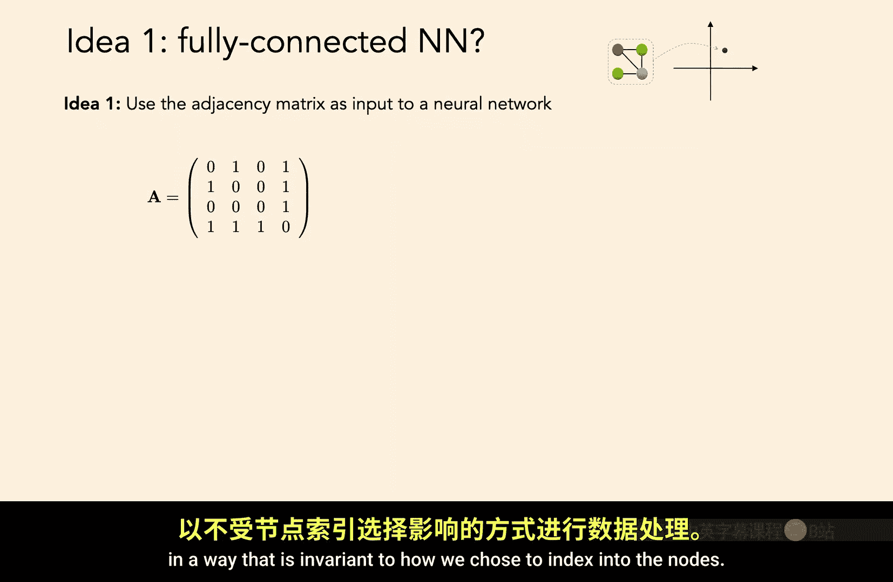

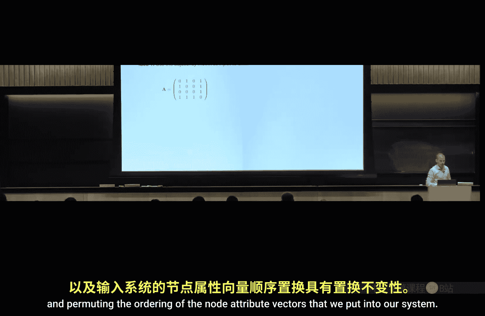

ok。So here is a permutation matrix P applied to the rows and the columns of our adjacency matrix。

 and the graph that is described by this permutation is the same structurally as the graph that's described by the original adjacency matrix。

 We've just chosen a different ordering of， of the indexes to label the nodes。 Okay， so。😊。

The first matrix P permeates the rows in this in the P transpose permeates the columns。Additionally。

 if we have。A matrix of node attributes。 So we have， you know， four nodes。

 And so we'll have a  four by D dimensional matrix X of the node attributes。

 This is the observed data at each node。We can permute。That with our permutation matrix， P。

 And in order for the graphnet F or the function F to be invariant to these types of reining of our graph。

 we would want that permuting the adjacency matrix and permuting the nodes。

 The node attributes will result in the same answer as any other permutation。

 So this property is called permutation invariance， very related to what we heard about on Tuesday。

 where convolutional networks are invariant or equivariant to translation。

 graphnets are going to be invariant or equivariant to permutations of the inputs。o k。

So permutation equivari is almost the same thing。 It just says that if you permute the way that you have indexed into the data。

 then you should permute your outputs。 So if I shuffle my， my nodes。

 then I should end up shuffling my predictions。Okay。

 so the same idea as translation invariance versus equal variance。

 I would want to be permutation invariant if I'm trying to， let's say。

 predict something about the entire graph。 So no matter how I index those nodes。

 then the prediction about the graph will be the same。

 And if I want to predict something about every。Noode， like I want to output node embeddings。

 Then I want to be permutation equalvari so that if I shuffle the nodes。

 my predictions about the nodes get shuffled in the same way。Okay。

 just like I want translation equivari， If I want to have the output of my convolutional network。

 have the property that if I shuffle or translate the input image。

 I will translate the dense map up set of predictions in the output。

 I'll translate the feature map that comes out。Okay。

So this is the kind of fundamental symmetry that we're going to be kind of exploiting with graph neural networks。

 They'll be appropriate for processing data that for which the， you know。

 problem of interest is actually permutation equalvariant or invariant。Yeah， question。

I think I understand why we need to make it。But is that under the assumption that all graphs could be made into？

这 invari。Yeah， some problems were。The notes are just not able to become。Yeah。

 we'll see at the at the end of the class some cases where you wouldn't want permutation invariance。

嗯。But if， for example， like。You live in a world where you know。

 molecules always come in some orientation like。The the heavier， like the blue is a heavier atom。

 and always like。Lives on them。 It has a position， a canonical position that you're always going to observe。

 Then you'd want to use that information。 But in in our world。Yeah。Actually， yeah。

 I'll have to think a little bit more about a good example。

 But we're gonna see we're not the end of the class。O。One more question， yeah。Invari。

 why is the output a single vector？Have anything。So is there a reason why that output is in？Yeah。

 for permutation in invariance。The output could be more than one vector。

 It could be any dimensionality。 It just means that if I permute the inputs。

 then I get the same output， no matter what。And that。

 that's gonna be most appropriate if I'm making some， you know， prediction about the entire graph。

 If I'm making predictions about a single node in the graph， I kind of want my。

 my prediction for the n node in the graph。To always be in the end output row of my like output matrix。

 if I'm predicting。A matrix is output or a set of vector vector embeddings per node's output。Okay。

So let's again make the connection to graph neural networks。 sorry to convolutional neural networks。

 So connets are graphnets applied on a grid， right。

 We said that cons are appropriate for grid structured data。And。If we're processing an image。

 which is one of the main applications of convolutional networks。

 then we'll have a grid of pixels or patches。 And we can think of that as just a graph of nodes and the edges between the nodes are the kind of the weights of this。

 the convolutional filter， right。😊，And in a graphnet。

 it's just the same idea except generalized to non grid topologies。 So if I want to， you know。

 process something about the node in the center of that green region。

 I'm gonna look at all my neighbors and。Aregate information from all of them。 just like in the con。

 we're gonna run a filter that's gonna look at all my local neighbors in a patch around a pixel or around a node on a grid graph and aggregate information to make a new representation of that location in the。

 in the， in the image。😊，Okay， so。So， so one question for you。

 So graphnets look a lot like compliments， But now they're on arbitrary graphs as opposed to just on a grid。

So what are some of the interesting differences between a cofnet and a graphnet。

What is something that， what is the new problem you might encounter with a graph that you want to encounter with a conve。

 yeah。

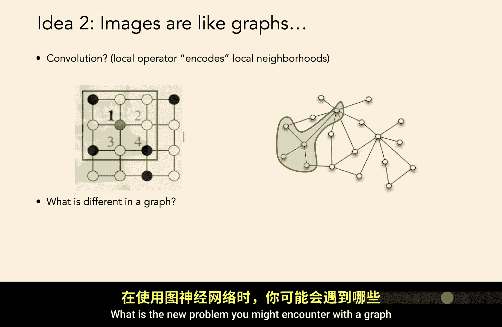

Aex is not the same shape of the time。Yeah， great。 So the neighborhood of a vertex is not the same shape all the time。

 So you need， you need a architecture that can handle having variable numbers of neighbors。

 It's not going to be something that's always like a 3 by three patch。

 And this is gonna have hardware implications， right， It's going to mean that。

I can't just have like baked tongue to my hardware that I'm gonna look at， you know， a 3 by 3 grid。

 I'm going to have to make that flexible enough that if the edge the note has a lot of edge neighbors。

 then I will be able to aggregate over a bigger set。 Any others， yeah。Yes， excellent。

 There's no structure in the neighborhood。 all should be treated equally， so。In a。

Convolutional network， there is this kind of spatial dimensionality to it where。

Left and right have a different meaning than up and down。

 And I might want to treat left and right differently than up and down。 And in a graph that。

 we actually are going to represent the operation that kind of。Updates the node representation。

 given the neighbors in a way that is in。Doesn't depend on spatially where those nodes land。 So the。

 the structures is more abstract than the the spatial structure of a continent。

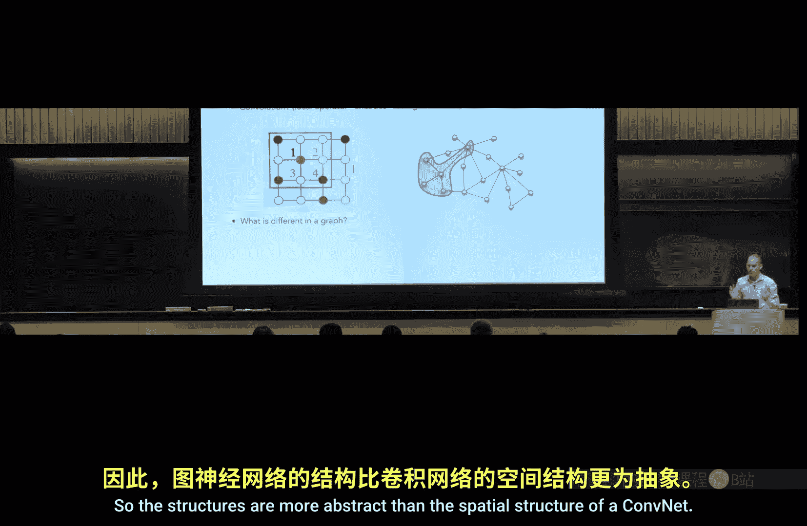

Okay。So there are a few important differences， but there's also a lot of commonalities。

 So here's a few of the commonalities。 One is that both of these architectures are based on local operations。

 Okay， so we run local convolutional filters to update our representation of the data at that location。

 and we run graph local computations where every node in the graph is going to get input from just its neighbors。

 And the way you make a global decision or you propagate information across the entire graph for the entire image is just by stacking those local operations。

 so。😊，You can filter an image over and over again。 and the receptive fields gets bigger and bigger and bigger。

 And that location of the image aggregates information from farther and farther away。

 It's the exact same in a graphnet。 If I update a node based on its neighbors。

Then if I repeat that operation， I will， every time I repeat it， I will hop one more neighbor away。

 and eventually， I'll cover the entire graph， and I'll globalize。

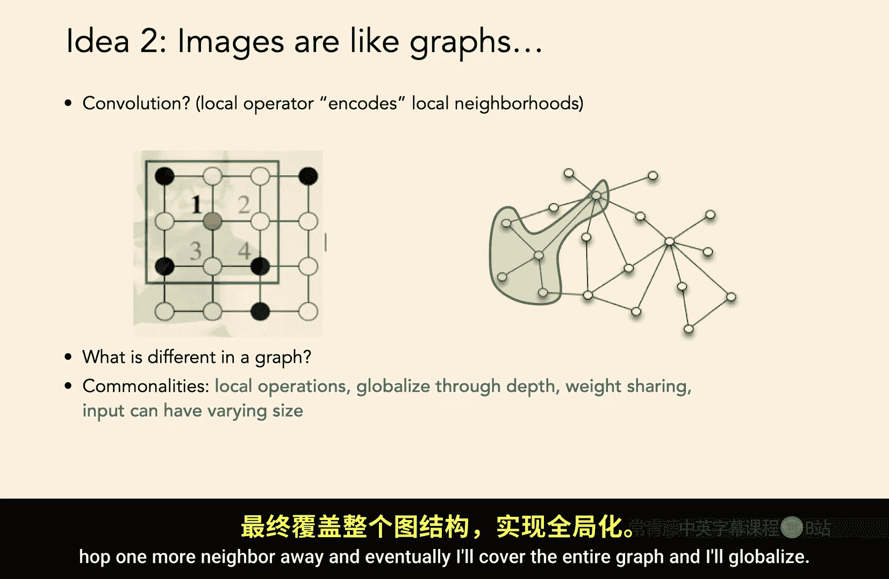

Another idea that shared between these things is that just like a continent is chopping up the image and to patches and operate on each patch independently and identically with the same parameters。

 a graph that will also chop up graphs into little local regions and operate on each local region independently and and identically。

 and it's going to share the same parameters to update region that each region of that graph。

And another interesting property is that confidencefiness can operate functionally on any size input image。

 They slide that filter over as much as they need to go。

 and a graph net can operate on any sized graph。 You just continue running that local operation at every node in the graph。

 Okay， so these are， that's a big difference from MP， which require a fixed dimensional input。 Okay。

 one question。 Are we sharing the weights across different depth。😊，Yeah。

 so we're gonna get into that in a minute。 So are we sharing the weights across depth。

 And the answer is that's an option you can or you don't have to。

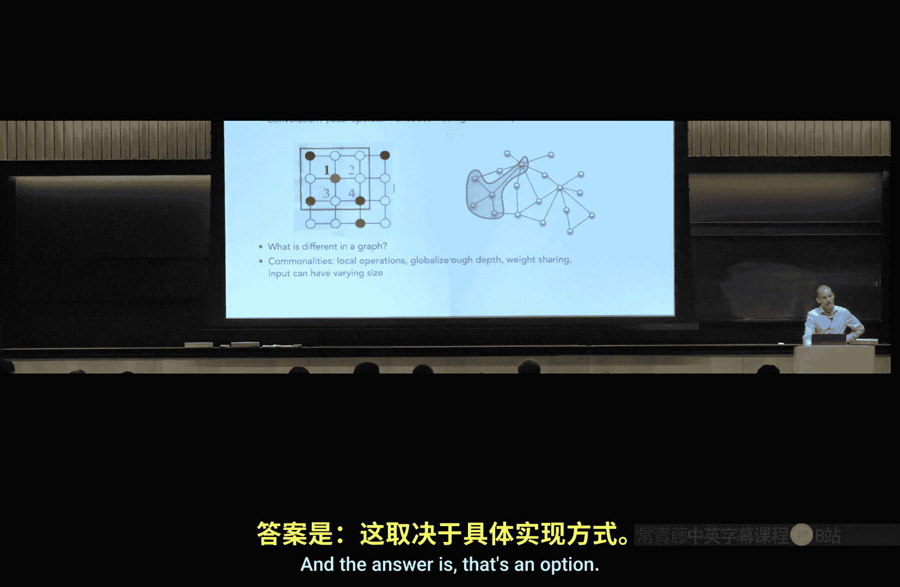

Okay， but we'll see that in just a second。Okay， so here's one more just pointing out the exact relationship between a graphnet and a convolutional network。

 So this is a。CNN visualized like a graphnet。 So every single node in the graph is going to be connected to its neighbors。

And every node will have this gray。Let me， let me try to get my mouse back。 Okay， there， there we go。

啊。I don't know why my mouse is not showing enough。Okay， anyway， it's， it's fine。 So the。

 the gray columns are meant to be the node attribute vectors。

 But what would the name of those gray columns be if we were working with a CNN。😊，Anyone want to say。

 I think it's on the slide。Ebedding， embeddings are channels。 Yeah， so in a CNN。

 every point in the grid has this column of channels underneath it。

 And that's equivalent to the node vectors in a graph neural network。

 So maybe some CNN review questions very quickly。In this convolutional network。

 what is the kernel size。3 by3。 Okay， great。And what is the stride。The stride is 3。 So why。

 why is the spread 3 right， Because I didn't draw edges between。呃。Like。I don't。If。

 if you look at the pattern of edges， it's like I'm taking that pattern。

 that template and moving it over by three to get the the next filters application。Okay。Cool。

 so CNNNs are GNs。But now， let's look at GNs more generally and get into the exact equations of how they operate。

Okay， so the。The way I'm going to present this is that there's two steps。

One step is we're going to pass messages。From each node to its neighbors。 And the next step is。

 we're going to aggregate all of those messages to update the representation of of each node。

 So every node has a vector associated with it。 And that vector is gonna be modified。

Kind of layer by layer through my graphnet in order to come up with a better embedding that then makes a prediction at the very end of the day。

 just like an a compliment how every layer modifies the set of channels underneath every spatial location。

ok。So here's the general form of one layer application of a graphnet。Okay。

 so we're gonna look at a really tiny graph here。 I'm gonna gonna highlight that middle node and ask。

 how does that middle nodes node vector get updated after one application one layer of processing。

 So what is one layer of processing。 So we call this in in each round K in each layer K。

 We're going to do two things。 We're gonna to do aggregate and then update。

 So the aggregate function is going to be a function that takes the node vectorsnoted as H of all of my neighbors and it's going to produce a message M from that set。

 Okay， and importantly， aggregate is going to be a function that is permutation invariant。😊，Okay， so。

If I rein into my neighbors， then I shouldn't get any different output message M。Okay。

 so the kind of italic N is the set of neighbors of a vector of， of a node V。And。

I'm gonna take the attribute vectors H from all my neighbors in that set。

 And I'm going to then somehow aggregate them。Now， once I've gotten that message。

 which is now just a vector。 It's an end D dimensional vector， let's say。Then， I will update。

The red node。Note vector。Using another function called update。Okay。

 so I'll take the messages from my neighbors。 My neighbors told me something about what they know about the graph and about the world。

 And I'll combine that information with what I know about myself to update my own representation。

And now I can repeat this process， K times。And as， you know， K gets larger。

 it's like going in depth in a neural network where I'm just。

Updating my representation to be better and better and better until finally， at the end。

 I make a prediction。ok。So every application of that。

 those two steps is going to essentially increase my receptive field by one。

So that red node is going to get information about the green nodes。 If I run this algorithm twice。

 So I get a message that's passed from the green node to the blue node now to the red node on the second round。

Okay， so some of you will be familiar with message passes passing algorithms and hidden Markov chains and so forth。

And that's one perspective on this。 But I'll try to give a few different perspectives。Okay。

 so what is the aggregate function。And what is the update function。Okay。

 let's make it a little bit more precise。 So the aggregate function is going to be any。Set function。

 That means it takes as input a set of items where the ordering doesn't matter。

 So it's permutation and variant to the ordering。And it produces an output vector。 Now， technically。

 we would call this a multi set function because the set of inputs， which are the node vectors H。

Could potentially。Have duplicates。 So multiet is just the technical name for a set that can potentially have duplicate items。

 So if you come across this in the reading and so forth， they'll call it a multiet function。

 But unless you're like deep into set theory， then it's just a function from a set of items to a vector。

Okay， the set of items can have duplicates。Okay， so let's look at some examples of aggregate functions。

 So one example would be summation， right， A summation takes a set。Of any length。

And it produces a vector。So summation， and also is permutation invari。

 It doesn't matter how you order the items in that set。 So。

 so summation is a multi set function that produces a。vectorctor M as output。

And that will be the message that is passed to the red node。And another one could be average。 So on。

 so on the left here， I have summation。 But then in gray， I'm dividing by the number of neighbors。

 So that would be the average， as opposed to the sum。 It has interesting different properties。

 We'll get into that in a bit。And on the right is just another popular aggregation function。

 which is like。Normalizing by the number of neighbors that both you and your。

 what are the messages coming from have。So just another variation on the same thing。Okay， so the。

 the key property is that aggregate is not a universal function。 It can't represent everything。

 aggregate is constrained。 aggregate is a multi set function is per this permutation andvari。

 It maps a set of items。To in a vector。 And the ordering of the set doesn't matter。Okay。

 another interesting。Aggregate function that satisfies those rules is max or min， right， This is。

 this is a lot like the pooling operations in convolutional networks。So。呃。

Max will just take the largest item in this set。It produce， it produces a， you know。

Tix length vector， regardless of the size of the set。 So it's a multiet function。Men， same。

 same property。And there's some interesting things that you can do when you start to look at different aggregate functions。

 So here's。Here's a graph algorithm that can be implemented with min aggregation。

 And this is the shortest path， Billman Ford algorithm。

So a lot of you will have seen this in intro algorithms。 But in case you don't remember。

 try to find the shortest path with Billman Ford， what you do is you assign to every node in your graph。

 an attribute vector， which is just going to be the distance to the the target node you're trying to reach。

 So we're trying to find the shortest path of the target。 So every node will have an attribute。

 which is just a scalr。 It's just the distance。My estimate of the shortest distance or the cost of the shortest path to get to the target。

And I'll initialize those。Vectctorors D。With infinity。

And then I will run this recurrence over and over again until it converge， where I'm trying to say。

 I will say that the the attribute vector for the target node。Is 0， and everything else is infinity。

 And then as I run this， I'll look at all of my neighbors， and I will see if the distance between。

Myself and the neighbor。Plus， the estimate that the neighbor has of the distance to the target。

I'll see what that is。 And I'll take the minimum over that。

 And that'll be that will give me the shortest path。 if I。

 if I kind of propagate out now from that target these distances initially。

 itll be 0 and everything will be infinity。 And then all the neighbors of that target will be one。

 if the cost is one to go one hop in the graph。 And then this will propagate outward。

 And this will tell me the shortest， the cost of the shortest path to that that target， y。

So because the aggregate function is constrained， like how would？

I guess this is more of a question of designing。Proble to then use a graph。

How do you know that your information needs to be permeation variantant or how do you classify a set of problems to where you say。

 okay， I need to just aggregate my information together and it doesn't matter what order they come in。

Like how do you know when to？还是会饱的。Yeah， so the question is。

 how do you know when you want perm invariance？And I think that's， that's a good question。

 It's going to depend a lot on the， the domain。嗯。But， yeah。

 so any problem where the kind of the ordering of inputs doesn't change。

The optimal thing you want to do， the prediction you want to make is going to be something you want to apply this constraint of being permutation imvari to。

And we're seeing a lot of examples where structurally， that actually does make sense。

 Like the shortest path in the graph has that， has that property。I think that maybe。Yeah。

 maybe a clearer example of a case where you wouldn't want permutation invari is if I'm doing image processing。

And I know that the top of the image is more likely to be sky than the bottom of the image。I。

 if I have a graph which has these like local patches that I'm processing。

 I want to know where I am in the image。 And I think Sarah talked about adding positional encoding to tell you where you are in an image。

 if you don't want this translation， imvariance。 So translation imvariance is kind of one type of permutation imvariance。

 But permation imvari is a more general version of that。Okay， yeah question。你知行。こ可です。Yeah。

 so the output of the aggregate function is a d dimensional column vector。Okay。So， so yeah。

 on your problems that you'll have some questions about this shortest path computation。 So you'll。

 you'll get a little bit more intuition of it。 But it's just。

 it's just a construction to demonstrate that you can represent classical graph problems like graph search and shortest path problems with these aggregate and update operations。

 in in this particular case， Billman Ford can be implemented just as a GN N that only does aggregate and the update is kind of trivial in this case。

So Belman Ford is on the left， and the equivalent graphnet is on the right。 The graphnet。

 the aggregate is going to be a min for Belman Ford， rather than the sum and the computation of。

 you know， the the node embedding of your neighbor plus this cost， could be represented as an MP。

 which just adds like one as the cost of one， if we're assuming that every edge in the graph has length one。

Okay， soll， you'll work through that a little bit more in your problem set。So what。

 one question you might have is。Well， some seems like a fine aggregation function。

 Min seems like a fine one。 I there a family of aggregation functions that are universal in the sense that any multiet permutation invariant mapping。

😊，It can be represented in that family。And the answer is that， yes。

 this family of aggregation functions is universal in that sense， okay， so。😊，take my。Neighbors know。

embedding my neighbor's， you know， node vector and take my own node vector。

 pass those through an MLP， then sum up over， sum that operation over all of my neighbors and then pass the output through another MP。

 This is a universal appromator of the family of multi set functions。😊，And。

One question you might have is， wait a second。 Don't we say that M LP is on their own are universal approximators。

 and they are。If I increase the width to infinity。But here。

 we're not trying to approximate all functions。 We're trying to only approximate。 We want。

 We want to have an approximator that can't fit functions that are not。Multiet functions。

So the sum is the thing that makes it So it's one of these multiet functions that the ordering of the edges。

 sorry， the ordering of the neighbors doesn't matter because we're gonna summit over them。

So this has the property that it is a universal appximator。To the family of multi set functions。

 but can't， it can't represent other functions。Okay， so that's good It's a con constrained family。

Okay， the other thing that we need is what we call an update function。

 and the update function will take our messages from our neighbors and combine them with our current node vector and update that node vector to be a better representation of the graph of。

 of the information that we're trying to process。😊，And for this one， we're just going to use a very。

 a simple update， which is going to be like an MP。 you know， just a tiny one layer MP。

 It goes linear transformation of my each of my neighbors sorry， linear transformation of myself。

 plus linear transformation of the message coming from my neighbors plus a bias passed through sigma。

 which is going to be a pointwise non linearity。 That could be a relu。

That's a canonical update function。O。So once we have those two things， then we have a graphnet。Okay。

 so。I， I also want to mention how we can aggregate。ThatThat will give me updated node embeddings。

 And I can apply that over and over again to get my node embeddings into a better and better state。

And then at the very end of the day， I could just take those node embeddings as my prediction about properties or the nodes。

 But if I want to instead predict something about the entire graph， I just do one more step。

 which is very simple， which is I aggregate the node embeddings into a final prediction。Okay。

 so here is my mapping from a graph to an embedding。 And it requires this final step。

 which we call read out。Okay， there's other ways that you could have decided on the conventions of how to break down the pieces of a graphnet。

 I'm just giving you one that makes some of the analysis simple and clean。

But we're gonna define this extra layer at the end， which is going to take all of my node embedding。

 So it's gonna be a multi set function。 Again， it's going take a set of node embeddings possibly with duplicates。

 And it's going to output a vector。 And this will be how I get a vector embedding of an entire graph。

😊，Okay， it's just another aggregate operator。 It has exactly the same form as aggregate。

 But it's over all nodes in the graph， as opposed to the neighbors of a node。ok。Okay。

 so this is kind of the message passing view of graphnet。

 It connects to classical theory of message passing algorithms and graphs。

But I actually think that there's a better and simpler way of understanding all of this。

 which will connect very intimately to what we'll see soon， which is transformers。So。

 here' here's how I like to think of it。If I unroll that， those。

 those message passing iterations for case steps， I can just think of every step as。

Taking a set of node， vectors， and updating them。And here's my set of node vectors at the input。

 That's like my input data， the， the observed data about the nodes in the graph。 Okay， again。

 if they're drugs， it might be the name of the drug。If theyre molecules， it might be。

 if the graph is a molecule， it might be the atom。 like is it carbon or is it hydrogen。Okay。

 if it's a social network， then the input could be a description of the， the user profile for every。

 every person in that graph。Okay， I take。That set of node vectors。 And now I will do aggregate。

 So what is aggregate going to do， Areate is going to say。I I I'm trying to make it so that the。

The vertical the aligned nodes are corresponding to each other。

 So my message is going to be passed to the red。Notode is going to be。That black。Vectctor。

 which is the second one。And。As you can see， the red node in the graph gets input from the teal。

 the blue and the yellow node。 Okay， so the message is going to be coming from them。

And aggregate is going to。Take all of their。All the node vectors from those three neighbors and combine them into a single de dimensional vector。

 And that's my message that will be used to update the red。The red nodes， not emttting。Okay。

 and then I will run update， which is going to take the red node node embedding。

 plus the message from those neighbors and。Provide an updated representation of the red node。Okay。

 so what does this look like， This now looks a lot like。A neural network。MLP。

 just like we saw before， we would have a set of neurons as input。

 and then we would take a linear combination， some aggregation of them。

And then we would do a pointwise mal nonlinearity。 Now， we have a set of vectors as input we。

For every output vector， we're going to aggregate information over the neighbors that it connects to。

 Then we're gonna do a。Point wise No nonlinearity， but it's going be a node wise No nonlinearity。

 It's going to be this update function， which will apply the same vector to vector mapping to every single。

 every single node in a graph。Okay， then we'll repeat the process again on the next step of this message passing algorithm。

 But if we unroll it like this， it just looks like an MLP。 the only difference is that。

The neurons in this MLP are going to be vectors。 Theyre gonna to be node embeddings。

And that means that the point was operation will be a vector to vector mapping。

 The aggregate operation will be a vector， a set of vectors to a vector operation。

 but kind of topologically， it looks very similar to just a regular old neural network， okay。

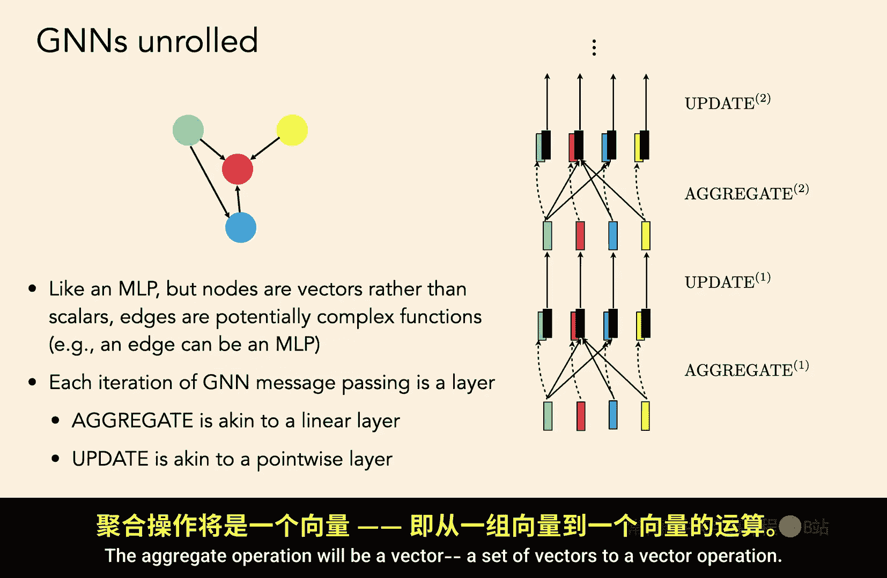

A few questions。 Let's go here。How is this different from an extension head and how it think。Yeah。

 so so how is this different from an attention head。

 So this perspective is the kind of connection between graphnets and transformers and transformers are a special kind of graphnet。

 So we're gonna talk a lot more in detail about that。 And we'll get to attention。

 Then attention is just a special aggregation operator。

 It's a particular kind of aggregation operator。So update。

 so you need to have some nonlinearities in here， and， and graphnets。

 you can have nonlinearities in the aggregate and or the update。 And I think typically。

 they'll both be nonlinear。 But theoretically， you probably can prove universal approximation。

 even if only one is nonlinear。 I have to think about that a little bit more， yeah。Yeah。

How you think the optimal number。Is the question how should you set K， what is the optimal K？Yeah。

 so。Typically， we will case like your depth。Now， in graphnets。

 the interesting thing is that we could choose to share parameters。

 We could choose to do the same message fast algorithm at every iteration。😊。

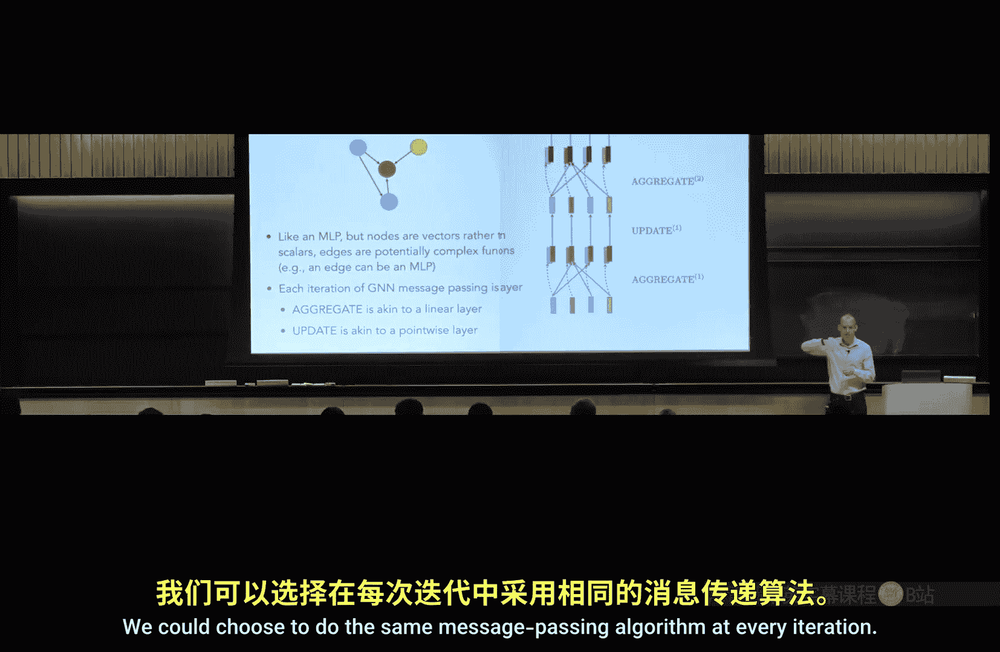

Or we could choose to say that my aggregate function has the supercase。

 So I use a different set of parameters for every iteration of that aggregate function。

So now aggregate is going to be， you know， some parameterized function。si here。

 We said it could be this。This in this form of an MLLP。And we could choose to make it time dependent。

 dependent on K and use different parameters per K， or we can choose to make it。

Use the same parameters for every single layer。 If we choose to make it。Time dependent。

 Then we'll have to pick a fixed。Depth K that we're going to unroll to and train for that depth because well。

 the different set of parameters for each of these operations。

 But if we choose to make it not depend on K and share parameters across time， across depth。

 then you can just run this as long as you want。 and it will keep doing computation and you might want to ensure that there's good asympotic properties。

 Like if you run it forever， it will converge to a good value。

 And those are two different settings that can be interesting to look at。

Let's go in the back over here。そシ場合の。This why。Theself。Right。

 so what is the intuition behind the update？Forula。Why do we use different way matrices。

 So I think what you could do is you could always just concatenate。H。

 your node embedding with your the message from the neighbors with M and then have one big W。

 And then it will just look like a linear followed by Reou La。

It's just separated here for notal kind of clarity， I suppose。Okay， one more and then I'll move on。

Yeah。How you best information if to have like edge information， for example， the distance。Yeah。

 that's a great， great question。 So what if you have edge information So we I。

 I said you have no attributes and you just send messages based on which edges connect to which node。

 So the edges only tell you about who your neighbors are to send messages to you。 There's no other。

Like weight on the edge or information on the edge。 And so I won't get into it in detail。 but you。

 you can also have edge attribute vectors and then have kind of a generalization of GNN that has node attributes and edge attributes。

 And then the update and the aggregation is going to also take into account the edge attributes。Okay。

 so。Yeah， so this is the picture of how I like to think about GN N's。 And you might be wondering。

 wait a second。 like， where is back prop coming in here。 is this message passing， like。

 is that an optimization algorithm。 the message passing and this propagation。

 that's like the forward pass through the network is taking data about the graph。😊。

And updating the representation of the nodes over and over again until finally。

 having a read out at the end that makes a prediction。 So how would you train that。

 You just back propagate through this computation graph。 Okay， nothing different。

So these message passing steps are just a new computation graph that looks like that when enrolled。

 and I can back propp through the whole thing。 Okay。

 so same exact algorithm that we saw for training any， any other neural network。😊，ok。Cool。Okay。

 here's， this might be a slightly tricky question， but。

I said that convolutional networks can be represented as a graph， and then you can observe。

 you can just treat them like a graphnet。 It's a graph that has this grid connectivity。

What is the graph net。For an MLP。What， what does it look like。

 What does the graph look like for an MLP。Let's somebody president spoken。 Did he speak no， Okay。

 yeah， in back there。Yes， just just a chain。 So in particular， what does the graph look like。

 It's really just a node。Because the message passing algorithm。

 So remember that an MP takes a vector of neurons as input and then does linear chrommo on linear or linear。

So a node in a graphnet comes with a vector。 So that has the generality of being like the vector input from an MLP。

And then if we unroll the message passing algorithm， it's just， it's just this， right。

 It's just a chain of take that vector update it。 And in this case， there's only one vector。

 So the aggregate function is kind of trivial。 It can be identity。

 And the update we said is just W times my node vector。 right， Here's what we said for the update。

 This's node neighbors。 It will just be W self times my node vector H pass through a relu or pointwise No linearity。

 That's an MP。 So an MP is just like a graphnet。 This is a single node。

 Comp is a graphnet that is a grid。😊，Okay。Okay， so throughout this class。

 I'm gonna try to point out like connections between different things。

 because I think sometimes when you first learn about deep learning。And just any topic。

 it'll seem like everything is different， But really， everything is is the same。 Really。

 everything is， you know， densely connected to all other concepts。 And it's just like。

 you can cast one concept as another concept with， you know， small manipulations。

 And I find this really helps me to get inside and understand how these things work， okay。😊。

So theres a question about edge attributes。 And I'm not gonna go into details on that。 But yes。

 you can add vectors describing the information that an edge carries as well。We could have。

Not just like a single message passing algorithm， but maybe K different or N different message passing algorithms in parallel that are passing different types of messages。

 There's a lot of variations and rifts on these， on these general themes。

One of the most important ones is that we can aggregate with a operation。

 which is not just sum mean or averaging， but instead it's called attention。

 which is like a summation that's dependent on the value of your node embeddings。

 We're going talk a lot more detail about that because the name for that system is called a transformer。

 So transformers are graphnets with attention as the aggregation operator。

And you can read up on some of these other variations， too， but I'm not going go into detail on them。

 The reading that I we assigned for today is a chapter on graphnets。

 But if you continue reading forward from the part that we assigned， you'll see that there's a lot。

 a lot more in that in that document， it's a very good kind of almost a book， really， manuscript。

Okay， so in the last section of this lecture， I want to talk a little bit about the theoretical properties of graphphnets。

 What types of， what types of problems can they solve and what types of problems cant they solve。

 And it's going to be related to approximation theory。So to set this up。

 I'm going to give one more perspective on how graphnets are operating。

 And this is kind of the tree perspective of what a node will see。So here we have a node of interest。

 node A， and it has neighbors B， C， and D。And。The message passing algorithm。

 layer by layer will do the following。 This gray box is the aggregate function。

 It's going to take messages from all the neighbors。 combinebine them。

 aggregate them together and send a message to note a。

And so note A only is learning something from these， these neighbors。

But if we run multiple steps of message passing or， you know， we unroll this graphnet deep。 So two。

 two steps So two layer graphnet， essentially， now we'll get messages not only from BD。

 but also from A and C going into B。And， and so forth。 Okay。

 so the kind of information flow from the perspective。

 suppose you're standing on the graph at node A， This is who's talking to you。

 And this is like the funnel of information coming into you。

 And every iteration of the message passing will increase the depth of this tree by one。Okay， so。

 okay， so the layer 2 representation of a is going to be messages passed from the layer 1 representation of these other nodes。

 which is going to be messages passed from the input raw layer 0 node vectors for those， those nodes。

Question。嗯。I guess when you're starting to train your graph， youre getting in。

Do you start with all the different nodes densely connected and then you set some sort of parameter to disconnectconnect those certain nodes or just start where none of the nodes are connected。

Great question。 So how do you know the connectivity of the graph。

 Do you start with a fully connected graph， Do you prune it？ So the answer is。

That the vanilla answer for GNs is the。The data tells you the connectivity that you're gonna have to use。

 like the molecule that you're going to be making a prediction about， it has。

A particular graph structure， which is just given by the data， right， If it's some hydrocarbon。

 will have hydrogen connected to a few carbons and so forth。

And that's not something you're gonna optimize。 That's just given that's given to you。

 So the graph structure is given to you。 And then you try to process that graph。 It's like。

 that's the data。Now， you're kind of alluding to， could I somehow take nodes and learn the graph structure that makes me able to make good predictions。

 This is like a meta。 like this is another problem， but we're not gonna get to that today。

 So for now， you're given the graph structure。 and that tells you how to send messages to process information on that graph。

😊，Okay。So this tree structure is important。 Oh， and additionally。

 we're going to just understand that every single aggregate function is the same。

 So we're sharing the weights。 All those gray boxes are the same function。

They could be different functions at different layers。

 but in parallel across all operations of aggregation within one layer of the message passing algorithm are going to be using the same function。

Okay， so。That's the weight train idea。 And that has some really nice properties。That means that。

If we add more nodes to the graph after having trained。

 So we're learning the parameters of these gray boxes。

 learning the parameters the aggregate and update functions。But after we've learned those parameters。

 we could run the same GNN。With the same aggregate function on a graph that has a different shape。

 because in order to aggregate over a different set of nodes。

 we just use the same function again on those， on those new set of nodes， just like in commonnets。

 I can train on a small image and run the filters on a big image because I can they use the learn filter。

 but just on a different set of inputs。Okay， so that means that graphnets can be trained on graphs of one size。

 but they'll generalize the graphs of other size。statistically。

 they might only generalize two graphs of a slightly different size because they'll have maybe overfit to to that to the training data。

 which came in a certain size。But functionally， they can process。

 They can just repeat the same operation， no matter how big the graph becomes。Okay， so， yeah。

 we're gonna to get to the， the， the theory that makes use of these trees in just a second。

But let's quickly make sure we understand how to set up a GNN and train it on a problem。

 So let's say I want to train a graphnet on， on， you know， some problem of interest。

 like predicting the toxicity of molecules。 So what would a data point be。

 What would a training data point look like。

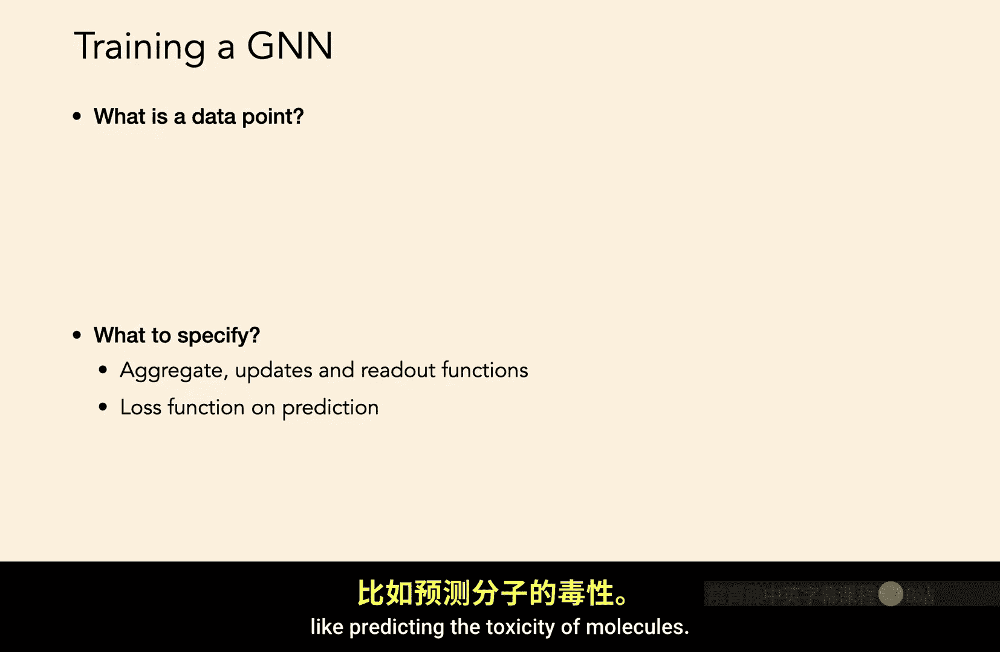

So who can tell me what a training data point would look like for classifying toxicity of molecules。

 Let's go to somebody new。Over here， yeah。So like。Yeah。

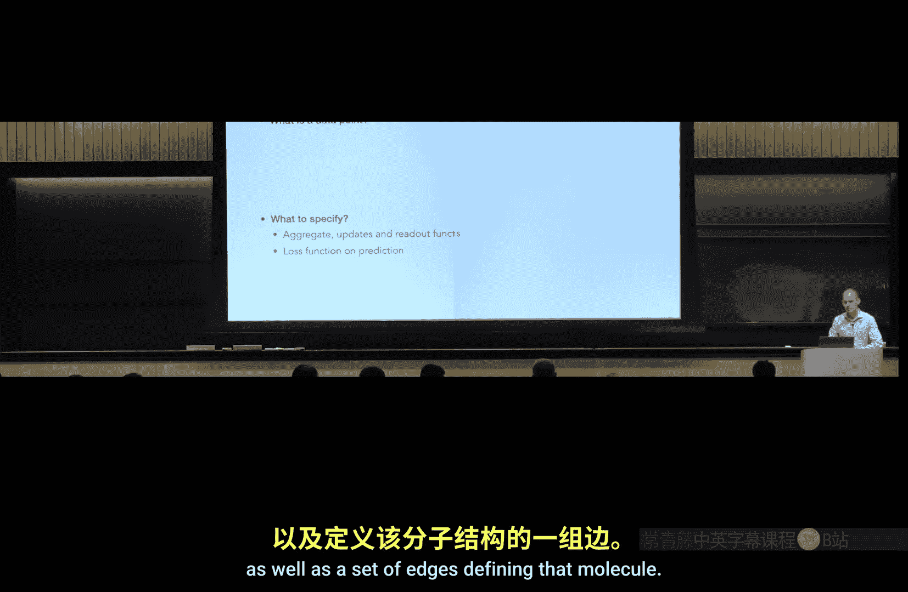

あすす。Yeah， so。I I think you're roughly saying what I wanted to say here， so。If I'm trying。

 if I have a supervised learning problem where I know the desirable prediction I want to make for every node。

 like the label of every node， then I would have node and label pairs。

 And that would be my training data。 If I want to predict a property， the whole graph。

 like I was saying， the toxicity of that entire molecule， it'd be the whole graph plus the。The label。

 is it toxic or not maybe a binary label。 So that's my， that's what my training data looks like。

 So molecule toxicity or a social network。 And for every single node。

 every single person to social network， a prediction of what music they like to listen to。

 And that would be a label of what music they'd truly like to listen to if I'm gonna fit to that data。

Okay， so then what do we do， How do we train on that， What do we have to specify。

 We have to specify the aggregate function， the update function and the readout function。

 the loss function。 If it's a classification problem。

 maybe I'm gonna have a cross entropy loss between the。Predictions at each node。

 and the ground truth labels。And then we'll train this with back propagation。

 stochastic gradientdiant descent， okay。Yeah， question。Oh。

 for the node label pair will also take us input the adjacency matrix。 So the。

 the a single data point would be like a graph。With a target ground with label for every node。

And additionally， the connectivity structure of that graph。

 because that that's gonna be used in the algorithm， too。The graph label pair would just be the。

 the graph the same， the same input。 But then the target output would be a label for the entire graph。

Yeah， so I suppose I should have said node comma connect like adjacency matrix comma comma labels。

 Yeah， but every node has a label is， is the point there。 And then you。

 you'd also need that other information。Okay， one more question here。这个 color。Blue。

 so does that mean that some those cannot have labels。 Yeah， no， that's。

 that's really just meant to refer to。We are isolating one note and looking at a set of neighbors。

 And， yeah， don't read to mention to the visualization。Sorry， this。

 this wasn't the best visualization。Okay， so I think I'm gonna， gonna skip past this。

 This is just giving an example of， you know， in that paper that I showed at the start。

 how they can use， how they can set it up as a GN N to predict something about molecules。

 And you can see on the， on the leftover there that we have these。Boxes。

 which are like aggregating information from。All the different proteins and pharmaceuticals that are interacting in this system。

you can read that more if， if you're interested， you know， this is the same。

 We can set up our Google Maps problem。嗯。And。There's a lot of connections for you to read up on if you're interested。

 So， of course， graphs come up everywhere。 So signal processing and problems of graphical models and inference。

 and graphnets are intimately connected to these。 And here's a few examples。Okay。But let's。

 let's get into the final section， which is the the theory of what kinds of functions can GNNs approximate。

Okay， and the key question here is going to be， which graphs can a G NN distinguish。

And we'll see that they actually can't distinguish all possible graphs from each other。

 There will be these equivalent sets， where willll be two different graphs where a G and N will necessarily have to make the same prediction。

 because according to the GN N， those are the same graphs。 So what is the equivalent set。Okay， so。

 so。Here are a bunch of graphs。 And you can imagine that。From the perspective of certain types of。

Algorithms， certain sets of these graphs will be seen as the same。

 And we want to ask which sets of graphs are gonna to be seen as the same as the graph cannot make a separate prediction on one graph versus the other graph if they're part of the same equivalentence class。

Okay， so the， we're trying to understand what types of。

Predictions and functions graphnets can approximate。

 And the way we'll do that is by showing that graphnets cannot distinguish between certain types of inputs。

 so they necessarily would not be able to approximate a function that has to distinguish between those。

 those inputs。ok。So。Yeah， the the theorem is just a formal statement of that that if a graphnet cannot distinguish between two items in an equivalence class。

 then clearly it must incur an approximation error。

 If the function I'm trying to approximate does distinguish between those two。

 those two graphs in that equience class。 Okay， so what is the set of equivalentence class classes for graphnets。

 what graphs are considered equivalent to each other。Okay， so the way to understand this is。

 is the tree structure。 So So accordinging to a graph net。That graph on the left。

According to any node that's trying to update its representation based on messages coming in。

What it sees is this， these tree structures。 So the red node is going to see this neighborhood。

Structure that has that tree。 So it's connected on the first hop to the blue and green and on the second hop to all the other nodes。

And the green node is going to have that tree structure。

 and the other green node is gonna to have that tree structure。So from the perspective of a graphnet。

These trees are the entire characterization of that graph。 That's all they can see。

Because that's how the messages get propagated。So if two graphs have the same。

Tree structures for all the nodes。 Then those two graphs are equivalent， according to the graphnet。

This may not be obvious， but it turns out。We can find it。Two graphs。

 they are different and yet have the same three structure。

 And those two graphs will be two graphs that graph that cannot distinguish cannot make different predictions for。

So here's an example。 And you're gonna work in your problem set on trying to show some of their examples。

But I'm gonna show you this one in particular。 So first。

 convince yourself that these are not the same graph。Okay。Structurally， these are different graphs。

 right， One has these two kind of closed planar regions， and the other has。2 regions。

 but there are triangles。 These are， these are structurally distinct graphs。Okay。

 but let's look at the tree structure of the top left red node。

It has exactly the same tree structure for both graph。 we can expand those trees going further down。

 But this is enough to， to make the point。Okay， so the red node has a yellow node and a red node as neighbor。

And the yellow note has a red， yellow and red note as neighbor。

And then we can just keep repeating that process。 You'll see they're entirely equivalent。And yet。

 they're not the same graph。 So two graphs can have the same tree structure。

 but not be the same graph。 That means that if one of these molecules is toxic and the other is not。

 let's say these are molecules。 and one of them is toxic there's not。

 These are different physical things。 And so one of them could be different。

 could be toxic than might not be。 A graph that will have to assign the same label to them， y。

Each node。One hot encoding。In addition to its not dash。Yeah， so you're。

 you're giving the answer to a question。 I was going to ask in a few slides。

 So if you simply give each node a one hot encoding， like， tell it。Its position in the graph。

Then the symmetry can be broken。 But the power of graphnets is that you want to be invariant to the ordering of the nodes。

 And so by breaking that symmetry， you， you break the permutation invariance。

 So it's kind of a trade off。Okay。Here's another case， a bit harder to see。

 But these two graphs are equivalent， according to a GNN。Okay， but they're not the same graph。Okay。

 so those are equience classes， according to the GN Ns。

 because a GNN can only distinguish two graphs that have different neighborhood tree structures。Now。

 this actually connects to some deep and old theory in， in graphs， graph isomorphisms。

 where you're trying to say， how can I tell if one graph is the same as another graph。

And GNNs have the same power to distinguish graphs as this thing called the the1 WL algorithm。

So some of you might have seen this before。 I'm not gonna go into all the details。 But， you know。

 this is going back to the 1960s， This is really classical graph theory。

 and the We filler Lehman algorithm is， an algorithm that takes two graphs and decides if they're the same are different。

 And the one Weis filler Lehman algorithm can distinguish certain kinds of graphs and the same kinds of graphs that a GN can distinguish。

 So So whatever the We filler， Lehman algorithm can discriminate a GN can discriminate。

 And this is just a connection to some graph theory。嗯。So。

Roughly the way that the white limitman algorithm works is you assign colors to the nodes in the graph。

 and then you do some kind of propagation， and you decide if two graphs are the same if they result in the same coloring of the nodes。

啊。And。嗯。Let's see。 So， yeah， G N can best distinguish。

The same graphs that the one dimensional vice fill leman algorithm can distinguish。

 But another interesting thing is that。It's not only can， can best。 just actually。

 you can achieve this。 So for any size graph， there existed A GN N such that you can distinguish。

Two graphs that are distinguishable by the W L algorithm。

 So we have universal approximation within this， within this family， universal， you know。

 ability to discriminate within this family of graphs that can be discriminated by this classical theory。

😊，And just like， just kind of giving you the gist of why you get universality within that family is。

 it's a two part argument。 The first part is that。A arbitrary nonlinear some nonlinear function is a universal appximator of any multiet function。

And M，OPs are universal appmators to arbitrary nonlinear functions。So MOP。

 some M LP is the universal appmator to multi set functions and。And then you， yeah。

 you can essentially show that。The aggregate of in this form that can take on a multi function can distinguish exactly the same class of algorithms as the W L algorithm。

 yeah。

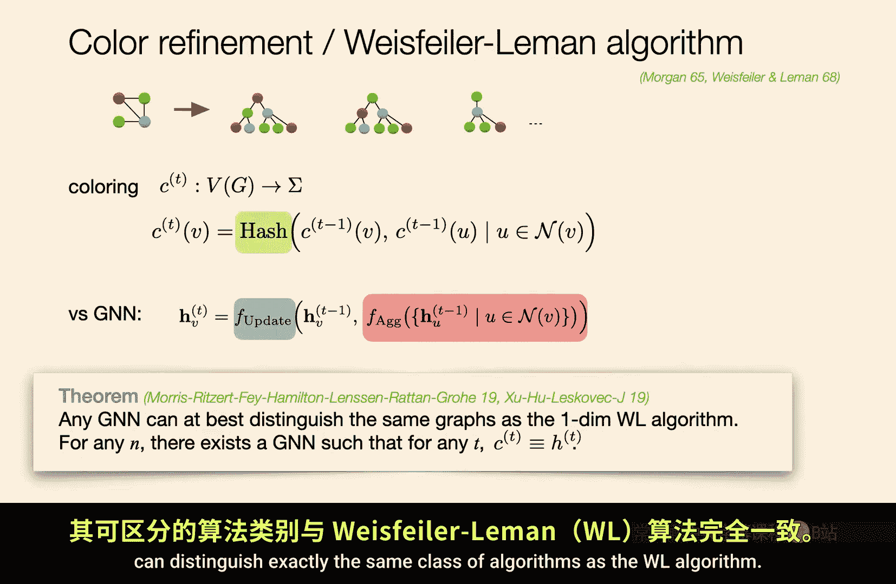

かかです。Yeah， great question。 So how common is it to two graphs that cannot be distinguished in this way。

I think that last year， I said， oh， it's kind of an edge case。 It's not too common。

 And then I realized I don't actually know。 So I， it's hard to come up with them on like pencil and paper。

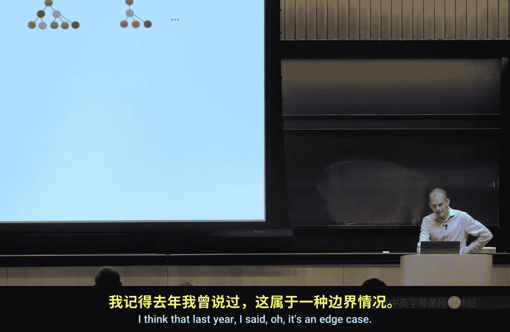

But。I so I think this my， my guess is that this is kind of a theoretically important thing。

 It's like an adversary， like a worst case thing。 Like this could exist。

 And then all your machinery breaks。But I it would be really interesting to know if like actual molecules that you're trying to classify the toxicity of would ever have this issue。

 I there ever be like a benign and a toxic molecule that would be indistinguishable as according tographnet。

 but。😊，Actually， have different effects on the body。 And the answer is， I don't know。

 But I imagine that for like health and safety， critical applications， this is important to。

 to understand。So this is the worst case。 I'm not sure how common it is in practice。Yeah。Okay。Okay。

 so I， I do want to bring this back to kind of empirical practice to show that this really does make an important。

It difference if you understand the theory of what are。

 what are the appropriate aggregation functions that will lead you to be able to approximate all the functions you care about within this set of multiet functions。

 Well， is that theory actually important in practice。 So let's， let's look at this example。

So here's a paper where we have training training accuracy on the Y axis。

 and we have the epochs of learning on the X axis。And higher is better， so。The red line is using。

An aggregation function， which is M LP some M LP。 Okay， so the Gs are an MLP for the red line。

And I stated that that is a universal approximator to any multi set function。And indeed。

 this is able to get 100% accuracy on fitting the training data。 This is just a training accuracy。

 this is just about approximation， not about generalization。 Can I fit the training data。

But the interesting thing is that if I use a different aggregation operation。

 like you might be just hacking away in Pytorrch and think， oh， I'll just。

 I'm not gonna do MP some MP。 I'll just do some and linear Re。 So linear re is not a full MP。

 It's not a universal approximator， right， We have to have linear relu linear is a universal approximator。

 but linear Relu is not。 So let's say I just decided， oh， I'm gonna save some computation。

 I'm gonna skip that line in pytorrch。😊，Well， that's not a universal approximator。

 And for this type of data， this protein prediction problem， I don't know the domain very well。

 but for this problem， you actually just plateau at a lower level of accuracy。

 And I suppose that's because you can't even approximate that data you're trying to approximate because you're not using an approximation function that has that capacity。

 So the theory actually is meaningful here。 And sometimes I think that it's hard to see like why do we need to learn all this theory of you know。

 what kinds of kinds of functions can be approximated by what kinds of neural networks。 Well。

 it actually can matter in practice。 And if you use something that does not have the capacity to approximate the family you care about。

 you can just be fundamentally limited。The other curves are even worse aggregation functions。

 So here's one really interesting one。 Look at this one that is I just used the blue curve is using the mean as opposed to the sum。

 So I believe it's the same as the equation at the top。 But rather than taking a sum。

 I take the mean。 And suddenly， it doesn't work。 And you might think like that seems like a tiny。

 tiny difference。😊，Instead of taking the sum over my node， my neighbors。

 I'm taking the mean over my neighbors。 Surely that should work。

 And you might be coding this way and just said， oh， you know。

 I bet taking the average as opposed to the sun is going to be more numerically stable。

 I'll just do that。 Well， the thing would fail completely。 Anyone know why taking the。

 the mean is going to lose information that the sum has。 Let's see if we can go， Okay。

 right back here。Yeah， so maybe you can't calculate how many neighbors， right， So taking the sum。

Know something about the total number of neighbors because it gets bigger with more neighbors。

 taking the mean divides by the number of neighbors。 So it loses information。

 And by losing that information on this problem， you just get。

 you can't actually learn the true function because you required knowing the number of neighbors。

Okay， so these tiny little details can actually make a big difference。

 And it's important to know that。Okay， so here's a few other properties of graphs that cannot be。

Learned with a conventional GNN， as I've described it so far。

 So you can't estimate the longest cycle in the graph。 You can't estimate the diameter of the graph。

 These are things that no matter how much training data you have。

 the graphnet is there's going to be cases where you'll get arbitrarily large error on these。

 on these estimates， because you can construct two graphs that are isomorphic according to the GNN。

 two graphs of the same neighborhood structure， but different diameter。Okay。

 so there's fundamental limits to what GenMs can do。

 But how do we get around these fundamental limits。 Okay， we heard the answer already， but。

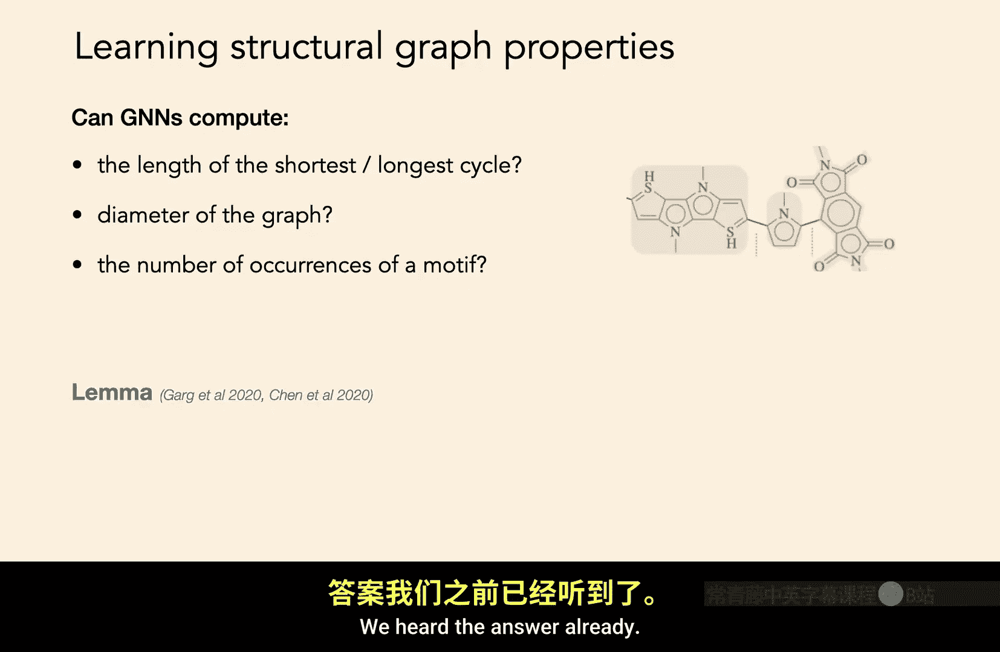

Even when I shout it out again， what， what would be a way of making a graphnet that is not going to be。

Invariant to you know， permutations of the， of the nodes。When hot encoding， yeah， so。

Or more generally positional encodings。 So just like we can make a convolutional network。

 which is not translation equivariant， we can make a graph net that is not invariant to permutations by adding telling that each node where it is。

 what position it's at。

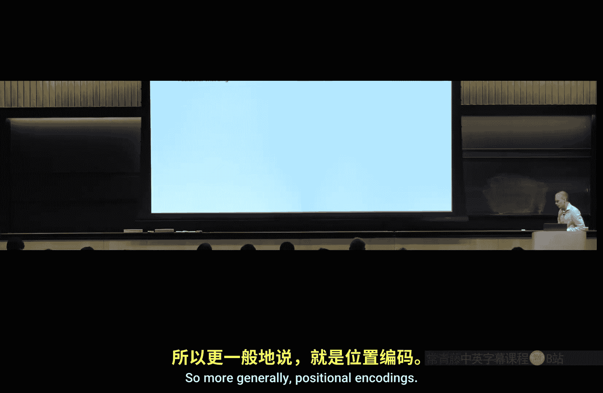

And this allows you to break some of these as symmetries with these。

These equivalent classes of two graphs have the same neighborhood structure。

 because now we actually can see that the the nodes have different positions in the graph。And。

One of the common ways of doing this。 remember that Sarah talked about adding kind of a s useoidal positional encoding where every position in your image is going to get it's going to get a vector that tells us where it is as upper left。

 I it middle， iss it right。 Well in a graph， we can get a of generalized version of where you are in the graph using the eigenvectors of the graph lapplaceians。

 So I'm not going talk in detail about that。 But this is just a generalized coordinate system for your location of a node within a graph。

 And if you add those to your graph node inputs The node vectors like the input layer to the graphnet。

 then you will break some of these symmetries。 And that can be good or bad。

 because now you might not generalize to new permutations。

 but you will be able to discriminate things you couldn't discriminate before。So it's a tradeoff。

Okay。So， yeah， that's just like position encoding in CNNN， which we saw on the previous day。

 So I'm gonna end there。We saw that graphnets are appropriate for processing graph structured data。

 It turns out that a special case of the graphnet is called the transformer。

 And that's just the dominant architecture these days。

 And we're gonna hear a lot more about that in a week or so。 Okay。

 and I can take questions up here at the end。 But feel you're welcome to all leave now。 Thank you。😊。

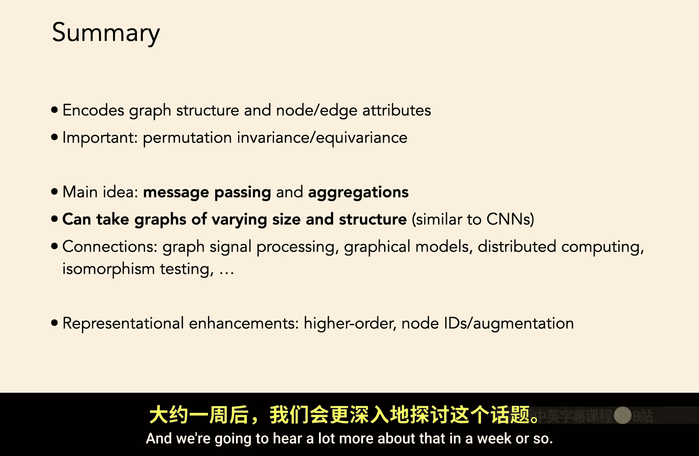

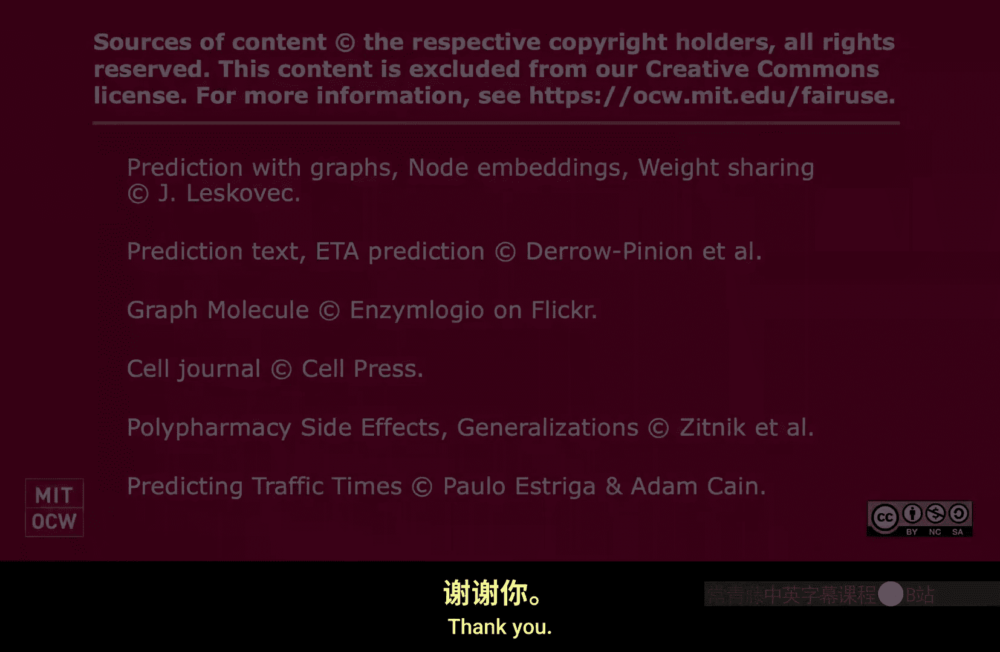

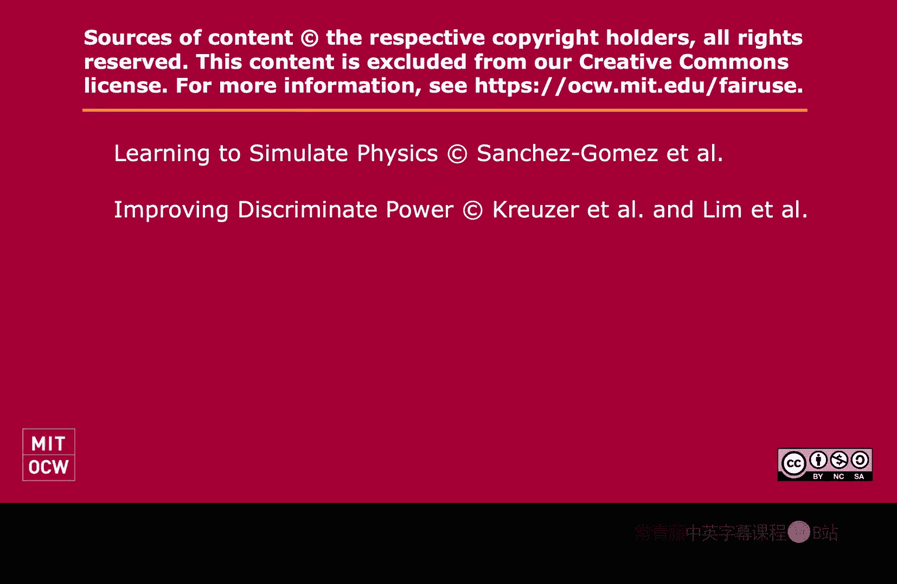