# 麻省理工学院【中英⚡深度学习｜6.7960-Fall-2024,-Deep-Learning】-p06-P6-泛化理论--BV15QZ4B1E6v_p6-

Okay， great。 So welcome。 This lecture is going to be on generalization。😊。

So this is the next topic in the series of how do you approximate functions now do they actually generalize？

And the， the basic question is， do neural networks generalize。 And well， we'll see yes。

 The answer is yes to some degree。 And then the question is， why， why do they generalize。Okay。So。

 okay， a few logistical reminders， problems that one is due today。

 problemsble that two goes out today。Problem sets two will be posted sometime after this class。

 so we always will post problem sets after the lecture。嗯。

And you might want to look at the first question of problems set too。

 if you happen to have time before Thursday's lecture， because it can kind of help motivate。

 you don't have to solve it， but it can help kind of motivate and put into context what we'll see on Thursday。

 So I'd recommend taking a look at at that first problem。

 and then you'll kind of know what to look out for in the lecture to help you solve that problem。

 So just a little piece of advice。And I think that's it。 So we're gonna go right in。

 So the outline for today will be。What is generalization， that should be review。

 you've all taken machine learning or classes like this before。Okay， then the next question is。

 do deep nets generalize。Then we'll see that there are some classical theories of generalization。

 and they don't actually work very well for deep learning。

 So we'll see some failures of classical generalization theory at explaining phenomena and deep learning。

And then I've already given away the answer that to some degree， deep nets will argue do generalize。

 So why， Why do they generalize， What does this tell us about their inductive biases and preferences toward solutions that will generalize over solutions that simply for the data。

 but don't generalize。Okay。

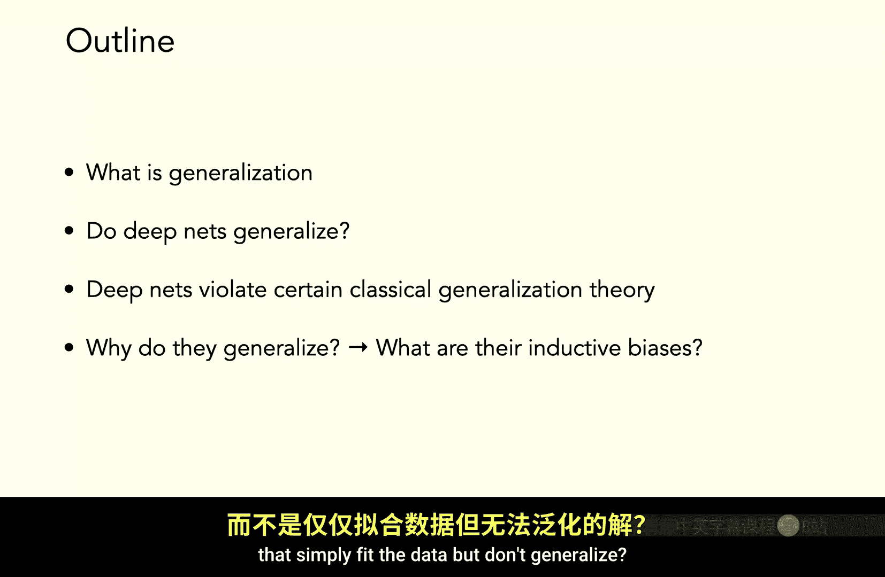

So， that's the outline。And I should also say that。The material in this lecture is not really textbook material。

 We gave a few readings， but there are kind of recent papers。 we just listed them as optional。

 This is very much ongoing science。This is， to me， maybe kind of the biggest or one of the biggest open sets of like questions of topics of inquiry in the field of deep learning and in AI in general。

Is exactly what are the generalization properties of deep networks。

 They seem to work a lot better than we would have expected from kind of classical theory。

 So why we don't actually know we don't have all the answers。

 This lecture will just pose some questions and give some initial threads that you could pull on。

But this is going to be a topic that will change a lot over the next coming years。

 I think this will develop a lot。

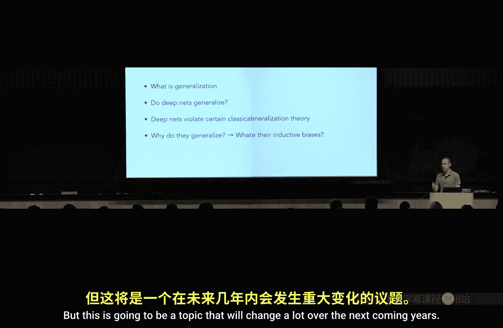

Okay， so let's go over the basics of approximation versus generalization。

 We've so far talked in this course really only about approximation。 So approximation is。

 I have some training data。 I want to ask how well can I fit that training data。

 And we measure the fit with the empirical risk， which is the first equation up here。 So we just say。

 what is the loss L incurred over all of my training data points This is a supervised setting where data points X and outputs Y。

 I'm trying to predict the correct output Y for a given x。

 So I just sum up all of my prediction errors according to my model F and my loss function L， Okay。

 so this is just the on average， what is my prediction error。

And we had a few lectures and then the problems that you worked out cases where you can find that。

 you know， Class functions can minimize that towards0 with sufficient capacity。

 with sufficient width or depth。Okay， but that's not actually what we care about in machine learning。

 All we actually care about is the test error， which can be called the population risk。

 So the population risk is on new samples from the world。

 new samples from the data generating process P， so new samples X， Y， new observations。

 how will it do I do in expectation。And this is like the population。

 because it's over the entire population of。Observations I could get from my world's data generating process B。

But you could also have like an empirical test risk， which would just be over a sample。

 like my test said is a sample of 10，000 images。 How well do I do on them。Okay。

So we have three different kind of topics that we can factorize machine learning into one is。

How well can you approximate the training data， And that's what we've talked about so far。

 So what is the in my family of functions I'm considering parametermetized by theta。

What is the best beta star that will achieve the lowest empirical risk？

And we've said that you can get it to go to zero under some conditions。Okay。

 so we can fit our training data， but next then the next question is optimization。

 how do we actually find that theta star， and we've talked a little bit about that we saw back prop and on Thursday's lecture。

 we'll talk more about optimization。😊，But we said that you can。

 you can often find theta star to some degree。And this lecture is， well， wait a second。

 if you find that really good parameter vector on the training data， what is the population risk。

 What is the risk on the test data。So what is the gap between the training training error and the test error。

 And that's the question of generalization。 And that's all we actually care about because we want to do well。

When we deploy the system in the world and we see new observations。 Okay， this should be reviewed。

 This， this is like， you know， M L 1，0，1。Okay， got question。Are in approximations。ぱしる方。Yeah。

 I think you could ask the question。So in approximation， yeah， typically it would be。

 can I minimize the empirical risk on the training data， yes。Oh， I， I see。Yeah， we could have。

 we could have denoted that with a hat。 but I suppose you could also ask the question。

 is the best possible function in the hypothesis space going to achieve low risk on the population as well。

 So you could ask both of those are questions of approximation。

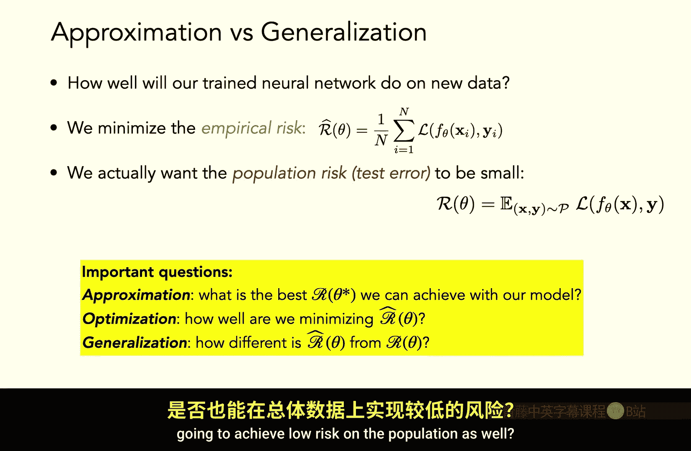

ok。Okay， so let's go over some intuitive ideas about generalization。

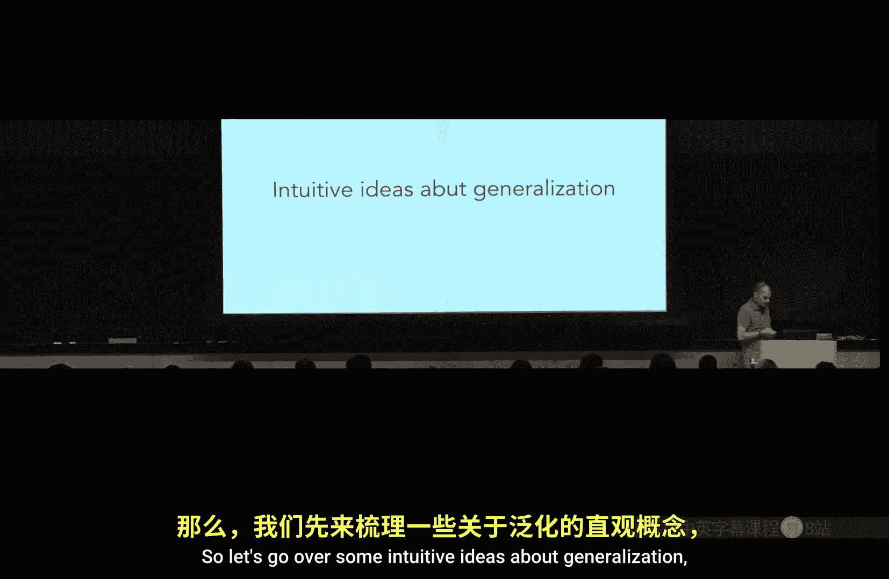

Just to kind of get warmed up and get you thinking about this。Okay， so here's a bad data set。

 Supp we have a data which is just a bunch of photos of cats。

And we want to train a cat versus dog classifier。So。Clearly， this is not going work。

 You only observe cats。 You're not gonna get a cat versus dog classifier， right， So， so。

 what's wrong with this， this data。What would make for better training data for a cat versus dog classifier。

什么比还要是呀。You wantna have some dogs。 Yeah， Yeah， what else would you， What if you have just one cat。

 one dog and then a lot of copies So that that image。You want diversity。 You want coverage。

 You want to show all your different conditions。 So there' are certain properties with the data that are critical。

 You can't really understand generalization without understanding the data distribution that you're training on。

And if your training set doesn't represent all the interesting aspects of variation that you'll encounter in the world。

 then you're not gonna generalize well。 So， so data is critical to generalization。

 And we have to understand data to understand generalization。Okay。

The other thing that's critical to understanding generalization is the model。

 which will be most of what we focus on。 I just wanted to start by saying that the data is also a critical part of the recipe for generalization。

Okay， so here's a bad model。The filing cabinet。So the filing in cabinet model is going to be this little Python program here。

Where we have a dictionary called cabinetbin。 And if we see a new data point X。

 we put it into our cabinet， along with the correct prediction y for that that X。

 And if we come across that X again， we just like hash into that cabinet， we just pull out that file。

 we see what the answer is。So this is sometimes called memorization。

 I'm just memorizing my training data。But the questions for you are， what。

 what will the approximation error be of the filing cabinet model。Yeah。0， right？ So。

 so the approximation there is 0 because。For every data point that I train on。

I can retrieve the exact memorized answer。 Okay， what about the generalization error。

 What will the generalization error of the filing cabinet be。

Generalization there is the difference between the empirical risk and the population risk。So roughly。

 what will it be good， Will it be good， will it be bad。Bad， yeah， it'll。

 it'll generally be bad unless it happens to be that like the true function we modeling is 0 almost everywhere。

 which would be a very strange function， because we said by the theres like， if I。

 if I don't have my phone in the cabinet， I will just。Not know what to do， but maybe that was。

 I got lucky。 And the true function is 0 everywhere。

 So you could have a violent cabinet that gets slow generalization error。

 but it would be a very strange function that you're modeling in that case。Okay。

 so we'll come back to the filing cabinet model and know， one of the questions is。

 are deep nets like filing cabinets or like something else。

Do they just memorize and not generalize or do they do something else。Okay。Here's another bad。

 bad model。 just， I guess a little bit for fun。 So this is Paul， the octopus。

 And Paul can decide who's going to win a soccer match。😊，Between two different countries。

And Paul was like super accurate。 And people would make their bets based on what Paul said。

 And what Paul did is just went and like， went to the tank of the flag that it thought would win the match。

 And it was like getting， it got 6 out of6 correct predictions。 So what do you trust。

 Paul to make the correct prediction next year。Yeah， right。

 we probably is probably like some super intelligent ocists。 No， obviously， wouldn't trust Paul。

 It must have just。It generalized， sorry， it fit the training data Well。 It's not a filing cabinet。

 It is making some decision， but it's like， it happened to get lucky。 as。

 it's like some random function that happened to fit the training data。

 but you'd never expect it to actually have a true model of soccer。

Okay， so you can have functions that get lucky and do make interesting predictions out of sample on the test The。

 but wrong predictions。 I Paulo is an example。

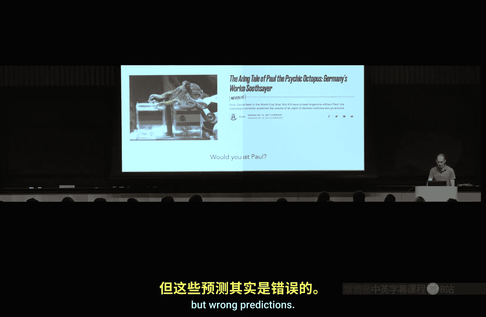

Okay， so our our， our big question in this course in this lecture is， do deep nets generalize。Okay。

 so here's a simple warm up。 Here is the filing cabinet fit to these block data points。 Okay。

 so my training data is the block points。It's a scalar to scalar mapping。 I I'm predicting y given x。

 And the red line is the fit of my model。 And if my model is a filing cabinet。

What it's saying is that I've memorized that if I see one of my training data points。

 I know exactly what to predict。 That's the kind of red lines。

 like the delta functions going down to each of those dots or up to the dots。

And everywhere else I predict 0。 So anything that is not。Anything on the X axis。

 any point I could sample on the X axis， that's not in my training set。

 That's not where the black dots fly。 I will predict 04。

 So this is a very kind of bad kind of generalization。

So here's the same data where I've just fit it with a three layer MLP， Re MLlP。Okay。

 not too surprising。 I really you can fit data， but notice that it fits it in a very different way。

 So both of these actually 0 approximation error。 Both of them have fit the training data。

 But if that were all that mattered， then we would have to say these are。Equally good。

 but that's not all that matters。 It also matters how you interpolate and extrapolate from the training data and deep nets do that in a way that's。

 you know。Marketably different than a filing cabinet。 Okay。

 so memorization is just what do I predict on the training data points and filing cabinets can memorize。

 deep nets can memorize。 And generalization is what do I do on the points where I didn't have training data And we might expect that this type of kind of interpolation。

 this type of generalization is better than that other type。

 because most functions in the world are gonna be you know， smooth as opposed to spiky。😊。

You can imagine an adversarial world， that's not the case。

 but our world looks more like this on the right。Okay。Okay， so that's a very simple deep net。

 But the real feats of generalization that we get excited about these days are with fancy， big。

 modern nets。😊，Okay， so。Here， here's a little experiment that you can do。 I， I just。

Ran this for myself this weekend。 But I think it might be a fun thing to。

 for you to play with or maybe take into a final project。

 So let's try to ask are modern deep nets big， the best model you can think of。

 are they acting like a filing cabinet or are they doing something more。😊。

It's a little bit hard to say because。If you train on enough data and these are trained on， know。

 billions or trillions of data points。 If you train on enough data and you just memorize the data。

 well， your test conditions might look。Identical to your， you know。

 if I've trained on infinite things， then my test cases are just the same as my training data。

 So are they， Are they close to that， just memorizing like nearly infinite things or are they not。

So L O M， if you don't know， this is large language model， Cha GT latest， greatest， deep。

 deep nets are， are in that family。Okay， it's a big model。So is it acting like a filing cabinet。

 Can we actually measure if it's generalizing or not。So here's the question we can ask。

How big would the filing cabinet have to be in order to do the feats of prediction that chat GD or some big LLM can do？

Okay， so remember， our model of the following cabinet is just we return 0 if we have a data point we've never seen before。

Okay， so here's just a simple accountinging experiment。

 I think you can make more sophisticated versionversions to this， but。I， I found it fun， okay， so。

Well'， sample a sequence- language models are deep nets that take sequences of words as input and make some prediction from them。

Okay， so we'll sample a sequence of n words。And we'll be sampling from a vocabab of size M。Okay。

 so we have like M nouns，  a00 different nouns， and we make a sentence of length。

Or I set a sequence of nouns of length 5， so then n would be 5。

So how many unique input sequences are there？Okay， so just simple combinators M to the N， right。

 So I have M possible， M possible words， and I have n of them in the row。

 I sample independently each one。That's the number of such sequences。 So now we can， we can ask。

 well， if we take a random such sequence and we input it into our model。

 did the model make a reasonable prediction。So technically。

 if this is our model of the filing cabinet， we're just asking， did it make a non zero prediction。

 but it it make did output like a correct。A correct prediction。

So we can take our favorite language model。 We can ask our favorite question about the input sequence and have the language model try to solve that question。

 That's how they work。 You can prompt them to ask to。

 to answer different questions about your input sequence。 We'll ask， how often is the output。😊。

Something that's non trivial。Not what a filingin cabinet would do。

And then we can say that the filing cabinet， in order to get。

 get the score of S equals a number of unique sequences times the percent of times those sequences map to something nontrivial。

 It would have to be that big。It' have to be taking that many unique sequences and achieving this proportion of correct predictions。

 It'd have to have that many cabinetvenants。Okay， and if that number is really， really big。

 bigger than we think language models are or bigger than the amount of data they've been trained on。

 then we know that language models are not doingization pure memorization。So I， so I ran here。

 you can make up your own version of this。 But just to convince myself， I ran it like this。

 I took 30 fruit names。 Okay， Apple， orange， pear， or whatever。😊，Okay。

 so my vocab is size 30 and my sequence length is size 10。

So I'm going to sample 10 random fruits from that list。 So there's you know。

10 to the 30th possible input sequences。And then I'm going to have my language model answer this question about those sequences。

 So we'll talk more about language models and prompting later。

 But just you've all done this with things like cat GT your clod and so forth， right？

 You can say how many citrus fruits， This is just my。😊，My toy problem。

 I'm giving it to try to estimate these probaities how many citrus fruits are in this list。

 And I give it this random sequence of 10 fruits sample from that vocab of size 30。

And it gets it correct。And so I did this five times。 It's not。

 I'm not saying this is like the best experiment， but I got 5 out of  five。

 So it was correct every single time。 So my estimate for the probability of being correct is， is one。

😊，So now we can just estimate P times M to the N。Is going to be 100 trillion。Okay。

 so the filing cabinet would have to have 100 trillion files。Okay， also。

 the training data the way the filing cabinet works is it only you。

 inputs a new data point into the cabinet。 if it sees that data point in the training set。

 So it means the training set has to have 100 million examples for that model。 Sorry 100 trillion。

 And we think that chat GT and things like this are trained on more like tens of trillions。

 So I think I exceeded that。 But you could always make this list longer and run the same experiment。

 Get it to a quadrillion and really convince yourself that these things are not just memorizing。😊。

Okay。Another just for fun。 when we can do the same thing。

 But we can use a text to image model and now have it draw the fruits and ask， you know。

 how many unique different， you know， how， how often we'll be correct in drawing the fruits。

 So I asked that too this， you know， chat GD can do both these things。 Now。

 These are kind of multimodal models。 So you can say， draw these fruits。

 I sample a random sequence of 10 fruits。 And I check if it's correct。 Okay， is this one correct。😊。

I said no。It's almost correct。 I think I got 9 out of 10。 I don't think it has a passion fruit。

 But anyway， I don't know what passion fruit look like， but I I， I called this one incorrect。

 And so I estimated。😊，Just have another wrong thing。 Okay， yeah。Cantlopeer， okay。Oh yeah。

 coconuts missing。 Maybe that was a passion fruit up there。 But anyway， this one's wrong。

But I ran this eight times and one out of the eight times I thought it got it correct。

 I really saw each of the fruits represented。So now our proportion of P is 0。125，108。

 and that means that you'd have to have a filingin cognitive size is 12 trillion。

So I don't think this has been 1212 trillion images， but it's hard to know， you know。

 Open A I secretive。Okay， but you can do these types of experiments。

 And I think you can pretty quickly convince yourself that the way that modern deep nets are working is not like a filing cabinet。

 It has some properties in come with the filing cabinet。 Well come back to that。

 but that doesn't fully explain what they're doing。Okay。嗯。Yeah， and。

 and so just suggestion for final project， I think it'd be fun to really do that like systematically and rigorously and try to actually estimate。

 you know， how many unique concepts these things have。 I haven't really seen very many papers that。😊。

That that do this type of experiment。 But I think it' would be fun。Okay， so here。

 so I got kind of excited about the feats of generalization of deep nets in this project from a few years ago。

😊，And so what we did here is we trained in deep nett to take us input sketches and produces output photos of cats in this case。

Okay， so a neural net just maps。 and we'， we'll talk about these， you know。

 generative models and image image models a little bit later in the course。 But for now， it's just。

 you know， I'm mapping from X to Y。 It happens to be sketches to， to photos。

And so what we did in this project is we didn't use human hand drawn sketches because those were expensive to acquire。

 So instead， we just use this thing called HED， which is like an edge detector。

 and it's like a proxy for what a human might have drawn。

 but it doesn't quite match what a human would really draw。So。

From a kind of naive machine learning perspective， you would say。

If I train this on a ton of examples of edge maps and cads and I give it a new edge map。

 it should predict。A new cat， because this is just generalization to independently and identically sample data points from the same population。

Okay， so that's like classical generalization theory and machine learning。

But the really interesting thing is。It also worked when you give it hand drawing cats。

 which had never been trained on。 So these are inputs that are actually out of distribution。

 systematically different than what it was trained on， Okay， so。嗯。You know， in the prehistory of。

 of deep learning， this was the the popular thing of the day。 Now， of course。

 we've seen much more exciting things。 But so I sketch a cat right。

 doesn't look anything like an edge map。 And it， It just works。 It is still cool， even today。😊，So。

You know， people had a lot of fun。And this is just， this is generalization。

 It's never been trained on these， these types of things。 It has some kind of creativity almost。

 I don't， you know， we have to be careful not to anthro formize too much。

 but there's something here which is， which is a little bit magical and not fully understood。😊。

But I think we can start to get a sense of what's going on。With an experiment like this。

 So I'm just trying to kind of build up intuitions， to simple， kind of。Experiments。

 we'll get into some more technical theory in a bit。 Okay， but here we go。 We， I just draw two。

 two eyes。Now what if I draw three eyes， what's going to happen？O。

 it's never seen a photo of a cat with three eyes。 How would I know what to do， But it it works。

 It just puts that eye where， where that eye was drawn。A lot of eyes。Okay。You can add the body。

 that makes sense。So。So how is it doing this， How is it generalizing to more eyes than it ever thought training time。

And I think。There's not like a single explanation， but the。

 the best1 I have in mind is it's the inductive biases of convolutional net。

 So this network was a convenet。 We've seen that。 What do confnets do。被。Take an input。

 They chop it up into patches。Okay， and then they independently and identically process every patch。

So， there are。Factorizing the problem into a lot of independent decisions。

And when you have like decomose something into these independent components。

 you get what's called compositionality， where you can， you know， make the。

 you can take a new composition of things。

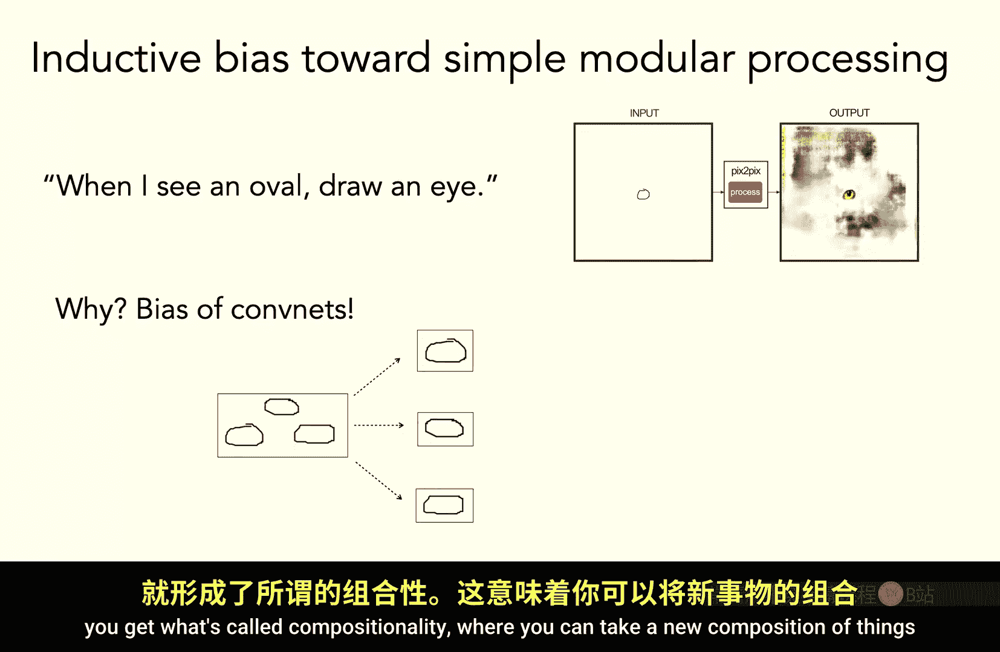

And factor them into these independent components， these patches。 and it should。

It should know what to do because。

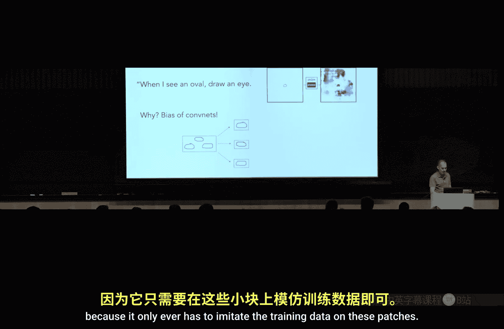

It only ever has to。You know， imitate the training data on these patches。

 And then the combination of the patches is just the rule of stitch them together。Okay。

 so for every single patch， it's doing in distribution generalization。

 It's seen a lot of things that look like ovals and they match eyes。

 and then it can generalize to more eyes because。I've just factorized the the problem in this。

 in this simple way。Okay。So， architectural。嗯。Constraints and biases and the way that we enforce symmetries and factorization into our models allows you to do certain kinds of feats of generalization。

 And we saw， we saw that with know， the ability of graphnets to generalize to。

 new permutations of their inputs because they're permutation invariant or equal variant。

 So that's just built into the architecture。 I don't have to have seen every permutation。

 I can just have seen some permutations， and then it will generalize to other permutations。

 That's baked into the architecture。 It's not something you have to learn from the data。

 So architecture is one of the main levers we have for。

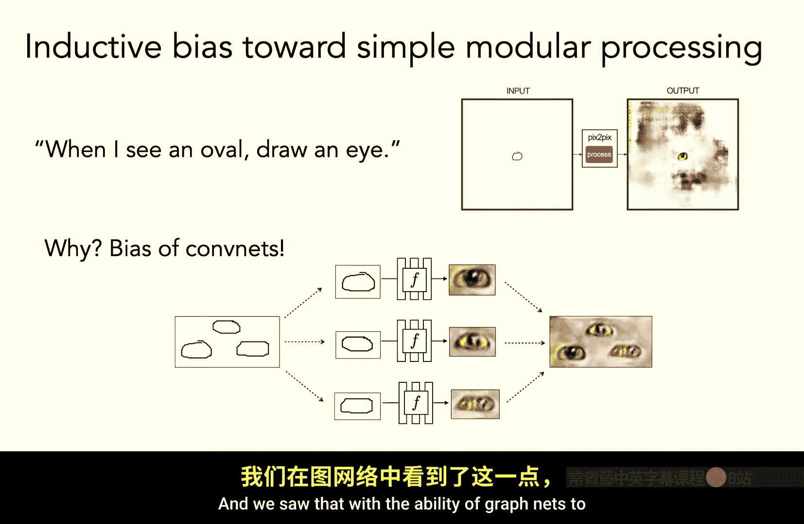

These feats of generalization that。That violate just like statistical learning theory。

Or do they go beyond just like naive statistical learning theory？Okay。

So let's get a little bit into generalization theory。And start with the， the classic picture。

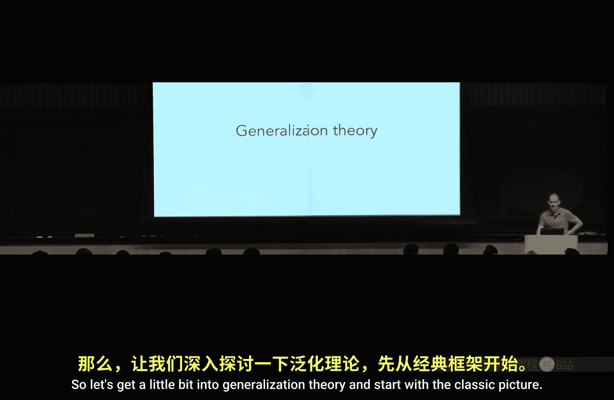

So most of generalization theory comes from Aham。Com from this， the Ahams Raer Ra。's all。

 it's all variations on Alhams Razor in some sense。 So just to remind you。

 Alhams Razor says among competing explanations that fit the data equally well。

 you should prefer the simplest。😊，Okay， and the generalization way of stating that is that the simplest model that fits the data will be most likely to be the true model。

 Therefore， it will be most likely to generalize the best。

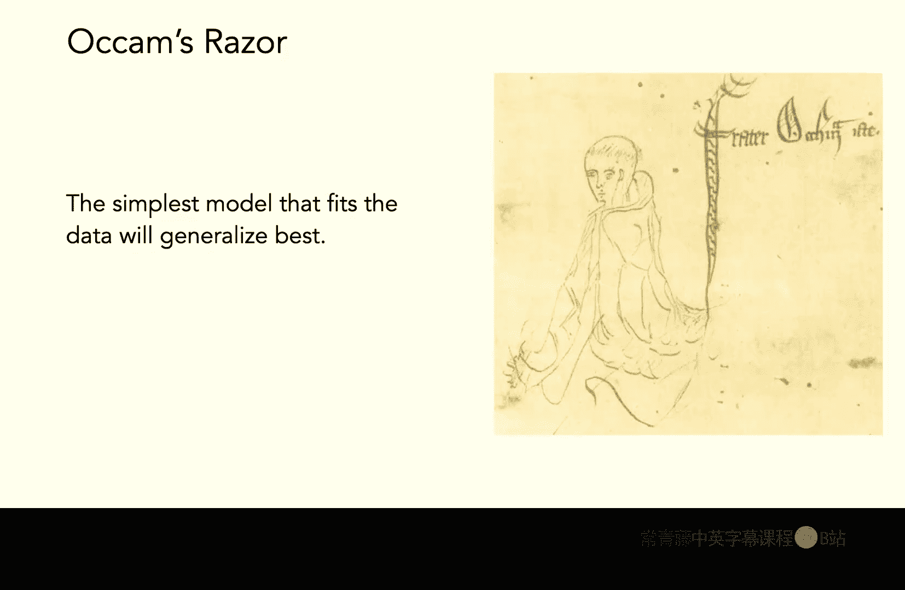

Just one，1 little note is that I think sometimes people forget to add that fits the data。

 So it's not true the simplest model is most likely to be true or is most likely to generalize best。

 It's the simplest model that fits the data that actually explains the data。Okay， you， you need that。

 Okay， Otherwise， you， you get these absurd statements like， oh， well， I should use a linear model。

 but no， it doesn't fit the data。 So you， you have to use a complex enough model that it fits the data。

 But then you want to prefer the simpler one。 And there's a lot of deep arguments for why that should be the case。

 It's intuitively， you know， clear from the idea of Aham's razor that we， you know。

 learn in grade school or whenever we learn it。 But it also。

 there's deep mathematics that can be used to drive like formal versions of the statement。 Yeah。

 question。😊。

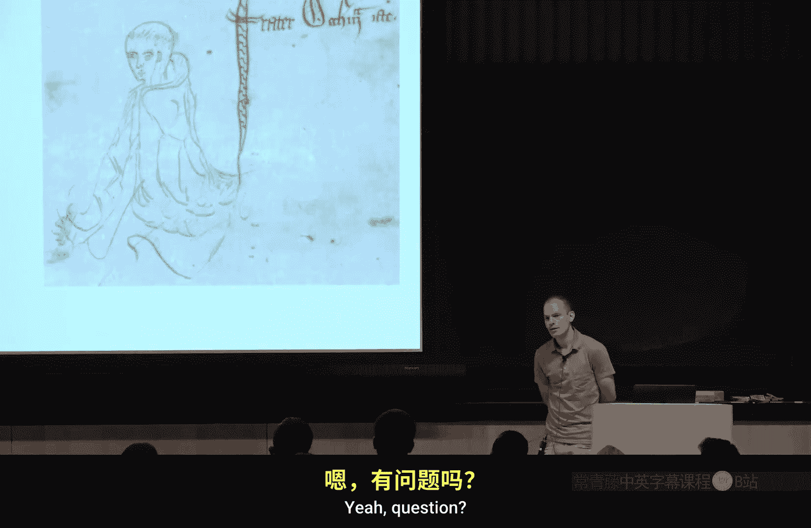

啊。Yeah。Right， the question that's really interesting。 there's another quote。 All models are wrong。

 but some are useful。嗯。Yeah。That that's， that's intriguing to thinking about。I would say that。

The all models is So this is only the set of models that are。

In the equivalence class of all equally well fitting the data。

So we're not really considering models that are wrong in terms of only approximating the data。

So it's a slightly different setting that we're looking at there。诶。But yeah， I don't know。

 I there's probably more kind of discussion around that， but I。

 I don't have a crisp answer right now。 Yeah question。In proven rigorousrous floor， is it better？

So I would say in this format， so the question has this statement been proven rigorously or is it heuristic in this format。

 it's a heuristic？😊，Because how do we measure simplest， How do we measure generalization。

 like we need to make these mathematically precise to make it rigorous。

 But there are rigorous versions of the Als Razor argument。

The the my favorite one is this one from various people， including Salamov。😊。

Which is that the shortest program。That perfectly fits or generates the data that just outputs the data set。

Is the one that will generalize best and make the best predictions。

There's an equivalent version of this statement， which is the the know。

 the most compressed representation of your data is the best model of your data。

 There's some equivalency between these two things。

 So I'm not going to get into all the technical details of that， but。

This is kind of the place to start reading if you want mathematically precise arguments for。

Alcu's Razor。And the problem， though， is that finding the shortest program that fits the data requires searching over the space of all possible programs。

 Like imagine searching over the space of all possible Python programs。

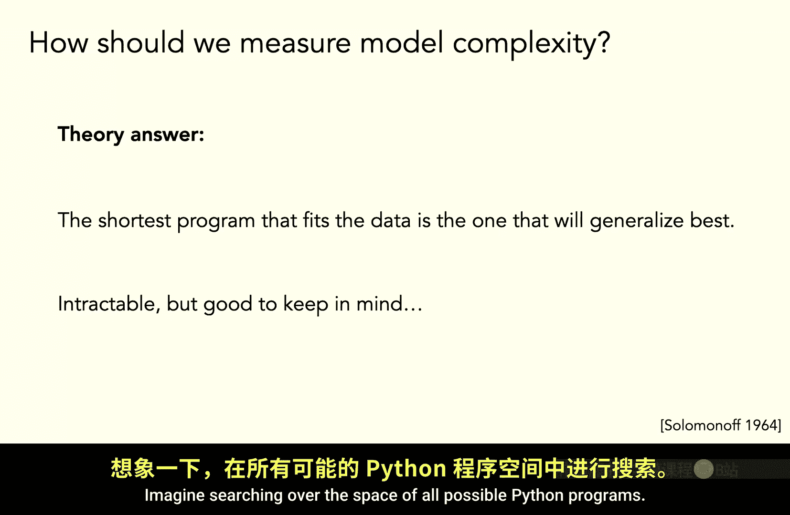

You just can't do that。And deep learning doesn't search over the space of all possible programs。

 It just searches over the space of all weights and biases of a particular model architecture。

So this is completely intractable， but it comes up in like algorithmic information theory and areas like that。

So it's good to keep in mind this， this is， this is kind of like the mathematical basis for generalization theory。

 But actually finding the optimal program or the shortest program is intractable。

 So we're not gonna quite do that。 But， but， but this is what we want。 We want to measure。

 We want a way of measuring simplicity or complexity of a hypothesis space or of a solution to a problem And this is kind of the best notion of of simplicity。

 but we can't quite use it。 So what else can we use。😊。

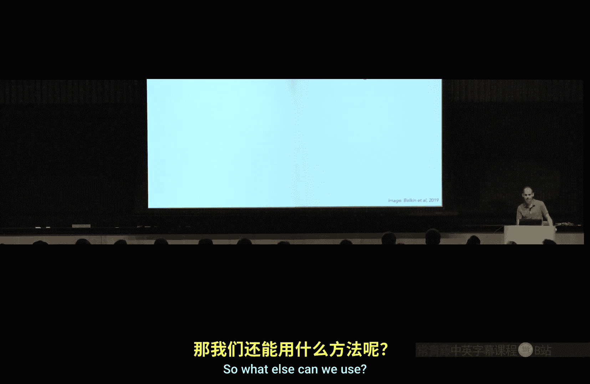

Okay。So let's do a quick review of overfitting， the idea of overfitting and the bias variance trade off。

So remember that the test error is equal to the train error plus the difference between the train error and the test error。

And we call the train error of the bias and the difference between the test error and the train error of the variance。

And the kind of classical machine learning 101 picture of how things work is that as I increase the kind of capacity。

 the number of functions under consideration in my hypothesis space that I'm searching over as I make bigger and bigger and bigger deep nets with more and more and more parameters。

 then eventually I you know， I'll get universal approximation， know if I get width goes to infinity。

 I can fit any function。 so I can minimize my loss on the training error So the training risk goes down。

😊，But I'll start overfitting， and the test risk will eventually go up because I'm finding fits to the data。

 which are kind of fitting to properties of the data that don't actually generalize。

 like noise or the fact that I got this particular batch of samples。

 as opposed to a different batch of samples。Okay， so this is the overfitting scenario that you have。

Likely it seen before。And one of the ways of measuring model capacity。

 modeling the X axis or measuring， you know， the complexity of hypothesis space is via number of parameters。

 And this is one of the classical ways that you might have encountered。 If I want to you know。

 find my best machine learning model， I need to control the number of parameters if I have too many parameters will overfit。

 right， So let's look at what that what happens if I'm doing some kind of polynomial regression onto these these red points here。

 Okay， so the orange line is my fit to the data。 And if I use like degree1 polynomial。 This is。

 I think it's not quite polynomials。 It's a particular family of polynomials I'm doing。😊。

Finding the coefficients of a weighted sum of a particular family of simple functions。

 like the gender polynomials， I think in this case， But it doesn't matter too much。

 So I'm going to say with。D equals1 is the degree of that family of polynomials。

 It's just D equals 1 means linear。And a linear fit can't do a great job。

 The true function is the blue line， and the training data is the red points。Okay。

 what happens as I increase the you know， the wigss of the polynomials in my family include more and more polynomials that are higher and higher frequency in the kind of wiggles that they can express。

Okay， so if I go up to a quadratic or cubic model in this case。

 well the ground truth function happened to be cubic or happened to have order 3 Lend polynomial。

 and I get a really good fit， right？And then overfitting is， if I go to。

Have too many kind of degrees of freedom。Actually， not only recover the， the， the true data。

 but I'm also kind of fitting to the noise， right， This deviation from the blue line is just noise。

 And the model is， you know， wildly deviating in order to， to， to capture that aspect。

 that doesn't actually generalize。 It doesn't actually tell makes something me about the true smooth underlyingline function。

😊，Okay， so this is our classic picture of overfitting。 But heres here's the surprise。

If you haven't seen it before， what happens if I go not to d equals 20， but d equals 1000。

R and have a really， really expressive class of polynomials that can fit really。

 really crazy wiggly functions。😊，Is it going go more crazy and overfit even worse in the sense that these deviations will just go to infinity or will it do something different。

 what do you think。Some of you probably have seen this before， but let's go here now。是他了。有在在。

Perfectly right。Some of them觉该 some of them。Yeah， that so the answer to that that's a quite sophisticated answer is you should have a large set of functions that all perfectly fit the data。

 And so some of them should be good and some of them should be bad。 But which one will you arrive at。

 Well， it's gonna to depend on other factors， It's going to depend on how you're searching over that space。

 What optimizer are you using， How are you minimizing your training error。

 It's going depend on other factors beyond just。😊，You know。

 randomly selecting one of the solutions that fits the data。Okay， well， so here。

 here's what happens for this regression problem with these polynomials。So when D equals 1000。

 you actually。Are able to fit。Theres really spiky function。

But it adheres much more closely to the true， smooth solution。Okay。

 and this phenomenon is called leads to what is called double descent。

 So it's the idea that overfitting is actually the classical picture of overfi is a little bit inaccurate。

 And what actually happens is you start overfitting really badly， as you add more parameters。

 But eventually， if you add enough parameters for certain types of models。

 including deep nuts and also including these polynomial regression problems， you end up。😊。

Getting this kind of behavior where you start actually getting better generalization error with more parameters。

And and the basic hypothesis here is that， and this is provable for certain simple systems。

 but it's not really provable for deep nets。 But the basic hypothesis for deep nets in the general statement is that the learn model has two components。

It will with enough capacity， it will find a simple fit to the data。

And then it will also use like little spikes of capacity。To， to fit the outliers。

So there's kind of some kind of simple component plot which is predictive and generalizes well to new samples from the the population and a spikeik in component that overfits noise and things that don't generalize in the training data。

 So it's like memorization。 Spikiness is like memorization， right， I'm just memorizing those。

You know， when my input is this， I memorized what it was。 So it's memorization plus generalization。

 It's a really interesting combination that until a few years ago， people didn't widely appreciate。😊。

Okay， there's a nice visualization of this with an MLP that you can find at this link。

 It looks basically the same as what I'm showing you， but not quite as， not quite as spiky。 So。

 you know。

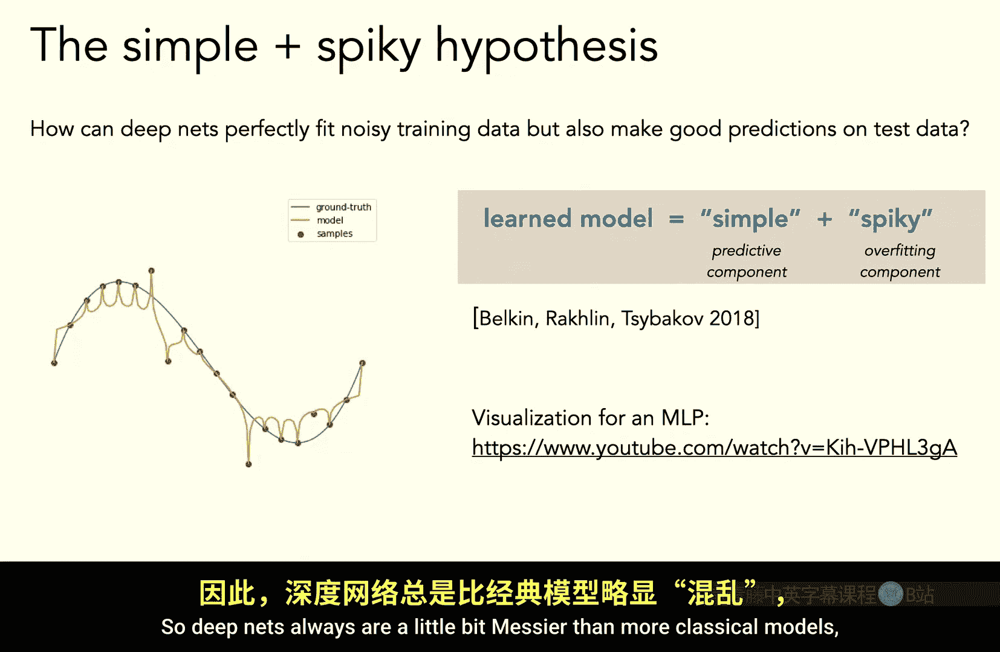

Deep nets always are a little bit messier than more classical models。

 So it's easier to see with this polynomial regression model。Yeah， question。お。

So I just like to see that well。Yes。Like just scto passastic off。Alsos， I'm wondering how you do。有是。

And theyre not， as you said， like a function。还对。Yeah。

 so the question is for polynommal regressiongress， there's a closed form solution。

 and you can really prove that this will be what happens and that solution will have this property。

 if that's the case for a neural net。The solution you arrive at will depend on the initialization。

 which might be random， It will depend on the stochastic mini batches， which are gonna to be random。

 There's a lot of randomness。 And it's， much harder to make clean statements about what solution you'll arrive at。

 So instead we can make empirical statements， we can say that if we run this neural network over and over again with the atom optimizer or the SG optimizer。

 Here's what we observe。 and I'll show you that on the next slide。

 or we can make theoretical statements like the distribution of solutions that will be arrived at under starting conditions will be smooth and spiky with high probability stuff like this。

One more question would you know that you're using the right computational resources。

Optimizing to a new model。 So if it takes 100 to make an optimal。选费正咗啦。Computational effort。

Should you step at some point， stop at some point or church other moto that will potentially be？Yeah。

 so。When should you decide， you know。Where where to stop in an optimization process or it's a question or at least stop me。

 Yeah， so that'ss a hard question。 And so the number of steps of gradient descent that you do is kind of a hyperparameter and it can affect the solution。

 than if you do too many， then you might be overfitting。 And that's kind of a classical idea。

 But what we kind of see is that in this neural net era， it tends to be just train forever。

 and the longer you train the better you do because there's like a double disscent phenomenon。

 which I'll show in the next slide in terms of computation。

 The longer you train the better you'll do in this particular family of models is the general principle。

 But yeah， of course， there's more that can be said about that。 Okay。

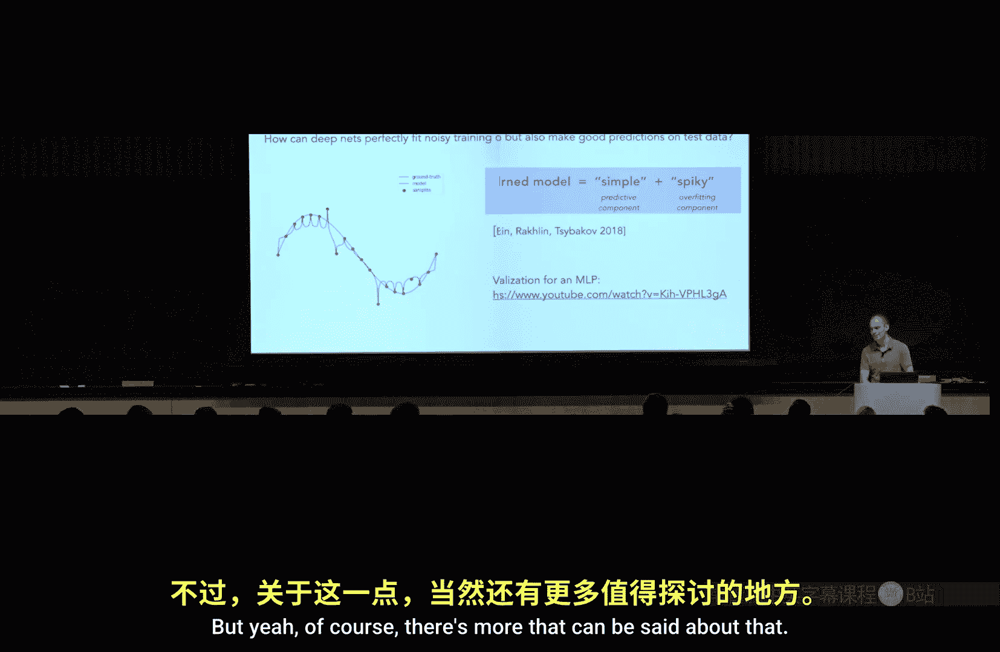

Okay， so this， this was a really cool paper from a few years ago that got people excited。

 So the double disscent phenomenon is just a consequence of what I already showed you。

 So we have regular classical overfitting as I increase my number。

 my capacity of my hypothesis space， which we're right now naively calculating as a number of parameters in the hypothesis space。

😊，Then my training error goes down， but my test error eventually goes up， I overfit。

But then after overfitting， eventually， I learned the simple function and the spikes。

 And so I actually start to generalize better again。😊，Okay。

 and there's this thing called the interpolation threshold。

 which is the point at which I can perfectly memorize all the training data。

And I think one intuitive， I'm not sure if this is going turn out to be precisely true。

 but my intuitive picture of what's going on is that you're trying to fit the training data。

 So you kind of have to memorize it。 and you have to learn a really crazy function to memorize it。

 But then once you add more capacity where now there are a lot of solutions that equally well memorize the data。

 equally well interpolate the data。😊，Then you have。

 then you can select within all of those set of solutions that fit the data。

 the one that is the smoothest or has other nice properties。

 and the pressures that select within the set of things that fit the data。

 the one that is the smoothest are sometimes called regularizers or implicit regularizers or inductive biases。

 And we'll talk more about those in a bit。 Sos like for a while， you're just fitting the data。

 you have to find a crazy fit。 And then once you have more capacity。

 you can search over that kind of degeneracy to find the one that is the best in other。

 according to other criteria。 I like smoothness。😊。

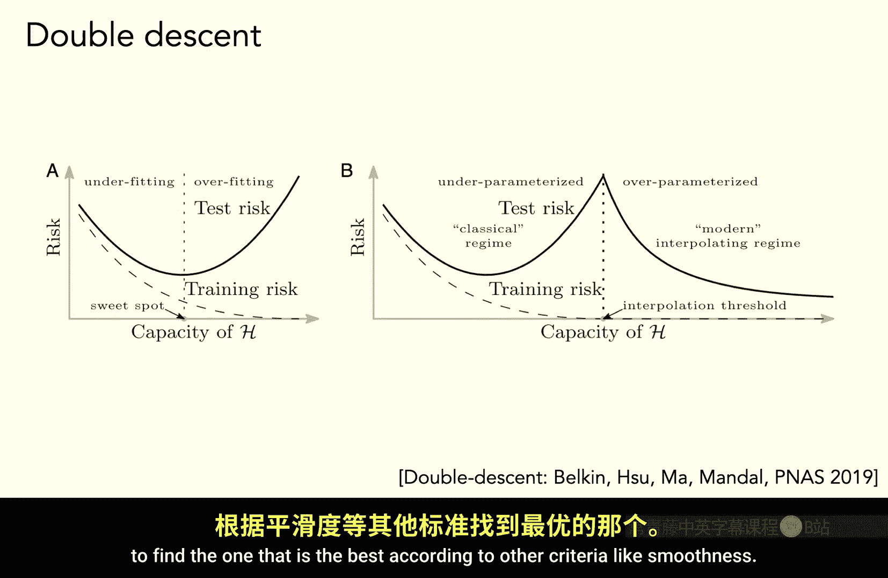

Okay。

So yeah， we'll go question。没有。Inside。Like you should stop ever。Or you should train like no。

 like no earned training。Until the second cover。Yeah。So the question is。

 should you stop at the first minima of the double descent curve where you have low risk。

On the population or should you stop that or should just train forever。 And generally。

 I would say that。It'll depend。On you know， how much capacity you， you have available to to you like。

 because this is costly to move out in the X axis。 capacityac can be measured in， you know。

 parameters， but it could also be measured in flops。

 So there's kind of double descent also in compute time。And。

So it'll depend on the kind of cost benefit analysis there。 But generally in deep learning。

 we're out in this regime。 We're past the first peak。

 And we're in the part where you just train longer and longer and longer and it smoothly will get better。

 That seems to be the empirical property we have。 Okay， one more and then it often move on here。

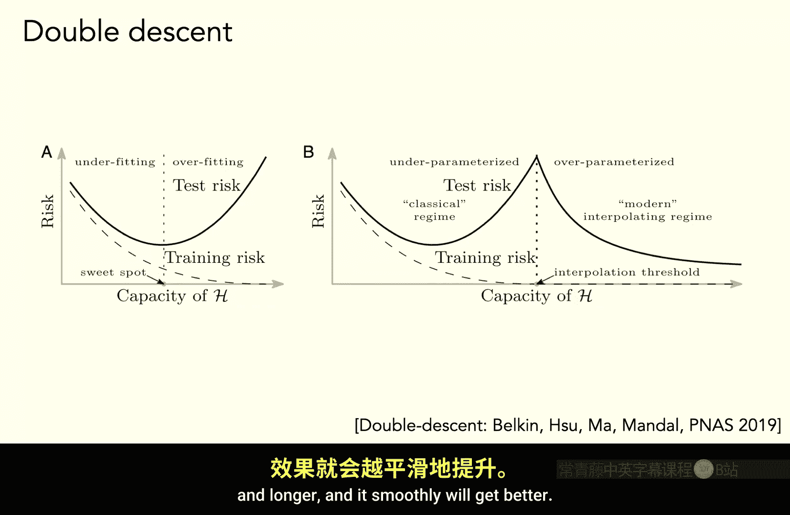

过没行。他。I。有有新。Yeah， some choice affinity in the UK data。Yeah，家のか。

Which relationship between polynomal regression and deep deep nets？So。Roughly。

 you can think of the last layer of an MLP。As a linear combination of some。

 know basis functions of some features。 So every neuron on the previous layer is like a feature of the data。

 And those features could be like polynomial functions of a scalar input。

 and that would be polynomial regression or they could be Fourier。

 they could be signs and cosines with different frequencies。 And in deep learning。

 they'll be learn functions。 But they have the capacity to learn those types of functions if those are the right ones to learn。

😊。

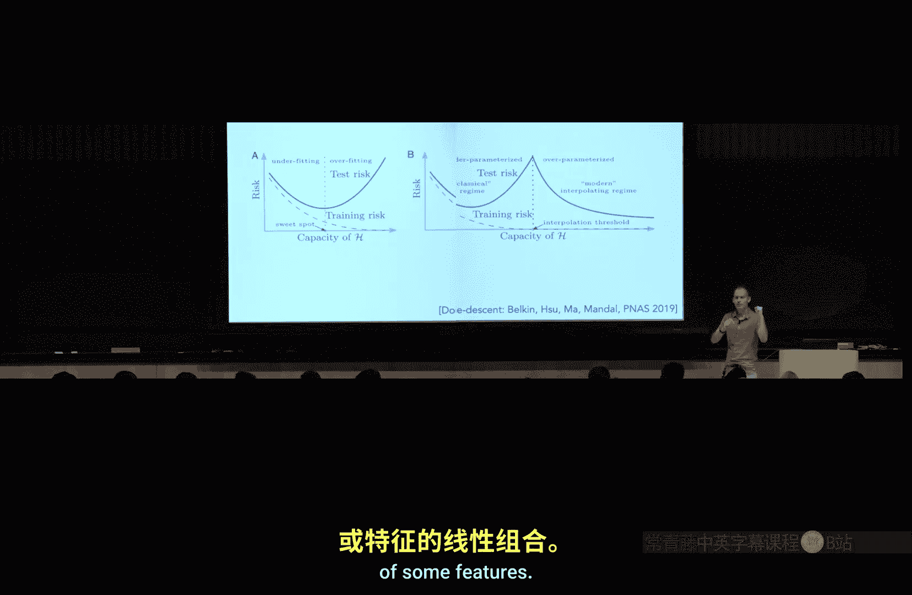

Okay， so here's an empirical result of double descent。And this is training an Ms classifier。

 And you can see this really happens。 So the train error just always goes down as I add more weights。

 So I increase the width of my model。 I get universal approximation。😊，But test error spikes。

 and then it goes back down。This stuff is a little finicky to actually observe in practice。

 So like I I actually tried to make my own example of this， and I couldn't get it to work。

 But if you read the double desent papers， you'll， you'll realize that it only really shows up in certain regimes。

 and you have to make sure not to have momentum and this and that and you know， wait decay。

 There's a lot of kind of aspects of the optimization process that can make this disappear。

But it is a real phenomena that does exist in the right conditions。Okay。

 so don't worry if you don't see it in your graphs。

 You might just be out in this regime or you might have other effects that are dampening now。

 That's like， Yeah， question over here。Yeah， I'll have to think。

 I'd have to think a bit more about the interaction of momentum with this。

 But I would say that generally， all the tricks that we use in practice are just getting rid of that spike and pushing us more out to the right。

 So it's not like we're losing that benefit。 We're just。

 we're reducing the negative effect of having this， this spike in the middle。Okay。Okay。

 so one of the interesting things that could help explain this phenomenon is that。

The more features features that you have that you're regressing on top of。

 these could be features like the hidden units of M LP。 Or in this case。

 these are what are called random Fourier features like random signs and cosines。Random。Yeah。

 periodic functions to the data。 as I have more， more and more features well。Aveure at first。

 I under the data， and then I start using all the features and my weights I assign to those features spike because I have to。

 you know， to make a linear combination that fits the data。 I have to be using all of them。啊。

But then what happens is， as I add more and more features。

 the the norm of the weight vector the parameter norm， the norm of that vector。

 the size of that vector actually decays。 So I have more features。

 but the weight sign applying to those features。😊，Are getting smaller and smaller in terms of their overall magnitude。

 the norm of the entire parameter vector。 So it's like more features means lower norm。

Prameter solutions。 So in some sense， kind of smoother in a particular sense。

And so this is just saying that counting number of parameters is not the right thing to do。

 It might be that the parameter norm or some other property of the parameters is。

Is what is the more meaningful measure of the complexity of the solution or how wiggly it is or how much it deviates from a nice smooth fit to the underlying trend。

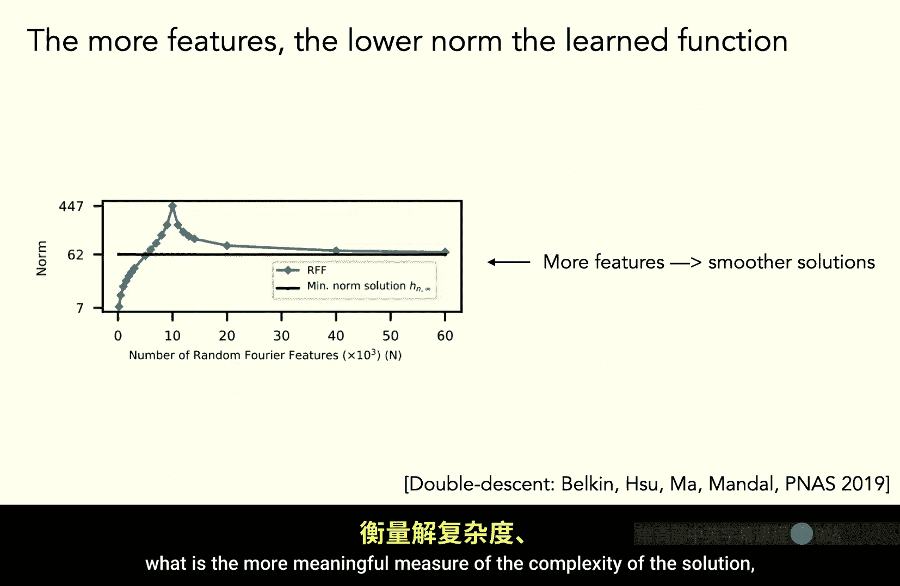

Yeah， question。Line up with the interlation threshold。So the question is。

 does that peak line up with the interpolation threshold， or you perfectly fit the data， Yes。

 it's exactly at the interpolation threshold。And you can。

 you can like show these things for linear models。 And it's all provable， but for deep nets。

 it's just empirical。Let me keep going and we can come back to more questions later。 Okay。

 so how should we measure complexity。

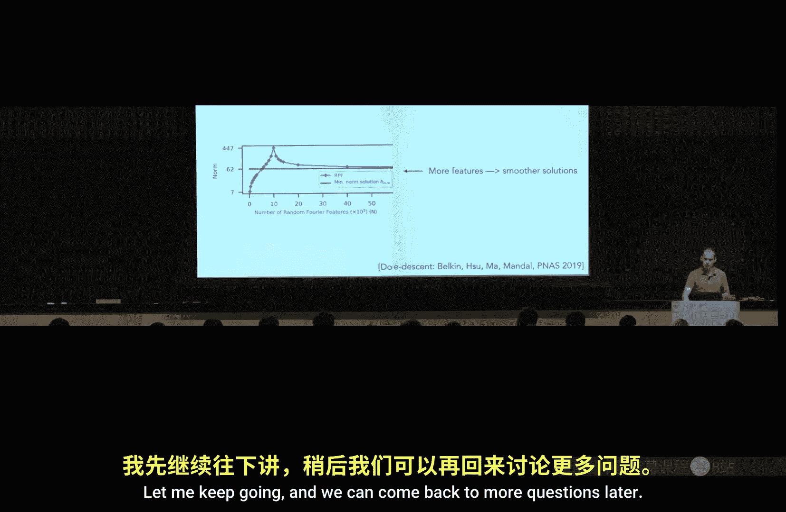

So number of neurons， number of weights， number of parameters， no， that just doesn't work。So。

Double descent shows that as I increase the number of neurons， the number of parameters。

 I don't necessarily overfit。So number parameters is not really the right notion of complexity。

 according to the classical theory that having more expressive higher capacity。

Hypotheesis space will cause overfitting。 So number of parameters no。Priimeter norm。

 maybe that seems a little bit better， but it has own its own flaws。

Just to emphasize this with like maybe a really obvious example。You know， does。

 does the number of parameters a deep net has。What why would we actually expect that to matter？

 So consider these two deep nuts， F and G。And F has a lot of parameters， right， a lot of edges。

 And G has only a few parameters， a few edges。And we're going to consider a new function H。

 which is just a combination of a tiny， tiny bit of F，10 to the negative 100 worth of F。

 And then almost entirely we're going use G。Okay， and now we're going to ask like， how many。

Prameters would it take to fit H to some epsilon degree of approximation。

And and the point here is that。You know， if I just fit H with G。

I would only be using a few parameters， but get within epsilon that is 10 to the negative 100th of the。

 of the correct solution。So， it's kind of like。The count of parameters is not what matters。

 Something about the size has to has to also be what matters in terms of how well I'm able to approximate different types of functions。

ok。So parameter norm， size of the parameters matters more than count。

But parameter norm is also not everything。Okay， so let's， let's try another。

 another idea from classical theory， which is， okay， it's not a number of parameters that。

That is the proper measure of the complexity of a hypothesis space or a neural architecture。

How about the number of unique functions。In the hypothesis space。It's another measure of capacity。

Okay， and this is。Related to a theory that Vniick and。S Vans。

 I don't know if I got the pronunation right。 anyway， V C theory。So remember。

 generalization error is the difference between the training error and the test error。

 the training error and the population error。And the basic argument to this theory says that。

If the number of training data points I fit to is much larger than the number of functions under consideration in my hypothesis space that I'm searching over。

Then you can guarantee to some degree that the population error matches the training error。

So it's something about the size of the training data and the size。

 the number of distinct functions that I'm searching over。

Something about the ratio between these things。 Okay， so the intuition is， is like this。

So we could define something called a false false positive。

 which would be a function that fits the training data， but has high population。Risk。

A function that just gets lucky it fits， but doesn't generalize。

So what is the chance of getting getting a false positive if I'm searching over all of the different。

Candidate functions in my function class。So the trans a false positive will be high if we just have more candidate functions。

 like if I just have。More candidated functions。 There's more random ones will to get lucky， right。

 So that intuition。And then， it should be lower。If I have。More data points。

 because every additional data point rules out certain candidate functions from being able to fit the data。

 right， Every new data points， a new constraint。 And it says。

There are fewer functions in my hypothesis space in my function class that can fit the data。Okay。

 so therefore， if the function class is small and the training data is big。

 the chance of a false positive of just getting lucky is low。 And therefore。

 I have a higher chance that I really found a solution that generalizes。 That's。

 that's kind of the rough argument。 And， you know， you can make this mathematically precise。😊。

I have one more picture to make this argument just in case that that wasn't clear。 But let's。

 let's imagine that I have this very， very simple setting。 I have a hypothesis space。

 which is a discrete set of candidate functions。 These circles。

 So every circle is a candidate function。 The purple circles are the functions that fit my training data。

😊，And the true function is in green。And we're gonna make some assumptions。

 We're gonna assume that there's no noise in the training data。

 We're gonna assume that the true function is in the in this set。

 So it's not like I I have a chance of finding it。 And we'll assume that my kind of way of selecting from this set is just I pick up random One of the purple points。

 And， and the true function is also one of the the true function also perfectly fits the training data。

 So， so my optimization algorithm is just pick at random。 One of the points that fits the training。😊。

The training data。 So what happens as I increase。The training data。 Okay。

 as I increase the training data， some of those purple points turn off because if I add a new data point。

 some of the functions that fit。The data previously no longer will fit the new data because there's more constraints。

 Every new data point adds new constraints that you might violate。Okay， so as I increase data， I。

 I strictly will decrease or at least not increase the number of these purple points。

 So what happened as I add training data right now。

 I have a one out of six chance of if I randomly sample one of the， the purple or green points。

 one out of six times， I will get the true function。But if I add more data。

 now it's one out of four times。Okay， so adding data will increase my chance of getting the true function under this procedure。

Okay， if I reduce the capacity， What does that mean， that just means removing circles。

 So the capacity is a number of functions in my function class。 If I just remove circles at random。

 Okay， it's not necessarily how you would normally reduce capacity。

 but this is one model of reducing capacity。I will， will still。

Making sure that the true function is within my hypothesis space。Then。

I will remove some of the purple spurus fits， and I'll increase the probability of if I just like a random function getting the right one。

 Okay， so there's there's these two things that are happening。 control capacity， add more data。ll。

 they'll both end up increasing my probability of getting the true function that generalizes。Okay。So。

呃。A few more technical details。 How do you count。The number of functions in a function class。

 I said that we can have a discrete set of functions under consideration， but with a neural net。

 its a continuous thing。 So it turns out that for the VC theory， it suffices to do the following。

 you simply。Coun up。How many discrete。嗯。Outputs， your function can apply to the training data so。

The simple version of this is I'm going to assume that my function is outputting。

 is's a binary output。 So it's gonna output negative one or one。 So it's like classifications。

 binary classifications of my， my data。 These are called dichotomies。

 and let's say I'm doing an image classification system。 So I have some number of images。 and。😊。

One unique dichotomy is plus one to the first image， plus one to the next image。

 negative one to the thousandsth image and so forth。And I can count up。

How many unique dichotomies I can apply to my data。

 and that will be called the VC dimension of that of that model。In just one sec。

 So VC dimension is the number of dichotomies over my N turning points。And。

You can prove under some assumptions， this generalization bound that the population risk will be bounded by something related to this square root of D over ver N。

So if I if my model class can represent more dichotomies。

 can classify the training data in more different ways。Then my generalization bound will increase。

 and I will not be able to say how well I'll do on the test here。

 There's like more functions under consideration。 So de increasing。 But as I add more data N。

Then that will rule out more and more of the spurorus fits。 And so we have this ratio。

 and we say that our population error will be bounded by this ratio。O。

 so the cartoon argument is the same， but you can prove under some conditions that this is the exact bound that you get。

Okay， let me go， let me finish this argument， and then we'll go a few questions。Okay。So here。

 here's the interesting thing。Neurural net。Can basically fit any dichotomy。Over regular data sets。

 So given a data set of cat versus dogs， I'm trying to classify。I can train the neural net。

 and it will correctly classify cats and dogs， right， but I can do the following thing。

 I can randomly shuffle the labels。 So I take my data set where the cats are labeled cat and dogs are labeled cat。

 dog。😊，And I'll just randomly permute the labels。Assign each image a random label。 Okay。

 just choose a different random ordering。 So now the some dogs are labeled cats。

 Some cats are labeled Do。 Some cats are labeled cats is completely random labels。

And it turns out that， in practice。The neural thats we use can fit any random labeling。

So in other words， they can achieve any dichotomy。So in other words。

 the VC dimension is the total possible numbers of dichotomies of end points。So。

How many different ways can I。Binarily classify endpoints two to the end possible possible ways。

 right。Okay， so every single point I can， I can assign you either plus1 or  minus-1。

 and then I can do that for every other point， for endpoints。And so， the V C dimension。

D is equal to two to the n， and the generalization bound is like exponential number of data training points is like2 to the n over n square root of that。

And it turns out that this is， is just extremely loose。 And， in practice， it's just vacuous。

 It says that my population error will be like greater than 100%。 if this is a classifier。

Or my population error is less than like 1010 billion。Percent or something like this。Okay。

 so as I becomes large， this it scales exponentially and it becomes e vacuous bound。

 It doesn't really， It tells us nothing about how well the system will generalize。Okay。

 so the V C theory。Doesn't explain。Deep learning。It has the right， I think。

Paraigm of thinking about the size of the hypothesis space， the number of constraints。

 how many functions could fit the data without generalizing well。

 but the assumptions it makes are violated and don't take into account the full picture of all of the factors that are affecting deep learning。

I think， you， one of the main ones is that in deep learning。

 we're not just picking a random hypothesis that fits the data。 We're using gradient descent。

 And that's going to pick certain hypotheses and prefer certain hypotheses over others。

Among all hypotheses that fit the data， it might prefer simple ones over complex ones。

 which we'll see in a minute。Okay， so empirically， and this is one of the optional readings。

 There's a nice paper from a few years ago called。You like understanding deep learning requires rethinking generalization。

 It just， it ran that experiment。 It， it took Mist and Car in some of the classic data sets。

 and it randomly shuffled the labels。 And it showed that you can get 100% training accuracy on any random shuffling of the labels。

😊，But if you use the true labels， then your test accuracy will be high。

 But if you use if you like just randomly tough the labels。

 now there's no ability to generalize at all。 Your test accuracy will be low。

 And V C theory would say that this the generalization bound is completely vacuous。

 It doesn't tell us anything about how how well one or the other these things will generalize for the test data。

 So there must be something more about what neural nets are doing。

 that's not explained by V C theory。Okay， so neural nets can fit。

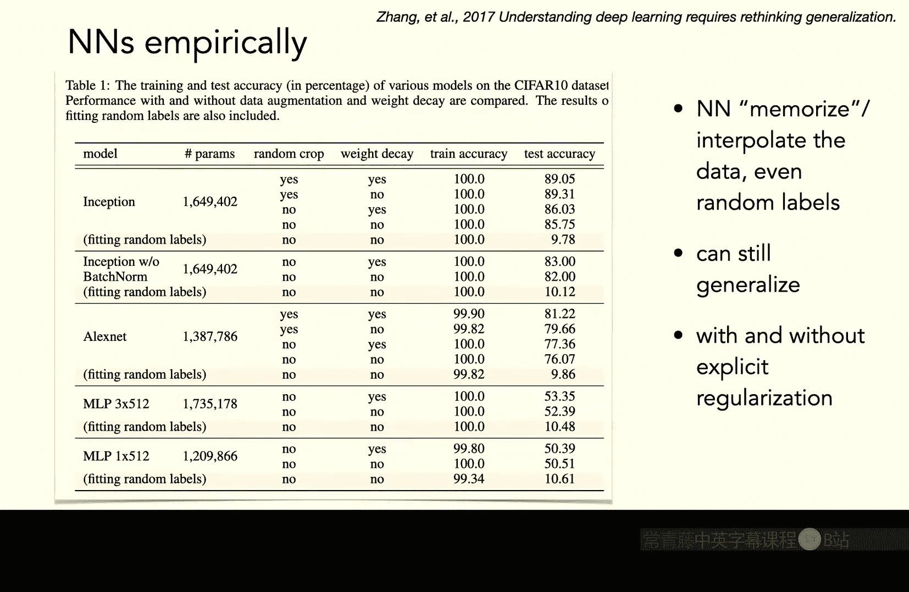

Random labels， Yet when they're trained on real labels， they generalize。

This is the violation of classical theory。Okay， any questions there。

I think we had a few so we can go back to the slides where you had them if you still have them。Yeah。

Yeah， dichotomy is a labeling， a binary labeling of all of the training data points。

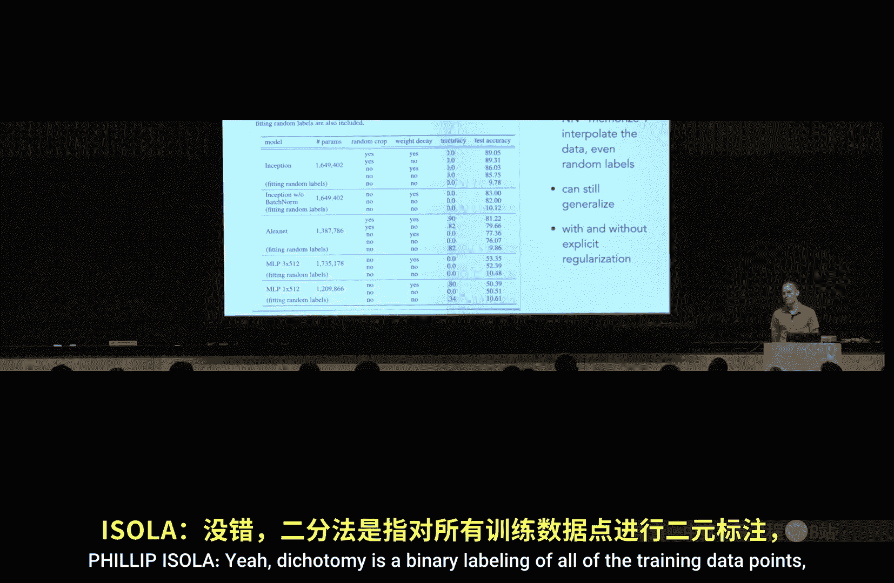

So a vector of。Assignments of the turning points to you know，0 or one， negative one or one。Okay。Okay。

 so how should we measure model complexity？In the deep learning era。

Should it just be the number of distinct functions a molecule can represent。 No。

 because deep nets can represent a huge number of functions and so many functions that the classical bounds on that tell us how capacity it relates to generalization don't hold。

 They would say that this is like way too high capacity of model。 There must be some other thing。

 There must be something else that is。Helping us to find solutions that generalize rather than solutions that don't generalize。

Okay， and unfortunately， I have to say that for deep learning， which we really don't know what it is。

 It's still an open question。 There's a lot of papers。 You know， there's a lot of new ideas on this。

 I'm not saying that we don't know anything， but a lot of the classical tools aren't working in this era。

 And it's a great thing to， for us to try to make progress on。😊，Okay， so let， I'm gonna。

Use the final section to talk about some of the inductive biases and pressures that do lead deep nets to find solutions that generalize that give us some。

 some inkling of where the theory might go。And some practical tips。 But the recap so far is that。

Empirically， deep nets generalize。They can make reasonable predictions。

 often accurate predictions on inputs that are not in their training data。

 And you can even show this for。Large language models and things where they've been trend in so so much data。

 But you can just make a accounting argument that they still can't possibly be just memorizing。

 They have to be doing some generalization。O， in generalization。

 just from first principles requires some kind of inductive bias。

 You have to have something that rules out the filing cabinet。

Only fitting the training data cannot fully explain generalization because you can fit the training data by just memorizing the training points。

 but not having。Saying anything about the samples in between the out of distribution samples in between the 20 points。

Or sorry， the out of sample。Samples in the test set。Okay。So， the inductive biases。

Can't really just be about classical notions of model capacity。

 like number of parameters or V C dimension， which is number of functions that can be represented by that hypothesis space。

 So we need to understand， what are the inductive biases and how do they relate to meaningful controls on the expressivity and the capacity of the model。

 How do they prefer simple or smooth solutions over other solutions， and how do we measure that。

And this is very much open and ongoing research。So deep nets must have some nice inductive biases。

They must control the complexity in ways we don't fully know how to characterize。

So what are these inductive biases that deep nets have that allow them to generalize。Okay。

 so why do deepnet learn functions that generalize。And the basic questions。

 other than fitting the training data， we understand that。 that's approximation。

 We understand that fitting the training data is critical。

 That's part of the recipe for generalization。 But。

 but there has to be something else other than fitting the training data。

 What are the other pressures that affect the solution that deep nets arrive at。

 There must be some other pressures that affect which of the two solutions that both perfectly fit the training data Does the deep net choose。

 And why does it choose the one that works and not the filing cabinet1。

 which potentially would have the capacity to do in some cases。Okay， so if we fit the training data。

 what's left to consider。 So this purple space is meant to be。

 It's the same space as I showed in purple dots before。

 But I'm gonna give it this name version space。 So the version space is the set of all hypotheses in the hypothesis space。

😊，That fit the， the training data。 So in neural nets， like if I have an MLP。

 the version space is setting the the set of all settings of the parameters。

 the weights and the biases that perfectly interpolate that perfectly fit my training training data that achieves  zero training error。

😊，So some blob within this， the set of， you know， functions I'm searching over。

 which is the set of weights and biases of the MLP。 if that is my model。Okay。So basically。

 the point is that some points in this set are bad and don't generalize and some are good and do generalize。

 Why， why do deep nets find the ones that are good and de generalized to some degree。Okay。

 so these are all kind of ideas that are out there， but are not。

Yet completely like standard or proven， but I think that they're fun to think about。Okay。

 so the first one is。The idea that there's a simplicity bias in what's called the parameter function map。

Okay， the parameter function map。Is remember that we're trying to find functions of the data。

 but we're trying to find them by searching over parameter parameterization of those functions。

 So we have access to the parameters， the weights and biases。

 But every setting of the weights and biases defines actually some mathematical mapping F。😊。

And there might be， you know， some parameter vectors。

 I got two parameter vectors could define the same F， right， like if I have。

I have a network which is just。诶。Adds the bias of one on one layer。

 and then sub practice the bias of one on the next layer， and otherwise its an identity。Well。

 that is equivalent to just a network that adds a bias of 0 and。Then that's the bias of 0， right。

 So plus 1 -1 equals 0。There are a multiplicity。 This is a mini to one mapping， right。

 There's a multiplicity of parameter vectors that all map to the same function。

 So the parameters and the function space are not the same thing。

 And we can look at the parameter function math。😊，And this is what was observed by these authors a few years ago。

 empiricalmly， They didn't prove this， but they've observed it empirically。

If you just sample a random set of parameters。In an MLP or some other neural net models。

Most of them will map to functions F that are simple， according to。This is not number of parameters。

 This is not a number of distinct。 This is not V C dimension。

 This is another one Lmel zip complexity。 It's like saying。You know。

 Lmple zip is one of these compression algorithms。 And I think this is the same。 Like。

 if I run that function F on some data， how well can I compress it with this algorithm。

 So another crazy complexity measure that's hard to understand exactly how that would relate to。😊。

Generalization， but they tried that one。 And so they're saying that。

This is like a probability distribution， I believe。 It's a little hard to interpret this plot， but。

There is high probability of finding。If I take a random parameter vector random setting of the weights and biases in a network。

 most random settings will be will be down here。 It will be higher probability。

 and only a few will be functions will will define functions that are really uncompressible and complex in that particular sense。

Okay， so saying， so here's， here's a way to， look at lot， like an intuitive way of looking at this。

So if we randomly pick a point in the parameter space of the neural network。

This will tend to map toward simple functions。 So imagine that we're organizing this hypothesis based by the simple functions。

 the smooth， compressible functions are down to the left and more complex。

 wiggly incompressible functions are up at the right。😊，So most random samples will be simple。

 And then what it's learning do， Learn just moves our parameters and therefore moves the functions they map to toward the version space。

 It moves you toward the space that fits the data。 And so we'll end up in this little section where we're at the corner of the version space where we have simple functions just by chance。

 because most random initializations in my parameters。😊，Maap to simple functions。

 And most of the volume as I walk through， you know。

 parameter space will also map the simple functions。 And so just by chance。

 we will find a a solution that is simple， in that sense。😊，Okay。So。

I was involved in another paper that that looked at that。

 but looked particularly at a metro of simplicity， which is the rank of the kernels。

 So I'm going to describe what that means。 But we found that there's also this bias in the parameter function map toward solutions that are low rank in a certain sense。

Okay， so heres MLP， W Reello W。And here's a deeper MLP。And one of the classic stories。

 And we'll come back to this in the representation learning lectures。

 one of the classical stories is that shallow nets。

 let's say I'm trying to classify between 10 different classes indicated by the colors。

 and I'm trying to take my data and you map them to a space where they're all linearly separable so I can classify them。

 right。 So the classic story is that deeper nets with more parameters。

 have more capacity to organize the data and separate all those classes。😊，Okay。

So that's the picture here。 We get better linear separation of all these classes at the top of the network。

Now， I'm going to characterize that distribution at the top of the network with a kernel matrix。

 which is going to be the similarity。Between every data point and every other data point。

 So this creates a matrix of bivariate function。And it's called the kernel of my。

Embbeddings that the neural network arrives at。So every row and column is。Every row is a data point。

 and the column is another data point。 And the blue value is the similarity in the representational vectors at the output of that network。

So we'll see these kinds of kernels a few times。 This is kernel that characterizes the representation at the output of the network over the input data。

And if it's kind of block structured like it is here， that means that it's found clusters。So。嗯。

That's like all the red points have grouped together into one block and all the purple points into another block。

 And that's that's good。 So that's kind of what we're looking at， looking for。

 If we want a good organization in my data that's easy to like， classify It's very clustered。

 It will look block structured like this。😊，Okay。So。

The common understanding is that deeper nets have greater capacity to organize the data into this like clustered structure。

 that's easy to then make a prediction on top of to classify。But the interesting thing is。

 if you get rid of the nonlinearities， you actually get the same effect。So just a linear network。

 just a stack of linear layers。Also will result。In a deeper linear net results in more blocky。Clons。

Okay， so we're gonna characterize now the kernel with its rank。 So the rank of that matrix。

Is like how many， you know， linearly independent rows and columns there are。Okay。

 so blocker matrices have lower rank。Lower rank is like I have clustered the data into a simpler format。

And that's useful for classification。So you get the same phenomenon。

 deep linear nets and deep linear nets are equivalent to one linear transformation。

 So that you can't explain this phenomenon as the， the deeper nets have more capacity to organize the data。

So what's going on， The argument that we make in this paper is that。

Products of matrices tend to be low rank。 So again it's like a parameter function math。

If I have a random set of weight matrices。If I have more of them， just it will be。

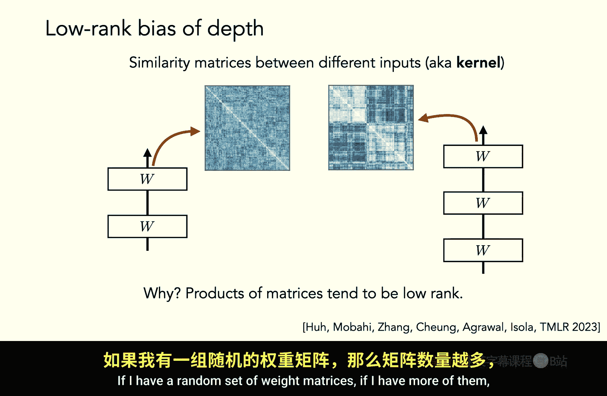

Higher probability that I will。Output vectors whose kernel is lower rank。

So this is a property of like random matrix theory that products of random Gaussian matrices will result in a low rank matrix。

Now， deep nets are not products of random matrices。

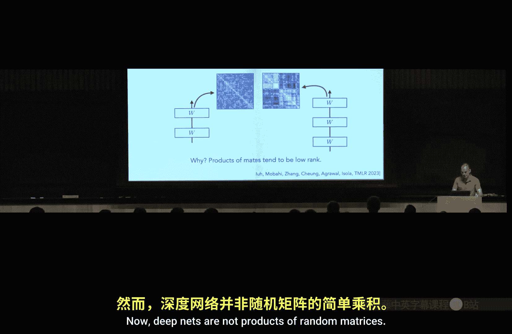

呃。But the， the full argument is that if I'm looking at the weight space of a neural network and I'm sampling a random point。

 if I have a shallow network。Then most random points will be full rank。If I have a deeper network。

Whether it's a linear net or a nonlinear net。I will tend to map to lower rank solutions。

 just by chance。Now， optimization will pick out which， you know。

 which of the parameter vectors actually is in the version space actually fits the data。

But because most of the volume of parameter space is mapping into low， low rank solutions。

 low rank representations of the data。When the network is deep， there'll be this kind of bias。

 There'll be the bias that if I'm， if I'm just searching over some random location。

 I'll tend to be more likely to find low rank solutions and high rank solutions。 And empirically。

 this is what happens。 So a lot of these things are only like kind of provable and。😊。

Analyzable and linear models， but then we can show it empirically in real deep nets。

And what I'm showing here is the， the rank， is's called effective rank。

 It's just really kind of like the rank of the matrix， but it' a slightly different version of it。So。

 higher rank means。You have。These representation of of data that are less clustered in lower rank means like this more clustered like structure。

And。On the y axis is the probability。 these are like probability densities。

 So this is empirical PDFfs， probability densities。呃。

Of if I randomly sample parameters of a neural network of different depths。

 So if I randomly sample the parameters of a depth 16 network， the。

Functions that it maps to will be these functions that map to low rank embes， okay。

I know there's a lot of moving pieces here， but basically deeper nets will be biased toward functions that are simpler in the sense of having lower rank structure。

Okay。So one more way of looking at it。 So this is the。嗯。Rannk， which is in color and in height。

If I'm navigating two different。Dimenssions of my hypothesis space。

 my hypothesis is parameterized by2 my parameter space has you know， a million parameters。

 weights and biases。 But I'm gonna look at just two of them。

And I'm going to chart out as I walk around that space。 what is the effective rank and。

The point here is that as I add depth， so。With a single layer model。

 I will have this kind of narrow ridge of low rank。functionsunctions。

As I navigate my parameter space， but a two layer model， I'll kind of pull that ridge apart。

 And so more volume of the parameter space will map to low rank functions。

And if I combine this with optimization， I'll just， you know。

 more of the solutions will lie in the lowering space as well。Okay。So。Yeah。

 one set of ideas is that deep notes are biased toward simplicity。

 according to Lmhal Ziv or according to the rank of the functions that they learn just because most parameterizations。

 most settings of the parameters map to these simple functions。

Another idea is that actually the optimization dynamics really play a big role here。And that。

I'm not just picking a random solution in my version space。 I'm actually using an optimizer。

 which will prefer some solutions over other solutions。And sometimes I'll have explicit。

Regularizers that prefer simple solutions in my in my optimizer or in my objective function。

And so one of those is called weight decay， it's just saying that。As I optimize all。

Tend to shrink the weights a little bit on each opt update step。

 And this tends to make weights that aren't actually being used。 Go to 0。

 And so I'll end up learning。A set of weight of mineral network， which have lower norm。

 and are simple in that sense。Often， we initialize our weights and biases of our networks in year 0。

 And this acts like a bias toward finding solutions that have， again， low norm solutions。

 low low norm parameter vectors。And then there's a lot of interesting work on the implicit biases of gradient descent and stochastic gradient descent。

 And so one， one idea here is that stochastic gradient descent， Well。

 gradient descent with a fixed step size is kind of descend down。 But let's say that I have a really。

 really sharp。😊，Well in my objective function and my energy landscape。 Well。

 gradient descent can't go into a really sharp well。 if I'm using fixed step sizes。

 it'll just jump right over。 Itll be that well will be too small。

 So what gradient descent with a fixed step size will do is it will tend to find these what are called flat minima。

 So kind of basins， that are low loss。 but are low loss over a kind of。know。

 a large region of the parameter space that I'm searching over。

And these flat minima can be argued to generalize better than these narrow minima。

 The narrow minima might be more like just a weird solution that got lucky。

 but the flat mini is one that will generalize better。Okay。

 so I'm not going to go to all the arguments for， for why that's the case。

 but you can see these papers if you're， if you're interested。

But the optimizer is a critical part of the recipe， too。

 and it can affect the generalization properties。Okay。

 but I think all of what I've said so far is not actually the most important。

 I think the most important is the following two slides is the architectural symmetries。

And we saw these incumbs and graphnets。 And we'll see these in transformers and other models， too。So。

 our architectures。Are built out certain invaris， like if I'm pooling over channels with a max pooling operation。

 I'll be invariant。 And， and my， my filters are like edge detectors。

 I'll be invariant to the orientation of that， that bird's beak。😊。

I'll fire regardless of what the orientation of that ver to speak is。

 So max pooling the chiefs this kind of invariance over the dimension we're maxing over。Okay。嗯。

Eququivaris。 So graph nets and continents have these equal variances。

 if I permute the labeling of the nodes， then I will permute the predictions。Tranlate an equivari。

 If I have a filter and I slide it across the image， then。If I， shift the image by some amount。

 I'll shift my predictions by that same amount。So these。

 these are cemetries that are kind of built into our architectures that cause them to exhibit out of sample generalization。

Because if I know if I just shift my image。And it it will respond in the way it was trained to respond on the unshifted image。

 right， that's， that's what the symmetry gives you。

And then this kind of compositionality I was mentioning before that the con and a lot of architectures。

 they factor this input signal， they maybe chop it up into little little components。

 They learn something about every little component。

 But then the conjunction of components is just given by something that's defined by the architecture is not learned。

 The conjunction of the outputs of these little patchwise filters。

 patchwise predictors is not learned is just you stitch them all back together。😊，Okay。

So I think this is where really the real， the real power and the real explanation of why things like chat GT。

 why they actually do these fe of generalization。 It's not so much in my。 well， I don't know， but。

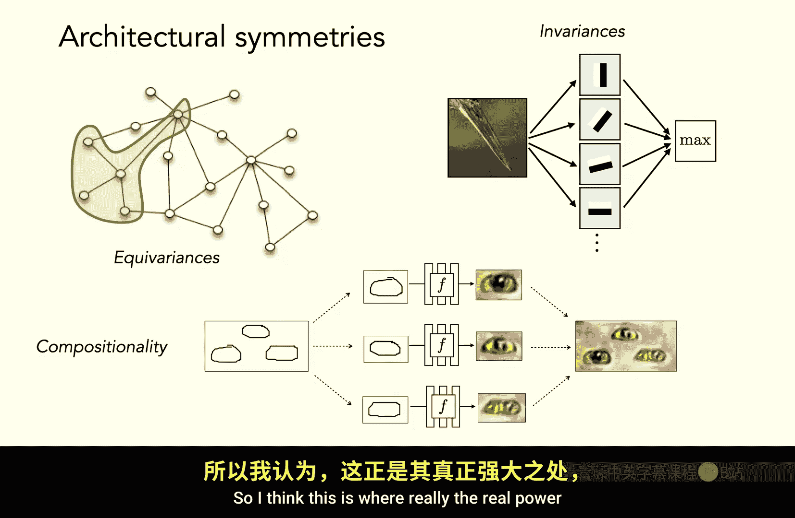

II think it's a lot about， like， it factorizes the world。 It carves the world that destroys。

 It factors this the world into， you know， parcels。

 which are words and sentences and paragraphs and then compositions of these things will。Will。

 will be arrived at not from learning， but from just how the architecture。

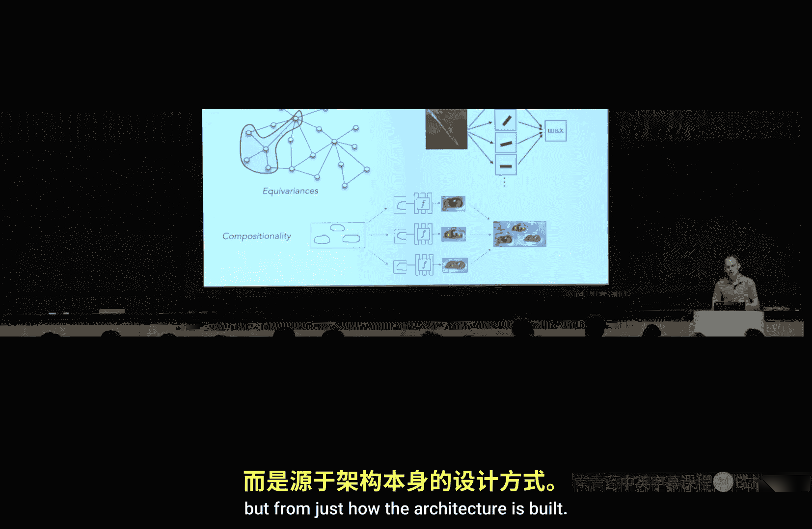

Is built。Okay， and then a lot of neural networks have domain knowledges baked into them。 For example。

 Sarah gave the example of the Nf model， which。You know，' a neural architecture。

 but it it uses equations of perspective geometry projection。

 and it uses equations of light transport， and these are built into the process。

 And so will it'll generalize some new viewpoints because it's using kind of structures。

 It's not just fitting to data， data plus structure， data plus constraints。 And this is a， you know。

 drug discovery， drug prediction problem where they've baked in structure they know about how drugs are supposed to interact with each other And the conjunction of fitting to data under structural constraints is what can allow you to generalize。

Okay， so I want to end with one final point， which is。Well， maybe。

 maybe we can actually go back ultimately to this theory answer。

 The theory answer is that the shortest program that fits the data will be the one that generalizes。

I said it's intractable。 But what if we say we don't have to find the shortest。

 Finding the shortest is intractable。Maybe we don't have to optimize for the shortest program。

 but we can just say a short enough program that fits the data will， will generalize。

And so this is something that I've just kind of come back to you。You know， over the years。

 this is a conversation I had with Elas Suzkiver， who's well known as you know。

 one of the founders of Open AI。And so， he had this thing he said， which is， you know， deep。

 this is not direct quote。 This is just the rough memory。

 deep nets generalized because they find small circuits that fit the data。

And so at the time I didn't quite get。 I was like smallest focus。 What are you talking about。

 deep nets are huge。 Like， don't we need all of these inductive biases and regularizers and simplicity biases。

 Like， that seems critical to understanding deep learning。 And we need to bake those in。

 we need to put those in our models， right。And he said， no， no， no， it's okay。 deep net or finite。

 that's enough。I finite is small。 Anything finite will look small if you have enough data。

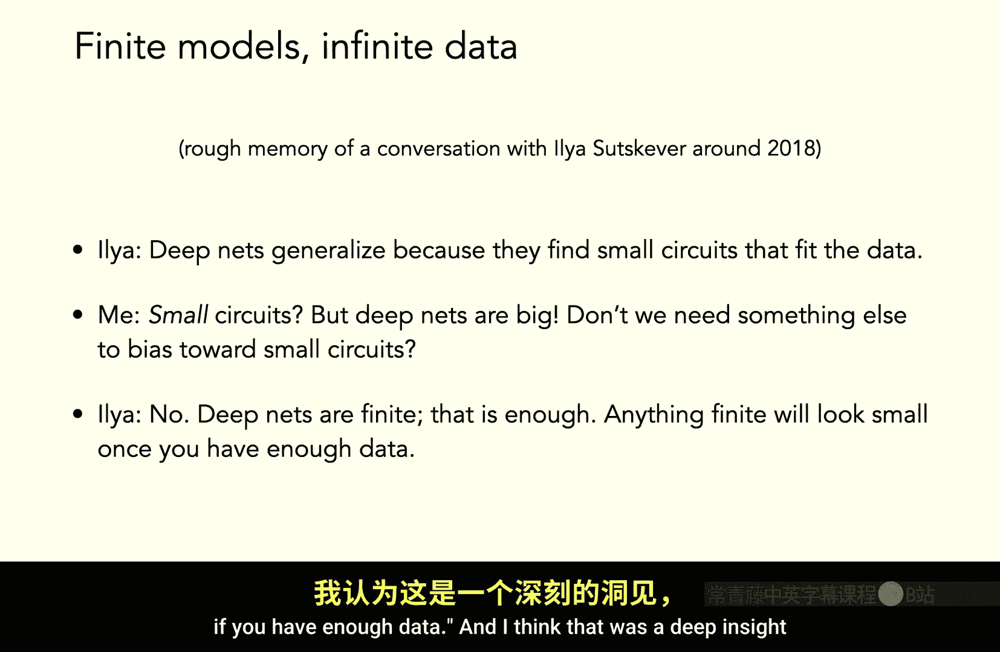

And I think that was a deep insight and maybe LED to some of the success that he's had。 So。

 so I'll end there。Thank you。

